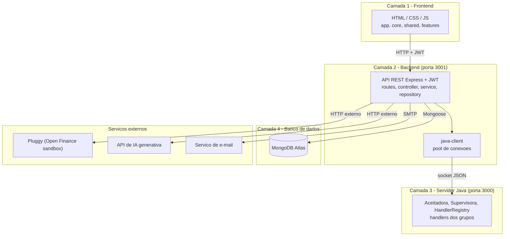
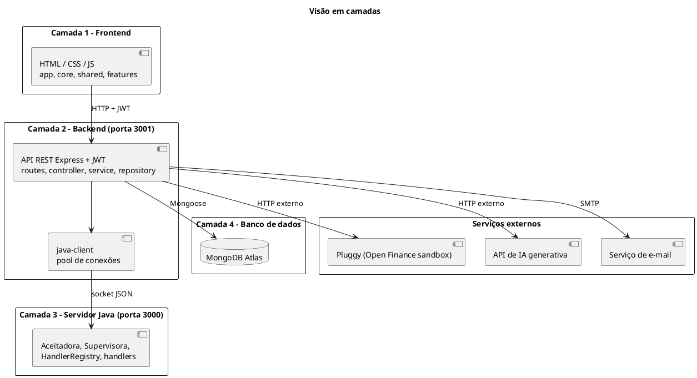
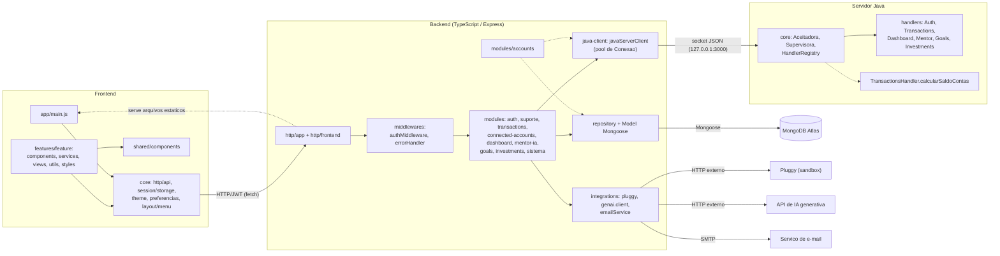
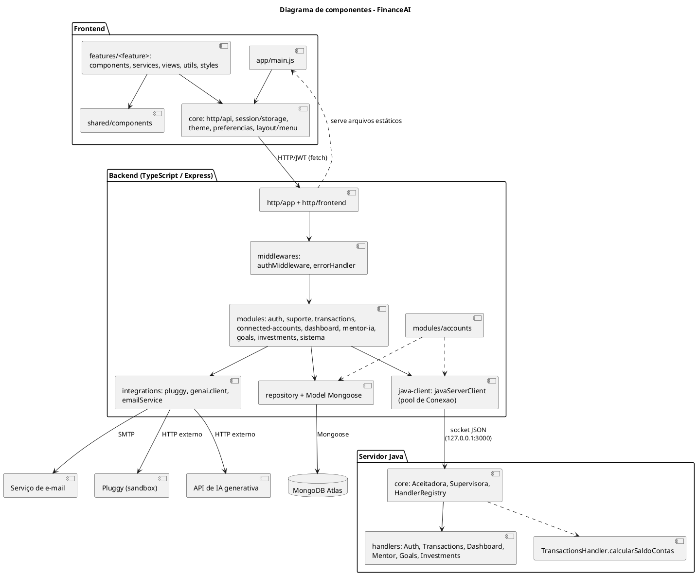
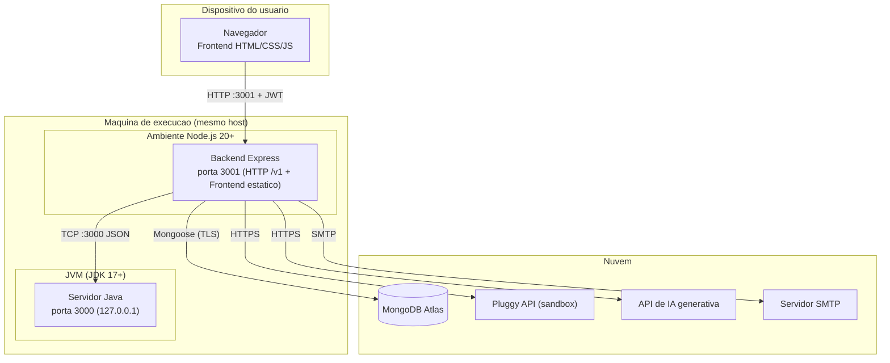
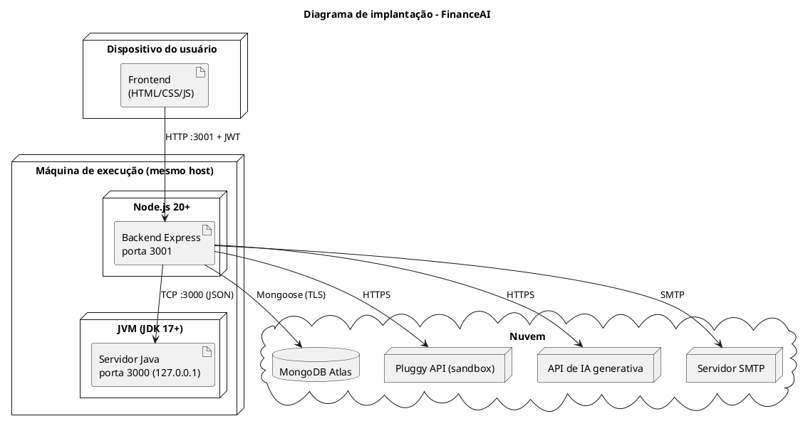
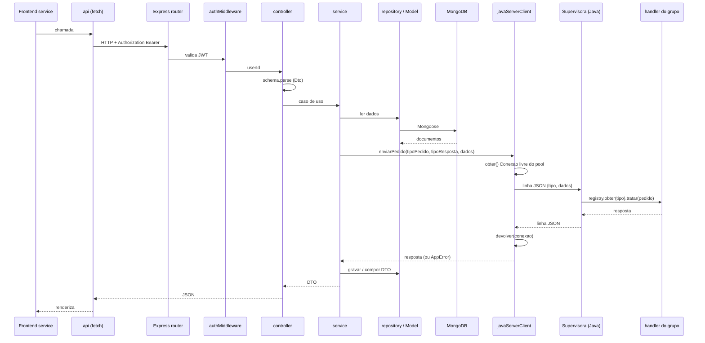
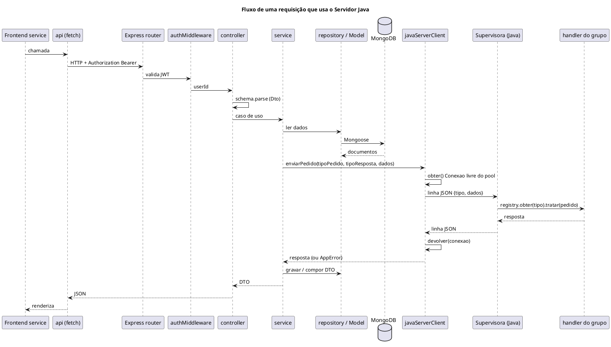

# FinanceAI — Arquitetura

Documento de arquitetura do FinanceAI (ES-PI4-2026-T1-G18), em notação UML 2 (padrão Astah). Cada diagrama aparece em dois blocos: `mermaid` (renderiza no GitHub) e `plantuml` (mesma informação, serve para recriar o diagrama no Astah).


Fontes: seção 1 de [`../organizacao-sprints.md`](../organizacao-sprints.md) e [`../../README.md`](../../README.md).

## 1. Visão em camadas

O sistema tem quatro camadas de código/dados e dois grupos de serviços externos.

| Camada | Tecnologia | Porta | Quem acessa |
|---|---|---|---|
| Frontend | HTML, CSS e JavaScript (sem TypeScript, sem bundler, sem Axios) | servido pelo Backend | Navegador do usuário |
| Backend | TypeScript, Node.js, Express, Mongoose | 3001 | Frontend (HTTP/JWT) |
| Servidor Java | Java, sockets, threads, mensagens JSON | 3000 (só `127.0.0.1`) | Somente o Backend |
| Banco de dados | MongoDB Atlas | — | Somente o Backend (Mongoose) |
| Serviços externos | Pluggy (Open Finance, sandbox), API de IA generativa, serviço de e-mail (SMTP) | — | Somente o Backend |





## 2. Diagrama de componentes

Interfaces entre os componentes: HTTP com JWT (Frontend para Backend), sockets com mensagens JSON em linha (Backend para Servidor Java), Mongoose (Backend para MongoDB) e HTTP externo (Backend para Pluggy e IA).






### Interfaces entre os componentes

| De | Para | Interface | Observação |
|---|---|---|---|
| Frontend (`api`) | Backend | HTTP/JSON com `Authorization: Bearer <JWT>` | `fetch` nativo, sem Axios; rotas sob `/v1` |
| Backend (`javaServerClient`) | Servidor Java | Socket TCP, uma linha JSON `{tipo, dados}` por mensagem | Pool de conexões duradouras, `PedidoXxx`/`RespostaXxx` |
| Backend (`repository`) | MongoDB Atlas | Mongoose (Model/Document) | Único ponto de acesso ao banco |
| Backend (`pluggyClient`) | Pluggy | HTTP externo | Sandbox com instituições fictícias |
| Backend (`genai.client`) | API de IA | HTTP externo | Resposta filtrada depois pelo Servidor Java |
| Backend (`emailService`) | Serviço de e-mail | SMTP | Confirmação de cadastro e recuperação de senha |
| Servidor Java | Backend | Mesma conexão de socket (resposta ou `Erro`) | O Servidor não conhece HTTP: devolve `code` + `message` |

## 3. Diagrama de implantação

O Servidor Java escuta apenas em loopback (`127.0.0.1`), por isso roda na mesma máquina do Backend. O Frontend não tem processo próprio: o Backend entrega os arquivos estáticos em `http://localhost:3001`.





Ordem de subida: Servidor Java (porta 3000), depois o Backend (porta 3001). Teste das camadas juntas: `curl localhost:3001/v1/health` e `POST /v1/eco` (Backend, socket, Servidor Java e volta).

## 4. Responsabilidades de cada camada

**Frontend**
- Telas web e interação do usuário; validação de formulário no cliente.
- Cada `service` de feature chama `api` (`fetch`) com o JWT guardado pela sessão (`storage`).
- Preferências locais (tema, ocultar valores sensíveis). Sem regra de negócio de cálculo.

**Backend (porta 3001)**
- API REST Express sob `/v1`, autenticação por JWT (`authMiddleware` coloca `userId` em `AuthenticatedRequest`).
- CRUD e acesso ao MongoDB via Mongoose (somente nos `repository`).
- Validação com zod (`*Schema` para `*Dto`) nos `controller`; regra de negócio nos `service`.
- Chama serviços externos: Pluggy (`pluggyClient`, `pluggy.mapper`), IA (`genai.client`), e-mail (`emailService`).
- Único cliente do Servidor Java (`javaServerClient`, pool de conexões) e tradutor dos `code` de erro em status HTTP (`error-codes`, `errorHandler`).
- Serve o Frontend (`http/frontend`).
-: módulo `accounts` (`/v1/accounts`, `POST /v1/transactions/transfers`), regra `PLAN_REQUIRED` para conta Open Finance.

**Servidor Java (porta 3000)**
- Operações puras sobre os dados recebidos no pedido: hash e validação de senha (PBKDF2), categorização, indicadores e comparação de períodos, contexto e filtro da IA, progresso de meta, rentabilidade simulada, parcelamentos.
- Não acessa banco, não conhece HTTP, aceita só `127.0.0.1`.
-: cálculo do saldo das contas (`PedidoCalcularSaldoContas`, `TransactionsHandler.calcularSaldoContas`).

**MongoDB Atlas**
- Coleções isoladas por feature: users, pending registrations, transactions, connected_accounts, goals, investments, cards, card installments, chat messages, alerts, suporte;: accounts.
- Acessado só pelo Backend.

**Serviços externos**
- Pluggy: widget de conexão, itens, contas e transações importadas (sandbox).
- API de IA: respostas do Mentor e mensagens proativas.
- E-mail: confirmação de cadastro e recuperação de senha.

## 5. Fluxo de uma requisição que usa o Servidor Java





Detalhe do pool (`javaServerClient`):
- `obter()` pega uma `Conexao` livre, até `env.JAVA_SERVER_POOL_SIZE`. Se não há livre e o pool não está cheio, abre uma nova; senão o pedido espera em fila (`esperando`).
- `Conexao.enviar` escreve `{tipo, dados}` pelo `Parceiro` do Backend (uma linha JSON). No Servidor, a `Supervisora` lê com `Parceiro.envie()`, chama `registry.obter(tipo).tratar(pedido)` e responde com `Parceiro.receba(resposta)`. Os nomes `receba`/`envie` são herdados do exemplo do professor: `receba(x)` manda ao outro lado e `envie()` lê.
- Se a resposta for do tipo `Erro`, o Backend traduz o `code` em status (`statusDoCodigo`, em `error-codes`) e lança `AppError`. Se o tipo for diferente do esperado: `502 JAVA_SERVER_ERROR`.
- Fluxos sem Servidor Java (CRUD puro: listar transações, metas, suporte) terminam no `repository`.

### Robustez

| Situação | Comportamento |
|---|---|
| Timeout por pedido (`JAVA_SERVER_TIMEOUT_MS`) | A conexão é morta (evita resposta desalinhada) |
| `FalhaDeTransporte` | Uma segunda tentativa; depois `503 JAVA_SERVER_UNAVAILABLE` |
| `ComunicadoDeDesligamento` | O Backend descarta a conexão (`503 JAVA_SERVER_SHUTTING_DOWN`) |
| Conexão ociosa por 5 min | O Servidor fecha; o pool reconecta |
| Encerramento do Backend | `javaServerClient.fechar()` manda `PedidoParaSair` em cada conexão |
| Servidor fora do ar na categorização | Categoria cai para `Outros` (RNF05) |

## 6. Decisões de arquitetura

| Decisão | Motivo |
|---|---|
| Servidor Java sem banco de dados | Fica como "fazedor de continhas": operações puras sobre os dados do pedido. O banco e o CRUD ficam no Backend, que é o único dono do MongoDB. Confirmado pelo professor. |
| Mensagens JSON por socket, não serialização nativa | `ObjectOutputStream` só funciona entre programas Java; o Backend é TypeScript. A estrutura de threads (Aceitadora, Supervisora, Parceiro) foi mantida igual à do exemplo. |
| Pool de conexões duradouras no Backend | Evita abrir um socket por pedido; cada conexão atende um pedido por vez (sem mistura de respostas) e o pool limita a concorrência (`JAVA_SERVER_POOL_SIZE`). |
| Uma `Supervisora` por conexão e `HandlerRegistry` | Despacho por tipo de mensagem; cada grupo registra seu handler com uma linha, sem editar o mesmo arquivo. |
| Servidor só em `127.0.0.1` | Só o Backend se conecta; não há exposição externa. |
| Backend serve o Frontend | Uma só origem (`http://localhost:3001`), sem CORS nem bundler; Frontend em HTML/CSS/JS puro. |
| Frontend sem Axios | `fetch` nativo encapsulado em `core/http/api` (com `ApiError`). |
| Erros do Servidor como `code` + `message` | O Servidor não conhece HTTP; o Backend traduz o `code` em status. |
| `repository` é o único que fala com o MongoDB | Camadas `routes`, `controller`, `service`, `repository` por módulo; coleções isoladas por feature. |
| Degradação na categorização | Servidor indisponível não bloqueia o lançamento: categoria `Outros` (RNF05). |

## 7. Estrutura de pastas por camada

**Frontend** (`Frontend/src`)
```
app/                    main.js
core/                   http (api, ApiError), session (storage, login), theme,
                        preferencias, privacy (valores), layout (menu), views (includes)
shared/                 components (Calendario, campos, notificacao, seletor,
                        dateRange, entrada, moeda, rolagem)
features/<feature>/     components, services, views, utils, styles
                        (auth/Perfil, transactions, contas-conectadas, dashboard,
                         mentor-ia, goals, investments)
```

**Backend** (`Backend/src`)
```
config/                 env (variáveis validadas com zod)
database/               mongo.connection
shared/errors/          app-error, error-codes
java-client/            Comunicado, Parceiro, javaServerClient (pool)
http/                   app, server, frontend
middlewares/            auth.middleware, error-handler.middleware
integrations/           pluggy (pluggyClient, pluggy.mapper), genai.client, emailService
modules/                index.ts (monta os routers sob /v1)
  sistema/              /v1/health e /v1/eco
  auth/  suporte/  transactions/  connected-accounts/
  dashboard/  mentor-ia/  goals/  investments/
  accounts/            
```
Cada módulo: `routes`, `controller`, `service`, `repository`, `model`, `dto`.

**Servidor Java** (`Servidor/src/main/java/com/financeai`)
```
Main.java               porta padrão 3000; sobe Aceitadora e lê o console
core/                   Comunicado, Parceiro, Aceitadora, Supervisora,
                        HandlerRegistry, Handler, ErroDeNegocio, EcoHandler, Teclado
auth/                   AuthHandler, PedidoHashSenha, PedidoValidarSenha (+ Respostas)
transactions/           TransactionsHandler, PedidoCategorizarTransacao (+ Resposta);
                        PedidoCalcularSaldoContas (+ Resposta)
dashboard/              DashboardHandler, PedidoCalcularIndicadores, PedidoCompararPeriodos
mentoria/               MentorHandler, FiltroDeAtivos, FiltroDeEscopo,
                        PedidoMontarContextoIA, PedidoFiltrarResposta
goals/                  GoalsHandler, PedidoProgressoMeta
investments/            InvestmentsHandler, PedidoRentabilidadeSimulada,
                        PedidoCalcularParcelamentos
```

**Banco de dados (MongoDB Atlas)**: coleções users, pending registrations, transactions, connected_accounts, goals, investments, cards, card installments, chat messages, alerts, suporte e,, accounts.
