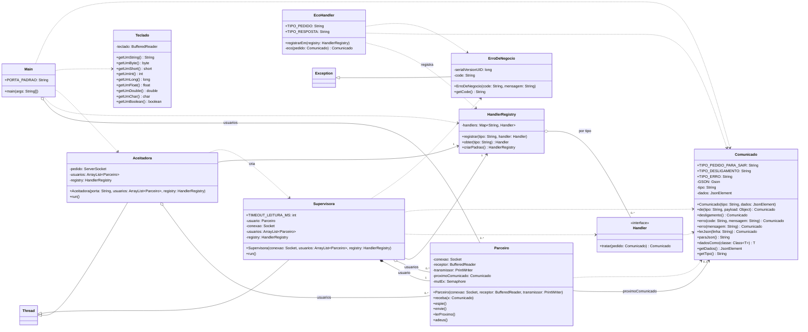
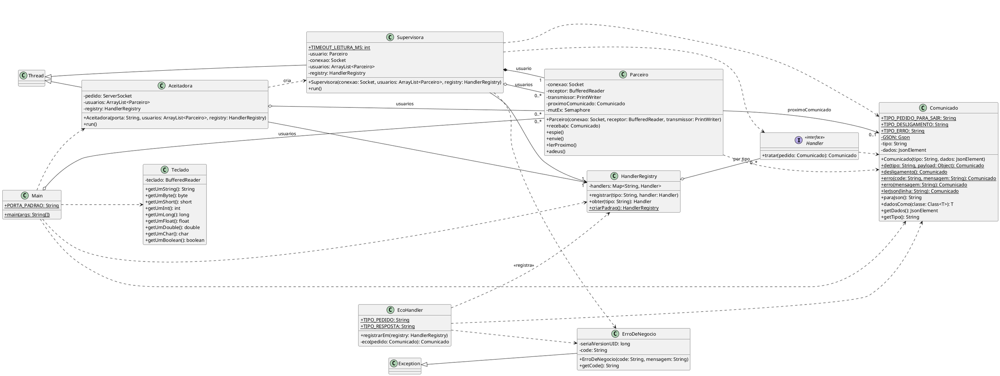
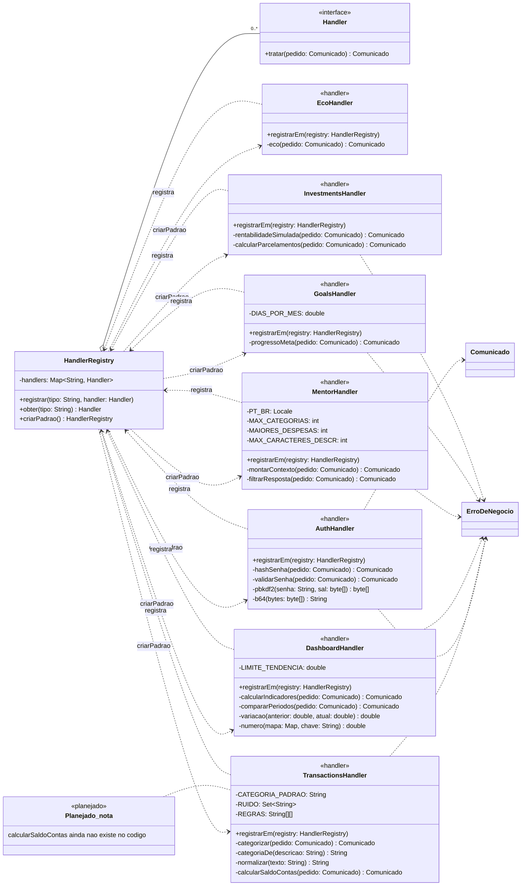
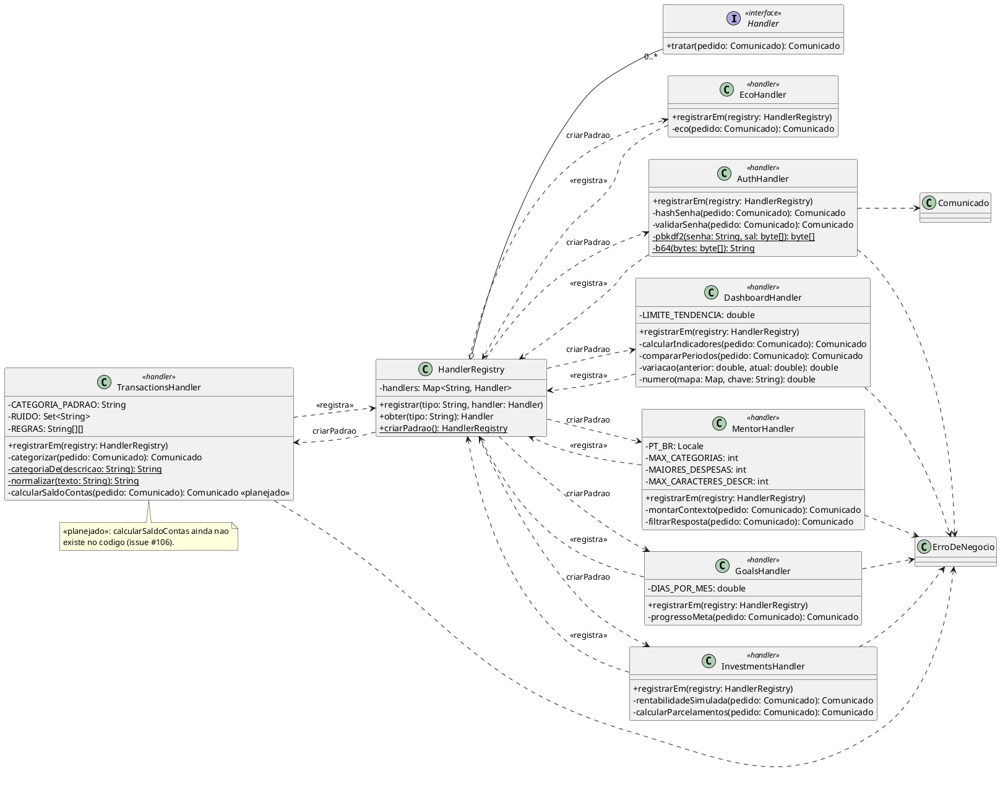
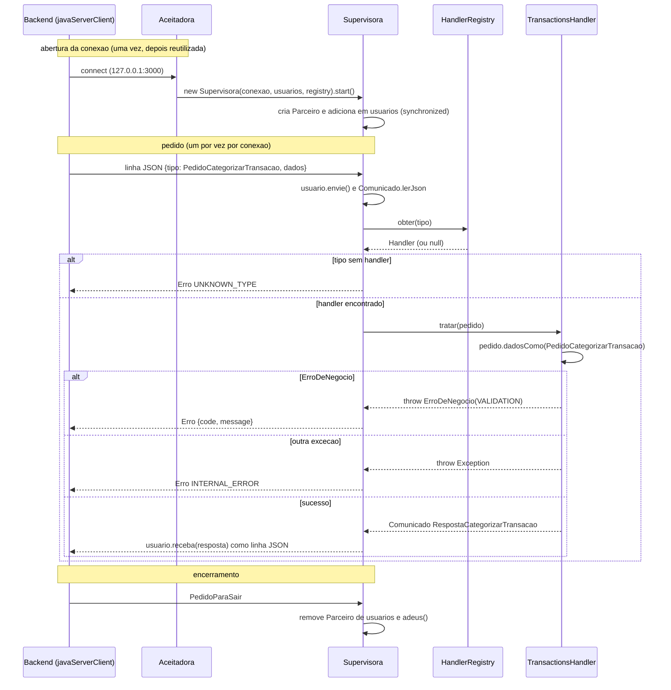
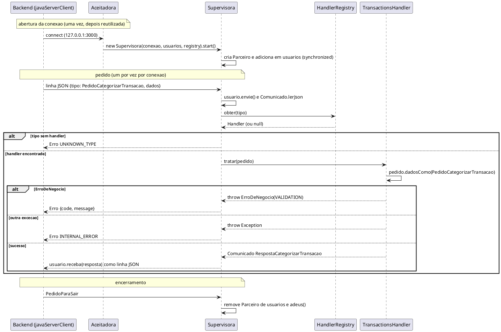
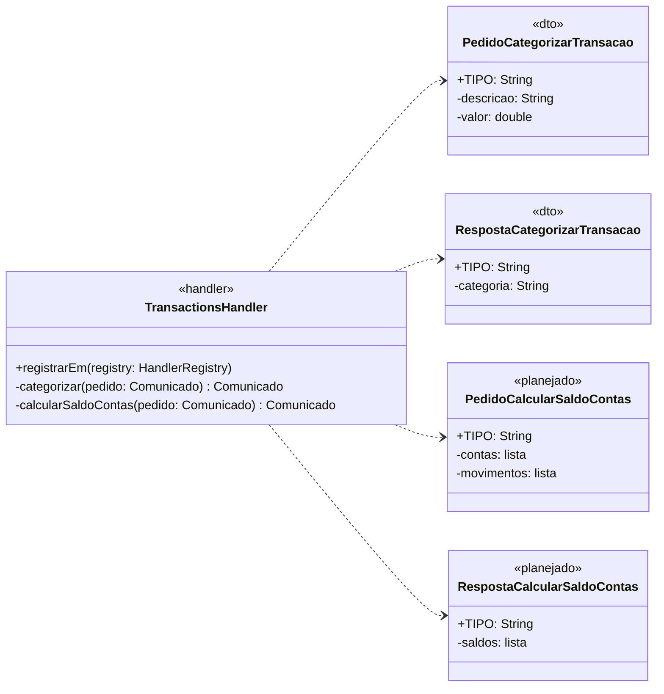
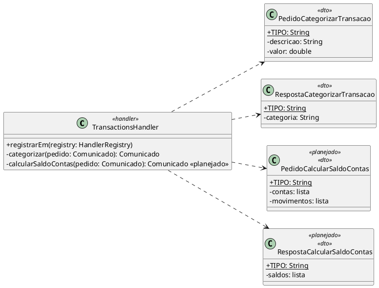

# Estrutura do Servidor Java

Notação UML 2 (padrão Astah). Visibilidade: `+` público, `-` privado, `#` protegido, `~` pacote. Estereótipos em «aspas angulares» no texto; nos blocos Mermaid e PlantUML aparecem como `<<estereótipo>>`. Elementos «planejado» ainda não existem no código. Cada diagrama aparece em dois blocos (Mermaid, que renderiza no GitHub, e PlantUML, que serve para recriá-lo no Astah).

Fontes: `Servidor/src/main/java/com/financeai` e `Servidor/README.md`.

## 1. Visão geral

```
Frontend --HTTP (REST)--> Backend (Express, :3001) --socket TCP, JSON por linha--> Servidor Java (:3000, só 127.0.0.1)
                          (CRUD, MongoDB, JWT)                                      (operações puras, sem banco)
```

O Servidor é um executor de operações: o Backend manda os dados no pedido, o Servidor calcula e devolve o resultado. Não acessa banco e não guarda estado entre pedidos. É a adaptação do "Fazedor de Continhas" do professor, com conversa em JSON e despacho por registro de handlers.

## 2. Pacotes e responsabilidades

Pacote raiz `com.financeai` (`Servidor/src/main/java`), um subpacote por grupo. No Astah, um pacote por subpacote.

| Pacote | Classes | Responsabilidade |
|---|---|---|
| `com.financeai` | `Main` | `PORTA_PADRAO = "3000"`. Cria `ArrayList<Parceiro> usuarios`, monta `HandlerRegistry.criarPadrao()`, inicia a `Aceitadora` e lê o console com `Teclado`. O comando `desativar` envia `ComunicadoDeDesligamento` a cada `Parceiro` e encerra. |
| `com.financeai.core` | `Comunicado`, `Parceiro`, `Aceitadora`, `Supervisora`, `Handler` «interface», `HandlerRegistry`, `ErroDeNegocio`, `EcoHandler`, `Teclado` | Infraestrutura do professor adaptada para JSON: envelope, conexão, threads e despacho. |
| `com.financeai.auth` | `AuthHandler`, `PedidoHashSenha`, `RespostaHashSenha`, `PedidoValidarSenha`, `RespostaValidarSenha` | Hash e validação de senha (PBKDF2-HMAC-SHA256, 120.000 iterações). MFA (`PedidoGerarSegredoMFA`, `PedidoValidarMFA`) só documentado em `exemplo/`, sem classe. |
| `com.financeai.transactions` | `TransactionsHandler`, `PedidoCategorizarTransacao`, `RespostaCategorizarTransacao` | Categorização por palavras-chave. «planejado»: `PedidoCalcularSaldoContas`, `RespostaCalcularSaldoContas` e o método `calcularSaldoContas`. |
| `com.financeai.dashboard` | `DashboardHandler` + 4 mensagens | Indicadores (saldo, economia, fluxo de caixa) e comparação de períodos. |
| `com.financeai.mentoria` | `MentorHandler`, `FiltroDeAtivos`, `FiltroDeEscopo`, 4 mensagens (`PedidoMontarContextoIA` com a classe aninhada `Transacao`) | Contexto da IA em texto e filtro da resposta (sem recomendação de ativo, sem fora de escopo). |
| `com.financeai.goals` | `GoalsHandler`, `PedidoProgressoMeta`, `RespostaProgressoMeta` | Progresso de meta. |
| `com.financeai.investments` | `InvestmentsHandler` + 4 mensagens | Rentabilidade simulada (juros compostos) e parcelamentos (Tabela Price). |

### Padrão de cada handler de grupo

- A classe não tem herança e **não implementa `Handler` diretamente**.
- Tem `+ registrarEm(registry: HandlerRegistry)` e métodos privados com a assinatura de `Handler.tratar`, registrados por method reference: `registry.registrar(PedidoHashSenha.TIPO, this::hashSenha)`. Assim a realização de `Handler` é feita pelo method reference.
- Cada `PedidoXxx`/`RespostaXxx` é um POJO (DTO) com a constante `TIPO`, desserializado por `Comunicado.dadosComo(Classe)`. Não estende `Comunicado` no código (o documento de arquitetura diz que estende; ver divergências no `00-README.md`). Na UML é dependência, não generalização.
- Cada grupo adiciona uma linha em `HandlerRegistry.criarPadrao()`: `new XxxHandler().registrarEm(registry)`.

## 3. Arquitetura de threads

| Elemento | Papel |
|---|---|
| `Main` (thread principal) | Sobe a `Aceitadora` e fica no laço de console (`Teclado`); `desativar` avisa todos os `Parceiro` e encerra. |
| `Aceitadora` «extends Thread» | Abre `ServerSocket` em `127.0.0.1:porta` e, em laço, faz `accept()` criando uma `Supervisora` por conexão. Recebe a lista compartilhada `usuarios` e o `HandlerRegistry`. |
| `Supervisora` «extends Thread» | Uma por conexão duradoura do pool do Backend. `TIMEOUT_LEITURA_MS = 300000` (5 min ociosos fecham a conexão; o Backend reconecta). Cria o `Parceiro`, adiciona em `usuarios` (bloco `synchronized`), e em laço lê o pedido, obtém o `Handler` pelo `tipo` e responde. `ErroDeNegocio` vira `Comunicado.erro(code, message)`; outra exceção vira `INTERNAL_ERROR` (detalhe só no log); tipo sem handler vira `UNKNOWN_TYPE`; `PedidoParaSair` remove o `Parceiro` da lista e fecha. |
| `Parceiro` | Encapsula `Socket`, `BufferedReader` e `PrintWriter`. `receba(Comunicado)` escreve uma linha JSON (protegido por `Semaphore mutEx`); `envie()` lê o próximo; `espie()` olha sem consumir; `adeus()` fecha. |
| `HandlerRegistry` | `Map<String, Handler>` por `tipo`. `registrar` recusa tipo duplicado (`IllegalStateException`); `obter` devolve `null` se não houver. |

Observação sobre nomes: `Parceiro` herdou do exemplo do professor nomes invertidos. `receba(x)` **manda** `x` ao outro lado e `envie()` **lê** o próximo comunicado. Foi mantido por fidelidade ao material.

Concorrência: cada conexão atende **um pedido por vez** (envia o pedido, lê a resposta); pedidos simultâneos usam conexões diferentes, cada uma com a sua `Supervisora`. Por isso não há ID de correlação. As operações são puras e sem estado compartilhado, exceto a lista `usuarios`, acessada sempre em `synchronized`.

## 4. Protocolo JSON

### Envelope

Uma mensagem por linha, UTF-8:

```json
{"tipo":"PedidoCategorizarTransacao","dados":{"descricao":"UBER EATS *PEDIDO","valor":54.9}}
```

| Campo | Tipo | Descrição |
|---|---|---|
| `tipo` | `String` | Nome da mensagem (obrigatório; ausente ou em branco gera `IllegalArgumentException`). |
| `dados` | `JsonElement` | Conteúdo; se ausente vira `{}`. |

### Pedido e Resposta

- Pedido (Backend -> Servidor): `tipo = "PedidoXxx"`, `dados` com os "operandos".
- Resposta (Servidor -> Backend): `tipo = "RespostaXxx"` (um `tipo` diferente do esperado é tratado pelo Backend como 502 `JAVA_SERVER_ERROR`).
- Tipos de controle: `PedidoParaSair` (Backend -> Servidor, encerra a conexão), `ComunicadoDeDesligamento` (Servidor -> Backend, ao digitar `desativar`), `Erro`.

### Erros de negócio

```json
{"tipo":"Erro","dados":{"code":"VALIDATION","message":"..."}}
```

| `code` | Origem |
|---|---|
| `VALIDATION` | `ErroDeNegocio` lançado pelos handlers (campo ausente, valor inválido). |
| `UNKNOWN_TYPE` | `Supervisora`: `tipo` sem handler no registro. |
| `INTERNAL_ERROR` | `Supervisora`: exceção inesperada (mensagem genérica) e `Comunicado.erro(mensagem)`. |
| `TESTE_NEGOCIO` | `EcoHandler` com `{"falhar":"negocio"}` (teste). |

O Servidor não envia status HTTP: o Backend deduz o status a partir do `code` (`shared/errors/error-codes.ts`).

## 5. Mensagens por grupo e handlers

| Grupo | Pedido -> Resposta | Handler (método) | Situação |
|---|---|---|---|
| Teste | `PedidoEco` -> `RespostaEco` | `EcoHandler.eco` | implementado |
| 1 Autenticação | `PedidoHashSenha` -> `RespostaHashSenha` | `AuthHandler.hashSenha` | implementado |
| 1 Autenticação | `PedidoValidarSenha` -> `RespostaValidarSenha` | `AuthHandler.validarSenha` | implementado |
| 1 Autenticação | `PedidoGerarSegredoMFA` -> `RespostaGerarSegredoMFA`; `PedidoValidarMFA` -> `RespostaValidarMFA` | (nenhum) | só documentado (`exemplo/`) |
| 2 Transações | `PedidoCategorizarTransacao` -> `RespostaCategorizarTransacao` | `TransactionsHandler.categorizar` | implementado |
| 2 Transações | `PedidoCalcularSaldoContas` -> `RespostaCalcularSaldoContas` | `TransactionsHandler.calcularSaldoContas` | «planejado» (issue #106) |
| 3 Painel | `PedidoCalcularIndicadores` -> `RespostaCalcularIndicadores` | `DashboardHandler.calcularIndicadores` | implementado |
| 3 Painel | `PedidoCompararPeriodos` -> `RespostaCompararPeriodos` | `DashboardHandler.compararPeriodos` | implementado |
| 4 Mentor IA | `PedidoMontarContextoIA` -> `RespostaMontarContextoIA` | `MentorHandler.montarContexto` | implementado |
| 4 Mentor IA | `PedidoFiltrarResposta` -> `RespostaFiltrarResposta` | `MentorHandler.filtrarResposta` | implementado |
| 5 Metas | `PedidoProgressoMeta` -> `RespostaProgressoMeta` | `GoalsHandler.progressoMeta` | implementado |
| 5 Investimentos | `PedidoRentabilidadeSimulada` -> `RespostaRentabilidadeSimulada` | `InvestmentsHandler.rentabilidadeSimulada` | implementado (sem tela) |
| 5 Investimentos | `PedidoCalcularParcelamentos` -> `RespostaCalcularParcelamentos` | `InvestmentsHandler.calcularParcelamentos` | implementado |

Campos principais das mensagens (conforme os `.java`):

| Mensagem | Atributos |
|---|---|
| `PedidoHashSenha` | `senha: String` |
| `RespostaHashSenha` | `hash: String` |
| `PedidoValidarSenha` | `senha: String`, `hash: String` |
| `RespostaValidarSenha` | `valido: boolean` |
| `PedidoCategorizarTransacao` | `descricao: String`, `valor: double` |
| `RespostaCategorizarTransacao` | `categoria: String` |
| `PedidoCalcularSaldoContas` «planejado» | contas (com `saldoInicial`) e movimentos; nomes exatos a definir com o Backend |
| `RespostaCalcularSaldoContas` «planejado» | saldo atual de cada conta |
| `PedidoCalcularIndicadores` | `receitas: double`, `despesas: double` |
| `RespostaCalcularIndicadores` | `saldo`, `economia`, `fluxoDeCaixa` (`double`) |
| `PedidoCompararPeriodos` | `periodos: List<Map<String,Object>>` |
| `RespostaCompararPeriodos` | `periodos: List<Map<String,Object>>`, `tendenciaDespesas: String` |
| `PedidoMontarContextoIA` | `diaDoMes: int`, `transacoes: List<Transacao>` |
| `PedidoMontarContextoIA.Transacao` | `tipo`, `valor`, `categoria`, `descricao`, `data` |
| `RespostaMontarContextoIA` | `contexto: String` |
| `PedidoFiltrarResposta` | `resposta: String` |
| `RespostaFiltrarResposta` | `respostaFiltrada: String` |
| `PedidoProgressoMeta` | `valorAtual`, `valorObjetivo: double`, `prazo: String`, `hoje: String` (opcional) |
| `RespostaProgressoMeta` | `percentual`, `falta`, `aporteMensalNecessario: double`; `concluida`, `noPrazo: boolean`; `diasRestantes`, `mesesRestantes: int` |
| `PedidoRentabilidadeSimulada` | `ativos: List<Map<String,Object>>`, `meses: Integer` |
| `RespostaRentabilidadeSimulada` | `ativos`, `totalInvestido`, `patrimonio`, `rendimento`, `rentabilidade` |
| `PedidoCalcularParcelamentos` | `parcelamentos: List<Map<String,Object>>` |
| `RespostaCalcularParcelamentos` | `parcelamentos`, `totalParcelasDoMes`, `totalSaldoDevedor`, `totalJuros` |

## 6. Diagrama de classes: núcleo (core) e Main





## 7. Diagrama de classes: registro dos handlers

Os handlers de grupo não implementam `Handler`: registram métodos privados por method reference em `registrarEm`. A dependência «registra» substitui a realização.





As mensagens (`PedidoXxx`/`RespostaXxx`) de cada grupo são detalhadas em `04-diagrama-de-classes-servidor.md`; os atributos estão na tabela da seção 5.

## 8. Diagrama de sequência: um pedido

Exemplo com a categorização (`PedidoCategorizarTransacao`); vale para qualquer mensagem. A conexão já existe (duradoura, do pool do Backend), então a `Supervisora` já foi criada pela `Aceitadora` na abertura.





## 9. Planejado: `PedidoCalcularSaldoContas` «planejado»

Ainda não existe como `.java` (issue #106; ver `docs/especificacao-contas-e-transferencias.md`, seção 5). Operação pura, como as demais: o Backend lê contas e movimentos no MongoDB e manda tudo no pedido; o Servidor devolve o saldo atual de cada conta.

| Item | Descrição |
|---|---|
| Pedido | `PedidoCalcularSaldoContas`: contas (cada uma com `saldoInicial`) e movimentos (receitas, despesas e transferências). Nomes exatos a definir com o Backend. |
| Resposta | `RespostaCalcularSaldoContas`: saldo atual de cada conta. |
| Handler | `TransactionsHandler.calcularSaldoContas` «planejado». |
| Regra (RN2, RN6, RN9) | `saldoAtual = saldoInicial + receitas - despesas ± transferências`; a transferência subtrai da conta de origem e soma na de destino. O saldo é sempre calculado, nunca gravado. |
| Chamador | Backend (`GET /accounts` e a criação de transferência). |




