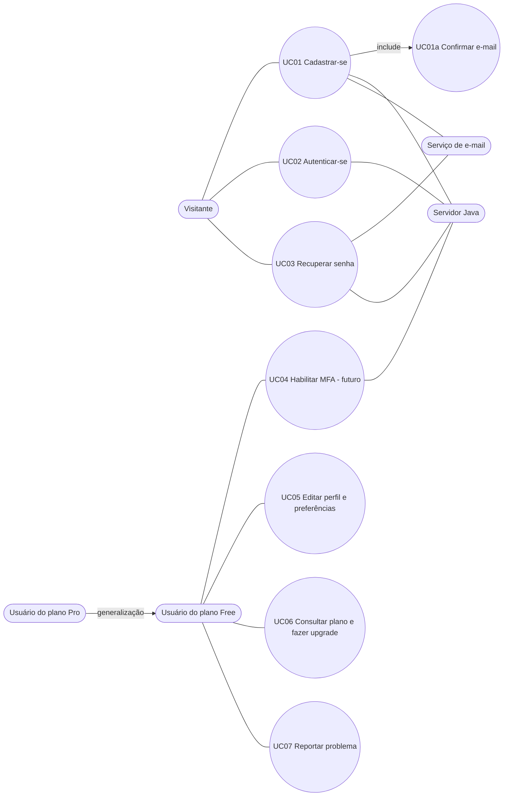
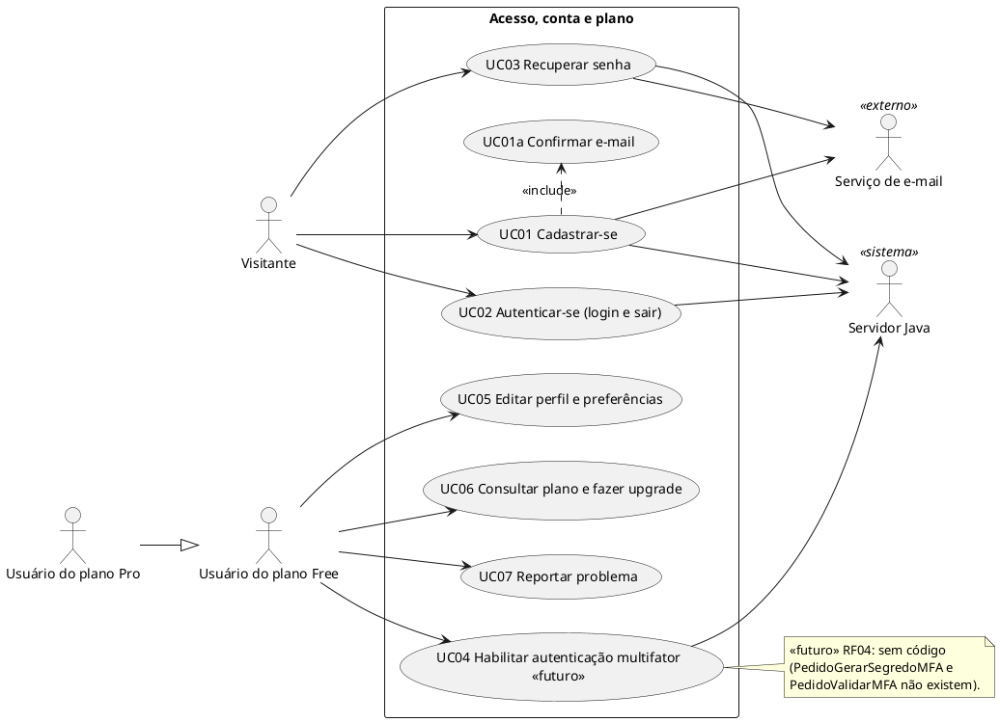
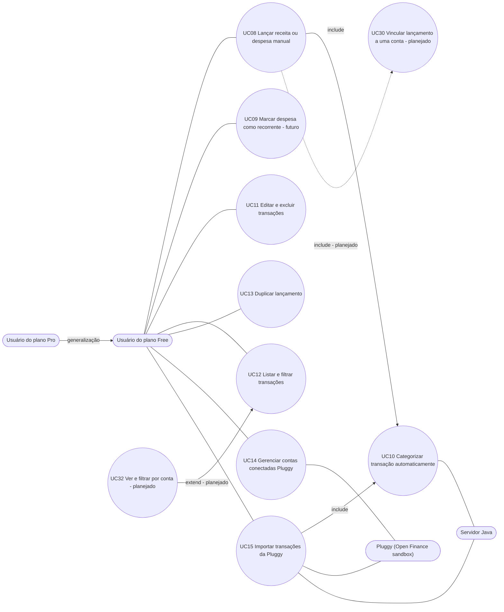
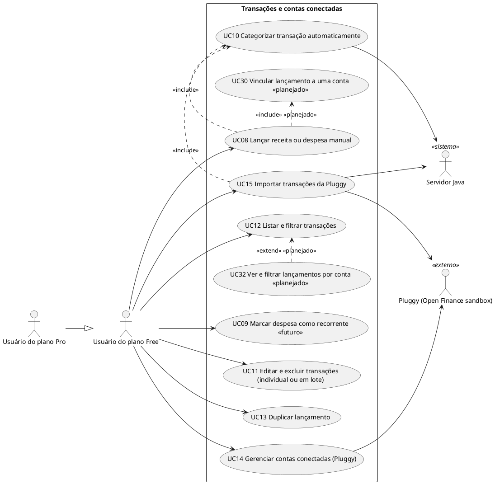
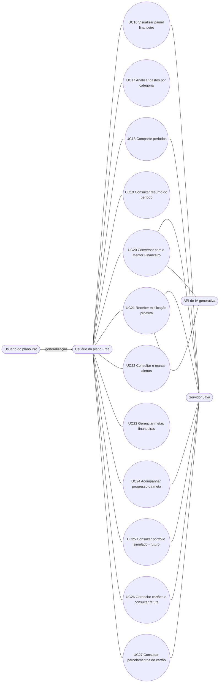
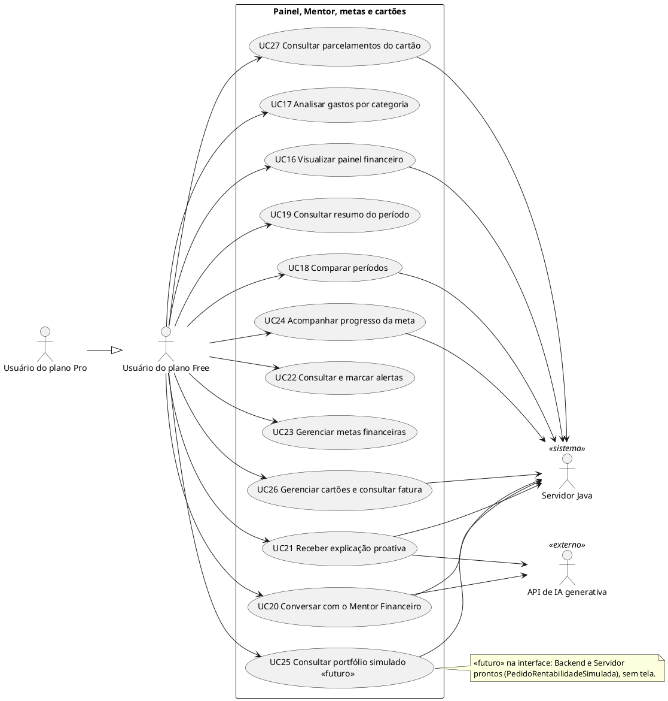
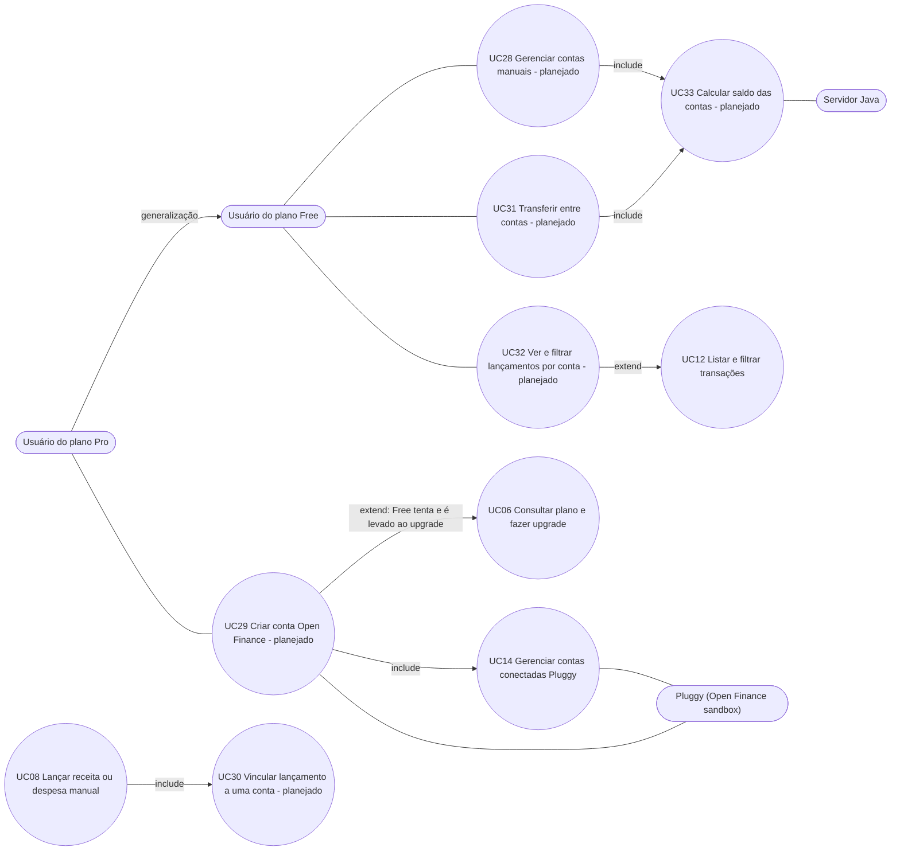
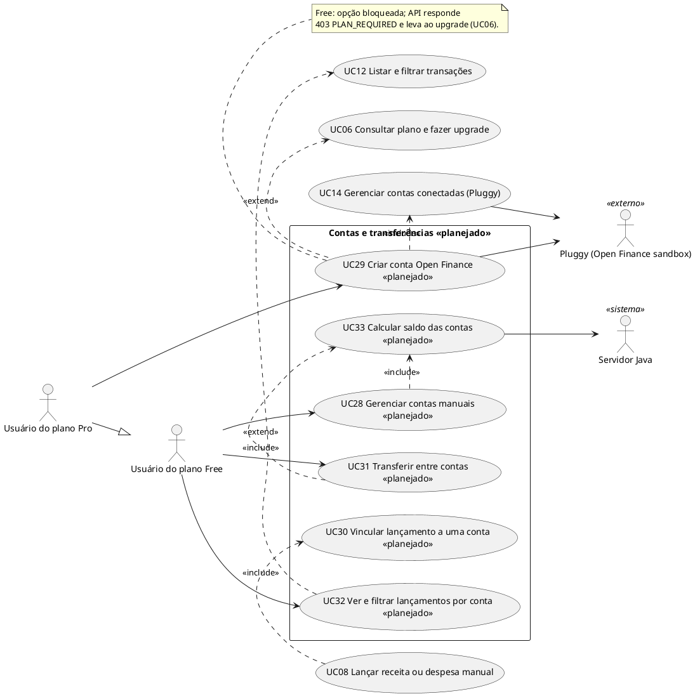

# Casos de uso — FinanceAI

Modelagem de casos de uso (UML 2, padrão Astah) do FinanceAI. Fontes: `docs/documento-de-visao.md` (requisitos RF01 a RF42) e `docs/especificacao-contas-e-transferencias.md` (contas e transferências, issues #101 a #115).

Legenda de estado:

- sem marca: caso de uso já existente no código;
- «planejado»: ainda não existe no código (contas e transferências, Sprint 5);
- «futuro»: feature futura, sem código ou sem interface (RF04, RF08, RF25 e RF26).

> O Mermaid não possui diagrama de casos de uso. Cada diagrama abaixo aparece em dois blocos: um `flowchart` Mermaid (renderiza no GitHub, com atores em losango arredondado e casos de uso em elipse) e o PlantUML equivalente, que serve para recriar o diagrama no Astah. Nos blocos Mermaid e PlantUML os estereótipos aparecem sem as aspas angulares (include, extend, planejado, futuro) por limitação de sintaxe.

## 1. Atores

| Ator | Tipo | Descrição |
|---|---|---|
| Visitante | Primário | Pessoa ainda não autenticada. Cria a conta (RF01), confirma o e-mail, faz login (RF02) e recupera a senha (RF03). Depois do login passa a ser Usuário do plano Free ou Pro. |
| Usuário do plano Free | Primário (ator-base) | Usuário autenticado com plano `free` (`UserModel.plano`). Usa os casos de uso do núcleo: transações, painel, Mentor, metas, cartões, perfil, suporte e, quando implementado, contas manuais e transferências. |
| Usuário do plano Pro | Primário (especialização) | Generalização do Usuário do plano Free: herda todos os casos de uso e é o único que pode criar uma conta Open Finance pela Pluggy (RF39, RN3; «planejado»). No Astah: seta de generalização Usuário do plano Pro -> Usuário do plano Free. |
| Servidor Java | Secundário (sistema) | Processo separado que recebe pedidos JSON por socket e devolve o resultado de operações puras: hash e validação de senha, categorização, indicadores e comparação de períodos, contexto e filtro da IA, progresso de meta, rentabilidade simulada, parcelamentos e, «planejado», saldo das contas (`PedidoCalcularSaldoContas`). Não acessa banco. |
| Pluggy (Open Finance sandbox) | Secundário (externo) | Provedor de Open Finance em sandbox (instituições fictícias). Fornece o widget de conexão, os itens, as contas e as transações importadas (RF09, RF34) e, «planejado», o saldo somente leitura das contas Open Finance (RN3). |
| API de IA generativa | Secundário (externo) | Acessada pelo `genai.client` do Backend. Gera as respostas do chat do Mentor (RF19) e as mensagens proativas (RF20), sempre filtradas depois pelo Servidor Java para não recomendar ativos (RF22). |
| Serviço de e-mail | Secundário (externo) | SMTP usado pelo `emailService`. Envia o e-mail de confirmação do cadastro (`PendingRegistrationModel` / `verifyEmail`) e o de recuperação de senha (RF01, RF03). |

## 2. Diagramas de casos de uso

O diagrama completo ficaria ilegível; por isso ele é dividido em quatro grupos de features. O Usuário do plano Pro herda os casos de uso do Usuário do plano Free em todos os grupos.

### 2.1 Grupo A — Acesso, conta e plano (UC01 a UC07)

### 2.2 Grupo B — Transações e contas conectadas Pluggy (UC08 a UC15)

### 2.3 Grupo C — Painel, Mentor, metas e cartões (UC16 a UC27)

### 2.4 Grupo D — Contas e transferências «planejado» (UC28 a UC33)

Todo o grupo é «planejado» (ver `especificacao-contas-e-transferencias.md`).

> Nota sobre a direção do «extend» de UC29: o plano define que o upgrade (UC06) é o ponto de extensão usado por UC29 quando o Free tenta criar conta Open Finance. Na convenção UML a seta do extend sai do caso que estende; aqui o comportamento extra (convite ao upgrade) é disparado a partir de UC29, e por isso a seta é desenhada de UC29 para UC06 e documentada no fluxo alternativo A1 de UC29.

## 3. Rastreabilidade UC x RF

| UC | RF relacionados | Estado |
|---|---|---|
| UC01, UC01a | RF01, RF30, RNF01 | existente |
| UC02 | RF02, RF30, RNF02 | existente |
| UC03 | RF03 | existente |
| UC04 | RF04 | «futuro» |
| UC05 | RF05, RF28, RF29 | existente |
| UC06 | RF31 | existente |
| UC07 | RF32 | existente |
| UC08 | RF06, RF07 | existente |
| UC09 | RF08 | «futuro» |
| UC10 | RF10, RNF05 | existente |
| UC11 | RF10, RNF06 | existente |
| UC12 | RF12, RNF06 | existente |
| UC13 | RF33 | existente (ação no Frontend pendente) |
| UC14 | RF34 | existente |
| UC15 | RF09, RF10 | existente |
| UC16 | RF13, RF14 | existente |
| UC17 | RF15, RF16, RF35 | existente |
| UC18 | RF17 | existente |
| UC19 | RF18 | existente |
| UC20 | RF19, RF22 | existente |
| UC21 | RF20, RF22 | existente |
| UC22 | RF21 | existente |
| UC23 | RF23 | existente |
| UC24 | RF24 | existente |
| UC25 | RF25, RF26 | «futuro» |
| UC26 | RF27 | existente |
| UC27 | RF36 | existente |
| UC28 | RF37, RF38, RF39 | «planejado» |
| UC29 | RF39, RN3 | «planejado» |
| UC30 | RF40, RN4, RN5 | «planejado» |
| UC31 | RF41, RN6, RN7, RN9 | «planejado» |
| UC32 | RF42 | «planejado» |
| UC33 | RF38, RN2, RN9 | «planejado» |

## 4. Descrições textuais (formato Astah)

Convenção: RN refere-se às regras de negócio da `especificacao-contas-e-transferencias.md`. Os fluxos descrevem o comportamento a partir do plano de modelagem; detalhes de tela e de rota estão em `contrato-api.md`.

### Grupo A — Acesso, conta e plano

#### UC01 — Cadastrar-se

| Campo | Conteúdo |
|---|---|
| ID | UC01 |
| Nome | Cadastrar-se |
| Ator principal | Visitante |
| Atores secundários | Servidor Java; Serviço de e-mail |
| Pré-condições | O visitante não está autenticado e o e-mail e o CPF ainda não pertencem a um usuário. |
| Fluxo principal | 1. O visitante informa nome, e-mail, CPF e senha. 2. O Backend valida os dados (`registerSchema`, `validarCPF`). 3. O Backend envia `PedidoHashSenha` ao Servidor Java e recebe o hash e o sal. 4. O Backend grava o cadastro pendente (`PendingRegistrationModel`). 5. O Backend envia o e-mail de confirmação pelo Serviço de e-mail. 6. O sistema informa que a confirmação foi enviada. «include» UC01a. |
| Fluxos alternativos | A1. Dados inválidos (campo vazio, CPF inválido, senha fora da regra): o Backend responde 400 e a tela mostra o erro. A2. E-mail ou CPF já cadastrado: o cadastro é recusado com mensagem. A3. Servidor Java indisponível: o Backend responde 503 e o cadastro não é feito. A4. Falha no envio do e-mail: o erro é informado ao visitante. |
| Pós-condições | Existe um cadastro pendente com a senha em hash, aguardando a confirmação do e-mail. |
| Requisitos relacionados | RF01, RF30, RNF01 |

#### UC01a — Confirmar e-mail

| Campo | Conteúdo |
|---|---|
| ID | UC01a (incluído por UC01) |
| Nome | Confirmar e-mail |
| Ator principal | Visitante |
| Atores secundários | Serviço de e-mail |
| Pré-condições | Existe um cadastro pendente e o visitante recebeu o link de confirmação. |
| Fluxo principal | 1. O visitante abre o link recebido por e-mail. 2. O Backend executa `verifyEmail`, localiza o cadastro pendente e cria o `UserModel`. 3. O cadastro pendente é removido. 4. A tela informa que a conta está ativa e leva ao login. |
| Fluxos alternativos | A1. Link inválido ou expirado: o Backend recusa e a tela informa o problema. |
| Pós-condições | O usuário existe com plano `free` e pode fazer login. |
| Requisitos relacionados | RF01 |

#### UC02 — Autenticar-se (login e sair)

| Campo | Conteúdo |
|---|---|
| ID | UC02 |
| Nome | Autenticar-se (login e sair) |
| Ator principal | Visitante |
| Atores secundários | Servidor Java |
| Pré-condições | O usuário já confirmou o e-mail (UC01a). |
| Fluxo principal | 1. O visitante informa e-mail e senha. 2. O Backend busca o usuário pelo e-mail. 3. O Backend envia `PedidoValidarSenha` ao Servidor Java. 4. Com `valido = true`, o Backend gera o JWT e devolve `{token, usuario}`. 5. O Frontend guarda a sessão no storage e abre o painel. 6. Em toda rota privada o `authMiddleware` valida o JWT. 7. Para sair, o Frontend apaga a sessão do storage. |
| Fluxos alternativos | A1. Dados inválidos: 400 `VALIDATION_ERROR`. A2. E-mail inexistente ou senha incorreta: 401 `INVALID_CREDENTIALS`. A3. Servidor Java fora do ar: 503 `JAVA_SERVER_UNAVAILABLE`. A4. Token ausente ou inválido em rota privada: 401 `UNAUTHENTICATED`. |
| Pós-condições | Com sucesso, o usuário tem sessão válida; ao sair, a sessão local é apagada. |
| Requisitos relacionados | RF02, RF30, RNF02 |

#### UC03 — Recuperar senha

| Campo | Conteúdo |
|---|---|
| ID | UC03 |
| Nome | Recuperar senha |
| Ator principal | Visitante |
| Atores secundários | Serviço de e-mail; Servidor Java |
| Pré-condições | O e-mail informado pertence a um usuário cadastrado. |
| Fluxo principal | 1. O visitante pede a recuperação (`forgotPassword`) informando o e-mail. 2. O Backend envia o link de redefinição pelo Serviço de e-mail. 3. O visitante abre o link e informa a nova senha (`resetPassword`). 4. O Backend pede o hash ao Servidor Java e grava a nova senha. 5. A tela leva ao login. |
| Fluxos alternativos | A1. Link inválido ou expirado: a redefinição é recusada. A2. Senha fora da regra: 400 e a tela mostra o erro. A3. Servidor Java indisponível: 503. |
| Pós-condições | A senha do usuário é substituída pelo novo hash. |
| Requisitos relacionados | RF03 |

#### UC04 — Habilitar autenticação multifator «futuro»

| Campo | Conteúdo |
|---|---|
| ID | UC04 |
| Nome | Habilitar autenticação multifator |
| Ator principal | Usuário do plano Free |
| Atores secundários | Servidor Java |
| Pré-condições | Usuário autenticado. Feature futura: não há código (só a pasta `mfa` com exemplo; `PedidoGerarSegredoMFA` e `PedidoValidarMFA` não existem). |
| Fluxo principal | 1. O usuário pede para habilitar o MFA. 2. O sistema gera o segredo (previsto no Servidor Java) e o exibe. 3. O usuário confirma com um código. 4. O sistema marca `mfaEnabled` no usuário. |
| Fluxos alternativos | A1. Código incorreto: a habilitação não é concluída. |
| Pós-condições | Previstas: `mfaEnabled` verdadeiro e login em duas etapas. |
| Requisitos relacionados | RF04 |

#### UC05 — Editar perfil e preferências

| Campo | Conteúdo |
|---|---|
| ID | UC05 |
| Nome | Editar perfil e preferências |
| Ator principal | Usuário do plano Free |
| Atores secundários | — |
| Pré-condições | Usuário autenticado. |
| Fluxo principal | 1. O usuário abre o Perfil. 2. Altera os dados do perfil; o Backend valida com `atualizarPerfilSchema` e grava. 3. Altera as preferências locais: tema claro/escuro (`theme`) e ocultar valores sensíveis (`valores` / `preferencias`). 4. O Frontend aplica as preferências imediatamente. |
| Fluxos alternativos | A1. Dados inválidos: 400 e a tela mostra o erro. |
| Pós-condições | Perfil atualizado e preferências aplicadas. |
| Requisitos relacionados | RF05, RF28, RF29 |

#### UC06 — Consultar plano e fazer upgrade

| Campo | Conteúdo |
|---|---|
| ID | UC06 |
| Nome | Consultar plano e fazer upgrade |
| Ator principal | Usuário do plano Free |
| Atores secundários | — |
| Pré-condições | Usuário autenticado. |
| Fluxo principal | 1. O usuário abre a tela PlanoConta e vê o plano atual (Free ou Pro). 2. Escolhe trocar de plano. 3. O Frontend chama `authService.atualizarPlano` e o Backend grava o novo plano. 4. A tela mostra o plano atualizado. |
| Fluxos alternativos | A1. Falha na troca: a tela mostra o erro e o plano não muda. A2. Ponto de extensão: UC29 leva a este caso de uso quando o Free tenta criar conta Open Finance «planejado». |
| Pós-condições | O plano do usuário (`UserModel.plano`) reflete a escolha. |
| Requisitos relacionados | RF31 |

#### UC07 — Reportar problema

| Campo | Conteúdo |
|---|---|
| ID | UC07 |
| Nome | Reportar problema |
| Ator principal | Usuário do plano Free |
| Atores secundários | — |
| Pré-condições | Usuário autenticado. |
| Fluxo principal | 1. O usuário abre ReportarProblema e descreve o problema. 2. O Frontend envia `POST /v1/suporte`. 3. O Backend valida (`criarSuporteSchema`) e grava na coleção de suporte. 4. A tela confirma o envio. |
| Fluxos alternativos | A1. Dados inválidos: 400 e a tela mostra o erro. |
| Pós-condições | O relato fica registrado na coleção de suporte. |
| Requisitos relacionados | RF32 |

### Grupo B — Transações e contas conectadas

#### UC08 — Lançar receita ou despesa manual

| Campo | Conteúdo |
|---|---|
| ID | UC08 |
| Nome | Lançar receita ou despesa manual |
| Ator principal | Usuário do plano Free |
| Atores secundários | Servidor Java (via UC10) |
| Pré-condições | Usuário autenticado. «planejado»: ter pelo menos uma conta (UC30, RN4). |
| Fluxo principal | 1. O usuário abre Lançamento e escolhe Nova receita ou Nova despesa. 2. Receita: informa descrição, valor, data e categoria. Despesa: acrescenta forma de pagamento, observações, meta, cartão e parcelas. 3. O formulário valida no cliente (`formValidation`). 4. O Frontend envia `POST /v1/transactions`; o Backend valida (`createTransactionSchema`). 5. Se a categoria está em branco, «include» UC10. 6. Para crédito parcelado, o Backend monta as parcelas e o vínculo com o cartão. 7. O Backend grava e responde 201; a lista e o resumo são atualizados e uma notificação é exibida. 8. «planejado»: «include» UC30 exige a conta (`contaId`). |
| Fluxos alternativos | A1. Dados inválidos: 400 `VALIDATION_ERROR`. A2. Token inválido: 401 `UNAUTHENTICATED`. A3. Servidor Java indisponível na categorização: a categoria fica "Outros" (RNF05). A4. «planejado»: sem nenhuma conta, o botão Lançamento leva a UC28 e a API responde 422 `ACCOUNT_REQUIRED`. |
| Pós-condições | A transação existe no MongoDB com origem `manual` e aparece na lista. |
| Requisitos relacionados | RF06, RF07 |

#### UC09 — Marcar despesa como recorrente «futuro»

| Campo | Conteúdo |
|---|---|
| ID | UC09 |
| Nome | Marcar despesa como recorrente |
| Ator principal | Usuário do plano Free |
| Atores secundários | — |
| Pré-condições | Usuário autenticado. Feature futura: sem issue nem código. |
| Fluxo principal | 1. O usuário marca uma despesa como recorrente (fixa mensal). 2. O sistema guarda a recorrência (previsto). |
| Fluxos alternativos | Não definidos (feature futura). |
| Pós-condições | Previstas: a despesa fica marcada como recorrente. |
| Requisitos relacionados | RF08 |

#### UC10 — Categorizar transação automaticamente

| Campo | Conteúdo |
|---|---|
| ID | UC10 (incluído por UC08, UC15 e pela sugestão de categoria) |
| Nome | Categorizar transação automaticamente |
| Ator principal | Servidor Java |
| Atores secundários | — |
| Pré-condições | Existe uma transação (ou descrição) sem categoria: lançamento manual sem categoria, transação importada ou chamada a `POST /transactions/suggest-category`. |
| Fluxo principal | 1. O Backend envia `PedidoCategorizarTransacao` ao Servidor Java. 2. O `TransactionsHandler` categoriza por palavras-chave. 3. O Servidor devolve `RespostaCategorizarTransacao` com a categoria. 4. O Backend usa a categoria na transação. |
| Fluxos alternativos | A1. Servidor Java fora do ar ou com falha: a categoria fica "Outros" (RNF05). |
| Pós-condições | A transação tem categoria definida. |
| Requisitos relacionados | RF10, RNF05 |

#### UC11 — Editar e excluir transações (individual ou em lote)

| Campo | Conteúdo |
|---|---|
| ID | UC11 |
| Nome | Editar e excluir transações (individual ou em lote) |
| Ator principal | Usuário do plano Free |
| Atores secundários | — |
| Pré-condições | Usuário autenticado e transação existente (manual ou importada). |
| Fluxo principal | 1. O usuário edita um campo, inclusive na própria célula (`EdicaoCelula`), ou abre o detalhe e altera os campos. 2. O Backend valida (`updateTransactionSchema`) e grava. 3. Para excluir, o usuário confirma e o Backend remove. 4. Em lote, o usuário seleciona até 100 itens e aplica a edição ou a exclusão (`bulkUpdateSchema`, `bulkDeleteSchema`). 5. A lista é atualizada. |
| Fluxos alternativos | A1. Lote com mais de 100 itens: 400. A2. Transação inexistente ou de outro usuário: erro de não encontrada. A3. Dados inválidos: 400. |
| Pós-condições | As transações ficam alteradas ou removidas. |
| Requisitos relacionados | RF10, RNF06 |

#### UC12 — Listar e filtrar transações

| Campo | Conteúdo |
|---|---|
| ID | UC12 |
| Nome | Listar e filtrar transações |
| Ator principal | Usuário do plano Free |
| Atores secundários | — |
| Pré-condições | Usuário autenticado. |
| Fluxo principal | 1. O usuário abre Transações. 2. O Frontend chama `GET /v1/transactions` com paginação. 3. O usuário aplica filtros por descrição, categoria, período, faixa de valor, forma de pagamento, meta e origem, abertos no cabeçalho das colunas (a faixa de filtros saiu). 4. A lista mostra as transações e os totais (receitas, despesas e saldo) em um cartão com fundo escuro. |
| Fluxos alternativos | A1. Nenhum resultado: a lista mostra o estado vazio. A2. Filtro inválido: 400. |
| Pós-condições | Nenhuma alteração de dados. |
| Requisitos relacionados | RF12, RNF06 |

#### UC13 — Duplicar lançamento

| Campo | Conteúdo |
|---|---|
| ID | UC13 |
| Nome | Duplicar lançamento |
| Ator principal | Usuário do plano Free |
| Atores secundários | — |
| Pré-condições | Existe um lançamento do usuário. O Backend está pronto; a ação no Frontend é pendente segundo o documento de visão. |
| Fluxo principal | 1. O usuário escolhe duplicar um lançamento. 2. O Frontend envia `POST /transactions/:id/duplicate` (`duplicateTransactionSchema`). 3. O Backend cria uma cópia e responde com ela. 4. A lista é atualizada. |
| Fluxos alternativos | A1. Lançamento inexistente: erro de não encontrado. A2. Dados inválidos: 400. |
| Pós-condições | Existe uma nova transação copiada da original. |
| Requisitos relacionados | RF33 |

#### UC14 — Gerenciar contas conectadas (Pluggy)

| Campo | Conteúdo |
|---|---|
| ID | UC14 |
| Nome | Gerenciar contas conectadas (Pluggy) |
| Ator principal | Usuário do plano Free |
| Atores secundários | Pluggy (Open Finance sandbox) |
| Pré-condições | Usuário autenticado. |
| Fluxo principal | 1. O usuário abre Contas Conectadas e vê a lista. 2. Para conectar, abre o widget `pluggyConnect`, escolhe a instituição fictícia e conclui. 3. O Backend grava a conta conectada (`connected_accounts`). 4. Para desconectar, o usuário confirma e o Backend remove a conexão. «planejado»: passa a ser o fluxo de UC29 e fica restrito ao plano Pro para contas novas. |
| Fluxos alternativos | A1. Falha na Pluggy: a tela mostra o erro (`erros`). A2. Usuário cancela o widget: nada é gravado. |
| Pós-condições | A lista de contas conectadas reflete a conexão ou a desconexão. |
| Requisitos relacionados | RF34 |

#### UC15 — Importar transações da Pluggy

| Campo | Conteúdo |
|---|---|
| ID | UC15 |
| Nome | Importar transações da Pluggy |
| Ator principal | Usuário do plano Free |
| Atores secundários | Pluggy (Open Finance sandbox); Servidor Java |
| Pré-condições | Existe uma conta conectada (UC14). |
| Fluxo principal | 1. O usuário aciona a sincronização da conta conectada. 2. O Backend lê as transações pela Pluggy. 3. O `pluggy.mapper` gera `TransacaoParaImportar` e ignora as inválidas. 4. «include» UC10 categoriza as importadas. 5. O Backend grava as transações com origem `pluggy` e devolve o `ResultadoImportacao`. |
| Fluxos alternativos | A1. Transação inválida: ignorada e contada no resultado. A2. Pluggy indisponível: erro ao usuário. A3. Servidor Java fora do ar: categoria "Outros". |
| Pós-condições | As transações importadas ficam na lista, com origem `pluggy`. |
| Requisitos relacionados | RF09, RF10 |

### Grupo C — Painel, Mentor, metas e cartões

#### UC16 — Visualizar painel financeiro

| Campo | Conteúdo |
|---|---|
| ID | UC16 |
| Nome | Visualizar painel financeiro |
| Ator principal | Usuário do plano Free |
| Atores secundários | Servidor Java |
| Pré-condições | Usuário autenticado. |
| Fluxo principal | 1. O usuário abre a tela inicial. 2. O Backend lê as transações e envia `PedidoCalcularIndicadores` ao Servidor Java. 3. O painel mostra saldo em contas, gastos do mês, economia acumulada, fluxo de caixa e as transações recentes. «planejado»: transferências ficam fora dos totais (RN6, issue #107). |
| Fluxos alternativos | A1. Servidor Java indisponível: 503 e o painel mostra o erro. A2. Sem transações: o painel mostra valores zerados. |
| Pós-condições | Nenhuma alteração de dados. |
| Requisitos relacionados | RF13, RF14 |

#### UC17 — Analisar gastos por categoria

| Campo | Conteúdo |
|---|---|
| ID | UC17 |
| Nome | Analisar gastos por categoria |
| Ator principal | Usuário do plano Free |
| Atores secundários | — |
| Pré-condições | Usuário autenticado. |
| Fluxo principal | 1. O usuário escolhe um período. 2. O sistema mostra a distribuição dos gastos por categoria e por grupo de categorias. 3. O usuário expande uma categoria para ver as transações que a compõem. |
| Fluxos alternativos | A1. Sem gastos no período: estado vazio. |
| Pós-condições | Nenhuma alteração de dados. |
| Requisitos relacionados | RF15, RF16, RF35 |

#### UC18 — Comparar períodos

| Campo | Conteúdo |
|---|---|
| ID | UC18 |
| Nome | Comparar períodos |
| Ator principal | Usuário do plano Free |
| Atores secundários | Servidor Java |
| Pré-condições | Usuário autenticado. |
| Fluxo principal | 1. O usuário escolhe o tipo de comparação (mensal, últimos 6 meses ou YTD, `TipoPeriodoComparacao`). 2. O Backend envia `PedidoCompararPeriodos` ao Servidor Java. 3. A tela mostra receitas e despesas comparadas entre os períodos. |
| Fluxos alternativos | A1. Servidor Java indisponível: 503. |
| Pós-condições | Nenhuma alteração de dados. |
| Requisitos relacionados | RF17 |

#### UC19 — Consultar resumo do período

| Campo | Conteúdo |
|---|---|
| ID | UC19 |
| Nome | Consultar resumo do período |
| Ator principal | Usuário do plano Free |
| Atores secundários | — |
| Pré-condições | Usuário autenticado. |
| Fluxo principal | 1. O usuário seleciona o período. 2. O sistema mostra total gasto, categoria de maior peso, número de transações e média diária (`TransactionSummaryDto` / `DashboardSummaryDto`). «planejado»: ignora transferências. |
| Fluxos alternativos | A1. Sem transações no período: valores zerados. |
| Pós-condições | Nenhuma alteração de dados. |
| Requisitos relacionados | RF18 |

#### UC20 — Conversar com o Mentor Financeiro

| Campo | Conteúdo |
|---|---|
| ID | UC20 |
| Nome | Conversar com o Mentor Financeiro |
| Ator principal | Usuário do plano Free |
| Atores secundários | Servidor Java; API de IA generativa |
| Pré-condições | Usuário autenticado. |
| Fluxo principal | 1. O usuário digita a pergunta. 2. O Backend grava a mensagem (`ChatMessageModel`) e monta o resumo das transações e o histórico. 3. Envia `PedidoMontarContextoIA` ao Servidor Java. 4. Chama a API de IA generativa com contexto, histórico e pergunta. 5. Envia `PedidoFiltrarResposta` ao Servidor Java (`FiltroDeAtivos`, `FiltroDeEscopo`). 6. Grava a resposta e a exibe com markdown. 7. O usuário também pode consultar o histórico da conversa. |
| Fluxos alternativos | A1. Erro ou indisponibilidade da IA: 503. A2. Resposta com recomendação de ativos: o filtro a descarta ou ajusta (RF22). A3. Servidor Java indisponível: 503. |
| Pós-condições | Pergunta e resposta ficam no histórico. |
| Requisitos relacionados | RF19, RF22 |

#### UC21 — Receber explicação proativa

| Campo | Conteúdo |
|---|---|
| ID | UC21 |
| Nome | Receber explicação proativa |
| Ator principal | Usuário do plano Free |
| Atores secundários | API de IA generativa; Servidor Java |
| Pré-condições | Usuário autenticado com histórico de transações. |
| Fluxo principal | 1. O usuário abre o Mentor. 2. O Backend gera a mensagem proativa (`proactiveMessage`) sobre padrões do histórico, usando a IA. 3. A resposta passa pelo mesmo filtro de ativos do Servidor Java. 4. A mensagem é exibida. |
| Fluxos alternativos | A1. IA ou Servidor Java indisponível: erro 503. A2. Sem histórico suficiente: não há padrão a explicar. |
| Pós-condições | Mensagem proativa exibida. |
| Requisitos relacionados | RF20, RF22 |

#### UC22 — Consultar e marcar alertas

| Campo | Conteúdo |
|---|---|
| ID | UC22 |
| Nome | Consultar e marcar alertas |
| Ator principal | Usuário do plano Free |
| Atores secundários | — |
| Pré-condições | Usuário autenticado. |
| Fluxo principal | 1. O usuário abre os alertas do Mentor. 2. O sistema lista os alertas gerados pelas regras (`alertas.regras`): gasto fora do padrão, fatura próxima e dinheiro parado. 3. O usuário marca um alerta como lido. |
| Fluxos alternativos | A1. Sem alertas: estado vazio. A2. Alerta inexistente: erro de não encontrado. |
| Pós-condições | O alerta fica marcado como lido. |
| Requisitos relacionados | RF21 |

#### UC23 — Gerenciar metas financeiras

| Campo | Conteúdo |
|---|---|
| ID | UC23 |
| Nome | Gerenciar metas financeiras |
| Ator principal | Usuário do plano Free |
| Atores secundários | — |
| Pré-condições | Usuário autenticado. |
| Fluxo principal | 1. O usuário abre Metas. 2. Cria uma meta com nome, valor desejado e prazo, ou edita ou exclui uma existente. 3. O Backend valida e grava (`GoalModel`). 4. As transações se vinculam à meta pela `metaId`. |
| Fluxos alternativos | A1. Dados inválidos: 400. |
| Pós-condições | A lista de metas reflete a alteração. |
| Requisitos relacionados | RF23 |

#### UC24 — Acompanhar progresso da meta

| Campo | Conteúdo |
|---|---|
| ID | UC24 |
| Nome | Acompanhar progresso da meta |
| Ator principal | Usuário do plano Free |
| Atores secundários | Servidor Java |
| Pré-condições | Existe pelo menos uma meta. |
| Fluxo principal | 1. O usuário abre Metas. 2. O Backend soma os aportes (transações com `metaId`) e envia `PedidoProgressoMeta` ao Servidor Java. 3. A tela mostra o progresso de cada meta. |
| Fluxos alternativos | A1. Servidor Java indisponível: 503. A2. Meta sem aportes: progresso zero. |
| Pós-condições | Nenhuma alteração de dados. |
| Requisitos relacionados | RF24 |

#### UC25 — Consultar portfólio simulado «futuro»

| Campo | Conteúdo |
|---|---|
| ID | UC25 |
| Nome | Consultar portfólio simulado |
| Ator principal | Usuário do plano Free |
| Atores secundários | Servidor Java |
| Pré-condições | Usuário autenticado. Feature futura na interface: Backend e Servidor Java prontos, sem tela. |
| Fluxo principal | 1. O usuário abre o portfólio. 2. O Backend lê os ativos e envia `PedidoRentabilidadeSimulada` ao Servidor Java. 3. A tela mostra o patrimônio total e os ativos com rentabilidade (previsto). |
| Fluxos alternativos | A1. Servidor Java indisponível: 503. |
| Pós-condições | Nenhuma alteração de dados. |
| Requisitos relacionados | RF25, RF26 |

#### UC26 — Gerenciar cartões e consultar fatura

| Campo | Conteúdo |
|---|---|
| ID | UC26 |
| Nome | Gerenciar cartões e consultar fatura |
| Ator principal | Usuário do plano Free |
| Atores secundários | Servidor Java |
| Pré-condições | Usuário autenticado. |
| Fluxo principal | 1. O usuário abre Cartões. 2. Cadastra um cartão simulado (até 5) ou edita e exclui um existente. 3. O Backend lê as compras de cada cartão e calcula os parcelamentos pelo Servidor Java (UC27). 4. A tela mostra fatura do mês, vencimento e limite disponível. 5. Ao abrir um cartão, `CartaoCompras` lista as compras do cartão. |
| Fluxos alternativos | A1. Já existem 5 cartões: o cadastro é recusado. A2. Servidor Java indisponível: 503 e a tela mostra o erro. |
| Pós-condições | Cartões atualizados e fatura exibida. |
| Requisitos relacionados | RF27 |

#### UC27 — Consultar parcelamentos do cartão

| Campo | Conteúdo |
|---|---|
| ID | UC27 |
| Nome | Consultar parcelamentos do cartão |
| Ator principal | Usuário do plano Free |
| Atores secundários | Servidor Java |
| Pré-condições | Existem compras parceladas no crédito (nascem em UC08). O cadastro manual de parcelamento é feature futura. |
| Fluxo principal | 1. O Backend monta os parcelamentos de cada cartão. 2. Envia `PedidoCalcularParcelamentos` ao Servidor Java. 3. Recebe parcela atual, valor da parcela, juros e saldo devedor. 4. A tela exibe os dados. |
| Fluxos alternativos | A1. Servidor Java indisponível: 503. |
| Pós-condições | Nenhuma alteração de dados. |
| Requisitos relacionados | RF36 |

### Grupo D — Contas e transferências «planejado»

#### UC28 — Gerenciar contas manuais «planejado»

| Campo | Conteúdo |
|---|---|
| ID | UC28 |
| Nome | Gerenciar contas manuais |
| Ator principal | Usuário do plano Free |
| Atores secundários | Servidor Java |
| Pré-condições | Usuário autenticado. |
| Fluxo principal | 1. O usuário abre Contas Conectadas e clica em Nova conta. 2. Na janela (modal), informa nome (1 a 40 caracteres, único por usuário), banco (lista fixa) e saldo inicial, com tipo manual. 3. O Backend grava a conta (`POST /v1/accounts`). 4. O Backend calcula o saldo atual de cada conta: «include» UC33. 5. A lista mostra as contas, cada uma com saldo atual. 6. O usuário pode editar nome, banco e saldo inicial (`PATCH`) ou excluir a conta (`DELETE`). O usuário pode ter várias contas. |
| Fluxos alternativos | A1. Nome já usado (sem diferenciar maiúsculas): 409 `ACCOUNT_NAME_IN_USE`. A2. Excluir conta com lançamentos: 409 `ACCOUNT_HAS_TRANSACTIONS` (RN8). A3. Conta inexistente: 404 `ACCOUNT_NOT_FOUND`. A4. Dados inválidos: 400. |
| Pós-condições | A conta criada, editada ou excluída é refletida na lista com o saldo atual calculado. |
| Requisitos relacionados | RF37, RF38, RF39 |

#### UC29 — Criar conta Open Finance «planejado»

| Campo | Conteúdo |
|---|---|
| ID | UC29 |
| Nome | Criar conta Open Finance |
| Ator principal | Usuário do plano Pro |
| Atores secundários | Pluggy (Open Finance sandbox) |
| Pré-condições | Usuário autenticado com plano Pro (RN3). |
| Fluxo principal | 1. Na mesma janela de UC28, o usuário escolhe o tipo `open_finance` (com selo PRO). 2. O sistema conecta pela Pluggy, reaproveitando UC14. 3. O Backend grava a conta com tipo `open_finance` e a ligação à conta conectada (`conectadaId`). 4. O saldo vem da Pluggy e é somente leitura. |
| Fluxos alternativos | A1. Plano Free: a opção aparece bloqueada com o selo PRO; se a API for chamada, responde 403 `PLAN_REQUIRED` e a tela convida ao upgrade («extend» UC06). A2. Falha na Pluggy: a tela mostra o erro e a conta não é criada. |
| Pós-condições | Existe uma conta Open Finance com saldo somente leitura. |
| Requisitos relacionados | RF39, RN3 |

#### UC30 — Vincular lançamento a uma conta «planejado»

| Campo | Conteúdo |
|---|---|
| ID | UC30 (incluído por UC08) |
| Nome | Vincular lançamento a uma conta |
| Ator principal | Usuário do plano Free |
| Atores secundários | — |
| Pré-condições | Usuário autenticado e lançamento manual em criação. |
| Fluxo principal | 1. O formulário de lançamento exibe o campo Conta, obrigatório. 2. O usuário escolhe a conta. 3. O Backend confirma que `contaId` pertence ao usuário e grava o lançamento com `contaId`. 4. Lançamentos importados da Pluggy ficam ligados à conta Open Finance de origem (RN5). |
| Fluxos alternativos | A1. Usuário sem nenhuma conta: o botão Lançamento leva a UC28 e a API responde 422 `ACCOUNT_REQUIRED` (RN4). A2. Conta de outro usuário ou inexistente: 404 `ACCOUNT_NOT_FOUND`. |
| Pós-condições | O lançamento fica vinculado a uma conta do usuário. |
| Requisitos relacionados | RF40, RN4, RN5 |

#### UC31 — Transferir entre contas «planejado»

| Campo | Conteúdo |
|---|---|
| ID | UC31 |
| Nome | Transferir entre contas |
| Ator principal | Usuário do plano Free |
| Atores secundários | Servidor Java |
| Pré-condições | Usuário autenticado com pelo menos duas contas manuais. |
| Fluxo principal | 1. O usuário escolhe Lançamento > Nova transferência (ao lado de despesa e receita) ou o atalho T. 2. Informa conta de origem, conta de destino, valor, data, descrição e observação. 3. O Frontend envia `POST /v1/transactions/transfers`. 4. O Backend valida: contas diferentes e valor maior que zero. 5. Confirma que as duas contas pertencem ao usuário e são manuais. 6. Grava um único registro do tipo `transferencia` com `contaId` e `contaDestinoId`. 7. «include» UC33 recalcula os saldos das duas contas. 8. A lista mostra o tipo Transferência e a coluna Origem com a conta; a transferência não entra nos totais do painel (RN6). |
| Fluxos alternativos | A1. Menos de duas contas manuais: a tela leva a Contas Conectadas > Nova conta (UC28). A2. Contas iguais ou valor não positivo: 400. A3. Conta inexistente: 404 `ACCOUNT_NOT_FOUND`. A4. Alguma conta é Open Finance: 422 `TRANSFER_NOT_ALLOWED` (RN7). |
| Pós-condições | A transferência fica registrada e os saldos das duas contas refletem o movimento. |
| Requisitos relacionados | RF41, RN6, RN7, RN9 |

#### UC32 — Ver e filtrar lançamentos por conta «planejado»

| Campo | Conteúdo |
|---|---|
| ID | UC32 (estende UC12) |
| Nome | Ver e filtrar lançamentos por conta |
| Ator principal | Usuário do plano Free |
| Atores secundários | — |
| Pré-condições | Usuário autenticado e lançamentos vinculados a contas. |
| Fluxo principal | 1. Na lista de transações (UC12), a coluna Origem mostra a conta (banco e nome). 2. O filtro Origem lista as contas do usuário e filtra por `contaId`. 3. O tipo Transferência aparece na coluna Tipo. |
| Fluxos alternativos | A1. Conta sem lançamentos: a lista mostra o estado vazio. |
| Pós-condições | Nenhuma alteração de dados. |
| Requisitos relacionados | RF42 |

#### UC33 — Calcular saldo das contas «planejado»

| Campo | Conteúdo |
|---|---|
| ID | UC33 (incluído por UC28 e UC31) |
| Nome | Calcular saldo das contas |
| Ator principal | Servidor Java |
| Atores secundários | — |
| Pré-condições | O Backend tem as contas (com `saldoInicial`) e os movimentos (receitas, despesas e transferências). |
| Fluxo principal | 1. O Backend envia `PedidoCalcularSaldoContas` com contas e movimentos. 2. O `TransactionsHandler.calcularSaldoContas` calcula o saldo atual de cada conta: saldo inicial mais receitas, menos despesas e mais ou menos transferências (RN2). 3. O Servidor devolve `RespostaCalcularSaldoContas` com os saldos. 4. O Backend inclui `saldoAtual` na resposta das contas. |
| Fluxos alternativos | A1. Servidor Java indisponível: 503 `JAVA_SERVER_UNAVAILABLE`. |
| Pós-condições | Os saldos são calculados e nunca gravados (RN9). |
| Requisitos relacionados | RF38, RN2, RN9 |
