# Diagramas de classes do Servidor Java

Diagramas de classes (UML 2, padrão Astah) do Servidor Java do FinanceAI. Cada diagrama aparece em dois blocos: `mermaid` (renderiza no GitHub) e `plantuml` (descreve o mesmo diagrama; serve para recriá-lo no Astah).

## Legenda

- Visibilidade: `+` público, `-` privado, `#` protegido, `~` pacote. Atributo: `- nome: Tipo`. Operação: `+ nome(param: Tipo): Retorno`.
- Estereótipos: «interface», «handler» (classe que registra e trata mensagens), «dto» (mensagem de pedido/resposta com constante `TIPO`), «planejado» (elemento que ainda não existe no código; ver `docs/especificacao-contas-e-transferencias.md`).
- Relações: generalização (seta com triângulo cheio), realização, associação, agregação (losango vazio), composição (losango cheio), dependência (tracejada).
- Multiplicidade: `1`, `0..1`, `*`, `1..*`.

---

## 1. Servidor — núcleo (core) e Main

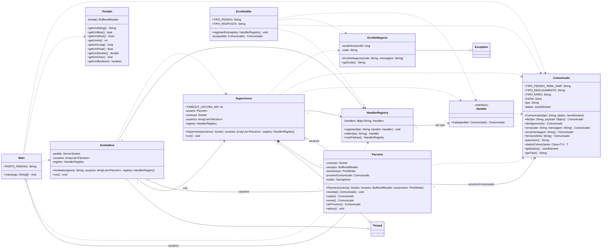

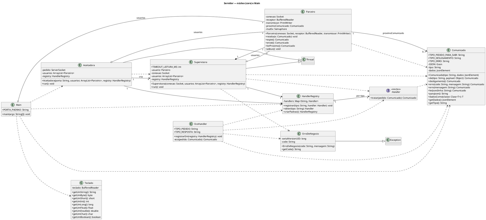

---

## 2. Servidor — registro dos handlers dos grupos

Visão de pacotes. Cada handler expõe `registrarEm(registry)` e registra seus métodos privados de tratamento no `HandlerRegistry` como method reference, que cumpre o contrato da interface `Handler` (por isso não há seta de realização). `TransactionsHandler.calcularSaldoContas` é «planejado».

```mermaid
classDiagram
    direction TB
    class Handler {
        <<interface>>
        +tratar(pedido: Comunicado) Comunicado
    }
    class HandlerRegistry {
        -handlers: Map~String, Handler~
        +registrar(tipo: String, handler: Handler) void
        +obter(tipo: String) Handler
        +criarPadrao() HandlerRegistry
    }
    class EcoHandler {
        <<handler>>
        +registrarEm(registry: HandlerRegistry) void
        -eco(pedido: Comunicado) Comunicado
    }
    class AuthHandler {
        <<handler>>
        +registrarEm(registry: HandlerRegistry) void
        -hashSenha(pedido: Comunicado) Comunicado
        -validarSenha(pedido: Comunicado) Comunicado
    }
    class TransactionsHandler {
        <<handler>>
        +registrarEm(registry: HandlerRegistry) void
        -categorizar(pedido: Comunicado) Comunicado
        -calcularSaldoContas(pedido: Comunicado) Comunicado
    }
    class DashboardHandler {
        <<handler>>
        +registrarEm(registry: HandlerRegistry) void
        -calcularIndicadores(pedido: Comunicado) Comunicado
        -compararPeriodos(pedido: Comunicado) Comunicado
    }
    class MentorHandler {
        <<handler>>
        +registrarEm(registry: HandlerRegistry) void
        -montarContexto(pedido: Comunicado) Comunicado
        -filtrarResposta(pedido: Comunicado) Comunicado
    }
    class GoalsHandler {
        <<handler>>
        +registrarEm(registry: HandlerRegistry) void
        -progressoMeta(pedido: Comunicado) Comunicado
    }
    class InvestmentsHandler {
        <<handler>>
        +registrarEm(registry: HandlerRegistry) void
        -rentabilidadeSimulada(pedido: Comunicado) Comunicado
        -calcularParcelamentos(pedido: Comunicado) Comunicado
    }
    note for Handler "Pacote srv-core. Os handlers registram method references (Comunicado -> Comunicado), que realizam Handler."
    note for TransactionsHandler "calcularSaldoContas e PLANEJADO: ainda nao existe no codigo."

    HandlerRegistry "1" o--> "*" Handler : por tipo
    HandlerRegistry ..> EcoHandler : criarPadrao
    HandlerRegistry ..> AuthHandler : criarPadrao
    HandlerRegistry ..> MentorHandler : criarPadrao
    HandlerRegistry ..> TransactionsHandler : criarPadrao
    HandlerRegistry ..> DashboardHandler : criarPadrao
    HandlerRegistry ..> GoalsHandler : criarPadrao
    HandlerRegistry ..> InvestmentsHandler : criarPadrao
    EcoHandler ..> HandlerRegistry : registra
    AuthHandler ..> HandlerRegistry : registra
    TransactionsHandler ..> HandlerRegistry : registra
    DashboardHandler ..> HandlerRegistry : registra
    MentorHandler ..> HandlerRegistry : registra
    GoalsHandler ..> HandlerRegistry : registra
    InvestmentsHandler ..> HandlerRegistry : registra
```

```plantuml
@startuml
title Servidor — registro dos handlers dos grupos
skinparam classAttributeIconSize 0

package "srv-core" {
  interface Handler <<interface>> {
    +tratar(pedido: Comunicado): Comunicado
  }
  class HandlerRegistry {
    -handlers: Map<String, Handler>
    +registrar(tipo: String, handler: Handler): void
    +obter(tipo: String): Handler
    +criarPadrao(): HandlerRegistry
  }
  class EcoHandler <<handler>> {
    +registrarEm(registry: HandlerRegistry): void
    -eco(pedido: Comunicado): Comunicado
  }
}
package "srv-auth" {
  class AuthHandler <<handler>> {
    +registrarEm(registry: HandlerRegistry): void
    -hashSenha(pedido: Comunicado): Comunicado
    -validarSenha(pedido: Comunicado): Comunicado
  }
}
package "srv-transactions" {
  class TransactionsHandler <<handler>> {
    +registrarEm(registry: HandlerRegistry): void
    -categorizar(pedido: Comunicado): Comunicado
    -calcularSaldoContas(pedido: Comunicado): Comunicado <<planejado>>
  }
}
package "srv-dashboard" {
  class DashboardHandler <<handler>> {
    +registrarEm(registry: HandlerRegistry): void
    -calcularIndicadores(pedido: Comunicado): Comunicado
    -compararPeriodos(pedido: Comunicado): Comunicado
  }
}
package "srv-mentoria" {
  class MentorHandler <<handler>> {
    +registrarEm(registry: HandlerRegistry): void
    -montarContexto(pedido: Comunicado): Comunicado
    -filtrarResposta(pedido: Comunicado): Comunicado
  }
}
package "srv-goals" {
  class GoalsHandler <<handler>> {
    +registrarEm(registry: HandlerRegistry): void
    -progressoMeta(pedido: Comunicado): Comunicado
  }
}
package "srv-investments" {
  class InvestmentsHandler <<handler>> {
    +registrarEm(registry: HandlerRegistry): void
    -rentabilidadeSimulada(pedido: Comunicado): Comunicado
    -calcularParcelamentos(pedido: Comunicado): Comunicado
  }
}

note top of Handler
  Pacote srv-core. Os handlers registram method references
  (Comunicado -> Comunicado), que realizam Handler.
end note
note right of TransactionsHandler
  calcularSaldoContas e PLANEJADO:
  ainda nao existe no codigo.
end note

HandlerRegistry "1" o--> "*" Handler : por tipo
HandlerRegistry ..> EcoHandler : criarPadrao
HandlerRegistry ..> AuthHandler : criarPadrao
HandlerRegistry ..> MentorHandler : criarPadrao
HandlerRegistry ..> TransactionsHandler : criarPadrao
HandlerRegistry ..> DashboardHandler : criarPadrao
HandlerRegistry ..> GoalsHandler : criarPadrao
HandlerRegistry ..> InvestmentsHandler : criarPadrao
EcoHandler ..> HandlerRegistry : <<registra>>
AuthHandler ..> HandlerRegistry : <<registra>>
TransactionsHandler ..> HandlerRegistry : <<registra>>
DashboardHandler ..> HandlerRegistry : <<registra>>
MentorHandler ..> HandlerRegistry : <<registra>>
GoalsHandler ..> HandlerRegistry : <<registra>>
InvestmentsHandler ..> HandlerRegistry : <<registra>>
@enduml
```

---

## 3. Servidor — Autenticação e Transações (mensagens)

`PedidoCalcularSaldoContas` e `RespostaCalcularSaldoContas` são «planejado» (contas e transferências).

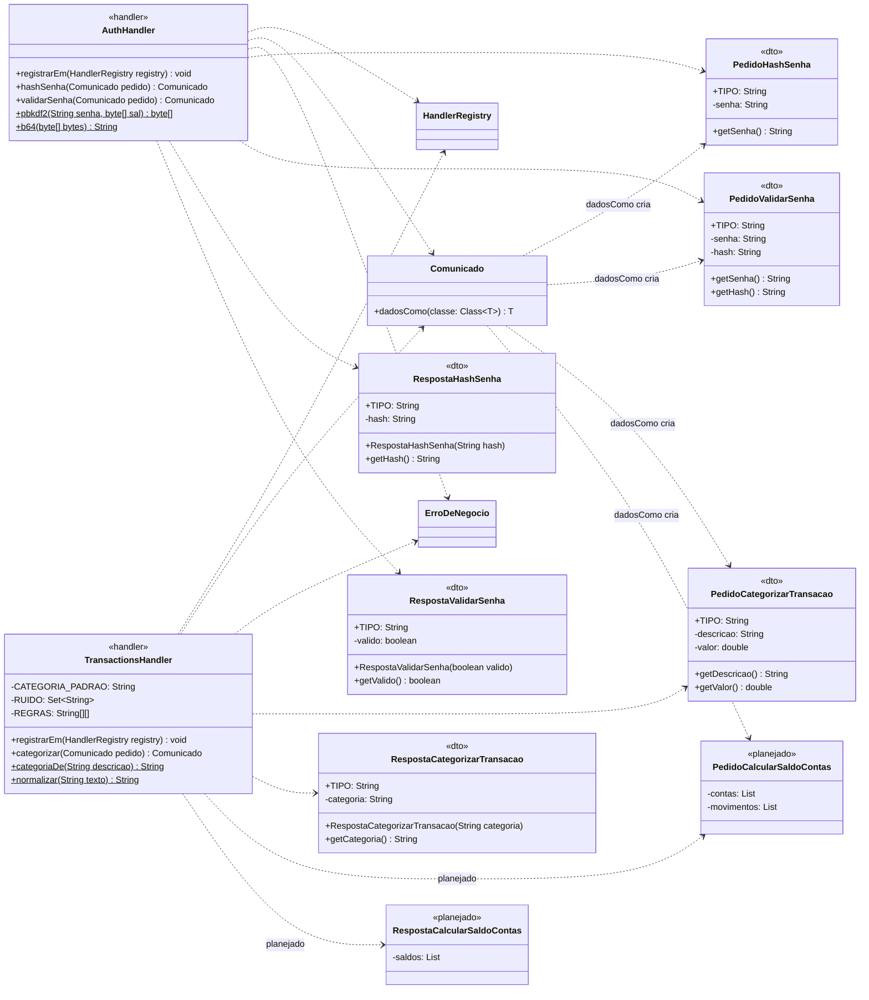

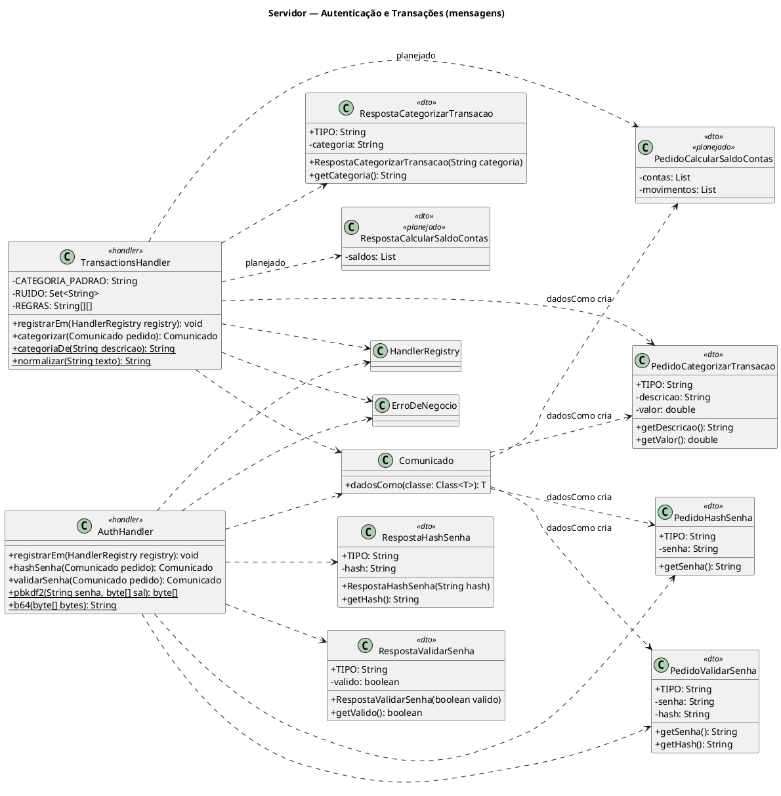

---

## 4. Servidor — Painel e Metas (mensagens)

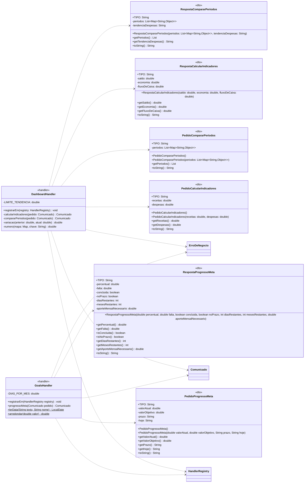

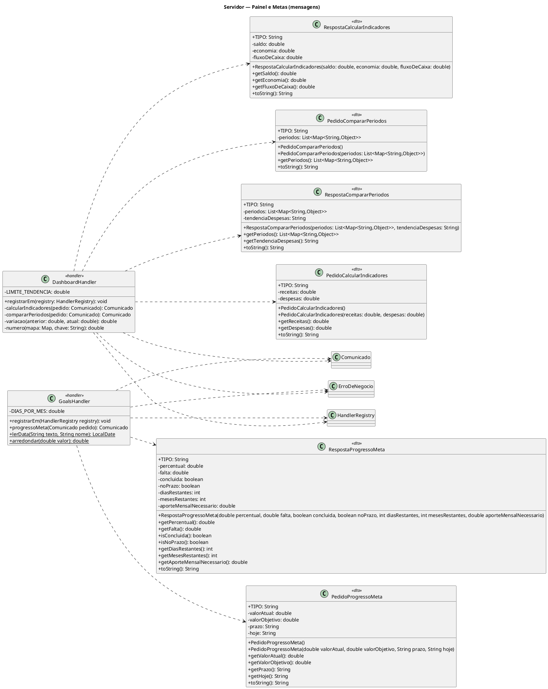

---

## 5. Servidor — Investimentos e cartão (mensagens)

Os itens de ativos e de parcelamentos trafegam como `List<Map<String,Object>>`; não existem classes internas de item no código. A rentabilidade simulada é uma feature futura na interface.

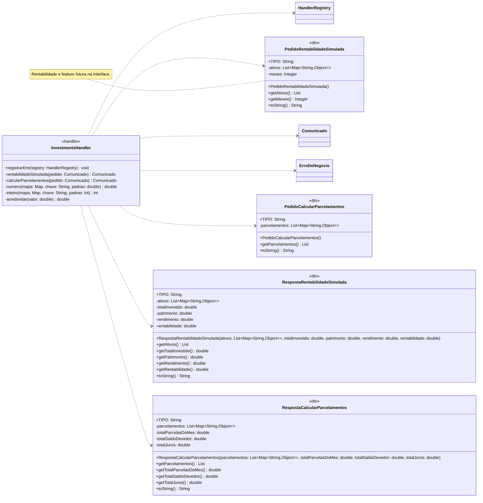

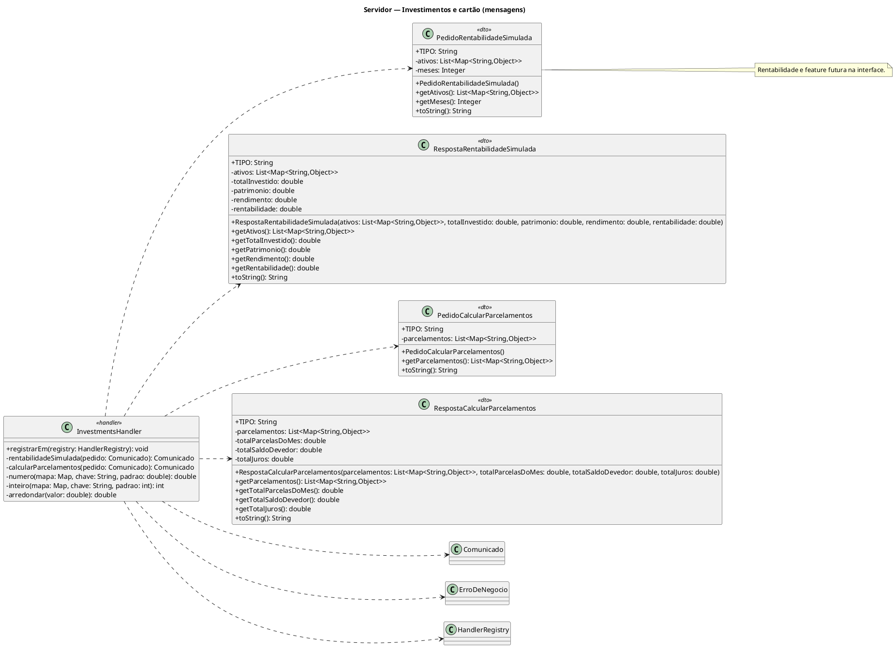

---

## 6. Servidor — Mentoria (contexto e filtro da IA)

`PedidoMontarContextoIA.Transacao` é classe aninhada (arquivo `PedidoMontarContextoIA.java`), ligada por composição ao pedido.

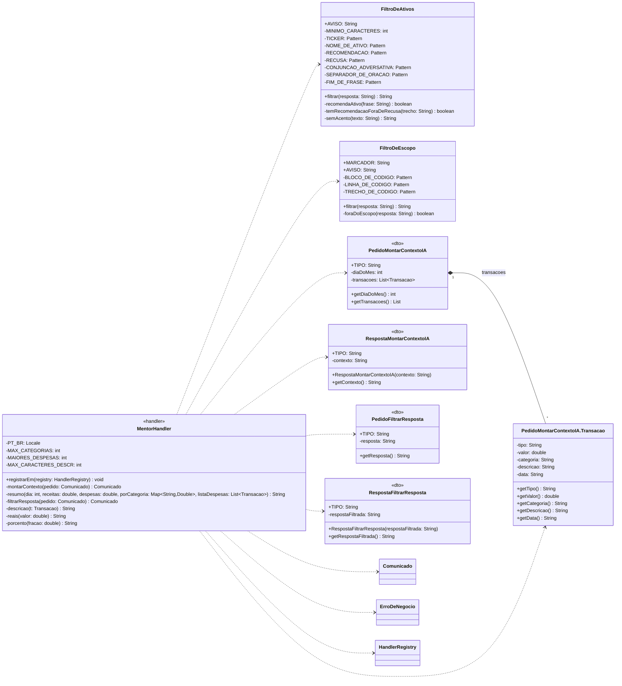

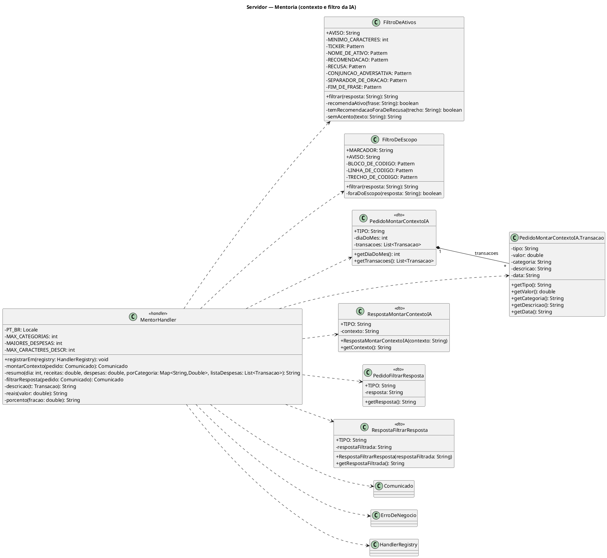
