# Diagrama de classes — Frontend

Diagramas de classes do Frontend do FinanceAI (JavaScript, módulos ES). Cada arquivo `.js` é modelado como uma classe com o estereótipo «module»; as funções exportadas são as operações e as constantes e variáveis de módulo são os atributos. As setas tracejadas indicam dependência (importação), no fluxo Página -> componentes -> services -> core/http.

## Notação (padrão Astah / UML 2)

- Visibilidade: `+` público, `-` privado, `#` protegido, `~` pacote.
- Estereótipos: «module» (módulo JavaScript), «backend» (endpoint do Backend ou recurso externo), «planejado» (elemento que ainda não existe no código; ver [especificação de contas e transferências](../especificacao-contas-e-transferencias.md)).
- Relações: dependência (`..>`) e generalização (`<|--`).
- Colchetes em parâmetros e retornos (por exemplo `[aoMudar, signal]`) representam objetos desestruturados do JavaScript.
- Cada diagrama aparece em dois blocos: `mermaid` (renderiza no GitHub) e `plantuml` (serve para recriar o diagrama no Astah). Os dois descrevem a mesma informação.
- Quando mais de uma feature tem um arquivo com o mesmo nome (constants.js, format.js, GoalForm.js, goalsService.js, investmentsService.js), o rótulo traz a feature entre parênteses.

## 1. Frontend — núcleo (app e core)

Módulos ES do núcleo do Frontend. Cada arquivo JavaScript é representado como uma classe «module», com as funções exportadas como operações. A cadeia de dependência é main -> menu/theme/includes -> core/http (api) -> storage.

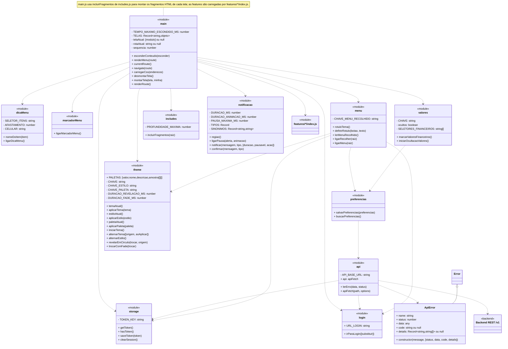

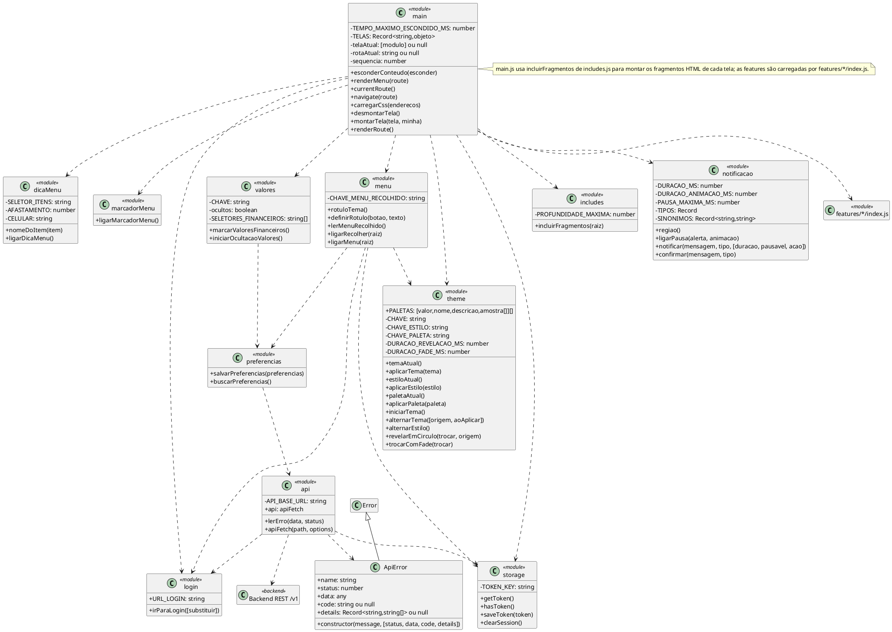

## 2. Frontend — componentes compartilhados

Componentes e utilitários de shared/components e shared/utils. As features que os usam estão indicadas nas notas.

```mermaid
classDiagram
  class Calendario["Calendario"] {
    <<module>>
    - MESES_EM_TEXTO: Intl.DateTimeFormat
    - DATA_EM_TEXTO: Intl.DateTimeFormat
    - ESPERA_PARA_ABRIR_MS: number
    - ESPERA_PARA_FECHAR_MS: number
    + iso(ano, mes, dia)
    + ligarCalendario(area, [signal])
  }
  class campos["campos"] {
    <<module>>
    + ligarCampo(raiz, id)
    + aceitarSomenteNumeros(controle)
    + aplicarMascaraMoeda(controle)
  }
  class notificacao["notificacao"] {
    <<module>>
    - DURACAO_MS: number
    - DURACAO_ANIMACAO_MS: number
    - PAUSA_MAXIMA_MS: number
    - TIPOS: Record
    - SINONIMOS: Record~string,string~
    + regiao()
    + ligarPausa(alerta, animacao)
    + notificar(mensagem, tipo, [duracao, pausavel, acao])
    + confirmar(mensagem, tipo)
  }
  class seletor["seletor"] {
    <<module>>
    - ESPERA_PARA_ABRIR_MS: number
    - ESPERA_PARA_FECHAR_MS: number
    - DURACAO_FADE_MS: number
    - MARGEM_PX: number
    - ALTURA_MINIMA_PX: number
    + ligarSeletores(raiz, signal)
    + ligarSeletor(campo, modelo, signal)
  }
  class dateRange["dateRange"] {
    <<module>>
    - DATA_BR: RegExp
    + dataValida(texto)
    + isoDeData(data)
    + isoParaBr(iso)
    + mascararData(texto)
    + lerData(texto)
    + lerPeriodo(textoInicio, textoFim)
    + mesAtual(hoje)
    + periodoPredefinido(chave, hoje)
  }
  class entrada["entrada"] {
    <<module>>
    - porTeclado: boolean
    + entradaPorTeclado()
  }
  class moeda["moeda"] {
    <<module>>
    - moeda: Intl.NumberFormat
    - numero: Intl.NumberFormat
    - dataCurta: Intl.DateTimeFormat
    + formatarMoeda(valor)
    + formatarPercentual(valor)
    + formatarData(iso)
    + valorParaCampo(valor)
    + lerValor(texto)
    + lerTaxa(texto)
  }
  class rolagem["rolagem"] {
    <<module>>
    - travas: number
    - anterior: [overflow, paddingRight] ou null
    + travarRolagem()
    + liberarRolagem()
  }
  Calendario ..> dateRange
  Calendario ..> entrada
  notificacao ..> rolagem
  seletor ..> entrada
  note for Calendario "Usado por: TransactionBarra, TransactionLista, TransactionDetalhe, TransactionForm, TransactionFilters, TransactionExtrato e GoalForm."
  note for campos "Usado por: TransactionBarra, TransactionLista, TransactionForm, TransactionFilters, TransactionExtrato, EdicaoCelula, GoalForm e CartaoForm."
  note for notificacao "Usado por: TransactionsPage, TransactionDetalhe, TransactionForm, TransactionFilters, TransactionExtrato, EdicaoCelula, MetaDoLancamento, Perfil, ReportarProblema, telas de autenticação, ContasPage, GoalsPage, InvestmentsPage e MentorPage."
  note for seletor "Usado por: TransactionsPage."
  note for dateRange "Usado por: formValidation, filterParams, TransactionBarra e GoalForm."
  note for moeda "Usado por: TransactionBarra, TransactionLista, MetaDoLancamento, CartaoDoLancamento, GoalForm, GoalList, CartaoCompras, CartaoForm e CartoesLista."
  note for rolagem "Usado por: TransactionDetalhe, TransactionForm e notificacao."
```

```plantuml
@startuml
skinparam classAttributeIconSize 0
hide empty members
class "Calendario" as Calendario <<module>> {
  - MESES_EM_TEXTO: Intl.DateTimeFormat
  - DATA_EM_TEXTO: Intl.DateTimeFormat
  - ESPERA_PARA_ABRIR_MS: number
  - ESPERA_PARA_FECHAR_MS: number
  + iso(ano, mes, dia)
  + ligarCalendario(area, [signal])
}
class "campos" as campos <<module>> {
  + ligarCampo(raiz, id)
  + aceitarSomenteNumeros(controle)
  + aplicarMascaraMoeda(controle)
}
class "notificacao" as notificacao <<module>> {
  - DURACAO_MS: number
  - DURACAO_ANIMACAO_MS: number
  - PAUSA_MAXIMA_MS: number
  - TIPOS: Record
  - SINONIMOS: Record<string,string>
  + regiao()
  + ligarPausa(alerta, animacao)
  + notificar(mensagem, tipo, [duracao, pausavel, acao])
  + confirmar(mensagem, tipo)
}
class "seletor" as seletor <<module>> {
  - ESPERA_PARA_ABRIR_MS: number
  - ESPERA_PARA_FECHAR_MS: number
  - DURACAO_FADE_MS: number
  - MARGEM_PX: number
  - ALTURA_MINIMA_PX: number
  + ligarSeletores(raiz, signal)
  + ligarSeletor(campo, modelo, signal)
}
class "dateRange" as dateRange <<module>> {
  - DATA_BR: RegExp
  + dataValida(texto)
  + isoDeData(data)
  + isoParaBr(iso)
  + mascararData(texto)
  + lerData(texto)
  + lerPeriodo(textoInicio, textoFim)
  + mesAtual(hoje)
  + periodoPredefinido(chave, hoje)
}
class "entrada" as entrada <<module>> {
  - porTeclado: boolean
  + entradaPorTeclado()
}
class "moeda" as moeda <<module>> {
  - moeda: Intl.NumberFormat
  - numero: Intl.NumberFormat
  - dataCurta: Intl.DateTimeFormat
  + formatarMoeda(valor)
  + formatarPercentual(valor)
  + formatarData(iso)
  + valorParaCampo(valor)
  + lerValor(texto)
  + lerTaxa(texto)
}
class "rolagem" as rolagem <<module>> {
  - travas: number
  - anterior: [overflow, paddingRight] ou null
  + travarRolagem()
  + liberarRolagem()
}
Calendario ..> dateRange
Calendario ..> entrada
notificacao ..> rolagem
seletor ..> entrada
note right of Calendario : Usado por: TransactionBarra, TransactionLista, TransactionDetalhe, TransactionForm, TransactionFilters, TransactionExtrato e GoalForm.
note right of campos : Usado por: TransactionBarra, TransactionLista, TransactionForm, TransactionFilters, TransactionExtrato, EdicaoCelula, GoalForm e CartaoForm.
note right of notificacao : Usado por: TransactionsPage, TransactionDetalhe, TransactionForm, TransactionFilters, TransactionExtrato, EdicaoCelula, MetaDoLancamento, Perfil, ReportarProblema, telas de autenticação, ContasPage, GoalsPage, InvestmentsPage e MentorPage.
note right of seletor : Usado por: TransactionsPage.
note right of dateRange : Usado por: formValidation, filterParams, TransactionBarra e GoalForm.
note right of moeda : Usado por: TransactionBarra, TransactionLista, MetaDoLancamento, CartaoDoLancamento, GoalForm, GoalList, CartaoCompras, CartaoForm e CartoesLista.
note right of rolagem : Usado por: TransactionDetalhe, TransactionForm e notificacao.
@enduml
```

## 3. Frontend — Autenticação, Perfil e Plano

Telas de autenticação (features/auth), Perfil e escolha de plano, com os módulos de core que utilizam. PlanoConta permite o upgrade de plano (RF31).

```mermaid
classDiagram
  class inicio["inicio.js"] {
    <<module>>
    - ESPERA_REDIRECIONAMENTO_MS: number
    - DURACAO_CADASTRO_MS: number
    - redirecionando: boolean
    + validarSenha(senha)
  }
  class confirmarEmail["confirmarEmail.js"] {
    <<module>>
    + confirmarEmail()
  }
  class recuperarSenha["recuperarSenha.js"] {
    <<module>>
  }
  class redefinirSenha["redefinirSenha.js"] {
    <<module>>
    - ESPERA_REDIRECIONAMENTO_MS: number
    - token: string ou null
    - redirecionando: boolean
  }
  class PlanoConta["PlanoConta.js"] {
    <<module>>
    - token: string ou null
    - planoAtual: string ou null
    - planoSelecionado: string
    + mostrarPlano(plano)
    + carregarPlano()
  }
  class PerfilIdx["Perfil/index.js"] {
    <<module>>
    - CAMINHO: string
    - FRAGMENTOS: Record~string,string~
    - controlador: AbortController ou null
    - usuarioAtual: object ou null
    - sequencia: number
    + montar(container)
    + desmontar()
    + buscarUsuario(signal)
    + preencherVisaoGeral(container)
    + preencherPerfil(container)
    + iniciarEdicaoPerfil(container, signal)
    + iniciarPreferencias(container, signal)
    + carregarAba(container, aba, signal)
  }
  class ReportarProblema["ReportarProblema.js"] {
    <<module>>
    + iniciarReportarProblema()
  }
  class api["api"] {
    <<module>>
    - API_BASE_URL: string
    + api: apiFetch
    + lerErro(data, status)
    + apiFetch(path, options)
  }
  class login["login"] {
    <<module>>
    + URL_LOGIN: string
    + irParaLogin([substituir])
  }
  class storage["storage"] {
    <<module>>
    - TOKEN_KEY: string
    + getToken()
    + hasToken()
    + saveToken(token)
    + clearSession()
  }
  class theme["theme"] {
    <<module>>
    + PALETAS: [valor,nome,descricao,amostra[]][]
    - CHAVE: string
    - CHAVE_ESTILO: string
    - CHAVE_PALETA: string
    - DURACAO_REVELACAO_MS: number
    - DURACAO_FADE_MS: number
    + temaAtual()
    + aplicarTema(tema)
    + estiloAtual()
    + aplicarEstilo(estilo)
    + paletaAtual()
    + aplicarPaleta(paleta)
    + iniciarTema()
    + alternarTema([origem, aoAplicar])
    + alternarEstilo()
    + revelarEmCirculo(trocar, origem)
    + trocarComFade(trocar)
  }
  class valores["valores"] {
    <<module>>
    - CHAVE: string
    - ocultos: boolean
    - SELETORES_FINANCEIROS: string[]
    + marcarValoresFinanceiros()
    + iniciarOcultacaoValores()
  }
  class notificacao["notificacao"] {
    <<module>>
    - DURACAO_MS: number
    - DURACAO_ANIMACAO_MS: number
    - PAUSA_MAXIMA_MS: number
    - TIPOS: Record
    - SINONIMOS: Record~string,string~
    + regiao()
    + ligarPausa(alerta, animacao)
    + notificar(mensagem, tipo, [duracao, pausavel, acao])
    + confirmar(mensagem, tipo)
  }
  class preferencias["preferencias"] {
    <<module>>
    + salvarPreferencias(preferencias)
    + buscarPreferencias()
  }
  class includes["includes"] {
    <<module>>
    - PROFUNDIDADE_MAXIMA: number
    + incluirFragmentos(raiz)
  }
  class BE_login["Backend /v1/auth/login e /v1/auth/register"] {
    <<backend>>
  }
  class BE_verify["Backend /v1/auth/verify-email"] {
    <<backend>>
  }
  class BE_forgot["Backend /v1/auth/forgot-password"] {
    <<backend>>
  }
  class BE_reset["Backend /v1/auth/reset-password"] {
    <<backend>>
  }
  class BE_me["Backend /v1/auth/me"] {
    <<backend>>
  }
  class BE_plano["Backend /v1/auth/me/plano"] {
    <<backend>>
  }
  class BE_suporte["Backend /v1/suporte"] {
    <<backend>>
  }
  inicio ..> notificacao
  inicio ..> BE_login
  confirmarEmail ..> BE_verify
  recuperarSenha ..> notificacao
  recuperarSenha ..> BE_forgot
  redefinirSenha ..> notificacao
  redefinirSenha ..> BE_reset
  PlanoConta ..> notificacao
  PlanoConta ..> BE_me
  PlanoConta ..> BE_plano
  PerfilIdx ..> ReportarProblema
  PerfilIdx ..> includes
  PerfilIdx ..> theme
  PerfilIdx ..> preferencias
  PerfilIdx ..> notificacao
  PerfilIdx ..> BE_me
  ReportarProblema ..> notificacao
  ReportarProblema ..> BE_suporte
  api ..> storage
  api ..> login
  valores ..> preferencias
  preferencias ..> api
  note for PlanoConta "RF31: upgrade de plano. «planejado»: o selo PRO de Contas Conectadas (opção Open Finance somente no plano PRO) lê o plano do usuário."
```

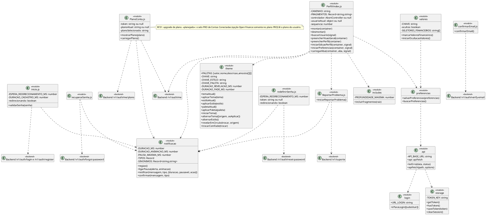

## 4. Frontend — Transações: página, lista e barra

Estrutura da tela de Transações. A barra traz os botões Lançamento e Selecionar lado a lado; os filtros ficam no cabeçalho das colunas da lista; o resumo de receitas/despesas fica em cartão de fundo escuro.

```mermaid
classDiagram
  class txIdx["index.js (transactions)"] {
    <<module>>
    + montar(container): Promise~void~
    + temPendencias(): boolean
    + desmontar(): void
  }
  class TransactionsPage["TransactionsPage.js"] {
    <<module>>
    + iniciarPaginaTransacoes(raiz, [ signal ]): [ temPendencias ]
  }
  class TransactionBarra["TransactionBarra.js"] {
    <<module>>
    + iniciarBarra(raiz, [ aoMudar, aoSelecionar, aoNovo, signal ]): [ definirMetas, sairDaSelecao ]
  }
  class TransactionLista["TransactionLista.js"] {
    <<module>>
    + iniciarLista(raiz, [ abrirDetalhe, carregarMais, tentarNovamente, editarCampo, alterarVarias, confirmarPendentes, duplicarVarias, excluirVarias, signal ]): Lista
  }
  class TransactionResumo["TransactionResumo.js"] {
    <<module>>
    + iniciarResumo(raiz): [ atualizar ]
  }
  class TransactionExtrato["TransactionExtrato.js"] {
    <<module>>
    + iniciarExtrato(raiz, [ irParaPagina, tentarNovamente, mudarLimite, salvarAlteracoes, editarVarias, duplicarVarias, excluirVarias, signal ]): Extrato
  }
  class TransactionFilters["TransactionFilters.js"] {
    <<module>>
    + iniciarFiltros(raiz, [ aoMudar, signal ]): [ definirMetas ]
  }
  class EdicaoCelula["EdicaoCelula.js"] {
    <<module>>
    + valorParaEditar(campo, transacao): string
    + iniciarEdicao([ botao, campo, atual, aoSalvar, opcoes ]): void
  }
  class filterParams["filterParams.js"] {
    <<module>>
    + montarParametros(valores): [ erros, parametros ]
  }
  class transactionsService["transactionsService.js"] {
    <<module>>
    + listarTransacoes(filtros = []): Promise~Pagina~
    + sugerirCategoria(descricao, valor?): Promise~[ categoria ]~
    + criarTransacao(dados): Promise~Transacao~
    + atualizarTransacoesEmLote(itens): Promise~Lote~
    + duplicarTransacoes(ids): Promise~Lote~
    + excluirTransacoesEmLote(ids): Promise~Lote~
  }
  class txConstants["constants.js (transactions)"] {
    <<module>>
    + TIPOS: [valor,rotulo,cor][]
    + CATEGORIAS: [valor,rotulo,cor][]
    + FORMAS_PAGAMENTO: [valor,rotulo,cor][]
    + corDe(lista, valor): string
    + rotuloDe(lista, valor): string
  }
  class txFormat["format.js (transactions)"] {
    <<module>>
    + formatarMoeda(valor): string
    + formatarData(iso): string
    + dataDeHoje(): string
  }
  class includes["includes"] {
    <<module>>
    - PROFUNDIDADE_MAXIMA: number
    + incluirFragmentos(raiz)
  }
  class formValidation["formValidation.js"] {
    <<module>>
    + LIMITE_OBSERVACOES: number
    + MENSAGENS_CAMPO: Record~string,string~
    + lerValor(texto): number
    + validarCampo(nome, texto): [ erro, valor ]
    + validarFormulario(valores): [ erros, dados ]
  }
  class Calendario["Calendario"] {
    <<module>>
    - MESES_EM_TEXTO: Intl.DateTimeFormat
    - DATA_EM_TEXTO: Intl.DateTimeFormat
    - ESPERA_PARA_ABRIR_MS: number
    - ESPERA_PARA_FECHAR_MS: number
    + iso(ano, mes, dia)
    + ligarCalendario(area, [signal])
  }
  class campos["campos"] {
    <<module>>
    + ligarCampo(raiz, id)
    + aceitarSomenteNumeros(controle)
    + aplicarMascaraMoeda(controle)
  }
  class dateRange["dateRange"] {
    <<module>>
    - DATA_BR: RegExp
    + dataValida(texto)
    + isoDeData(data)
    + isoParaBr(iso)
    + mascararData(texto)
    + lerData(texto)
    + lerPeriodo(textoInicio, textoFim)
    + mesAtual(hoje)
    + periodoPredefinido(chave, hoje)
  }
  class moeda["moeda"] {
    <<module>>
    - moeda: Intl.NumberFormat
    - numero: Intl.NumberFormat
    - dataCurta: Intl.DateTimeFormat
    + formatarMoeda(valor)
    + formatarPercentual(valor)
    + formatarData(iso)
    + valorParaCampo(valor)
    + lerValor(texto)
    + lerTaxa(texto)
  }
  class notificacao["notificacao"] {
    <<module>>
    - DURACAO_MS: number
    - DURACAO_ANIMACAO_MS: number
    - PAUSA_MAXIMA_MS: number
    - TIPOS: Record
    - SINONIMOS: Record~string,string~
    + regiao()
    + ligarPausa(alerta, animacao)
    + notificar(mensagem, tipo, [duracao, pausavel, acao])
    + confirmar(mensagem, tipo)
  }
  class seletor["seletor"] {
    <<module>>
    - ESPERA_PARA_ABRIR_MS: number
    - ESPERA_PARA_FECHAR_MS: number
    - DURACAO_FADE_MS: number
    - MARGEM_PX: number
    - ALTURA_MINIMA_PX: number
    + ligarSeletores(raiz, signal)
    + ligarSeletor(campo, modelo, signal)
  }
  class goalsService["goalsService.js (goals)"] {
    <<module>>
  }
  class api["api"] {
    <<module>>
    - API_BASE_URL: string
    + api: apiFetch
    + lerErro(data, status)
    + apiFetch(path, options)
  }
  txIdx ..> includes
  txIdx ..> TransactionsPage
  TransactionsPage ..> transactionsService
  TransactionsPage ..> TransactionBarra
  TransactionsPage ..> TransactionLista
  TransactionsPage ..> formValidation
  TransactionsPage ..> goalsService
  TransactionsPage ..> notificacao
  TransactionsPage ..> seletor
  TransactionsPage ..> txIdx
  transactionsService ..> api
  TransactionBarra ..> Calendario
  TransactionBarra ..> campos
  TransactionBarra ..> dateRange
  TransactionBarra ..> moeda
  TransactionBarra ..> txConstants
  TransactionBarra ..> TransactionsPage
  TransactionLista ..> Calendario
  TransactionLista ..> campos
  TransactionLista ..> moeda
  TransactionLista ..> txConstants
  TransactionLista ..> txFormat
  TransactionLista ..> TransactionsPage
  TransactionFilters ..> filterParams
  TransactionFilters ..> Calendario
  TransactionFilters ..> campos
  TransactionFilters ..> notificacao
  TransactionResumo ..> txFormat
  TransactionExtrato ..> EdicaoCelula
  TransactionExtrato ..> formValidation
  TransactionExtrato ..> txConstants
  TransactionExtrato ..> txFormat
  TransactionExtrato ..> Calendario
  TransactionExtrato ..> campos
  TransactionExtrato ..> notificacao
  EdicaoCelula ..> formValidation
  EdicaoCelula ..> txConstants
  EdicaoCelula ..> campos
  EdicaoCelula ..> notificacao
  EdicaoCelula ..> TransactionExtrato
  filterParams ..> formValidation
  filterParams ..> dateRange
  formValidation ..> txConstants
  formValidation ..> dateRange
  note for TransactionsPage "Os módulos TransactionBarra e TransactionLista dependem de TransactionsPage pelos callbacks (aoMudar, aoSelecionar, aoNovo, abrirDetalhe, entre outros)."
  note for TransactionLista "«planejado»: a coluna Origem passa a mostrar a conta do lançamento e há filtro por contaId."
```

```plantuml
@startuml
skinparam classAttributeIconSize 0
hide empty members
class "index.js (transactions)" as txIdx <<module>> {
  + montar(container): Promise<void>
  + temPendencias(): boolean
  + desmontar(): void
}
class "TransactionsPage.js" as TransactionsPage <<module>> {
  + iniciarPaginaTransacoes(raiz, [ signal ]): [ temPendencias ]
}
class "TransactionBarra.js" as TransactionBarra <<module>> {
  + iniciarBarra(raiz, [ aoMudar, aoSelecionar, aoNovo, signal ]): [ definirMetas, sairDaSelecao ]
}
class "TransactionLista.js" as TransactionLista <<module>> {
  + iniciarLista(raiz, [ abrirDetalhe, carregarMais, tentarNovamente, editarCampo, alterarVarias, confirmarPendentes, duplicarVarias, excluirVarias, signal ]): Lista
}
class "TransactionResumo.js" as TransactionResumo <<module>> {
  + iniciarResumo(raiz): [ atualizar ]
}
class "TransactionExtrato.js" as TransactionExtrato <<module>> {
  + iniciarExtrato(raiz, [ irParaPagina, tentarNovamente, mudarLimite, salvarAlteracoes, editarVarias, duplicarVarias, excluirVarias, signal ]): Extrato
}
class "TransactionFilters.js" as TransactionFilters <<module>> {
  + iniciarFiltros(raiz, [ aoMudar, signal ]): [ definirMetas ]
}
class "EdicaoCelula.js" as EdicaoCelula <<module>> {
  + valorParaEditar(campo, transacao): string
  + iniciarEdicao([ botao, campo, atual, aoSalvar, opcoes ]): void
}
class "filterParams.js" as filterParams <<module>> {
  + montarParametros(valores): [ erros, parametros ]
}
class "transactionsService.js" as transactionsService <<module>> {
  + listarTransacoes(filtros = []): Promise<Pagina>
  + sugerirCategoria(descricao, valor?): Promise<[ categoria ]>
  + criarTransacao(dados): Promise<Transacao>
  + atualizarTransacoesEmLote(itens): Promise<Lote>
  + duplicarTransacoes(ids): Promise<Lote>
  + excluirTransacoesEmLote(ids): Promise<Lote>
}
class "constants.js (transactions)" as txConstants <<module>> {
  + TIPOS: [valor,rotulo,cor][]
  + CATEGORIAS: [valor,rotulo,cor][]
  + FORMAS_PAGAMENTO: [valor,rotulo,cor][]
  + corDe(lista, valor): string
  + rotuloDe(lista, valor): string
}
class "format.js (transactions)" as txFormat <<module>> {
  + formatarMoeda(valor): string
  + formatarData(iso): string
  + dataDeHoje(): string
}
class "includes" as includes <<module>> {
  - PROFUNDIDADE_MAXIMA: number
  + incluirFragmentos(raiz)
}
class "formValidation.js" as formValidation <<module>> {
  + LIMITE_OBSERVACOES: number
  + MENSAGENS_CAMPO: Record<string,string>
  + lerValor(texto): number
  + validarCampo(nome, texto): [ erro, valor ]
  + validarFormulario(valores): [ erros, dados ]
}
class "Calendario" as Calendario <<module>> {
  - MESES_EM_TEXTO: Intl.DateTimeFormat
  - DATA_EM_TEXTO: Intl.DateTimeFormat
  - ESPERA_PARA_ABRIR_MS: number
  - ESPERA_PARA_FECHAR_MS: number
  + iso(ano, mes, dia)
  + ligarCalendario(area, [signal])
}
class "campos" as campos <<module>> {
  + ligarCampo(raiz, id)
  + aceitarSomenteNumeros(controle)
  + aplicarMascaraMoeda(controle)
}
class "dateRange" as dateRange <<module>> {
  - DATA_BR: RegExp
  + dataValida(texto)
  + isoDeData(data)
  + isoParaBr(iso)
  + mascararData(texto)
  + lerData(texto)
  + lerPeriodo(textoInicio, textoFim)
  + mesAtual(hoje)
  + periodoPredefinido(chave, hoje)
}
class "moeda" as moeda <<module>> {
  - moeda: Intl.NumberFormat
  - numero: Intl.NumberFormat
  - dataCurta: Intl.DateTimeFormat
  + formatarMoeda(valor)
  + formatarPercentual(valor)
  + formatarData(iso)
  + valorParaCampo(valor)
  + lerValor(texto)
  + lerTaxa(texto)
}
class "notificacao" as notificacao <<module>> {
  - DURACAO_MS: number
  - DURACAO_ANIMACAO_MS: number
  - PAUSA_MAXIMA_MS: number
  - TIPOS: Record
  - SINONIMOS: Record<string,string>
  + regiao()
  + ligarPausa(alerta, animacao)
  + notificar(mensagem, tipo, [duracao, pausavel, acao])
  + confirmar(mensagem, tipo)
}
class "seletor" as seletor <<module>> {
  - ESPERA_PARA_ABRIR_MS: number
  - ESPERA_PARA_FECHAR_MS: number
  - DURACAO_FADE_MS: number
  - MARGEM_PX: number
  - ALTURA_MINIMA_PX: number
  + ligarSeletores(raiz, signal)
  + ligarSeletor(campo, modelo, signal)
}
class "goalsService.js (goals)" as goalsService <<module>>
class "api" as api <<module>> {
  - API_BASE_URL: string
  + api: apiFetch
  + lerErro(data, status)
  + apiFetch(path, options)
}
txIdx ..> includes
txIdx ..> TransactionsPage
TransactionsPage ..> transactionsService
TransactionsPage ..> TransactionBarra
TransactionsPage ..> TransactionLista
TransactionsPage ..> formValidation
TransactionsPage ..> goalsService
TransactionsPage ..> notificacao
TransactionsPage ..> seletor
TransactionsPage ..> txIdx
transactionsService ..> api
TransactionBarra ..> Calendario
TransactionBarra ..> campos
TransactionBarra ..> dateRange
TransactionBarra ..> moeda
TransactionBarra ..> txConstants
TransactionBarra ..> TransactionsPage
TransactionLista ..> Calendario
TransactionLista ..> campos
TransactionLista ..> moeda
TransactionLista ..> txConstants
TransactionLista ..> txFormat
TransactionLista ..> TransactionsPage
TransactionFilters ..> filterParams
TransactionFilters ..> Calendario
TransactionFilters ..> campos
TransactionFilters ..> notificacao
TransactionResumo ..> txFormat
TransactionExtrato ..> EdicaoCelula
TransactionExtrato ..> formValidation
TransactionExtrato ..> txConstants
TransactionExtrato ..> txFormat
TransactionExtrato ..> Calendario
TransactionExtrato ..> campos
TransactionExtrato ..> notificacao
EdicaoCelula ..> formValidation
EdicaoCelula ..> txConstants
EdicaoCelula ..> campos
EdicaoCelula ..> notificacao
EdicaoCelula ..> TransactionExtrato
filterParams ..> formValidation
filterParams ..> dateRange
formValidation ..> txConstants
formValidation ..> dateRange
note right of TransactionsPage : Os módulos TransactionBarra e TransactionLista dependem de TransactionsPage pelos callbacks (aoMudar, aoSelecionar, aoNovo, abrirDetalhe, entre outros).
note right of TransactionLista : «planejado»: a coluna Origem passa a mostrar a conta do lançamento e há filtro por contaId.
@enduml
```

## 5. Frontend — Transações: formulário e detalhe

Formulário de novo lançamento, detalhe do lançamento e campos auxiliares (meta e cartão). Em «planejado»: modal Nova transferência (atalho T) e campo Conta obrigatório.

```mermaid
classDiagram
  class TransactionForm["TransactionForm.js"] {
    <<module>>
    + iniciarFormulario(raiz, [ aoSalvar, signal ]): [ abrir, fechar ]
  }
  class TransactionDetalhe["TransactionDetalhe.js"] {
    <<module>>
    + iniciarDetalhe(raiz, [ salvar, duplicar, excluir, signal ]): [ abrir, fechar ]
  }
  class MetaDoLancamento["MetaDoLancamento.js"] {
    <<module>>
    + ligarMeta(raiz, [ signal ]): CampoMeta
  }
  class CartaoDoLancamento["CartaoDoLancamento.js"] {
    <<module>>
    + ligarCartao(raiz, [ signal, formaPagamento, tipo, valor ]): CampoCartao
  }
  class formValidation["formValidation.js"] {
    <<module>>
    + LIMITE_OBSERVACOES: number
    + MENSAGENS_CAMPO: Record~string,string~
    + lerValor(texto): number
    + validarCampo(nome, texto): [ erro, valor ]
    + validarFormulario(valores): [ erros, dados ]
  }
  class transactionsService["transactionsService.js"] {
    <<module>>
    + listarTransacoes(filtros = []): Promise~Pagina~
    + sugerirCategoria(descricao, valor?): Promise~[ categoria ]~
    + criarTransacao(dados): Promise~Transacao~
    + atualizarTransacoesEmLote(itens): Promise~Lote~
    + duplicarTransacoes(ids): Promise~Lote~
    + excluirTransacoesEmLote(ids): Promise~Lote~
  }
  class txConstants["constants.js (transactions)"] {
    <<module>>
    + TIPOS: [valor,rotulo,cor][]
    + CATEGORIAS: [valor,rotulo,cor][]
    + FORMAS_PAGAMENTO: [valor,rotulo,cor][]
    + corDe(lista, valor): string
    + rotuloDe(lista, valor): string
  }
  class txFormat["format.js (transactions)"] {
    <<module>>
    + formatarMoeda(valor): string
    + formatarData(iso): string
    + dataDeHoje(): string
  }
  class seletor["seletor"] {
    <<module>>
    - ESPERA_PARA_ABRIR_MS: number
    - ESPERA_PARA_FECHAR_MS: number
    - DURACAO_FADE_MS: number
    - MARGEM_PX: number
    - ALTURA_MINIMA_PX: number
    + ligarSeletores(raiz, signal)
    + ligarSeletor(campo, modelo, signal)
  }
  class moeda["moeda"] {
    <<module>>
    - moeda: Intl.NumberFormat
    - numero: Intl.NumberFormat
    - dataCurta: Intl.DateTimeFormat
    + formatarMoeda(valor)
    + formatarPercentual(valor)
    + formatarData(iso)
    + valorParaCampo(valor)
    + lerValor(texto)
    + lerTaxa(texto)
  }
  class TransactionsPage["TransactionsPage.js"] {
    <<module>>
    + iniciarPaginaTransacoes(raiz, [ signal ]): [ temPendencias ]
  }
  class Calendario["Calendario"] {
    <<module>>
    - MESES_EM_TEXTO: Intl.DateTimeFormat
    - DATA_EM_TEXTO: Intl.DateTimeFormat
    - ESPERA_PARA_ABRIR_MS: number
    - ESPERA_PARA_FECHAR_MS: number
    + iso(ano, mes, dia)
    + ligarCalendario(area, [signal])
  }
  class campos["campos"] {
    <<module>>
    + ligarCampo(raiz, id)
    + aceitarSomenteNumeros(controle)
    + aplicarMascaraMoeda(controle)
  }
  class notificacao["notificacao"] {
    <<module>>
    - DURACAO_MS: number
    - DURACAO_ANIMACAO_MS: number
    - PAUSA_MAXIMA_MS: number
    - TIPOS: Record
    - SINONIMOS: Record~string,string~
    + regiao()
    + ligarPausa(alerta, animacao)
    + notificar(mensagem, tipo, [duracao, pausavel, acao])
    + confirmar(mensagem, tipo)
  }
  class rolagem["rolagem"] {
    <<module>>
    - travas: number
    - anterior: [overflow, paddingRight] ou null
    + travarRolagem()
    + liberarRolagem()
  }
  class dateRange["dateRange"] {
    <<module>>
    - DATA_BR: RegExp
    + dataValida(texto)
    + isoDeData(data)
    + isoParaBr(iso)
    + mascararData(texto)
    + lerData(texto)
    + lerPeriodo(textoInicio, textoFim)
    + mesAtual(hoje)
    + periodoPredefinido(chave, hoje)
  }
  class goalsService["goalsService.js (goals)"] {
    <<module>>
  }
  class GoalForm["GoalForm.js (goals)"] {
    <<module>>
  }
  class investmentsService["investmentsService.js (investments)"] {
    <<module>>
  }
  class api["api"] {
    <<module>>
    - API_BASE_URL: string
    + api: apiFetch
    + lerErro(data, status)
    + apiFetch(path, options)
  }
  class TransferenciaForm["TransferenciaForm"] {
    <<planejado>>
  }
  class ContaDoLancamento["ContaDoLancamento"] {
    <<planejado>>
  }
  TransactionForm ..> transactionsService
  TransactionForm ..> MetaDoLancamento
  TransactionForm ..> CartaoDoLancamento
  TransactionForm ..> formValidation
  TransactionForm ..> txConstants
  TransactionForm ..> txFormat
  TransactionForm ..> Calendario
  TransactionForm ..> campos
  TransactionForm ..> notificacao
  TransactionForm ..> rolagem
  TransactionForm ..> TransactionsPage
  TransactionDetalhe ..> Calendario
  TransactionDetalhe ..> notificacao
  TransactionDetalhe ..> rolagem
  TransactionDetalhe ..> formValidation
  TransactionDetalhe ..> txFormat
  TransactionDetalhe ..> TransactionsPage
  MetaDoLancamento ..> goalsService
  MetaDoLancamento ..> GoalForm
  MetaDoLancamento ..> notificacao
  MetaDoLancamento ..> moeda
  CartaoDoLancamento ..> investmentsService
  CartaoDoLancamento ..> moeda
  formValidation ..> txConstants
  formValidation ..> dateRange
  transactionsService ..> api
  TransactionsPage ..> seletor
  TransactionForm ..> ContaDoLancamento
  note for TransferenciaForm "«planejado»: modal Nova transferência, aberto pelo atalho T e pela opção Transferência junto de Despesa e Receita. Ainda não existe no código."
  note for ContaDoLancamento "«planejado»: campo Conta obrigatório do lançamento manual. Ainda não existe no código."
```

```plantuml
@startuml
skinparam classAttributeIconSize 0
hide empty members
class "TransactionForm.js" as TransactionForm <<module>> {
  + iniciarFormulario(raiz, [ aoSalvar, signal ]): [ abrir, fechar ]
}
class "TransactionDetalhe.js" as TransactionDetalhe <<module>> {
  + iniciarDetalhe(raiz, [ salvar, duplicar, excluir, signal ]): [ abrir, fechar ]
}
class "MetaDoLancamento.js" as MetaDoLancamento <<module>> {
  + ligarMeta(raiz, [ signal ]): CampoMeta
}
class "CartaoDoLancamento.js" as CartaoDoLancamento <<module>> {
  + ligarCartao(raiz, [ signal, formaPagamento, tipo, valor ]): CampoCartao
}
class "formValidation.js" as formValidation <<module>> {
  + LIMITE_OBSERVACOES: number
  + MENSAGENS_CAMPO: Record<string,string>
  + lerValor(texto): number
  + validarCampo(nome, texto): [ erro, valor ]
  + validarFormulario(valores): [ erros, dados ]
}
class "transactionsService.js" as transactionsService <<module>> {
  + listarTransacoes(filtros = []): Promise<Pagina>
  + sugerirCategoria(descricao, valor?): Promise<[ categoria ]>
  + criarTransacao(dados): Promise<Transacao>
  + atualizarTransacoesEmLote(itens): Promise<Lote>
  + duplicarTransacoes(ids): Promise<Lote>
  + excluirTransacoesEmLote(ids): Promise<Lote>
}
class "constants.js (transactions)" as txConstants <<module>> {
  + TIPOS: [valor,rotulo,cor][]
  + CATEGORIAS: [valor,rotulo,cor][]
  + FORMAS_PAGAMENTO: [valor,rotulo,cor][]
  + corDe(lista, valor): string
  + rotuloDe(lista, valor): string
}
class "format.js (transactions)" as txFormat <<module>> {
  + formatarMoeda(valor): string
  + formatarData(iso): string
  + dataDeHoje(): string
}
class "seletor" as seletor <<module>> {
  - ESPERA_PARA_ABRIR_MS: number
  - ESPERA_PARA_FECHAR_MS: number
  - DURACAO_FADE_MS: number
  - MARGEM_PX: number
  - ALTURA_MINIMA_PX: number
  + ligarSeletores(raiz, signal)
  + ligarSeletor(campo, modelo, signal)
}
class "moeda" as moeda <<module>> {
  - moeda: Intl.NumberFormat
  - numero: Intl.NumberFormat
  - dataCurta: Intl.DateTimeFormat
  + formatarMoeda(valor)
  + formatarPercentual(valor)
  + formatarData(iso)
  + valorParaCampo(valor)
  + lerValor(texto)
  + lerTaxa(texto)
}
class "TransactionsPage.js" as TransactionsPage <<module>> {
  + iniciarPaginaTransacoes(raiz, [ signal ]): [ temPendencias ]
}
class "Calendario" as Calendario <<module>> {
  - MESES_EM_TEXTO: Intl.DateTimeFormat
  - DATA_EM_TEXTO: Intl.DateTimeFormat
  - ESPERA_PARA_ABRIR_MS: number
  - ESPERA_PARA_FECHAR_MS: number
  + iso(ano, mes, dia)
  + ligarCalendario(area, [signal])
}
class "campos" as campos <<module>> {
  + ligarCampo(raiz, id)
  + aceitarSomenteNumeros(controle)
  + aplicarMascaraMoeda(controle)
}
class "notificacao" as notificacao <<module>> {
  - DURACAO_MS: number
  - DURACAO_ANIMACAO_MS: number
  - PAUSA_MAXIMA_MS: number
  - TIPOS: Record
  - SINONIMOS: Record<string,string>
  + regiao()
  + ligarPausa(alerta, animacao)
  + notificar(mensagem, tipo, [duracao, pausavel, acao])
  + confirmar(mensagem, tipo)
}
class "rolagem" as rolagem <<module>> {
  - travas: number
  - anterior: [overflow, paddingRight] ou null
  + travarRolagem()
  + liberarRolagem()
}
class "dateRange" as dateRange <<module>> {
  - DATA_BR: RegExp
  + dataValida(texto)
  + isoDeData(data)
  + isoParaBr(iso)
  + mascararData(texto)
  + lerData(texto)
  + lerPeriodo(textoInicio, textoFim)
  + mesAtual(hoje)
  + periodoPredefinido(chave, hoje)
}
class "goalsService.js (goals)" as goalsService <<module>>
class "GoalForm.js (goals)" as GoalForm <<module>>
class "investmentsService.js (investments)" as investmentsService <<module>>
class "api" as api <<module>> {
  - API_BASE_URL: string
  + api: apiFetch
  + lerErro(data, status)
  + apiFetch(path, options)
}
class "TransferenciaForm" as TransferenciaForm <<planejado>>
class "ContaDoLancamento" as ContaDoLancamento <<planejado>>
TransactionForm ..> transactionsService
TransactionForm ..> MetaDoLancamento
TransactionForm ..> CartaoDoLancamento
TransactionForm ..> formValidation
TransactionForm ..> txConstants
TransactionForm ..> txFormat
TransactionForm ..> Calendario
TransactionForm ..> campos
TransactionForm ..> notificacao
TransactionForm ..> rolagem
TransactionForm ..> TransactionsPage
TransactionDetalhe ..> Calendario
TransactionDetalhe ..> notificacao
TransactionDetalhe ..> rolagem
TransactionDetalhe ..> formValidation
TransactionDetalhe ..> txFormat
TransactionDetalhe ..> TransactionsPage
MetaDoLancamento ..> goalsService
MetaDoLancamento ..> GoalForm
MetaDoLancamento ..> notificacao
MetaDoLancamento ..> moeda
CartaoDoLancamento ..> investmentsService
CartaoDoLancamento ..> moeda
formValidation ..> txConstants
formValidation ..> dateRange
transactionsService ..> api
TransactionsPage ..> seletor
TransactionForm ..> ContaDoLancamento
note right of TransferenciaForm : «planejado»: modal Nova transferência, aberto pelo atalho T e pela opção Transferência junto de Despesa e Receita. Ainda não existe no código.
note right of ContaDoLancamento : «planejado»: campo Conta obrigatório do lançamento manual. Ainda não existe no código.
@enduml
```

Elementos «planejado» neste diagrama: TransferenciaForm, ContaDoLancamento.

## 6. Frontend — Contas Conectadas

Tela de Contas Conectadas (Open Finance via Pluggy). Em «planejado»: modal Nova conta (nome, banco, saldo inicial e tipo com selo PRO) e serviço de contas em /v1/accounts.

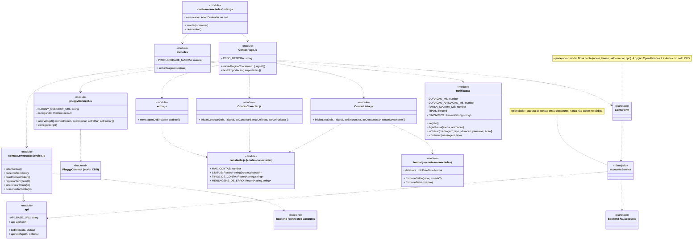

```plantuml
@startuml
skinparam classAttributeIconSize 0
hide empty members
class "contas-conectadas/index.js" as ccIdx <<module>> {
  - controlador: AbortController ou null
  + montar(container)
  + desmontar()
}
class "ContasPage.js" as ContasPage <<module>> {
  - AVISO_DEMORA: string
  + iniciarPaginaContas(raiz, [ signal ])
  + textoImportacao([ importadas ])
}
class "ContasConectar.js" as ContasConectar <<module>> {
  + iniciarConectar(raiz, [ signal, aoConectarBancoDeTeste, aoAbrirWidget ])
}
class "ContasLista.js" as ContasLista <<module>> {
  + iniciarLista(raiz, [ signal, aoSincronizar, aoDesconectar, tentarNovamente ])
}
class "contasConectadasService.js" as ccService <<module>> {
  + listarContas()
  + conectarSandbox()
  + criarConnectToken()
  + registrarItem(itemId)
  + sincronizarConta(id)
  + desconectarConta(id)
}
class "pluggyConnect.js" as pluggyConnect <<module>> {
  - PLUGGY_CONNECT_URL: string
  - carregando: Promise ou null
  + abrirWidget([ connectToken, aoConectar, aoFalhar, aoFechar ])
  + carregarScript()
}
class "constants.js (contas-conectadas)" as ccConstants <<module>> {
  + MAX_CONTAS: number
  + STATUS: Record<string,[rotulo,situacao]>
  + TIPOS_DE_CONTA: Record<string,string>
  + MENSAGENS_DE_ERRO: Record<string,string>
}
class "erros.js" as erros <<module>> {
  + mensagemDeErro(erro, padrao?)
}
class "format.js (contas-conectadas)" as ccFormat <<module>> {
  - dataHora: Intl.DateTimeFormat
  + formatarSaldo(valor, moeda?)
  + formatarDataHora(iso)
}
class "includes" as includes <<module>> {
  - PROFUNDIDADE_MAXIMA: number
  + incluirFragmentos(raiz)
}
class "api" as api <<module>> {
  - API_BASE_URL: string
  + api: apiFetch
  + lerErro(data, status)
  + apiFetch(path, options)
}
class "notificacao" as notificacao <<module>> {
  - DURACAO_MS: number
  - DURACAO_ANIMACAO_MS: number
  - PAUSA_MAXIMA_MS: number
  - TIPOS: Record
  - SINONIMOS: Record<string,string>
  + regiao()
  + ligarPausa(alerta, animacao)
  + notificar(mensagem, tipo, [duracao, pausavel, acao])
  + confirmar(mensagem, tipo)
}
class "PluggyConnect (script CDN)" as PluggyCDN <<backend>>
class "Backend /connected-accounts" as BE_cc <<backend>>
class "ContaForm" as ContaForm <<planejado>>
class "accountsService" as accountsService <<planejado>>
class "Backend /v1/accounts" as BE_accounts <<planejado>>
ccIdx ..> includes
ccIdx ..> ContasPage
ContasPage ..> ccService
ContasPage ..> pluggyConnect
ContasPage ..> erros
ContasPage ..> ContasConectar
ContasPage ..> ContasLista
ContasPage ..> notificacao
ContasConectar ..> ccConstants
ContasLista ..> ccConstants
ContasLista ..> ccFormat
ccService ..> api
ccService ..> BE_cc
erros ..> ccConstants
pluggyConnect ..> PluggyCDN
ContasPage ..> ContaForm
ContaForm ..> accountsService
accountsService ..> api
accountsService ..> BE_accounts
note right of ContaForm : «planejado»: modal Nova conta (nome, banco, saldo inicial, tipo). A opção Open Finance é exibida com selo PRO.
note right of accountsService : «planejado»: acessa as contas em /v1/accounts. Ainda não existe no código.
@enduml
```

Elementos «planejado» neste diagrama: ContaForm, accountsService, Backend /v1/accounts.

## 7. Frontend — Painel e Metas

Telas de Painel (dashboard) e Metas (goals), com suas páginas, componentes e serviços sobre o módulo api.

```mermaid
classDiagram
  class dashIdx["dashboard/index.js"] {
    <<module>>
    + inicializarPagina()
    + carregarDadosDashboard()
  }
  class DashboardEstado["DashboardEstado.js"] {
    <<module>>
    + mostrarEstadoDashboard([ tipo, mensagem, aoTentarNovamente ])
  }
  class DashboardHeader["DashboardHeader.js"] {
    <<module>>
    + iniciarDashboardHeader()
  }
  class DashboardResumo["DashboardResumo.js"] {
    <<module>>
    - formatadorBRL: Intl.NumberFormat
    + iniciarDashboardResumo(dados?)
  }
  class dashboardService["dashboardService.js"] {
    <<module>>
    - DADOS_MOCK: object
    + buscarResumoDashboard([ usarMock? ])
  }
  class goalsIdx["goals/index.js"] {
    <<module>>
    - controlador: AbortController ou null
    + montar(container)
    + desmontar()
  }
  class GoalsPage["GoalsPage.js"] {
    <<module>>
    - MENSAGENS_DE_ERRO: Record~string,string~
    + iniciarPaginaMetas(raiz, [ signal ])
    + mensagemDeErro(erro, padrao)
  }
  class GoalFormM["GoalForm.js"] {
    <<module>>
    - LIMITE_TITULO: number
    - MENSAGENS: Record~string,string~
    - CAMPO_DA_API: Record~string,string~
    + iniciarFormulario(raiz, [ signal, enviar, aoFechar ])
  }
  class GoalList["GoalList.js"] {
    <<module>>
    + iniciarLista(raiz, [ signal, aoEditar, aoExcluir, tentarNovamente ])
    + statusDa(meta)
    + textoDoPrazo(meta)
    + textoDaOrigem(meta)
  }
  class goalsSvc["goalsService.js"] {
    <<module>>
    + listarMetas()
    + criarMeta(dados)
    + atualizarMeta(id, alteracoes)
    + excluirMeta(id)
  }
  class api["api"] {
    <<module>>
    - API_BASE_URL: string
    + api: apiFetch
    + lerErro(data, status)
    + apiFetch(path, options)
  }
  class theme["theme"] {
    <<module>>
    + PALETAS: [valor,nome,descricao,amostra[]][]
    - CHAVE: string
    - CHAVE_ESTILO: string
    - CHAVE_PALETA: string
    - DURACAO_REVELACAO_MS: number
    - DURACAO_FADE_MS: number
    + temaAtual()
    + aplicarTema(tema)
    + estiloAtual()
    + aplicarEstilo(estilo)
    + paletaAtual()
    + aplicarPaleta(paleta)
    + iniciarTema()
    + alternarTema([origem, aoAplicar])
    + alternarEstilo()
    + revelarEmCirculo(trocar, origem)
    + trocarComFade(trocar)
  }
  class menu["menu"] {
    <<module>>
    - CHAVE_MENU_RECOLHIDO: string
    + rotuloTema()
    + definirRotulo(botao, texto)
    + lerMenuRecolhido()
    + ligarRecolher(raiz)
    + ligarMenu(raiz)
  }
  class includes["includes"] {
    <<module>>
    - PROFUNDIDADE_MAXIMA: number
    + incluirFragmentos(raiz)
  }
  class notificacao["notificacao"] {
    <<module>>
    - DURACAO_MS: number
    - DURACAO_ANIMACAO_MS: number
    - PAUSA_MAXIMA_MS: number
    - TIPOS: Record
    - SINONIMOS: Record~string,string~
    + regiao()
    + ligarPausa(alerta, animacao)
    + notificar(mensagem, tipo, [duracao, pausavel, acao])
    + confirmar(mensagem, tipo)
  }
  class campos["campos"] {
    <<module>>
    + ligarCampo(raiz, id)
    + aceitarSomenteNumeros(controle)
    + aplicarMascaraMoeda(controle)
  }
  class Calendario["Calendario"] {
    <<module>>
    - MESES_EM_TEXTO: Intl.DateTimeFormat
    - DATA_EM_TEXTO: Intl.DateTimeFormat
    - ESPERA_PARA_ABRIR_MS: number
    - ESPERA_PARA_FECHAR_MS: number
    + iso(ano, mes, dia)
    + ligarCalendario(area, [signal])
  }
  class dateRange["dateRange"] {
    <<module>>
    - DATA_BR: RegExp
    + dataValida(texto)
    + isoDeData(data)
    + isoParaBr(iso)
    + mascararData(texto)
    + lerData(texto)
    + lerPeriodo(textoInicio, textoFim)
    + mesAtual(hoje)
    + periodoPredefinido(chave, hoje)
  }
  class moeda["moeda"] {
    <<module>>
    - moeda: Intl.NumberFormat
    - numero: Intl.NumberFormat
    - dataCurta: Intl.DateTimeFormat
    + formatarMoeda(valor)
    + formatarPercentual(valor)
    + formatarData(iso)
    + valorParaCampo(valor)
    + lerValor(texto)
    + lerTaxa(texto)
  }
  class BE_dash["Backend /dashboard/summary"] {
    <<backend>>
  }
  class BE_goals["Backend /goals"] {
    <<backend>>
  }
  dashIdx ..> theme
  dashIdx ..> menu
  dashIdx ..> includes
  dashIdx ..> DashboardHeader
  dashIdx ..> DashboardResumo
  dashIdx ..> DashboardEstado
  dashIdx ..> dashboardService
  dashboardService ..> api
  dashboardService ..> BE_dash
  goalsIdx ..> includes
  goalsIdx ..> GoalsPage
  GoalsPage ..> goalsSvc
  GoalsPage ..> GoalFormM
  GoalsPage ..> GoalList
  GoalsPage ..> notificacao
  GoalFormM ..> campos
  GoalFormM ..> Calendario
  GoalFormM ..> dateRange
  GoalFormM ..> moeda
  GoalList ..> moeda
  goalsSvc ..> api
  goalsSvc ..> BE_goals
```

```plantuml
@startuml
skinparam classAttributeIconSize 0
hide empty members
class "dashboard/index.js" as dashIdx <<module>> {
  + inicializarPagina()
  + carregarDadosDashboard()
}
class "DashboardEstado.js" as DashboardEstado <<module>> {
  + mostrarEstadoDashboard([ tipo, mensagem, aoTentarNovamente ])
}
class "DashboardHeader.js" as DashboardHeader <<module>> {
  + iniciarDashboardHeader()
}
class "DashboardResumo.js" as DashboardResumo <<module>> {
  - formatadorBRL: Intl.NumberFormat
  + iniciarDashboardResumo(dados?)
}
class "dashboardService.js" as dashboardService <<module>> {
  - DADOS_MOCK: object
  + buscarResumoDashboard([ usarMock? ])
}
class "goals/index.js" as goalsIdx <<module>> {
  - controlador: AbortController ou null
  + montar(container)
  + desmontar()
}
class "GoalsPage.js" as GoalsPage <<module>> {
  - MENSAGENS_DE_ERRO: Record<string,string>
  + iniciarPaginaMetas(raiz, [ signal ])
  + mensagemDeErro(erro, padrao)
}
class "GoalForm.js" as GoalFormM <<module>> {
  - LIMITE_TITULO: number
  - MENSAGENS: Record<string,string>
  - CAMPO_DA_API: Record<string,string>
  + iniciarFormulario(raiz, [ signal, enviar, aoFechar ])
}
class "GoalList.js" as GoalList <<module>> {
  + iniciarLista(raiz, [ signal, aoEditar, aoExcluir, tentarNovamente ])
  + statusDa(meta)
  + textoDoPrazo(meta)
  + textoDaOrigem(meta)
}
class "goalsService.js" as goalsSvc <<module>> {
  + listarMetas()
  + criarMeta(dados)
  + atualizarMeta(id, alteracoes)
  + excluirMeta(id)
}
class "api" as api <<module>> {
  - API_BASE_URL: string
  + api: apiFetch
  + lerErro(data, status)
  + apiFetch(path, options)
}
class "theme" as theme <<module>> {
  + PALETAS: [valor,nome,descricao,amostra[]][]
  - CHAVE: string
  - CHAVE_ESTILO: string
  - CHAVE_PALETA: string
  - DURACAO_REVELACAO_MS: number
  - DURACAO_FADE_MS: number
  + temaAtual()
  + aplicarTema(tema)
  + estiloAtual()
  + aplicarEstilo(estilo)
  + paletaAtual()
  + aplicarPaleta(paleta)
  + iniciarTema()
  + alternarTema([origem, aoAplicar])
  + alternarEstilo()
  + revelarEmCirculo(trocar, origem)
  + trocarComFade(trocar)
}
class "menu" as menu <<module>> {
  - CHAVE_MENU_RECOLHIDO: string
  + rotuloTema()
  + definirRotulo(botao, texto)
  + lerMenuRecolhido()
  + ligarRecolher(raiz)
  + ligarMenu(raiz)
}
class "includes" as includes <<module>> {
  - PROFUNDIDADE_MAXIMA: number
  + incluirFragmentos(raiz)
}
class "notificacao" as notificacao <<module>> {
  - DURACAO_MS: number
  - DURACAO_ANIMACAO_MS: number
  - PAUSA_MAXIMA_MS: number
  - TIPOS: Record
  - SINONIMOS: Record<string,string>
  + regiao()
  + ligarPausa(alerta, animacao)
  + notificar(mensagem, tipo, [duracao, pausavel, acao])
  + confirmar(mensagem, tipo)
}
class "campos" as campos <<module>> {
  + ligarCampo(raiz, id)
  + aceitarSomenteNumeros(controle)
  + aplicarMascaraMoeda(controle)
}
class "Calendario" as Calendario <<module>> {
  - MESES_EM_TEXTO: Intl.DateTimeFormat
  - DATA_EM_TEXTO: Intl.DateTimeFormat
  - ESPERA_PARA_ABRIR_MS: number
  - ESPERA_PARA_FECHAR_MS: number
  + iso(ano, mes, dia)
  + ligarCalendario(area, [signal])
}
class "dateRange" as dateRange <<module>> {
  - DATA_BR: RegExp
  + dataValida(texto)
  + isoDeData(data)
  + isoParaBr(iso)
  + mascararData(texto)
  + lerData(texto)
  + lerPeriodo(textoInicio, textoFim)
  + mesAtual(hoje)
  + periodoPredefinido(chave, hoje)
}
class "moeda" as moeda <<module>> {
  - moeda: Intl.NumberFormat
  - numero: Intl.NumberFormat
  - dataCurta: Intl.DateTimeFormat
  + formatarMoeda(valor)
  + formatarPercentual(valor)
  + formatarData(iso)
  + valorParaCampo(valor)
  + lerValor(texto)
  + lerTaxa(texto)
}
class "Backend /dashboard/summary" as BE_dash <<backend>>
class "Backend /goals" as BE_goals <<backend>>
dashIdx ..> theme
dashIdx ..> menu
dashIdx ..> includes
dashIdx ..> DashboardHeader
dashIdx ..> DashboardResumo
dashIdx ..> DashboardEstado
dashIdx ..> dashboardService
dashboardService ..> api
dashboardService ..> BE_dash
goalsIdx ..> includes
goalsIdx ..> GoalsPage
GoalsPage ..> goalsSvc
GoalsPage ..> GoalFormM
GoalsPage ..> GoalList
GoalsPage ..> notificacao
GoalFormM ..> campos
GoalFormM ..> Calendario
GoalFormM ..> dateRange
GoalFormM ..> moeda
GoalList ..> moeda
goalsSvc ..> api
goalsSvc ..> BE_goals
@enduml
```

## 8. Frontend — Cartões de crédito

Tela de Cartões de crédito (feature investments): lista, formulário, compras e serviço.

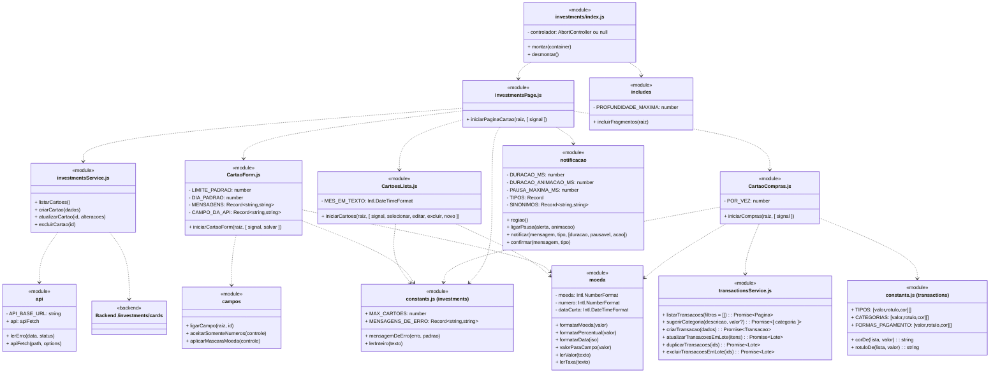

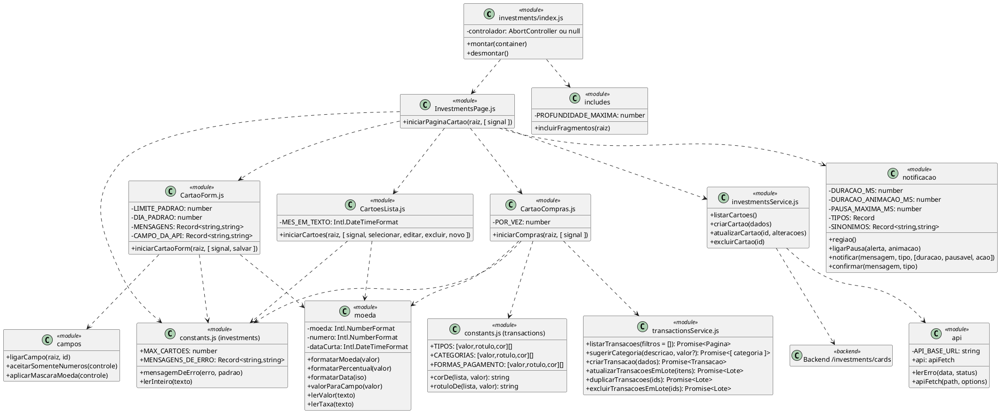

## 9. Frontend — Mentor IA

Tela do Mentor IA: conversa, entrada de mensagens, alertas e serviço.

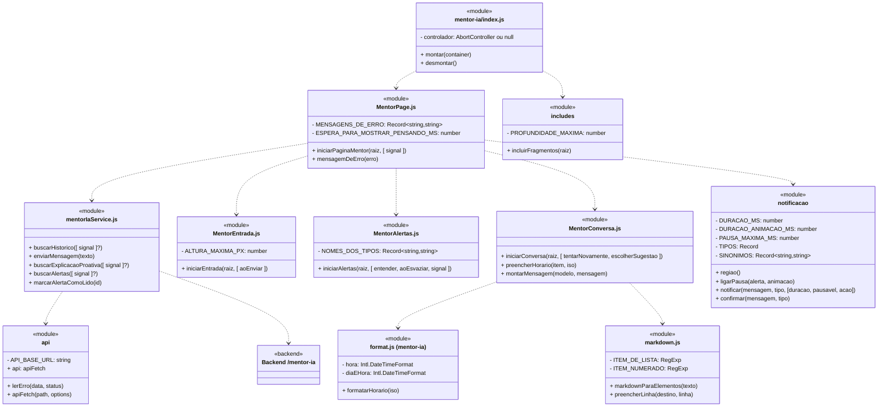

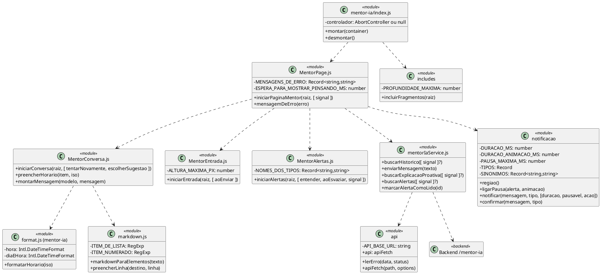

