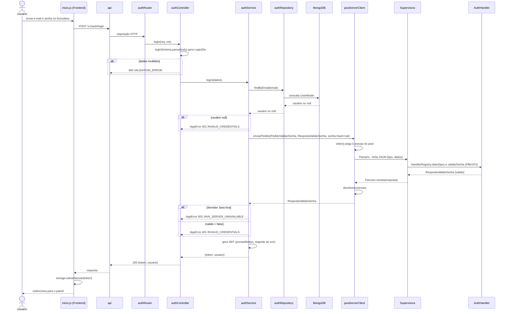
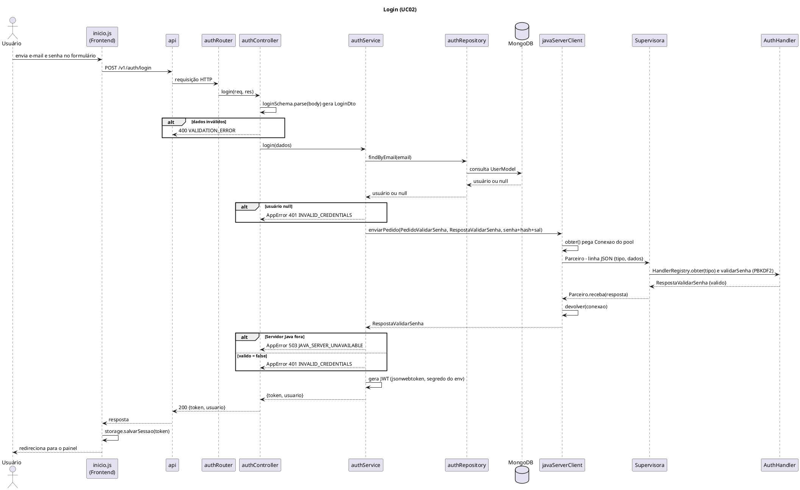
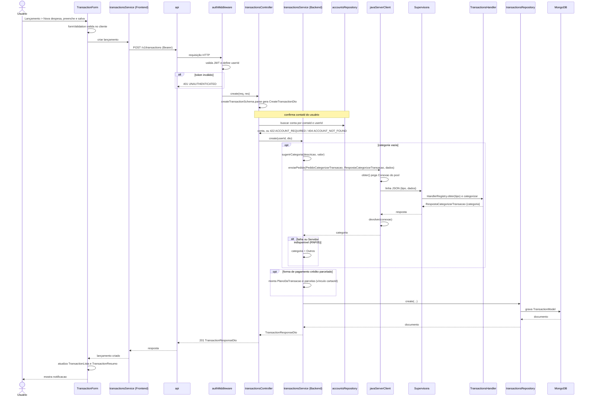
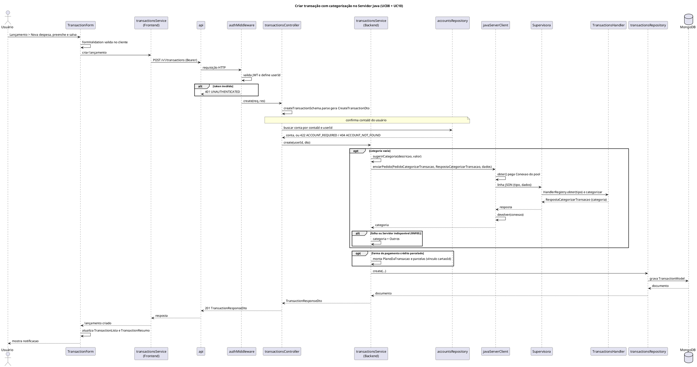
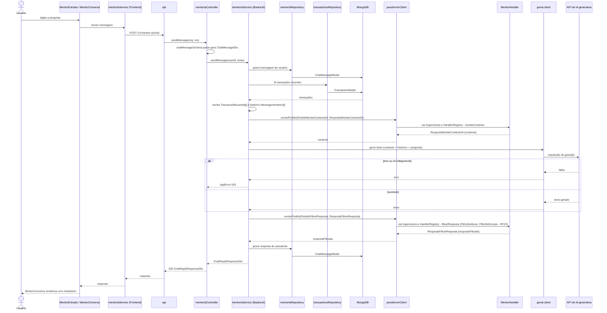
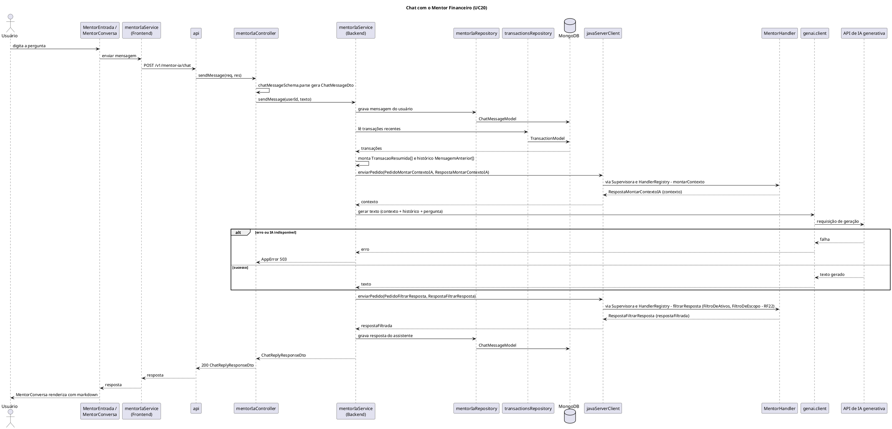
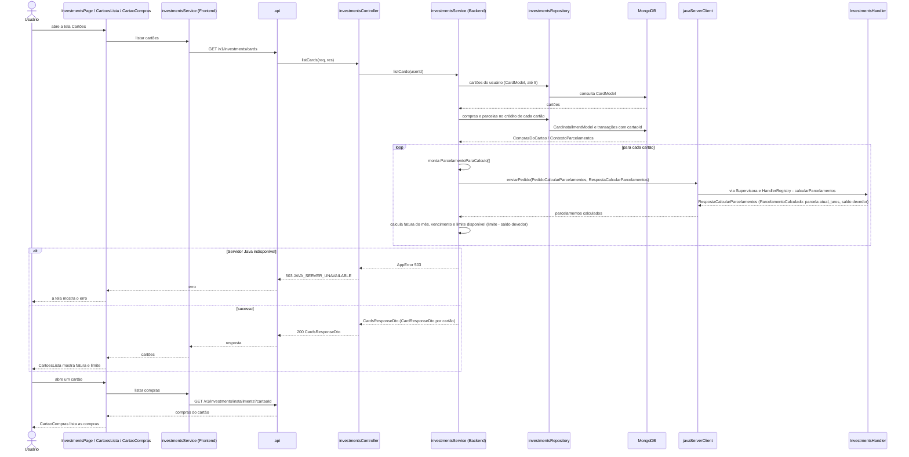
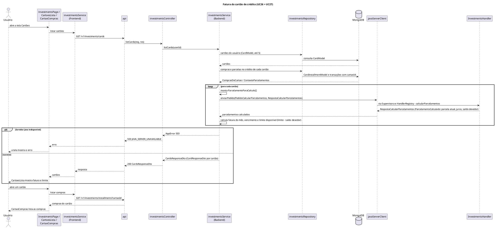
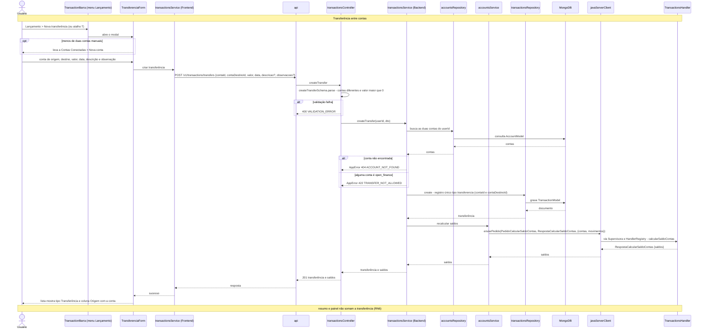
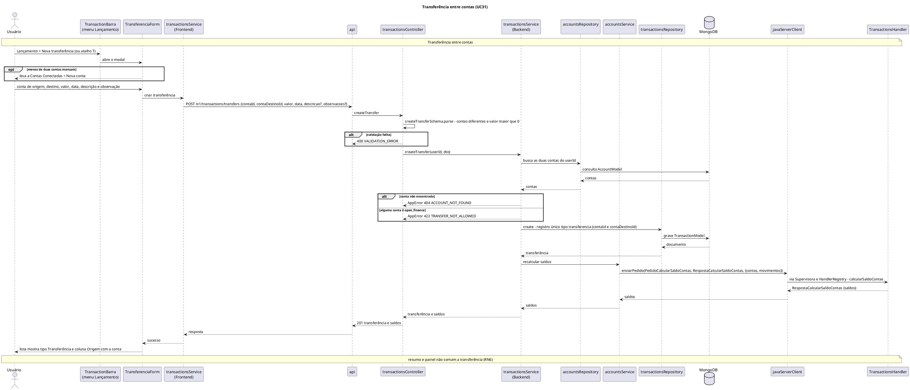

# 07 - Diagramas de sequência

Diagramas de sequência (UML 2) do FinanceAI. Cada diagrama aparece em dois blocos: `mermaid` (renderiza no GitHub) e `plantuml` (descreve o mesmo diagrama e serve para recriá-lo no Astah, em *Sequence Diagram*).

Convenções:

- Linhas de vida usam os nomes reais de arquivos e funções do código.
- `Parceiro.receba(x)` envia ao outro lado e `Parceiro.envie()` lê (nomes herdados do exemplo do professor, ver `00-README.md`).

---

## 1. Login (UC02)

Participantes: Usuário, `inicio.js` (Frontend), `api`, `authRouter`, `authController`, `authService`, `authRepository`, MongoDB, `javaServerClient`, `Supervisora`, `AuthHandler`.

Observação: o cadastro (UC01) é análogo, com `PedidoHashSenha`, `PendingRegistrationModel` e `emailService`.

---

## 2. Criar transação com categorização no Servidor Java (UC08 + UC10)

Participantes: Usuário, `TransactionForm`, `transactionsService` (Frontend), `api`, `authMiddleware`, `transactionsController`, `transactionsService` (Backend), `javaServerClient`, `Supervisora`, `TransactionsHandler`, `transactionsRepository`, MongoDB.

Nota: depois da validação do corpo, `accountsRepository` confirma `contaId` (422 `ACCOUNT_REQUIRED` ou 404 `ACCOUNT_NOT_FOUND`).

---

## 3. Chat com o Mentor Financeiro (UC20)

Participantes: Usuário, `MentorEntrada`/`MentorConversa`, `mentorIaService` (Frontend), `api`, `mentorIaController`, `mentorIaService` (Backend), `mentorIaRepository`, `transactionsRepository`/MongoDB, `javaServerClient`, `MentorHandler`, `genai.client`, API de IA generativa.

No Backend, `montarContexto` e `filtrarResposta` são funções internas de `mentorIaService` que chamam o Servidor Java.

---

## 4. Fatura do cartão de crédito (UC26 + UC27)

Participantes: Usuário, `InvestmentsPage`/`CartoesLista`/`CartaoCompras`, `investmentsService` (Frontend), `api`, `investmentsController`, `investmentsService` (Backend), `investmentsRepository`, MongoDB, `javaServerClient`, `InvestmentsHandler`.

---

## 5. Transferência entre contas (UC31)

Participantes: Usuário, `TransactionBarra` (menu Lançamento), `TransferenciaForm`, `transactionsService` (Frontend), `api`, `transactionsController`, `transactionsService` (Backend), `accountsRepository`, `transactionsRepository`, MongoDB, `javaServerClient`, `TransactionsHandler`.

