# Modelo UML de classes: Backend: auth

Módulo `Backend/src/modules/auth` do FinanceAI (Express + Mongoose + zod). Este documento descreve, no padrão Astah / UML 2, cada classe, objeto, tipo e função do grupo `be-auth`.

Notação: visibilidade `+` público, `-` privado, `#` protegido, `~` pacote. Os diagramas aparecem em dois blocos (mermaid para renderizar no GitHub e plantuml para recriar no Astah). Elementos vizinhos de outros grupos (`javaServerClient`, `emailService`, `AppError`, `env`, `authMiddleware`, `AuthenticatedRequest`) aparecem apenas como contexto. Nenhum elemento deste grupo é «planejado»: todos existem no código.

## Diagrama do grupo

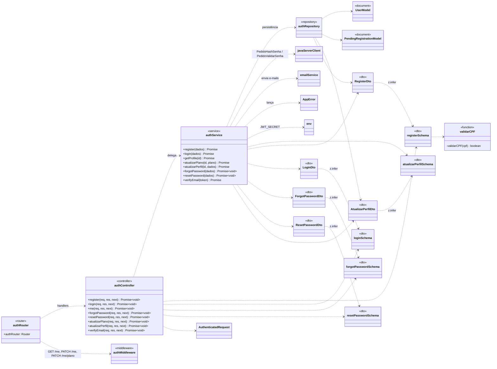

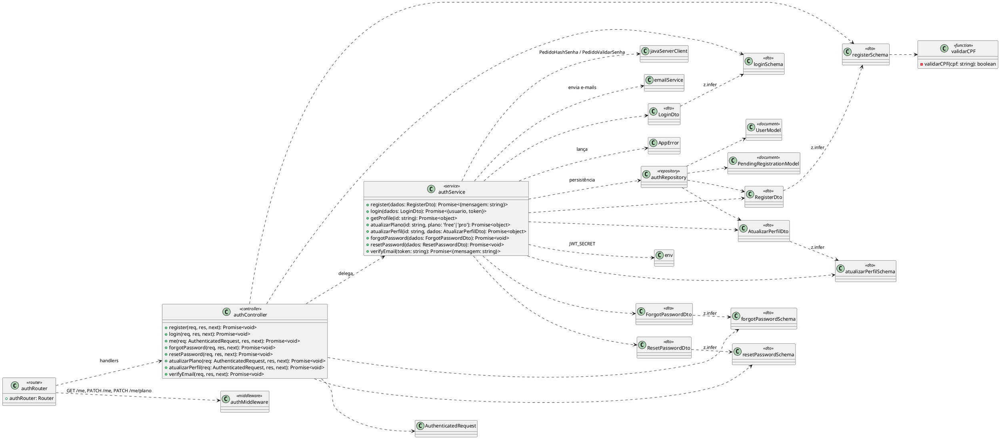

---

## authRouter

- **Tipo / estereótipo:** objeto (instância de `Router`) «router»
- **Arquivo:** `Backend/src/modules/auth/auth.routes.ts`
- **Descrição:** Router Express do módulo auth com as rotas de registro, login, verificação de e-mail, recuperação de senha, perfil e plano.

### Atributos

| Visibilidade | Nome | Tipo | Descrição |
|---|---|---|---|
| + | authRouter | Router | Instância do router Express exportada pelo módulo. |

### Operações

| Visibilidade | Assinatura | Retorno | Descrição |
|---|---|---|---|
| (nenhuma) | | | O objeto não declara operações próprias; registra handlers do `authController`. |

### Relações

| Tipo | Alvo | Multiplicidade | Rótulo |
|---|---|---|---|
| dependência | authController | 1 | handlers |
| dependência | authMiddleware | 1 | GET /me, PATCH /me, PATCH /me/plano |

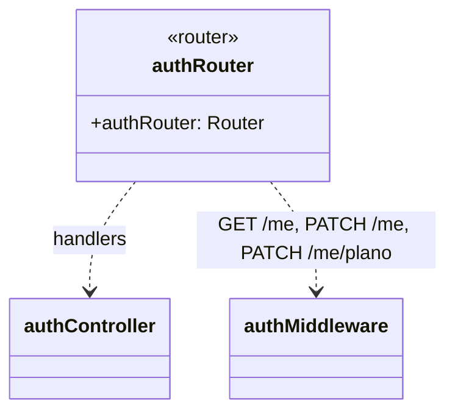

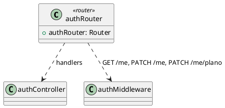

---

## authController

- **Tipo / estereótipo:** serviço (conjunto de handlers) «controller»
- **Arquivo:** `Backend/src/modules/auth/auth.controller.ts`
- **Descrição:** Controller que valida o corpo com zod e delega as operações de autenticação e perfil ao `authService`.

### Atributos

| Visibilidade | Nome | Tipo | Descrição |
|---|---|---|---|
| (nenhum) | | | Sem atributos. |

### Operações

| Visibilidade | Assinatura | Retorno | Descrição |
|---|---|---|---|
| + | register(req, res, next) | Promise&lt;void&gt; | Valida o corpo com `registerSchema` e inicia o cadastro. |
| + | login(req, res, next) | Promise&lt;void&gt; | Valida o corpo com `loginSchema` e autentica o usuário. |
| + | me(req: AuthenticatedRequest, res, next) | Promise&lt;void&gt; | Retorna o perfil do usuário autenticado. |
| + | forgotPassword(req, res, next) | Promise&lt;void&gt; | Valida o corpo com `forgotPasswordSchema` e solicita recuperação de senha. |
| + | resetPassword(req, res, next) | Promise&lt;void&gt; | Valida o corpo com `resetPasswordSchema` e redefine a senha. |
| + | atualizarPlano(req: AuthenticatedRequest, res, next) | Promise&lt;void&gt; | Atualiza o plano (free ou pro) do usuário autenticado. |
| + | atualizarPerfil(req: AuthenticatedRequest, res, next) | Promise&lt;void&gt; | Atualiza nome e preferências do usuário autenticado. |
| + | verifyEmail(req, res, next) | Promise&lt;void&gt; | Confirma o e-mail a partir do token. |

### Relações

| Tipo | Alvo | Multiplicidade | Rótulo |
|---|---|---|---|
| dependência | authService | 1 | delega |
| dependência | registerSchema | 1 | |
| dependência | loginSchema | 1 | |
| dependência | forgotPasswordSchema | 1 | |
| dependência | resetPasswordSchema | 1 | |
| dependência | AuthenticatedRequest | 1 | |

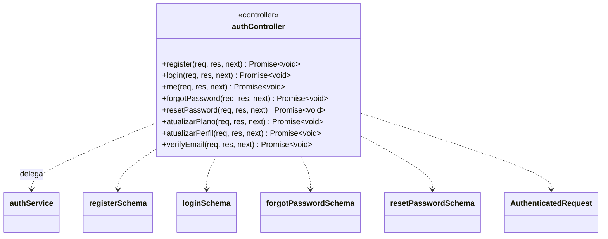

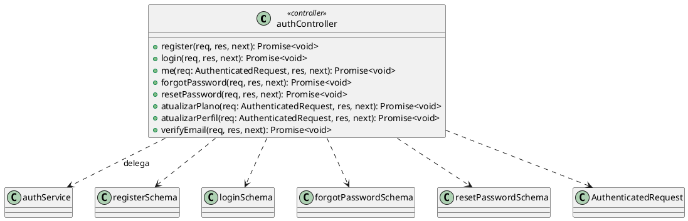

---

## authService

- **Tipo / estereótipo:** serviço «service»
- **Arquivo:** `Backend/src/modules/auth/auth.service.ts`
- **Descrição:** Regras de autenticação: cadastro pendente com confirmação por e-mail, login com JWT, perfil, plano e redefinição de senha; hash e validação de senha via Servidor Java.

### Atributos

| Visibilidade | Nome | Tipo | Descrição |
|---|---|---|---|
| (nenhum) | | | Sem atributos. |

### Operações

| Visibilidade | Assinatura | Retorno | Descrição |
|---|---|---|---|
| + | register(dados: RegisterDto) | Promise&lt;{mensagem: string}&gt; | Cria cadastro pendente e envia e-mail de confirmação. |
| + | login(dados: LoginDto) | Promise&lt;{usuario, token}&gt; | Valida a senha no Servidor Java e emite o JWT. |
| + | getProfile(id: string) | Promise&lt;object&gt; | Retorna o perfil do usuário. |
| + | atualizarPlano(id: string, plano: 'free'\|'pro') | Promise&lt;object&gt; | Altera o plano do usuário. |
| + | atualizarPerfil(id: string, dados: AtualizarPerfilDto) | Promise&lt;object&gt; | Atualiza nome e preferências. |
| + | forgotPassword(dados: ForgotPasswordDto) | Promise&lt;void&gt; | Gera token de recuperação e envia e-mail. |
| + | resetPassword(dados: ResetPasswordDto) | Promise&lt;void&gt; | Redefine a senha a partir do token. |
| + | verifyEmail(token: string) | Promise&lt;{mensagem: string}&gt; | Confirma o e-mail e efetiva o cadastro pendente. |

### Relações

| Tipo | Alvo | Multiplicidade | Rótulo |
|---|---|---|---|
| dependência | authRepository | 1 | persistência |
| dependência | javaServerClient | 1 | PedidoHashSenha / PedidoValidarSenha |
| dependência | emailService | 1 | envia e-mails |
| dependência | AppError | * | lança |
| dependência | env | 1 | JWT_SECRET |
| dependência | atualizarPerfilSchema | 1 | |
| dependência | RegisterDto | 1 | |
| dependência | LoginDto | 1 | |
| dependência | ForgotPasswordDto | 1 | |
| dependência | ResetPasswordDto | 1 | |
| dependência | AtualizarPerfilDto | 1 | |

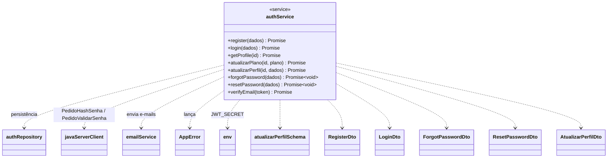

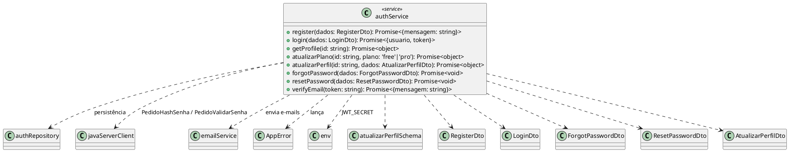

---

## authRepository

- **Tipo / estereótipo:** serviço «repository»
- **Arquivo:** `Backend/src/modules/auth/auth.repository.ts`
- **Descrição:** Acesso a dados de usuários e cadastros pendentes via Mongoose.

### Atributos

| Visibilidade | Nome | Tipo | Descrição |
|---|---|---|---|
| (nenhum) | | | Sem atributos. |

### Operações

| Visibilidade | Assinatura | Retorno | Descrição |
|---|---|---|---|
| + | findByEmail(email: string) | Promise&lt;User\|null&gt; | Busca usuário por e-mail. |
| + | findById(id: string) | Promise&lt;User\|null&gt; | Busca usuário por id. |
| + | atualizarPlano(userId: string, plano: 'free'\|'pro') | Promise&lt;User\|null&gt; | Atualiza o plano. |
| + | create(dados: {nome, email, cpf, senhaHash}) | Promise&lt;User&gt; | Cria usuário. |
| + | atualizarPerfil(userId: string, dados: AtualizarPerfilDto) | Promise&lt;User\|null&gt; | Atualiza nome e preferências. |
| + | setMfaSecret(userId: string, mfaSecret: string) | Promise&lt;User\|null&gt; | Grava o segredo MFA. |
| + | findMfaSecret(userId: string) | Promise&lt;string\|null&gt; | Lê o segredo MFA. |
| + | savePasswordResetToken(userId: string, tokenHash: string, expiresAt: Date) | Promise&lt;User\|null&gt; | Grava o hash do token de redefinição e sua expiração. |
| + | resetPassword(tokenHash: string, senhaHash: string) | Promise&lt;User\|null&gt; | Troca a senha a partir do hash do token. |
| + | saveEmailVerificationToken(userId: string, tokenHash: string, expiresAt: Date) | Promise&lt;User\|null&gt; | Grava o hash do token de verificação de e-mail. |
| + | verifyEmail(tokenHash: string) | Promise&lt;User\|null&gt; | Marca o e-mail como verificado. |
| + | createPendingRegistration(dados) | Promise&lt;PendingRegistration&gt; | Cria cadastro pendente. |
| + | findPendingRegistration(tokenHash: string) | Promise&lt;PendingRegistration\|null&gt; | Busca cadastro pendente pelo hash do token. |
| + | deletePendingRegistration(id: string) | Promise&lt;PendingRegistration\|null&gt; | Remove cadastro pendente. |

### Relações

| Tipo | Alvo | Multiplicidade | Rótulo |
|---|---|---|---|
| dependência | UserModel | 1 | |
| dependência | PendingRegistrationModel | 1 | |
| dependência | AtualizarPerfilDto | 1 | |
| dependência | RegisterDto | 1 | |

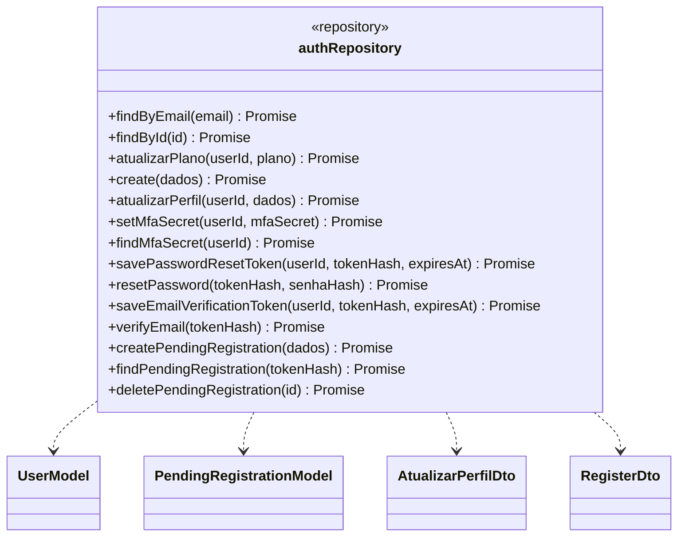

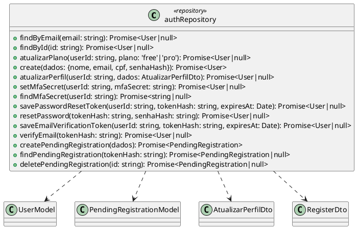

---

## UserModel

- **Tipo / estereótipo:** classe «document»
- **Arquivo:** `Backend/src/modules/auth/auth.model.ts`
- **Descrição:** Modelo Mongoose da coleção User (UserDocument/UserSchema) com dados de conta, tokens, MFA, plano e preferências.

### Atributos

| Visibilidade | Nome | Tipo | Descrição |
|---|---|---|---|
| + | nome | string | Nome do usuário. |
| + | email | string | E-mail de login. |
| + | cpf | string | CPF do usuário. |
| + | senhaHash | string | Hash da senha. |
| + | emailVerificado | boolean | Indica e-mail confirmado. |
| + | emailVerificationTokenHash | string? | Hash do token de verificação de e-mail. |
| + | emailVerificationExpiresAt | Date? | Expiração do token de verificação. |
| + | resetPasswordTokenHash | string? | Hash do token de redefinição de senha. |
| + | resetPasswordExpiresAt | Date? | Expiração do token de redefinição. |
| + | mfaEnabled | boolean | Indica MFA habilitado. |
| + | mfaSecret | string? | Segredo MFA. |
| + | plano | 'free'\|'pro' | Plano do usuário. |
| + | preferencias | {tema, estilo, ocultarValores} | Preferências de interface. |

### Operações

| Visibilidade | Assinatura | Retorno | Descrição |
|---|---|---|---|
| (nenhuma) | | | Sem operações. |

### Relações

| Tipo | Alvo | Multiplicidade | Rótulo |
|---|---|---|---|
| (nenhuma direta declarada) | | | Referenciada por `authRepository` (dependência). |

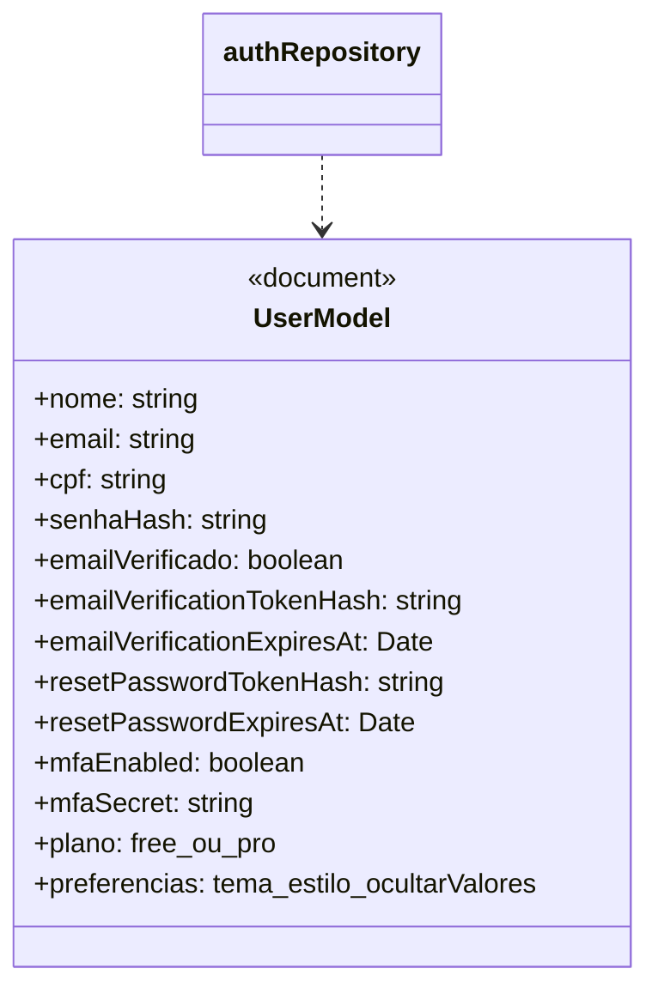

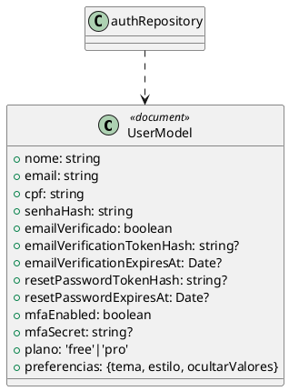

---

## PendingRegistrationModel

- **Tipo / estereótipo:** classe «document»
- **Arquivo:** `Backend/src/modules/auth/pending-registration.model.ts`
- **Descrição:** Modelo Mongoose de cadastro pendente de confirmação de e-mail, com índice TTL em `expiresAt`.

### Atributos

| Visibilidade | Nome | Tipo | Descrição |
|---|---|---|---|
| + | nome | string | Nome informado no cadastro. |
| + | email | string | E-mail a confirmar. |
| + | cpf | string | CPF informado. |
| + | senhaHash | string | Hash da senha. |
| + | tokenHash | string | Hash do token de confirmação. |
| + | expiresAt | Date | Expiração (índice TTL remove o documento). |

### Operações

| Visibilidade | Assinatura | Retorno | Descrição |
|---|---|---|---|
| (nenhuma) | | | Sem operações. |

### Relações

| Tipo | Alvo | Multiplicidade | Rótulo |
|---|---|---|---|
| (nenhuma direta declarada) | | | Referenciada por `authRepository` (dependência). |

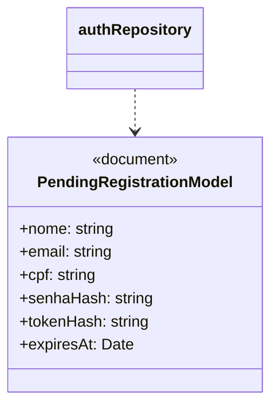

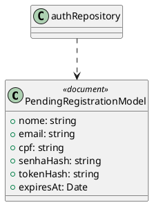

---

## registerSchema

- **Tipo / estereótipo:** objeto «dto»
- **Arquivo:** `Backend/src/modules/auth/auth.dto.ts`
- **Descrição:** Schema zod de cadastro (nome, email, cpf validado, senha forte).

### Atributos

| Visibilidade | Nome | Tipo | Descrição |
|---|---|---|---|
| + | nome | string | Nome. |
| + | email | string | E-mail. |
| + | cpf | string | CPF, validado por `validarCPF`. |
| + | senha | string | Senha forte. |

### Operações

| Visibilidade | Assinatura | Retorno | Descrição |
|---|---|---|---|
| (nenhuma) | | | Sem operações. |

### Relações

| Tipo | Alvo | Multiplicidade | Rótulo |
|---|---|---|---|
| dependência | validarCPF | 1 | |

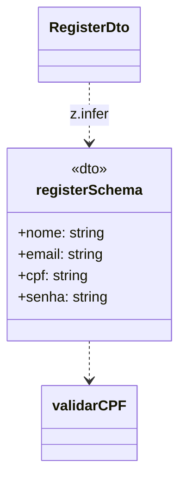

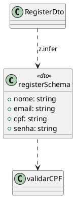

---

## loginSchema

- **Tipo / estereótipo:** objeto «dto»
- **Arquivo:** `Backend/src/modules/auth/auth.dto.ts`
- **Descrição:** Schema zod de login (email, senha).

### Atributos

| Visibilidade | Nome | Tipo | Descrição |
|---|---|---|---|
| + | email | string | E-mail. |
| + | senha | string | Senha. |

### Operações

| Visibilidade | Assinatura | Retorno | Descrição |
|---|---|---|---|
| (nenhuma) | | | Sem operações. |

### Relações

| Tipo | Alvo | Multiplicidade | Rótulo |
|---|---|---|---|
| (nenhuma direta declarada) | | | Origem do tipo `LoginDto` (z.infer). |

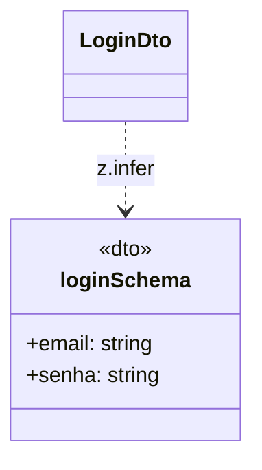

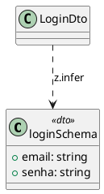

---

## forgotPasswordSchema

- **Tipo / estereótipo:** objeto «dto»
- **Arquivo:** `Backend/src/modules/auth/auth.dto.ts`
- **Descrição:** Schema zod do pedido de recuperação de senha (email).

### Atributos

| Visibilidade | Nome | Tipo | Descrição |
|---|---|---|---|
| + | email | string | E-mail da conta. |

### Operações

| Visibilidade | Assinatura | Retorno | Descrição |
|---|---|---|---|
| (nenhuma) | | | Sem operações. |

### Relações

| Tipo | Alvo | Multiplicidade | Rótulo |
|---|---|---|---|
| (nenhuma direta declarada) | | | Origem do tipo `ForgotPasswordDto` (z.infer). |

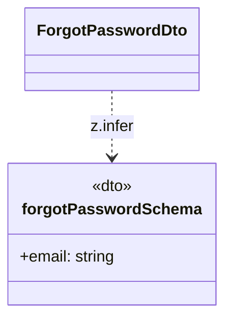

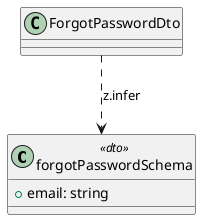

---

## resetPasswordSchema

- **Tipo / estereótipo:** objeto «dto»
- **Arquivo:** `Backend/src/modules/auth/auth.dto.ts`
- **Descrição:** Schema zod de redefinição de senha (token, nova senha forte).

### Atributos

| Visibilidade | Nome | Tipo | Descrição |
|---|---|---|---|
| + | token | string | Token de redefinição. |
| + | senha | string | Nova senha forte. |

### Operações

| Visibilidade | Assinatura | Retorno | Descrição |
|---|---|---|---|
| (nenhuma) | | | Sem operações. |

### Relações

| Tipo | Alvo | Multiplicidade | Rótulo |
|---|---|---|---|
| (nenhuma direta declarada) | | | Origem do tipo `ResetPasswordDto` (z.infer). |

```mermaid
classDiagram
class resetPasswordSchema {
  <<dto>>
  +token: string
  +senha: string
}
ResetPasswordDto ..> resetPasswordSchema : z.infer
```

```plantuml
@startuml
class resetPasswordSchema <<dto>> {
  +token: string
  +senha: string
}
ResetPasswordDto ..> resetPasswordSchema : z.infer
@enduml
```

---

## atualizarPerfilSchema

- **Tipo / estereótipo:** objeto «dto»
- **Arquivo:** `Backend/src/modules/auth/auth.dto.ts`
- **Descrição:** Schema zod estrito de atualização de perfil (nome e preferências tema, estilo, ocultarValores).

### Atributos

| Visibilidade | Nome | Tipo | Descrição |
|---|---|---|---|
| + | nome | string? | Novo nome. |
| + | preferencias | {tema?, estilo?, ocultarValores?}? | Preferências de interface. |

### Operações

| Visibilidade | Assinatura | Retorno | Descrição |
|---|---|---|---|
| (nenhuma) | | | Sem operações. |

### Relações

| Tipo | Alvo | Multiplicidade | Rótulo |
|---|---|---|---|
| (nenhuma direta declarada) | | | Origem do tipo `AtualizarPerfilDto` (z.infer); usado por `authService`. |

```mermaid
classDiagram
class atualizarPerfilSchema {
  <<dto>>
  +nome: string
  +preferencias: tema_estilo_ocultarValores
}
AtualizarPerfilDto ..> atualizarPerfilSchema : z.infer
authService ..> atualizarPerfilSchema
```

```plantuml
@startuml
class atualizarPerfilSchema <<dto>> {
  +nome: string?
  +preferencias: {tema?, estilo?, ocultarValores?}?
}
AtualizarPerfilDto ..> atualizarPerfilSchema : z.infer
authService ..> atualizarPerfilSchema
@enduml
```

---

## validarCPF

- **Tipo / estereótipo:** serviço (função auxiliar) «function»
- **Arquivo:** `Backend/src/modules/auth/auth.dto.ts`
- **Descrição:** Função auxiliar (não exportada) que valida CPF por dígitos verificadores.

### Atributos

| Visibilidade | Nome | Tipo | Descrição |
|---|---|---|---|
| (nenhum) | | | Sem atributos. |

### Operações

| Visibilidade | Assinatura | Retorno | Descrição |
|---|---|---|---|
| - | validarCPF(cpf: string) | boolean | Verifica os dígitos verificadores do CPF. |

### Relações

| Tipo | Alvo | Multiplicidade | Rótulo |
|---|---|---|---|
| (nenhuma direta declarada) | | | Usada por `registerSchema` (dependência). |

```mermaid
classDiagram
class validarCPF {
  <<function>>
  -validarCPF(cpf) boolean
}
registerSchema ..> validarCPF
```

```plantuml
@startuml
class validarCPF <<function>> {
  -validarCPF(cpf: string): boolean
}
registerSchema ..> validarCPF
@enduml
```

---

## RegisterDto

- **Tipo / estereótipo:** tipo «dto»
- **Arquivo:** `Backend/src/modules/auth/auth.dto.ts`
- **Descrição:** Tipo inferido de `registerSchema`.

### Atributos

| Visibilidade | Nome | Tipo | Descrição |
|---|---|---|---|
| (nenhum) | | | Herda a forma de `registerSchema` (nome, email, cpf, senha). |

### Operações

| Visibilidade | Assinatura | Retorno | Descrição |
|---|---|---|---|
| (nenhuma) | | | Sem operações. |

### Relações

| Tipo | Alvo | Multiplicidade | Rótulo |
|---|---|---|---|
| dependência | registerSchema | 1 | z.infer |

```mermaid
classDiagram
class RegisterDto {
  <<dto>>
}
RegisterDto ..> registerSchema : z.infer
```

```plantuml
@startuml
class RegisterDto <<dto>>
RegisterDto ..> registerSchema : z.infer
@enduml
```

---

## LoginDto

- **Tipo / estereótipo:** tipo «dto»
- **Arquivo:** `Backend/src/modules/auth/auth.dto.ts`
- **Descrição:** Tipo inferido de `loginSchema`.

### Atributos

| Visibilidade | Nome | Tipo | Descrição |
|---|---|---|---|
| (nenhum) | | | Herda a forma de `loginSchema` (email, senha). |

### Operações

| Visibilidade | Assinatura | Retorno | Descrição |
|---|---|---|---|
| (nenhuma) | | | Sem operações. |

### Relações

| Tipo | Alvo | Multiplicidade | Rótulo |
|---|---|---|---|
| dependência | loginSchema | 1 | z.infer |

```mermaid
classDiagram
class LoginDto {
  <<dto>>
}
LoginDto ..> loginSchema : z.infer
```

```plantuml
@startuml
class LoginDto <<dto>>
LoginDto ..> loginSchema : z.infer
@enduml
```

---

## ForgotPasswordDto

- **Tipo / estereótipo:** tipo «dto»
- **Arquivo:** `Backend/src/modules/auth/auth.dto.ts`
- **Descrição:** Tipo inferido de `forgotPasswordSchema`.

### Atributos

| Visibilidade | Nome | Tipo | Descrição |
|---|---|---|---|
| (nenhum) | | | Herda a forma de `forgotPasswordSchema` (email). |

### Operações

| Visibilidade | Assinatura | Retorno | Descrição |
|---|---|---|---|
| (nenhuma) | | | Sem operações. |

### Relações

| Tipo | Alvo | Multiplicidade | Rótulo |
|---|---|---|---|
| dependência | forgotPasswordSchema | 1 | z.infer |

```mermaid
classDiagram
class ForgotPasswordDto {
  <<dto>>
}
ForgotPasswordDto ..> forgotPasswordSchema : z.infer
```

```plantuml
@startuml
class ForgotPasswordDto <<dto>>
ForgotPasswordDto ..> forgotPasswordSchema : z.infer
@enduml
```

---

## ResetPasswordDto

- **Tipo / estereótipo:** tipo «dto»
- **Arquivo:** `Backend/src/modules/auth/auth.dto.ts`
- **Descrição:** Tipo inferido de `resetPasswordSchema`.

### Atributos

| Visibilidade | Nome | Tipo | Descrição |
|---|---|---|---|
| (nenhum) | | | Herda a forma de `resetPasswordSchema` (token, senha). |

### Operações

| Visibilidade | Assinatura | Retorno | Descrição |
|---|---|---|---|
| (nenhuma) | | | Sem operações. |

### Relações

| Tipo | Alvo | Multiplicidade | Rótulo |
|---|---|---|---|
| dependência | resetPasswordSchema | 1 | z.infer |

```mermaid
classDiagram
class ResetPasswordDto {
  <<dto>>
}
ResetPasswordDto ..> resetPasswordSchema : z.infer
```

```plantuml
@startuml
class ResetPasswordDto <<dto>>
ResetPasswordDto ..> resetPasswordSchema : z.infer
@enduml
```

---

## AtualizarPerfilDto

- **Tipo / estereótipo:** tipo «dto»
- **Arquivo:** `Backend/src/modules/auth/auth.dto.ts`
- **Descrição:** Tipo inferido de `atualizarPerfilSchema`.

### Atributos

| Visibilidade | Nome | Tipo | Descrição |
|---|---|---|---|
| (nenhum) | | | Herda a forma de `atualizarPerfilSchema` (nome, preferencias). |

### Operações

| Visibilidade | Assinatura | Retorno | Descrição |
|---|---|---|---|
| (nenhuma) | | | Sem operações. |

### Relações

| Tipo | Alvo | Multiplicidade | Rótulo |
|---|---|---|---|
| dependência | atualizarPerfilSchema | 1 | z.infer |

```mermaid
classDiagram
class AtualizarPerfilDto {
  <<dto>>
}
AtualizarPerfilDto ..> atualizarPerfilSchema : z.infer
```

```plantuml
@startuml
class AtualizarPerfilDto <<dto>>
AtualizarPerfilDto ..> atualizarPerfilSchema : z.infer
@enduml
```
