# Backend: contas conectadas (módulo `connected-accounts`)

Modelo UML (padrão Astah / UML 2) do módulo `Backend/src/modules/connected-accounts`. O módulo registra conexões do usuário com instituições financeiras via Pluggy (Open Finance, sandbox), sincroniza e importa as transações como lançamentos de origem `pluggy`, e remove a conexão. Segue as camadas Router, Controller, Service, Repository e Model. Os elementos `transactionsRepository`, `transactionsService`, `pluggyClient`, `mapearTransacao`, `AppError`, `authMiddleware` e `AuthenticatedRequest` pertencem a outros módulos e aparecem apenas como vizinhos.

Elementos do grupo: `connectedAccountsController`, `connectSchema`, `accountIdSchema`, `ConnectedAccountResponseDto`, `ResultadoImportacao`, `ContaDaConexao`, `ConnectedAccountDocument`, `ConnectedAccountSchema`, `ConnectedAccountModel`, `connectedAccountsRepository`, `connectedAccountsRouter`, `connectedAccountsService`, `ContaLida`. Não há enumerações neste grupo.

Nota sobre o plano: na especificação de contas e transferências (`docs/especificacao-contas-e-transferencias.md`, RN10), as conexões existentes em `connected_accounts` passam a ser contas do tipo `open_finance`, e a criação delas fica restrita ao plano Pro (RN3). Isso ainda não existe no código deste módulo: nenhum elemento planejado do módulo de contas é documentado aqui como existente.

## Diagrama do grupo

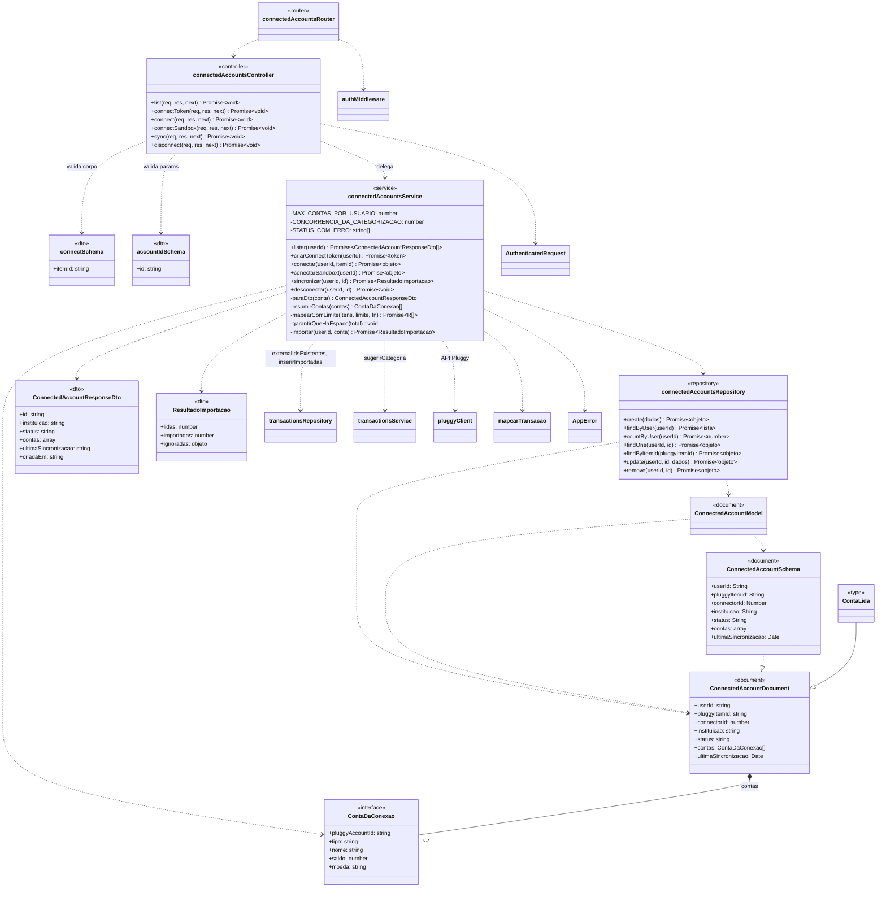

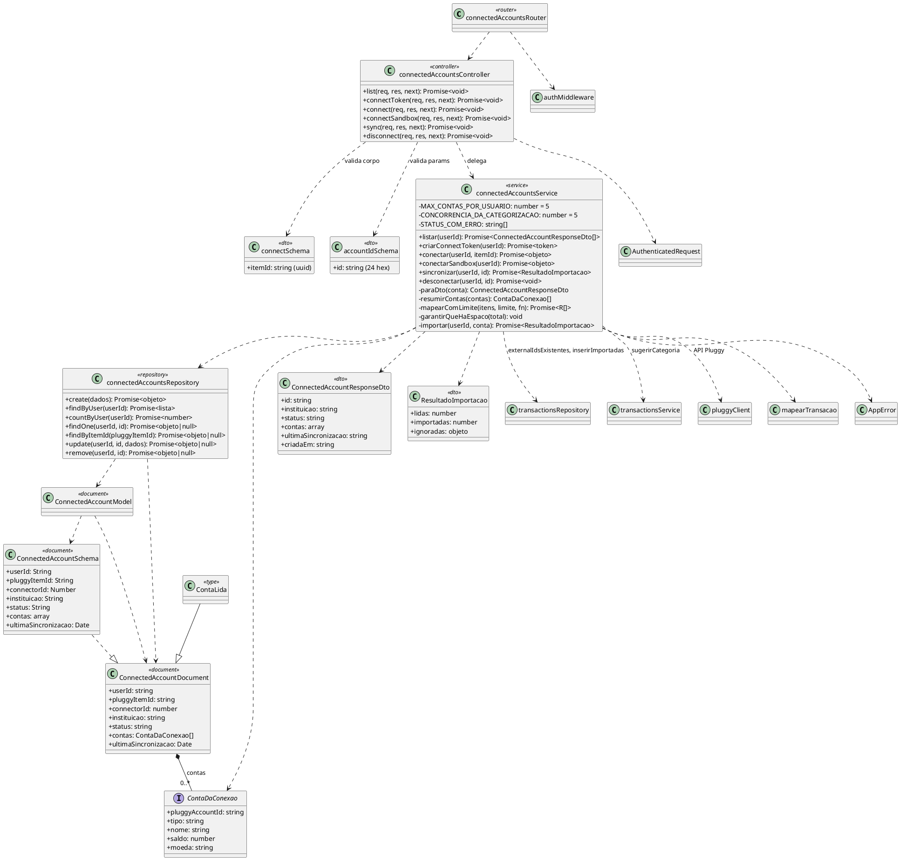

---

## connectedAccountsController

- Tipo e estereótipo: objeto de serviço, «controller»
- Arquivo de origem: `Backend/src/modules/connected-accounts/connected-accounts.controller.ts`
- Descrição: Controller Express das rotas de contas conectadas (Pluggy). Valida a entrada com zod e delega ao service.

Atributos: nenhum.

| Visibilidade | Assinatura | Retorno | Descrição |
|---|---|---|---|
| + | list(req, res, next) | Promise&lt;void&gt; | Lista as conexões do usuário. |
| + | connectToken(req, res, next) | Promise&lt;void&gt; | Gera o token para o Frontend abrir o widget Pluggy Connect. |
| + | connect(req, res, next) | Promise&lt;void&gt; | Registra um item Pluggy como conta conectada (corpo validado por `connectSchema`). |
| + | connectSandbox(req, res, next) | Promise&lt;void&gt; | Conecta o conector de teste do sandbox. |
| + | sync(req, res, next) | Promise&lt;void&gt; | Sincroniza e importa as transações de uma conexão (parâmetro validado por `accountIdSchema`). |
| + | disconnect(req, res, next) | Promise&lt;void&gt; | Remove a conexão. |

| Tipo | Alvo | Multiplicidade | Rótulo |
|---|---|---|---|
| dependência | connectedAccountsService | 1 | delega |
| dependência | connectSchema | 1 | valida corpo |
| dependência | accountIdSchema | 1 | valida params |
| dependência | AuthenticatedRequest | 1 | |

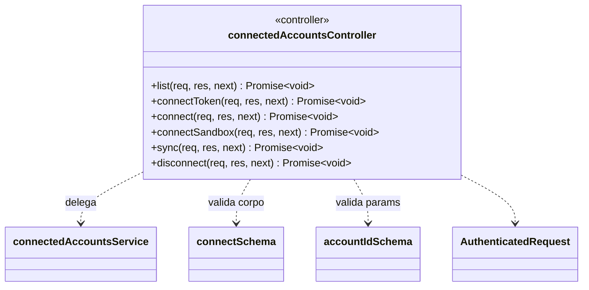

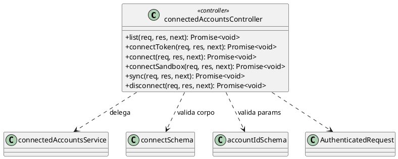

---

## connectSchema

- Tipo e estereótipo: objeto, «dto»
- Arquivo de origem: `Backend/src/modules/connected-accounts/connected-accounts.dto.ts`
- Descrição: schema zod do corpo de conectar conta, com o `itemId` (uuid) do item Pluggy criado pelo widget.

| Visibilidade | Nome | Tipo | Descrição |
|---|---|---|---|
| + | itemId | string (uuid) | Id do item Pluggy a registrar. |

Operações: nenhuma.

| Tipo | Alvo | Multiplicidade | Rótulo |
|---|---|---|---|
| dependência (entrante) | connectedAccountsController | 1 | valida corpo |

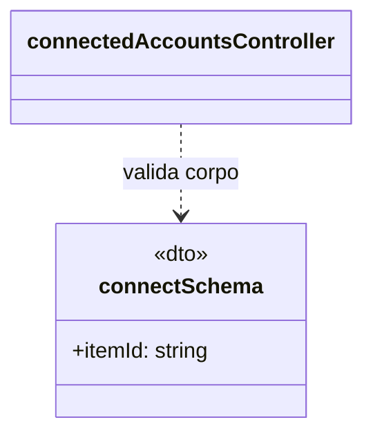

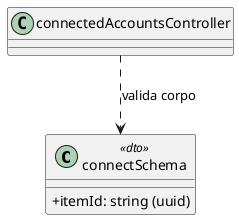

---

## accountIdSchema

- Tipo e estereótipo: objeto, «dto»
- Arquivo de origem: `Backend/src/modules/connected-accounts/connected-accounts.dto.ts`
- Descrição: schema zod do parâmetro `id` (ObjectId de 24 caracteres hexadecimais) da conta conectada.

| Visibilidade | Nome | Tipo | Descrição |
|---|---|---|---|
| + | id | string (24 hex) | Id da conta conectada na rota. |

Operações: nenhuma.

| Tipo | Alvo | Multiplicidade | Rótulo |
|---|---|---|---|
| dependência (entrante) | connectedAccountsController | 1 | valida params |

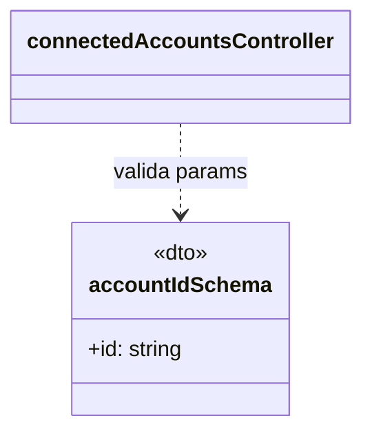

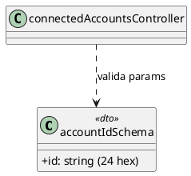

---

## ConnectedAccountResponseDto

- Tipo e estereótipo: interface TypeScript, «dto»
- Arquivo de origem: `Backend/src/modules/connected-accounts/connected-accounts.dto.ts`
- Descrição: resposta ao Frontend de uma conexão, sem o id do item Pluggy nem campos internos do Mongo.

| Visibilidade | Nome | Tipo | Descrição |
|---|---|---|---|
| + | id | string | Id da conexão. |
| + | instituicao | string | Nome da instituição. |
| + | status | string | Status do item na Pluggy. |
| + | contas | {id, tipo, nome, saldo?, moeda?}[] | Contas (corrente ou cartão) da conexão. |
| + | ultimaSincronizacao | string? | Data ISO 8601 da última sincronização. |
| + | criadaEm | string | Data ISO 8601 de criação. |

Operações: nenhuma.

| Tipo | Alvo | Multiplicidade | Rótulo |
|---|---|---|---|
| dependência (entrante) | connectedAccountsService | 1 | produz em `paraDto` |

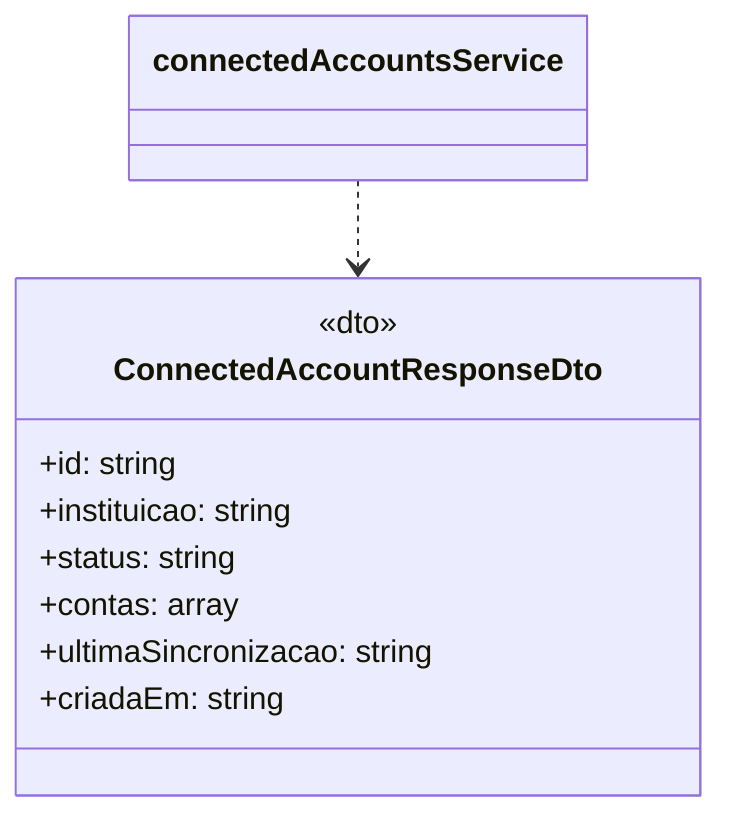

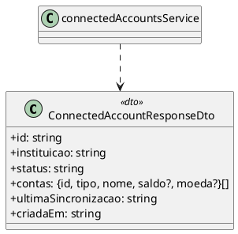

---

## ResultadoImportacao

- Tipo e estereótipo: interface TypeScript, «dto»
- Arquivo de origem: `Backend/src/modules/connected-accounts/connected-accounts.dto.ts`
- Descrição: resultado de uma importação de transações da Pluggy, com a contagem de ignoradas por motivo.

| Visibilidade | Nome | Tipo | Descrição |
|---|---|---|---|
| + | lidas | number | Quantas transações a Pluggy devolveu. |
| + | importadas | number | Quantas entraram agora. |
| + | ignoradas | {duplicadas, pendentes, zeradas, faturaCartao, invalidas: number} | Contagem do que foi descartado, por motivo. |

Operações: nenhuma.

| Tipo | Alvo | Multiplicidade | Rótulo |
|---|---|---|---|
| dependência (entrante) | connectedAccountsService | 1 | retorna de `sincronizar` e `importar` |

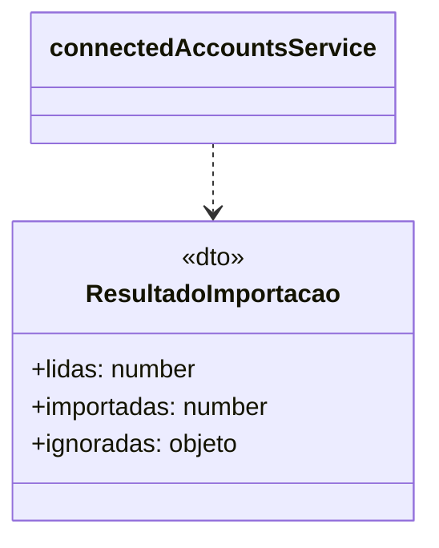

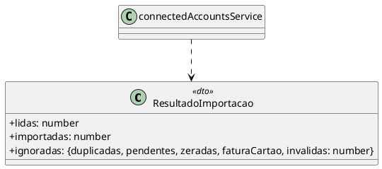

---

## ContaDaConexao

- Tipo e estereótipo: interface TypeScript
- Arquivo de origem: `Backend/src/modules/connected-accounts/connected-accounts.model.ts`
- Descrição: resumo de uma conta (corrente ou cartão) dentro de uma conexão.

| Visibilidade | Nome | Tipo | Descrição |
|---|---|---|---|
| + | pluggyAccountId | string | Id da conta na Pluggy. |
| + | tipo | string | Tipo da conta na Pluggy. |
| + | nome | string | Nome da conta. |
| + | saldo | number? | Saldo informado pela Pluggy. |
| + | moeda | string? | Código da moeda. |

Operações: nenhuma.

| Tipo | Alvo | Multiplicidade | Rótulo |
|---|---|---|---|
| composição (entrante) | ConnectedAccountDocument | 0..* | contas |
| dependência (entrante) | connectedAccountsService | 1 | `resumirContas` |

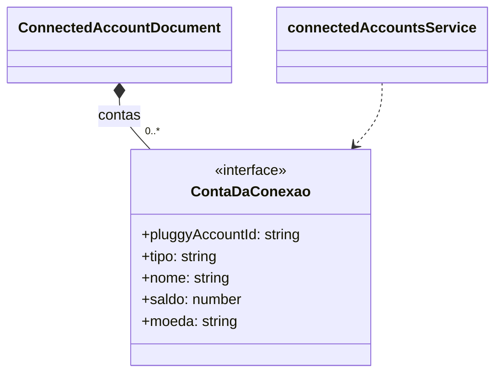

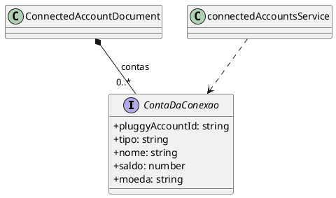

---

## ConnectedAccountDocument

- Tipo e estereótipo: interface TypeScript, «document»
- Arquivo de origem: `Backend/src/modules/connected-accounts/connected-accounts.model.ts`
- Descrição: documento da coleção `connected_accounts`: conexão do usuário com uma instituição via Pluggy.

| Visibilidade | Nome | Tipo | Descrição |
|---|---|---|---|
| + | userId | string | Dono da conexão. |
| + | pluggyItemId | string | Id do item na Pluggy. |
| + | connectorId | number | Id do conector da instituição. |
| + | instituicao | string | Nome da instituição. |
| + | status | string | Status do item. |
| + | contas | ContaDaConexao[] | Contas da conexão. |
| + | ultimaSincronizacao | Date? | Última importação concluída. |

Operações: nenhuma.

| Tipo | Alvo | Multiplicidade | Rótulo |
|---|---|---|---|
| composição | ContaDaConexao | 0..* | contas |
| realização (entrante) | ConnectedAccountSchema | 1 | |
| generalização (entrante) | ContaLida | 1 | |

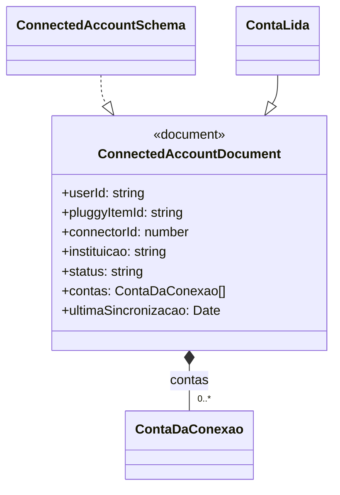

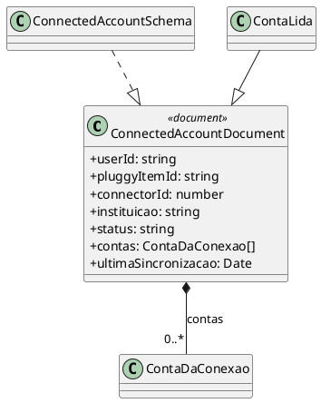

---

## ConnectedAccountSchema

- Tipo e estereótipo: objeto, «document»
- Arquivo de origem: `Backend/src/modules/connected-accounts/connected-accounts.model.ts`
- Descrição: esquema Mongoose (com timestamps, coleção `connected_accounts`), com índice em `userId` e `pluggyItemId` único.

| Visibilidade | Nome | Tipo | Descrição |
|---|---|---|---|
| + | userId | String (index) | Dono da conexão, indexado. |
| + | pluggyItemId | String (unique) | Id do item Pluggy, único. |
| + | connectorId | Number | Id do conector. |
| + | instituicao | String | Nome da instituição. |
| + | status | String | Status do item. |
| + | contas | [{pluggyAccountId, tipo, nome, saldo, moeda}] | Subdocumentos das contas. |
| + | ultimaSincronizacao | Date | Última importação concluída. |

Operações: nenhuma.

| Tipo | Alvo | Multiplicidade | Rótulo |
|---|---|---|---|
| realização | ConnectedAccountDocument | 1 | |
| dependência (entrante) | ConnectedAccountModel | 1 | |

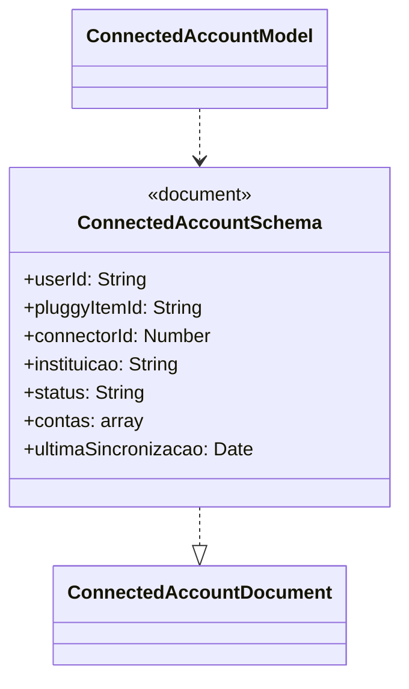

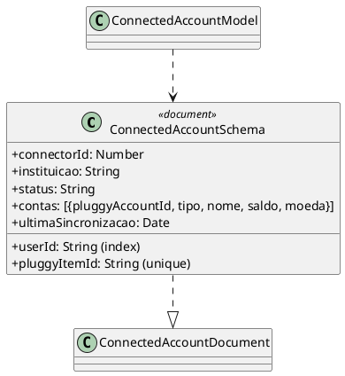

---

## ConnectedAccountModel

- Tipo e estereótipo: objeto, «document»
- Arquivo de origem: `Backend/src/modules/connected-accounts/connected-accounts.model.ts`
- Descrição: modelo Mongoose "ConnectedAccount", criado a partir do esquema.

Atributos: nenhum. Operações: nenhuma (usa as do Mongoose).

| Tipo | Alvo | Multiplicidade | Rótulo |
|---|---|---|---|
| dependência | ConnectedAccountSchema | 1 | |
| dependência | ConnectedAccountDocument | 1 | |
| dependência (entrante) | connectedAccountsRepository | 1 | |

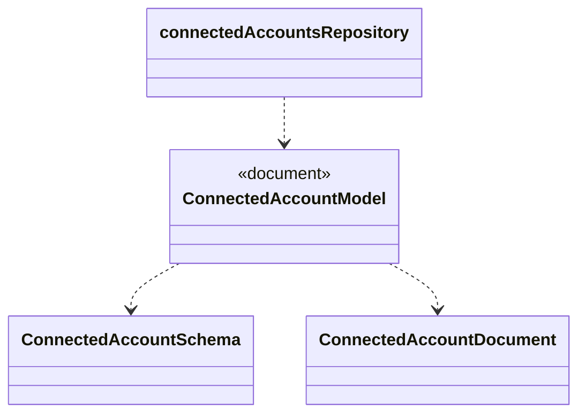

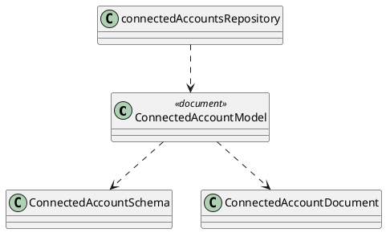

---

## connectedAccountsRepository

- Tipo e estereótipo: objeto de serviço, «repository»
- Arquivo de origem: `Backend/src/modules/connected-accounts/connected-accounts.repository.ts`
- Descrição: único acesso ao MongoDB para `connected_accounts`, sempre filtrando por `userId`.

Atributos: nenhum.

| Visibilidade | Assinatura | Retorno | Descrição |
|---|---|---|---|
| + | create(dados: ConnectedAccountDocument) | Promise&lt;objeto&gt; | Cria a conexão. |
| + | findByUser(userId) | Promise&lt;lista&gt; | Lista as conexões do usuário. |
| + | countByUser(userId) | Promise&lt;number&gt; | Conta as conexões do usuário. |
| + | findOne(userId, id) | Promise&lt;objeto\|null&gt; | Busca uma conexão do usuário. |
| + | findByItemId(pluggyItemId) | Promise&lt;objeto\|null&gt; | Busca pelo id do item Pluggy. |
| + | update(userId, id, dados) | Promise&lt;objeto\|null&gt; | Atualiza campos da conexão. |
| + | remove(userId, id) | Promise&lt;objeto\|null&gt; | Remove a conexão. |

| Tipo | Alvo | Multiplicidade | Rótulo |
|---|---|---|---|
| dependência | ConnectedAccountModel | 1 | |
| dependência | ConnectedAccountDocument | 1 | |
| dependência (entrante) | connectedAccountsService | 1 | |

```mermaid
classDiagram
    class connectedAccountsRepository {
        <<repository>>
        +create(dados) Promise~objeto~
        +findByUser(userId) Promise~lista~
        +countByUser(userId) Promise~number~
        +findOne(userId, id) Promise~objeto~
        +findByItemId(pluggyItemId) Promise~objeto~
        +update(userId, id, dados) Promise~objeto~
        +remove(userId, id) Promise~objeto~
    }
    connectedAccountsRepository ..> ConnectedAccountModel
    connectedAccountsRepository ..> ConnectedAccountDocument
    connectedAccountsService ..> connectedAccountsRepository
```

```plantuml
@startuml
skinparam classAttributeIconSize 0
class connectedAccountsRepository <<repository>> {
  + create(dados: ConnectedAccountDocument): Promise<objeto>
  + findByUser(userId): Promise<lista>
  + countByUser(userId): Promise<number>
  + findOne(userId, id): Promise<objeto|null>
  + findByItemId(pluggyItemId): Promise<objeto|null>
  + update(userId, id, dados): Promise<objeto|null>
  + remove(userId, id): Promise<objeto|null>
}
connectedAccountsRepository ..> ConnectedAccountModel
connectedAccountsRepository ..> ConnectedAccountDocument
connectedAccountsService ..> connectedAccountsRepository
@enduml
```

---

## connectedAccountsRouter

- Tipo e estereótipo: objeto, «router»
- Arquivo de origem: `Backend/src/modules/connected-accounts/connected-accounts.routes.ts`
- Descrição: router Express com `GET /`, `POST /`, `POST /connect-token`, `POST /sandbox`, `POST /:id/sync` e `DELETE /:id`, todos protegidos por `authMiddleware`.

Atributos e operações: nenhum declarado como membro (o router é um objeto de configuração das rotas).

| Tipo | Alvo | Multiplicidade | Rótulo |
|---|---|---|---|
| dependência | connectedAccountsController | 1 | |
| dependência | authMiddleware | 1 | |

```mermaid
classDiagram
    class connectedAccountsRouter {
        <<router>>
    }
    connectedAccountsRouter ..> connectedAccountsController
    connectedAccountsRouter ..> authMiddleware
```

```plantuml
@startuml
class connectedAccountsRouter <<router>>
connectedAccountsRouter ..> connectedAccountsController
connectedAccountsRouter ..> authMiddleware
@enduml
```

---

## connectedAccountsService

- Tipo e estereótipo: objeto de serviço, «service»
- Arquivo de origem: `Backend/src/modules/connected-accounts/connected-accounts.service.ts`
- Descrição: regras de contas conectadas: conectar item Pluggy (conferindo que o `clientUserId` é o do usuário), sandbox, sincronizar, importar transações (ignora pendentes, zeradas e pagamento de fatura; pula as já importadas; categoria sugerida pelo Servidor Java) e desconectar.

| Visibilidade | Nome | Tipo | Descrição |
|---|---|---|---|
| - | MAX_CONTAS_POR_USUARIO | number = 5 | Limite de conexões por usuário. |
| - | CONCORRENCIA_DA_CATEGORIZACAO | number = 5 | Pedidos simultâneos de categoria (tamanho do pool do Servidor Java). |
| - | STATUS_COM_ERRO | string[] | Status do item Pluggy que pedem ação do usuário. |

| Visibilidade | Assinatura | Retorno | Descrição |
|---|---|---|---|
| + | listar(userId) | Promise&lt;ConnectedAccountResponseDto[]&gt; | Lista as conexões do usuário. |
| + | criarConnectToken(userId) | Promise&lt;token&gt; | Token do widget Pluggy Connect. |
| + | conectar(userId, itemId) | Promise&lt;{conta, importacao, avisoImportacao?}&gt; | Registra o item e importa as transações. |
| + | conectarSandbox(userId) | Promise&lt;{conta, importacao, avisoImportacao?}&gt; | Conecta o conector de teste do sandbox. |
| + | sincronizar(userId, id) | Promise&lt;ResultadoImportacao&gt; | Importa de novo as transações. |
| + | desconectar(userId, id) | Promise&lt;void&gt; | Remove a conexão e o item na Pluggy. |
| - | paraDto(conta) | ConnectedAccountResponseDto | Converte para a resposta do Frontend. |
| - | resumirContas(contas) | ContaDaConexao[] | Resume as contas devolvidas pela Pluggy. |
| - | mapearComLimite(itens, limite, fn) | Promise&lt;R[]&gt; | Como `Promise.all` com limite de concorrência. |
| - | garantirQueHaEspaco(total) | void | Lança `AppError` se o limite foi atingido. |
| - | importar(userId, conta) | Promise&lt;ResultadoImportacao&gt; | Lê, filtra, categoriza e grava as transações. |

| Tipo | Alvo | Multiplicidade | Rótulo |
|---|---|---|---|
| dependência | connectedAccountsRepository | 1 | |
| dependência | transactionsRepository | 1 | externalIdsExistentes, inserirImportadas |
| dependência | transactionsService | 1 | sugerirCategoria |
| dependência | pluggyClient | 1 | API Pluggy |
| dependência | mapearTransacao | 1 | |
| dependência | AppError | 1 | |
| dependência | ConnectedAccountResponseDto | 1 | |
| dependência | ResultadoImportacao | 1 | |
| dependência | ContaDaConexao | 1 | |
| dependência (entrante) | connectedAccountsController | 1 | delega |

```mermaid
classDiagram
    class connectedAccountsService {
        <<service>>
        -MAX_CONTAS_POR_USUARIO: number
        -CONCORRENCIA_DA_CATEGORIZACAO: number
        -STATUS_COM_ERRO: string[]
        +listar(userId) Promise~ConnectedAccountResponseDto[]~
        +criarConnectToken(userId) Promise~token~
        +conectar(userId, itemId) Promise~objeto~
        +conectarSandbox(userId) Promise~objeto~
        +sincronizar(userId, id) Promise~ResultadoImportacao~
        +desconectar(userId, id) Promise~void~
        -paraDto(conta) ConnectedAccountResponseDto
        -resumirContas(contas) ContaDaConexao[]
        -mapearComLimite(itens, limite, fn) Promise~R[]~
        -garantirQueHaEspaco(total) void
        -importar(userId, conta) Promise~ResultadoImportacao~
    }
    connectedAccountsService ..> connectedAccountsRepository
    connectedAccountsService ..> transactionsRepository : externalIdsExistentes, inserirImportadas
    connectedAccountsService ..> transactionsService : sugerirCategoria
    connectedAccountsService ..> pluggyClient : API Pluggy
    connectedAccountsService ..> mapearTransacao
    connectedAccountsService ..> AppError
    connectedAccountsService ..> ConnectedAccountResponseDto
    connectedAccountsService ..> ResultadoImportacao
    connectedAccountsService ..> ContaDaConexao
    connectedAccountsController ..> connectedAccountsService : delega
```

```plantuml
@startuml
skinparam classAttributeIconSize 0
class connectedAccountsService <<service>> {
  - MAX_CONTAS_POR_USUARIO: number = 5
  - CONCORRENCIA_DA_CATEGORIZACAO: number = 5
  - STATUS_COM_ERRO: string[]
  + listar(userId): Promise<ConnectedAccountResponseDto[]>
  + criarConnectToken(userId): Promise<token>
  + conectar(userId, itemId): Promise<objeto>
  + conectarSandbox(userId): Promise<objeto>
  + sincronizar(userId, id): Promise<ResultadoImportacao>
  + desconectar(userId, id): Promise<void>
  - paraDto(conta): ConnectedAccountResponseDto
  - resumirContas(contas): ContaDaConexao[]
  - mapearComLimite(itens, limite, fn): Promise<R[]>
  - garantirQueHaEspaco(total): void
  - importar(userId, conta): Promise<ResultadoImportacao>
}
connectedAccountsService ..> connectedAccountsRepository
connectedAccountsService ..> transactionsRepository : externalIdsExistentes, inserirImportadas
connectedAccountsService ..> transactionsService : sugerirCategoria
connectedAccountsService ..> pluggyClient : API Pluggy
connectedAccountsService ..> mapearTransacao
connectedAccountsService ..> AppError
connectedAccountsService ..> ConnectedAccountResponseDto
connectedAccountsService ..> ResultadoImportacao
connectedAccountsService ..> ContaDaConexao
connectedAccountsController ..> connectedAccountsService : delega
@enduml
```

---

## ContaLida

- Tipo e estereótipo: alias de tipo TypeScript, «type» (interno ao arquivo do service)
- Arquivo de origem: `Backend/src/modules/connected-accounts/connected-accounts.service.ts`
- Descrição: `ConnectedAccountDocument` acrescido de `_id` e `createdAt` do documento lean, que o tipo gerado pelo Mongoose não expõe.

Atributos: herda os de `ConnectedAccountDocument`, mais `_id` (objeto com `toString()`) e `createdAt` (Date). Operações: nenhuma.

| Tipo | Alvo | Multiplicidade | Rótulo |
|---|---|---|---|
| generalização | ConnectedAccountDocument | 1 | |

```mermaid
classDiagram
    class ContaLida {
        <<type>>
    }
    ContaLida --|> ConnectedAccountDocument
```

```plantuml
@startuml
class ContaLida <<type>>
ContaLida --|> ConnectedAccountDocument
@enduml
```
