# Modelo UML: Backend, módulo dashboard

Modelo UML (notação Astah / UML 2) de cada classe, interface, tipo e módulo do módulo `Backend/src/modules/dashboard`. O módulo segue a arquitetura em camadas do Backend (router, controller, service, repository) e delega os cálculos ao Servidor Java.

Convenções: visibilidade `+` público, `-` privado, `#` protegido, `~` pacote. Estereótipos entre «aspas angulares». Todos os elementos deste grupo existem no código; nenhum elemento «planejado» pertence a este grupo (contas e transferências ainda não afetam o dashboard no código atual).

Observação sobre os diagramas Mermaid: tipos genéricos usam `~T~` e tipos literais/objeto foram simplificados para que o diagrama renderize; as tabelas de cada elemento trazem a assinatura exata do código.

## Diagrama do grupo

Elementos externos ao grupo (vizinhos principais, marcados como «externo»): `javaServerClient`, `AppError`, `TransactionModel` e `authMiddleware`.

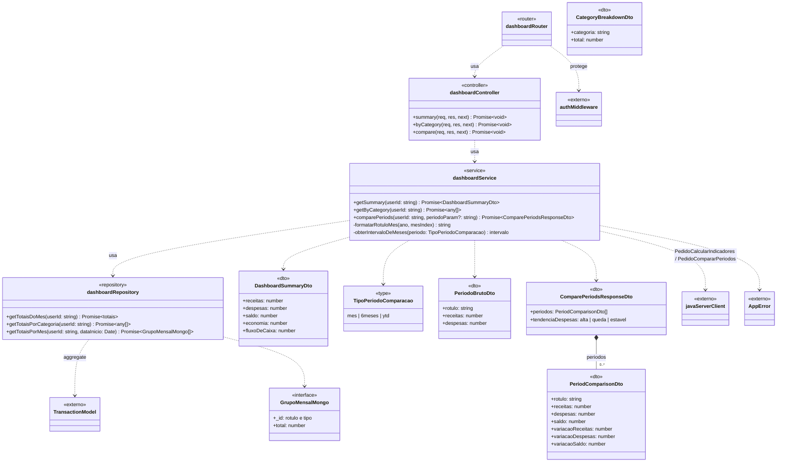

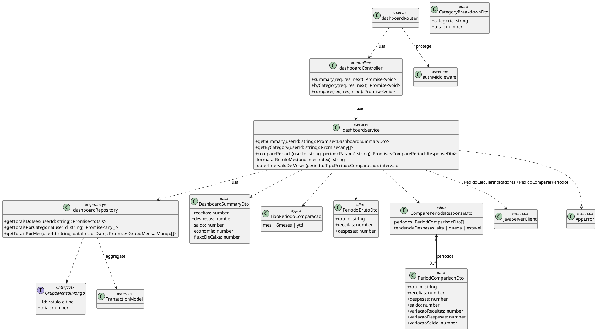

---

## dashboardController

- **Tipo e estereótipo:** serviço (objeto/módulo de funções), «controller»
- **Arquivo de origem:** `Backend/src/modules/dashboard/dashboard.controller.ts`
- **Descrição:** Controller Express do dashboard: resumo, gastos por categoria e comparação de períodos.

### Atributos

| Visibilidade | Nome | Tipo | Descrição |
|---|---|---|---|
| (sem atributos) | | | |

### Operações

| Visibilidade | Assinatura | Retorno | Descrição |
|---|---|---|---|
| + | `summary(req, res, next)` | `Promise<void>` | Responde com o resumo do mês do usuário autenticado. |
| + | `byCategory(req, res, next)` | `Promise<void>` | Responde com os gastos por categoria. |
| + | `compare(req, res, next)` | `Promise<void>` | Responde com a comparação de períodos. |

### Relações

| Tipo | Alvo | Multiplicidade | Rótulo |
|---|---|---|---|
| dependência | dashboardService | 1 | usa |

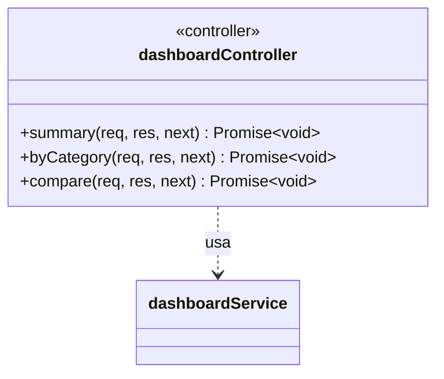

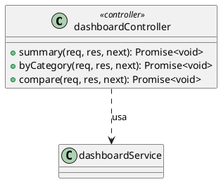

---

## dashboardService

- **Tipo e estereótipo:** serviço, «service»
- **Arquivo de origem:** `Backend/src/modules/dashboard/dashboard.service.ts`
- **Descrição:** Regras do dashboard; agrega dados no repository e delega indicadores e comparações ao Servidor Java.

### Atributos

| Visibilidade | Nome | Tipo | Descrição |
|---|---|---|---|
| (sem atributos) | | | |

### Operações

| Visibilidade | Assinatura | Retorno | Descrição |
|---|---|---|---|
| + | `getSummary(userId: string)` | `Promise<DashboardSummaryDto>` | Obtém os totais do mês no repository e pede ao Servidor Java o cálculo dos indicadores (PedidoCalcularIndicadores). |
| + | `getByCategory(userId: string)` | `Promise<any[]>` | Obtém os totais por categoria no repository. |
| + | `comparePeriods(userId: string, periodoParam?: string)` | `Promise<ComparePeriodsResponseDto>` | Monta os períodos brutos e delega a comparação ao Servidor Java (PedidoCompararPeriodos). |
| - | `formatarRotuloMes(ano, mesIndex)` | `string` | Formata o rótulo de um mês. |
| - | `obterIntervaloDeMeses(periodo: TipoPeriodoComparacao)` | `{dataInicio: Date; rotulos: string[]}` | Calcula a data inicial e os rótulos dos meses do período. |

### Relações

| Tipo | Alvo | Multiplicidade | Rótulo |
|---|---|---|---|
| dependência | dashboardRepository | 1 | |
| dependência | javaServerClient | 1 | PedidoCalcularIndicadores / PedidoCompararPeriodos |
| dependência | AppError | | |
| dependência | DashboardSummaryDto | | |
| dependência | ComparePeriodsResponseDto | | |
| dependência | PeriodoBrutoDto | | |
| dependência | TipoPeriodoComparacao | | |

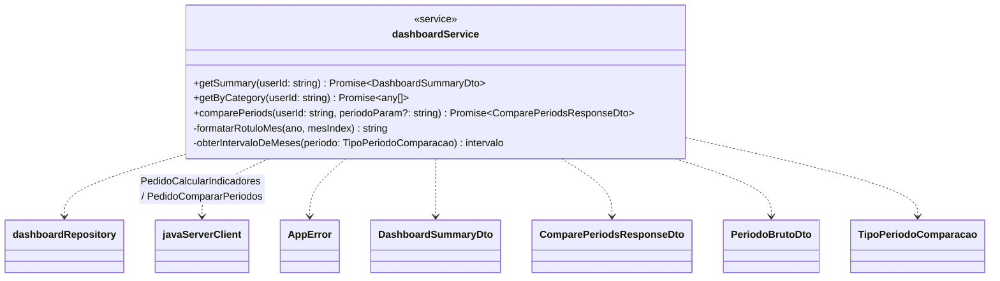

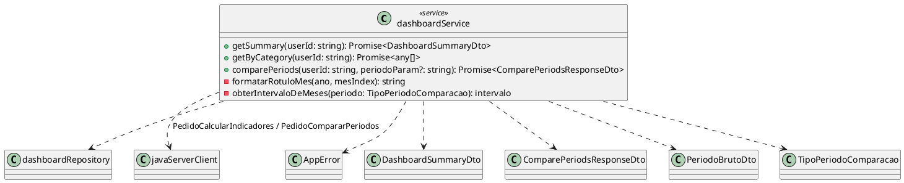

---

## dashboardRepository

- **Tipo e estereótipo:** serviço, «repository»
- **Arquivo de origem:** `Backend/src/modules/dashboard/dashboard.repository.ts`
- **Descrição:** Agregações Mongo sobre as transações para totais do mês, por categoria e por mês.

### Atributos

| Visibilidade | Nome | Tipo | Descrição |
|---|---|---|---|
| (sem atributos) | | | |

### Operações

| Visibilidade | Assinatura | Retorno | Descrição |
|---|---|---|---|
| + | `getTotaisDoMes(userId: string)` | `Promise<{receitas: number; despesas: number}>` | Soma receitas e despesas do mês corrente do usuário. |
| + | `getTotaisPorCategoria(userId: string)` | `Promise<any[]>` | Agrega o total de despesas por categoria. |
| + | `getTotaisPorMes(userId: string, dataInicio: Date)` | `Promise<GrupoMensalMongo[]>` | Agrega receitas e despesas por mês a partir de `dataInicio`. |

### Relações

| Tipo | Alvo | Multiplicidade | Rótulo |
|---|---|---|---|
| dependência | TransactionModel | 1 | aggregate |
| dependência | GrupoMensalMongo | | |

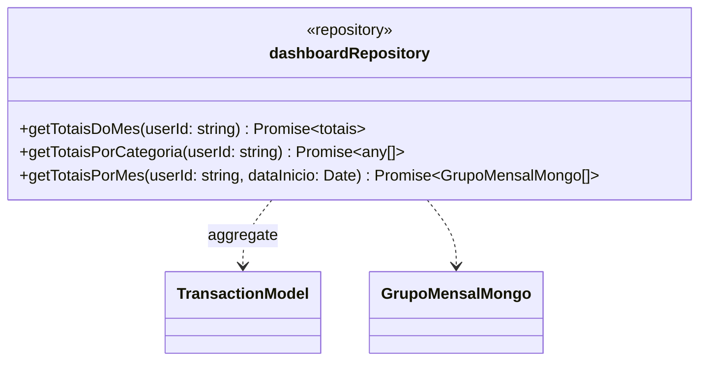

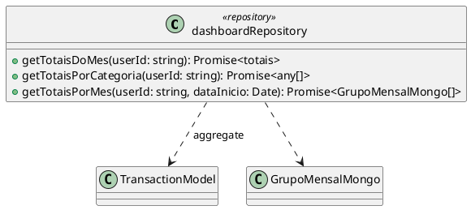

---

## dashboardRouter

- **Tipo e estereótipo:** módulo, «router»
- **Arquivo de origem:** `Backend/src/modules/dashboard/dashboard.routes.ts`
- **Descrição:** Router Express protegido por authMiddleware com GET `/summary`, `/by-category` e `/compare`.

### Atributos

| Visibilidade | Nome | Tipo | Descrição |
|---|---|---|---|
| (sem atributos) | | | |

### Operações

| Visibilidade | Assinatura | Retorno | Descrição |
|---|---|---|---|
| + | `GET /summary` | resposta HTTP | Encaminha para `dashboardController.summary`. |
| + | `GET /by-category` | resposta HTTP | Encaminha para `dashboardController.byCategory`. |
| + | `GET /compare` | resposta HTTP | Encaminha para `dashboardController.compare`. |

### Relações

| Tipo | Alvo | Multiplicidade | Rótulo |
|---|---|---|---|
| dependência | dashboardController | 1 | |
| dependência | authMiddleware | 1 | |

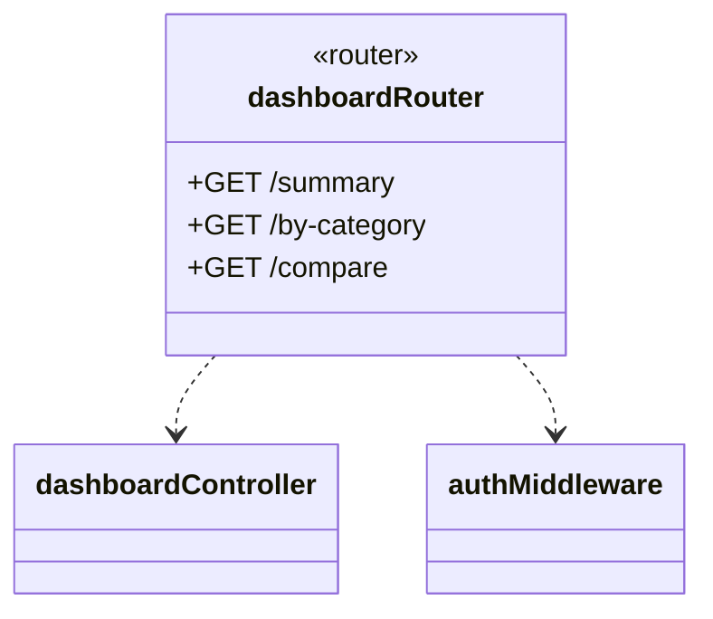

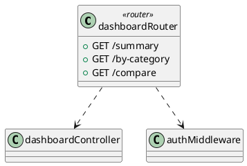

---

## DashboardSummaryDto

- **Tipo e estereótipo:** classe, «dto»
- **Arquivo de origem:** `Backend/src/modules/dashboard/dashboard.dto.ts`
- **Descrição:** Resumo do mês devolvido ao Frontend.

### Atributos

| Visibilidade | Nome | Tipo | Descrição |
|---|---|---|---|
| + | `receitas` | `number` | Total de receitas do mês. |
| + | `despesas` | `number` | Total de despesas do mês. |
| + | `saldo` | `number` | Saldo do mês. |
| + | `economia` | `number` | Indicador de economia. |
| + | `fluxoDeCaixa` | `number` | Fluxo de caixa do mês. |

### Operações

| Visibilidade | Assinatura | Retorno | Descrição |
|---|---|---|---|
| (sem operações) | | | |

### Relações

| Tipo | Alvo | Multiplicidade | Rótulo |
|---|---|---|---|
| dependência (entrante) | dashboardService | 1 | retornado por getSummary |

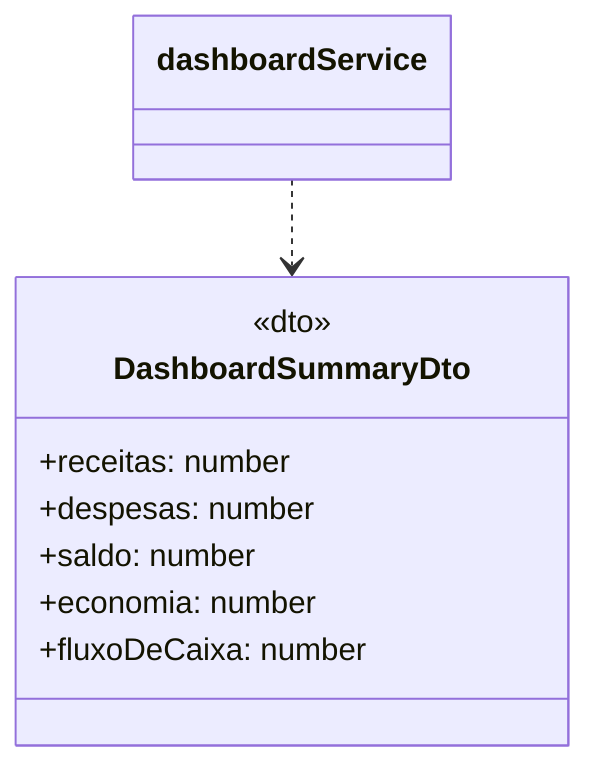

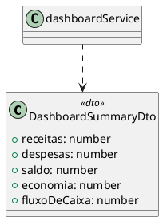

---

## CategoryBreakdownDto

- **Tipo e estereótipo:** classe, «dto»
- **Arquivo de origem:** `Backend/src/modules/dashboard/dashboard.dto.ts`
- **Descrição:** Total de despesas por categoria.

### Atributos

| Visibilidade | Nome | Tipo | Descrição |
|---|---|---|---|
| + | `categoria` | `string` | Nome da categoria. |
| + | `total` | `number` | Total de despesas da categoria. |

### Operações

| Visibilidade | Assinatura | Retorno | Descrição |
|---|---|---|---|
| (sem operações) | | | |

### Relações

| Tipo | Alvo | Multiplicidade | Rótulo |
|---|---|---|---|
| (nenhuma relação declarada no mapeamento) | | | |

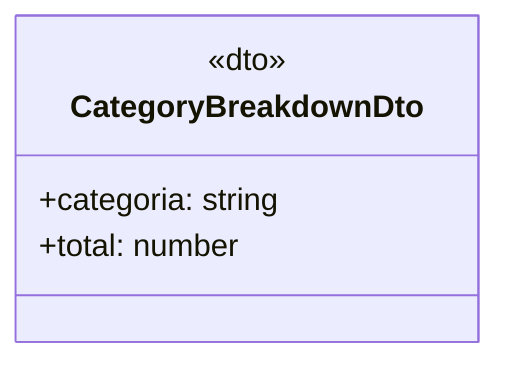

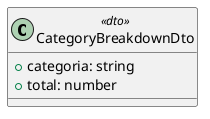

---

## PeriodComparisonDto

- **Tipo e estereótipo:** classe, «dto»
- **Arquivo de origem:** `Backend/src/modules/dashboard/dashboard.dto.ts`
- **Descrição:** Um período comparado, com totais e variações.

### Atributos

| Visibilidade | Nome | Tipo | Descrição |
|---|---|---|---|
| + | `rotulo` | `string` | Rótulo do período. |
| + | `receitas` | `number` | Total de receitas. |
| + | `despesas` | `number` | Total de despesas. |
| + | `saldo` | `number` | Saldo do período. |
| + | `variacaoReceitas` | `number` | Variação das receitas. |
| + | `variacaoDespesas` | `number` | Variação das despesas. |
| + | `variacaoSaldo` | `number` | Variação do saldo. |

### Operações

| Visibilidade | Assinatura | Retorno | Descrição |
|---|---|---|---|
| (sem operações) | | | |

### Relações

| Tipo | Alvo | Multiplicidade | Rótulo |
|---|---|---|---|
| composição (entrante) | ComparePeriodsResponseDto | 0..* | periodos |

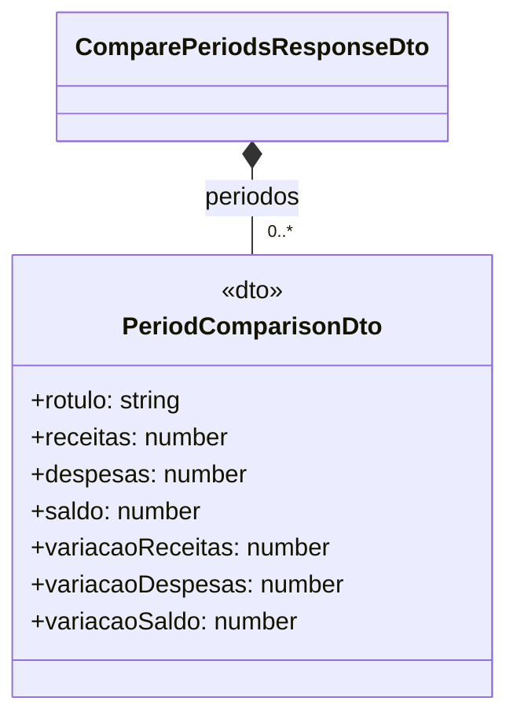

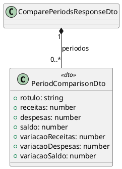

---

## TipoPeriodoComparacao

- **Tipo e estereótipo:** tipo (alias de união de literais), «type»
- **Arquivo de origem:** `Backend/src/modules/dashboard/dashboard.dto.ts`
- **Descrição:** União de literais `"mes" | "6meses" | "ytd"`.

### Atributos

| Visibilidade | Nome | Tipo | Descrição |
|---|---|---|---|
| + | `"mes"` | literal | Período do mês corrente. |
| + | `"6meses"` | literal | Últimos seis meses. |
| + | `"ytd"` | literal | Ano até a data atual. |

### Operações

| Visibilidade | Assinatura | Retorno | Descrição |
|---|---|---|---|
| (sem operações) | | | |

### Relações

| Tipo | Alvo | Multiplicidade | Rótulo |
|---|---|---|---|
| dependência (entrante) | dashboardService | 1 | parâmetro de obterIntervaloDeMeses |

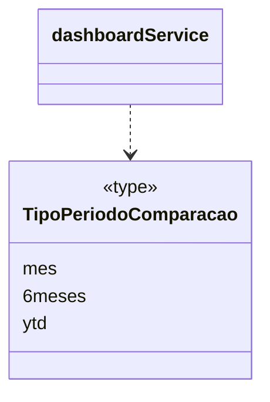

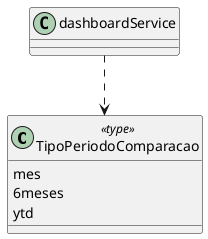

---

## PeriodoBrutoDto

- **Tipo e estereótipo:** classe, «dto»
- **Arquivo de origem:** `Backend/src/modules/dashboard/dashboard.dto.ts`
- **Descrição:** Totais brutos de um mês enviados ao Servidor Java.

### Atributos

| Visibilidade | Nome | Tipo | Descrição |
|---|---|---|---|
| + | `rotulo` | `string` | Rótulo do mês. |
| + | `receitas` | `number` | Total bruto de receitas. |
| + | `despesas` | `number` | Total bruto de despesas. |

### Operações

| Visibilidade | Assinatura | Retorno | Descrição |
|---|---|---|---|
| (sem operações) | | | |

### Relações

| Tipo | Alvo | Multiplicidade | Rótulo |
|---|---|---|---|
| dependência (entrante) | dashboardService | 1 | enviado em PedidoCompararPeriodos |

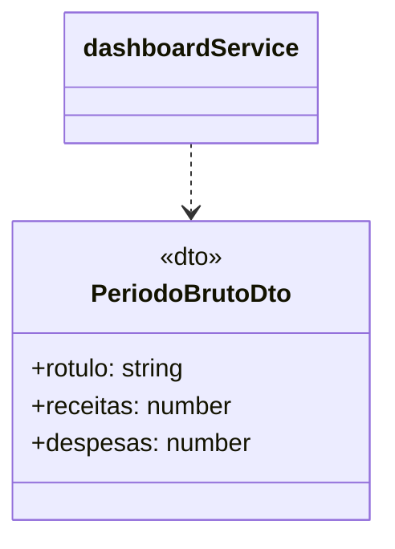

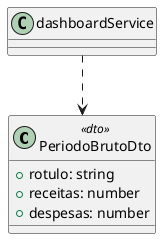

---

## ComparePeriodsResponseDto

- **Tipo e estereótipo:** classe, «dto»
- **Arquivo de origem:** `Backend/src/modules/dashboard/dashboard.dto.ts`
- **Descrição:** Resposta da comparação de períodos com tendência de despesas.

### Atributos

| Visibilidade | Nome | Tipo | Descrição |
|---|---|---|---|
| + | `periodos` | `PeriodComparisonDto[]` | Períodos comparados. |
| + | `tendenciaDespesas` | `"alta"\|"queda"\|"estavel"` | Tendência das despesas. |

### Operações

| Visibilidade | Assinatura | Retorno | Descrição |
|---|---|---|---|
| (sem operações) | | | |

### Relações

| Tipo | Alvo | Multiplicidade | Rótulo |
|---|---|---|---|
| composição | PeriodComparisonDto | 0..* | periodos |
| dependência (entrante) | dashboardService | 1 | retornado por comparePeriods |

```mermaid
classDiagram
    class ComparePeriodsResponseDto {
        <<dto>>
        +periodos: PeriodComparisonDto[]
        +tendenciaDespesas: alta | queda | estavel
    }
    ComparePeriodsResponseDto *-- "0..*" PeriodComparisonDto : periodos
    dashboardService ..> ComparePeriodsResponseDto
```

```plantuml
@startuml
class ComparePeriodsResponseDto <<dto>> {
  + periodos: PeriodComparisonDto[]
  + tendenciaDespesas: alta | queda | estavel
}
ComparePeriodsResponseDto "1" *-- "0..*" PeriodComparisonDto : periodos
dashboardService ..> ComparePeriodsResponseDto
@enduml
```

---

## GrupoMensalMongo

- **Tipo e estereótipo:** interface (tipo TypeScript, mapeado como classe no mapeamento), «interface»
- **Arquivo de origem:** `Backend/src/modules/dashboard/dashboard.repository.ts`
- **Descrição:** Formato do grupo devolvido pela agregação mensal do Mongo.

### Atributos

| Visibilidade | Nome | Tipo | Descrição |
|---|---|---|---|
| + | `_id` | `{rotulo: string; tipo: string}` | Chave do grupo: rótulo do mês e tipo da transação. |
| + | `total` | `number` | Soma dos valores do grupo. |

### Operações

| Visibilidade | Assinatura | Retorno | Descrição |
|---|---|---|---|
| (sem operações) | | | |

### Relações

| Tipo | Alvo | Multiplicidade | Rótulo |
|---|---|---|---|
| dependência (entrante) | dashboardRepository | 0..* | retornado por getTotaisPorMes |

```mermaid
classDiagram
    class GrupoMensalMongo {
        <<interface>>
        +_id: rotulo e tipo
        +total: number
    }
    dashboardRepository ..> GrupoMensalMongo
```

```plantuml
@startuml
interface GrupoMensalMongo <<interface>> {
  + _id: rotulo e tipo
  + total: number
}
dashboardRepository ..> GrupoMensalMongo
@enduml
```
