# Modelo UML de classes: Backend, módulo goals

Notação Astah / UML 2. Visibilidade: `+` público, `-` privado, `#` protegido, `~` pacote. Origem: `Backend/src/modules/goals/`. Nenhum elemento deste grupo é «planejado»; todos existem no código.

## Diagrama do grupo

Vizinhos externos ao grupo: `javaServerClient`, `AppError`, `authMiddleware` e `TransactionModel`.

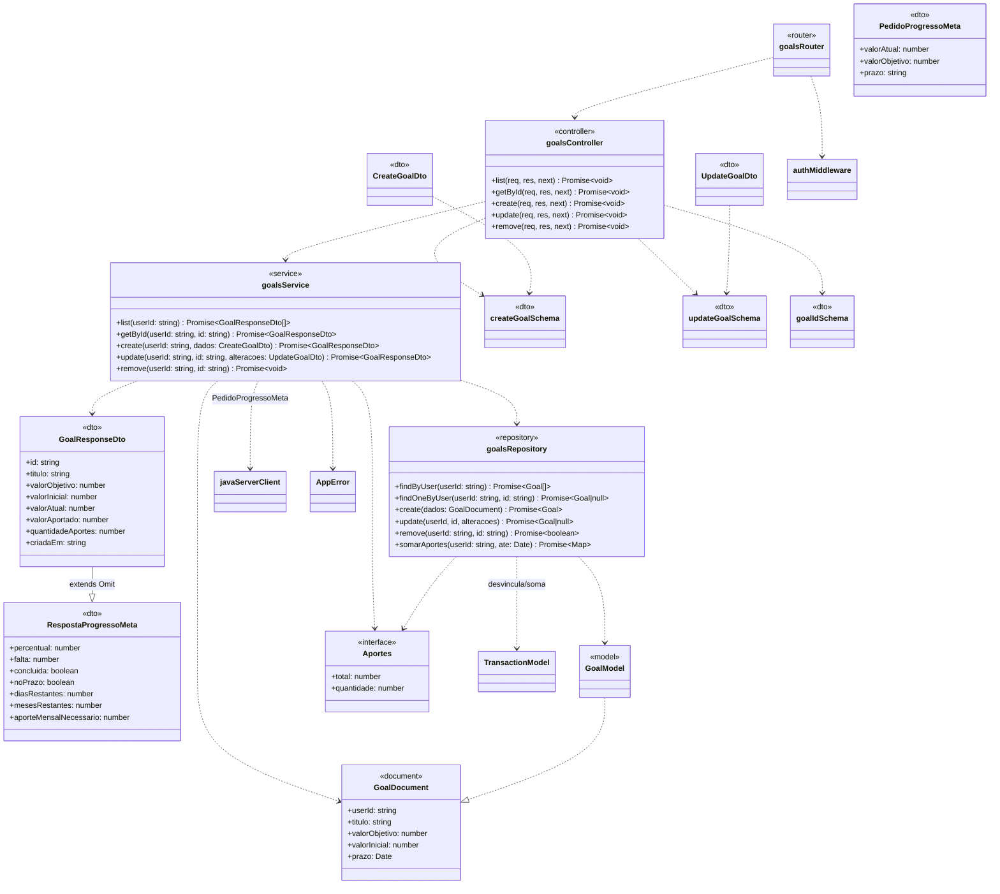

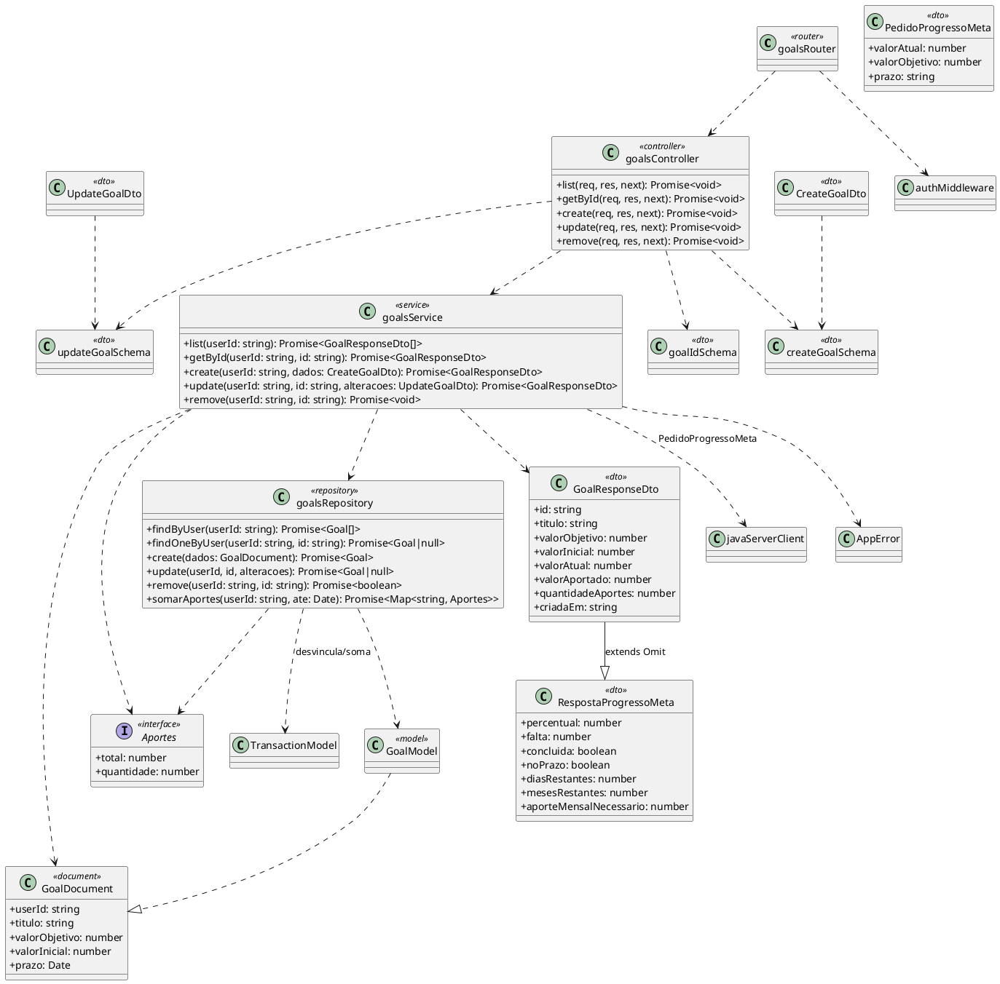

---

## goalsController

- **Tipo e estereótipo:** módulo/serviço, «controller»
- **Arquivo:** `Backend/src/modules/goals/goals.controller.ts`
- **Descrição:** Controller CRUD de metas; valida entrada com zod e delega ao service.

**Atributos:** nenhum.

| Visibilidade | Assinatura | Retorno | Descrição |
|---|---|---|---|
| + | list(req, res, next) | Promise&lt;void&gt; | Lista as metas do usuário. |
| + | getById(req, res, next) | Promise&lt;void&gt; | Busca uma meta pelo id. |
| + | create(req, res, next) | Promise&lt;void&gt; | Cria uma meta. |
| + | update(req, res, next) | Promise&lt;void&gt; | Edita uma meta. |
| + | remove(req, res, next) | Promise&lt;void&gt; | Remove uma meta. |

| Tipo | Alvo | Multiplicidade | Rótulo |
|---|---|---|---|
| dependência | goalsService | 1 | |
| dependência | createGoalSchema | 1 | |
| dependência | updateGoalSchema | 1 | |
| dependência | goalIdSchema | 1 | |

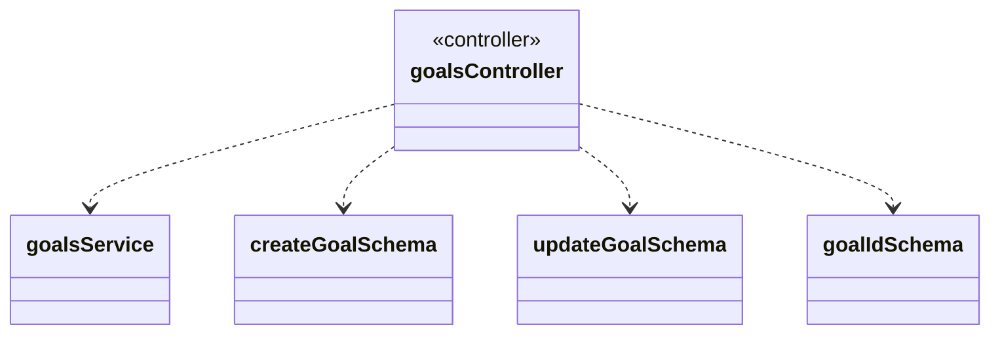

## goalsService

- **Tipo e estereótipo:** serviço, «service»
- **Arquivo:** `Backend/src/modules/goals/goals.service.ts`
- **Descrição:** Regras das metas; calcula o progresso com as transações vinculadas via Servidor Java (PedidoProgressoMeta).

**Atributos:** nenhum.

| Visibilidade | Assinatura | Retorno | Descrição |
|---|---|---|---|
| + | list(userId: string) | Promise&lt;GoalResponseDto[]&gt; | Lista metas com progresso. |
| + | getById(userId: string, id: string) | Promise&lt;GoalResponseDto&gt; | Busca uma meta com progresso. |
| + | create(userId: string, dados: CreateGoalDto) | Promise&lt;GoalResponseDto&gt; | Cria meta. |
| + | update(userId: string, id: string, alteracoes: UpdateGoalDto) | Promise&lt;GoalResponseDto&gt; | Atualiza meta. |
| + | remove(userId: string, id: string) | Promise&lt;void&gt; | Remove meta. |
| - | calcularProgresso(meta, aportes: Aportes) | Promise&lt;object&gt; | Pede o progresso ao Servidor Java. |
| - | paraDto(meta, progresso) | GoalResponseDto | Converte meta e progresso em DTO. |
| - | prazoNaoPassou(prazo: Date) | void | Valida que o prazo não passou. |
| - | naoEncontrada() | AppError | Cria o erro de meta não encontrada. |
| - | emReais(valor: number) | number | Normaliza valor em reais. |
| - | inicioDoDia(data?: Date) | Date | Início do dia da data informada. |

| Tipo | Alvo | Multiplicidade | Rótulo |
|---|---|---|---|
| dependência | goalsRepository | 1 | |
| dependência | javaServerClient | 1 | PedidoProgressoMeta |
| dependência | AppError | * | |
| dependência | GoalDocument | * | |
| dependência | GoalResponseDto | * | |
| dependência | Aportes | * | |

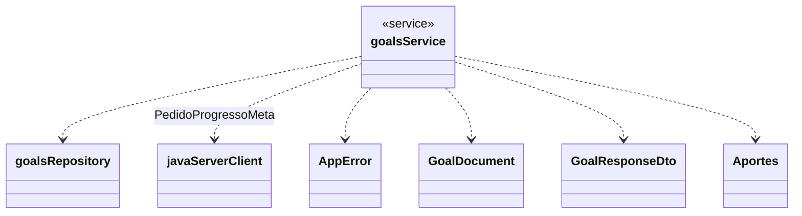

## goalsRepository

- **Tipo e estereótipo:** serviço, «repository»
- **Arquivo:** `Backend/src/modules/goals/goals.repository.ts`
- **Descrição:** Acesso a dados das metas, sempre filtrado por usuário; soma aportes lendo as transações.

**Atributos:** nenhum.

| Visibilidade | Assinatura | Retorno | Descrição |
|---|---|---|---|
| + | findByUser(userId: string) | Promise&lt;Goal[]&gt; | Metas do usuário. |
| + | findOneByUser(userId: string, id: string) | Promise&lt;Goal\|null&gt; | Uma meta do usuário. |
| + | create(dados: GoalDocument) | Promise&lt;Goal&gt; | Insere meta. |
| + | update(userId, id, alteracoes) | Promise&lt;Goal\|null&gt; | Atualiza meta do usuário. |
| + | remove(userId: string, id: string) | Promise&lt;boolean&gt; | Remove meta (desvincula transações). |
| + | somarAportes(userId: string, ate: Date) | Promise&lt;Map&lt;string, Aportes&gt;&gt; | Soma aportes por meta lendo as transações. |

| Tipo | Alvo | Multiplicidade | Rótulo |
|---|---|---|---|
| dependência | GoalModel | 1 | |
| dependência | TransactionModel | 1 | desvincula/soma |
| dependência | Aportes | * | |

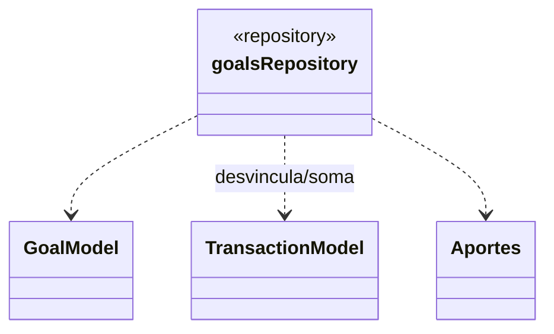

## goalsRouter

- **Tipo e estereótipo:** módulo, «router»
- **Arquivo:** `Backend/src/modules/goals/goals.routes.ts`
- **Descrição:** Router de metas (GET/POST /, GET/PATCH/DELETE /:id) protegido por authMiddleware.

**Atributos:** nenhum. **Operações:** nenhuma (rotas declaradas no módulo).

| Tipo | Alvo | Multiplicidade | Rótulo |
|---|---|---|---|
| dependência | goalsController | 1 | |
| dependência | authMiddleware | 1 | |

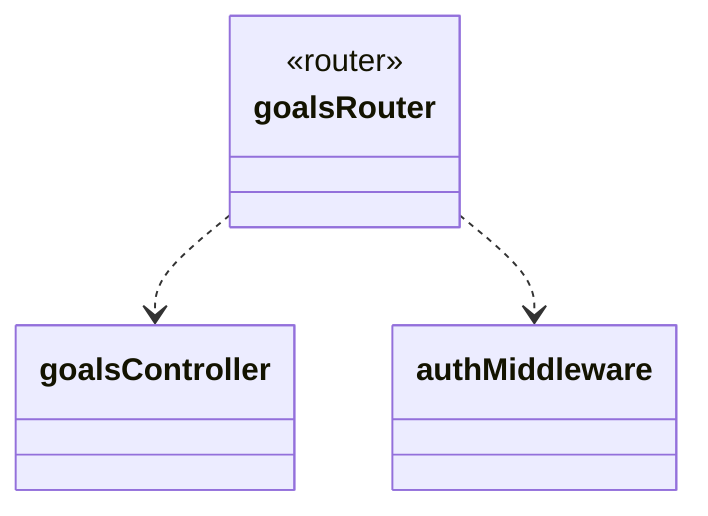

## createGoalSchema

- **Tipo e estereótipo:** objeto, «dto»
- **Arquivo:** `Backend/src/modules/goals/goals.dto.ts`
- **Descrição:** Schema zod de criação de meta.

| Visibilidade | Nome | Tipo | Descrição |
|---|---|---|---|
| + | titulo | string | Título da meta. |
| + | valorObjetivo | number | Valor a atingir. |
| + | valorInicial | number (default 0) | Valor já acumulado. |
| + | prazo | Date? | Prazo opcional. |

**Operações:** nenhuma.

| Tipo | Alvo | Multiplicidade | Rótulo |
|---|---|---|---|
| dependência | goalsController | * | usado por (entrada) |
| dependência | CreateGoalDto | 1 | tipo inferido |

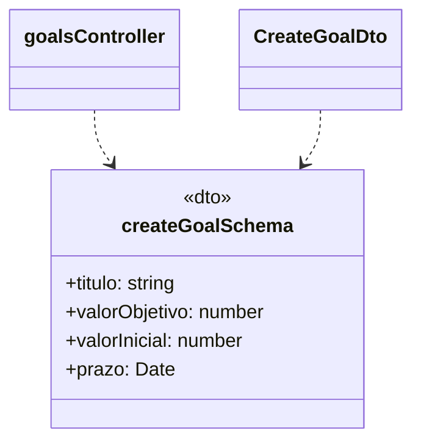

## updateGoalSchema

- **Tipo e estereótipo:** objeto, «dto»
- **Arquivo:** `Backend/src/modules/goals/goals.dto.ts`
- **Descrição:** Schema zod parcial de edição de meta (prazo pode ser null).

| Visibilidade | Nome | Tipo | Descrição |
|---|---|---|---|
| + | titulo | string? | Novo título. |
| + | valorObjetivo | number? | Novo valor objetivo. |
| + | valorInicial | number? | Novo valor inicial. |
| + | prazo | Date\|null? | Novo prazo ou null para removê-lo. |

**Operações:** nenhuma.

| Tipo | Alvo | Multiplicidade | Rótulo |
|---|---|---|---|
| dependência | goalsController | * | usado por (entrada) |
| dependência | UpdateGoalDto | 1 | tipo inferido |

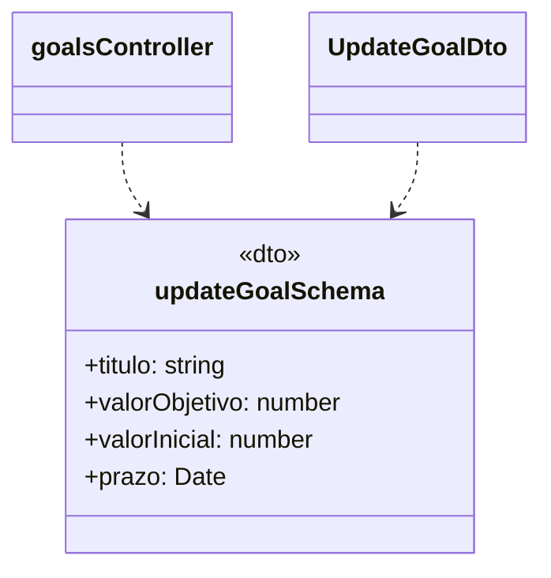

## goalIdSchema

- **Tipo e estereótipo:** objeto, «dto»
- **Arquivo:** `Backend/src/modules/goals/goals.dto.ts`
- **Descrição:** Schema zod do id (24 caracteres hexadecimais).

**Atributos:** nenhum. **Operações:** nenhuma.

| Tipo | Alvo | Multiplicidade | Rótulo |
|---|---|---|---|
| dependência | goalsController | * | usado por (entrada) |

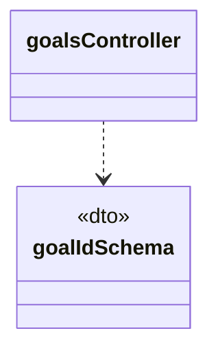

## CreateGoalDto

- **Tipo e estereótipo:** tipo, «dto»
- **Arquivo:** `Backend/src/modules/goals/goals.dto.ts`
- **Descrição:** Tipo inferido de createGoalSchema.

**Atributos:** os de createGoalSchema (inferidos). **Operações:** nenhuma.

| Tipo | Alvo | Multiplicidade | Rótulo |
|---|---|---|---|
| dependência | createGoalSchema | 1 | z.infer |

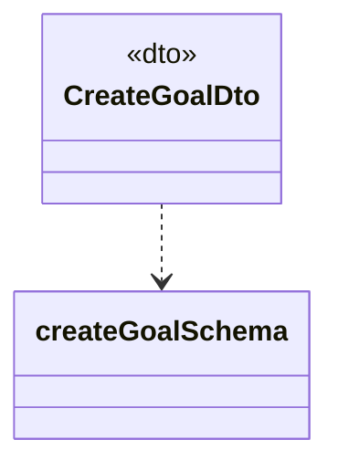

## UpdateGoalDto

- **Tipo e estereótipo:** tipo, «dto»
- **Arquivo:** `Backend/src/modules/goals/goals.dto.ts`
- **Descrição:** Tipo inferido de updateGoalSchema.

**Atributos:** os de updateGoalSchema (inferidos). **Operações:** nenhuma.

| Tipo | Alvo | Multiplicidade | Rótulo |
|---|---|---|---|
| dependência | updateGoalSchema | 1 | z.infer |

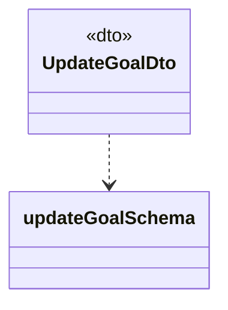

## PedidoProgressoMeta

- **Tipo e estereótipo:** classe, «dto»
- **Arquivo:** `Backend/src/modules/goals/goals.dto.ts`
- **Descrição:** Mensagem enviada ao Servidor Java para calcular o progresso da meta.

| Visibilidade | Nome | Tipo | Descrição |
|---|---|---|---|
| + | valorAtual | number | Valor acumulado atual. |
| + | valorObjetivo | number | Valor a atingir. |
| + | prazo | string | Prazo da meta. |

**Operações:** nenhuma.

| Tipo | Alvo | Multiplicidade | Rótulo |
|---|---|---|---|
| dependência | javaServerClient | 1 | enviada por goalsService |

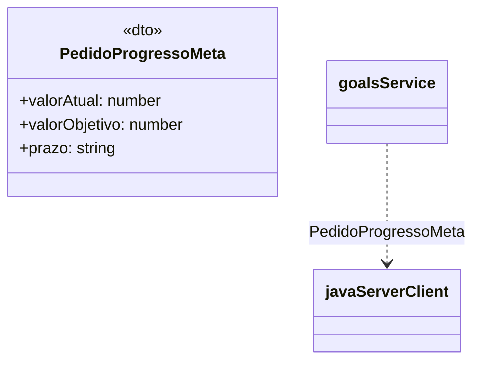

## RespostaProgressoMeta

- **Tipo e estereótipo:** classe, «dto»
- **Arquivo:** `Backend/src/modules/goals/goals.dto.ts`
- **Descrição:** Resposta do Servidor Java com o progresso calculado.

| Visibilidade | Nome | Tipo | Descrição |
|---|---|---|---|
| + | percentual | number | Percentual atingido. |
| + | falta | number | Valor que falta. |
| + | concluida | boolean | Meta concluída. |
| + | noPrazo | boolean | Dentro do prazo. |
| + | diasRestantes | number | Dias até o prazo. |
| + | mesesRestantes | number | Meses até o prazo. |
| + | aporteMensalNecessario | number | Aporte mensal necessário. |

**Operações:** nenhuma.

| Tipo | Alvo | Multiplicidade | Rótulo |
|---|---|---|---|
| generalização | GoalResponseDto | 1 | base (extends Omit&lt;...&gt;) |

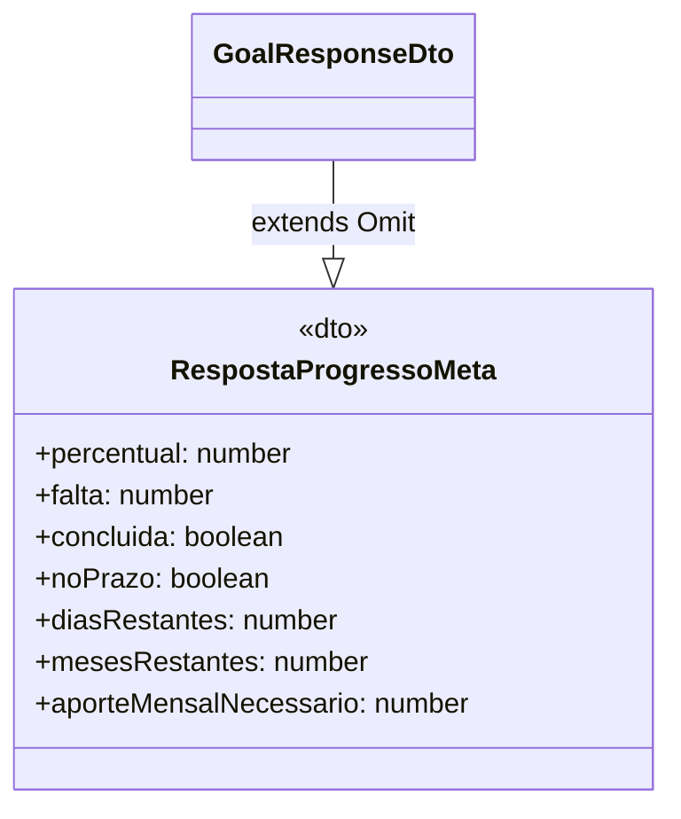

## GoalResponseDto

- **Tipo e estereótipo:** classe, «dto»
- **Arquivo:** `Backend/src/modules/goals/goals.dto.ts`
- **Descrição:** Meta devolvida ao Frontend, com progresso calculado.

| Visibilidade | Nome | Tipo | Descrição |
|---|---|---|---|
| + | id | string | Identificador. |
| + | titulo | string | Título. |
| + | valorObjetivo | number | Valor a atingir. |
| + | valorInicial | number | Valor inicial. |
| + | prazo | string? | Prazo. |
| + | diasRestantes | number? | Dias restantes. |
| + | mesesRestantes | number? | Meses restantes. |
| + | aporteMensalNecessario | number? | Aporte mensal necessário. |
| + | valorAtual | number | Valor atual. |
| + | valorAportado | number | Soma dos aportes. |
| + | quantidadeAportes | number | Quantidade de aportes. |
| + | criadaEm | string | Data de criação. |

**Operações:** nenhuma.

| Tipo | Alvo | Multiplicidade | Rótulo |
|---|---|---|---|
| generalização | RespostaProgressoMeta | 1 | extends Omit&lt;...&gt; |

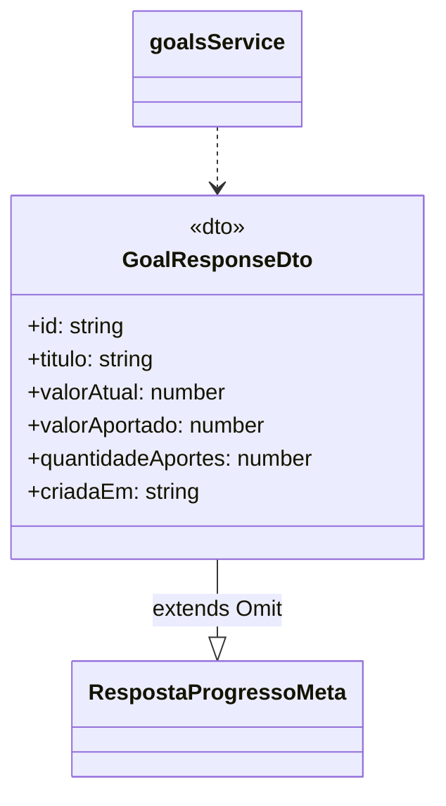

## GoalDocument

- **Tipo e estereótipo:** classe, «document»
- **Arquivo:** `Backend/src/modules/goals/goals.model.ts`
- **Descrição:** Documento Mongoose de uma meta de poupança; o progresso não é guardado.

| Visibilidade | Nome | Tipo | Descrição |
|---|---|---|---|
| + | userId | string | Dono da meta. |
| + | titulo | string | Título. |
| + | valorObjetivo | number | Valor a atingir. |
| + | valorInicial | number | Valor inicial. |
| + | prazo | Date? | Prazo opcional. |

**Operações:** nenhuma.

| Tipo | Alvo | Multiplicidade | Rótulo |
|---|---|---|---|
| realização | GoalModel | 1 | realizado por (GoalModel) |

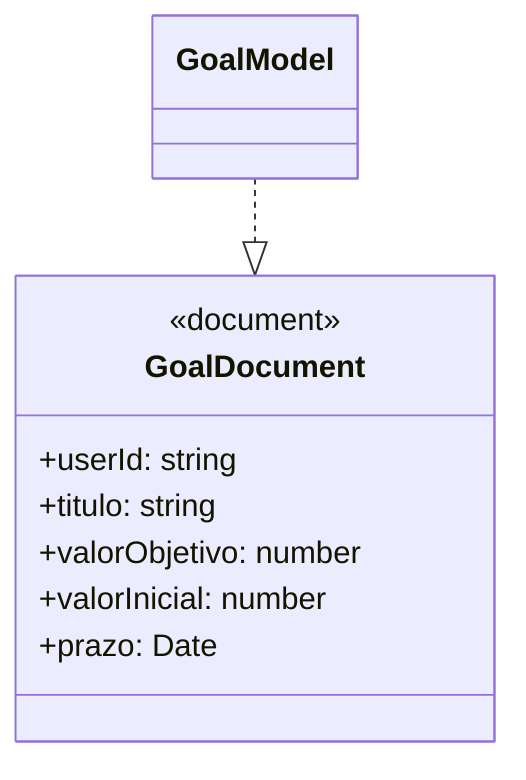

## GoalModel

- **Tipo e estereótipo:** objeto, «model»
- **Arquivo:** `Backend/src/modules/goals/goals.model.ts`
- **Descrição:** Model Mongoose "Goal" (GoalSchema com timestamps e índice userId+prazo).

**Atributos:** nenhum. **Operações:** nenhuma declarada.

| Tipo | Alvo | Multiplicidade | Rótulo |
|---|---|---|---|
| realização | GoalDocument | 1 | |

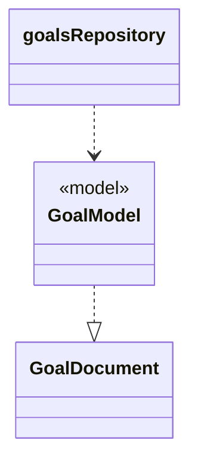

## Aportes

- **Tipo e estereótipo:** interface, «interface»
- **Arquivo:** `Backend/src/modules/goals/goals.repository.ts`
- **Descrição:** Total e quantidade das transações vinculadas a uma meta.

| Visibilidade | Nome | Tipo | Descrição |
|---|---|---|---|
| + | total | number | Soma dos valores vinculados. |
| + | quantidade | number | Quantidade de transações vinculadas. |

**Operações:** nenhuma.

| Tipo | Alvo | Multiplicidade | Rótulo |
|---|---|---|---|
| dependência | goalsRepository | * | produzida por somarAportes |
| dependência | goalsService | * | consumida por calcularProgresso |

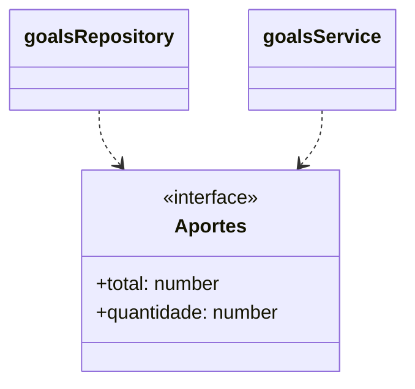
