# Backend: infraestrutura (config, database, http, integrations, java-client, middlewares, shared)

Modelo UML (padrão Astah / UML 2) dos elementos de infraestrutura do Backend FinanceAI: configuração, conexão e seeds do banco, app Express, integração Pluggy, cliente do Servidor Java, middlewares e utilitários compartilhados.

Convenções: visibilidade `+` público, `-` privado, `#` protegido, `~` pacote. Estereótipos: «module», «service», «middleware», «dto», «interface», «enumeration». Cada diagrama aparece em Mermaid (renderiza no GitHub) e em PlantUML (para recriar no Astah). Nos diagramas, tipos complexos aparecem simplificados; as tabelas trazem o tipo exato do código.

Observação sobre o plano de contas e transferências (`docs/especificacao-contas-e-transferencias.md`): nenhum elemento deste grupo é criado ou alterado pelo plano; o plano acrescenta uma nova mensagem do Grupo 2 (`PedidoCalcularSaldoContas` / `RespostaCalcularSaldoContas`) que trafega por `javaServerClient.enviarPedido`, sem mudar sua assinatura. Por isso não há elementos «planejado» neste arquivo.

## Diagrama do grupo

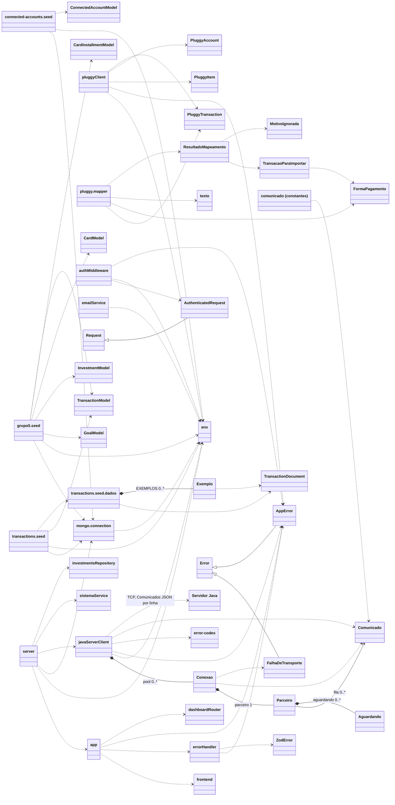

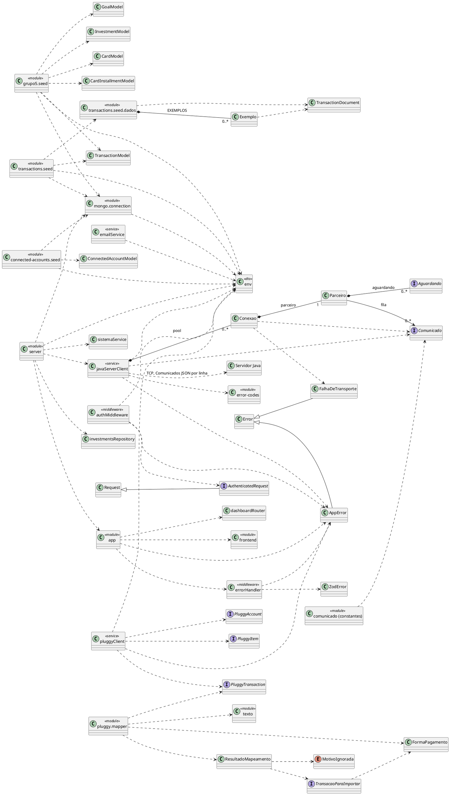

---

## env

**Tipo:** objeto exportado (constante tipada), «dto»
**Arquivo:** `Backend/src/config/env.ts`

**Descrição:** variáveis de ambiente validadas por um schema zod e exportadas como objeto tipado.

### Atributos

| Visibilidade | Nome | Tipo | Descrição |
|---|---|---|---|
| + | PORT | number | Porta HTTP do Backend |
| + | JWT_SECRET | string | Segredo de assinatura dos tokens JWT |
| + | MONGO_URI | string? | URI do MongoDB |
| + | MONGO_DB | string | Nome do banco |
| + | JAVA_SERVER_HOST | string | Host do Servidor Java |
| + | JAVA_SERVER_PORT | number | Porta do Servidor Java |
| + | JAVA_SERVER_TIMEOUT_MS | number | Timeout dos pedidos ao Servidor Java |
| + | JAVA_SERVER_POOL_SIZE | number | Tamanho do pool de conexões |
| + | GENAI_API_KEY | string? | Chave da API de IA generativa |
| + | GENAI_BASE_URL | string | URL base da API de IA |
| + | GENAI_MODEL | string | Modelo de IA usado |
| + | GENAI_TIMEOUT_MS | number | Timeout da API de IA |
| + | PLUGGY_CLIENT_ID | string? | Client id da Pluggy |
| + | PLUGGY_CLIENT_SECRET | string? | Client secret da Pluggy |
| + | PLUGGY_BASE_URL | string | URL base da Pluggy |
| + | PLUGGY_TIMEOUT_MS | number | Timeout das chamadas à Pluggy |
| + | PLUGGY_ESPERA_ITEM_MS | number | Tempo máximo de espera da sincronização de um item |
| + | PLUGGY_INTERVALO_MS | number | Intervalo entre consultas ao status do item |
| + | EMAIL_USER | string | Usuário do e-mail remetente |
| + | EMAIL_PASSWORD | string | Senha do e-mail remetente |

### Operações

Nenhuma.

### Relações

| Tipo | Alvo | Multiplicidade | Rótulo |
|---|---|---|---|
| (nenhuma) | | | |

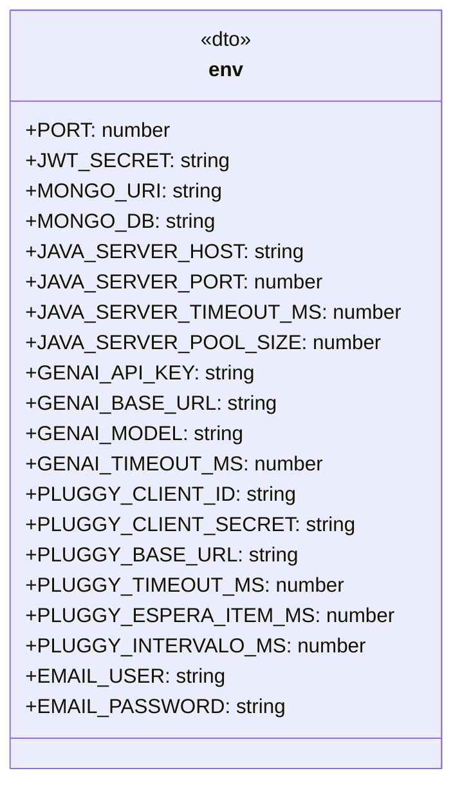

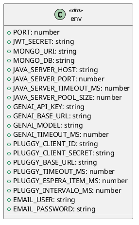

---

## mongo.connection

**Tipo:** módulo, «module»
**Arquivo:** `Backend/src/database/mongo.connection.ts`

**Descrição:** abre e fecha a conexão com o MongoDB via Mongoose.

### Atributos

Nenhum.

### Operações

| Visibilidade | Assinatura | Retorno | Descrição |
|---|---|---|---|
| + | connectDatabase() | Promise<boolean> | Abre a conexão com o MongoDB |
| + | disconnectDatabase() | Promise<void> | Fecha a conexão |

### Relações

| Tipo | Alvo | Multiplicidade | Rótulo |
|---|---|---|---|
| dependência | env | | |

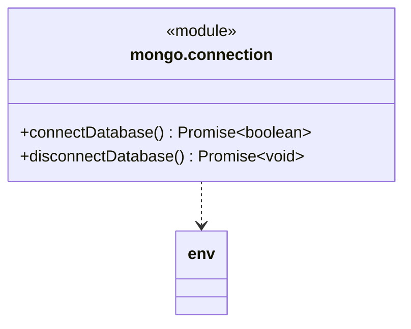

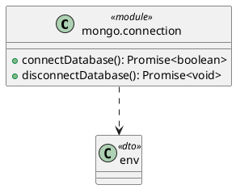

---

## connected-accounts.seed

**Tipo:** módulo (script), «module»
**Arquivo:** `Backend/src/database/seeds/connected-accounts.seed.ts`

**Descrição:** script que insere contas conectadas de exemplo para um usuário.

### Atributos

Nenhum.

### Operações

| Visibilidade | Assinatura | Retorno | Descrição |
|---|---|---|---|
| - | main() | Promise<void> | Conecta ao banco e insere as contas conectadas de exemplo |

### Relações

| Tipo | Alvo | Multiplicidade | Rótulo |
|---|---|---|---|
| dependência | mongo.connection | | |
| dependência | env | | |
| dependência | ConnectedAccountModel | | |

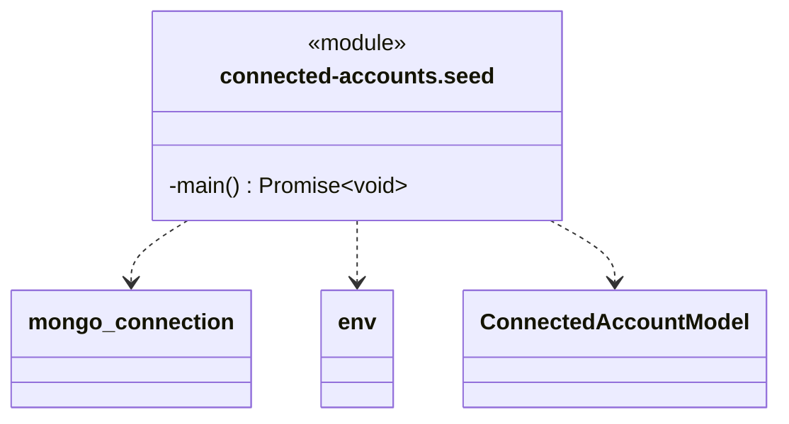

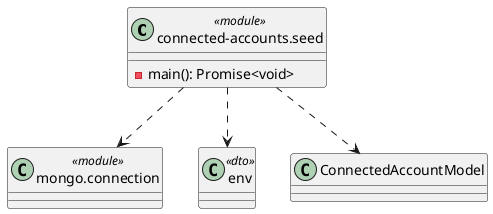

---

## grupo5.seed

**Tipo:** módulo (script), «module»
**Arquivo:** `Backend/src/database/seeds/grupo5.seed.ts`

**Descrição:** script que insere metas, aportes, ativos, cartão e parcelamentos de exemplo.

### Atributos

Nenhum.

### Operações

| Visibilidade | Assinatura | Retorno | Descrição |
|---|---|---|---|
| - | hoje() | Date | Data de hoje |
| - | emDias(dias: number) | Date | Data daqui a `dias` dias |
| - | mesesAtras(n: number) | Date | Data de `n` meses atrás |
| - | main() | Promise<void> | Conecta ao banco e insere os dados de exemplo |

### Relações

| Tipo | Alvo | Multiplicidade | Rótulo |
|---|---|---|---|
| dependência | mongo.connection | | |
| dependência | env | | |
| dependência | GoalModel | | |
| dependência | InvestmentModel | | |
| dependência | CardModel | | |
| dependência | CardInstallmentModel | | |
| dependência | TransactionModel | | |

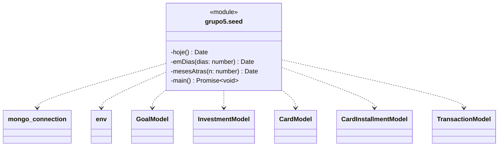

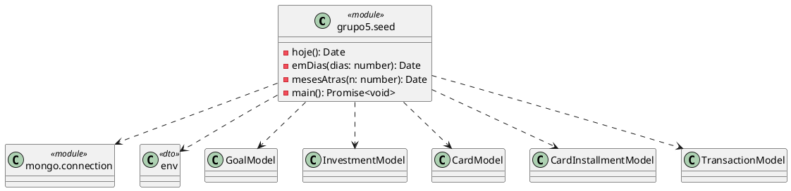

---

## transactions.seed

**Tipo:** módulo (script), «module»
**Arquivo:** `Backend/src/database/seeds/transactions.seed.ts`

**Descrição:** script que insere transações de exemplo dos últimos meses para um usuário.

### Atributos

Nenhum.

### Operações

| Visibilidade | Assinatura | Retorno | Descrição |
|---|---|---|---|
| - | main() | Promise<void> | Conecta ao banco e insere as transações de exemplo |

### Relações

| Tipo | Alvo | Multiplicidade | Rótulo |
|---|---|---|---|
| dependência | mongo.connection | | |
| dependência | env | | |
| dependência | TransactionModel | | |
| dependência | transactions.seed.dados | | |

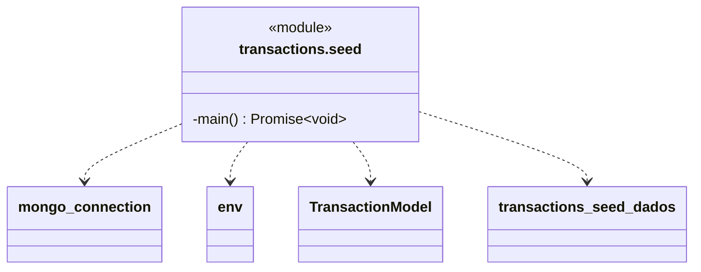

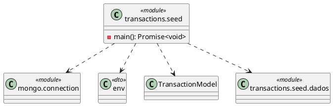

---

## transactions.seed.dados

**Tipo:** módulo, «module»
**Arquivo:** `Backend/src/database/seeds/transactions.seed.dados.ts`

**Descrição:** dados de exemplo do seed de transações, importáveis sem conectar ao banco.

### Atributos

| Visibilidade | Nome | Tipo | Descrição |
|---|---|---|---|
| + | EXEMPLOS | Exemplo[] | Lista de transações de exemplo |

### Operações

| Visibilidade | Assinatura | Retorno | Descrição |
|---|---|---|---|
| + | dataDaquiAtras(dias: number) | Date | Data de `dias` dias atrás |

### Relações

| Tipo | Alvo | Multiplicidade | Rótulo |
|---|---|---|---|
| dependência | TransactionDocument | | |
| composição | Exemplo | 0..* | EXEMPLOS |

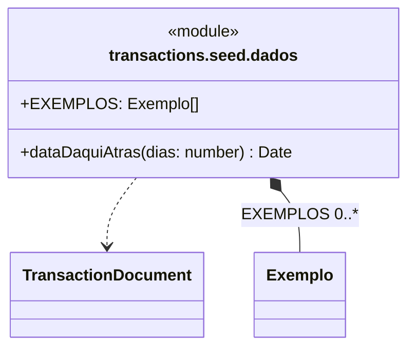

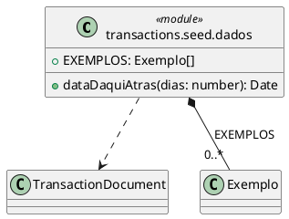

---

## Exemplo

**Tipo:** alias de tipo (TypeScript `type`), tratado como classe de dados
**Arquivo:** `Backend/src/database/seeds/transactions.seed.dados.ts`

**Descrição:** tipo de uma transação de exemplo: TransactionDocument sem userId, data e origem, mais diasAtras.

### Atributos

| Visibilidade | Nome | Tipo | Descrição |
|---|---|---|---|
| + | diasAtras | number | Quantos dias atrás a transação ocorreu (a data é calculada a partir disso) |

Os demais campos vêm de `TransactionDocument`, exceto `userId`, `data` e `origem`.

### Operações

Nenhuma.

### Relações

| Tipo | Alvo | Multiplicidade | Rótulo |
|---|---|---|---|
| dependência | TransactionDocument | | derivado (Omit) |

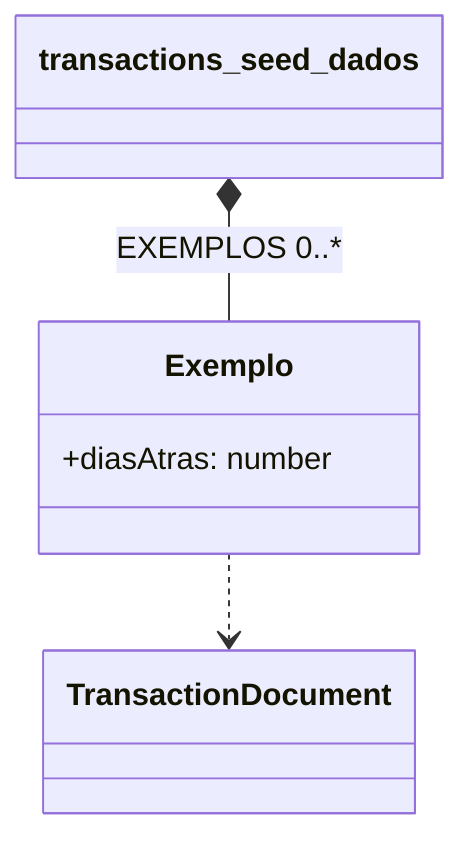

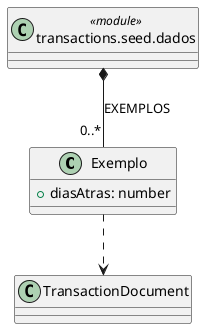

---

## app

**Tipo:** módulo, «module»
**Arquivo:** `Backend/src/http/app.ts`

**Descrição:** cria o app Express com helmet, cors, JSON, rotas /v1, Frontend, 404 e errorHandler.

### Atributos

| Visibilidade | Nome | Tipo | Descrição |
|---|---|---|---|
| + | app | Express | Aplicação Express exportada |
| + | opcoesHelmet | object | Opções de configuração do helmet |

### Operações

Nenhuma.

### Relações

| Tipo | Alvo | Multiplicidade | Rótulo |
|---|---|---|---|
| dependência | frontendRouter (módulo frontend) | | serve o Frontend |
| dependência | errorHandler | | último middleware |
| dependência | AppError | | 404 |
| dependência | dashboardRouter | | rotas /v1 |

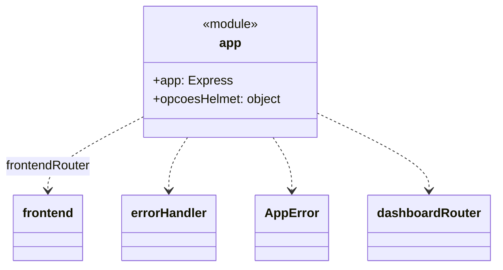

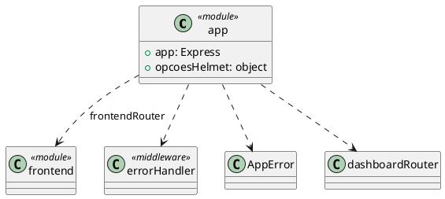

---

## frontend

**Tipo:** módulo, «module»
**Arquivo:** `Backend/src/http/frontend.ts`

**Descrição:** router que entrega a pasta Frontend (estáticos, página inicial e atalhos do SPA).

### Atributos

| Visibilidade | Nome | Tipo | Descrição |
|---|---|---|---|
| + | frontendRouter | Router | Router Express exportado |
| - | PASTA_FRONTEND | string | Caminho da pasta Frontend |
| - | PAGINAS | Record<string,string> | Mapa de rotas para páginas HTML |
| - | ATALHOS_DO_INDEX | Record<string,string> | Atalhos que levam ao index (SPA) |

### Operações

Nenhuma.

### Relações

| Tipo | Alvo | Multiplicidade | Rótulo |
|---|---|---|---|
| (nenhuma) | | | |

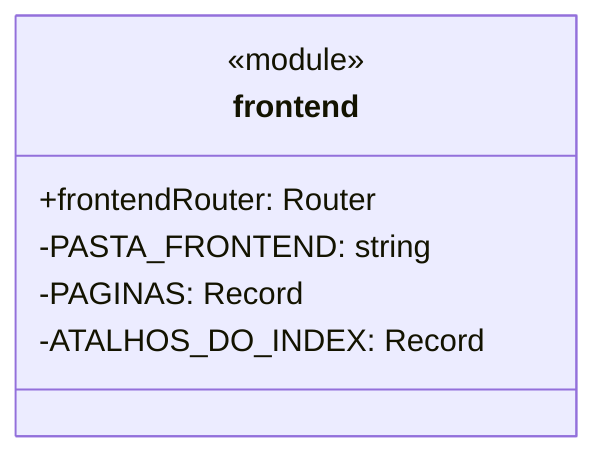

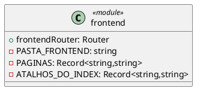

---

## server

**Tipo:** módulo (ponto de entrada), «module»
**Arquivo:** `Backend/src/http/server.ts`

**Descrição:** ponto de entrada: conecta ao banco, sobe o app, avisa sobre o Servidor Java e trata o encerramento.

### Atributos

Nenhum.

### Operações

| Visibilidade | Assinatura | Retorno | Descrição |
|---|---|---|---|
| - | avisarSeJavaIndisponivel() | Promise<void> | Registra aviso quando o Servidor Java não responde |
| - | iniciar() | Promise<void> | Conecta ao banco, inicia o servidor HTTP e trata o encerramento |

### Relações

| Tipo | Alvo | Multiplicidade | Rótulo |
|---|---|---|---|
| dependência | app | | |
| dependência | env | | |
| dependência | mongo.connection | | |
| dependência | javaServerClient | | |
| dependência | sistemaService | | |
| dependência | investmentsRepository | | |

```mermaid
classDiagram
    class server {
        <<module>>
        -avisarSeJavaIndisponivel() Promise~void~
        -iniciar() Promise~void~
    }
    server ..> app
    server ..> env
    server ..> mongo_connection
    server ..> javaServerClient
    server ..> sistemaService
    server ..> investmentsRepository
```

```plantuml
@startuml
class server <<module>> {
  -avisarSeJavaIndisponivel(): Promise<void>
  -iniciar(): Promise<void>
}
class app <<module>>
class env <<dto>>
class "mongo.connection" as mongo_connection <<module>>
class javaServerClient <<service>>
class sistemaService
class investmentsRepository
server ..> app
server ..> env
server ..> mongo_connection
server ..> javaServerClient
server ..> sistemaService
server ..> investmentsRepository
@enduml
```

---

## pluggyClient

**Tipo:** objeto de serviço, «service»
**Arquivo:** `Backend/src/integrations/pluggy/pluggy.client.ts`

**Descrição:** cliente HTTP da API da Pluggy (Open Finance) com cache da apiKey e tratamento de erros.

### Atributos

| Visibilidade | Nome | Tipo | Descrição |
|---|---|---|---|
| + | CONECTOR_SANDBOX | number | Id do conector de sandbox |
| + | CREDENCIAIS_SANDBOX | {user,password} | Credenciais do conector de sandbox |
| - | cache | {chave,expiraEm}\|null | Cache da apiKey com validade |
| - | autenticando | Promise<string>\|null | Autenticação em andamento (evita chamadas simultâneas) |

### Operações

| Visibilidade | Assinatura | Retorno | Descrição |
|---|---|---|---|
| + | criarConnectToken(clientUserId: string) | Promise<{accessToken}> | Cria o token do widget de conexão |
| + | criarItem(connectorId: number, parameters: Record<string,string>, clientUserId: string) | Promise<PluggyItem> | Cria uma conexão (item) com a instituição |
| + | obterItem(id: string) | Promise<PluggyItem> | Consulta um item |
| + | esperarItem(id: string) | Promise<PluggyItem> | Aguarda a sincronização do item terminar |
| + | listarContas(itemId: string) | Promise<PluggyAccount[]> | Lista as contas do item |
| + | listarTransacoes(accountId: string) | Promise<PluggyTransaction[]> | Lista as transações de uma conta |
| + | apagarItem(id: string) | Promise<void> | Remove o item na Pluggy |
| + | _limparCache() | void | Limpa o cache da apiKey (uso em testes) |

### Relações

| Tipo | Alvo | Multiplicidade | Rótulo |
|---|---|---|---|
| dependência | env | | |
| dependência | AppError | | |
| dependência | PluggyItem | | |
| dependência | PluggyAccount | | |
| dependência | PluggyTransaction | | |

```mermaid
classDiagram
    class pluggyClient {
        <<service>>
        +CONECTOR_SANDBOX: number
        +CREDENCIAIS_SANDBOX: user_password
        -cache: chave_expiraEm
        -autenticando: Promise
        +criarConnectToken(clientUserId: string) Promise
        +criarItem(connectorId: number, parameters: Record, clientUserId: string) Promise~PluggyItem~
        +obterItem(id: string) Promise~PluggyItem~
        +esperarItem(id: string) Promise~PluggyItem~
        +listarContas(itemId: string) Promise
        +listarTransacoes(accountId: string) Promise
        +apagarItem(id: string) Promise~void~
        +_limparCache() void
    }
    pluggyClient ..> env
    pluggyClient ..> AppError
    pluggyClient ..> PluggyItem
    pluggyClient ..> PluggyAccount
    pluggyClient ..> PluggyTransaction
```

```plantuml
@startuml
class pluggyClient <<service>> {
  +CONECTOR_SANDBOX: number
  +CREDENCIAIS_SANDBOX: {user,password}
  -cache: {chave,expiraEm} ou null
  -autenticando: Promise<string> ou null
  +criarConnectToken(clientUserId: string): Promise<{accessToken}>
  +criarItem(connectorId: number, parameters: Record<string,string>, clientUserId: string): Promise<PluggyItem>
  +obterItem(id: string): Promise<PluggyItem>
  +esperarItem(id: string): Promise<PluggyItem>
  +listarContas(itemId: string): Promise<PluggyAccount[]>
  +listarTransacoes(accountId: string): Promise<PluggyTransaction[]>
  +apagarItem(id: string): Promise<void>
  +_limparCache(): void
}
class env <<dto>>
class AppError
interface PluggyItem
interface PluggyAccount
interface PluggyTransaction
pluggyClient ..> env
pluggyClient ..> AppError
pluggyClient ..> PluggyItem
pluggyClient ..> PluggyAccount
pluggyClient ..> PluggyTransaction
@enduml
```

---

## pluggy.mapper

**Tipo:** módulo, «module»
**Arquivo:** `Backend/src/integrations/pluggy/pluggy.mapper.ts`

**Descrição:** converte transações da Pluggy no formato do FinanceAI, ignorando pendentes, zeradas e pagamento de fatura.

### Atributos

Nenhum.

### Operações

| Visibilidade | Assinatura | Retorno | Descrição |
|---|---|---|---|
| + | ehPagamentoDeFatura(descricao: string) | boolean | Indica se a descrição é de pagamento de fatura de cartão |
| + | mapearTransacao(t: PluggyTransaction, tipoConta: string) | ResultadoMapeamento | Converte uma transação da Pluggy ou informa o motivo de ignorá-la |
| - | formaDePagamento(t, tipoConta) | FormaPagamento | Define a forma de pagamento a partir dos dados da Pluggy |

### Relações

| Tipo | Alvo | Multiplicidade | Rótulo |
|---|---|---|---|
| dependência | PluggyTransaction | | |
| dependência | FormaPagamento | | |
| dependência | texto | | normalizar |
| dependência | ResultadoMapeamento | | |

```mermaid
classDiagram
    class pluggy_mapper["pluggy.mapper"] {
        <<module>>
        +ehPagamentoDeFatura(descricao: string) boolean
        +mapearTransacao(t: PluggyTransaction, tipoConta: string) ResultadoMapeamento
        -formaDePagamento(t, tipoConta) FormaPagamento
    }
    pluggy_mapper ..> PluggyTransaction
    pluggy_mapper ..> FormaPagamento
    pluggy_mapper ..> texto
    pluggy_mapper ..> ResultadoMapeamento
```

```plantuml
@startuml
class "pluggy.mapper" as pluggy_mapper <<module>> {
  +ehPagamentoDeFatura(descricao: string): boolean
  +mapearTransacao(t: PluggyTransaction, tipoConta: string): ResultadoMapeamento
  -formaDePagamento(t, tipoConta): FormaPagamento
}
interface PluggyTransaction
class FormaPagamento
class texto <<module>>
class ResultadoMapeamento
pluggy_mapper ..> PluggyTransaction
pluggy_mapper ..> FormaPagamento
pluggy_mapper ..> texto
pluggy_mapper ..> ResultadoMapeamento
@enduml
```

---

## TransacaoParaImportar

**Tipo:** interface, «interface»
**Arquivo:** `Backend/src/integrations/pluggy/pluggy.mapper.ts`

**Descrição:** transação já convertida, pronta para ser gravada pelo FinanceAI.

### Atributos

| Visibilidade | Nome | Tipo | Descrição |
|---|---|---|---|
| + | externalId | string | Id da transação na Pluggy |
| + | tipo | "receita"\|"despesa" | Tipo do lançamento |
| + | valor | number | Valor positivo |
| + | data | Date | Data da transação |
| + | descricao | string | Descrição |
| + | formaPagamento | FormaPagamento | Forma de pagamento |

### Operações

Nenhuma.

### Relações

| Tipo | Alvo | Multiplicidade | Rótulo |
|---|---|---|---|
| dependência | FormaPagamento | | |

```mermaid
classDiagram
    class TransacaoParaImportar {
        <<interface>>
        +externalId: string
        +tipo: receita ou despesa
        +valor: number
        +data: Date
        +descricao: string
        +formaPagamento: FormaPagamento
    }
    TransacaoParaImportar ..> FormaPagamento
```

```plantuml
@startuml
interface TransacaoParaImportar {
  +externalId: string
  +tipo: "receita" ou "despesa"
  +valor: number
  +data: Date
  +descricao: string
  +formaPagamento: FormaPagamento
}
class FormaPagamento
TransacaoParaImportar ..> FormaPagamento
@enduml
```

---

## MotivoIgnorada

**Tipo:** alias de tipo (união de literais), «enumeration»
**Arquivo:** `Backend/src/integrations/pluggy/pluggy.mapper.ts`

**Descrição:** união de motivos para ignorar uma transação: pendente, zerada, faturaCartao ou invalida.

### Atributos

| Visibilidade | Nome | Tipo | Descrição |
|---|---|---|---|
| + | pendente | literal | Transação ainda pendente |
| + | zerada | literal | Valor zero |
| + | faturaCartao | literal | Pagamento de fatura de cartão |
| + | invalida | literal | Dados inválidos |

### Operações

Nenhuma.

### Relações

| Tipo | Alvo | Multiplicidade | Rótulo |
|---|---|---|---|
| (nenhuma) | | | |

```mermaid
classDiagram
    class MotivoIgnorada {
        <<enumeration>>
        pendente
        zerada
        faturaCartao
        invalida
    }
```

```plantuml
@startuml
enum MotivoIgnorada {
  pendente
  zerada
  faturaCartao
  invalida
}
@enduml
```

---

## ResultadoMapeamento

**Tipo:** alias de tipo (união discriminada), «dto»
**Arquivo:** `Backend/src/integrations/pluggy/pluggy.mapper.ts`

**Descrição:** união discriminada: sucesso com TransacaoParaImportar ou falha com MotivoIgnorada.

### Atributos

Nenhum atributo próprio (cada variante carrega a transação ou o motivo).

### Operações

Nenhuma.

### Relações

| Tipo | Alvo | Multiplicidade | Rótulo |
|---|---|---|---|
| dependência | TransacaoParaImportar | | variante de sucesso |
| dependência | MotivoIgnorada | | variante de falha |

```mermaid
classDiagram
    class ResultadoMapeamento {
        <<dto>>
    }
    ResultadoMapeamento ..> TransacaoParaImportar : sucesso
    ResultadoMapeamento ..> MotivoIgnorada : falha
```

```plantuml
@startuml
class ResultadoMapeamento <<dto>>
interface TransacaoParaImportar
enum MotivoIgnorada
ResultadoMapeamento ..> TransacaoParaImportar : sucesso
ResultadoMapeamento ..> MotivoIgnorada : falha
@enduml
```

---

## PluggyItem

**Tipo:** interface, «interface»
**Arquivo:** `Backend/src/integrations/pluggy/pluggy.types.ts`

**Descrição:** conexão (item) da Pluggy com instituição, com o status de sincronização.

### Atributos

| Visibilidade | Nome | Tipo | Descrição |
|---|---|---|---|
| + | id | string | Id do item |
| + | status | string | Status do item |
| + | executionStatus | string\|null? | Status da execução da sincronização |
| + | clientUserId | string\|null? | Id do usuário no FinanceAI |
| + | connector | {id:number,name:string}\|null? | Instituição conectada |

### Operações

Nenhuma.

### Relações

| Tipo | Alvo | Multiplicidade | Rótulo |
|---|---|---|---|
| (nenhuma) | | | |

```mermaid
classDiagram
    class PluggyItem {
        <<interface>>
        +id: string
        +status: string
        +executionStatus: string
        +clientUserId: string
        +connector: id_name
    }
```

```plantuml
@startuml
interface PluggyItem {
  +id: string
  +status: string
  +executionStatus: string ou null
  +clientUserId: string ou null
  +connector: {id:number,name:string} ou null
}
@enduml
```

---

## PluggyAccount

**Tipo:** interface, «interface»
**Arquivo:** `Backend/src/integrations/pluggy/pluggy.types.ts`

**Descrição:** conta (bancária ou de cartão) devolvida pela Pluggy.

### Atributos

| Visibilidade | Nome | Tipo | Descrição |
|---|---|---|---|
| + | id | string | Id da conta |
| + | type | string | Tipo da conta |
| + | subtype | string\|null? | Subtipo |
| + | name | string | Nome |
| + | balance | number\|null? | Saldo |
| + | currencyCode | string\|null? | Moeda |

### Operações

Nenhuma.

### Relações

| Tipo | Alvo | Multiplicidade | Rótulo |
|---|---|---|---|
| (nenhuma) | | | |

```mermaid
classDiagram
    class PluggyAccount {
        <<interface>>
        +id: string
        +type: string
        +subtype: string
        +name: string
        +balance: number
        +currencyCode: string
    }
```

```plantuml
@startuml
interface PluggyAccount {
  +id: string
  +type: string
  +subtype: string ou null
  +name: string
  +balance: number ou null
  +currencyCode: string ou null
}
@enduml
```

---

## PluggyTransaction

**Tipo:** interface, «interface»
**Arquivo:** `Backend/src/integrations/pluggy/pluggy.types.ts`

**Descrição:** transação devolvida pela Pluggy; o sinal de amount define receita ou despesa.

### Atributos

| Visibilidade | Nome | Tipo | Descrição |
|---|---|---|---|
| + | id | string | Id da transação |
| + | description | string\|null? | Descrição |
| + | amount | number | Valor com sinal (define receita ou despesa) |
| + | date | string | Data |
| + | type | string\|null? | Tipo |
| + | status | string\|null? | Status (ex.: pendente) |
| + | operationType | string\|null? | Tipo de operação |
| + | paymentData | {paymentMethod?}\|null? | Dados do pagamento |

### Operações

Nenhuma.

### Relações

| Tipo | Alvo | Multiplicidade | Rótulo |
|---|---|---|---|
| (nenhuma) | | | |

```mermaid
classDiagram
    class PluggyTransaction {
        <<interface>>
        +id: string
        +description: string
        +amount: number
        +date: string
        +type: string
        +status: string
        +operationType: string
        +paymentData: paymentMethod
    }
```

```plantuml
@startuml
interface PluggyTransaction {
  +id: string
  +description: string ou null
  +amount: number
  +date: string
  +type: string ou null
  +status: string ou null
  +operationType: string ou null
  +paymentData: {paymentMethod?} ou null
}
@enduml
```

---

## Comunicado

**Tipo:** interface genérica, «interface»
**Arquivo:** `Backend/src/java-client/comunicado.ts`

**Descrição:** envelope genérico (tipo e dados) trocado com o Servidor Java.

### Atributos

| Visibilidade | Nome | Tipo | Descrição |
|---|---|---|---|
| + | tipo | string | Tipo da mensagem |
| + | dados | TDados | Conteúdo da mensagem |

### Operações

Nenhuma.

### Relações

| Tipo | Alvo | Multiplicidade | Rótulo |
|---|---|---|---|
| (nenhuma) | | | |

```mermaid
classDiagram
    class Comunicado~TDados~ {
        <<interface>>
        +tipo: string
        +dados: TDados
    }
```

```plantuml
@startuml
interface "Comunicado<TDados>" as Comunicado {
  +tipo: string
  +dados: TDados
}
@enduml
```

---

## comunicado (constantes)

**Tipo:** módulo, «module»
**Arquivo:** `Backend/src/java-client/comunicado.ts`

**Descrição:** constantes de tipo de comunicado e verificação de desligamento.

### Atributos

| Visibilidade | Nome | Tipo | Descrição |
|---|---|---|---|
| + | TIPO_PEDIDO_PARA_SAIR | string | Tipo do pedido de saída |
| + | TIPO_COMUNICADO_DESLIGAMENTO | string | Tipo do comunicado de desligamento |
| + | TIPO_ERRO | string | Tipo da resposta de erro |

### Operações

| Visibilidade | Assinatura | Retorno | Descrição |
|---|---|---|---|
| + | ehComunicadoDeDesligamento(comunicado: Comunicado) | boolean | Indica se o comunicado é de desligamento |

### Relações

| Tipo | Alvo | Multiplicidade | Rótulo |
|---|---|---|---|
| dependência | Comunicado | | |

```mermaid
classDiagram
    class comunicado_const["comunicado (constantes)"] {
        <<module>>
        +TIPO_PEDIDO_PARA_SAIR: string
        +TIPO_COMUNICADO_DESLIGAMENTO: string
        +TIPO_ERRO: string
        +ehComunicadoDeDesligamento(comunicado: Comunicado) boolean
    }
    comunicado_const ..> Comunicado
```

```plantuml
@startuml
class "comunicado (constantes)" as comunicado_const <<module>> {
  +TIPO_PEDIDO_PARA_SAIR: string
  +TIPO_COMUNICADO_DESLIGAMENTO: string
  +TIPO_ERRO: string
  +ehComunicadoDeDesligamento(comunicado: Comunicado): boolean
}
interface Comunicado
comunicado_const ..> Comunicado
@enduml
```

---

## Parceiro

**Tipo:** classe
**Arquivo:** `Backend/src/java-client/parceiro.ts`

**Descrição:** envolve o socket TCP: envia e recebe Comunicados JSON delimitados por linha.

### Atributos

| Visibilidade | Nome | Tipo | Descrição |
|---|---|---|---|
| - | buffer | string | Texto recebido ainda sem linha completa |
| - | fila | Comunicado[] | Comunicados recebidos e não consumidos |
| - | aguardando | Aguardando[] | Esperas pendentes por mensagem |
| - | fechado | boolean | Indica socket encerrado |
| - | aoFecharCallback | (() => void)\|null | Função chamada ao fechar |
| - | conexao | net.Socket | Socket TCP |

### Operações

| Visibilidade | Assinatura | Retorno | Descrição |
|---|---|---|---|
| + | constructor(conexao: net.Socket) | | Cria o parceiro e registra os eventos do socket |
| - | aoReceberDados(chunk: Buffer) | void | Acumula dados e separa os comunicados por linha |
| - | aoEncerrar() | void | Trata o fechamento do socket e rejeita as esperas |
| - | aguardarMensagem() | Promise<void> | Espera a chegada de uma mensagem |
| + | aoFechar(callback: () => void) | void | Registra o callback de fechamento |
| + | receba(comunicado: Comunicado) | void | Envia um comunicado ao Servidor Java |
| + | espie() | Promise<Comunicado> | Aguarda e devolve o próximo comunicado sem retirá-lo da fila |
| + | envie() | Promise<Comunicado> | Aguarda e retira o próximo comunicado da fila |
| + | adeus() | void | Encerra a conexão |

### Relações

| Tipo | Alvo | Multiplicidade | Rótulo |
|---|---|---|---|
| associação | Comunicado | 0..* | fila |
| composição | Aguardando | 0..* | aguardando |

```mermaid
classDiagram
    class Parceiro {
        -buffer: string
        -fila: Comunicado[]
        -aguardando: Aguardando[]
        -fechado: boolean
        -aoFecharCallback: funcao
        -conexao: Socket
        +Parceiro(conexao: Socket)
        -aoReceberDados(chunk: Buffer) void
        -aoEncerrar() void
        -aguardarMensagem() Promise~void~
        +aoFechar(callback) void
        +receba(comunicado: Comunicado) void
        +espie() Promise~Comunicado~
        +envie() Promise~Comunicado~
        +adeus() void
    }
    Parceiro --> Comunicado : fila 0..*
    Parceiro *-- Aguardando : aguardando 0..*
```

```plantuml
@startuml
class Parceiro {
  -buffer: string
  -fila: Comunicado[]
  -aguardando: Aguardando[]
  -fechado: boolean
  -aoFecharCallback: (() => void) ou null
  -conexao: net.Socket
  +Parceiro(conexao: net.Socket)
  -aoReceberDados(chunk: Buffer): void
  -aoEncerrar(): void
  -aguardarMensagem(): Promise<void>
  +aoFechar(callback: () => void): void
  +receba(comunicado: Comunicado): void
  +espie(): Promise<Comunicado>
  +envie(): Promise<Comunicado>
  +adeus(): void
}
interface Comunicado
interface Aguardando
Parceiro --> "0..*" Comunicado : fila
Parceiro *-- "0..*" Aguardando : aguardando
@enduml
```

---

## Aguardando

**Tipo:** interface (não exportada), «interface»
**Arquivo:** `Backend/src/java-client/parceiro.ts`

**Descrição:** par resolve/reject de uma espera por mensagem.

### Atributos

| Visibilidade | Nome | Tipo | Descrição |
|---|---|---|---|
| + | resolve | () => void | Conclui a espera |
| + | reject | (erro: Error) => void | Rejeita a espera com erro |

### Operações

Nenhuma.

### Relações

| Tipo | Alvo | Multiplicidade | Rótulo |
|---|---|---|---|
| composição (lado do todo) | Parceiro | 1 | aguardando (recebe a composição de Parceiro) |

```mermaid
classDiagram
    class Aguardando {
        <<interface>>
        +resolve: funcao
        +reject: funcao
    }
    Parceiro *-- Aguardando : aguardando 0..*
```

```plantuml
@startuml
interface Aguardando {
  +resolve: () => void
  +reject: (erro: Error) => void
}
class Parceiro
Parceiro *-- "0..*" Aguardando : aguardando
@enduml
```

---

## Conexao

**Tipo:** classe (não exportada)
**Arquivo:** `Backend/src/java-client/java-server.client.ts`

**Descrição:** conexão duradoura com o Servidor Java que atende um pedido por vez.

### Atributos

| Visibilidade | Nome | Tipo | Descrição |
|---|---|---|---|
| + | parceiro | Parceiro | Envolve o socket |
| + | ocupada | boolean | Há pedido em andamento |
| + | morta | boolean | Conexão caiu |
| - | pendente | {resolve,reject}\|null | Pedido aguardando resposta |
| - | aoMorrer | () => void | Callback chamado quando a conexão morre |

### Operações

| Visibilidade | Assinatura | Retorno | Descrição |
|---|---|---|---|
| + | constructor(socket: net.Socket, aoMorrer: () => void) | | Cria o Parceiro e inicia a leitura |
| - | ler() | Promise<void> | Laço de leitura das respostas |
| + | enviar(pedido: Comunicado) | Promise<Comunicado> | Envia um pedido e aguarda a resposta |
| + | morrer(erro?: Error) | void | Marca como morta e rejeita o pedido pendente |

### Relações

| Tipo | Alvo | Multiplicidade | Rótulo |
|---|---|---|---|
| composição | Parceiro | 1 | parceiro |
| dependência | Comunicado | | |
| dependência | FalhaDeTransporte | | lançada ao cair |

```mermaid
classDiagram
    class Conexao {
        +parceiro: Parceiro
        +ocupada: boolean
        +morta: boolean
        -pendente: resolve_reject
        -aoMorrer: funcao
        +Conexao(socket: Socket, aoMorrer)
        -ler() Promise~void~
        +enviar(pedido: Comunicado) Promise~Comunicado~
        +morrer(erro: Error) void
    }
    Conexao *-- Parceiro : parceiro 1
    Conexao ..> Comunicado
    Conexao ..> FalhaDeTransporte
    javaServerClient *-- Conexao : pool 0..*
```

```plantuml
@startuml
class Conexao {
  +parceiro: Parceiro
  +ocupada: boolean
  +morta: boolean
  -pendente: {resolve,reject} ou null
  -aoMorrer: () => void
  +Conexao(socket: net.Socket, aoMorrer: () => void)
  -ler(): Promise<void>
  +enviar(pedido: Comunicado): Promise<Comunicado>
  +morrer(erro?: Error): void
}
class Parceiro
interface Comunicado
class FalhaDeTransporte
class javaServerClient <<service>>
Conexao *-- "1" Parceiro : parceiro
Conexao ..> Comunicado
Conexao ..> FalhaDeTransporte
javaServerClient *-- "0..*" Conexao : pool
@enduml
```

---

## FalhaDeTransporte

**Tipo:** classe (não exportada)
**Arquivo:** `Backend/src/java-client/java-server.client.ts`

**Descrição:** erro interno que indica queda da conexão antes da resposta.

### Atributos

Nenhum.

### Operações

Nenhuma própria (herda de Error).

### Relações

| Tipo | Alvo | Multiplicidade | Rótulo |
|---|---|---|---|
| generalização | Error | | estende |

```mermaid
classDiagram
    class FalhaDeTransporte
    Error <|-- FalhaDeTransporte
```

```plantuml
@startuml
class FalhaDeTransporte
class Error
Error <|-- FalhaDeTransporte
@enduml
```

---

## javaServerClient

**Tipo:** objeto de serviço, «service»
**Arquivo:** `Backend/src/java-client/java-server.client.ts`

**Descrição:** cliente do Servidor Java com pool de conexões, timeout e uma nova tentativa em falha de transporte.

### Atributos

| Visibilidade | Nome | Tipo | Descrição |
|---|---|---|---|
| - | pool | Conexao[] | Conexões abertas |
| - | criando | number | Conexões em criação |
| - | esperando | Array<() => void> | Pedidos aguardando uma conexão livre |

### Operações

| Visibilidade | Assinatura | Retorno | Descrição |
|---|---|---|---|
| + | enviarPedido<TDados,TResposta>(tipoPedido: string, tipoResposta: string, dados: TDados) | Promise<TResposta> | Envia um pedido ao Servidor Java e devolve os dados da resposta; converte erros em AppError |
| + | fechar() | void | Fecha todas as conexões |
| - | conectar() | Promise<Conexao> | Abre uma nova conexão TCP |
| - | obter() | Promise<Conexao> | Obtém conexão livre do pool (ou cria/espera) |
| - | devolver(c: Conexao) | void | Devolve a conexão ao pool |
| - | comTimeout<T>(promessa, ms, aoEstourar) | Promise<T> | Aplica timeout a uma promessa |
| - | tentar(pedido: Comunicado, tentativa: number) | Promise<Comunicado> | Executa o pedido, com nova tentativa em falha de transporte |

### Relações

| Tipo | Alvo | Multiplicidade | Rótulo |
|---|---|---|---|
| composição | Conexao | 0..* | pool |
| dependência | env | | |
| dependência | AppError | | |
| dependência | statusDoCodigo (módulo error-codes) | | |
| dependência | Comunicado | | |
| dependência | Servidor Java | | TCP, Comunicados JSON por linha |

```mermaid
classDiagram
    class javaServerClient {
        <<service>>
        -pool: Conexao[]
        -criando: number
        -esperando: funcoes
        +enviarPedido~TDados,TResposta~(tipoPedido: string, tipoResposta: string, dados: TDados) Promise~TResposta~
        +fechar() void
        -conectar() Promise~Conexao~
        -obter() Promise~Conexao~
        -devolver(c: Conexao) void
        -comTimeout~T~(promessa, ms, aoEstourar) Promise~T~
        -tentar(pedido: Comunicado, tentativa: number) Promise~Comunicado~
    }
    javaServerClient *-- Conexao : pool 0..*
    javaServerClient ..> env
    javaServerClient ..> AppError
    javaServerClient ..> error_codes : statusDoCodigo
    javaServerClient ..> Comunicado
    javaServerClient ..> ServidorJava : TCP, Comunicados JSON por linha
```

```plantuml
@startuml
class javaServerClient <<service>> {
  -pool: Conexao[]
  -criando: number
  -esperando: Array<() => void>
  +enviarPedido<TDados,TResposta>(tipoPedido: string, tipoResposta: string, dados: TDados): Promise<TResposta>
  +fechar(): void
  -conectar(): Promise<Conexao>
  -obter(): Promise<Conexao>
  -devolver(c: Conexao): void
  -comTimeout<T>(promessa, ms, aoEstourar): Promise<T>
  -tentar(pedido: Comunicado, tentativa: number): Promise<Comunicado>
}
class Conexao
class env <<dto>>
class AppError
class "error-codes" as error_codes <<module>>
interface Comunicado
class "Servidor Java" as ServidorJava
javaServerClient *-- "0..*" Conexao : pool
javaServerClient ..> env
javaServerClient ..> AppError
javaServerClient ..> error_codes : statusDoCodigo
javaServerClient ..> Comunicado
javaServerClient ..> ServidorJava : TCP, Comunicados JSON por linha
@enduml
```

---

## authMiddleware

**Tipo:** função de middleware, «middleware»
**Arquivo:** `Backend/src/middlewares/auth.middleware.ts`

**Descrição:** valida o token Bearer JWT e preenche req.user.

### Atributos

Nenhum.

### Operações

| Visibilidade | Assinatura | Retorno | Descrição |
|---|---|---|---|
| + | authMiddleware(req: AuthenticatedRequest, res: Response, next: NextFunction) | void | Valida o JWT com `JWT_SECRET`, preenche `req.user` ou lança AppError de não autorizado |

### Relações

| Tipo | Alvo | Multiplicidade | Rótulo |
|---|---|---|---|
| dependência | AuthenticatedRequest | | |
| dependência | env | | JWT_SECRET |
| dependência | AppError | | |

```mermaid
classDiagram
    class authMiddleware {
        <<middleware>>
        +authMiddleware(req: AuthenticatedRequest, res: Response, next: NextFunction) void
    }
    authMiddleware ..> AuthenticatedRequest
    authMiddleware ..> env : JWT_SECRET
    authMiddleware ..> AppError
```

```plantuml
@startuml
class authMiddleware <<middleware>> {
  +authMiddleware(req: AuthenticatedRequest, res: Response, next: NextFunction): void
}
interface AuthenticatedRequest
class env <<dto>>
class AppError
authMiddleware ..> AuthenticatedRequest
authMiddleware ..> env : JWT_SECRET
authMiddleware ..> AppError
@enduml
```

---

## AuthenticatedRequest

**Tipo:** interface, «interface»
**Arquivo:** `Backend/src/middlewares/auth.middleware.ts`

**Descrição:** request do Express com o usuário autenticado opcional.

### Atributos

| Visibilidade | Nome | Tipo | Descrição |
|---|---|---|---|
| + | user | {id:string,email:string}? | Usuário autenticado |

### Operações

Nenhuma.

### Relações

| Tipo | Alvo | Multiplicidade | Rótulo |
|---|---|---|---|
| generalização | Request | | estende |

```mermaid
classDiagram
    class AuthenticatedRequest {
        <<interface>>
        +user: id_email
    }
    Request <|-- AuthenticatedRequest
```

```plantuml
@startuml
interface AuthenticatedRequest {
  +user: {id:string,email:string}
}
class Request
Request <|-- AuthenticatedRequest
@enduml
```

---

## errorHandler

**Tipo:** função de middleware, «middleware»
**Arquivo:** `Backend/src/middlewares/error-handler.middleware.ts`

**Descrição:** converte AppError, ZodError, JSON inválido e erros inesperados em respostas JSON padronizadas.

### Atributos

Nenhum.

### Operações

| Visibilidade | Assinatura | Retorno | Descrição |
|---|---|---|---|
| + | errorHandler(err: unknown, req: Request, res: Response, next: NextFunction) | Response | Mapeia o erro para status HTTP e corpo JSON padronizado |

### Relações

| Tipo | Alvo | Multiplicidade | Rótulo |
|---|---|---|---|
| dependência | AppError | | |
| dependência | ZodError | | |

```mermaid
classDiagram
    class errorHandler {
        <<middleware>>
        +errorHandler(err: unknown, req: Request, res: Response, next: NextFunction) Response
    }
    errorHandler ..> AppError
    errorHandler ..> ZodError
```

```plantuml
@startuml
class errorHandler <<middleware>> {
  +errorHandler(err: unknown, req: Request, res: Response, next: NextFunction): Response
}
class AppError
class ZodError
errorHandler ..> AppError
errorHandler ..> ZodError
@enduml
```

---

## emailService

**Tipo:** objeto de serviço, «service»
**Arquivo:** `Backend/src/shared/email/email.service.ts`

**Descrição:** envia e-mails de recuperação de senha e confirmação usando templates HTML/CSS com nodemailer e juice.

### Atributos

| Visibilidade | Nome | Tipo | Descrição |
|---|---|---|---|
| - | transporter | nodemailer.Transporter | Transporte SMTP configurado com `EMAIL_USER` e `EMAIL_PASSWORD` |

### Operações

| Visibilidade | Assinatura | Retorno | Descrição |
|---|---|---|---|
| + | enviarRecuperacaoSenha(email: string, link: string) | Promise<void> | Envia o e-mail de recuperação de senha |
| + | enviarConfirmacaoEmail(email: string, link: string) | Promise<void> | Envia o e-mail de confirmação de cadastro |

### Relações

| Tipo | Alvo | Multiplicidade | Rótulo |
|---|---|---|---|
| dependência | env | | EMAIL_USER, EMAIL_PASSWORD |

```mermaid
classDiagram
    class emailService {
        <<service>>
        -transporter: Transporter
        +enviarRecuperacaoSenha(email: string, link: string) Promise~void~
        +enviarConfirmacaoEmail(email: string, link: string) Promise~void~
    }
    emailService ..> env
```

```plantuml
@startuml
class emailService <<service>> {
  -transporter: nodemailer.Transporter
  +enviarRecuperacaoSenha(email: string, link: string): Promise<void>
  +enviarConfirmacaoEmail(email: string, link: string): Promise<void>
}
class env <<dto>>
emailService ..> env
@enduml
```

---

## AppError

**Tipo:** classe
**Arquivo:** `Backend/src/shared/errors/app-error.ts`

**Descrição:** erro da aplicação com status HTTP e código.

### Atributos

| Visibilidade | Nome | Tipo | Descrição |
|---|---|---|---|
| + | statusCode | number | Status HTTP da resposta |
| + | code | string | Código do erro (ex.: PLAN_REQUIRED) |

### Operações

| Visibilidade | Assinatura | Retorno | Descrição |
|---|---|---|---|
| + | constructor(message: string, statusCode: number, code: string) | | Cria o erro |

### Relações

| Tipo | Alvo | Multiplicidade | Rótulo |
|---|---|---|---|
| generalização | Error | | estende |

```mermaid
classDiagram
    class AppError {
        +statusCode: number
        +code: string
        +AppError(message: string, statusCode: number, code: string)
    }
    Error <|-- AppError
```

```plantuml
@startuml
class AppError {
  +statusCode: number
  +code: string
  +AppError(message: string, statusCode: number, code: string)
}
class Error
Error <|-- AppError
@enduml
```

---

## error-codes

**Tipo:** módulo, «module»
**Arquivo:** `Backend/src/shared/errors/error-codes.ts`

**Descrição:** mapeia os códigos de erro do Servidor Java para status HTTP.

### Atributos

| Visibilidade | Nome | Tipo | Descrição |
|---|---|---|---|
| - | STATUS_POR_CODE | const map | Mapa de código de erro para status HTTP |

### Operações

| Visibilidade | Assinatura | Retorno | Descrição |
|---|---|---|---|
| + | statusDoCodigo(code: string) | number\|undefined | Devolve o status HTTP do código, se mapeado |

### Relações

| Tipo | Alvo | Multiplicidade | Rótulo |
|---|---|---|---|
| (nenhuma) | | | |

```mermaid
classDiagram
    class error_codes["error-codes"] {
        <<module>>
        -STATUS_POR_CODE: map
        +statusDoCodigo(code: string) number
    }
```

```plantuml
@startuml
class "error-codes" as error_codes <<module>> {
  -STATUS_POR_CODE: const map
  +statusDoCodigo(code: string): number ou undefined
}
@enduml
```

---

## texto

**Tipo:** módulo, «module»
**Arquivo:** `Backend/src/shared/utils/texto.ts`

**Descrição:** utilitário de normalização de texto para comparar descrições.

### Atributos

Nenhum.

### Operações

| Visibilidade | Assinatura | Retorno | Descrição |
|---|---|---|---|
| + | normalizar(texto: string) | string | Normaliza o texto para comparação |

### Relações

| Tipo | Alvo | Multiplicidade | Rótulo |
|---|---|---|---|
| (nenhuma) | | | |

```mermaid
classDiagram
    class texto {
        <<module>>
        +normalizar(texto: string) string
    }
```

```plantuml
@startuml
class texto <<module>> {
  +normalizar(texto: string): string
}
@enduml
```
