# Backend: investments (cartões e parcelamentos)

Modelo UML (padrão Astah / UML 2) de cada classe, interface, enumeração e módulo do grupo **be-investments**, em `Backend/src/modules/investments/`. Cada diagrama aparece em Mermaid (renderiza no GitHub) e em PlantUML (para recriar no Astah). Elementos externos ao grupo aparecem apenas como vizinhos.

> Nenhum elemento deste grupo é «planejado»: as contas e transferências de `docs/especificacao-contas-e-transferencias.md` não alteram estes elementos, e os cartões não têm referência a conta no código atual.

## Diagrama do grupo

```mermaid
classDiagram
  class investmentsController {
    <<controller>>
  }
  class investmentsService {
    <<service>>
  }
  class investmentsRepository {
    <<repository>>
  }
  class investmentsRouter {
    <<module>>
  }
  class idSchema {
    <<dto>>
  }
  class createInvestmentSchema {
    <<dto>>
  }
  class createCardSchema {
    <<dto>>
  }
  class updateCardSchema {
    <<dto>>
  }
  class listInstallmentsQuerySchema {
    <<dto>>
  }
  class createInstallmentSchema {
    <<dto>>
  }
  class updateInstallmentSchema {
    <<dto>>
  }
  class CreateInvestmentDto {
    <<dto>>
  }
  class CreateCardDto {
    <<dto>>
  }
  class UpdateCardDto {
    <<dto>>
  }
  class CreateInstallmentDto {
    <<dto>>
  }
  class UpdateInstallmentDto {
    <<dto>>
  }
  class AtivoParaCalculo {
    <<dto>>
  }
  class PedidoRentabilidadeSimulada {
    <<dto>>
  }
  class AtivoCalculado {
    <<dto>>
  }
  class RespostaRentabilidadeSimulada {
    <<dto>>
  }
  class ParcelamentoParaCalculo {
    <<dto>>
  }
  class PedidoCalcularParcelamentos {
    <<dto>>
  }
  class ParcelamentoCalculado {
    <<dto>>
  }
  class RespostaCalcularParcelamentos {
    <<dto>>
  }
  class InvestmentResponseDto {
    <<dto>>
  }
  class PortfolioResponseDto {
    <<dto>>
  }
  class InstallmentResponseDto {
    <<dto>>
  }
  class InstallmentsResponseDto {
    <<dto>>
  }
  class CardResponseDto {
    <<dto>>
  }
  class CardsResponseDto {
    <<dto>>
  }
  class TIPOS_DE_ATIVO {
    <<enumeration>>
  }
  class TipoDeAtivo {
    <<type>>
  }
  class InvestmentDocument {
    <<document>>
  }
  class CardDocument {
    <<document>>
  }
  class InstallmentDocument {
    <<document>>
  }
  class InvestmentModel {
    <<model>>
  }
  class CardModel {
    <<model>>
  }
  class CardInstallmentModel {
    <<model>>
  }
  class CARTAO_PADRAO {
    <<constant>>
  }
  class ConstantesDeCartao {
    <<constant>>
  }
  class ComprasDoCartao {
    <<interface>>
  }
  class ContextoParcelamentos {
    <<interface>>
  }
  class javaServerClient {
    <<service>>
  }
  class AppError {
    <<class>>
  }
  class authMiddleware {
    <<handler>>
  }
  class TransactionModel {
    <<model>>
  }
  investmentsController ..> investmentsService
  investmentsController ..> createInvestmentSchema
  investmentsController ..> createCardSchema
  investmentsController ..> updateCardSchema
  investmentsController ..> createInstallmentSchema
  investmentsController ..> updateInstallmentSchema
  investmentsController ..> listInstallmentsQuerySchema
  investmentsController ..> idSchema
  investmentsService ..> investmentsRepository
  investmentsService ..> javaServerClient : PedidoRentabilidadeSimulada / PedidoCalcularParcelamentos
  investmentsService ..> AppError
  investmentsService ..> PortfolioResponseDto
  investmentsService ..> CardsResponseDto
  investmentsService ..> InstallmentsResponseDto
  investmentsService ..> CardDocument
  investmentsService ..> InstallmentDocument
  investmentsService ..> InvestmentDocument
  investmentsService ..> ContextoParcelamentos
  investmentsRepository ..> InvestmentModel
  investmentsRepository ..> CardModel
  investmentsRepository ..> CardInstallmentModel
  investmentsRepository ..> TransactionModel : lê/desvincula
  investmentsRepository ..> ComprasDoCartao
  investmentsRouter ..> investmentsController
  investmentsRouter ..> authMiddleware
  createInvestmentSchema ..> TIPOS_DE_ATIVO
  createCardSchema ..> CARTAO_PADRAO
  CreateInvestmentDto ..> createInvestmentSchema
  CreateCardDto ..> createCardSchema
  UpdateCardDto ..> updateCardSchema
  CreateInstallmentDto ..> createInstallmentSchema
  UpdateInstallmentDto ..> updateInstallmentSchema
  AtivoParaCalculo ..> TipoDeAtivo
  PedidoRentabilidadeSimulada *-- "0..*" AtivoParaCalculo : ativos
  AtivoParaCalculo <|-- AtivoCalculado
  RespostaRentabilidadeSimulada *-- "0..*" AtivoCalculado : ativos
  PedidoCalcularParcelamentos *-- "0..*" ParcelamentoParaCalculo : parcelamentos
  ParcelamentoParaCalculo <|-- ParcelamentoCalculado
  RespostaCalcularParcelamentos *-- "0..*" ParcelamentoCalculado : parcelamentos
  InvestmentResponseDto ..> TipoDeAtivo
  PortfolioResponseDto *-- "0..*" InvestmentResponseDto : ativos
  InstallmentsResponseDto *-- "0..*" InstallmentResponseDto : parcelamentos
  CardsResponseDto *-- "0..*" CardResponseDto : cartoes
  TipoDeAtivo ..> TIPOS_DE_ATIVO
  InvestmentDocument ..> TipoDeAtivo
  InstallmentDocument --> "0..1" CardDocument : cartaoId
  InvestmentDocument <|.. InvestmentModel
  CardDocument <|.. CardModel
  InstallmentDocument <|.. CardInstallmentModel
```

```plantuml
@startuml
hide empty members
class investmentsController <<controller>> {
}
class investmentsService <<service>> {
}
class investmentsRepository <<repository>> {
}
class investmentsRouter <<module>> {
}
class idSchema <<dto>> {
}
class createInvestmentSchema <<dto>> {
}
class createCardSchema <<dto>> {
}
class updateCardSchema <<dto>> {
}
class listInstallmentsQuerySchema <<dto>> {
}
class createInstallmentSchema <<dto>> {
}
class updateInstallmentSchema <<dto>> {
}
class CreateInvestmentDto <<dto>> {
}
class CreateCardDto <<dto>> {
}
class UpdateCardDto <<dto>> {
}
class CreateInstallmentDto <<dto>> {
}
class UpdateInstallmentDto <<dto>> {
}
class AtivoParaCalculo <<dto>> {
}
class PedidoRentabilidadeSimulada <<dto>> {
}
class AtivoCalculado <<dto>> {
}
class RespostaRentabilidadeSimulada <<dto>> {
}
class ParcelamentoParaCalculo <<dto>> {
}
class PedidoCalcularParcelamentos <<dto>> {
}
class ParcelamentoCalculado <<dto>> {
}
class RespostaCalcularParcelamentos <<dto>> {
}
class InvestmentResponseDto <<dto>> {
}
class PortfolioResponseDto <<dto>> {
}
class InstallmentResponseDto <<dto>> {
}
class InstallmentsResponseDto <<dto>> {
}
class CardResponseDto <<dto>> {
}
class CardsResponseDto <<dto>> {
}
enum TIPOS_DE_ATIVO {
}
class TipoDeAtivo <<type>> {
}
class InvestmentDocument <<document>> {
}
class CardDocument <<document>> {
}
class InstallmentDocument <<document>> {
}
class InvestmentModel <<model>> {
}
class CardModel <<model>> {
}
class CardInstallmentModel <<model>> {
}
class CARTAO_PADRAO <<constant>> {
}
class ConstantesDeCartao <<constant>> {
}
interface ComprasDoCartao {
}
interface ContextoParcelamentos {
}
class javaServerClient <<service>>
class AppError <<class>>
class authMiddleware <<handler>>
class TransactionModel <<model>>
investmentsController ..> investmentsService
investmentsController ..> createInvestmentSchema
investmentsController ..> createCardSchema
investmentsController ..> updateCardSchema
investmentsController ..> createInstallmentSchema
investmentsController ..> updateInstallmentSchema
investmentsController ..> listInstallmentsQuerySchema
investmentsController ..> idSchema
investmentsService ..> investmentsRepository
investmentsService ..> javaServerClient : PedidoRentabilidadeSimulada / PedidoCalcularParcelamentos
investmentsService ..> AppError
investmentsService ..> PortfolioResponseDto
investmentsService ..> CardsResponseDto
investmentsService ..> InstallmentsResponseDto
investmentsService ..> CardDocument
investmentsService ..> InstallmentDocument
investmentsService ..> InvestmentDocument
investmentsService ..> ContextoParcelamentos
investmentsRepository ..> InvestmentModel
investmentsRepository ..> CardModel
investmentsRepository ..> CardInstallmentModel
investmentsRepository ..> TransactionModel : lê/desvincula
investmentsRepository ..> ComprasDoCartao
investmentsRouter ..> investmentsController
investmentsRouter ..> authMiddleware
createInvestmentSchema ..> TIPOS_DE_ATIVO
createCardSchema ..> CARTAO_PADRAO
CreateInvestmentDto ..> createInvestmentSchema
CreateCardDto ..> createCardSchema
UpdateCardDto ..> updateCardSchema
CreateInstallmentDto ..> createInstallmentSchema
UpdateInstallmentDto ..> updateInstallmentSchema
AtivoParaCalculo ..> TipoDeAtivo
PedidoRentabilidadeSimulada *-- "0..*" AtivoParaCalculo : ativos
AtivoCalculado --|> AtivoParaCalculo
RespostaRentabilidadeSimulada *-- "0..*" AtivoCalculado : ativos
PedidoCalcularParcelamentos *-- "0..*" ParcelamentoParaCalculo : parcelamentos
ParcelamentoCalculado --|> ParcelamentoParaCalculo
RespostaCalcularParcelamentos *-- "0..*" ParcelamentoCalculado : parcelamentos
InvestmentResponseDto ..> TipoDeAtivo
PortfolioResponseDto *-- "0..*" InvestmentResponseDto : ativos
InstallmentsResponseDto *-- "0..*" InstallmentResponseDto : parcelamentos
CardsResponseDto *-- "0..*" CardResponseDto : cartoes
TipoDeAtivo ..> TIPOS_DE_ATIVO
InvestmentDocument ..> TipoDeAtivo
InstallmentDocument --> "0..1" CardDocument : cartaoId
InvestmentModel ..|> InvestmentDocument
CardModel ..|> CardDocument
CardInstallmentModel ..|> InstallmentDocument
@enduml
```

---

## investmentsController

- **Tipo:** classe
- **Estereótipo:** «controller»
- **Arquivo de origem:** `Backend/src/modules/investments/investments.controller.ts`
- **Descrição:** Controller de portfólio, cartões e parcelamentos; valida com zod e repassa erros ao error-handler.

**Atributos**

_Sem atributos._

**Operações**

| Visibilidade | Assinatura | Retorno | Descrição |
|---|---|---|---|
| + | list | RequestHandler | Lista a carteira de investimentos. |
| + | create | RequestHandler | Cria investimento simulado. |
| + | remove | RequestHandler | Remove investimento. |
| + | listCards | RequestHandler | Lista os cartões do usuário. |
| + | getCardById | RequestHandler | Busca cartão por id. |
| + | createCard | RequestHandler | Cria cartão. |
| + | updateCardById | RequestHandler | Edita cartão por id. |
| + | removeCardById | RequestHandler | Remove cartão por id. |
| + | getCard | RequestHandler | Rota legada /card: devolve o cartão padrão. |
| + | updateCard | RequestHandler | Rota legada /card: edita o cartão padrão. |
| + | listInstallments | RequestHandler | Lista parcelamentos (filtro opcional cartaoId). |
| + | createInstallment | RequestHandler | Cria parcelamento. |
| + | updateInstallment | RequestHandler | Edita parcelamento. |
| + | removeInstallment | RequestHandler | Remove parcelamento. |
| - | tratar(manipulador: Manipulador) | RequestHandler | Envolve o manipulador e repassa erros ao error-handler. |

**Relações**

| Tipo | Alvo | Multiplicidade | Rótulo |
|---|---|---|---|
| dependência | investmentsService | — | — |
| dependência | createInvestmentSchema | — | — |
| dependência | createCardSchema | — | — |
| dependência | updateCardSchema | — | — |
| dependência | createInstallmentSchema | — | — |
| dependência | updateInstallmentSchema | — | — |
| dependência | listInstallmentsQuerySchema | — | — |
| dependência | idSchema | — | — |

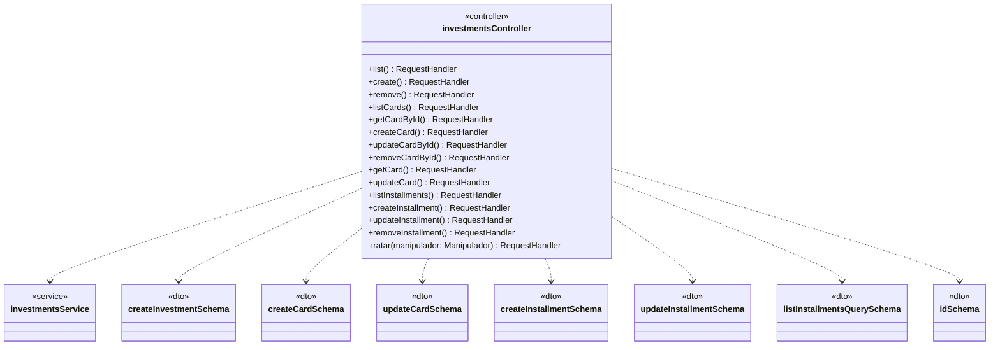

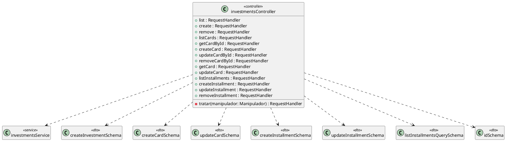

---

## investmentsService

- **Tipo:** classe
- **Estereótipo:** «service»
- **Arquivo de origem:** `Backend/src/modules/investments/investments.service.ts`
- **Descrição:** Regras de investimentos simulados, cartões (até 5), faturas e parcelamentos; cálculos delegados ao Servidor Java.

**Atributos**

_Sem atributos._

**Operações**

| Visibilidade | Assinatura | Retorno | Descrição |
|---|---|---|---|
| + | listInvestments(userId) | Promise<PortfolioResponseDto> | Monta a carteira com cálculo do Servidor Java. |
| + | createInvestment(userId, dados: CreateInvestmentDto) | Promise<InvestmentResponseDto> | Cria investimento e devolve com valores calculados. |
| + | removeInvestment(userId, id) | Promise<void> | Remove investimento do usuário. |
| + | listCards(userId) | Promise<CardsResponseDto> | Lista cartões com fatura e totais. |
| + | getCardById(userId, id) | Promise<CardResponseDto> | Busca cartão por id. |
| + | createCard(userId, dados: CreateCardDto) | Promise<CardResponseDto> | Cria cartão respeitando o máximo de cartões. |
| + | updateCardById(userId, id, alteracoes: UpdateCardDto) | Promise<CardResponseDto> | Edita cartão. |
| + | removeCardById(userId, id) | Promise<void> | Remove cartão. |
| + | getCard(userId) | Promise<CardResponseDto> | Cartão padrão (legado). |
| + | updateCard(userId, alteracoes) | Promise<CardResponseDto> | Edita cartão padrão (legado). |
| + | listInstallments(userId, cartaoId?) | Promise<InstallmentsResponseDto> | Lista parcelamentos com totais. |
| + | createInstallment(userId, dados: CreateInstallmentDto) | Promise<InstallmentResponseDto> | Cria parcelamento. |
| + | updateInstallment(userId, id, alteracoes: UpdateInstallmentDto) | Promise<InstallmentResponseDto> | Edita parcelamento. |
| + | removeInstallment(userId, id) | Promise<void> | Remove parcelamento. |
| + | mesesCompletos(desde: Date, ate: Date) | number | Meses completos entre duas datas. |
| + | proximoFechamento(diaFechamento: number, hoje: Date) | Date | Próxima data de fechamento da fatura. |
| + | vencimentoDoFechamento(fechamento: Date) | Date | Vencimento a partir do fechamento. |
| - | calcularCarteira(itens, agora) | Promise<PortfolioResponseDto> | Envia ativos ao Servidor Java e monta a carteira. |
| - | calcularParcelamentos(itens, contexto) | Promise<InstallmentsResponseDto> | Envia parcelamentos ao Servidor Java e monta a resposta. |
| - | contextoDeParcelamentos(userId, ids) | Promise<ContextoParcelamentos> | Reúne cartão padrão, transações e datas de compra. |
| - | parcelasPagasPelaData(item, datas, agora) | number | Parcelas pagas deduzidas pela data da compra. |
| - | carregarCartoes(userId) | Promise<Item<CardDocument>[]> | Carrega os cartões do usuário. |
| - | montarCartoes(userId, apenasId?) | Promise<CardResponseDto[]> | Monta cartões com limite disponível e fatura. |

**Relações**

| Tipo | Alvo | Multiplicidade | Rótulo |
|---|---|---|---|
| dependência | investmentsRepository | — | — |
| dependência | javaServerClient | — | PedidoRentabilidadeSimulada / PedidoCalcularParcelamentos |
| dependência | AppError | — | — |
| dependência | PortfolioResponseDto | — | — |
| dependência | CardsResponseDto | — | — |
| dependência | InstallmentsResponseDto | — | — |
| dependência | CardDocument | — | — |
| dependência | InstallmentDocument | — | — |
| dependência | InvestmentDocument | — | — |
| dependência | ContextoParcelamentos | — | — |

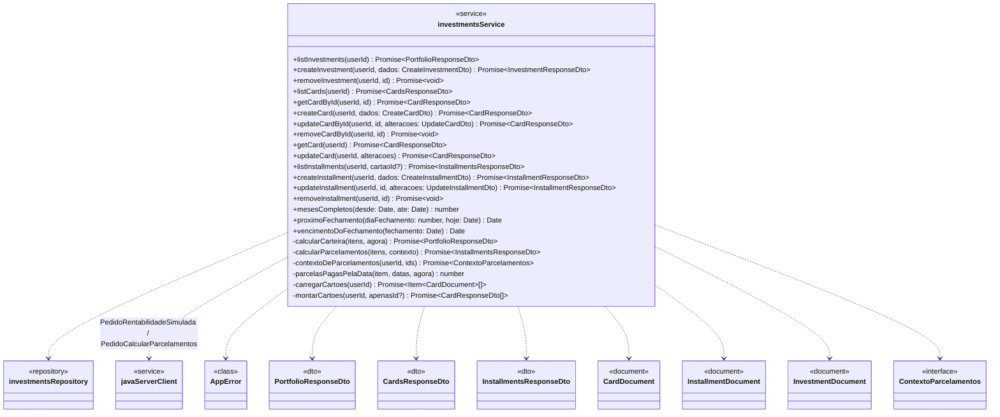

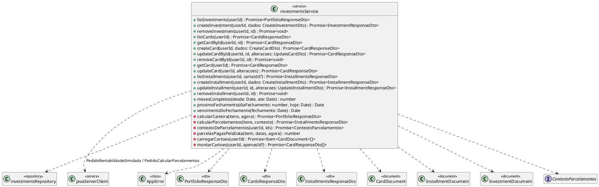

---

## investmentsRepository

- **Tipo:** classe
- **Estereótipo:** «repository»
- **Arquivo de origem:** `Backend/src/modules/investments/investments.repository.ts`
- **Descrição:** Acesso a dados de investimentos, cartões e parcelamentos, filtrado por usuário, mais migração de cartões.

**Atributos**

_Sem atributos._

**Operações**

| Visibilidade | Assinatura | Retorno | Descrição |
|---|---|---|---|
| + | findInvestments(userId) | Promise<Investment[]> | Lista investimentos do usuário. |
| + | createInvestment(dados: InvestmentDocument) | Promise<Investment> | Persiste investimento. |
| + | removeInvestment(userId, id) | Promise<boolean> | Remove investimento. |
| + | findCards(userId) | Promise<Card[]> | Lista cartões. |
| + | findCard(userId, id) | Promise<Card ou null> | Busca cartão. |
| + | countCards(userId) | Promise<number> | Conta cartões. |
| + | findCardByName(userId, nome, exceto?) | Promise<Card ou null> | Busca cartão pelo nome (unicidade). |
| + | ensureDefaultCard(userId) | Promise<void> | Garante a existência do cartão padrão. |
| + | findOldestCard(userId) | Promise<Card ou null> | Cartão mais antigo (padrão). |
| + | createCard(dados) | Promise<Card> | Persiste cartão. |
| + | updateCard(userId, id, alteracoes) | Promise<Card ou null> | Atualiza cartão. |
| + | countActiveInstallments(userId, cartaoId, ehPadrao) | Promise<number> | Conta parcelamentos ativos do cartão. |
| + | removeCard(userId, cartaoId, ehPadrao) | Promise<boolean> | Remove cartão. |
| + | somarComprasNoCredito(userId, de: Date, ate: Date) | Promise<ComprasDoCartao[]> | Soma compras no crédito por cartão no período. |
| + | findInstallments(userId) | Promise<Installment[]> | Lista parcelamentos. |
| + | findInstallment(userId, id) | Promise<Installment ou null> | Busca parcelamento. |
| + | findInstallmentsByIds(userId, ids) | Promise<Installment[]> | Busca parcelamentos por ids. |
| + | createInstallment(dados: InstallmentDocument) | Promise<Installment> | Persiste parcelamento. |
| + | updateInstallment(userId, id, alteracoes) | Promise<Installment ou null> | Atualiza parcelamento. |
| + | removeInstallment(userId, id) | Promise<boolean> | Remove parcelamento. |
| + | removeInstallments(userId, ids) | Promise<number> | Remove vários parcelamentos. |
| + | transacoesDosParcelamentos(userId, ids) | Promise<Map<string,string>> | Mapa parcelamento para transação vinculada. |
| + | datasDasCompras(userId, ids) | Promise<Map<string,Date>> | Mapa parcelamento para data da compra. |
| + | migrarCartoes() | Promise<void> | Migração de cartões existentes. |
| - | doCartao(cartaoId, ehPadrao) | object | Filtro de consulta por cartão (padrão inclui sem cartão). |

**Relações**

| Tipo | Alvo | Multiplicidade | Rótulo |
|---|---|---|---|
| dependência | InvestmentModel | — | — |
| dependência | CardModel | — | — |
| dependência | CardInstallmentModel | — | — |
| dependência | TransactionModel | — | lê/desvincula |
| dependência | ComprasDoCartao | — | — |

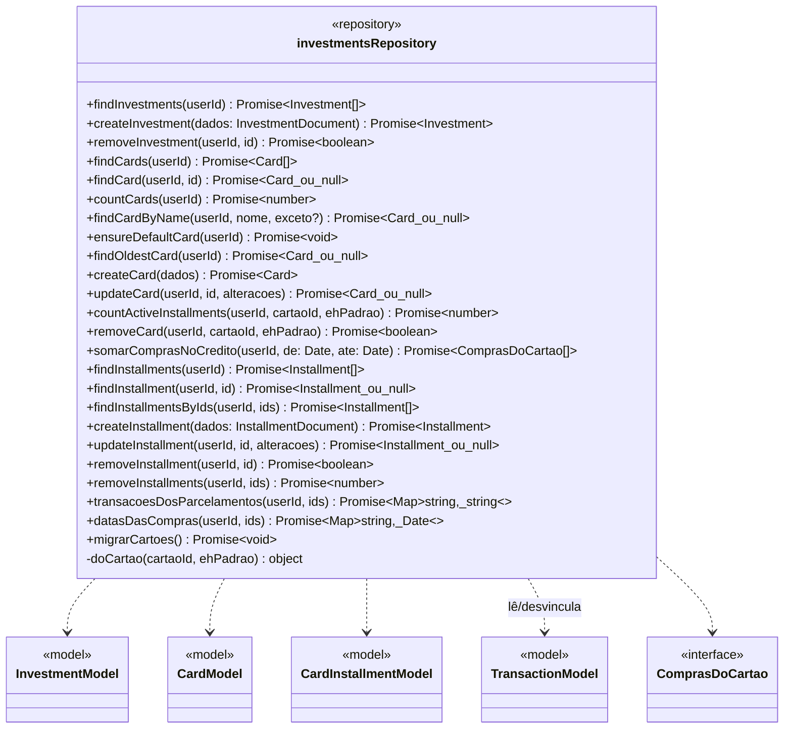

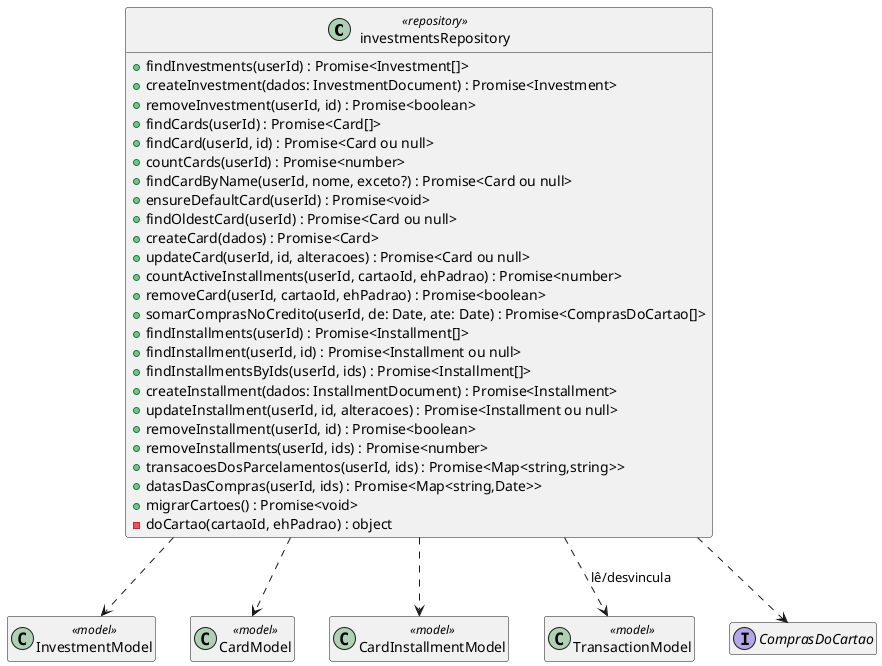

---

## investmentsRouter

- **Tipo:** módulo
- **Estereótipo:** «module»
- **Arquivo de origem:** `Backend/src/modules/investments/investments.routes.ts`
- **Descrição:** Router de portfólio, /cards, /card (legado) e /card/installments, protegido por authMiddleware.

**Atributos**

_Sem atributos._

**Operações**

_Sem operações._

**Relações**

| Tipo | Alvo | Multiplicidade | Rótulo |
|---|---|---|---|
| dependência | investmentsController | — | — |
| dependência | authMiddleware | — | — |

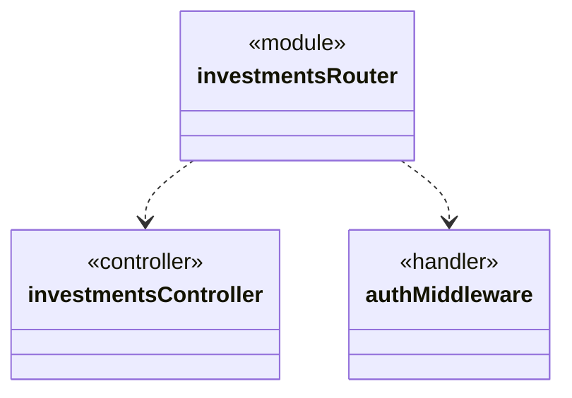

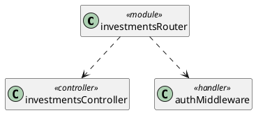

---

## idSchema

- **Tipo:** objeto
- **Estereótipo:** «dto»
- **Arquivo de origem:** `Backend/src/modules/investments/investments.dto.ts`
- **Descrição:** Schema zod do id (24 hexadecimais).

**Atributos**

_Sem atributos._

**Operações**

_Sem operações._

**Relações**

_Sem relações._

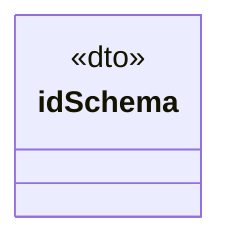

```plantuml
@startuml
hide empty members
class idSchema <<dto>> {
}
@enduml
```

---

## createInvestmentSchema

- **Tipo:** objeto
- **Estereótipo:** «dto»
- **Arquivo de origem:** `Backend/src/modules/investments/investments.dto.ts`
- **Descrição:** Schema zod de criação de investimento.

**Atributos**

| Visibilidade | Nome | Tipo | Descrição |
|---|---|---|---|
| + | nome | string | — |
| + | tipo | TipoDeAtivo (default outro) | — |
| + | valorInvestido | number | — |
| + | taxaMensal | number (default 0) | — |
| + | dataAplicacao | Date? | — |

**Operações**

_Sem operações._

**Relações**

| Tipo | Alvo | Multiplicidade | Rótulo |
|---|---|---|---|
| dependência | TIPOS_DE_ATIVO | — | — |

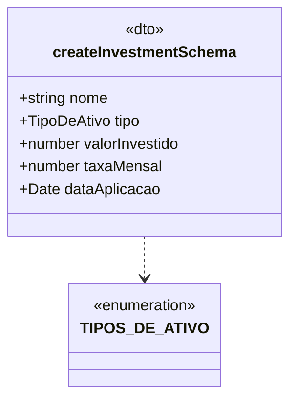

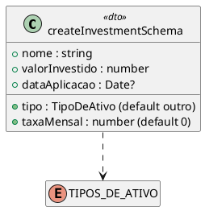

---

## createCardSchema

- **Tipo:** objeto
- **Estereótipo:** «dto»
- **Arquivo de origem:** `Backend/src/modules/investments/investments.dto.ts`
- **Descrição:** Schema zod de criação de cartão (limite e fechamento com padrão).

**Atributos**

| Visibilidade | Nome | Tipo | Descrição |
|---|---|---|---|
| + | nome | string | — |
| + | limite | number | — |
| + | diaFechamento | number (1..28) | — |

**Operações**

_Sem operações._

**Relações**

| Tipo | Alvo | Multiplicidade | Rótulo |
|---|---|---|---|
| dependência | CARTAO_PADRAO | — | — |

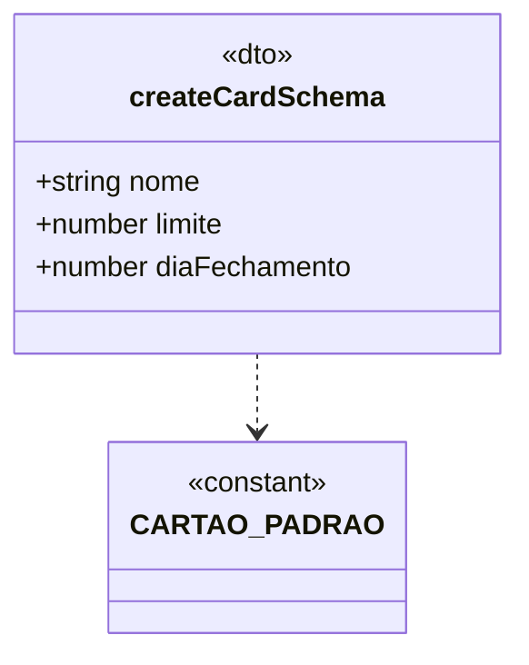

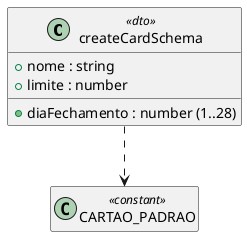

---

## updateCardSchema

- **Tipo:** objeto
- **Estereótipo:** «dto»
- **Arquivo de origem:** `Backend/src/modules/investments/investments.dto.ts`
- **Descrição:** Schema zod parcial de edição de cartão.

**Atributos**

| Visibilidade | Nome | Tipo | Descrição |
|---|---|---|---|
| + | nome | string? | — |
| + | limite | number? | — |
| + | diaFechamento | number? | — |

**Operações**

_Sem operações._

**Relações**

_Sem relações._

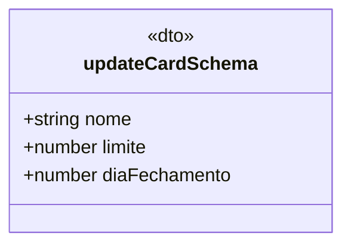

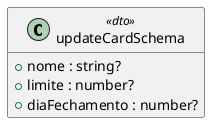

---

## listInstallmentsQuerySchema

- **Tipo:** objeto
- **Estereótipo:** «dto»
- **Arquivo de origem:** `Backend/src/modules/investments/investments.dto.ts`
- **Descrição:** Schema zod do filtro opcional cartaoId da listagem de parcelamentos.

**Atributos**

| Visibilidade | Nome | Tipo | Descrição |
|---|---|---|---|
| + | cartaoId | string? | — |

**Operações**

_Sem operações._

**Relações**

_Sem relações._

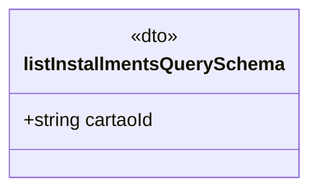

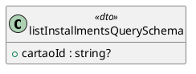

---

## createInstallmentSchema

- **Tipo:** objeto
- **Estereótipo:** «dto»
- **Arquivo de origem:** `Backend/src/modules/investments/investments.dto.ts`
- **Descrição:** Schema zod de criação de parcelamento (parcelasPagas <= parcelas).

**Atributos**

| Visibilidade | Nome | Tipo | Descrição |
|---|---|---|---|
| + | cartaoId | string? | — |
| + | descricao | string | — |
| + | valorTotal | number | — |
| + | parcelas | number | — |
| + | parcelasPagas | number (default 0) | — |
| + | taxaJurosMensal | number (default 0) | — |

**Operações**

_Sem operações._

**Relações**

_Sem relações._

```mermaid
classDiagram
  class createInstallmentSchema {
    <<dto>>
    +string cartaoId
    +string descricao
    +number valorTotal
    +number parcelas
    +number parcelasPagas
    +number taxaJurosMensal
  }
```

```plantuml
@startuml
hide empty members
class createInstallmentSchema <<dto>> {
  + cartaoId : string?
  + descricao : string
  + valorTotal : number
  + parcelas : number
  + parcelasPagas : number (default 0)
  + taxaJurosMensal : number (default 0)
}
@enduml
```

---

## updateInstallmentSchema

- **Tipo:** objeto
- **Estereótipo:** «dto»
- **Arquivo de origem:** `Backend/src/modules/investments/investments.dto.ts`
- **Descrição:** Schema zod de edição de parcelamento (descrição e parcelas pagas).

**Atributos**

| Visibilidade | Nome | Tipo | Descrição |
|---|---|---|---|
| + | descricao | string? | — |
| + | parcelasPagas | number? | — |

**Operações**

_Sem operações._

**Relações**

_Sem relações._

```mermaid
classDiagram
  class updateInstallmentSchema {
    <<dto>>
    +string descricao
    +number parcelasPagas
  }
```

```plantuml
@startuml
hide empty members
class updateInstallmentSchema <<dto>> {
  + descricao : string?
  + parcelasPagas : number?
}
@enduml
```

---

## CreateInvestmentDto

- **Tipo:** tipo
- **Estereótipo:** «dto»
- **Arquivo de origem:** `Backend/src/modules/investments/investments.dto.ts`
- **Descrição:** Tipo inferido de createInvestmentSchema.

**Atributos**

_Sem atributos._

**Operações**

_Sem operações._

**Relações**

| Tipo | Alvo | Multiplicidade | Rótulo |
|---|---|---|---|
| dependência | createInvestmentSchema | — | — |

```mermaid
classDiagram
  class CreateInvestmentDto {
    <<dto>>
  }
  class createInvestmentSchema {
    <<dto>>
  }
  CreateInvestmentDto ..> createInvestmentSchema
```

```plantuml
@startuml
hide empty members
class CreateInvestmentDto <<dto>> {
}
class createInvestmentSchema <<dto>> {
}
CreateInvestmentDto ..> createInvestmentSchema
@enduml
```

---

## CreateCardDto

- **Tipo:** tipo
- **Estereótipo:** «dto»
- **Arquivo de origem:** `Backend/src/modules/investments/investments.dto.ts`
- **Descrição:** Tipo inferido de createCardSchema.

**Atributos**

_Sem atributos._

**Operações**

_Sem operações._

**Relações**

| Tipo | Alvo | Multiplicidade | Rótulo |
|---|---|---|---|
| dependência | createCardSchema | — | — |

```mermaid
classDiagram
  class CreateCardDto {
    <<dto>>
  }
  class createCardSchema {
    <<dto>>
  }
  CreateCardDto ..> createCardSchema
```

```plantuml
@startuml
hide empty members
class CreateCardDto <<dto>> {
}
class createCardSchema <<dto>> {
}
CreateCardDto ..> createCardSchema
@enduml
```

---

## UpdateCardDto

- **Tipo:** tipo
- **Estereótipo:** «dto»
- **Arquivo de origem:** `Backend/src/modules/investments/investments.dto.ts`
- **Descrição:** Tipo inferido de updateCardSchema.

**Atributos**

_Sem atributos._

**Operações**

_Sem operações._

**Relações**

| Tipo | Alvo | Multiplicidade | Rótulo |
|---|---|---|---|
| dependência | updateCardSchema | — | — |

```mermaid
classDiagram
  class UpdateCardDto {
    <<dto>>
  }
  class updateCardSchema {
    <<dto>>
  }
  UpdateCardDto ..> updateCardSchema
```

```plantuml
@startuml
hide empty members
class UpdateCardDto <<dto>> {
}
class updateCardSchema <<dto>> {
}
UpdateCardDto ..> updateCardSchema
@enduml
```

---

## CreateInstallmentDto

- **Tipo:** tipo
- **Estereótipo:** «dto»
- **Arquivo de origem:** `Backend/src/modules/investments/investments.dto.ts`
- **Descrição:** Tipo inferido de createInstallmentSchema.

**Atributos**

_Sem atributos._

**Operações**

_Sem operações._

**Relações**

| Tipo | Alvo | Multiplicidade | Rótulo |
|---|---|---|---|
| dependência | createInstallmentSchema | — | — |

```mermaid
classDiagram
  class CreateInstallmentDto {
    <<dto>>
  }
  class createInstallmentSchema {
    <<dto>>
  }
  CreateInstallmentDto ..> createInstallmentSchema
```

```plantuml
@startuml
hide empty members
class CreateInstallmentDto <<dto>> {
}
class createInstallmentSchema <<dto>> {
}
CreateInstallmentDto ..> createInstallmentSchema
@enduml
```

---

## UpdateInstallmentDto

- **Tipo:** tipo
- **Estereótipo:** «dto»
- **Arquivo de origem:** `Backend/src/modules/investments/investments.dto.ts`
- **Descrição:** Tipo inferido de updateInstallmentSchema.

**Atributos**

_Sem atributos._

**Operações**

_Sem operações._

**Relações**

| Tipo | Alvo | Multiplicidade | Rótulo |
|---|---|---|---|
| dependência | updateInstallmentSchema | — | — |

```mermaid
classDiagram
  class UpdateInstallmentDto {
    <<dto>>
  }
  class updateInstallmentSchema {
    <<dto>>
  }
  UpdateInstallmentDto ..> updateInstallmentSchema
```

```plantuml
@startuml
hide empty members
class UpdateInstallmentDto <<dto>> {
}
class updateInstallmentSchema <<dto>> {
}
UpdateInstallmentDto ..> updateInstallmentSchema
@enduml
```

---

## AtivoParaCalculo

- **Tipo:** classe
- **Estereótipo:** «dto»
- **Arquivo de origem:** `Backend/src/modules/investments/investments.dto.ts`
- **Descrição:** Ativo enviado ao Servidor Java para cálculo de rentabilidade.

**Atributos**

| Visibilidade | Nome | Tipo | Descrição |
|---|---|---|---|
| + | id | string | — |
| + | nome | string | — |
| + | tipo | TipoDeAtivo | — |
| + | valor | number | — |
| + | taxaMensal | number | — |
| + | meses | number | — |

**Operações**

_Sem operações._

**Relações**

| Tipo | Alvo | Multiplicidade | Rótulo |
|---|---|---|---|
| dependência | TipoDeAtivo | — | — |

```mermaid
classDiagram
  class AtivoParaCalculo {
    <<dto>>
    +string id
    +string nome
    +TipoDeAtivo tipo
    +number valor
    +number taxaMensal
    +number meses
  }
  class TipoDeAtivo {
    <<type>>
  }
  AtivoParaCalculo ..> TipoDeAtivo
```

```plantuml
@startuml
hide empty members
class AtivoParaCalculo <<dto>> {
  + id : string
  + nome : string
  + tipo : TipoDeAtivo
  + valor : number
  + taxaMensal : number
  + meses : number
}
class TipoDeAtivo <<type>> {
}
AtivoParaCalculo ..> TipoDeAtivo
@enduml
```

---

## PedidoRentabilidadeSimulada

- **Tipo:** classe
- **Estereótipo:** «dto»
- **Arquivo de origem:** `Backend/src/modules/investments/investments.dto.ts`
- **Descrição:** Pedido ao Servidor Java com os ativos da carteira.

**Atributos**

| Visibilidade | Nome | Tipo | Descrição |
|---|---|---|---|
| + | ativos | AtivoParaCalculo[] | — |

**Operações**

_Sem operações._

**Relações**

| Tipo | Alvo | Multiplicidade | Rótulo |
|---|---|---|---|
| composição | AtivoParaCalculo | 0..* | ativos |

```mermaid
classDiagram
  class PedidoRentabilidadeSimulada {
    <<dto>>
    +AtivoParaCalculo[] ativos
  }
  class AtivoParaCalculo {
    <<dto>>
  }
  PedidoRentabilidadeSimulada *-- "0..*" AtivoParaCalculo : ativos
```

```plantuml
@startuml
hide empty members
class PedidoRentabilidadeSimulada <<dto>> {
  + ativos : AtivoParaCalculo[]
}
class AtivoParaCalculo <<dto>> {
}
PedidoRentabilidadeSimulada *-- "0..*" AtivoParaCalculo : ativos
@enduml
```

---

## AtivoCalculado

- **Tipo:** classe
- **Estereótipo:** «dto»
- **Arquivo de origem:** `Backend/src/modules/investments/investments.dto.ts`
- **Descrição:** Ativo com valores calculados pelo Servidor Java.

**Atributos**

| Visibilidade | Nome | Tipo | Descrição |
|---|---|---|---|
| + | valorAtual | number | — |
| + | rendimento | number | — |
| + | rentabilidade | number | — |
| + | percentualCarteira | number | — |

**Operações**

_Sem operações._

**Relações**

| Tipo | Alvo | Multiplicidade | Rótulo |
|---|---|---|---|
| generalização | AtivoParaCalculo | — | — |

```mermaid
classDiagram
  class AtivoCalculado {
    <<dto>>
    +number valorAtual
    +number rendimento
    +number rentabilidade
    +number percentualCarteira
  }
  class AtivoParaCalculo {
    <<dto>>
  }
  AtivoParaCalculo <|-- AtivoCalculado
```

```plantuml
@startuml
hide empty members
class AtivoCalculado <<dto>> {
  + valorAtual : number
  + rendimento : number
  + rentabilidade : number
  + percentualCarteira : number
}
class AtivoParaCalculo <<dto>> {
}
AtivoCalculado --|> AtivoParaCalculo
@enduml
```

---

## RespostaRentabilidadeSimulada

- **Tipo:** classe
- **Estereótipo:** «dto»
- **Arquivo de origem:** `Backend/src/modules/investments/investments.dto.ts`
- **Descrição:** Resposta do Servidor Java com a carteira calculada.

**Atributos**

| Visibilidade | Nome | Tipo | Descrição |
|---|---|---|---|
| + | ativos | AtivoCalculado[] | — |
| + | totalInvestido | number | — |
| + | patrimonio | number | — |
| + | rendimento | number | — |
| + | rentabilidade | number | — |

**Operações**

_Sem operações._

**Relações**

| Tipo | Alvo | Multiplicidade | Rótulo |
|---|---|---|---|
| composição | AtivoCalculado | 0..* | ativos |

```mermaid
classDiagram
  class RespostaRentabilidadeSimulada {
    <<dto>>
    +AtivoCalculado[] ativos
    +number totalInvestido
    +number patrimonio
    +number rendimento
    +number rentabilidade
  }
  class AtivoCalculado {
    <<dto>>
  }
  RespostaRentabilidadeSimulada *-- "0..*" AtivoCalculado : ativos
```

```plantuml
@startuml
hide empty members
class RespostaRentabilidadeSimulada <<dto>> {
  + ativos : AtivoCalculado[]
  + totalInvestido : number
  + patrimonio : number
  + rendimento : number
  + rentabilidade : number
}
class AtivoCalculado <<dto>> {
}
RespostaRentabilidadeSimulada *-- "0..*" AtivoCalculado : ativos
@enduml
```

---

## ParcelamentoParaCalculo

- **Tipo:** classe
- **Estereótipo:** «dto»
- **Arquivo de origem:** `Backend/src/modules/investments/investments.dto.ts`
- **Descrição:** Parcelamento enviado ao Servidor Java.

**Atributos**

| Visibilidade | Nome | Tipo | Descrição |
|---|---|---|---|
| + | id | string | — |
| + | descricao | string | — |
| + | valorTotal | number | — |
| + | parcelas | number | — |
| + | parcelasPagas | number | — |
| + | taxaJurosMensal | number | — |

**Operações**

_Sem operações._

**Relações**

_Sem relações._

```mermaid
classDiagram
  class ParcelamentoParaCalculo {
    <<dto>>
    +string id
    +string descricao
    +number valorTotal
    +number parcelas
    +number parcelasPagas
    +number taxaJurosMensal
  }
```

```plantuml
@startuml
hide empty members
class ParcelamentoParaCalculo <<dto>> {
  + id : string
  + descricao : string
  + valorTotal : number
  + parcelas : number
  + parcelasPagas : number
  + taxaJurosMensal : number
}
@enduml
```

---

## PedidoCalcularParcelamentos

- **Tipo:** classe
- **Estereótipo:** «dto»
- **Arquivo de origem:** `Backend/src/modules/investments/investments.dto.ts`
- **Descrição:** Pedido ao Servidor Java com os parcelamentos.

**Atributos**

| Visibilidade | Nome | Tipo | Descrição |
|---|---|---|---|
| + | parcelamentos | ParcelamentoParaCalculo[] | — |

**Operações**

_Sem operações._

**Relações**

| Tipo | Alvo | Multiplicidade | Rótulo |
|---|---|---|---|
| composição | ParcelamentoParaCalculo | 0..* | parcelamentos |

```mermaid
classDiagram
  class PedidoCalcularParcelamentos {
    <<dto>>
    +ParcelamentoParaCalculo[] parcelamentos
  }
  class ParcelamentoParaCalculo {
    <<dto>>
  }
  PedidoCalcularParcelamentos *-- "0..*" ParcelamentoParaCalculo : parcelamentos
```

```plantuml
@startuml
hide empty members
class PedidoCalcularParcelamentos <<dto>> {
  + parcelamentos : ParcelamentoParaCalculo[]
}
class ParcelamentoParaCalculo <<dto>> {
}
PedidoCalcularParcelamentos *-- "0..*" ParcelamentoParaCalculo : parcelamentos
@enduml
```

---

## ParcelamentoCalculado

- **Tipo:** classe
- **Estereótipo:** «dto»
- **Arquivo de origem:** `Backend/src/modules/investments/investments.dto.ts`
- **Descrição:** Parcelamento com valores calculados pelo Servidor Java.

**Atributos**

| Visibilidade | Nome | Tipo | Descrição |
|---|---|---|---|
| + | valorParcela | number | — |
| + | parcelasRestantes | number | — |
| + | saldoDevedor | number | — |
| + | jurosTotal | number | — |
| + | quitado | boolean | — |

**Operações**

_Sem operações._

**Relações**

| Tipo | Alvo | Multiplicidade | Rótulo |
|---|---|---|---|
| generalização | ParcelamentoParaCalculo | — | — |

```mermaid
classDiagram
  class ParcelamentoCalculado {
    <<dto>>
    +number valorParcela
    +number parcelasRestantes
    +number saldoDevedor
    +number jurosTotal
    +boolean quitado
  }
  class ParcelamentoParaCalculo {
    <<dto>>
  }
  ParcelamentoParaCalculo <|-- ParcelamentoCalculado
```

```plantuml
@startuml
hide empty members
class ParcelamentoCalculado <<dto>> {
  + valorParcela : number
  + parcelasRestantes : number
  + saldoDevedor : number
  + jurosTotal : number
  + quitado : boolean
}
class ParcelamentoParaCalculo <<dto>> {
}
ParcelamentoCalculado --|> ParcelamentoParaCalculo
@enduml
```

---

## RespostaCalcularParcelamentos

- **Tipo:** classe
- **Estereótipo:** «dto»
- **Arquivo de origem:** `Backend/src/modules/investments/investments.dto.ts`
- **Descrição:** Resposta do Servidor Java com parcelamentos e totais.

**Atributos**

| Visibilidade | Nome | Tipo | Descrição |
|---|---|---|---|
| + | parcelamentos | ParcelamentoCalculado[] | — |
| + | totalParcelasDoMes | number | — |
| + | totalSaldoDevedor | number | — |
| + | totalJuros | number | — |

**Operações**

_Sem operações._

**Relações**

| Tipo | Alvo | Multiplicidade | Rótulo |
|---|---|---|---|
| composição | ParcelamentoCalculado | 0..* | parcelamentos |

```mermaid
classDiagram
  class RespostaCalcularParcelamentos {
    <<dto>>
    +ParcelamentoCalculado[] parcelamentos
    +number totalParcelasDoMes
    +number totalSaldoDevedor
    +number totalJuros
  }
  class ParcelamentoCalculado {
    <<dto>>
  }
  RespostaCalcularParcelamentos *-- "0..*" ParcelamentoCalculado : parcelamentos
```

```plantuml
@startuml
hide empty members
class RespostaCalcularParcelamentos <<dto>> {
  + parcelamentos : ParcelamentoCalculado[]
  + totalParcelasDoMes : number
  + totalSaldoDevedor : number
  + totalJuros : number
}
class ParcelamentoCalculado <<dto>> {
}
RespostaCalcularParcelamentos *-- "0..*" ParcelamentoCalculado : parcelamentos
@enduml
```

---

## InvestmentResponseDto

- **Tipo:** classe
- **Estereótipo:** «dto»
- **Arquivo de origem:** `Backend/src/modules/investments/investments.dto.ts`
- **Descrição:** Investimento devolvido ao Frontend.

**Atributos**

| Visibilidade | Nome | Tipo | Descrição |
|---|---|---|---|
| + | id | string | — |
| + | nome | string | — |
| + | tipo | TipoDeAtivo | — |
| + | valorInvestido | number | — |
| + | taxaMensal | number | — |
| + | dataAplicacao | string | — |
| + | mesesRendendo | number | — |
| + | valorAtual | number | — |
| + | rendimento | number | — |
| + | rentabilidade | number | — |
| + | percentualCarteira | number | — |

**Operações**

_Sem operações._

**Relações**

| Tipo | Alvo | Multiplicidade | Rótulo |
|---|---|---|---|
| dependência | TipoDeAtivo | — | — |

```mermaid
classDiagram
  class InvestmentResponseDto {
    <<dto>>
    +string id
    +string nome
    +TipoDeAtivo tipo
    +number valorInvestido
    +number taxaMensal
    +string dataAplicacao
    +number mesesRendendo
    +number valorAtual
    +number rendimento
    +number rentabilidade
    +number percentualCarteira
  }
  class TipoDeAtivo {
    <<type>>
  }
  InvestmentResponseDto ..> TipoDeAtivo
```

```plantuml
@startuml
hide empty members
class InvestmentResponseDto <<dto>> {
  + id : string
  + nome : string
  + tipo : TipoDeAtivo
  + valorInvestido : number
  + taxaMensal : number
  + dataAplicacao : string
  + mesesRendendo : number
  + valorAtual : number
  + rendimento : number
  + rentabilidade : number
  + percentualCarteira : number
}
class TipoDeAtivo <<type>> {
}
InvestmentResponseDto ..> TipoDeAtivo
@enduml
```

---

## PortfolioResponseDto

- **Tipo:** classe
- **Estereótipo:** «dto»
- **Arquivo de origem:** `Backend/src/modules/investments/investments.dto.ts`
- **Descrição:** Carteira de investimentos com totais.

**Atributos**

| Visibilidade | Nome | Tipo | Descrição |
|---|---|---|---|
| + | ativos | InvestmentResponseDto[] | — |
| + | totalInvestido | number | — |
| + | patrimonio | number | — |
| + | rendimento | number | — |
| + | rentabilidade | number | — |

**Operações**

_Sem operações._

**Relações**

| Tipo | Alvo | Multiplicidade | Rótulo |
|---|---|---|---|
| composição | InvestmentResponseDto | 0..* | ativos |

```mermaid
classDiagram
  class PortfolioResponseDto {
    <<dto>>
    +InvestmentResponseDto[] ativos
    +number totalInvestido
    +number patrimonio
    +number rendimento
    +number rentabilidade
  }
  class InvestmentResponseDto {
    <<dto>>
  }
  PortfolioResponseDto *-- "0..*" InvestmentResponseDto : ativos
```

```plantuml
@startuml
hide empty members
class PortfolioResponseDto <<dto>> {
  + ativos : InvestmentResponseDto[]
  + totalInvestido : number
  + patrimonio : number
  + rendimento : number
  + rentabilidade : number
}
class InvestmentResponseDto <<dto>> {
}
PortfolioResponseDto *-- "0..*" InvestmentResponseDto : ativos
@enduml
```

---

## InstallmentResponseDto

- **Tipo:** classe
- **Estereótipo:** «dto»
- **Arquivo de origem:** `Backend/src/modules/investments/investments.dto.ts`
- **Descrição:** Parcelamento devolvido ao Frontend.

**Atributos**

| Visibilidade | Nome | Tipo | Descrição |
|---|---|---|---|
| + | id | string | — |
| + | cartaoId | string | — |
| + | transacaoId | string? | — |
| + | descricao | string | — |
| + | valorTotal | number | — |
| + | parcelas | number | — |
| + | parcelasPagas | number | — |
| + | parcelasRestantes | number | — |
| + | taxaJurosMensal | number | — |
| + | valorParcela | number | — |
| + | saldoDevedor | number | — |
| + | jurosTotal | number | — |
| + | quitado | boolean | — |

**Operações**

_Sem operações._

**Relações**

_Sem relações._

```mermaid
classDiagram
  class InstallmentResponseDto {
    <<dto>>
    +string id
    +string cartaoId
    +string transacaoId
    +string descricao
    +number valorTotal
    +number parcelas
    +number parcelasPagas
    +number parcelasRestantes
    +number taxaJurosMensal
    +number valorParcela
    +number saldoDevedor
    +number jurosTotal
    +boolean quitado
  }
```

```plantuml
@startuml
hide empty members
class InstallmentResponseDto <<dto>> {
  + id : string
  + cartaoId : string
  + transacaoId : string?
  + descricao : string
  + valorTotal : number
  + parcelas : number
  + parcelasPagas : number
  + parcelasRestantes : number
  + taxaJurosMensal : number
  + valorParcela : number
  + saldoDevedor : number
  + jurosTotal : number
  + quitado : boolean
}
@enduml
```

---

## InstallmentsResponseDto

- **Tipo:** classe
- **Estereótipo:** «dto»
- **Arquivo de origem:** `Backend/src/modules/investments/investments.dto.ts`
- **Descrição:** Lista de parcelamentos com totais.

**Atributos**

| Visibilidade | Nome | Tipo | Descrição |
|---|---|---|---|
| + | parcelamentos | InstallmentResponseDto[] | — |
| + | totalParcelasDoMes | number | — |
| + | totalSaldoDevedor | number | — |
| + | totalJuros | number | — |

**Operações**

_Sem operações._

**Relações**

| Tipo | Alvo | Multiplicidade | Rótulo |
|---|---|---|---|
| composição | InstallmentResponseDto | 0..* | parcelamentos |

```mermaid
classDiagram
  class InstallmentsResponseDto {
    <<dto>>
    +InstallmentResponseDto[] parcelamentos
    +number totalParcelasDoMes
    +number totalSaldoDevedor
    +number totalJuros
  }
  class InstallmentResponseDto {
    <<dto>>
  }
  InstallmentsResponseDto *-- "0..*" InstallmentResponseDto : parcelamentos
```

```plantuml
@startuml
hide empty members
class InstallmentsResponseDto <<dto>> {
  + parcelamentos : InstallmentResponseDto[]
  + totalParcelasDoMes : number
  + totalSaldoDevedor : number
  + totalJuros : number
}
class InstallmentResponseDto <<dto>> {
}
InstallmentsResponseDto *-- "0..*" InstallmentResponseDto : parcelamentos
@enduml
```

---

## CardResponseDto

- **Tipo:** classe
- **Estereótipo:** «dto»
- **Arquivo de origem:** `Backend/src/modules/investments/investments.dto.ts`
- **Descrição:** Cartão devolvido ao Frontend, com limite disponível e fatura do mês.

**Atributos**

| Visibilidade | Nome | Tipo | Descrição |
|---|---|---|---|
| + | id | string | — |
| + | nome | string | — |
| + | padrao | boolean | — |
| + | limite | number | — |
| + | diaFechamento | number | — |
| + | limiteDisponivel | number | — |
| + | saldoDevedor | number | — |
| + | parcelamentosAtivos | number | — |
| + | fatura | objeto (mes, valor, comprasNoCredito, parcelasDoMes, fechamento, diasParaFechar, vencimento, diasParaVencer) | — |

**Operações**

_Sem operações._

**Relações**

_Sem relações._

```mermaid
classDiagram
  class CardResponseDto {
    <<dto>>
    +string id
    +string nome
    +boolean padrao
    +number limite
    +number diaFechamento
    +number limiteDisponivel
    +number saldoDevedor
    +number parcelamentosAtivos
    +objeto fatura
  }
```

```plantuml
@startuml
hide empty members
class CardResponseDto <<dto>> {
  + id : string
  + nome : string
  + padrao : boolean
  + limite : number
  + diaFechamento : number
  + limiteDisponivel : number
  + saldoDevedor : number
  + parcelamentosAtivos : number
  + fatura : objeto (mes, valor, comprasNoCredito, parcelasDoMes, fechamento, diasParaFechar, vencimento, diasParaVencer)
}
@enduml
```

---

## CardsResponseDto

- **Tipo:** classe
- **Estereótipo:** «dto»
- **Arquivo de origem:** `Backend/src/modules/investments/investments.dto.ts`
- **Descrição:** Lista de cartões com máximo permitido e totais.

**Atributos**

| Visibilidade | Nome | Tipo | Descrição |
|---|---|---|---|
| + | cartoes | CardResponseDto[] | — |
| + | maximo | number | — |
| + | totais | objeto (limite, limiteDisponivel, saldoDevedor, faturaDoMes) | — |

**Operações**

_Sem operações._

**Relações**

| Tipo | Alvo | Multiplicidade | Rótulo |
|---|---|---|---|
| composição | CardResponseDto | 0..* | cartoes |

```mermaid
classDiagram
  class CardsResponseDto {
    <<dto>>
    +CardResponseDto[] cartoes
    +number maximo
    +objeto totais
  }
  class CardResponseDto {
    <<dto>>
  }
  CardsResponseDto *-- "0..*" CardResponseDto : cartoes
```

```plantuml
@startuml
hide empty members
class CardsResponseDto <<dto>> {
  + cartoes : CardResponseDto[]
  + maximo : number
  + totais : objeto (limite, limiteDisponivel, saldoDevedor, faturaDoMes)
}
class CardResponseDto <<dto>> {
}
CardsResponseDto *-- "0..*" CardResponseDto : cartoes
@enduml
```

---

## TIPOS_DE_ATIVO

- **Tipo:** enumeração
- **Estereótipo:** «enumeration»
- **Arquivo de origem:** `Backend/src/modules/investments/investments.model.ts`
- **Descrição:** Constante com os tipos de ativo: renda_fixa, renda_variavel, fundo, cripto, outro.

**Atributos**

| Visibilidade | Nome | Tipo | Descrição |
|---|---|---|---|
| + | renda_fixa | literal | — |
| + | renda_variavel | literal | — |
| + | fundo | literal | — |
| + | cripto | literal | — |
| + | outro | literal | — |

**Operações**

_Sem operações._

**Relações**

_Sem relações._

```mermaid
classDiagram
  class TIPOS_DE_ATIVO {
    <<enumeration>>
    +literal renda_fixa
    +literal renda_variavel
    +literal fundo
    +literal cripto
    +literal outro
  }
```

```plantuml
@startuml
hide empty members
enum TIPOS_DE_ATIVO {
  + renda_fixa
  + renda_variavel
  + fundo
  + cripto
  + outro
}
@enduml
```

---

## TipoDeAtivo

- **Tipo:** tipo
- **Estereótipo:** «type»
- **Arquivo de origem:** `Backend/src/modules/investments/investments.model.ts`
- **Descrição:** Tipo derivado de TIPOS_DE_ATIVO.

**Atributos**

_Sem atributos._

**Operações**

_Sem operações._

**Relações**

| Tipo | Alvo | Multiplicidade | Rótulo |
|---|---|---|---|
| dependência | TIPOS_DE_ATIVO | — | — |

```mermaid
classDiagram
  class TipoDeAtivo {
    <<type>>
  }
  class TIPOS_DE_ATIVO {
    <<enumeration>>
  }
  TipoDeAtivo ..> TIPOS_DE_ATIVO
```

```plantuml
@startuml
hide empty members
class TipoDeAtivo <<type>> {
}
enum TIPOS_DE_ATIVO {
}
TipoDeAtivo ..> TIPOS_DE_ATIVO
@enduml
```

---

## InvestmentDocument

- **Tipo:** classe
- **Estereótipo:** «document»
- **Arquivo de origem:** `Backend/src/modules/investments/investments.model.ts`
- **Descrição:** Documento Mongoose de investimento simulado (coleção investments).

**Atributos**

| Visibilidade | Nome | Tipo | Descrição |
|---|---|---|---|
| + | userId | string | — |
| + | nome | string | — |
| + | tipo | TipoDeAtivo | — |
| + | valorInvestido | number | — |
| + | taxaMensal | number | — |
| + | dataAplicacao | Date | — |

**Operações**

_Sem operações._

**Relações**

| Tipo | Alvo | Multiplicidade | Rótulo |
|---|---|---|---|
| dependência | TipoDeAtivo | — | — |

```mermaid
classDiagram
  class InvestmentDocument {
    <<document>>
    +string userId
    +string nome
    +TipoDeAtivo tipo
    +number valorInvestido
    +number taxaMensal
    +Date dataAplicacao
  }
  class TipoDeAtivo {
    <<type>>
  }
  InvestmentDocument ..> TipoDeAtivo
```

```plantuml
@startuml
hide empty members
class InvestmentDocument <<document>> {
  + userId : string
  + nome : string
  + tipo : TipoDeAtivo
  + valorInvestido : number
  + taxaMensal : number
  + dataAplicacao : Date
}
class TipoDeAtivo <<type>> {
}
InvestmentDocument ..> TipoDeAtivo
@enduml
```

---

## CardDocument

- **Tipo:** classe
- **Estereótipo:** «document»
- **Arquivo de origem:** `Backend/src/modules/investments/investments.model.ts`
- **Descrição:** Documento Mongoose de cartão de crédito simulado (coleção cards, índice único userId+nomeChave).

**Atributos**

| Visibilidade | Nome | Tipo | Descrição |
|---|---|---|---|
| + | userId | string | — |
| + | nome | string | — |
| + | nomeChave | string | — |
| + | limite | number | — |
| + | diaFechamento | number | — |

**Operações**

_Sem operações._

**Relações**

_Sem relações._

```mermaid
classDiagram
  class CardDocument {
    <<document>>
    +string userId
    +string nome
    +string nomeChave
    +number limite
    +number diaFechamento
  }
```

```plantuml
@startuml
hide empty members
class CardDocument <<document>> {
  + userId : string
  + nome : string
  + nomeChave : string
  + limite : number
  + diaFechamento : number
}
@enduml
```

---

## InstallmentDocument

- **Tipo:** classe
- **Estereótipo:** «document»
- **Arquivo de origem:** `Backend/src/modules/investments/investments.model.ts`
- **Descrição:** Documento Mongoose de parcelamento de cartão (coleção card_installments).

**Atributos**

| Visibilidade | Nome | Tipo | Descrição |
|---|---|---|---|
| + | userId | string | — |
| + | cartaoId | string? | — |
| + | descricao | string | — |
| + | valorTotal | number | — |
| + | parcelas | number | — |
| + | parcelasPagas | number | — |
| + | taxaJurosMensal | number | — |

**Operações**

_Sem operações._

**Relações**

| Tipo | Alvo | Multiplicidade | Rótulo |
|---|---|---|---|
| associação | CardDocument | 0..1 | cartaoId |

```mermaid
classDiagram
  class InstallmentDocument {
    <<document>>
    +string userId
    +string cartaoId
    +string descricao
    +number valorTotal
    +number parcelas
    +number parcelasPagas
    +number taxaJurosMensal
  }
  class CardDocument {
    <<document>>
  }
  InstallmentDocument --> "0..1" CardDocument : cartaoId
```

```plantuml
@startuml
hide empty members
class InstallmentDocument <<document>> {
  + userId : string
  + cartaoId : string?
  + descricao : string
  + valorTotal : number
  + parcelas : number
  + parcelasPagas : number
  + taxaJurosMensal : number
}
class CardDocument <<document>> {
}
InstallmentDocument --> "0..1" CardDocument : cartaoId
@enduml
```

---

## InvestmentModel

- **Tipo:** objeto
- **Estereótipo:** «model»
- **Arquivo de origem:** `Backend/src/modules/investments/investments.model.ts`
- **Descrição:** Model Mongoose "Investment".

**Atributos**

_Sem atributos._

**Operações**

_Sem operações._

**Relações**

| Tipo | Alvo | Multiplicidade | Rótulo |
|---|---|---|---|
| realização | InvestmentDocument | — | — |

```mermaid
classDiagram
  class InvestmentModel {
    <<model>>
  }
  class InvestmentDocument {
    <<document>>
  }
  InvestmentDocument <|.. InvestmentModel
```

```plantuml
@startuml
hide empty members
class InvestmentModel <<model>> {
}
class InvestmentDocument <<document>> {
}
InvestmentModel ..|> InvestmentDocument
@enduml
```

---

## CardModel

- **Tipo:** objeto
- **Estereótipo:** «model»
- **Arquivo de origem:** `Backend/src/modules/investments/investments.model.ts`
- **Descrição:** Model Mongoose "Card".

**Atributos**

_Sem atributos._

**Operações**

_Sem operações._

**Relações**

| Tipo | Alvo | Multiplicidade | Rótulo |
|---|---|---|---|
| realização | CardDocument | — | — |

```mermaid
classDiagram
  class CardModel {
    <<model>>
  }
  class CardDocument {
    <<document>>
  }
  CardDocument <|.. CardModel
```

```plantuml
@startuml
hide empty members
class CardModel <<model>> {
}
class CardDocument <<document>> {
}
CardModel ..|> CardDocument
@enduml
```

---

## CardInstallmentModel

- **Tipo:** objeto
- **Estereótipo:** «model»
- **Arquivo de origem:** `Backend/src/modules/investments/investments.model.ts`
- **Descrição:** Model Mongoose "CardInstallment" (coleção card_installments).

**Atributos**

_Sem atributos._

**Operações**

_Sem operações._

**Relações**

| Tipo | Alvo | Multiplicidade | Rótulo |
|---|---|---|---|
| realização | InstallmentDocument | — | — |

```mermaid
classDiagram
  class CardInstallmentModel {
    <<model>>
  }
  class InstallmentDocument {
    <<document>>
  }
  InstallmentDocument <|.. CardInstallmentModel
```

```plantuml
@startuml
hide empty members
class CardInstallmentModel <<model>> {
}
class InstallmentDocument <<document>> {
}
CardInstallmentModel ..|> InstallmentDocument
@enduml
```

---

## CARTAO_PADRAO

- **Tipo:** objeto
- **Estereótipo:** «constant»
- **Arquivo de origem:** `Backend/src/modules/investments/investments.model.ts`
- **Descrição:** Valores iniciais do cartão padrão (limite 5000, diaFechamento 3).

**Atributos**

| Visibilidade | Nome | Tipo | Descrição |
|---|---|---|---|
| + | limite | 5000 | — |
| + | diaFechamento | 3 | — |

**Operações**

_Sem operações._

**Relações**

_Sem relações._

```mermaid
classDiagram
  class CARTAO_PADRAO {
    <<constant>>
    +5000 limite
    +3 diaFechamento
  }
```

```plantuml
@startuml
hide empty members
class CARTAO_PADRAO <<constant>> {
  + limite : 5000
  + diaFechamento : 3
}
@enduml
```

---

## ConstantesDeCartao

- **Tipo:** objeto
- **Estereótipo:** «constant»
- **Arquivo de origem:** `Backend/src/modules/investments/investments.model.ts`
- **Descrição:** Constantes e helper do modelo: MAX_CARTOES, NOME_CARTAO_PADRAO, DIAS_DO_FECHAMENTO_AO_VENCIMENTO e chaveDoNome.

**Atributos**

| Visibilidade | Nome | Tipo | Descrição |
|---|---|---|---|
| + | MAX_CARTOES | 5 | — |
| + | NOME_CARTAO_PADRAO | "Cartão" | — |
| + | DIAS_DO_FECHAMENTO_AO_VENCIMENTO | 7 | — |

**Operações**

| Visibilidade | Assinatura | Retorno | Descrição |
|---|---|---|---|
| + | chaveDoNome(nome: string) | string | Gera a chave normalizada do nome (usada no índice único). |

**Relações**

_Sem relações._

```mermaid
classDiagram
  class ConstantesDeCartao {
    <<constant>>
    +5 MAX_CARTOES
    +Cartão NOME_CARTAO_PADRAO
    +7 DIAS_DO_FECHAMENTO_AO_VENCIMENTO
    +chaveDoNome(nome: string) string
  }
```

```plantuml
@startuml
hide empty members
class ConstantesDeCartao <<constant>> {
  + MAX_CARTOES : 5
  + NOME_CARTAO_PADRAO : "Cartão"
  + DIAS_DO_FECHAMENTO_AO_VENCIMENTO : 7
  + chaveDoNome(nome: string) : string
}
@enduml
```

---

## ComprasDoCartao

- **Tipo:** interface
- **Estereótipo:** «interface»
- **Arquivo de origem:** `Backend/src/modules/investments/investments.repository.ts`
- **Descrição:** Compras no crédito somadas por cartão (cartaoId null = sem cartão).

**Atributos**

| Visibilidade | Nome | Tipo | Descrição |
|---|---|---|---|
| + | cartaoId | string ou null | — |
| + | total | number | — |

**Operações**

_Sem operações._

**Relações**

_Sem relações._

```mermaid
classDiagram
  class ComprasDoCartao {
    <<interface>>
    +string_ou_null cartaoId
    +number total
  }
```

```plantuml
@startuml
hide empty members
interface ComprasDoCartao {
  + cartaoId : string ou null
  + total : number
}
@enduml
```

---

## ContextoParcelamentos

- **Tipo:** interface
- **Estereótipo:** «interface»
- **Arquivo de origem:** `Backend/src/modules/investments/investments.service.ts`
- **Descrição:** Contexto interno do cálculo de parcelamentos (cartão padrão, transações e datas de compra).

**Atributos**

| Visibilidade | Nome | Tipo | Descrição |
|---|---|---|---|
| + | padraoId | string | — |
| + | transacoes | Map<string,string> | — |
| + | datas | Map<string,Date> | — |

**Operações**

_Sem operações._

**Relações**

_Sem relações._

```mermaid
classDiagram
  class ContextoParcelamentos {
    <<interface>>
    +string padraoId
    +Map~string,_string~ transacoes
    +Map~string,_Date~ datas
  }
```

```plantuml
@startuml
hide empty members
interface ContextoParcelamentos {
  + padraoId : string
  + transacoes : Map<string,string>
  + datas : Map<string,Date>
}
@enduml
```

