# Backend: mentor-ia — modelo UML das classes

Modelo UML (notação Astah / UML 2) do módulo `mentor-ia` do Backend (Express + Mongoose): chat do Mentor IA, alertas financeiros e utilitários de data. Arquivos em `Backend/src/modules/mentor-ia/`.

Convenções: visibilidade `+` público, `-` privado, `#` protegido, `~` pacote. Estereótipo «externo» marca vizinhos de outros módulos, fora deste grupo. Todo diagrama aparece em Mermaid (renderiza no GitHub) e em PlantUML (para recriar no Astah). Este grupo não contém elementos «planejado»: tudo existe no código.

Elementos: `alertas.regras`, `TipoAlerta`, `TransacaoParaAlerta`, `AlertaCandidato`, `alertasService`, `datas`, `DiaEmBrasilia`, `genai.client`, `MensagemAnterior`, `mentorIaController`, `chatMessageSchema`, `ChatMessageDto`, `ChatMessageResponseDto`, `ChatReplyResponseDto`, `ChatProativaResponseDto`, `alertIdParamsSchema`, `AlertResponseDto`, `ChatMessageDocument`, `ChatMessageModel`, `AlertDocument`, `AlertModel`, `mentorIaRepository`, `mentorIaRouter`, `mentorIaService`, `TransacaoResumida`.

## Diagrama do grupo

```mermaid
classDiagram
    class alertas_regras["alertas.regras"] {
      <<module>>
      +TIPOS_ALERTA: readonly string[]
      +MESES_DE_HISTORICO: number
      +MESES_COM_HISTORICO_MINIMO: number
      +FATOR_GASTO_FORA_DO_PADRAO: number
      +DIFERENCA_MINIMA_GASTO: number
      +DIA_VENCIMENTO_FATURA: number
      +DIAS_ENTRE_FECHAMENTO_E_VENCIMENTO: number
      +DIAS_DE_AVISO_FATURA: number
      +MESES_DE_DESPESA_PARADOS: number
      +SALDO_MINIMO_PARADO: number
      +formatarReais(valor: number) string
      +gastoForaDoPadrao(transacoes: TransacaoParaAlerta[], hoje: Date) AlertaCandidato[]
      +faturaProxima(transacoes: TransacaoParaAlerta[], hoje: Date) AlertaCandidato[]
      +dinheiroParado(transacoes: TransacaoParaAlerta[], hoje: Date) AlertaCandidato[]
      +gerarAlertas(transacoes: TransacaoParaAlerta[], hoje: Date) AlertaCandidato[]
      +periodoDoHistorico(hoje: Date) (inicio: Date, fim: Date)
    }
    class TipoAlerta["TipoAlerta"] {
      <<type>>
    }
    class TransacaoParaAlerta["TransacaoParaAlerta"] {
      <<interface>>
      +tipo: 'receita' / 'despesa'
      +valor: number
      +categoria: string
      +data: Date
      +formaPagamento: string
    }
    class AlertaCandidato["AlertaCandidato"] {
      <<interface>>
      +tipo: TipoAlerta
      +chave: string
      +titulo: string
      +mensagem: string
      +dados: Record~string, string / number~
    }
    class alertasService["alertasService"] {
      <<service>>
      +atualizar(userId: string, agora?: Date) Promise~void~
      +listar(userId: string) Promise~AlertResponseDto[]~
      +marcarComoLido(userId: string, id: string) Promise~AlertResponseDto~
      +listarNaoExplicados(userId: string) Promise~AlertResponseDto[]~
      +marcarComoExplicados(userId: string, ids: string[]) Promise~number~
      -paraDto(a: AlertDocument) AlertResponseDto
    }
    class datas["datas"] {
      <<module>>
      +FUSO_BRASILIA_MS: number
      +diaEmBrasilia(instante: Date) DiaEmBrasilia
      +inicioDoDia(ano: number, mes: number, dia: number) Date
      +mesAtualEmBrasilia(agora?: Date) (inicio: Date, diaDoMes: number)
    }
    class DiaEmBrasilia["DiaEmBrasilia"] {
      <<interface>>
      +ano: number
      +mes: number
      +dia: number
    }
    class genai_client["genai.client"] {
      <<module>>
      +MARCADOR_FORA_DO_ESCOPO: string
      -INSTRUCOES: string
      +chamarApiDeIaGenerativa(contexto: string, texto: string, historico?: MensagemAnterior[]) Promise~string~
      -indisponivel() AppError
    }
    class MensagemAnterior["MensagemAnterior"] {
      <<interface>>
      +autor: 'usuario' / 'ia'
      +texto: string
    }
    class mentorIaController["mentorIaController"] {
      <<controller>>
      +sendMessage(req: AuthenticatedRequest, res: Response, next: NextFunction) Promise~void~
      +proactiveMessage(req, res, next) Promise~void~
      +history(req, res, next) Promise~void~
      +listAlerts(req, res, next) Promise~void~
      +markAlertRead(req, res, next) Promise~void~
    }
    class chatMessageSchema["chatMessageSchema"] {
      <<dto>>
      +texto: string
    }
    class ChatMessageDto["ChatMessageDto"] {
      <<dto>>
    }
    class ChatMessageResponseDto["ChatMessageResponseDto"] {
      <<dto>>
      +id: string
      +autor: 'usuario' / 'ia'
      +texto: string
      +proativa: true
      +criadaEm: string
    }
    class ChatReplyResponseDto["ChatReplyResponseDto"] {
      <<dto>>
      +pergunta: ChatMessageResponseDto
      +resposta: ChatMessageResponseDto
    }
    class ChatProativaResponseDto["ChatProativaResponseDto"] {
      <<dto>>
      +mensagens: ChatMessageResponseDto[]
    }
    class alertIdParamsSchema["alertIdParamsSchema"] {
      <<dto>>
      +id: string
    }
    class AlertResponseDto["AlertResponseDto"] {
      <<dto>>
      +id: string
      +tipo: TipoAlerta
      +titulo: string
      +mensagem: string
      +dados: Record~string, string / number~
      +lido: boolean
      +criadaEm: string
    }
    class ChatMessageDocument["ChatMessageDocument"] {
      <<document>>
      +userId: string
      +autor: 'usuario' / 'ia'
      +texto: string
      +proativa: boolean
      +createdAt: Date
    }
    class ChatMessageModel["ChatMessageModel"] {
      <<document>>
    }
    class AlertDocument["AlertDocument"] {
      <<document>>
      +userId: string
      +tipo: TipoAlerta
      +chave: string
      +titulo: string
      +mensagem: string
      +dados: Record~string, string / number~
      +lido: boolean
      +explicadoEm: Date
      +createdAt: Date
      +updatedAt: Date
    }
    class AlertModel["AlertModel"] {
      <<document>>
    }
    class mentorIaRepository["mentorIaRepository"] {
      <<repository>>
      +saveExchange(userId: string, pergunta: string, resposta: string) Promise~readonly [obj, obj]~
      +saveMensagemProativa(userId: string, texto: string) Promise~obj~
      +findRecent(userId: string, limite: number) Promise~obj[]~
      +findTransacoesParaAlertas(userId: string, inicio: Date, fim: Date) Promise~TransacaoParaAlerta[]~
      +sincronizarAlertas(userId: string, alertas: AlertaCandidato[]) Promise~void~
      +findAlertasNaoLidos(userId: string, naoExplicados?: boolean) Promise~obj[]~
      +marcarAlertaComoLido(userId: string, id: string) Promise~obj / null~
      +marcarAlertasComoExplicados(userId: string, ids: string[]) Promise~number~
    }
    class mentorIaRouter["mentorIaRouter"] {
      <<router>>
    }
    class mentorIaService["mentorIaService"] {
      <<service>>
      -TRANSACOES_DO_MES: number
      -MENSAGENS_ANTERIORES: number
      -MENSAGENS_NO_HISTORICO: number
      -INSTRUCAO_PROATIVA: string
      +sendMessage(userId: string, texto: string) Promise~ChatReplyResponseDto~
      +proactiveMessage(userId: string) Promise~ChatProativaResponseDto~
      +getHistory(userId: string) Promise~ChatMessageResponseDto[]~
      -montarContexto(userId: string) Promise~string~
      -filtrarResposta(resposta: string) Promise~string~
      -contextoComPadroes(contexto: string, alertas: AlertResponseDto[]) string
      -paraDto(m: ChatMessageDocument) ChatMessageResponseDto
    }
    class TransacaoResumida["TransacaoResumida"] {
      <<interface>>
      +tipo: 'receita' / 'despesa'
      +valor: number
      +categoria: string
      +descricao: string
      +data: string
    }
    class AppError["AppError"] {
      <<externo>>
    }
    class env["env"] {
      <<externo>>
    }
    class AuthenticatedRequest["AuthenticatedRequest"] {
      <<externo>>
    }
    class TransactionModel["TransactionModel"] {
      <<externo>>
    }
    class authMiddleware["authMiddleware"] {
      <<externo>>
    }
    class transactionsRepository["transactionsRepository"] {
      <<externo>>
    }
    class javaServerClient["javaServerClient"] {
      <<externo>>
    }
    alertas_regras ..> datas
    alertas_regras ..> TransacaoParaAlerta
    alertas_regras ..> AlertaCandidato
    TipoAlerta ..> alertas_regras
    AlertaCandidato --> "1" TipoAlerta : tipo
    alertasService ..> mentorIaRepository
    alertasService ..> alertas_regras
    alertasService ..> AlertDocument
    alertasService ..> AlertResponseDto
    alertasService ..> AppError
    datas ..> DiaEmBrasilia
    genai_client ..> MensagemAnterior
    genai_client ..> AppError
    genai_client ..> env
    mentorIaController ..> mentorIaService
    mentorIaController ..> alertasService
    mentorIaController ..> chatMessageSchema
    mentorIaController ..> alertIdParamsSchema
    mentorIaController ..> AuthenticatedRequest
    ChatMessageDto ..> chatMessageSchema
    ChatReplyResponseDto *-- "2" ChatMessageResponseDto : pergunta/resposta
    ChatProativaResponseDto *-- "0..*" ChatMessageResponseDto : mensagens
    AlertResponseDto --> "1" TipoAlerta : tipo
    ChatMessageModel ..> ChatMessageDocument
    AlertDocument --> "1" TipoAlerta : tipo
    AlertModel ..> AlertDocument
    mentorIaRepository ..> AlertModel
    mentorIaRepository ..> ChatMessageModel
    mentorIaRepository ..> TransactionModel
    mentorIaRepository ..> AlertaCandidato
    mentorIaRepository ..> TransacaoParaAlerta
    mentorIaRouter ..> mentorIaController
    mentorIaRouter ..> authMiddleware
    mentorIaService ..> mentorIaRepository
    mentorIaService ..> genai_client
    mentorIaService ..> alertasService
    mentorIaService ..> transactionsRepository
    mentorIaService ..> javaServerClient : PedidoMontarContextoIA / PedidoFiltrarResposta
    mentorIaService ..> datas
    mentorIaService ..> ChatMessageDocument
    mentorIaService ..> ChatReplyResponseDto
    mentorIaService ..> ChatProativaResponseDto
    mentorIaService ..> ChatMessageResponseDto
    mentorIaService ..> TransacaoResumida
```

```plantuml
@startuml
skinparam classAttributeIconSize 0
class "alertas.regras" as alertas_regras <<module>> {
  +TIPOS_ALERTA : readonly string[]
  +MESES_DE_HISTORICO : number
  +MESES_COM_HISTORICO_MINIMO : number
  +FATOR_GASTO_FORA_DO_PADRAO : number
  +DIFERENCA_MINIMA_GASTO : number
  +DIA_VENCIMENTO_FATURA : number
  +DIAS_ENTRE_FECHAMENTO_E_VENCIMENTO : number
  +DIAS_DE_AVISO_FATURA : number
  +MESES_DE_DESPESA_PARADOS : number
  +SALDO_MINIMO_PARADO : number
  +formatarReais(valor: number) : string
  +gastoForaDoPadrao(transacoes: TransacaoParaAlerta[], hoje: Date) : AlertaCandidato[]
  +faturaProxima(transacoes: TransacaoParaAlerta[], hoje: Date) : AlertaCandidato[]
  +dinheiroParado(transacoes: TransacaoParaAlerta[], hoje: Date) : AlertaCandidato[]
  +gerarAlertas(transacoes: TransacaoParaAlerta[], hoje: Date) : AlertaCandidato[]
  +periodoDoHistorico(hoje: Date) : {inicio: Date; fim: Date}
}
class "TipoAlerta" as TipoAlerta <<type>> {
}
class "TransacaoParaAlerta" as TransacaoParaAlerta <<interface>> {
  +tipo : "receita" | "despesa"
  +valor : number
  +categoria : string
  +data : Date
  +formaPagamento : string
}
class "AlertaCandidato" as AlertaCandidato <<interface>> {
  +tipo : TipoAlerta
  +chave : string
  +titulo : string
  +mensagem : string
  +dados : Record<string, string | number>
}
class "alertasService" as alertasService <<service>> {
  +atualizar(userId: string, agora?: Date) : Promise<void>
  +listar(userId: string) : Promise<AlertResponseDto[]>
  +marcarComoLido(userId: string, id: string) : Promise<AlertResponseDto>
  +listarNaoExplicados(userId: string) : Promise<AlertResponseDto[]>
  +marcarComoExplicados(userId: string, ids: string[]) : Promise<number>
  -paraDto(a: AlertDocument) : AlertResponseDto
}
class "datas" as datas <<module>> {
  +FUSO_BRASILIA_MS : number
  +diaEmBrasilia(instante: Date) : DiaEmBrasilia
  +inicioDoDia(ano: number, mes: number, dia: number) : Date
  +mesAtualEmBrasilia(agora?: Date) : {inicio: Date; diaDoMes: number}
}
class "DiaEmBrasilia" as DiaEmBrasilia <<interface>> {
  +ano : number
  +mes : number
  +dia : number
}
class "genai.client" as genai_client <<module>> {
  +MARCADOR_FORA_DO_ESCOPO : string
  -INSTRUCOES : string
  +chamarApiDeIaGenerativa(contexto: string, texto: string, historico?: MensagemAnterior[]) : Promise<string>
  -indisponivel() : AppError
}
class "MensagemAnterior" as MensagemAnterior <<interface>> {
  +autor : "usuario" | "ia"
  +texto : string
}
class "mentorIaController" as mentorIaController <<controller>> {
  +sendMessage(req: AuthenticatedRequest, res: Response, next: NextFunction) : Promise<void>
  +proactiveMessage(req, res, next) : Promise<void>
  +history(req, res, next) : Promise<void>
  +listAlerts(req, res, next) : Promise<void>
  +markAlertRead(req, res, next) : Promise<void>
}
class "chatMessageSchema" as chatMessageSchema <<dto>> {
  +texto : string
}
class "ChatMessageDto" as ChatMessageDto <<dto>> {
}
class "ChatMessageResponseDto" as ChatMessageResponseDto <<dto>> {
  +id : string
  +autor : "usuario" | "ia"
  +texto : string
  +proativa : true
  +criadaEm : string
}
class "ChatReplyResponseDto" as ChatReplyResponseDto <<dto>> {
  +pergunta : ChatMessageResponseDto
  +resposta : ChatMessageResponseDto
}
class "ChatProativaResponseDto" as ChatProativaResponseDto <<dto>> {
  +mensagens : ChatMessageResponseDto[]
}
class "alertIdParamsSchema" as alertIdParamsSchema <<dto>> {
  +id : string
}
class "AlertResponseDto" as AlertResponseDto <<dto>> {
  +id : string
  +tipo : TipoAlerta
  +titulo : string
  +mensagem : string
  +dados : Record<string, string | number>
  +lido : boolean
  +criadaEm : string
}
class "ChatMessageDocument" as ChatMessageDocument <<document>> {
  +userId : string
  +autor : "usuario" | "ia"
  +texto : string
  +proativa : boolean
  +createdAt : Date
}
class "ChatMessageModel" as ChatMessageModel <<document>> {
}
class "AlertDocument" as AlertDocument <<document>> {
  +userId : string
  +tipo : TipoAlerta
  +chave : string
  +titulo : string
  +mensagem : string
  +dados : Record<string, string | number>
  +lido : boolean
  +explicadoEm : Date
  +createdAt : Date
  +updatedAt : Date
}
class "AlertModel" as AlertModel <<document>> {
}
class "mentorIaRepository" as mentorIaRepository <<repository>> {
  +saveExchange(userId: string, pergunta: string, resposta: string) : Promise<readonly [obj, obj]>
  +saveMensagemProativa(userId: string, texto: string) : Promise<obj>
  +findRecent(userId: string, limite: number) : Promise<obj[]>
  +findTransacoesParaAlertas(userId: string, inicio: Date, fim: Date) : Promise<TransacaoParaAlerta[]>
  +sincronizarAlertas(userId: string, alertas: AlertaCandidato[]) : Promise<void>
  +findAlertasNaoLidos(userId: string, naoExplicados?: boolean) : Promise<obj[]>
  +marcarAlertaComoLido(userId: string, id: string) : Promise<obj | null>
  +marcarAlertasComoExplicados(userId: string, ids: string[]) : Promise<number>
}
class "mentorIaRouter" as mentorIaRouter <<router>> {
}
class "mentorIaService" as mentorIaService <<service>> {
  -TRANSACOES_DO_MES : number
  -MENSAGENS_ANTERIORES : number
  -MENSAGENS_NO_HISTORICO : number
  -INSTRUCAO_PROATIVA : string
  +sendMessage(userId: string, texto: string) : Promise<ChatReplyResponseDto>
  +proactiveMessage(userId: string) : Promise<ChatProativaResponseDto>
  +getHistory(userId: string) : Promise<ChatMessageResponseDto[]>
  -montarContexto(userId: string) : Promise<string>
  -filtrarResposta(resposta: string) : Promise<string>
  -contextoComPadroes(contexto: string, alertas: AlertResponseDto[]) : string
  -paraDto(m: ChatMessageDocument) : ChatMessageResponseDto
}
class "TransacaoResumida" as TransacaoResumida <<interface>> {
  +tipo : "receita" | "despesa"
  +valor : number
  +categoria : string
  +descricao : string
  +data : string
}
class "AppError" as AppError <<externo>>
class "env" as env <<externo>>
class "AuthenticatedRequest" as AuthenticatedRequest <<externo>>
class "TransactionModel" as TransactionModel <<externo>>
class "authMiddleware" as authMiddleware <<externo>>
class "transactionsRepository" as transactionsRepository <<externo>>
class "javaServerClient" as javaServerClient <<externo>>
alertas_regras ..> datas
alertas_regras ..> TransacaoParaAlerta
alertas_regras ..> AlertaCandidato
TipoAlerta ..> alertas_regras
AlertaCandidato --> "1" TipoAlerta : tipo
alertasService ..> mentorIaRepository
alertasService ..> alertas_regras
alertasService ..> AlertDocument
alertasService ..> AlertResponseDto
alertasService ..> AppError
datas ..> DiaEmBrasilia
genai_client ..> MensagemAnterior
genai_client ..> AppError
genai_client ..> env
mentorIaController ..> mentorIaService
mentorIaController ..> alertasService
mentorIaController ..> chatMessageSchema
mentorIaController ..> alertIdParamsSchema
mentorIaController ..> AuthenticatedRequest
ChatMessageDto ..> chatMessageSchema
ChatReplyResponseDto *-- "2" ChatMessageResponseDto : pergunta/resposta
ChatProativaResponseDto *-- "0..*" ChatMessageResponseDto : mensagens
AlertResponseDto --> "1" TipoAlerta : tipo
ChatMessageModel ..> ChatMessageDocument
AlertDocument --> "1" TipoAlerta : tipo
AlertModel ..> AlertDocument
mentorIaRepository ..> AlertModel
mentorIaRepository ..> ChatMessageModel
mentorIaRepository ..> TransactionModel
mentorIaRepository ..> AlertaCandidato
mentorIaRepository ..> TransacaoParaAlerta
mentorIaRouter ..> mentorIaController
mentorIaRouter ..> authMiddleware
mentorIaService ..> mentorIaRepository
mentorIaService ..> genai_client
mentorIaService ..> alertasService
mentorIaService ..> transactionsRepository
mentorIaService ..> javaServerClient : PedidoMontarContextoIA / PedidoFiltrarResposta
mentorIaService ..> datas
mentorIaService ..> ChatMessageDocument
mentorIaService ..> ChatReplyResponseDto
mentorIaService ..> ChatProativaResponseDto
mentorIaService ..> ChatMessageResponseDto
mentorIaService ..> TransacaoResumida
@enduml
```

## alertas.regras

- **Tipo:** Módulo (conjunto de funções e constantes)
- **Estereótipo:** «module»
- **Arquivo de origem:** `Backend/src/modules/mentor-ia/alertas.regras.ts`

**Descrição:** Funções puras que decidem quais alertas financeiros o usuário tem hoje, com constantes de limites.

**Atributos**

| Visibilidade | Nome | Tipo | Descrição |
|---|---|---|---|
| + | `TIPOS_ALERTA` | `readonly string[]` | TIPOS_ALERTA (readonly string[]) |
| + | `MESES_DE_HISTORICO` | `number` | MESES_DE_HISTORICO (number) |
| + | `MESES_COM_HISTORICO_MINIMO` | `number` | MESES_COM_HISTORICO_MINIMO (number) |
| + | `FATOR_GASTO_FORA_DO_PADRAO` | `number` | FATOR_GASTO_FORA_DO_PADRAO (number) |
| + | `DIFERENCA_MINIMA_GASTO` | `number` | DIFERENCA_MINIMA_GASTO (number) |
| + | `DIA_VENCIMENTO_FATURA` | `number` | DIA_VENCIMENTO_FATURA (number) |
| + | `DIAS_ENTRE_FECHAMENTO_E_VENCIMENTO` | `number` | DIAS_ENTRE_FECHAMENTO_E_VENCIMENTO (number) |
| + | `DIAS_DE_AVISO_FATURA` | `number` | DIAS_DE_AVISO_FATURA (number) |
| + | `MESES_DE_DESPESA_PARADOS` | `number` | MESES_DE_DESPESA_PARADOS (number) |
| + | `SALDO_MINIMO_PARADO` | `number` | SALDO_MINIMO_PARADO (number) |

**Operações**

| Visibilidade | Assinatura | Retorno | Descrição |
|---|---|---|---|
| + | `formatarReais(valor: number)` | `string` | Operação formatarReais do elemento. |
| + | `gastoForaDoPadrao(transacoes: TransacaoParaAlerta[], hoje: Date)` | `AlertaCandidato[]` | Operação gastoForaDoPadrao do elemento. |
| + | `faturaProxima(transacoes: TransacaoParaAlerta[], hoje: Date)` | `AlertaCandidato[]` | Operação faturaProxima do elemento. |
| + | `dinheiroParado(transacoes: TransacaoParaAlerta[], hoje: Date)` | `AlertaCandidato[]` | Operação dinheiroParado do elemento. |
| + | `gerarAlertas(transacoes: TransacaoParaAlerta[], hoje: Date)` | `AlertaCandidato[]` | Operação gerarAlertas do elemento. |
| + | `periodoDoHistorico(hoje: Date)` | `{inicio: Date; fim: Date}` | Operação periodoDoHistorico do elemento. |

**Relações**

| Tipo | Alvo | Multiplicidade | Rótulo |
|---|---|---|---|
| dependência | `datas` | — | — |
| dependência | `TransacaoParaAlerta` | — | — |
| dependência | `AlertaCandidato` | — | — |

**Diagrama**

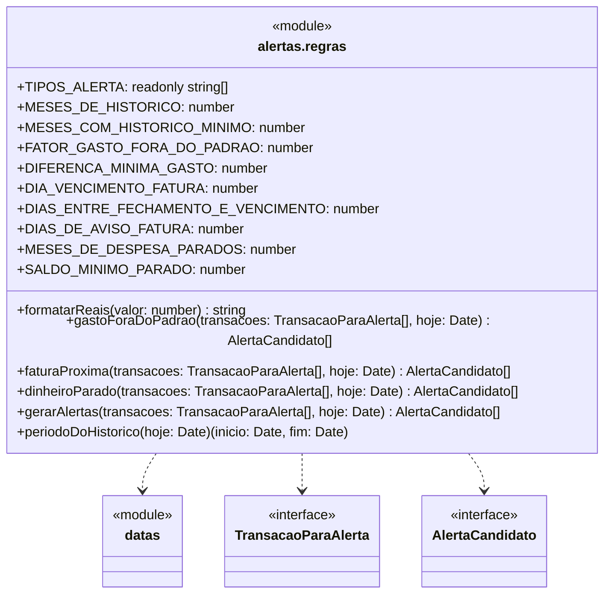

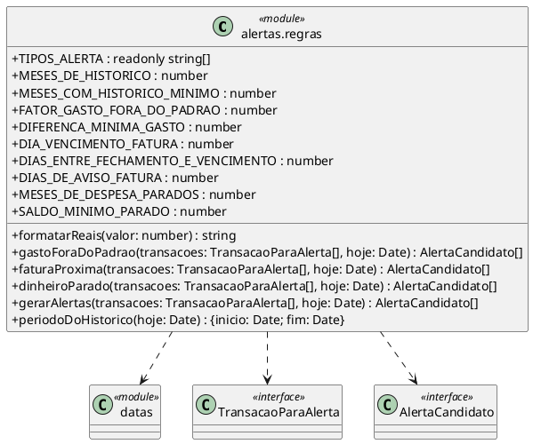

## TipoAlerta

- **Tipo:** Tipo (alias TypeScript)
- **Estereótipo:** «type»
- **Arquivo de origem:** `Backend/src/modules/mentor-ia/alertas.regras.ts`

**Descrição:** União dos tipos de alerta derivada de TIPOS_ALERTA: gasto_fora_do_padrao, fatura_proxima, dinheiro_parado.

**Atributos**

_Sem atributos._

**Operações**

_Sem operações._

**Relações**

| Tipo | Alvo | Multiplicidade | Rótulo |
|---|---|---|---|
| dependência | `alertas.regras` | — | — |

**Diagrama**

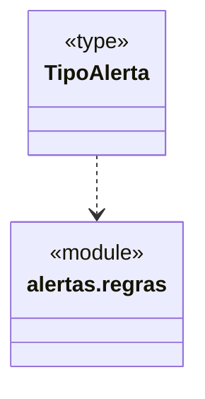

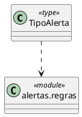

## TransacaoParaAlerta

- **Tipo:** Interface TypeScript
- **Estereótipo:** «interface»
- **Arquivo de origem:** `Backend/src/modules/mentor-ia/alertas.regras.ts`

**Descrição:** Subconjunto dos campos de transação de que as regras de alerta precisam.

**Atributos**

| Visibilidade | Nome | Tipo | Descrição |
|---|---|---|---|
| + | `tipo` | `"receita" \| "despesa"` | tipo ("receita" \| "despesa") |
| + | `valor` | `number` | valor (number) |
| + | `categoria` | `string` | categoria (string) |
| + | `data` | `Date` | data (Date) |
| + | `formaPagamento` | `string` | formaPagamento (string) |

**Operações**

_Sem operações._

**Relações**

_Sem relações declaradas._

**Diagrama**

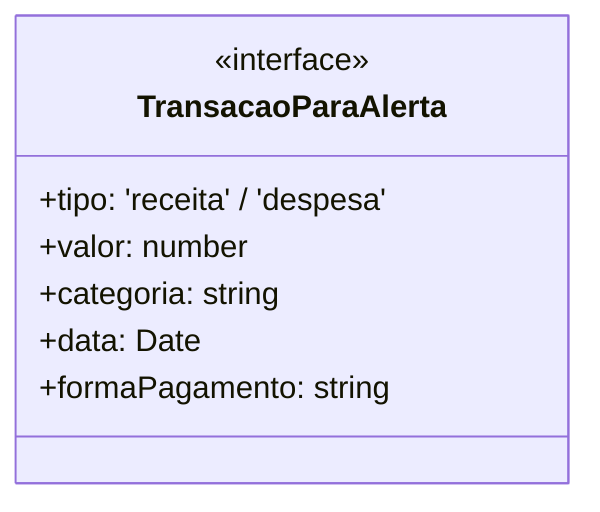

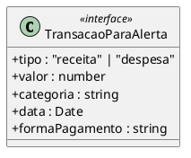

## AlertaCandidato

- **Tipo:** Interface TypeScript
- **Estereótipo:** «interface»
- **Arquivo de origem:** `Backend/src/modules/mentor-ia/alertas.regras.ts`

**Descrição:** Alerta calculado pelas regras, ainda não persistido, identificado por chave no período.

**Atributos**

| Visibilidade | Nome | Tipo | Descrição |
|---|---|---|---|
| + | `tipo` | `TipoAlerta` | tipo (TipoAlerta) |
| + | `chave` | `string` | chave (string) |
| + | `titulo` | `string` | titulo (string) |
| + | `mensagem` | `string` | mensagem (string) |
| + | `dados` | `Record<string, string \| number>` | dados (Record<string, string \| number>) |

**Operações**

_Sem operações._

**Relações**

| Tipo | Alvo | Multiplicidade | Rótulo |
|---|---|---|---|
| associação | `TipoAlerta` | 1 | tipo |

**Diagrama**

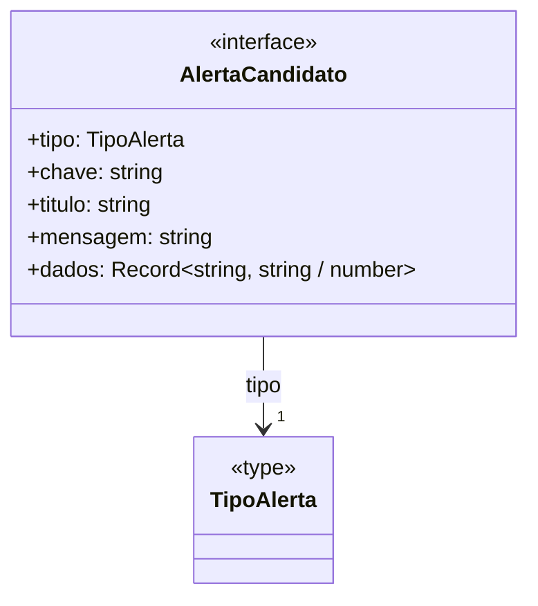

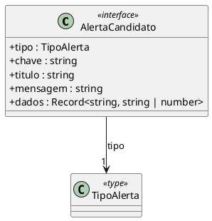

## alertasService

- **Tipo:** Classe/objeto de serviço
- **Estereótipo:** «service»
- **Arquivo de origem:** `Backend/src/modules/mentor-ia/alertas.service.ts`

**Descrição:** Gera os alertas na leitura com as transações reais do usuário, lista e marca como lidos ou explicados.

**Atributos**

_Sem atributos._

**Operações**

| Visibilidade | Assinatura | Retorno | Descrição |
|---|---|---|---|
| + | `atualizar(userId: string, agora?: Date)` | `Promise<void>` | Operação atualizar do elemento. |
| + | `listar(userId: string)` | `Promise<AlertResponseDto[]>` | Operação listar do elemento. |
| + | `marcarComoLido(userId: string, id: string)` | `Promise<AlertResponseDto>` | Operação marcarComoLido do elemento. |
| + | `listarNaoExplicados(userId: string)` | `Promise<AlertResponseDto[]>` | Operação listarNaoExplicados do elemento. |
| + | `marcarComoExplicados(userId: string, ids: string[])` | `Promise<number>` | Operação marcarComoExplicados do elemento. |
| - | `paraDto(a: AlertDocument)` | `AlertResponseDto` | Operação paraDto do elemento. |

**Relações**

| Tipo | Alvo | Multiplicidade | Rótulo |
|---|---|---|---|
| dependência | `mentorIaRepository` | — | — |
| dependência | `alertas.regras` | — | — |
| dependência | `AlertDocument` | — | — |
| dependência | `AlertResponseDto` | — | — |
| dependência | `AppError` (externo) | — | — |

**Diagrama**

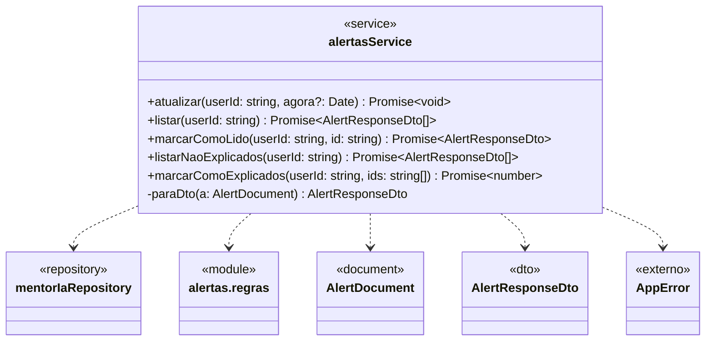

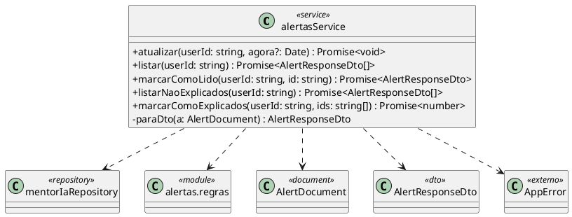

## datas

- **Tipo:** Módulo (conjunto de funções e constantes)
- **Estereótipo:** «module»
- **Arquivo de origem:** `Backend/src/modules/mentor-ia/datas.ts`

**Descrição:** Utilitários de data no fuso de Brasília (UTC-3).

**Atributos**

| Visibilidade | Nome | Tipo | Descrição |
|---|---|---|---|
| + | `FUSO_BRASILIA_MS` | `number` | FUSO_BRASILIA_MS (number) |

**Operações**

| Visibilidade | Assinatura | Retorno | Descrição |
|---|---|---|---|
| + | `diaEmBrasilia(instante: Date)` | `DiaEmBrasilia` | Operação diaEmBrasilia do elemento. |
| + | `inicioDoDia(ano: number, mes: number, dia: number)` | `Date` | Operação inicioDoDia do elemento. |
| + | `mesAtualEmBrasilia(agora?: Date)` | `{inicio: Date; diaDoMes: number}` | Operação mesAtualEmBrasilia do elemento. |

**Relações**

| Tipo | Alvo | Multiplicidade | Rótulo |
|---|---|---|---|
| dependência | `DiaEmBrasilia` | — | — |

**Diagrama**

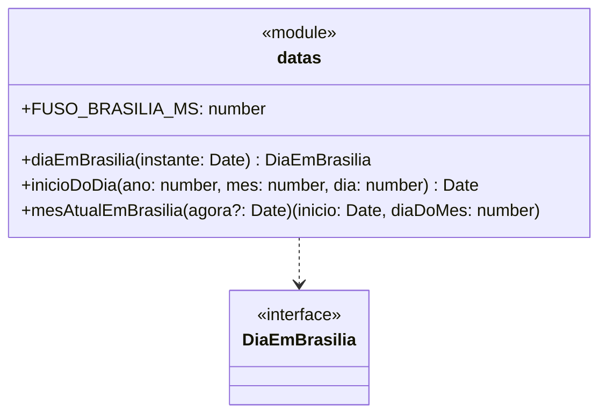

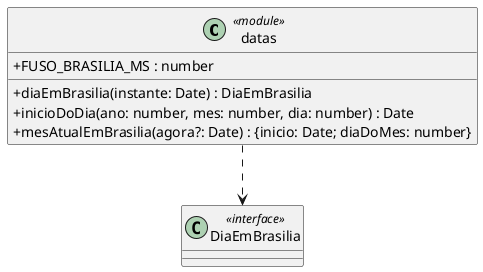

## DiaEmBrasilia

- **Tipo:** Interface TypeScript
- **Estereótipo:** «interface»
- **Arquivo de origem:** `Backend/src/modules/mentor-ia/datas.ts`

**Descrição:** Ano, mês (0 a 11) e dia de uma data em Brasília.

**Atributos**

| Visibilidade | Nome | Tipo | Descrição |
|---|---|---|---|
| + | `ano` | `number` | ano (number) |
| + | `mes` | `number` | mes (number) |
| + | `dia` | `number` | dia (number) |

**Operações**

_Sem operações._

**Relações**

_Sem relações declaradas._

**Diagrama**

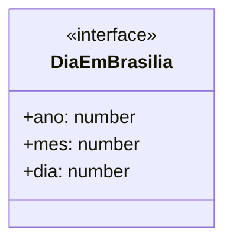

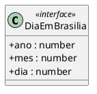

## genai.client

- **Tipo:** Módulo (conjunto de funções e constantes)
- **Estereótipo:** «module»
- **Arquivo de origem:** `Backend/src/modules/mentor-ia/genai.client.ts`

**Descrição:** Único ponto que chama a API de IA generativa (formato /chat/completions, compatível com Groq).

**Atributos**

| Visibilidade | Nome | Tipo | Descrição |
|---|---|---|---|
| + | `MARCADOR_FORA_DO_ESCOPO` | `string` | MARCADOR_FORA_DO_ESCOPO (string) |
| - | `INSTRUCOES` | `string` | INSTRUCOES (string) |

**Operações**

| Visibilidade | Assinatura | Retorno | Descrição |
|---|---|---|---|
| + | `chamarApiDeIaGenerativa(contexto: string, texto: string, historico?: MensagemAnterior[])` | `Promise<string>` | Operação chamarApiDeIaGenerativa do elemento. |
| - | `indisponivel()` | `AppError` | Operação indisponivel do elemento. |

**Relações**

| Tipo | Alvo | Multiplicidade | Rótulo |
|---|---|---|---|
| dependência | `MensagemAnterior` | — | — |
| dependência | `AppError` (externo) | — | — |
| dependência | `env` (externo) | — | — |

**Diagrama**

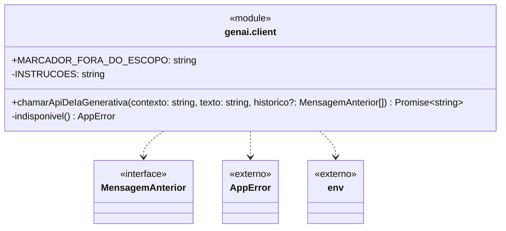

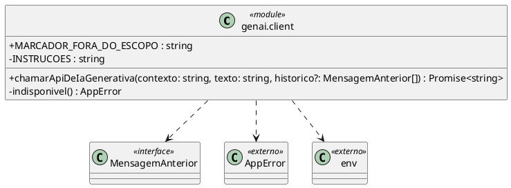

## MensagemAnterior

- **Tipo:** Interface TypeScript
- **Estereótipo:** «interface»
- **Arquivo de origem:** `Backend/src/modules/mentor-ia/genai.client.ts`

**Descrição:** Mensagem anterior do histórico enviada no prompt da IA.

**Atributos**

| Visibilidade | Nome | Tipo | Descrição |
|---|---|---|---|
| + | `autor` | `"usuario" \| "ia"` | autor ("usuario" \| "ia") |
| + | `texto` | `string` | texto (string) |

**Operações**

_Sem operações._

**Relações**

_Sem relações declaradas._

**Diagrama**

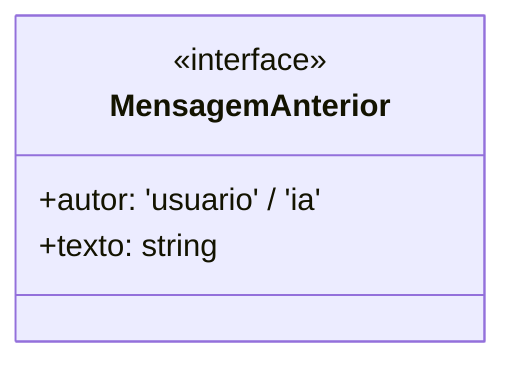

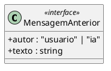

## mentorIaController

- **Tipo:** Classe/objeto de serviço
- **Estereótipo:** «controller»
- **Arquivo de origem:** `Backend/src/modules/mentor-ia/mentor-ia.controller.ts`

**Descrição:** Controller Express do chat do Mentor IA e dos alertas.

**Atributos**

_Sem atributos._

**Operações**

| Visibilidade | Assinatura | Retorno | Descrição |
|---|---|---|---|
| + | `sendMessage(req: AuthenticatedRequest, res: Response, next: NextFunction)` | `Promise<void>` | Operação sendMessage do elemento. |
| + | `proactiveMessage(req, res, next)` | `Promise<void>` | Operação proactiveMessage do elemento. |
| + | `history(req, res, next)` | `Promise<void>` | Operação history do elemento. |
| + | `listAlerts(req, res, next)` | `Promise<void>` | Operação listAlerts do elemento. |
| + | `markAlertRead(req, res, next)` | `Promise<void>` | Operação markAlertRead do elemento. |

**Relações**

| Tipo | Alvo | Multiplicidade | Rótulo |
|---|---|---|---|
| dependência | `mentorIaService` | — | — |
| dependência | `alertasService` | — | — |
| dependência | `chatMessageSchema` | — | — |
| dependência | `alertIdParamsSchema` | — | — |
| dependência | `AuthenticatedRequest` (externo) | — | — |

**Diagrama**

```mermaid
classDiagram
    class mentorIaController["mentorIaController"] {
      <<controller>>
      +sendMessage(req: AuthenticatedRequest, res: Response, next: NextFunction) Promise~void~
      +proactiveMessage(req, res, next) Promise~void~
      +history(req, res, next) Promise~void~
      +listAlerts(req, res, next) Promise~void~
      +markAlertRead(req, res, next) Promise~void~
    }
    class mentorIaService["mentorIaService"] {
      <<service>>
    }
    class alertasService["alertasService"] {
      <<service>>
    }
    class chatMessageSchema["chatMessageSchema"] {
      <<dto>>
    }
    class alertIdParamsSchema["alertIdParamsSchema"] {
      <<dto>>
    }
    class AuthenticatedRequest["AuthenticatedRequest"] {
      <<externo>>
    }
    mentorIaController ..> mentorIaService
    mentorIaController ..> alertasService
    mentorIaController ..> chatMessageSchema
    mentorIaController ..> alertIdParamsSchema
    mentorIaController ..> AuthenticatedRequest
```

```plantuml
@startuml
skinparam classAttributeIconSize 0
class "mentorIaController" as mentorIaController <<controller>> {
  +sendMessage(req: AuthenticatedRequest, res: Response, next: NextFunction) : Promise<void>
  +proactiveMessage(req, res, next) : Promise<void>
  +history(req, res, next) : Promise<void>
  +listAlerts(req, res, next) : Promise<void>
  +markAlertRead(req, res, next) : Promise<void>
}
class "mentorIaService" as mentorIaService <<service>>
class "alertasService" as alertasService <<service>>
class "chatMessageSchema" as chatMessageSchema <<dto>>
class "alertIdParamsSchema" as alertIdParamsSchema <<dto>>
class "AuthenticatedRequest" as AuthenticatedRequest <<externo>>
mentorIaController ..> mentorIaService
mentorIaController ..> alertasService
mentorIaController ..> chatMessageSchema
mentorIaController ..> alertIdParamsSchema
mentorIaController ..> AuthenticatedRequest
@enduml
```

## chatMessageSchema

- **Tipo:** Objeto
- **Estereótipo:** «dto»
- **Arquivo de origem:** `Backend/src/modules/mentor-ia/mentor-ia.dto.ts`

**Descrição:** Schema zod do corpo de POST /chat (texto de 1 a 2000 caracteres).

**Atributos**

| Visibilidade | Nome | Tipo | Descrição |
|---|---|---|---|
| + | `texto` | `string` | texto (string) |

**Operações**

_Sem operações._

**Relações**

_Sem relações declaradas._

**Diagrama**

```mermaid
classDiagram
    class chatMessageSchema["chatMessageSchema"] {
      <<dto>>
      +texto: string
    }


```

```plantuml
@startuml
skinparam classAttributeIconSize 0
class "chatMessageSchema" as chatMessageSchema <<dto>> {
  +texto : string
}


@enduml
```

## ChatMessageDto

- **Tipo:** Tipo (alias TypeScript)
- **Estereótipo:** «dto»
- **Arquivo de origem:** `Backend/src/modules/mentor-ia/mentor-ia.dto.ts`

**Descrição:** Tipo inferido de chatMessageSchema.

**Atributos**

_Sem atributos._

**Operações**

_Sem operações._

**Relações**

| Tipo | Alvo | Multiplicidade | Rótulo |
|---|---|---|---|
| dependência | `chatMessageSchema` | — | — |

**Diagrama**

```mermaid
classDiagram
    class ChatMessageDto["ChatMessageDto"] {
      <<dto>>
    }
    class chatMessageSchema["chatMessageSchema"] {
      <<dto>>
    }

    ChatMessageDto ..> chatMessageSchema
```

```plantuml
@startuml
skinparam classAttributeIconSize 0
class "ChatMessageDto" as ChatMessageDto <<dto>> {
}
class "chatMessageSchema" as chatMessageSchema <<dto>>

ChatMessageDto ..> chatMessageSchema
@enduml
```

## ChatMessageResponseDto

- **Tipo:** Interface TypeScript
- **Estereótipo:** «dto»
- **Arquivo de origem:** `Backend/src/modules/mentor-ia/mentor-ia.dto.ts`

**Descrição:** Mensagem do chat devolvida ao Frontend, com id no lugar de _id.

**Atributos**

| Visibilidade | Nome | Tipo | Descrição |
|---|---|---|---|
| + | `id` | `string` | id (string) |
| + | `autor` | `"usuario" \| "ia"` | autor ("usuario" \| "ia") |
| + | `texto` | `string` | texto (string) |
| + | `proativa` | `true` | proativa (true) |
| + | `criadaEm` | `string` | criadaEm (string) |

**Operações**

_Sem operações._

**Relações**

_Sem relações declaradas._

**Diagrama**

```mermaid
classDiagram
    class ChatMessageResponseDto["ChatMessageResponseDto"] {
      <<dto>>
      +id: string
      +autor: 'usuario' / 'ia'
      +texto: string
      +proativa: true
      +criadaEm: string
    }


```

```plantuml
@startuml
skinparam classAttributeIconSize 0
class "ChatMessageResponseDto" as ChatMessageResponseDto <<dto>> {
  +id : string
  +autor : "usuario" | "ia"
  +texto : string
  +proativa : true
  +criadaEm : string
}


@enduml
```

## ChatReplyResponseDto

- **Tipo:** Interface TypeScript
- **Estereótipo:** «dto»
- **Arquivo de origem:** `Backend/src/modules/mentor-ia/mentor-ia.dto.ts`

**Descrição:** Resposta de POST /chat com a pergunta do usuário e a resposta da IA.

**Atributos**

| Visibilidade | Nome | Tipo | Descrição |
|---|---|---|---|
| + | `pergunta` | `ChatMessageResponseDto` | pergunta (ChatMessageResponseDto) |
| + | `resposta` | `ChatMessageResponseDto` | resposta (ChatMessageResponseDto) |

**Operações**

_Sem operações._

**Relações**

| Tipo | Alvo | Multiplicidade | Rótulo |
|---|---|---|---|
| composição | `ChatMessageResponseDto` | 2 | pergunta/resposta |

**Diagrama**

```mermaid
classDiagram
    class ChatReplyResponseDto["ChatReplyResponseDto"] {
      <<dto>>
      +pergunta: ChatMessageResponseDto
      +resposta: ChatMessageResponseDto
    }
    class ChatMessageResponseDto["ChatMessageResponseDto"] {
      <<dto>>
    }

    ChatReplyResponseDto *-- "2" ChatMessageResponseDto : pergunta/resposta
```

```plantuml
@startuml
skinparam classAttributeIconSize 0
class "ChatReplyResponseDto" as ChatReplyResponseDto <<dto>> {
  +pergunta : ChatMessageResponseDto
  +resposta : ChatMessageResponseDto
}
class "ChatMessageResponseDto" as ChatMessageResponseDto <<dto>>

ChatReplyResponseDto *-- "2" ChatMessageResponseDto : pergunta/resposta
@enduml
```

## ChatProativaResponseDto

- **Tipo:** Interface TypeScript
- **Estereótipo:** «dto»
- **Arquivo de origem:** `Backend/src/modules/mentor-ia/mentor-ia.dto.ts`

**Descrição:** Resposta de POST /chat/proativa com as mensagens do Mentor.

**Atributos**

| Visibilidade | Nome | Tipo | Descrição |
|---|---|---|---|
| + | `mensagens` | `ChatMessageResponseDto[]` | mensagens (ChatMessageResponseDto[]) |

**Operações**

_Sem operações._

**Relações**

| Tipo | Alvo | Multiplicidade | Rótulo |
|---|---|---|---|
| composição | `ChatMessageResponseDto` | 0..* | mensagens |

**Diagrama**

```mermaid
classDiagram
    class ChatProativaResponseDto["ChatProativaResponseDto"] {
      <<dto>>
      +mensagens: ChatMessageResponseDto[]
    }
    class ChatMessageResponseDto["ChatMessageResponseDto"] {
      <<dto>>
    }

    ChatProativaResponseDto *-- "0..*" ChatMessageResponseDto : mensagens
```

```plantuml
@startuml
skinparam classAttributeIconSize 0
class "ChatProativaResponseDto" as ChatProativaResponseDto <<dto>> {
  +mensagens : ChatMessageResponseDto[]
}
class "ChatMessageResponseDto" as ChatMessageResponseDto <<dto>>

ChatProativaResponseDto *-- "0..*" ChatMessageResponseDto : mensagens
@enduml
```

## alertIdParamsSchema

- **Tipo:** Objeto
- **Estereótipo:** «dto»
- **Arquivo de origem:** `Backend/src/modules/mentor-ia/mentor-ia.dto.ts`

**Descrição:** Schema zod do parâmetro :id (ObjectId de 24 hex) de PATCH /alerts/:id/lido.

**Atributos**

| Visibilidade | Nome | Tipo | Descrição |
|---|---|---|---|
| + | `id` | `string` | id (string) |

**Operações**

_Sem operações._

**Relações**

_Sem relações declaradas._

**Diagrama**

```mermaid
classDiagram
    class alertIdParamsSchema["alertIdParamsSchema"] {
      <<dto>>
      +id: string
    }


```

```plantuml
@startuml
skinparam classAttributeIconSize 0
class "alertIdParamsSchema" as alertIdParamsSchema <<dto>> {
  +id : string
}


@enduml
```

## AlertResponseDto

- **Tipo:** Interface TypeScript
- **Estereótipo:** «dto»
- **Arquivo de origem:** `Backend/src/modules/mentor-ia/mentor-ia.dto.ts`

**Descrição:** Alerta devolvido ao Frontend, sem userId, chave nem explicadoEm.

**Atributos**

| Visibilidade | Nome | Tipo | Descrição |
|---|---|---|---|
| + | `id` | `string` | id (string) |
| + | `tipo` | `TipoAlerta` | tipo (TipoAlerta) |
| + | `titulo` | `string` | titulo (string) |
| + | `mensagem` | `string` | mensagem (string) |
| + | `dados` | `Record<string, string \| number>` | dados (Record<string, string \| number>) |
| + | `lido` | `boolean` | lido (boolean) |
| + | `criadaEm` | `string` | criadaEm (string) |

**Operações**

_Sem operações._

**Relações**

| Tipo | Alvo | Multiplicidade | Rótulo |
|---|---|---|---|
| associação | `TipoAlerta` | 1 | tipo |

**Diagrama**

```mermaid
classDiagram
    class AlertResponseDto["AlertResponseDto"] {
      <<dto>>
      +id: string
      +tipo: TipoAlerta
      +titulo: string
      +mensagem: string
      +dados: Record~string, string / number~
      +lido: boolean
      +criadaEm: string
    }
    class TipoAlerta["TipoAlerta"] {
      <<type>>
    }

    AlertResponseDto --> "1" TipoAlerta : tipo
```

```plantuml
@startuml
skinparam classAttributeIconSize 0
class "AlertResponseDto" as AlertResponseDto <<dto>> {
  +id : string
  +tipo : TipoAlerta
  +titulo : string
  +mensagem : string
  +dados : Record<string, string | number>
  +lido : boolean
  +criadaEm : string
}
class "TipoAlerta" as TipoAlerta <<type>>

AlertResponseDto --> "1" TipoAlerta : tipo
@enduml
```

## ChatMessageDocument

- **Tipo:** Interface TypeScript
- **Estereótipo:** «document»
- **Arquivo de origem:** `Backend/src/modules/mentor-ia/mentor-ia.model.ts`

**Descrição:** Documento Mongoose de mensagem do chat (coleção ChatMessage).

**Atributos**

| Visibilidade | Nome | Tipo | Descrição |
|---|---|---|---|
| + | `userId` | `string` | userId (string) |
| + | `autor` | `"usuario" \| "ia"` | autor ("usuario" \| "ia") |
| + | `texto` | `string` | texto (string) |
| + | `proativa` | `boolean` | proativa (boolean) |
| + | `createdAt` | `Date` | createdAt (Date) |

**Operações**

_Sem operações._

**Relações**

_Sem relações declaradas._

**Diagrama**

```mermaid
classDiagram
    class ChatMessageDocument["ChatMessageDocument"] {
      <<document>>
      +userId: string
      +autor: 'usuario' / 'ia'
      +texto: string
      +proativa: boolean
      +createdAt: Date
    }


```

```plantuml
@startuml
skinparam classAttributeIconSize 0
class "ChatMessageDocument" as ChatMessageDocument <<document>> {
  +userId : string
  +autor : "usuario" | "ia"
  +texto : string
  +proativa : boolean
  +createdAt : Date
}


@enduml
```

## ChatMessageModel

- **Tipo:** Objeto
- **Estereótipo:** «document»
- **Arquivo de origem:** `Backend/src/modules/mentor-ia/mentor-ia.model.ts`

**Descrição:** Model Mongoose de ChatMessage, com índice por userId e createdAt.

**Atributos**

_Sem atributos._

**Operações**

_Sem operações._

**Relações**

| Tipo | Alvo | Multiplicidade | Rótulo |
|---|---|---|---|
| dependência | `ChatMessageDocument` | — | — |

**Diagrama**

```mermaid
classDiagram
    class ChatMessageModel["ChatMessageModel"] {
      <<document>>
    }
    class ChatMessageDocument["ChatMessageDocument"] {
      <<document>>
    }

    ChatMessageModel ..> ChatMessageDocument
```

```plantuml
@startuml
skinparam classAttributeIconSize 0
class "ChatMessageModel" as ChatMessageModel <<document>> {
}
class "ChatMessageDocument" as ChatMessageDocument <<document>>

ChatMessageModel ..> ChatMessageDocument
@enduml
```

## AlertDocument

- **Tipo:** Interface TypeScript
- **Estereótipo:** «document»
- **Arquivo de origem:** `Backend/src/modules/mentor-ia/mentor-ia.model.ts`

**Descrição:** Documento Mongoose de alerta (coleção alerts), único por userId e chave.

**Atributos**

| Visibilidade | Nome | Tipo | Descrição |
|---|---|---|---|
| + | `userId` | `string` | userId (string) |
| + | `tipo` | `TipoAlerta` | tipo (TipoAlerta) |
| + | `chave` | `string` | chave (string) |
| + | `titulo` | `string` | titulo (string) |
| + | `mensagem` | `string` | mensagem (string) |
| + | `dados` | `Record<string, string \| number>` | dados (Record<string, string \| number>) |
| + | `lido` | `boolean` | lido (boolean) |
| + | `explicadoEm` | `Date` | explicadoEm (Date) |
| + | `createdAt` | `Date` | createdAt (Date) |
| + | `updatedAt` | `Date` | updatedAt (Date) |

**Operações**

_Sem operações._

**Relações**

| Tipo | Alvo | Multiplicidade | Rótulo |
|---|---|---|---|
| associação | `TipoAlerta` | 1 | tipo |

**Diagrama**

```mermaid
classDiagram
    class AlertDocument["AlertDocument"] {
      <<document>>
      +userId: string
      +tipo: TipoAlerta
      +chave: string
      +titulo: string
      +mensagem: string
      +dados: Record~string, string / number~
      +lido: boolean
      +explicadoEm: Date
      +createdAt: Date
      +updatedAt: Date
    }
    class TipoAlerta["TipoAlerta"] {
      <<type>>
    }

    AlertDocument --> "1" TipoAlerta : tipo
```

```plantuml
@startuml
skinparam classAttributeIconSize 0
class "AlertDocument" as AlertDocument <<document>> {
  +userId : string
  +tipo : TipoAlerta
  +chave : string
  +titulo : string
  +mensagem : string
  +dados : Record<string, string | number>
  +lido : boolean
  +explicadoEm : Date
  +createdAt : Date
  +updatedAt : Date
}
class "TipoAlerta" as TipoAlerta <<type>>

AlertDocument --> "1" TipoAlerta : tipo
@enduml
```

## AlertModel

- **Tipo:** Objeto
- **Estereótipo:** «document»
- **Arquivo de origem:** `Backend/src/modules/mentor-ia/mentor-ia.model.ts`

**Descrição:** Model Mongoose de Alert, com índices único por chave e de listagem de não lidos.

**Atributos**

_Sem atributos._

**Operações**

_Sem operações._

**Relações**

| Tipo | Alvo | Multiplicidade | Rótulo |
|---|---|---|---|
| dependência | `AlertDocument` | — | — |

**Diagrama**

```mermaid
classDiagram
    class AlertModel["AlertModel"] {
      <<document>>
    }
    class AlertDocument["AlertDocument"] {
      <<document>>
    }

    AlertModel ..> AlertDocument
```

```plantuml
@startuml
skinparam classAttributeIconSize 0
class "AlertModel" as AlertModel <<document>> {
}
class "AlertDocument" as AlertDocument <<document>>

AlertModel ..> AlertDocument
@enduml
```

## mentorIaRepository

- **Tipo:** Classe/objeto de serviço
- **Estereótipo:** «repository»
- **Arquivo de origem:** `Backend/src/modules/mentor-ia/mentor-ia.repository.ts`

**Descrição:** Acesso ao MongoDB para histórico do chat, alertas e leitura de transações para as regras.

**Atributos**

_Sem atributos._

**Operações**

| Visibilidade | Assinatura | Retorno | Descrição |
|---|---|---|---|
| + | `saveExchange(userId: string, pergunta: string, resposta: string)` | `Promise<readonly [obj, obj]>` | Operação saveExchange do elemento. |
| + | `saveMensagemProativa(userId: string, texto: string)` | `Promise<obj>` | Operação saveMensagemProativa do elemento. |
| + | `findRecent(userId: string, limite: number)` | `Promise<obj[]>` | Operação findRecent do elemento. |
| + | `findTransacoesParaAlertas(userId: string, inicio: Date, fim: Date)` | `Promise<TransacaoParaAlerta[]>` | Operação findTransacoesParaAlertas do elemento. |
| + | `sincronizarAlertas(userId: string, alertas: AlertaCandidato[])` | `Promise<void>` | Operação sincronizarAlertas do elemento. |
| + | `findAlertasNaoLidos(userId: string, naoExplicados?: boolean)` | `Promise<obj[]>` | Operação findAlertasNaoLidos do elemento. |
| + | `marcarAlertaComoLido(userId: string, id: string)` | `Promise<obj \| null>` | Operação marcarAlertaComoLido do elemento. |
| + | `marcarAlertasComoExplicados(userId: string, ids: string[])` | `Promise<number>` | Operação marcarAlertasComoExplicados do elemento. |

**Relações**

| Tipo | Alvo | Multiplicidade | Rótulo |
|---|---|---|---|
| dependência | `AlertModel` | — | — |
| dependência | `ChatMessageModel` | — | — |
| dependência | `TransactionModel` (externo) | — | — |
| dependência | `AlertaCandidato` | — | — |
| dependência | `TransacaoParaAlerta` | — | — |

**Diagrama**

```mermaid
classDiagram
    class mentorIaRepository["mentorIaRepository"] {
      <<repository>>
      +saveExchange(userId: string, pergunta: string, resposta: string) Promise~readonly [obj, obj]~
      +saveMensagemProativa(userId: string, texto: string) Promise~obj~
      +findRecent(userId: string, limite: number) Promise~obj[]~
      +findTransacoesParaAlertas(userId: string, inicio: Date, fim: Date) Promise~TransacaoParaAlerta[]~
      +sincronizarAlertas(userId: string, alertas: AlertaCandidato[]) Promise~void~
      +findAlertasNaoLidos(userId: string, naoExplicados?: boolean) Promise~obj[]~
      +marcarAlertaComoLido(userId: string, id: string) Promise~obj / null~
      +marcarAlertasComoExplicados(userId: string, ids: string[]) Promise~number~
    }
    class AlertModel["AlertModel"] {
      <<document>>
    }
    class ChatMessageModel["ChatMessageModel"] {
      <<document>>
    }
    class AlertaCandidato["AlertaCandidato"] {
      <<interface>>
    }
    class TransacaoParaAlerta["TransacaoParaAlerta"] {
      <<interface>>
    }
    class TransactionModel["TransactionModel"] {
      <<externo>>
    }
    mentorIaRepository ..> AlertModel
    mentorIaRepository ..> ChatMessageModel
    mentorIaRepository ..> TransactionModel
    mentorIaRepository ..> AlertaCandidato
    mentorIaRepository ..> TransacaoParaAlerta
```

```plantuml
@startuml
skinparam classAttributeIconSize 0
class "mentorIaRepository" as mentorIaRepository <<repository>> {
  +saveExchange(userId: string, pergunta: string, resposta: string) : Promise<readonly [obj, obj]>
  +saveMensagemProativa(userId: string, texto: string) : Promise<obj>
  +findRecent(userId: string, limite: number) : Promise<obj[]>
  +findTransacoesParaAlertas(userId: string, inicio: Date, fim: Date) : Promise<TransacaoParaAlerta[]>
  +sincronizarAlertas(userId: string, alertas: AlertaCandidato[]) : Promise<void>
  +findAlertasNaoLidos(userId: string, naoExplicados?: boolean) : Promise<obj[]>
  +marcarAlertaComoLido(userId: string, id: string) : Promise<obj | null>
  +marcarAlertasComoExplicados(userId: string, ids: string[]) : Promise<number>
}
class "AlertModel" as AlertModel <<document>>
class "ChatMessageModel" as ChatMessageModel <<document>>
class "AlertaCandidato" as AlertaCandidato <<interface>>
class "TransacaoParaAlerta" as TransacaoParaAlerta <<interface>>
class "TransactionModel" as TransactionModel <<externo>>
mentorIaRepository ..> AlertModel
mentorIaRepository ..> ChatMessageModel
mentorIaRepository ..> TransactionModel
mentorIaRepository ..> AlertaCandidato
mentorIaRepository ..> TransacaoParaAlerta
@enduml
```

## mentorIaRouter

- **Tipo:** Objeto
- **Estereótipo:** «router»
- **Arquivo de origem:** `Backend/src/modules/mentor-ia/mentor-ia.routes.ts`

**Descrição:** Router Express autenticado: POST/GET /chat, POST /chat/proativa, GET /alerts, PATCH /alerts/:id/lido.

**Atributos**

_Sem atributos._

**Operações**

_Sem operações._

**Relações**

| Tipo | Alvo | Multiplicidade | Rótulo |
|---|---|---|---|
| dependência | `mentorIaController` | — | — |
| dependência | `authMiddleware` (externo) | — | — |

**Diagrama**

```mermaid
classDiagram
    class mentorIaRouter["mentorIaRouter"] {
      <<router>>
    }
    class mentorIaController["mentorIaController"] {
      <<controller>>
    }
    class authMiddleware["authMiddleware"] {
      <<externo>>
    }
    mentorIaRouter ..> mentorIaController
    mentorIaRouter ..> authMiddleware
```

```plantuml
@startuml
skinparam classAttributeIconSize 0
class "mentorIaRouter" as mentorIaRouter <<router>> {
}
class "mentorIaController" as mentorIaController <<controller>>
class "authMiddleware" as authMiddleware <<externo>>
mentorIaRouter ..> mentorIaController
mentorIaRouter ..> authMiddleware
@enduml
```

## mentorIaService

- **Tipo:** Classe/objeto de serviço
- **Estereótipo:** «service»
- **Arquivo de origem:** `Backend/src/modules/mentor-ia/mentor-ia.service.ts`

**Descrição:** Orquestra o chat: contexto via Servidor Java, IA generativa, filtro via Servidor Java e histórico no MongoDB.

**Atributos**

| Visibilidade | Nome | Tipo | Descrição |
|---|---|---|---|
| - | `TRANSACOES_DO_MES` | `number` | TRANSACOES_DO_MES (number) |
| - | `MENSAGENS_ANTERIORES` | `number` | MENSAGENS_ANTERIORES (number) |
| - | `MENSAGENS_NO_HISTORICO` | `number` | MENSAGENS_NO_HISTORICO (number) |
| - | `INSTRUCAO_PROATIVA` | `string` | INSTRUCAO_PROATIVA (string) |

**Operações**

| Visibilidade | Assinatura | Retorno | Descrição |
|---|---|---|---|
| + | `sendMessage(userId: string, texto: string)` | `Promise<ChatReplyResponseDto>` | Operação sendMessage do elemento. |
| + | `proactiveMessage(userId: string)` | `Promise<ChatProativaResponseDto>` | Operação proactiveMessage do elemento. |
| + | `getHistory(userId: string)` | `Promise<ChatMessageResponseDto[]>` | Operação getHistory do elemento. |
| - | `montarContexto(userId: string)` | `Promise<string>` | Operação montarContexto do elemento. |
| - | `filtrarResposta(resposta: string)` | `Promise<string>` | Operação filtrarResposta do elemento. |
| - | `contextoComPadroes(contexto: string, alertas: AlertResponseDto[])` | `string` | Operação contextoComPadroes do elemento. |
| - | `paraDto(m: ChatMessageDocument)` | `ChatMessageResponseDto` | Operação paraDto do elemento. |

**Relações**

| Tipo | Alvo | Multiplicidade | Rótulo |
|---|---|---|---|
| dependência | `mentorIaRepository` | — | — |
| dependência | `genai.client` | — | — |
| dependência | `alertasService` | — | — |
| dependência | `transactionsRepository` (externo) | — | — |
| dependência | `javaServerClient` (externo) | — | PedidoMontarContextoIA / PedidoFiltrarResposta |
| dependência | `datas` | — | — |
| dependência | `ChatMessageDocument` | — | — |
| dependência | `ChatReplyResponseDto` | — | — |
| dependência | `ChatProativaResponseDto` | — | — |
| dependência | `ChatMessageResponseDto` | — | — |
| dependência | `TransacaoResumida` | — | — |

**Diagrama**

```mermaid
classDiagram
    class mentorIaService["mentorIaService"] {
      <<service>>
      -TRANSACOES_DO_MES: number
      -MENSAGENS_ANTERIORES: number
      -MENSAGENS_NO_HISTORICO: number
      -INSTRUCAO_PROATIVA: string
      +sendMessage(userId: string, texto: string) Promise~ChatReplyResponseDto~
      +proactiveMessage(userId: string) Promise~ChatProativaResponseDto~
      +getHistory(userId: string) Promise~ChatMessageResponseDto[]~
      -montarContexto(userId: string) Promise~string~
      -filtrarResposta(resposta: string) Promise~string~
      -contextoComPadroes(contexto: string, alertas: AlertResponseDto[]) string
      -paraDto(m: ChatMessageDocument) ChatMessageResponseDto
    }
    class mentorIaRepository["mentorIaRepository"] {
      <<repository>>
    }
    class genai_client["genai.client"] {
      <<module>>
    }
    class alertasService["alertasService"] {
      <<service>>
    }
    class datas["datas"] {
      <<module>>
    }
    class ChatMessageDocument["ChatMessageDocument"] {
      <<document>>
    }
    class ChatReplyResponseDto["ChatReplyResponseDto"] {
      <<dto>>
    }
    class ChatProativaResponseDto["ChatProativaResponseDto"] {
      <<dto>>
    }
    class ChatMessageResponseDto["ChatMessageResponseDto"] {
      <<dto>>
    }
    class TransacaoResumida["TransacaoResumida"] {
      <<interface>>
    }
    class transactionsRepository["transactionsRepository"] {
      <<externo>>
    }
    class javaServerClient["javaServerClient"] {
      <<externo>>
    }
    mentorIaService ..> mentorIaRepository
    mentorIaService ..> genai_client
    mentorIaService ..> alertasService
    mentorIaService ..> transactionsRepository
    mentorIaService ..> javaServerClient : PedidoMontarContextoIA / PedidoFiltrarResposta
    mentorIaService ..> datas
    mentorIaService ..> ChatMessageDocument
    mentorIaService ..> ChatReplyResponseDto
    mentorIaService ..> ChatProativaResponseDto
    mentorIaService ..> ChatMessageResponseDto
    mentorIaService ..> TransacaoResumida
```

```plantuml
@startuml
skinparam classAttributeIconSize 0
class "mentorIaService" as mentorIaService <<service>> {
  -TRANSACOES_DO_MES : number
  -MENSAGENS_ANTERIORES : number
  -MENSAGENS_NO_HISTORICO : number
  -INSTRUCAO_PROATIVA : string
  +sendMessage(userId: string, texto: string) : Promise<ChatReplyResponseDto>
  +proactiveMessage(userId: string) : Promise<ChatProativaResponseDto>
  +getHistory(userId: string) : Promise<ChatMessageResponseDto[]>
  -montarContexto(userId: string) : Promise<string>
  -filtrarResposta(resposta: string) : Promise<string>
  -contextoComPadroes(contexto: string, alertas: AlertResponseDto[]) : string
  -paraDto(m: ChatMessageDocument) : ChatMessageResponseDto
}
class "mentorIaRepository" as mentorIaRepository <<repository>>
class "genai.client" as genai_client <<module>>
class "alertasService" as alertasService <<service>>
class "datas" as datas <<module>>
class "ChatMessageDocument" as ChatMessageDocument <<document>>
class "ChatReplyResponseDto" as ChatReplyResponseDto <<dto>>
class "ChatProativaResponseDto" as ChatProativaResponseDto <<dto>>
class "ChatMessageResponseDto" as ChatMessageResponseDto <<dto>>
class "TransacaoResumida" as TransacaoResumida <<interface>>
class "transactionsRepository" as transactionsRepository <<externo>>
class "javaServerClient" as javaServerClient <<externo>>
mentorIaService ..> mentorIaRepository
mentorIaService ..> genai_client
mentorIaService ..> alertasService
mentorIaService ..> transactionsRepository
mentorIaService ..> javaServerClient : PedidoMontarContextoIA / PedidoFiltrarResposta
mentorIaService ..> datas
mentorIaService ..> ChatMessageDocument
mentorIaService ..> ChatReplyResponseDto
mentorIaService ..> ChatProativaResponseDto
mentorIaService ..> ChatMessageResponseDto
mentorIaService ..> TransacaoResumida
@enduml
```

## TransacaoResumida

- **Tipo:** Interface TypeScript
- **Estereótipo:** «interface»
- **Arquivo de origem:** `Backend/src/modules/mentor-ia/mentor-ia.service.ts`

**Descrição:** Transação reduzida enviada ao Servidor Java para montar o contexto da IA (não exportada).

**Atributos**

| Visibilidade | Nome | Tipo | Descrição |
|---|---|---|---|
| + | `tipo` | `"receita" \| "despesa"` | tipo ("receita" \| "despesa") |
| + | `valor` | `number` | valor (number) |
| + | `categoria` | `string` | categoria (string) |
| + | `descricao` | `string` | descricao (string) |
| + | `data` | `string` | data (string) |

**Operações**

_Sem operações._

**Relações**

_Sem relações declaradas._

**Diagrama**

```mermaid
classDiagram
    class TransacaoResumida["TransacaoResumida"] {
      <<interface>>
      +tipo: 'receita' / 'despesa'
      +valor: number
      +categoria: string
      +descricao: string
      +data: string
    }


```

```plantuml
@startuml
skinparam classAttributeIconSize 0
class "TransacaoResumida" as TransacaoResumida <<interface>> {
  +tipo : "receita" | "despesa"
  +valor : number
  +categoria : string
  +descricao : string
  +data : string
}


@enduml
```
