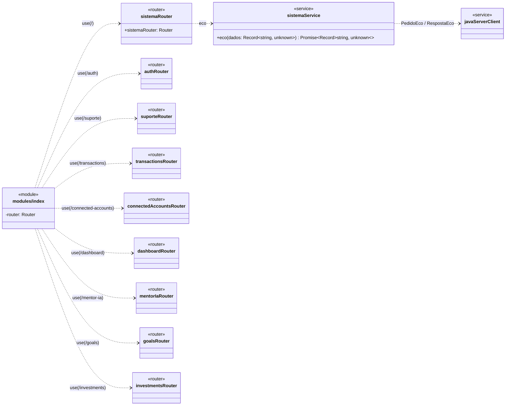
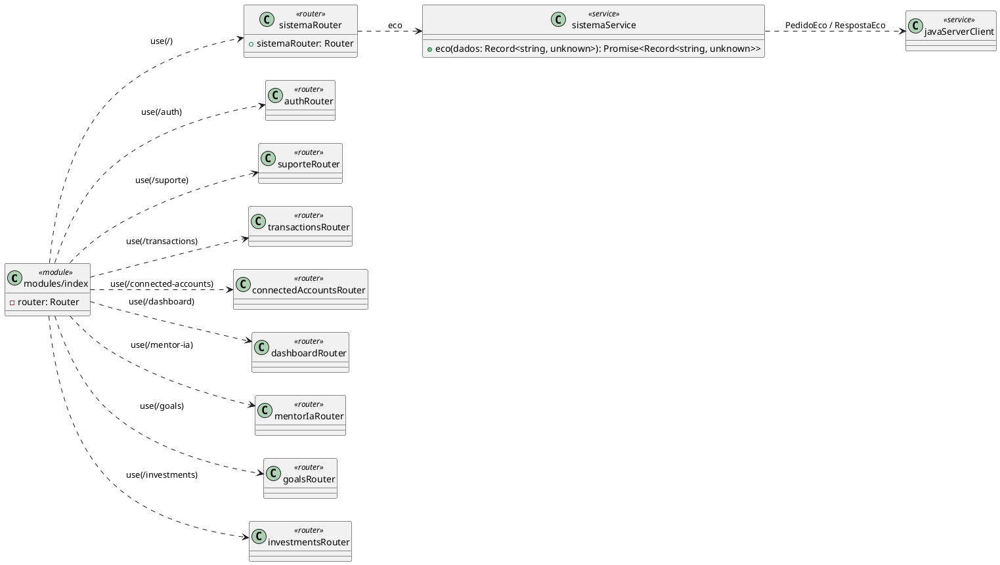
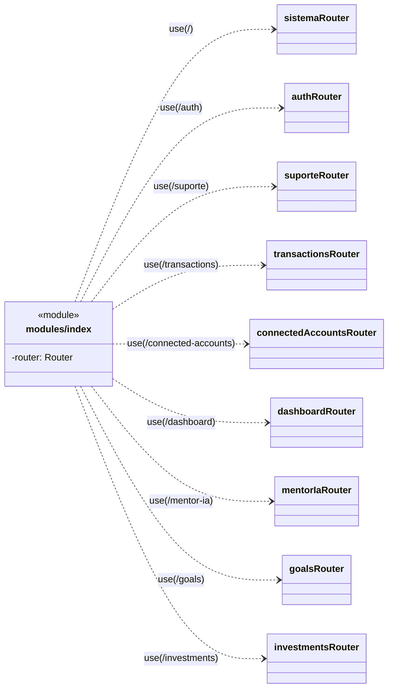
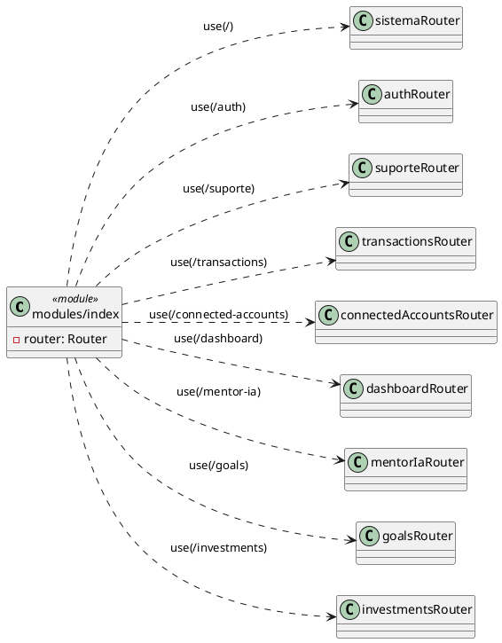
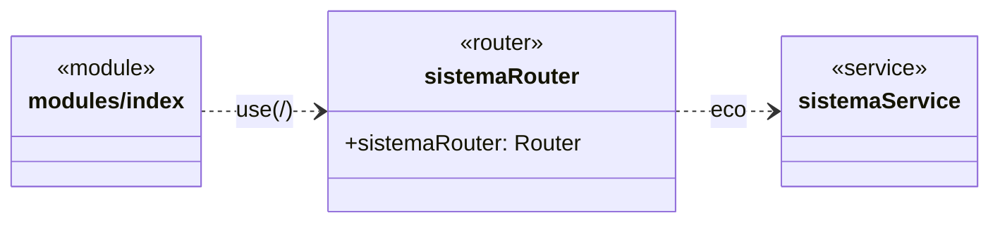
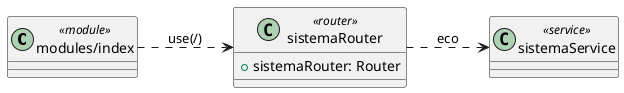
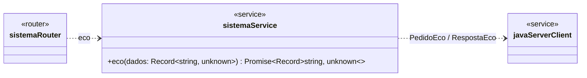
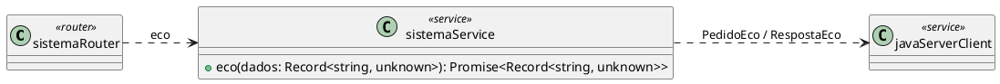

# Backend: sistema

Modelo UML (padrão Astah / UML 2) dos elementos do grupo **be-sistema**: o router raiz do Express (`modules/index`) e o módulo `sistema`, que verifica a base das 3 camadas (Frontend, Backend e Servidor Java). Todos os elementos abaixo existem no código; este grupo não possui elementos «planejado» (contas e transferências, descritas em `docs/especificacao-contas-e-transferencias.md`, entrarão nos módulos de outros grupos).

Notação: visibilidade `+` público, `-` privado, `#` protegido, `~` pacote. No código TypeScript, `sistemaRouter` e `sistemaService` são objetos (constantes exportadas), não classes; por isso aparecem com os estereótipos «router» e «service». Cada diagrama aparece em dois blocos (Mermaid para o GitHub e PlantUML para recriar no Astah).

## Elementos do grupo

| Elemento | Tipo | Estereótipo | Arquivo |
|---|---|---|---|
| modules/index | módulo | «module» | `Backend/src/modules/index.ts` |
| sistemaRouter | objeto | «router» | `Backend/src/modules/sistema/sistema.routes.ts` |
| sistemaService | serviço | «service» | `Backend/src/modules/sistema/sistema.service.ts` |

## Diagrama do grupo

Vizinhos de outros grupos (authRouter, suporteRouter, transactionsRouter, connectedAccountsRouter, dashboardRouter, mentorIaRouter, goalsRouter, investmentsRouter e javaServerClient) aparecem apenas como alvos de dependência.

## modules/index

**Tipo:** módulo. **Estereótipo:** «module». **Arquivo:** `Backend/src/modules/index.ts`.

**Descrição:** router raiz do Express. Cria um `Router` e monta nele os routers de todos os módulos: transactions, connected-accounts, dashboard, mentor-ia, goals, investments, sistema (na raiz, sem prefixo), auth e suporte. É exportado como `default`.

### Atributos

| Visibilidade | Nome | Tipo | Descrição |
|---|---|---|---|
| - | router | Router | Instância do `Router` do Express (constante local) à qual os routers dos módulos são montados com `use`. |

### Operações

| Visibilidade | Assinatura | Retorno | Descrição |
|---|---|---|---|
| (nenhuma) | - | - | O módulo não declara funções; apenas executa chamadas `router.use(...)` na carga. |

### Relações

| Tipo | Alvo | Multiplicidade | Rótulo |
|---|---|---|---|
| dependência | sistemaRouter | 1 | use(/) |
| dependência | authRouter | 1 | use(/auth) |
| dependência | suporteRouter | 1 | use(/suporte) |
| dependência | transactionsRouter | 1 | use(/transactions) |
| dependência | connectedAccountsRouter | 1 | use(/connected-accounts) |
| dependência | dashboardRouter | 1 | use(/dashboard) |
| dependência | mentorIaRouter | 1 | use(/mentor-ia) |
| dependência | goalsRouter | 1 | use(/goals) |
| dependência | investmentsRouter | 1 | use(/investments) |

### Diagrama

## sistemaRouter

**Tipo:** objeto (constante exportada). **Estereótipo:** «router». **Arquivo:** `Backend/src/modules/sistema/sistema.routes.ts`.

**Descrição:** router do Express com duas rotas de verificação da base das 3 camadas. `GET /health` responde `{ "status": "ok" }` e indica que o Backend está no ar, sem depender do Servidor Java. `POST /eco` chama `sistemaService.eco` com o corpo da requisição (ou `{}`) e devolve a resposta; em caso de erro repassa ao middleware de erros por `next(erro)`. O corpo `{"falhar":"negocio"}` ou `{"falhar":"interno"}` exercita o caminho de erro. Exportado como nomeado e como `default`. Como as rotas são funções anônimas inline, não há operações nomeadas.

### Atributos

| Visibilidade | Nome | Tipo | Descrição |
|---|---|---|---|
| + | sistemaRouter | Router | Instância do `Router` do Express com as rotas `GET /health` e `POST /eco`. |

### Operações

| Visibilidade | Assinatura | Retorno | Descrição |
|---|---|---|---|
| (nenhuma) | - | - | Rotas inline: `GET /health` e `POST /eco` (ver descrição). |

### Relações

| Tipo | Alvo | Multiplicidade | Rótulo |
|---|---|---|---|
| dependência | sistemaService | 1 | eco |
| dependência (inversa) | modules/index | 1 | montado em use(/) |

### Diagrama

## sistemaService

**Tipo:** serviço (objeto literal exportado). **Estereótipo:** «service». **Arquivo:** `Backend/src/modules/sistema/sistema.service.ts`.

**Descrição:** verificação da base das 3 camadas. Não tem regra de negócio e pode sair quando os grupos já tiverem rotas reais passando pelo Servidor Java. Envia um `PedidoEco` ao Servidor Java por `javaServerClient.enviarPedido` e retorna a `RespostaEco` (os mesmos dados enviados).

### Atributos

| Visibilidade | Nome | Tipo | Descrição |
|---|---|---|---|
| (nenhum) | - | - | O serviço não possui atributos. |

### Operações

| Visibilidade | Assinatura | Retorno | Descrição |
|---|---|---|---|
| + | eco(dados: Record<string, unknown>) | Promise<Record<string, unknown>> | Faz o caminho completo Backend, socket, Servidor Java e volta: chama `javaServerClient.enviarPedido("PedidoEco", "RespostaEco", dados)`. |

### Relações

| Tipo | Alvo | Multiplicidade | Rótulo |
|---|---|---|---|
| dependência | javaServerClient | 1 | PedidoEco / RespostaEco |
| dependência (inversa) | sistemaRouter | 1 | eco |

### Diagrama

