# Modelo UML de Classes - Backend: suporte

Módulo `Backend/src/modules/suporte`. Registra relatos de problemas de suporte enviados por usuários autenticados (`POST /`, protegido por `authMiddleware`, resposta HTTP 201). Fluxo: `suporteRouter` -> `suporteController` -> `suporteService` -> `suporteRepository` -> `SuporteModel` (MongoDB).

Notação: padrão Astah / UML 2. Visibilidade: `+` público, `-` privado, `#` protegido, `~` pacote. Elementos externos ao grupo (vizinhos) aparecem apenas como referência: `authMiddleware`, `AuthenticatedRequest`, `UserModel`.

## Diagrama do grupo

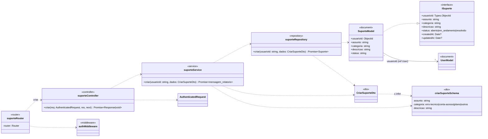

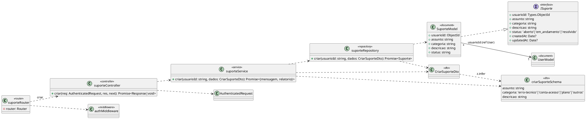

---

## suporteRouter

- Tipo: objeto (instância de `Router`). Estereótipo: «router».
- Arquivo: `Backend/src/modules/suporte/suporte.routes.ts`
- Descrição: Router Express com `POST /` protegido por `authMiddleware` para registrar problema de suporte.

### Atributos

| Visibilidade | Nome | Tipo | Descrição |
|---|---|---|---|
| - | router | Router | Instância do router Express do módulo. |

### Operações

| Visibilidade | Assinatura | Retorno | Descrição |
|---|---|---|---|
| (nenhuma) | | | |

### Relações

| Tipo | Alvo | Multiplicidade | Rótulo |
|---|---|---|---|
| dependência | suporteController | - | criar |
| dependência | authMiddleware | - | - |

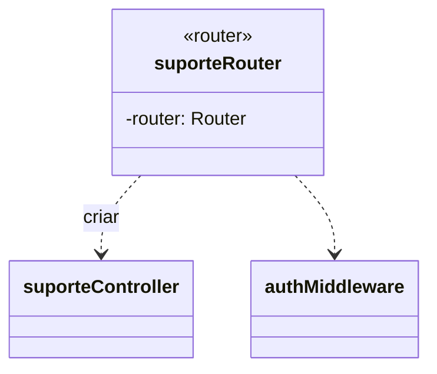

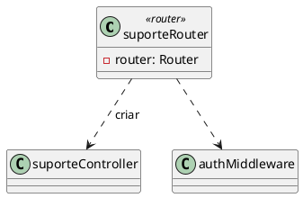

---

## suporteController

- Tipo: serviço. Estereótipo: «controller».
- Arquivo: `Backend/src/modules/suporte/suporte.controller.ts`
- Descrição: Controller que obtém o usuário autenticado e delega a criação do relato ao `suporteService` (HTTP 201).

### Atributos

| Visibilidade | Nome | Tipo | Descrição |
|---|---|---|---|
| (nenhum) | | | |

### Operações

| Visibilidade | Assinatura | Retorno | Descrição |
|---|---|---|---|
| + | criar(req: AuthenticatedRequest, res, next) | Promise<Response\|void> | Obtém o usuário autenticado e delega ao service; responde HTTP 201. |

### Relações

| Tipo | Alvo | Multiplicidade | Rótulo |
|---|---|---|---|
| dependência | suporteService | - | - |
| dependência | AuthenticatedRequest | - | - |

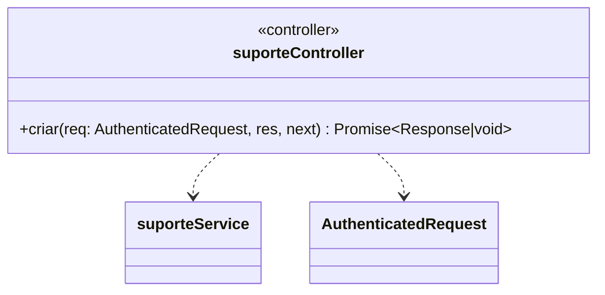

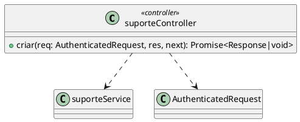

---

## suporteService

- Tipo: serviço. Estereótipo: «service».
- Arquivo: `Backend/src/modules/suporte/suporte.service.ts`
- Descrição: Valida o relato com zod, persiste via repository e devolve mensagem e dados do relatório.

### Atributos

| Visibilidade | Nome | Tipo | Descrição |
|---|---|---|---|
| (nenhum) | | | |

### Operações

| Visibilidade | Assinatura | Retorno | Descrição |
|---|---|---|---|
| + | criar(usuarioId: string, dados: CriarSuporteDto) | Promise<{mensagem, relatorio}> | Valida com `criarSuporteSchema`, persiste via `suporteRepository` e retorna mensagem e dados do relatório. |

### Relações

| Tipo | Alvo | Multiplicidade | Rótulo |
|---|---|---|---|
| dependência | suporteRepository | - | - |
| dependência | criarSuporteSchema | - | - |
| dependência | CriarSuporteDto | - | - |

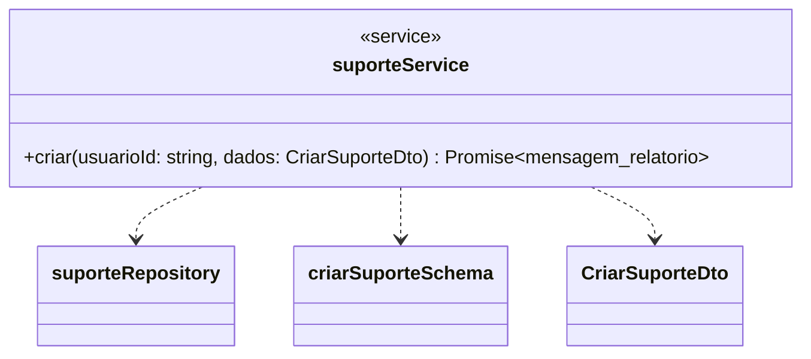

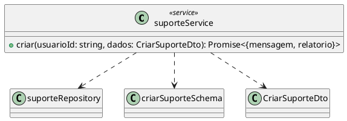

---

## suporteRepository

- Tipo: serviço. Estereótipo: «repository».
- Arquivo: `Backend/src/modules/suporte/suporte.repository.ts`
- Descrição: Persiste relatos de suporte no MongoDB.

### Atributos

| Visibilidade | Nome | Tipo | Descrição |
|---|---|---|---|
| (nenhum) | | | |

### Operações

| Visibilidade | Assinatura | Retorno | Descrição |
|---|---|---|---|
| + | criar(usuarioId: string, dados: CriarSuporteDto) | Promise<Suporte> | Cria o documento de suporte associado ao usuário. |

### Relações

| Tipo | Alvo | Multiplicidade | Rótulo |
|---|---|---|---|
| dependência | SuporteModel | - | - |
| dependência | CriarSuporteDto | - | - |

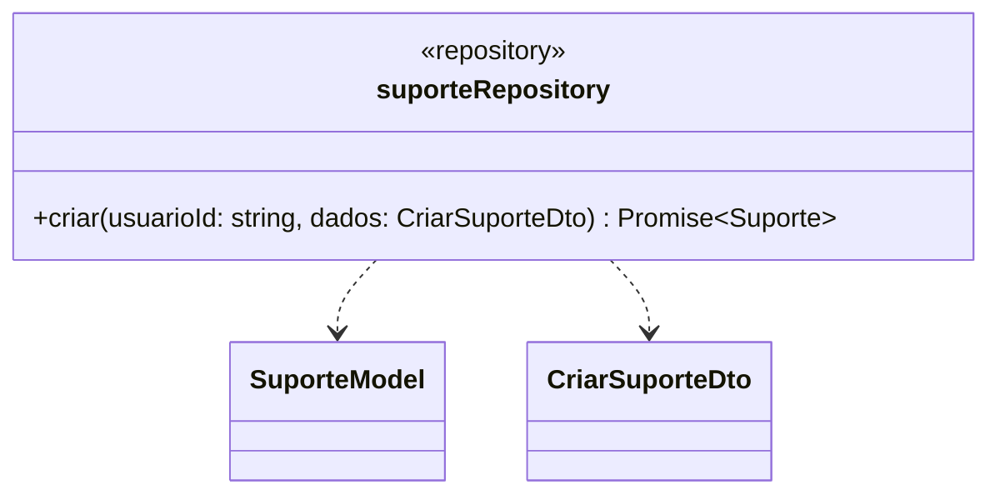

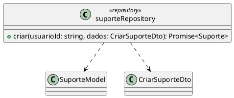

---

## ISuporte

- Tipo: interface. Estereótipo: «interface».
- Arquivo: `Backend/src/modules/suporte/suporte.model.ts`
- Descrição: Interface do documento de suporte.

### Atributos

| Visibilidade | Nome | Tipo | Descrição |
|---|---|---|---|
| + | usuarioId | Types.ObjectId | Identificador do usuário autor do relato. |
| + | assunto | string | Assunto do relato. |
| + | categoria | string | Categoria do relato. |
| + | descricao | string | Descrição do problema. |
| + | status | 'aberto'\|'em_andamento'\|'resolvido' | Situação do relato. |
| + | createdAt | Date? | Data de criação (opcional). |
| + | updatedAt | Date? | Data da última atualização (opcional). |

### Operações

| Visibilidade | Assinatura | Retorno | Descrição |
|---|---|---|---|
| (nenhuma) | | | |

### Relações

| Tipo | Alvo | Multiplicidade | Rótulo |
|---|---|---|---|
| realização (recebida) | SuporteModel | - | SuporteModel realiza ISuporte |

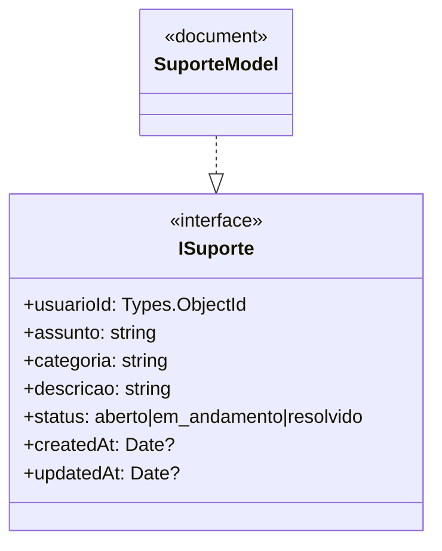

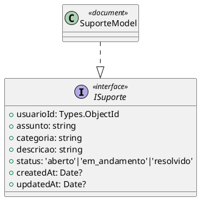

---

## SuporteModel

- Tipo: classe. Estereótipo: «document».
- Arquivo: `Backend/src/modules/suporte/suporte.model.ts`
- Descrição: Modelo Mongoose da coleção Suporte, com referência ao usuário.

### Atributos

| Visibilidade | Nome | Tipo | Descrição |
|---|---|---|---|
| + | usuarioId | ObjectId | Referência ao usuário (ref User). |
| + | assunto | string | Assunto do relato. |
| + | categoria | string | Categoria do relato. |
| + | descricao | string | Descrição do problema. |
| + | status | string | Situação do relato. |

### Operações

| Visibilidade | Assinatura | Retorno | Descrição |
|---|---|---|---|
| (nenhuma) | | | |

### Relações

| Tipo | Alvo | Multiplicidade | Rótulo |
|---|---|---|---|
| realização | ISuporte | - | - |
| associação | UserModel | * para 1 | usuarioId (ref User) |

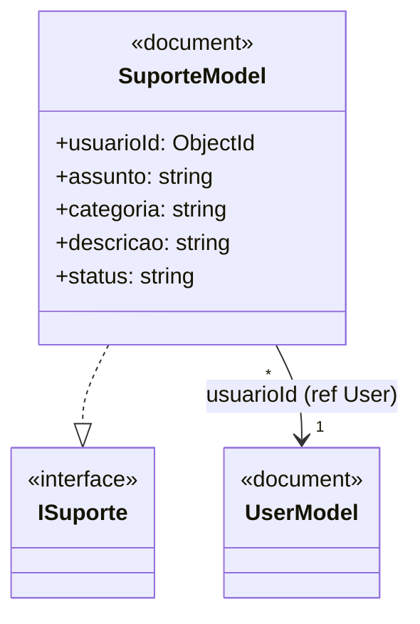

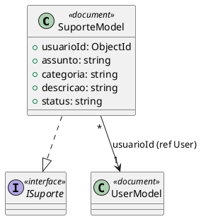

---

## criarSuporteSchema

- Tipo: objeto (schema zod). Estereótipo: «dto».
- Arquivo: `Backend/src/modules/suporte/suporte.dto.ts`
- Descrição: Schema zod do relato de suporte (assunto, categoria, descricao).

### Atributos

| Visibilidade | Nome | Tipo | Descrição |
|---|---|---|---|
| (não informada) | assunto | string | Assunto do relato. |
| (não informada) | categoria | 'erro-tecnico'\|'conta-acesso'\|'plano'\|'outros' | Categoria do relato. |
| (não informada) | descricao | string | Descrição do problema. |

### Operações

| Visibilidade | Assinatura | Retorno | Descrição |
|---|---|---|---|
| (nenhuma) | | | |

### Relações

| Tipo | Alvo | Multiplicidade | Rótulo |
|---|---|---|---|
| dependência (recebida) | CriarSuporteDto | - | z.infer |
| dependência (recebida) | suporteService | - | validação |

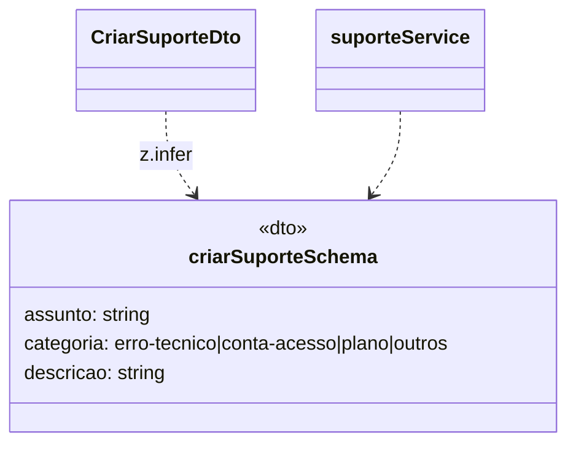

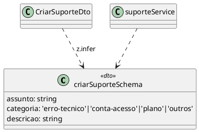

---

## CriarSuporteDto

- Tipo: tipo (type alias TypeScript). Estereótipo: «dto».
- Arquivo: `Backend/src/modules/suporte/suporte.dto.ts`
- Descrição: Tipo inferido de `criarSuporteSchema`.

### Atributos

| Visibilidade | Nome | Tipo | Descrição |
|---|---|---|---|
| (nenhum) | | | Campos inferidos de `criarSuporteSchema`. |

### Operações

| Visibilidade | Assinatura | Retorno | Descrição |
|---|---|---|---|
| (nenhuma) | | | |

### Relações

| Tipo | Alvo | Multiplicidade | Rótulo |
|---|---|---|---|
| dependência | criarSuporteSchema | - | z.infer |
| dependência (recebida) | suporteService | - | parâmetro |
| dependência (recebida) | suporteRepository | - | parâmetro |

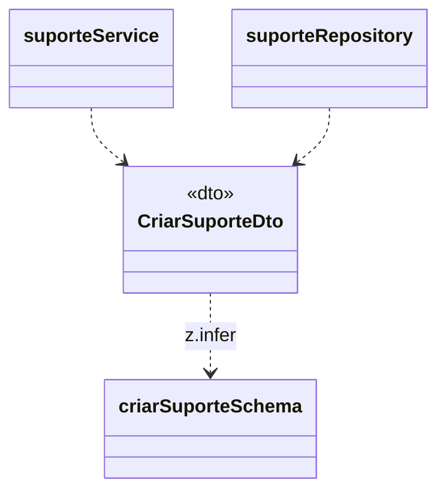

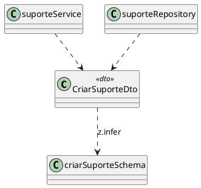
