# Modelo UML de classes: Backend, módulo transactions

Notação Astah / UML 2. Visibilidade: `+` público, `-` privado, `#` protegido, `~` pacote. Origem: `Backend/src/modules/transactions/`. Os elementos existentes estão no código; o que ainda não existe aparece marcado com «planejado» (fonte: `docs/especificacao-contas-e-transferencias.md`).

Convenções usadas nos diagramas: `receita/despesa` representa a união literal `"receita"|"despesa"`; `manual/pluggy` representa `"manual"|"pluggy"`; `?` após o tipo indica opcional.

## Diagrama do grupo

Vizinhos externos: `javaServerClient`, `goalsRepository`, `investmentsRepository`, `InstallmentDocument`, `AppError`, `AuthenticatedRequest`, `authMiddleware` e `ConnectedAccountDocument`. Elementos «planejado»: `AccountDocument` (contas) e `createTransferSchema` (transferências).

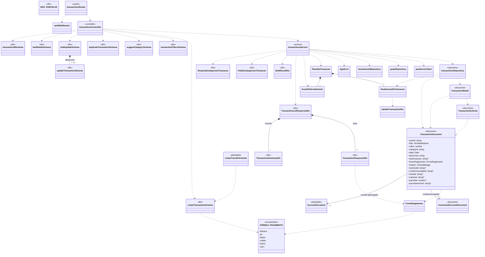

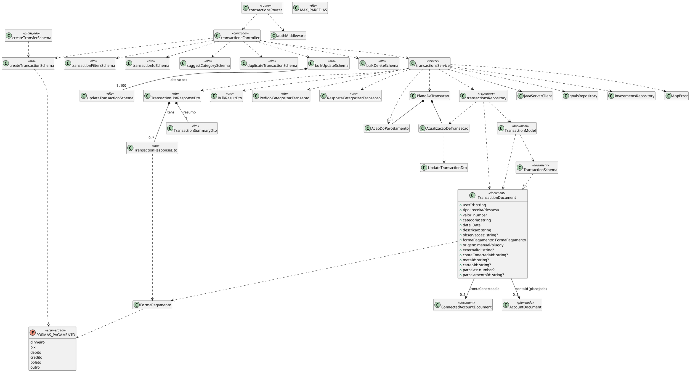

## Índice dos elementos

Enumeração: `FORMAS_PAGAMENTO`. Documentos: `TransactionDocument`, `TransactionSchema`, `TransactionModel`. Schemas e tipos de DTO: `createTransactionSchema`, `transactionFiltersSchema`, `updateTransactionSchema`, `transactionIdSchema`, `suggestCategorySchema`, `duplicateTransactionSchema`, `bulkUpdateSchema`, `bulkDeleteSchema`, `MAX_PARCELAS`, `SuggestCategoryDto`, `UpdateTransactionDto`, `BulkUpdateDto`, `DuplicateTransactionDto`, `CreateTransactionDto`, `TransactionFiltersDto`. Interfaces de DTO: `PedidoCategorizarTransacao`, `RespostaCategorizarTransacao`, `TransactionResponseDto`, `BulkResultDto`, `TransactionSummaryDto`, `TransactionListResponseDto`. Tipos auxiliares: `FormaPagamento`, `AtualizacaoDeTransacao`, `AcaoDoParcelamento`, `PlanoDaTransacao`. Camadas: `transactionsRepository`, `transactionsService`, `transactionsController`, `transactionsRouter`. Planejado: `createTransferSchema`.

---

## FORMAS_PAGAMENTO

- Tipo e estereótipo: enumeração «enumeration».
- Arquivo de origem: `Backend/src/modules/transactions/transactions.model.ts`.
- Descrição: lista constante dos valores aceitos em `formaPagamento`.

**Atributos (literais)**

| Visibilidade | Nome | Tipo | Descrição |
|---|---|---|---|
| + | dinheiro | literal | Pagamento em dinheiro |
| + | pix | literal | Pagamento via Pix |
| + | debito | literal | Cartão de débito |
| + | credito | literal | Cartão de crédito |
| + | boleto | literal | Boleto |
| + | outro | literal | Outra forma |

**Operações:** nenhuma.

**Relações**

| Tipo | Alvo | Multiplicidade | Rótulo |
|---|---|---|---|
| dependência (entrante) | FormaPagamento | - | união dos valores |
| dependência (entrante) | createTransactionSchema | - | enum de formaPagamento |

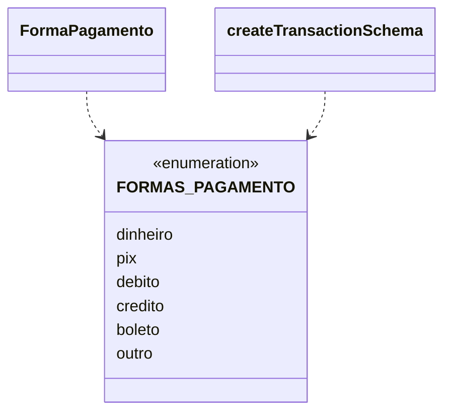

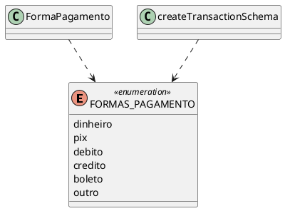

## FormaPagamento

- Tipo e estereótipo: tipo (alias de união).
- Arquivo de origem: `Backend/src/modules/transactions/transactions.model.ts`.
- Descrição: união dos valores de `FORMAS_PAGAMENTO`.

**Atributos:** nenhum.

**Operações:** nenhuma.

**Relações**

| Tipo | Alvo | Multiplicidade | Rótulo |
|---|---|---|---|
| dependência | FORMAS_PAGAMENTO | - | - |

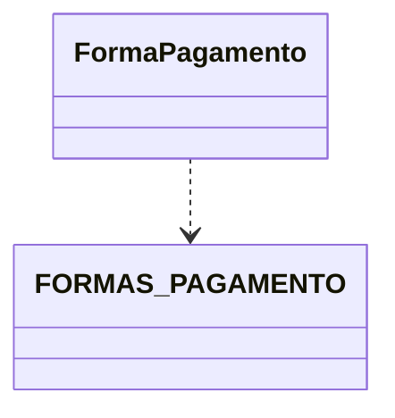

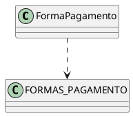

## TransactionDocument

- Tipo e estereótipo: interface «document».
- Arquivo de origem: `Backend/src/modules/transactions/transactions.model.ts`.
- Descrição: documento de transação (receita/despesa) manual ou importada da Pluggy.
- Planejado (não existe no código): campos `contaId` (obrigatório nos manuais), `contaDestinoId` e o valor `transferencia` em `tipo`, conforme a especificação de contas e transferências.

**Atributos**

| Visibilidade | Nome | Tipo | Descrição |
|---|---|---|---|
| + | userId | string | Dono da transação |
| + | tipo | receita/despesa | Natureza do lançamento |
| + | valor | number | Valor do lançamento |
| + | categoria | string | Categoria |
| + | data | Date | Data do lançamento |
| + | descricao | string | Descrição |
| + | observacoes | string? | Observações opcionais |
| + | formaPagamento | FormaPagamento | Forma de pagamento |
| + | origem | manual/pluggy | Origem do registro |
| + | externalId | string? | Id externo (importada da Pluggy) |
| + | contaConectadaId | string? | Conta conectada de onde veio a importação |
| + | metaId | string? | Meta vinculada |
| + | cartaoId | string? | Cartão vinculado |
| + | parcelas | number? | Número de parcelas |
| + | parcelamentoId | string? | Parcelamento vinculado |
| + | contaId | string | «planejado» conta do lançamento (obrigatório nos manuais) |
| + | contaDestinoId | string? | «planejado» conta de destino, só em transferência |

**Operações:** nenhuma.

**Relações**

| Tipo | Alvo | Multiplicidade | Rótulo |
|---|---|---|---|
| dependência | FormaPagamento | - | tipo de formaPagamento |
| associação | ConnectedAccountDocument | 0..1 | contaConectadaId |
| associação | AccountDocument «planejado» | 0..1 | contaId |

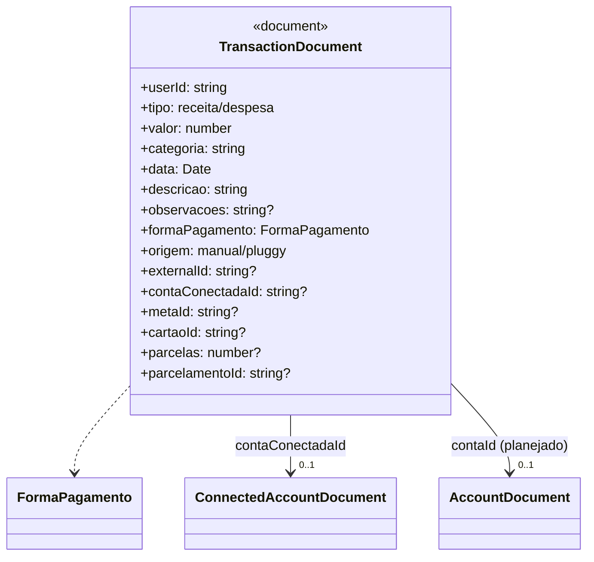

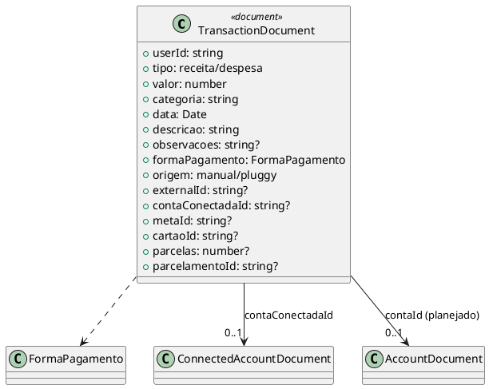

## TransactionSchema

- Tipo e estereótipo: objeto «document».
- Arquivo de origem: `Backend/src/modules/transactions/transactions.model.ts`.
- Descrição: esquema Mongoose de transações com timestamps e índices (userId+data, userId+metaId, userId+cartaoId, userId+externalId único parcial).

**Atributos**

| Visibilidade | Nome | Tipo | Descrição |
|---|---|---|---|
| + | userId | String (index) | Dono |
| + | tipo | String enum | Tipo do lançamento |
| + | valor | Number | Valor |
| + | categoria | String | Categoria |
| + | data | Date | Data |
| + | descricao | String | Descrição |
| + | observacoes | String (max 300) | Observações |
| + | formaPagamento | String enum | Forma de pagamento |
| + | origem | String enum | Origem |
| + | externalId | String | Id externo da importação |
| + | contaConectadaId | String (index) | Conta conectada |
| + | metaId | String | Meta vinculada |
| + | cartaoId | String | Cartão vinculado |
| + | parcelas | Number (1-24) | Parcelas |
| + | parcelamentoId | String | Parcelamento vinculado |

**Operações:** nenhuma.

**Relações**

| Tipo | Alvo | Multiplicidade | Rótulo |
|---|---|---|---|
| realização | TransactionDocument | - | - |
| dependência (entrante) | TransactionModel | - | cria o modelo |

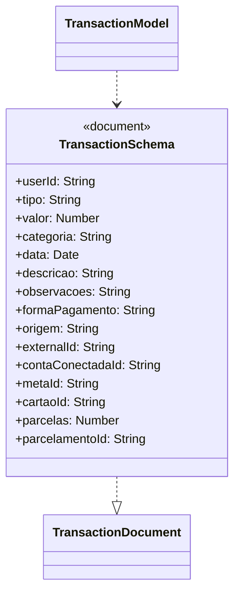

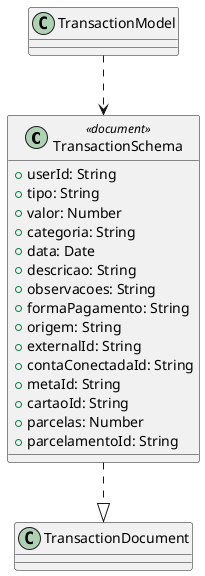

## TransactionModel

- Tipo e estereótipo: objeto «document».
- Arquivo de origem: `Backend/src/modules/transactions/transactions.model.ts`.
- Descrição: modelo Mongoose "Transaction" criado a partir do esquema.

**Atributos:** nenhum.

**Operações:** nenhuma.

**Relações**

| Tipo | Alvo | Multiplicidade | Rótulo |
|---|---|---|---|
| dependência | TransactionSchema | - | - |
| dependência | TransactionDocument | - | - |
| dependência (entrante) | transactionsRepository | - | acesso ao MongoDB |

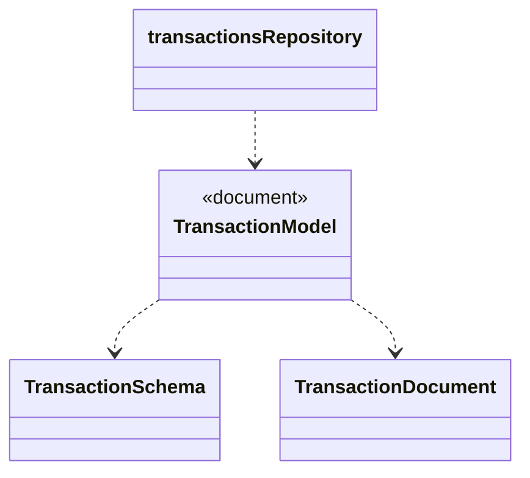

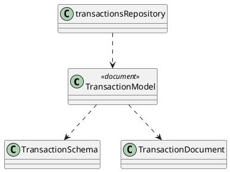

## createTransactionSchema

- Tipo e estereótipo: objeto «dto».
- Arquivo de origem: `Backend/src/modules/transactions/transactions.dto.ts`.
- Descrição: schema zod de criação de transação, com `superRefine` que restringe cartão e parcelas ao crédito e parcelamento a despesas manuais.
- Planejado: exigir `contaId` (RN5) e aceitar a validação de conta; ver `createTransferSchema`.

**Atributos**

| Visibilidade | Nome | Tipo | Descrição |
|---|---|---|---|
| + | tipo | enum | Tipo do lançamento |
| + | valor | number>0 | Valor positivo |
| + | categoria | string? | Categoria opcional |
| + | data | Date | Data |
| + | descricao | string | Descrição |
| + | observacoes | string? | Observações |
| + | formaPagamento | enum (default outro) | Forma de pagamento |
| + | origem | enum (default manual) | Origem |
| + | metaId | string? | Meta |
| + | cartaoId | string? | Cartão |
| + | parcelas | int 1..24? | Parcelas |

**Operações:** nenhuma.

**Relações**

| Tipo | Alvo | Multiplicidade | Rótulo |
|---|---|---|---|
| dependência | FORMAS_PAGAMENTO | - | - |
| dependência (entrante) | CreateTransactionDto | - | tipo inferido |
| dependência (entrante) | transactionsController | - | validação |

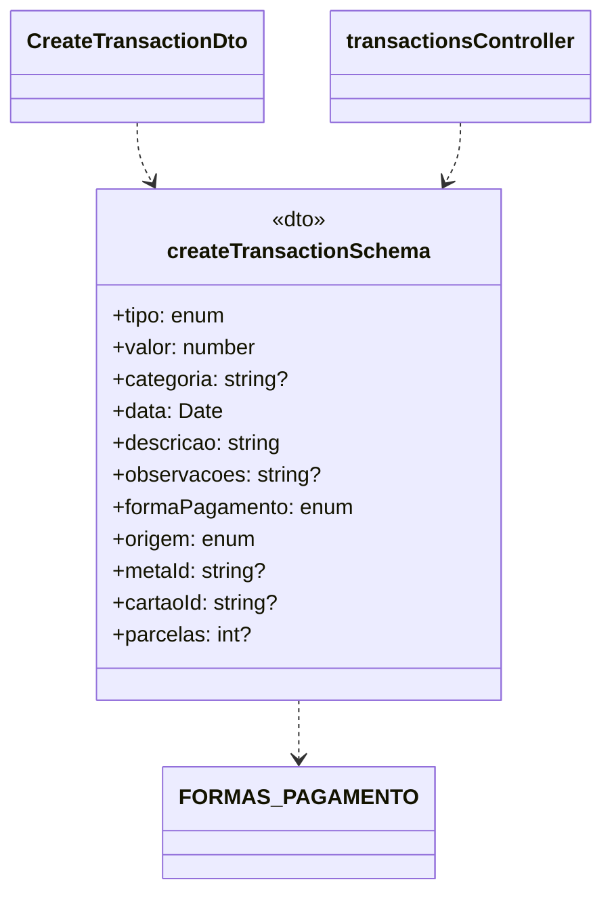

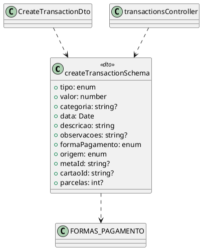

## transactionFiltersSchema

- Tipo e estereótipo: objeto «dto».
- Arquivo de origem: `Backend/src/modules/transactions/transactions.dto.ts`.
- Descrição: schema zod dos filtros e da paginação da listagem.
- Planejado: novo filtro `contaId`.

**Atributos**

| Visibilidade | Nome | Tipo | Descrição |
|---|---|---|---|
| + | tipo | enum? | Filtro por tipo |
| + | categoria | string? | Filtro por categoria |
| + | formaPagamento | enum? | Filtro por forma de pagamento |
| + | origem | enum? | Filtro por origem |
| + | metaId | string/"nenhuma"? | Filtro por meta (ou sem meta) |
| + | cartaoId | string? | Filtro por cartão |
| + | busca | string? | Busca textual |
| + | dataInicio | Date? | Início do período |
| + | dataFim | Date? | Fim do período |
| + | valorMin | number? | Valor mínimo |
| + | valorMax | number? | Valor máximo |
| + | pagina | int (default 1) | Página |
| + | limite | int (default 20) | Itens por página |

**Operações:** nenhuma.

**Relações**

| Tipo | Alvo | Multiplicidade | Rótulo |
|---|---|---|---|
| dependência (entrante) | TransactionFiltersDto | - | tipo inferido |
| dependência (entrante) | transactionsController | - | validação |

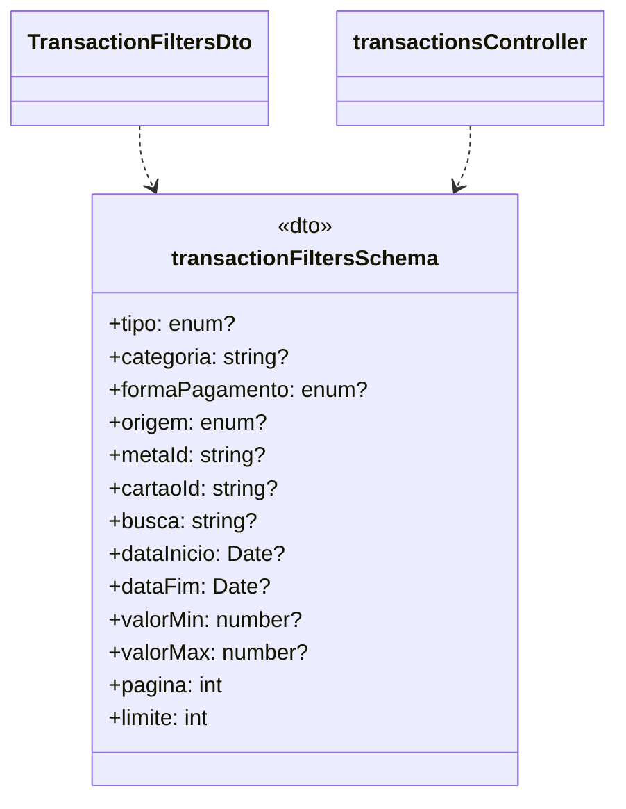

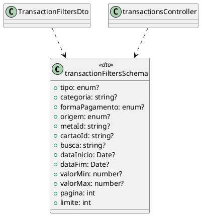

## updateTransactionSchema

- Tipo e estereótipo: objeto «dto».
- Arquivo de origem: `Backend/src/modules/transactions/transactions.dto.ts`.
- Descrição: schema zod parcial das alterações de uma transação na edição em lote.

**Atributos**

| Visibilidade | Nome | Tipo | Descrição |
|---|---|---|---|
| + | tipo | enum? | Tipo |
| + | valor | number? | Valor |
| + | categoria | string? | Categoria |
| + | data | Date? | Data |
| + | descricao | string? | Descrição |
| + | observacoes | string? | Observações |
| + | formaPagamento | enum? | Forma de pagamento |
| + | metaId | string/null? | Meta (null remove) |
| + | cartaoId | string/null? | Cartão (null remove) |
| + | parcelas | int 1..24? | Parcelas |

**Operações:** nenhuma.

**Relações**

| Tipo | Alvo | Multiplicidade | Rótulo |
|---|---|---|---|
| composição (entrante) | bulkUpdateSchema | 1..100 | alteracoes |
| dependência (entrante) | UpdateTransactionDto | - | tipo inferido |

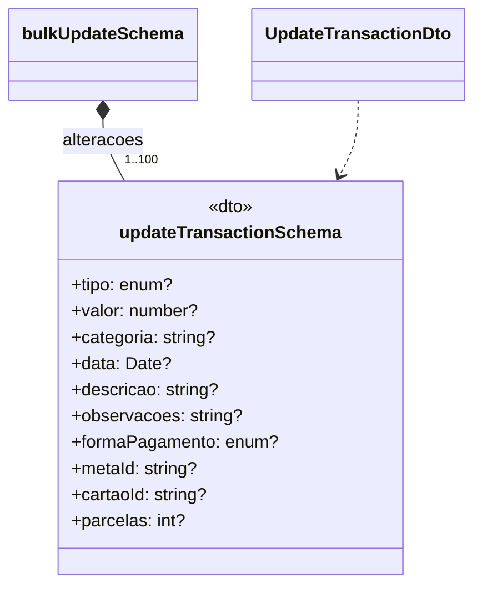

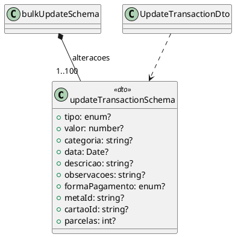

## transactionIdSchema

- Tipo e estereótipo: objeto «dto».
- Arquivo de origem: `Backend/src/modules/transactions/transactions.dto.ts`.
- Descrição: schema zod de um id de transação (24 hex).

**Atributos:** nenhum (valida uma string).

**Operações:** nenhuma.

**Relações**

| Tipo | Alvo | Multiplicidade | Rótulo |
|---|---|---|---|
| dependência (entrante) | transactionsController | - | valida o id da rota |

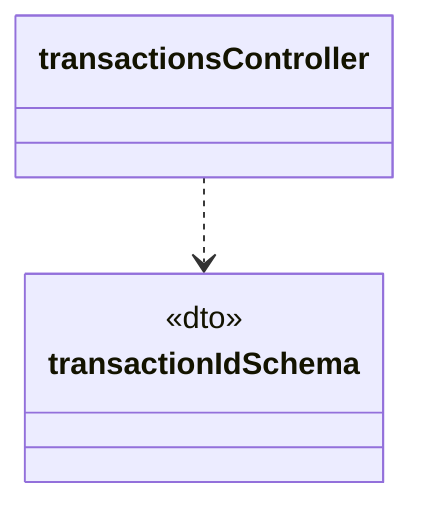

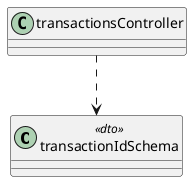

## suggestCategorySchema

- Tipo e estereótipo: objeto «dto».
- Arquivo de origem: `Backend/src/modules/transactions/transactions.dto.ts`.
- Descrição: schema zod do pedido de sugestão de categoria.

**Atributos**

| Visibilidade | Nome | Tipo | Descrição |
|---|---|---|---|
| + | descricao | string (1..200) | Descrição a categorizar |
| + | valor | number? | Valor opcional |

**Operações:** nenhuma.

**Relações**

| Tipo | Alvo | Multiplicidade | Rótulo |
|---|---|---|---|
| dependência (entrante) | SuggestCategoryDto | - | tipo inferido |
| dependência (entrante) | transactionsController | - | validação |

```mermaid
classDiagram
    class suggestCategorySchema {
        <<dto>>
        +descricao: string
        +valor: number?
    }
    SuggestCategoryDto ..> suggestCategorySchema
    transactionsController ..> suggestCategorySchema
```

```plantuml
@startuml
class suggestCategorySchema <<dto>> {
  +descricao: string
  +valor: number?
}
SuggestCategoryDto ..> suggestCategorySchema
transactionsController ..> suggestCategorySchema
@enduml
```

## duplicateTransactionSchema

- Tipo e estereótipo: objeto «dto».
- Arquivo de origem: `Backend/src/modules/transactions/transactions.dto.ts`.
- Descrição: schema zod opcional do corpo de duplicação, com a data do novo lançamento.

**Atributos**

| Visibilidade | Nome | Tipo | Descrição |
|---|---|---|---|
| + | data | Date? | Data do novo lançamento |

**Operações:** nenhuma.

**Relações**

| Tipo | Alvo | Multiplicidade | Rótulo |
|---|---|---|---|
| dependência (entrante) | DuplicateTransactionDto | - | tipo inferido |
| dependência (entrante) | transactionsController | - | validação |

```mermaid
classDiagram
    class duplicateTransactionSchema {
        <<dto>>
        +data: Date?
    }
    DuplicateTransactionDto ..> duplicateTransactionSchema
    transactionsController ..> duplicateTransactionSchema
```

```plantuml
@startuml
class duplicateTransactionSchema <<dto>> {
  +data: Date?
}
DuplicateTransactionDto ..> duplicateTransactionSchema
transactionsController ..> duplicateTransactionSchema
@enduml
```

## bulkUpdateSchema

- Tipo e estereótipo: objeto «dto».
- Arquivo de origem: `Backend/src/modules/transactions/transactions.dto.ts`.
- Descrição: schema zod da edição em lote (1 a 100 itens, ids sem repetição).

**Atributos**

| Visibilidade | Nome | Tipo | Descrição |
|---|---|---|---|
| + | itens | {id, alteracoes}[] | Itens com id e alterações |

**Operações:** nenhuma.

**Relações**

| Tipo | Alvo | Multiplicidade | Rótulo |
|---|---|---|---|
| composição | updateTransactionSchema | 1..100 | alteracoes |
| dependência (entrante) | BulkUpdateDto | - | tipo inferido |
| dependência (entrante) | transactionsController | - | validação |

```mermaid
classDiagram
    class bulkUpdateSchema {
        <<dto>>
        +itens: lista de id e alteracoes
    }
    bulkUpdateSchema *-- "1..100" updateTransactionSchema : alteracoes
    BulkUpdateDto ..> bulkUpdateSchema
    transactionsController ..> bulkUpdateSchema
```

```plantuml
@startuml
class bulkUpdateSchema <<dto>> {
  +itens: lista de id e alteracoes
}
bulkUpdateSchema *-- "1..100" updateTransactionSchema : alteracoes
BulkUpdateDto ..> bulkUpdateSchema
transactionsController ..> bulkUpdateSchema
@enduml
```

## bulkDeleteSchema

- Tipo e estereótipo: objeto «dto».
- Arquivo de origem: `Backend/src/modules/transactions/transactions.dto.ts`.
- Descrição: schema zod da exclusão em lote (1 a 100 ids sem repetição).

**Atributos**

| Visibilidade | Nome | Tipo | Descrição |
|---|---|---|---|
| + | ids | string[] | Ids a excluir |

**Operações:** nenhuma.

**Relações**

| Tipo | Alvo | Multiplicidade | Rótulo |
|---|---|---|---|
| dependência (entrante) | transactionsController | - | validação |

```mermaid
classDiagram
    class bulkDeleteSchema {
        <<dto>>
        +ids: string[]
    }
    transactionsController ..> bulkDeleteSchema
```

```plantuml
@startuml
class bulkDeleteSchema <<dto>> {
  +ids: string[]
}
transactionsController ..> bulkDeleteSchema
@enduml
```

## MAX_PARCELAS

- Tipo e estereótipo: objeto (constante) «dto».
- Arquivo de origem: `Backend/src/modules/transactions/transactions.dto.ts`.
- Descrição: constante com o máximo de parcelas de uma compra no crédito (24).

**Atributos**

| Visibilidade | Nome | Tipo | Descrição |
|---|---|---|---|
| + | MAX_PARCELAS | number = 24 | Máximo de parcelas |

**Operações:** nenhuma.

**Relações:** nenhuma declarada no mapeamento.

| Tipo | Alvo | Multiplicidade | Rótulo |
|---|---|---|---|
| - | - | - | - |

```mermaid
classDiagram
    class MAX_PARCELAS {
        <<dto>>
        +MAX_PARCELAS: number
    }
```

```plantuml
@startuml
class MAX_PARCELAS <<dto>> {
  +MAX_PARCELAS: number
}
@enduml
```

## SuggestCategoryDto

- Tipo e estereótipo: tipo «dto».
- Arquivo de origem: `Backend/src/modules/transactions/transactions.dto.ts`.
- Descrição: tipo inferido de `suggestCategorySchema`.

**Atributos:** os de `suggestCategorySchema` (descricao, valor?).

**Operações:** nenhuma.

**Relações**

| Tipo | Alvo | Multiplicidade | Rótulo |
|---|---|---|---|
| dependência | suggestCategorySchema | - | inferido |

```mermaid
classDiagram
    class SuggestCategoryDto {
        <<dto>>
    }
    SuggestCategoryDto ..> suggestCategorySchema
```

```plantuml
@startuml
class SuggestCategoryDto <<dto>>
SuggestCategoryDto ..> suggestCategorySchema
@enduml
```

## UpdateTransactionDto

- Tipo e estereótipo: tipo «dto».
- Arquivo de origem: `Backend/src/modules/transactions/transactions.dto.ts`.
- Descrição: tipo inferido de `updateTransactionSchema`.

**Atributos:** os de `updateTransactionSchema`.

**Operações:** nenhuma.

**Relações**

| Tipo | Alvo | Multiplicidade | Rótulo |
|---|---|---|---|
| dependência | updateTransactionSchema | - | inferido |
| dependência (entrante) | AtualizacaoDeTransacao | - | base do tipo |

```mermaid
classDiagram
    class UpdateTransactionDto {
        <<dto>>
    }
    UpdateTransactionDto ..> updateTransactionSchema
    AtualizacaoDeTransacao ..> UpdateTransactionDto
```

```plantuml
@startuml
class UpdateTransactionDto <<dto>>
UpdateTransactionDto ..> updateTransactionSchema
AtualizacaoDeTransacao ..> UpdateTransactionDto
@enduml
```

## BulkUpdateDto

- Tipo e estereótipo: tipo «dto».
- Arquivo de origem: `Backend/src/modules/transactions/transactions.dto.ts`.
- Descrição: tipo inferido de `bulkUpdateSchema`.

**Atributos:** os de `bulkUpdateSchema`.

**Operações:** nenhuma.

**Relações**

| Tipo | Alvo | Multiplicidade | Rótulo |
|---|---|---|---|
| dependência | bulkUpdateSchema | - | inferido |

```mermaid
classDiagram
    class BulkUpdateDto {
        <<dto>>
    }
    BulkUpdateDto ..> bulkUpdateSchema
```

```plantuml
@startuml
class BulkUpdateDto <<dto>>
BulkUpdateDto ..> bulkUpdateSchema
@enduml
```

## DuplicateTransactionDto

- Tipo e estereótipo: tipo «dto».
- Arquivo de origem: `Backend/src/modules/transactions/transactions.dto.ts`.
- Descrição: tipo inferido de `duplicateTransactionSchema`.

**Atributos:** os de `duplicateTransactionSchema` (data?).

**Operações:** nenhuma.

**Relações**

| Tipo | Alvo | Multiplicidade | Rótulo |
|---|---|---|---|
| dependência | duplicateTransactionSchema | - | inferido |

```mermaid
classDiagram
    class DuplicateTransactionDto {
        <<dto>>
    }
    DuplicateTransactionDto ..> duplicateTransactionSchema
```

```plantuml
@startuml
class DuplicateTransactionDto <<dto>>
DuplicateTransactionDto ..> duplicateTransactionSchema
@enduml
```

## CreateTransactionDto

- Tipo e estereótipo: tipo «dto».
- Arquivo de origem: `Backend/src/modules/transactions/transactions.dto.ts`.
- Descrição: tipo inferido de `createTransactionSchema`.

**Atributos:** os de `createTransactionSchema`.

**Operações:** nenhuma.

**Relações**

| Tipo | Alvo | Multiplicidade | Rótulo |
|---|---|---|---|
| dependência | createTransactionSchema | - | inferido |
| dependência (entrante) | transactionsRepository | - | dados de criação |

```mermaid
classDiagram
    class CreateTransactionDto {
        <<dto>>
    }
    CreateTransactionDto ..> createTransactionSchema
    transactionsRepository ..> CreateTransactionDto
```

```plantuml
@startuml
class CreateTransactionDto <<dto>>
CreateTransactionDto ..> createTransactionSchema
transactionsRepository ..> CreateTransactionDto
@enduml
```

## TransactionFiltersDto

- Tipo e estereótipo: tipo «dto».
- Arquivo de origem: `Backend/src/modules/transactions/transactions.dto.ts`.
- Descrição: tipo inferido de `transactionFiltersSchema`.

**Atributos:** os de `transactionFiltersSchema`.

**Operações:** nenhuma.

**Relações**

| Tipo | Alvo | Multiplicidade | Rótulo |
|---|---|---|---|
| dependência | transactionFiltersSchema | - | inferido |
| dependência (entrante) | transactionsRepository | - | filtros da listagem |

```mermaid
classDiagram
    class TransactionFiltersDto {
        <<dto>>
    }
    TransactionFiltersDto ..> transactionFiltersSchema
    transactionsRepository ..> TransactionFiltersDto
```

```plantuml
@startuml
class TransactionFiltersDto <<dto>>
TransactionFiltersDto ..> transactionFiltersSchema
transactionsRepository ..> TransactionFiltersDto
@enduml
```

## PedidoCategorizarTransacao

- Tipo e estereótipo: interface «dto».
- Arquivo de origem: `Backend/src/modules/transactions/transactions.dto.ts`.
- Descrição: mensagem enviada ao Servidor Java para categorizar uma transação.

**Atributos**

| Visibilidade | Nome | Tipo | Descrição |
|---|---|---|---|
| + | descricao | string | Descrição da transação |
| + | valor | number | Valor da transação |

**Operações:** nenhuma.

**Relações**

| Tipo | Alvo | Multiplicidade | Rótulo |
|---|---|---|---|
| dependência (entrante) | transactionsService | - | enviada via javaServerClient |

```mermaid
classDiagram
    class PedidoCategorizarTransacao {
        <<dto>>
        +descricao: string
        +valor: number
    }
    transactionsService ..> PedidoCategorizarTransacao
```

```plantuml
@startuml
class PedidoCategorizarTransacao <<dto>> {
  +descricao: string
  +valor: number
}
transactionsService ..> PedidoCategorizarTransacao
@enduml
```

## RespostaCategorizarTransacao

- Tipo e estereótipo: interface «dto».
- Arquivo de origem: `Backend/src/modules/transactions/transactions.dto.ts`.
- Descrição: resposta do Servidor Java com a categoria sugerida.

**Atributos**

| Visibilidade | Nome | Tipo | Descrição |
|---|---|---|---|
| + | categoria | string | Categoria sugerida |

**Operações:** nenhuma.

**Relações**

| Tipo | Alvo | Multiplicidade | Rótulo |
|---|---|---|---|
| dependência (entrante) | transactionsService | - | resposta do javaServerClient |

```mermaid
classDiagram
    class RespostaCategorizarTransacao {
        <<dto>>
        +categoria: string
    }
    transactionsService ..> RespostaCategorizarTransacao
```

```plantuml
@startuml
class RespostaCategorizarTransacao <<dto>> {
  +categoria: string
}
transactionsService ..> RespostaCategorizarTransacao
@enduml
```

## TransactionResponseDto

- Tipo e estereótipo: interface «dto».
- Arquivo de origem: `Backend/src/modules/transactions/transactions.dto.ts`.
- Descrição: transação como o Frontend recebe, com `id` no lugar de `_id`.
- Planejado: campo `conta: { id, nome, banco }` (RN do `GET /transactions`).

**Atributos**

| Visibilidade | Nome | Tipo | Descrição |
|---|---|---|---|
| + | id | string | Identificador |
| + | tipo | receita/despesa | Tipo |
| + | valor | number | Valor |
| + | categoria | string | Categoria |
| + | data | string | Data em texto |
| + | descricao | string | Descrição |
| + | observacoes | string? | Observações |
| + | formaPagamento | FormaPagamento | Forma de pagamento |
| + | origem | manual/pluggy | Origem |
| + | metaId | string? | Meta |
| + | cartaoId | string? | Cartão |
| + | parcelas | number? | Parcelas |
| + | parcelamentoId | string? | Parcelamento |

**Operações:** nenhuma.

**Relações**

| Tipo | Alvo | Multiplicidade | Rótulo |
|---|---|---|---|
| dependência | FormaPagamento | - | - |
| composição (entrante) | TransactionListResponseDto | 0..* | itens |

```mermaid
classDiagram
    class TransactionResponseDto {
        <<dto>>
        +id: string
        +tipo: receita/despesa
        +valor: number
        +categoria: string
        +data: string
        +descricao: string
        +observacoes: string?
        +formaPagamento: FormaPagamento
        +origem: manual/pluggy
        +metaId: string?
        +cartaoId: string?
        +parcelas: number?
        +parcelamentoId: string?
    }
    TransactionResponseDto ..> FormaPagamento
    TransactionListResponseDto *-- "0..*" TransactionResponseDto : itens
```

```plantuml
@startuml
class TransactionResponseDto <<dto>> {
  +id: string
  +tipo: receita/despesa
  +valor: number
  +categoria: string
  +data: string
  +descricao: string
  +observacoes: string?
  +formaPagamento: FormaPagamento
  +origem: manual/pluggy
  +metaId: string?
  +cartaoId: string?
  +parcelas: number?
  +parcelamentoId: string?
}
TransactionResponseDto ..> FormaPagamento
TransactionListResponseDto *-- "0..*" TransactionResponseDto : itens
@enduml
```

## BulkResultDto

- Tipo e estereótipo: interface «dto».
- Arquivo de origem: `Backend/src/modules/transactions/transactions.dto.ts`.
- Descrição: resultado de operações em lote: afetadas e ids não encontrados.

**Atributos**

| Visibilidade | Nome | Tipo | Descrição |
|---|---|---|---|
| + | afetadas | number | Quantidade afetada |
| + | naoEncontradas | string[] | Ids não encontrados |

**Operações:** nenhuma.

**Relações**

| Tipo | Alvo | Multiplicidade | Rótulo |
|---|---|---|---|
| dependência (entrante) | transactionsService | - | retorno de updateMany e removeMany |

```mermaid
classDiagram
    class BulkResultDto {
        <<dto>>
        +afetadas: number
        +naoEncontradas: string[]
    }
    transactionsService ..> BulkResultDto
```

```plantuml
@startuml
class BulkResultDto <<dto>> {
  +afetadas: number
  +naoEncontradas: string[]
}
transactionsService ..> BulkResultDto
@enduml
```

## TransactionSummaryDto

- Tipo e estereótipo: interface «dto».
- Arquivo de origem: `Backend/src/modules/transactions/transactions.dto.ts`.
- Descrição: resumo do extrato: receitas, despesas e saldo.
- Planejado: transferências não entram nestes totais (RN6, issue #107).

**Atributos**

| Visibilidade | Nome | Tipo | Descrição |
|---|---|---|---|
| + | receitas | number | Total de receitas |
| + | despesas | number | Total de despesas |
| + | saldo | number | Saldo do período |

**Operações:** nenhuma.

**Relações**

| Tipo | Alvo | Multiplicidade | Rótulo |
|---|---|---|---|
| composição (entrante) | TransactionListResponseDto | 1 | resumo |

```mermaid
classDiagram
    class TransactionSummaryDto {
        <<dto>>
        +receitas: number
        +despesas: number
        +saldo: number
    }
    TransactionListResponseDto *-- "1" TransactionSummaryDto : resumo
```

```plantuml
@startuml
class TransactionSummaryDto <<dto>> {
  +receitas: number
  +despesas: number
  +saldo: number
}
TransactionListResponseDto *-- "1" TransactionSummaryDto : resumo
@enduml
```

## TransactionListResponseDto

- Tipo e estereótipo: interface «dto».
- Arquivo de origem: `Backend/src/modules/transactions/transactions.dto.ts`.
- Descrição: página de transações com resumo e paginação.

**Atributos**

| Visibilidade | Nome | Tipo | Descrição |
|---|---|---|---|
| + | itens | TransactionResponseDto[] | Itens da página |
| + | pagina | number | Página atual |
| + | limite | number | Itens por página |
| + | total | number | Total de itens |
| + | totalPaginas | number | Total de páginas |
| + | resumo | TransactionSummaryDto | Resumo do extrato |

**Operações:** nenhuma.

**Relações**

| Tipo | Alvo | Multiplicidade | Rótulo |
|---|---|---|---|
| composição | TransactionResponseDto | 0..* | itens |
| composição | TransactionSummaryDto | 1 | resumo |
| dependência (entrante) | transactionsService | - | retorno de list |

```mermaid
classDiagram
    class TransactionListResponseDto {
        <<dto>>
        +itens: TransactionResponseDto[]
        +pagina: number
        +limite: number
        +total: number
        +totalPaginas: number
        +resumo: TransactionSummaryDto
    }
    TransactionListResponseDto *-- "0..*" TransactionResponseDto : itens
    TransactionListResponseDto *-- "1" TransactionSummaryDto : resumo
    transactionsService ..> TransactionListResponseDto
```

```plantuml
@startuml
class TransactionListResponseDto <<dto>> {
  +itens: TransactionResponseDto[]
  +pagina: number
  +limite: number
  +total: number
  +totalPaginas: number
  +resumo: TransactionSummaryDto
}
TransactionListResponseDto *-- "0..*" TransactionResponseDto : itens
TransactionListResponseDto *-- "1" TransactionSummaryDto : resumo
transactionsService ..> TransactionListResponseDto
@enduml
```

## AtualizacaoDeTransacao

- Tipo e estereótipo: tipo.
- Arquivo de origem: `Backend/src/modules/transactions/transactions.repository.ts`.
- Descrição: `UpdateTransactionDto` sem `parcelas`, com `parcelas` e `parcelamentoId` anuláveis, que o service entrega ao repository.

**Atributos:** os de `UpdateTransactionDto`, exceto `parcelas`; mais `parcelas` e `parcelamentoId` anuláveis.

**Operações:** nenhuma.

**Relações**

| Tipo | Alvo | Multiplicidade | Rótulo |
|---|---|---|---|
| dependência | UpdateTransactionDto | - | base |
| composição (entrante) | PlanoDaTransacao | 1 | alteracoes |
| dependência (entrante) | transactionsRepository | - | parâmetro de updateMany |

```mermaid
classDiagram
    class AtualizacaoDeTransacao
    AtualizacaoDeTransacao ..> UpdateTransactionDto
    PlanoDaTransacao *-- "1" AtualizacaoDeTransacao
    transactionsRepository ..> AtualizacaoDeTransacao
```

```plantuml
@startuml
class AtualizacaoDeTransacao
AtualizacaoDeTransacao ..> UpdateTransactionDto
PlanoDaTransacao *-- "1" AtualizacaoDeTransacao
transactionsRepository ..> AtualizacaoDeTransacao
@enduml
```

## transactionsRepository

- Tipo e estereótipo: serviço «repository».
- Arquivo de origem: `Backend/src/modules/transactions/transactions.repository.ts`.
- Descrição: único acesso ao MongoDB para transações: listagem filtrada com totais, criação, lote e inserção de importadas, sempre filtrando por `userId`.
- Planejado: filtro por `contaId` e exclusão de transferências dos totais.

**Atributos**

| Visibilidade | Nome | Tipo | Descrição |
|---|---|---|---|
| - | UM_DIA_MS | number | Milissegundos de um dia |

**Operações**

| Visibilidade | Assinatura | Retorno | Descrição |
|---|---|---|---|
| + | findByUser(userId, filtros, opcoes?) | Promise<{docs,total,totais}> | Lista filtrada com total e totais |
| + | create(dados) | Promise<objeto> | Cria uma transação |
| + | findOneByUser(userId, id) | Promise<objeto/null> | Busca uma transação do usuário |
| + | findManyByUser(userId, ids) | Promise<lista> | Busca várias do usuário |
| + | idsDoUsuario(userId, ids) | Promise<Set<string>> | Ids que pertencem ao usuário |
| + | externalIdsExistentes(userId, ids) | Promise<Set<string>> | Ids externos já importados |
| + | inserirImportadas(docs) | Promise<number> | Insere transações importadas |
| + | updateMany(userId, itens) | Promise<number> | Atualiza em lote |
| + | removeMany(userId, ids) | Promise<number> | Remove em lote |
| - | montarAtualizacao(dados) | Record | Monta o objeto de atualização |
| - | escaparRegex(texto) | string | Escapa texto para regex |

**Relações**

| Tipo | Alvo | Multiplicidade | Rótulo |
|---|---|---|---|
| dependência | TransactionModel | - | - |
| dependência | TransactionDocument | - | - |
| dependência | TransactionFiltersDto | - | - |
| dependência | CreateTransactionDto | - | - |
| dependência | AtualizacaoDeTransacao | - | - |
| dependência (entrante) | transactionsService | - | - |

```mermaid
classDiagram
    class transactionsRepository {
        <<repository>>
        -UM_DIA_MS: number
        +findByUser(userId, filtros, opcoes) Promise~docs_total_totais~
        +create(dados) Promise~objeto~
        +findOneByUser(userId, id) Promise~objeto~
        +findManyByUser(userId, ids) Promise~lista~
        +idsDoUsuario(userId, ids) Promise~Set~
        +externalIdsExistentes(userId, ids) Promise~Set~
        +inserirImportadas(docs) Promise~number~
        +updateMany(userId, itens) Promise~number~
        +removeMany(userId, ids) Promise~number~
        -montarAtualizacao(dados) Record
        -escaparRegex(texto) string
    }
    transactionsRepository ..> TransactionModel
    transactionsRepository ..> TransactionDocument
    transactionsRepository ..> TransactionFiltersDto
    transactionsRepository ..> CreateTransactionDto
    transactionsRepository ..> AtualizacaoDeTransacao
    transactionsService ..> transactionsRepository
```

```plantuml
@startuml
class transactionsRepository <<repository>> {
  -UM_DIA_MS: number
  +findByUser(userId, filtros, opcoes): Promise<docs_total_totais>
  +create(dados): Promise<objeto>
  +findOneByUser(userId, id): Promise<objeto>
  +findManyByUser(userId, ids): Promise<lista>
  +idsDoUsuario(userId, ids): Promise<Set>
  +externalIdsExistentes(userId, ids): Promise<Set>
  +inserirImportadas(docs): Promise<number>
  +updateMany(userId, itens): Promise<number>
  +removeMany(userId, ids): Promise<number>
  -montarAtualizacao(dados): Record
  -escaparRegex(texto): string
}
transactionsRepository ..> TransactionModel
transactionsRepository ..> TransactionDocument
transactionsRepository ..> TransactionFiltersDto
transactionsRepository ..> CreateTransactionDto
transactionsRepository ..> AtualizacaoDeTransacao
transactionsService ..> transactionsRepository
@enduml
```

## transactionsController

- Tipo e estereótipo: serviço «controller».
- Arquivo de origem: `Backend/src/modules/transactions/transactions.controller.ts`.
- Descrição: controller Express das rotas de transações: valida com zod e delega ao service.
- Planejado: operação de criação de transferência (`POST /transactions/transfers`).

**Atributos:** nenhum.

**Operações**

| Visibilidade | Assinatura | Retorno | Descrição |
|---|---|---|---|
| + | list(req, res, next) | Promise<void> | Lista transações filtradas |
| + | create(req, res, next) | Promise<void> | Cria transação |
| + | suggestCategory(req, res, next) | Promise<void> | Sugere categoria |
| + | duplicate(req, res, next) | Promise<void> | Duplica um lançamento |
| + | updateMany(req, res, next) | Promise<void> | Edição em lote |
| + | removeMany(req, res, next) | Promise<void> | Exclusão em lote |

**Relações**

| Tipo | Alvo | Multiplicidade | Rótulo |
|---|---|---|---|
| dependência | transactionsService | - | delega |
| dependência | createTransactionSchema | - | valida |
| dependência | transactionFiltersSchema | - | valida |
| dependência | suggestCategorySchema | - | valida |
| dependência | duplicateTransactionSchema | - | valida |
| dependência | bulkUpdateSchema | - | valida |
| dependência | bulkDeleteSchema | - | valida |
| dependência | transactionIdSchema | - | valida |
| dependência | AuthenticatedRequest | - | requisição autenticada |
| dependência (entrante) | transactionsRouter | - | - |

```mermaid
classDiagram
    class transactionsController {
        <<controller>>
        +list(req, res, next) Promise~void~
        +create(req, res, next) Promise~void~
        +suggestCategory(req, res, next) Promise~void~
        +duplicate(req, res, next) Promise~void~
        +updateMany(req, res, next) Promise~void~
        +removeMany(req, res, next) Promise~void~
    }
    transactionsController ..> transactionsService
    transactionsController ..> createTransactionSchema
    transactionsController ..> transactionFiltersSchema
    transactionsController ..> suggestCategorySchema
    transactionsController ..> duplicateTransactionSchema
    transactionsController ..> bulkUpdateSchema
    transactionsController ..> bulkDeleteSchema
    transactionsController ..> transactionIdSchema
    transactionsController ..> AuthenticatedRequest
    transactionsRouter ..> transactionsController
```

```plantuml
@startuml
class transactionsController <<controller>> {
  +list(req, res, next): Promise<void>
  +create(req, res, next): Promise<void>
  +suggestCategory(req, res, next): Promise<void>
  +duplicate(req, res, next): Promise<void>
  +updateMany(req, res, next): Promise<void>
  +removeMany(req, res, next): Promise<void>
}
transactionsController ..> transactionsService
transactionsController ..> createTransactionSchema
transactionsController ..> transactionFiltersSchema
transactionsController ..> suggestCategorySchema
transactionsController ..> duplicateTransactionSchema
transactionsController ..> bulkUpdateSchema
transactionsController ..> bulkDeleteSchema
transactionsController ..> transactionIdSchema
transactionsController ..> AuthenticatedRequest
transactionsRouter ..> transactionsController
@enduml
```

## transactionsRouter

- Tipo e estereótipo: objeto «router».
- Arquivo de origem: `Backend/src/modules/transactions/transactions.routes.ts`.
- Descrição: router Express: `GET /`, `POST /`, `POST /suggest-category`, `POST /:id/duplicate`, `PATCH /bulk`, `POST /bulk-delete`, com `authMiddleware`.
- Planejado: `POST /transfers`.

**Atributos:** nenhum.

**Operações:** nenhuma (rotas registradas).

**Relações**

| Tipo | Alvo | Multiplicidade | Rótulo |
|---|---|---|---|
| dependência | transactionsController | - | trata as rotas |
| dependência | authMiddleware | - | autenticação |

```mermaid
classDiagram
    class transactionsRouter {
        <<router>>
    }
    transactionsRouter ..> transactionsController
    transactionsRouter ..> authMiddleware
```

```plantuml
@startuml
class transactionsRouter <<router>>
transactionsRouter ..> transactionsController
transactionsRouter ..> authMiddleware
@enduml
```

## AcaoDoParcelamento

- Tipo e estereótipo: tipo (união discriminada).
- Arquivo de origem: `Backend/src/modules/transactions/transactions.service.ts`.
- Descrição: o que fazer com o parcelamento ligado a uma transação editada: criar, atualizar ou remover.

**Atributos:** discriminada por ação (criar, atualizar, remover); os campos exatos não constam do mapeamento.

**Operações:** nenhuma.

**Relações**

| Tipo | Alvo | Multiplicidade | Rótulo |
|---|---|---|---|
| dependência | InstallmentDocument | - | parcelamento afetado |
| composição (entrante) | PlanoDaTransacao | 0..1 | acao |

```mermaid
classDiagram
    class AcaoDoParcelamento
    AcaoDoParcelamento ..> InstallmentDocument
    PlanoDaTransacao *-- "0..1" AcaoDoParcelamento : acao
```

```plantuml
@startuml
class AcaoDoParcelamento
AcaoDoParcelamento ..> InstallmentDocument
PlanoDaTransacao *-- "0..1" AcaoDoParcelamento : acao
@enduml
```

## PlanoDaTransacao

- Tipo e estereótipo: interface.
- Arquivo de origem: `Backend/src/modules/transactions/transactions.service.ts`.
- Descrição: plano de edição de uma transação: alterações a gravar e ação opcional sobre o parcelamento.

**Atributos**

| Visibilidade | Nome | Tipo | Descrição |
|---|---|---|---|
| + | alteracoes | AtualizacaoDeTransacao | Alterações a gravar |
| + | acao | AcaoDoParcelamento? | Ação sobre o parcelamento |

**Operações:** nenhuma.

**Relações**

| Tipo | Alvo | Multiplicidade | Rótulo |
|---|---|---|---|
| composição | AtualizacaoDeTransacao | 1 | alteracoes |
| composição | AcaoDoParcelamento | 0..1 | acao |
| dependência (entrante) | transactionsService | - | retorno de planejarEdicao |

```mermaid
classDiagram
    class PlanoDaTransacao {
        +alteracoes: AtualizacaoDeTransacao
        +acao: AcaoDoParcelamento?
    }
    PlanoDaTransacao *-- "1" AtualizacaoDeTransacao : alteracoes
    PlanoDaTransacao *-- "0..1" AcaoDoParcelamento : acao
    transactionsService ..> PlanoDaTransacao
```

```plantuml
@startuml
interface PlanoDaTransacao {
  +alteracoes: AtualizacaoDeTransacao
  +acao: AcaoDoParcelamento?
}
PlanoDaTransacao *-- "1" AtualizacaoDeTransacao : alteracoes
PlanoDaTransacao *-- "0..1" AcaoDoParcelamento : acao
transactionsService ..> PlanoDaTransacao
@enduml
```

## transactionsService

- Tipo e estereótipo: serviço «service».
- Arquivo de origem: `Backend/src/modules/transactions/transactions.service.ts`.
- Descrição: regras de transações: listar, criar (com categoria via Servidor Java, cartão, parcelamento e meta), duplicar, editar e excluir em lote.
- Planejado: validar `contaId` obrigatório (`422 ACCOUNT_REQUIRED`), criar transferências entre contas manuais (`422 TRANSFER_NOT_ALLOWED`) e recalcular saldos.

**Atributos**

| Visibilidade | Nome | Tipo | Descrição |
|---|---|---|---|
| - | CATEGORIA_PADRAO | string = "Outros" | Categoria padrão |
| - | CODES_SERVIDOR_INDISPONIVEL | string[] | Códigos de erro que indicam Servidor Java indisponível |

**Operações**

| Visibilidade | Assinatura | Retorno | Descrição |
|---|---|---|---|
| + | list(userId, filtros) | Promise<TransactionListResponseDto> | Lista com resumo e paginação |
| + | sugerirCategoria(descricao, valor) | Promise<string> | Pede a categoria ao Servidor Java |
| + | suggestCategory(dados) | Promise<{categoria}> | Sugestão de categoria para a rota |
| + | create(userId, dados) | Promise<TransactionResponseDto> | Cria transação |
| + | duplicate(userId, id, dados) | Promise<TransactionResponseDto> | Duplica transação |
| + | updateMany(userId, itens) | Promise<BulkResultDto> | Edita em lote |
| + | removeMany(userId, ids) | Promise<BulkResultDto> | Exclui em lote |
| - | paraDto(t) | TransactionResponseDto | Converte documento em DTO |
| - | garantirMetasDoUsuario(userId, metaIds) | Promise<void> | Valida metas do usuário |
| - | garantirCartoesDoUsuario(userId, cartaoIds) | Promise<void> | Valida cartões do usuário |
| - | criarParcelamentoDaCompra(userId, cartaoId, descricao, valor, parcelas) | Promise<string> | Cria o parcelamento da compra |
| - | cartaoMaisAntigo(userId) | Promise<string> | Cartão mais antigo do usuário |
| - | planejarEdicao(userId, original, alt, existente) | Promise<PlanoDaTransacao> | Planeja a edição e o parcelamento |

**Relações**

| Tipo | Alvo | Multiplicidade | Rótulo |
|---|---|---|---|
| dependência | transactionsRepository | - | - |
| dependência | javaServerClient | - | PedidoCategorizarTransacao / RespostaCategorizarTransacao |
| dependência | goalsRepository | - | findOneByUser |
| dependência | investmentsRepository | - | cartões e parcelamentos |
| dependência | InstallmentDocument | - | - |
| dependência | AppError | - | - |
| dependência | PlanoDaTransacao | - | - |
| dependência | AcaoDoParcelamento | - | - |
| dependência | TransactionListResponseDto | - | - |
| dependência | BulkResultDto | - | - |
| dependência | PedidoCategorizarTransacao | - | - |
| dependência | RespostaCategorizarTransacao | - | - |
| dependência (entrante) | transactionsController | - | - |

```mermaid
classDiagram
    class transactionsService {
        <<service>>
        -CATEGORIA_PADRAO: string
        -CODES_SERVIDOR_INDISPONIVEL: string[]
        +list(userId, filtros) Promise~TransactionListResponseDto~
        +sugerirCategoria(descricao, valor) Promise~string~
        +suggestCategory(dados) Promise~categoria~
        +create(userId, dados) Promise~TransactionResponseDto~
        +duplicate(userId, id, dados) Promise~TransactionResponseDto~
        +updateMany(userId, itens) Promise~BulkResultDto~
        +removeMany(userId, ids) Promise~BulkResultDto~
        -paraDto(t) TransactionResponseDto
        -garantirMetasDoUsuario(userId, metaIds) Promise~void~
        -garantirCartoesDoUsuario(userId, cartaoIds) Promise~void~
        -criarParcelamentoDaCompra(userId, cartaoId, descricao, valor, parcelas) Promise~string~
        -cartaoMaisAntigo(userId) Promise~string~
        -planejarEdicao(userId, original, alt, existente) Promise~PlanoDaTransacao~
    }
    transactionsService ..> transactionsRepository
    transactionsService ..> javaServerClient : PedidoCategorizarTransacao / RespostaCategorizarTransacao
    transactionsService ..> goalsRepository : findOneByUser
    transactionsService ..> investmentsRepository : cartoes e parcelamentos
    transactionsService ..> InstallmentDocument
    transactionsService ..> AppError
    transactionsService ..> PlanoDaTransacao
    transactionsService ..> AcaoDoParcelamento
    transactionsService ..> TransactionListResponseDto
    transactionsService ..> BulkResultDto
    transactionsService ..> PedidoCategorizarTransacao
    transactionsService ..> RespostaCategorizarTransacao
    transactionsController ..> transactionsService
```

```plantuml
@startuml
class transactionsService <<service>> {
  -CATEGORIA_PADRAO: string
  -CODES_SERVIDOR_INDISPONIVEL: string[]
  +list(userId, filtros): Promise<TransactionListResponseDto>
  +sugerirCategoria(descricao, valor): Promise<string>
  +suggestCategory(dados): Promise<categoria>
  +create(userId, dados): Promise<TransactionResponseDto>
  +duplicate(userId, id, dados): Promise<TransactionResponseDto>
  +updateMany(userId, itens): Promise<BulkResultDto>
  +removeMany(userId, ids): Promise<BulkResultDto>
  -paraDto(t): TransactionResponseDto
  -garantirMetasDoUsuario(userId, metaIds): Promise<void>
  -garantirCartoesDoUsuario(userId, cartaoIds): Promise<void>
  -criarParcelamentoDaCompra(userId, cartaoId, descricao, valor, parcelas): Promise<string>
  -cartaoMaisAntigo(userId): Promise<string>
  -planejarEdicao(userId, original, alt, existente): Promise<PlanoDaTransacao>
}
transactionsService ..> transactionsRepository
transactionsService ..> javaServerClient : PedidoCategorizarTransacao / RespostaCategorizarTransacao
transactionsService ..> goalsRepository : findOneByUser
transactionsService ..> investmentsRepository : cartoes e parcelamentos
transactionsService ..> InstallmentDocument
transactionsService ..> AppError
transactionsService ..> PlanoDaTransacao
transactionsService ..> AcaoDoParcelamento
transactionsService ..> TransactionListResponseDto
transactionsService ..> BulkResultDto
transactionsService ..> PedidoCategorizarTransacao
transactionsService ..> RespostaCategorizarTransacao
transactionsController ..> transactionsService
@enduml
```

## createTransferSchema

- Tipo e estereótipo: objeto «planejado» «dto». Ainda não existe no código.
- Arquivo de origem: previsto em `Backend/src/modules/transactions/transactions.dto.ts` (issue #105).
- Descrição: schema zod do corpo de `POST /transactions/transfers`: conta de origem, conta de destino, valor, data e textos opcionais (RN6: contas diferentes, do mesmo usuário, valor maior que zero).

**Atributos**

| Visibilidade | Nome | Tipo | Descrição |
|---|---|---|---|
| + | contaId | string | Conta de origem |
| + | contaDestinoId | string | Conta de destino |
| + | valor | number>0 | Valor da transferência |
| + | data | Date | Data |
| + | descricao | string? | Descrição opcional |
| + | observacoes | string? | Observações opcionais |

**Operações:** nenhuma.

**Relações**

| Tipo | Alvo | Multiplicidade | Rótulo |
|---|---|---|---|
| dependência | createTransactionSchema | - | segue o mesmo padrão de validação |
| dependência | AccountDocument «planejado» | 2 | contas de origem e destino |
| dependência (entrante) | transactionsController | - | validação (planejada) |

```mermaid
classDiagram
    class createTransferSchema {
        <<planejado>>
        <<dto>>
        +contaId: string
        +contaDestinoId: string
        +valor: number
        +data: Date
        +descricao: string?
        +observacoes: string?
    }
    createTransferSchema ..> createTransactionSchema
    createTransferSchema ..> AccountDocument : 2
    transactionsController ..> createTransferSchema
```

```plantuml
@startuml
class createTransferSchema <<planejado>> <<dto>> {
  +contaId: string
  +contaDestinoId: string
  +valor: number
  +data: Date
  +descricao: string?
  +observacoes: string?
}
createTransferSchema ..> createTransactionSchema
createTransferSchema ..> AccountDocument : 2
transactionsController ..> createTransferSchema
@enduml
```
