# Modelo UML: Frontend: auth

Módulos de script das páginas de autenticação e plano do Frontend (`Frontend/src/features/auth/components/`). São módulos ES (`«module»`) executados no navegador: não há classes nem interfaces neste grupo. Os "atributos" são variáveis/constantes de módulo e as "operações" são funções de módulo. Todos consomem a API do Backend por `fetch` e exibem mensagens por `notificar` (módulo `notificacao.js`, em `Frontend/src/shared/components/`).

Nota: no mapeamento de origem, o módulo de `recuperarSenha.js` veio com o nome corrompido ("PlanoConta.js: n/a"). Aqui ele foi documentado como `recuperarSenha.js`, conforme o arquivo de origem informado.

Não há elementos «planejado» (contas, transferências) neste grupo.

## Diagrama do grupo

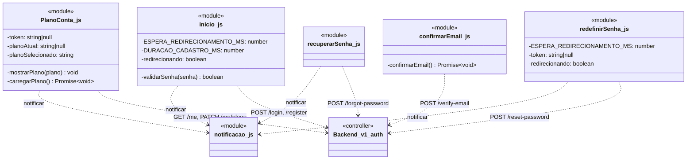

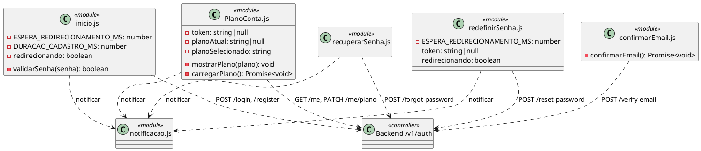

---

## PlanoConta.js

- **Tipo e estereótipo:** módulo «module»
- **Arquivo de origem:** `Frontend/src/features/auth/components/PlanoConta.js`
- **Descrição:** script da página de planos (Free/Pro). Mostra os benefícios de cada plano, carrega o plano atual do usuário (`GET /v1/auth/me`) e solicita a troca de plano (`PATCH /v1/auth/me/plano`), usando o token guardado em `localStorage` (`@FinanceAI:token`).

### Atributos

| Visibilidade | Nome | Tipo | Descrição |
|---|---|---|---|
| - | token | string\|null | Token JWT lido de `localStorage` (`@FinanceAI:token`). |
| - | planoAtual | string\|null | Plano atual do usuário, retornado pelo Backend. |
| - | planoSelecionado | string | Plano exibido/selecionado na tela (inicia em `"free"`). |

### Operações

| Visibilidade | Assinatura | Retorno | Descrição |
|---|---|---|---|
| - | mostrarPlano(plano: string) | void | Atualiza título, descrição, preço, lista de benefícios, status e botão de upgrade conforme o plano. |
| - | carregarPlano() | Promise\<void\> | Busca o usuário em `/v1/auth/me` e exibe o plano atual; trata erros com `notificar`. |

### Relações

| Tipo | Alvo | Multiplicidade | Rótulo |
|---|---|---|---|
| dependência | notificacao.js | 1 | notificar |
| dependência | Backend /v1/auth/me e /v1/auth/me/plano | 1 | GET/PATCH |

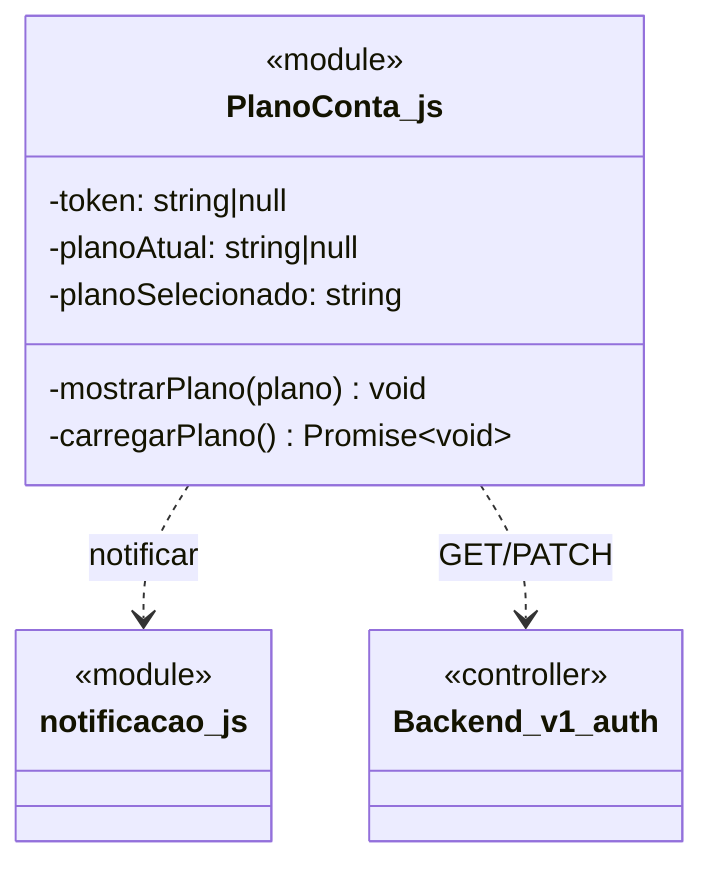

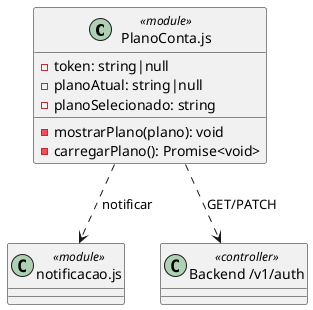

---

## confirmarEmail.js

- **Tipo e estereótipo:** módulo «module»
- **Arquivo de origem:** `Frontend/src/features/auth/components/confirmarEmail.js`
- **Descrição:** script da página de confirmação de e-mail. Lê o parâmetro `token` da URL e chama `POST /v1/auth/verify-email`, exibindo o resultado no elemento `#mensagem`. É invocado ao carregar a página.

### Atributos

| Visibilidade | Nome | Tipo | Descrição |
|---|---|---|---|
| - | (nenhum no nível do módulo) | - | O `token` e o elemento `mensagem` são variáveis locais da função `confirmarEmail`. |

### Operações

| Visibilidade | Assinatura | Retorno | Descrição |
|---|---|---|---|
| - | confirmarEmail() | Promise\<void\> | Lê o token da URL, envia ao Backend e escreve a mensagem de sucesso ou erro na página. |

### Relações

| Tipo | Alvo | Multiplicidade | Rótulo |
|---|---|---|---|
| dependência | Backend /v1/auth/verify-email | 1 | POST |

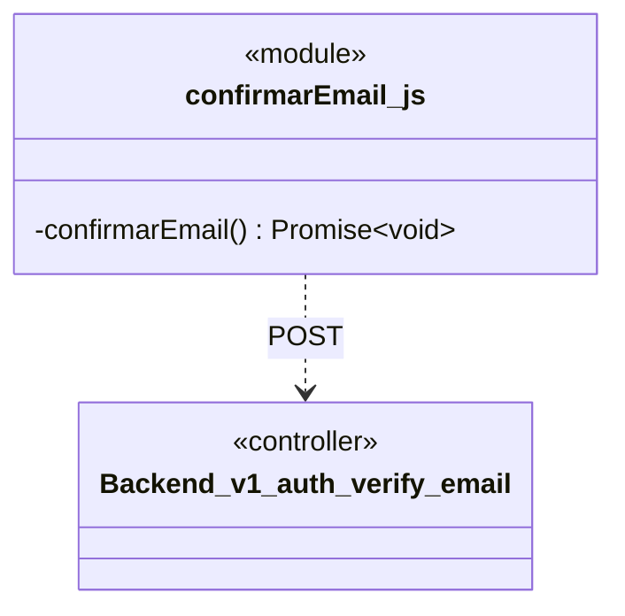

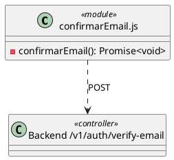

---

## inicio.js

- **Tipo e estereótipo:** módulo «module»
- **Arquivo de origem:** `Frontend/src/features/auth/components/inicio.js`
- **Descrição:** script da página `inicio.html`. Alterna entre os painéis de login e cadastro, valida os requisitos da senha, faz o login (`POST /v1/auth/login`, guarda o token em `localStorage` e redireciona ao painel) e o cadastro (`POST /v1/auth/register`) no Backend.

### Atributos

| Visibilidade | Nome | Tipo | Descrição |
|---|---|---|---|
| - | ESPERA_REDIRECIONAMENTO_MS | number | Constante (3000 ms): espera entre login concluído e ida ao painel; também a duração da linha de carregamento da notificação. |
| - | DURACAO_CADASTRO_MS | number | Constante (8000 ms): duração da notificação de cadastro, de texto mais longo. |
| - | redirecionando | boolean | Indica que o login foi concluído e o redirecionamento está em espera; evita envio duplo. |

### Operações

| Visibilidade | Assinatura | Retorno | Descrição |
|---|---|---|---|
| - | validarSenha(senha: string) | boolean | Verifica no mínimo 8 caracteres e 1 maiúscula, 1 número e 1 caractere especial; atualiza a lista de requisitos na tela e retorna se todos foram atendidos. |

### Relações

| Tipo | Alvo | Multiplicidade | Rótulo |
|---|---|---|---|
| dependência | notificacao.js | 1 | notificar |
| dependência | Backend /v1/auth/login e /v1/auth/register | 1 | POST |

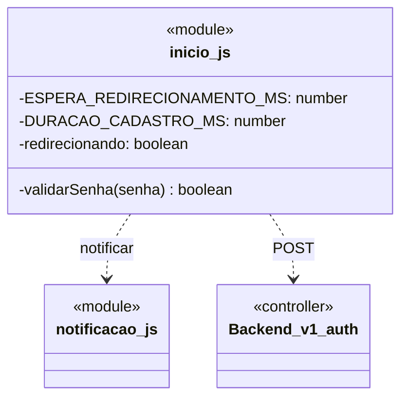

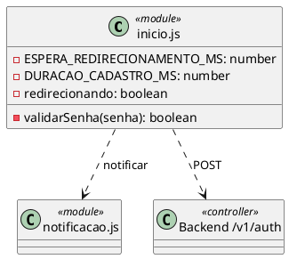

---

## recuperarSenha.js

- **Tipo e estereótipo:** módulo «module»
- **Arquivo de origem:** `Frontend/src/features/auth/components/recuperarSenha.js`
- **Descrição:** script da página de recuperação de senha. Envia o e-mail informado a `POST /v1/auth/forgot-password` e, em um bloco do mesmo arquivo, ajusta o texto e o destino do botão Voltar conforme o parâmetro de URL `origem` (`perfil` volta ao perfil; caso contrário, ao login). Não declara funções nomeadas; a lógica está em manipuladores de evento e código de nível de módulo.

### Atributos

| Visibilidade | Nome | Tipo | Descrição |
|---|---|---|---|
| - | (nenhum mapeado) | - | O mapeamento não lista atributos; o código usa apenas constantes de módulo para elementos do DOM (`recuperarForm`, `recuperarEmail`, `recuperarBotao`, `parametros`, `origem`, `botaoVoltar`). |

### Operações

| Visibilidade | Assinatura | Retorno | Descrição |
|---|---|---|---|
| - | (nenhuma função nomeada) | - | Manipulador de `submit` do formulário (assíncrono) envia o e-mail e notifica o resultado. |

### Relações

| Tipo | Alvo | Multiplicidade | Rótulo |
|---|---|---|---|
| dependência | notificacao.js | 1 | notificar |
| dependência | Backend /v1/auth/forgot-password | 1 | POST |

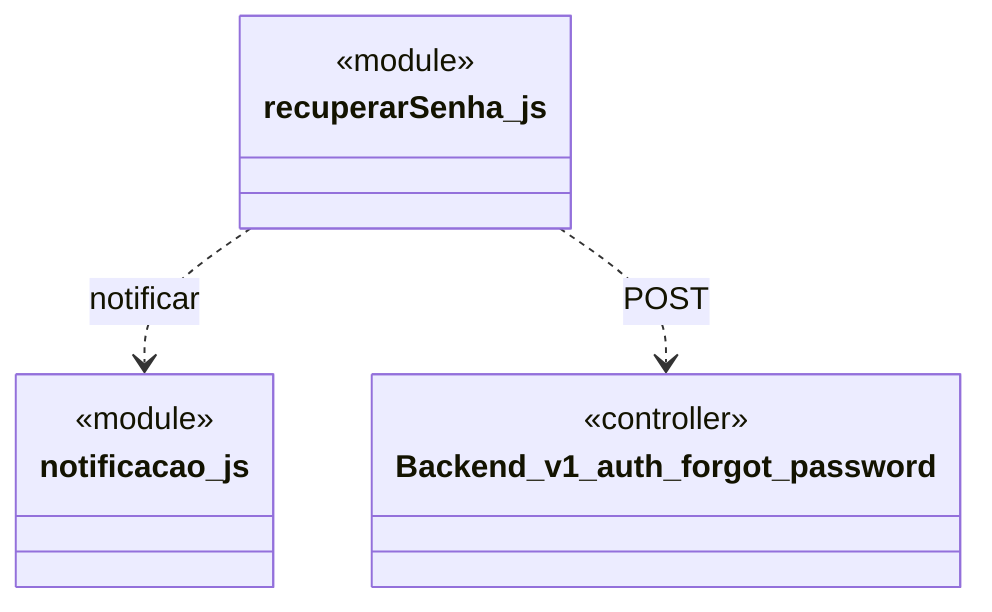

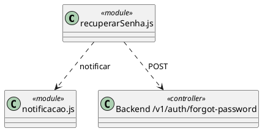

---

## redefinirSenha.js

- **Tipo e estereótipo:** módulo «module»
- **Arquivo de origem:** `Frontend/src/features/auth/components/redefinirSenha.js`
- **Descrição:** script da página de redefinição de senha. Valida que a nova senha e a confirmação coincidem, envia o token (da URL) e a nova senha a `POST /v1/auth/reset-password` e redireciona ao login após o sucesso.

### Atributos

| Visibilidade | Nome | Tipo | Descrição |
|---|---|---|---|
| - | ESPERA_REDIRECIONAMENTO_MS | number | Constante (3000 ms): espera entre "senha redefinida" e a volta ao login; também a duração da linha de carregamento da notificação. |
| - | token | string\|null | Token de recuperação lido do parâmetro `token` da URL. |
| - | redirecionando | boolean | Indica que o redirecionamento ao login está em espera; evita envio duplo. |

### Operações

| Visibilidade | Assinatura | Retorno | Descrição |
|---|---|---|---|
| - | (nenhuma função nomeada) | - | Manipulador de `submit` do formulário (assíncrono) valida, envia ao Backend e redireciona. |

### Relações

| Tipo | Alvo | Multiplicidade | Rótulo |
|---|---|---|---|
| dependência | notificacao.js | 1 | notificar |
| dependência | Backend /v1/auth/reset-password | 1 | POST |

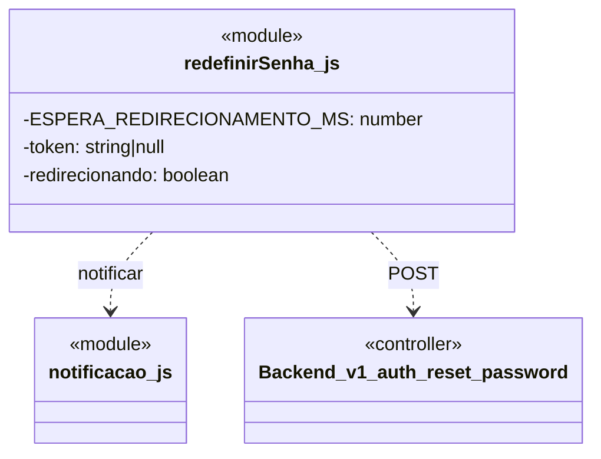

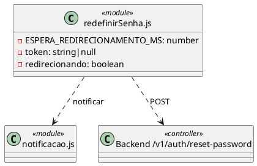
