# Modelo UML: Frontend, contas-conectadas

Grupo: `fe-contas-conectadas`. Origem: `Frontend/src/features/contas-conectadas/`.

Notação: padrão Astah / UML 2. Visibilidade: `+` público, `-` privado, `#` protegido, `~` pacote. Todos os elementos deste grupo são módulos JavaScript («module»); não há classes nem interfaces. Nenhum elemento «planejado» pertence a este grupo.

Vizinhos externos ao grupo (fora de `contas-conectadas`): `includes.js`, `api.js`, `notificacao.js`, o script `PluggyConnect` (CDN) e o Backend `/connected-accounts`.

## Diagrama do grupo

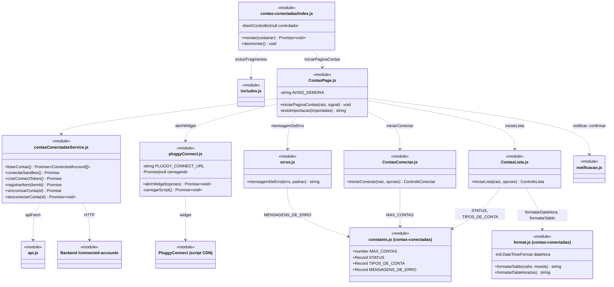

```plantuml
@startuml
skinparam classAttributeIconSize 0

class "contas-conectadas/index.js" as IndexJs <<module>> {
  - controlador: AbortController|null
  + montar(container): Promise<void>
  + desmontar(): void
}
class "ContasPage.js" as ContasPageJs <<module>> {
  - AVISO_DEMORA: string
  + iniciarPaginaContas(raiz, { signal }): void
  - textoImportacao({ importadas }): string
}
class "ContasConectar.js" as ContasConectarJs <<module>> {
  + iniciarConectar(raiz, { signal, aoConectarBancoDeTeste, aoAbrirWidget }): { mostrarAndamento, definirTotal }
}
class "ContasLista.js" as ContasListaJs <<module>> {
  + iniciarLista(raiz, { signal, aoSincronizar, aoDesconectar, tentarNovamente }): { iniciarCarga, mostrarContas, mostrarErro, mostrarAndamento }
}
class "contasConectadasService.js" as ServiceJs <<module>> {
  + listarContas(): Promise<ConnectedAccount[]>
  + conectarSandbox(): Promise<{conta,importacao,avisoImportacao?}>
  + criarConnectToken(): Promise<{accessToken}>
  + registrarItem(itemId): Promise<{conta,importacao,avisoImportacao?}>
  + sincronizarConta(id): Promise<{lidas,importadas,ignoradas}>
  + desconectarConta(id): Promise<void>
}
class "constants.js (contas-conectadas)" as ConstantsJs <<module>> {
  + MAX_CONTAS: number
  + STATUS: Record<string,{rotulo,situacao}>
  + TIPOS_DE_CONTA: Record<string,string>
  + MENSAGENS_DE_ERRO: Record<string,string>
}
class "erros.js" as ErrosJs <<module>> {
  + mensagemDeErro(erro, padrao?): string
}
class "format.js (contas-conectadas)" as FormatJs <<module>> {
  - dataHora: Intl.DateTimeFormat
  + formatarSaldo(valor, moeda?): string
  + formatarDataHora(iso): string
}
class "pluggyConnect.js" as PluggyJs <<module>> {
  - PLUGGY_CONNECT_URL: string
  - carregando: Promise|null
  + abrirWidget({ connectToken, aoConectar, aoFalhar, aoFechar }): Promise<void>
  - carregarScript(): Promise<void>
}
class "includes.js" as IncludesJs <<module>>
class "api.js" as ApiJs <<module>>
class "notificacao.js" as NotificacaoJs <<module>>
class "PluggyConnect (script CDN)" as PluggyCdn <<module>>
class "Backend /connected-accounts" as BackendCA <<module>>

IndexJs ..> IncludesJs : incluirFragmentos
IndexJs ..> ContasPageJs : iniciarPaginaContas
ContasPageJs ..> ServiceJs
ContasPageJs ..> PluggyJs : abrirWidget
ContasPageJs ..> ErrosJs : mensagemDeErro
ContasPageJs ..> ContasConectarJs : iniciarConectar
ContasPageJs ..> ContasListaJs : iniciarLista
ContasPageJs ..> NotificacaoJs : notificar, confirmar
ContasConectarJs ..> ConstantsJs : MAX_CONTAS
ContasListaJs ..> ConstantsJs : STATUS, TIPOS_DE_CONTA
ContasListaJs ..> FormatJs : formatarDataHora, formatarSaldo
ServiceJs ..> ApiJs : apiFetch
ServiceJs ..> BackendCA : HTTP
ErrosJs ..> ConstantsJs : MENSAGENS_DE_ERRO
PluggyJs ..> PluggyCdn : widget
@enduml
```

---

## contas-conectadas/index.js

- Tipo e estereótipo: módulo, «module»
- Arquivo de origem: `Frontend/src/features/contas-conectadas/index.js`
- Descrição: ponto de entrada da tela de Contas conectadas. Monta o HTML e liga `ContasPage`; ao desmontar, aborta o controlador.

### Atributos

| Visibilidade | Nome | Tipo | Descrição |
|---|---|---|---|
| - | controlador | AbortController\|null | Controlador de aborto da tela montada; abortado em `desmontar()`. |

### Operações

| Visibilidade | Assinatura | Retorno | Descrição |
|---|---|---|---|
| + | montar(container) | Promise\<void\> | Inclui os fragmentos HTML e inicia a página de contas. |
| + | desmontar() | void | Aborta o controlador, desfazendo os ouvintes da tela. |

### Relações

| Tipo | Alvo | Multiplicidade | Rótulo |
|---|---|---|---|
| dependência | includes.js | 1 | incluirFragmentos |
| dependência | ContasPage.js | 1 | iniciarPaginaContas |

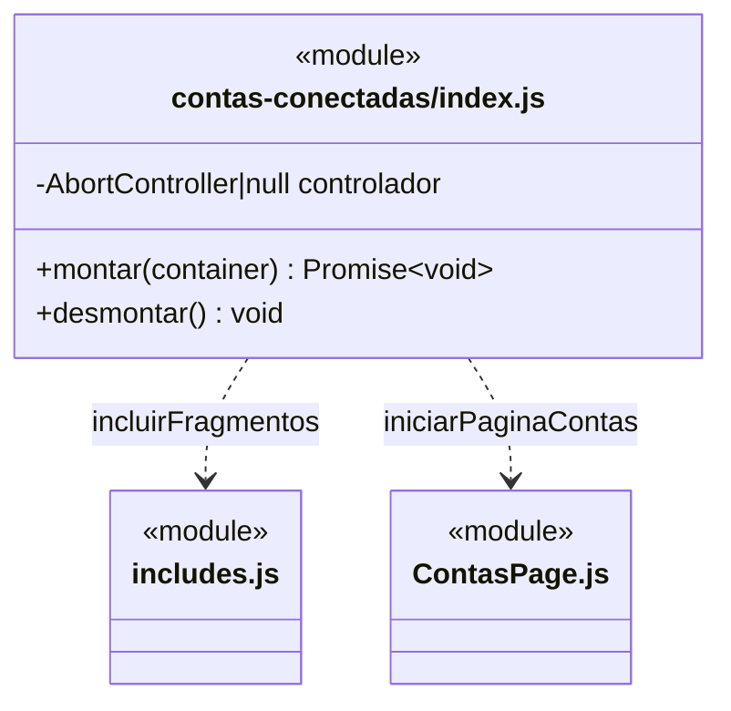

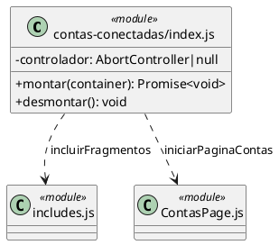

---

## ContasPage.js

- Tipo e estereótipo: módulo, «module»
- Arquivo de origem: `Frontend/src/features/contas-conectadas/components/ContasPage/ContasPage.js`
- Descrição: coordena a página de Contas conectadas. Chama o serviço, o widget Pluggy e liga os componentes de conectar e listar.

### Atributos

| Visibilidade | Nome | Tipo | Descrição |
|---|---|---|---|
| - | AVISO_DEMORA | string | Texto de aviso exibido enquanto a operação demora. |

### Operações

| Visibilidade | Assinatura | Retorno | Descrição |
|---|---|---|---|
| + | iniciarPaginaContas(raiz, { signal }) | void | Liga os componentes `ContasConectar` e `ContasLista` e orquestra serviço, widget e notificações. |
| - | textoImportacao({ importadas }) | string | Monta o texto que informa quantos lançamentos foram importados. |

### Relações

| Tipo | Alvo | Multiplicidade | Rótulo |
|---|---|---|---|
| dependência | contasConectadasService.js | 1 | |
| dependência | pluggyConnect.js | 1 | abrirWidget |
| dependência | erros.js | 1 | mensagemDeErro |
| dependência | ContasConectar.js | 1 | iniciarConectar |
| dependência | ContasLista.js | 1 | iniciarLista |
| dependência | notificacao.js | 1 | notificar, confirmar |

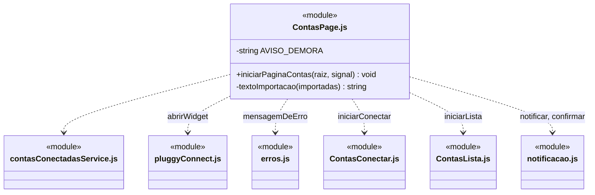

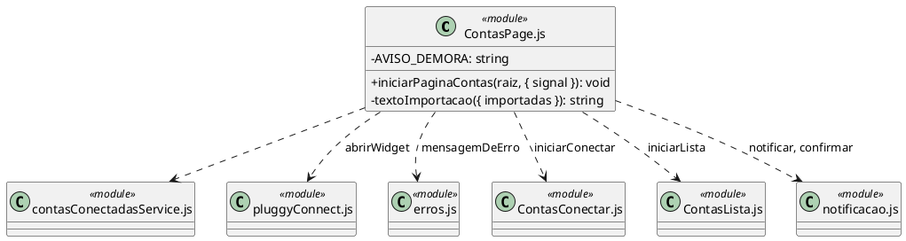

---

## ContasConectar.js

- Tipo e estereótipo: módulo, «module»
- Arquivo de origem: `Frontend/src/features/contas-conectadas/components/ContasConectar/ContasConectar.js`
- Descrição: cartão "Conectar uma conta" (par ContasConectar.html/CSS). Oferece botões de banco de teste e do widget, andamento e aviso de limite.

### Atributos

Nenhum atributo mapeado.

### Operações

| Visibilidade | Assinatura | Retorno | Descrição |
|---|---|---|---|
| + | iniciarConectar(raiz, { signal, aoConectarBancoDeTeste, aoAbrirWidget }) | { mostrarAndamento, definirTotal } | Liga o cartão e devolve os controles para exibir andamento e definir o total de contas (aviso de limite). |

### Relações

| Tipo | Alvo | Multiplicidade | Rótulo |
|---|---|---|---|
| dependência | constants.js (contas-conectadas) | 1 | MAX_CONTAS |

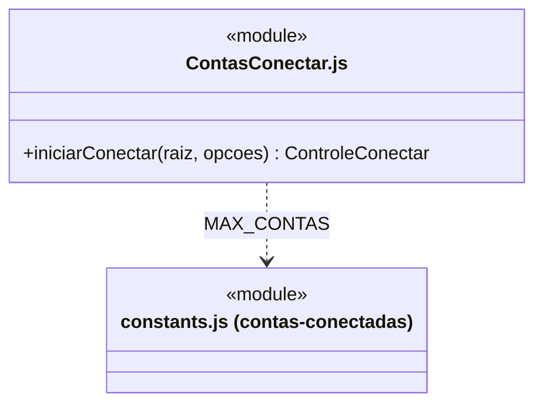

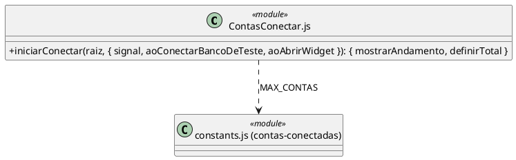

---

## ContasLista.js

- Tipo e estereótipo: módulo, «module»
- Arquivo de origem: `Frontend/src/features/contas-conectadas/components/ContasLista/ContasLista.js`
- Descrição: lista de conexões (par ContasLista.html/CSS). Trata estados, monta cartões por template e liga as ações sincronizar e desconectar.

### Atributos

Nenhum atributo mapeado.

### Operações

| Visibilidade | Assinatura | Retorno | Descrição |
|---|---|---|---|
| + | iniciarLista(raiz, { signal, aoSincronizar, aoDesconectar, tentarNovamente }) | { iniciarCarga, mostrarContas, mostrarErro, mostrarAndamento } | Liga a lista e devolve os controles de estado (carga, contas, erro, andamento). |

### Relações

| Tipo | Alvo | Multiplicidade | Rótulo |
|---|---|---|---|
| dependência | constants.js (contas-conectadas) | 1 | STATUS, TIPOS_DE_CONTA |
| dependência | format.js (contas-conectadas) | 1 | formatarDataHora, formatarSaldo |

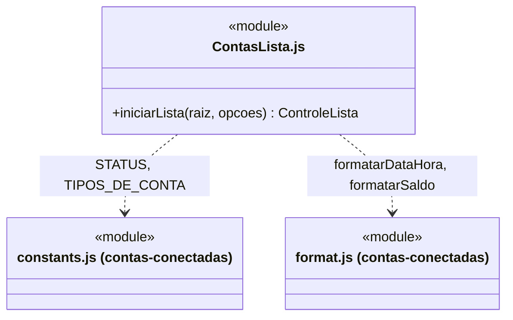

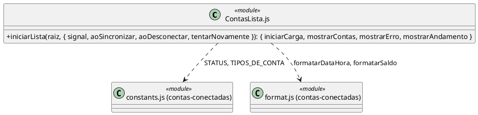

---

## contasConectadasService.js

- Tipo e estereótipo: módulo, «module»
- Arquivo de origem: `Frontend/src/features/contas-conectadas/services/contasConectadasService.js`
- Descrição: chamadas ao Backend em `/connected-accounts` (listar, sandbox, connect-token, registrar item, sincronizar, desconectar).

### Atributos

Nenhum atributo mapeado.

### Operações

| Visibilidade | Assinatura | Retorno | Descrição |
|---|---|---|---|
| + | listarContas() | Promise\<ConnectedAccount[]\> | Lista as contas conectadas. |
| + | conectarSandbox() | Promise\<{conta,importacao,avisoImportacao?}\> | Conecta um banco de teste (sandbox). |
| + | criarConnectToken() | Promise\<{accessToken}\> | Obtém o token temporário para o widget Pluggy. |
| + | registrarItem(itemId) | Promise\<{conta,importacao,avisoImportacao?}\> | Registra o item criado no widget. |
| + | sincronizarConta(id) | Promise\<{lidas,importadas,ignoradas}\> | Sincroniza lançamentos de uma conta. |
| + | desconectarConta(id) | Promise\<void\> | Desconecta uma conta. |

### Relações

| Tipo | Alvo | Multiplicidade | Rótulo |
|---|---|---|---|
| dependência | api.js | 1 | apiFetch |
| dependência | Backend /connected-accounts | 1 | HTTP |

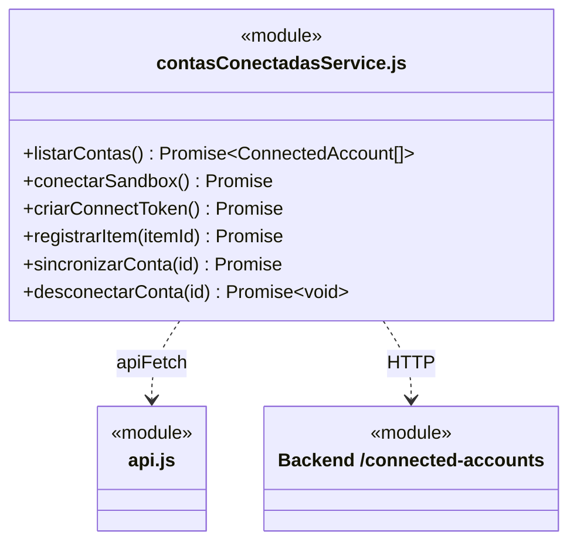

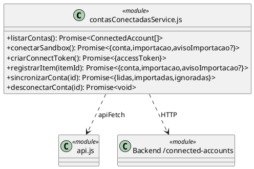

---

## constants.js (contas-conectadas)

- Tipo e estereótipo: módulo, «module»
- Arquivo de origem: `Frontend/src/features/contas-conectadas/utils/constants.js`
- Descrição: constantes do recurso: limite de contas, rótulos de status da Pluggy, tipos de conta e mensagens de erro da API.

### Atributos

| Visibilidade | Nome | Tipo | Descrição |
|---|---|---|---|
| + | MAX_CONTAS | number | Limite de contas conectadas. |
| + | STATUS | Record\<string,{rotulo,situacao}\> | Rótulo e situação de cada status da Pluggy. |
| + | TIPOS_DE_CONTA | Record\<string,string\> | Nomes legíveis dos tipos de conta. |
| + | MENSAGENS_DE_ERRO | Record\<string,string\> | Mensagens de tela para os erros da API. |

### Operações

Nenhuma operação.

### Relações

| Tipo | Alvo | Multiplicidade | Rótulo |
|---|---|---|---|
| dependência (entrada) | ContasConectar.js | 1 | MAX_CONTAS |
| dependência (entrada) | ContasLista.js | 1 | STATUS, TIPOS_DE_CONTA |
| dependência (entrada) | erros.js | 1 | MENSAGENS_DE_ERRO |

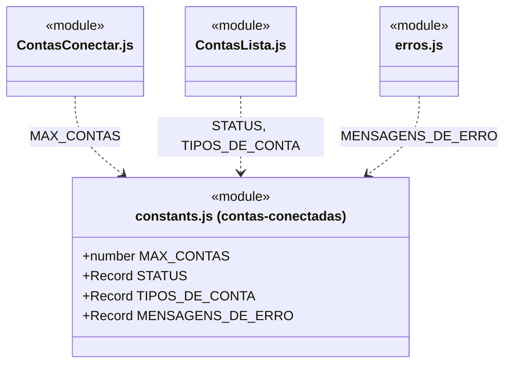

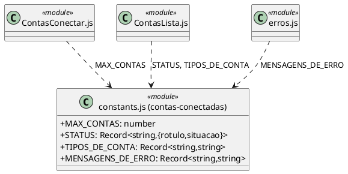

---

## erros.js

- Tipo e estereótipo: módulo, «module»
- Arquivo de origem: `Frontend/src/features/contas-conectadas/utils/erros.js`
- Descrição: converte erros da API em texto de tela.

### Atributos

Nenhum atributo mapeado.

### Operações

| Visibilidade | Assinatura | Retorno | Descrição |
|---|---|---|---|
| + | mensagemDeErro(erro, padrao?) | string | Devolve a mensagem de tela do erro, ou o texto padrão quando não houver correspondência. |

### Relações

| Tipo | Alvo | Multiplicidade | Rótulo |
|---|---|---|---|
| dependência | constants.js (contas-conectadas) | 1 | MENSAGENS_DE_ERRO |
| dependência (entrada) | ContasPage.js | 1 | mensagemDeErro |

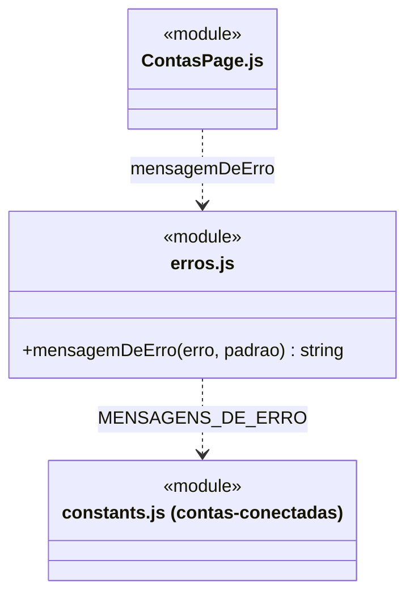

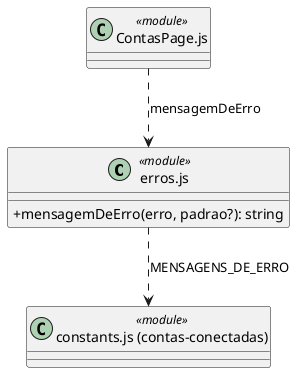

---

## format.js (contas-conectadas)

- Tipo e estereótipo: módulo, «module»
- Arquivo de origem: `Frontend/src/features/contas-conectadas/utils/format.js`
- Descrição: formatação de saldo em moeda e de data e hora em pt-BR.

### Atributos

| Visibilidade | Nome | Tipo | Descrição |
|---|---|---|---|
| - | dataHora | Intl.DateTimeFormat | Formatador de data e hora em pt-BR. |

### Operações

| Visibilidade | Assinatura | Retorno | Descrição |
|---|---|---|---|
| + | formatarSaldo(valor, moeda?) | string | Formata o saldo como moeda. |
| + | formatarDataHora(iso) | string | Formata uma data ISO como data e hora. |

### Relações

| Tipo | Alvo | Multiplicidade | Rótulo |
|---|---|---|---|
| dependência (entrada) | ContasLista.js | 1 | formatarDataHora, formatarSaldo |

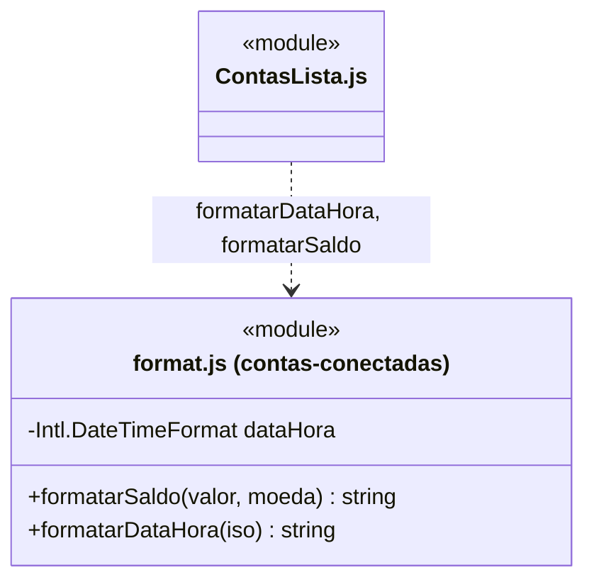

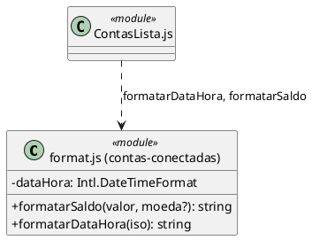

---

## pluggyConnect.js

- Tipo e estereótipo: módulo, «module»
- Arquivo de origem: `Frontend/src/features/contas-conectadas/utils/pluggyConnect.js`
- Descrição: carrega do CDN e abre o widget Pluggy Connect com o token temporário.

### Atributos

| Visibilidade | Nome | Tipo | Descrição |
|---|---|---|---|
| - | PLUGGY_CONNECT_URL | string | URL do script do widget no CDN. |
| - | carregando | Promise\|null | Promessa de carga em andamento, para não carregar o script duas vezes. |

### Operações

| Visibilidade | Assinatura | Retorno | Descrição |
|---|---|---|---|
| + | abrirWidget({ connectToken, aoConectar, aoFalhar, aoFechar }) | Promise\<void\> | Carrega o script, se preciso, e abre o widget com o token temporário. |
| - | carregarScript() | Promise\<void\> | Insere o script do CDN na página e aguarda a carga. |

### Relações

| Tipo | Alvo | Multiplicidade | Rótulo |
|---|---|---|---|
| dependência | PluggyConnect (script CDN) | 1 | widget |
| dependência (entrada) | ContasPage.js | 1 | abrirWidget |

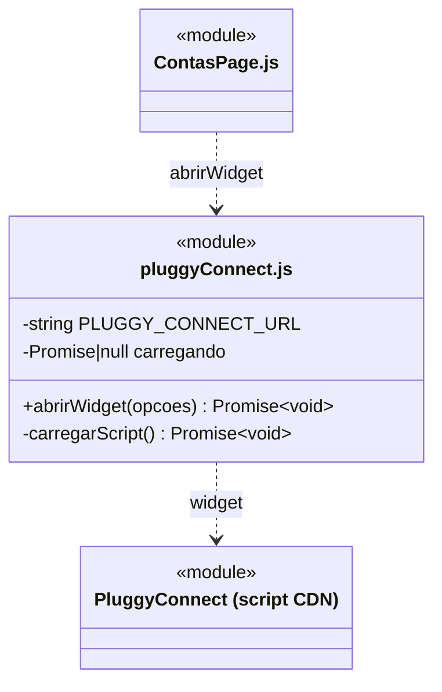

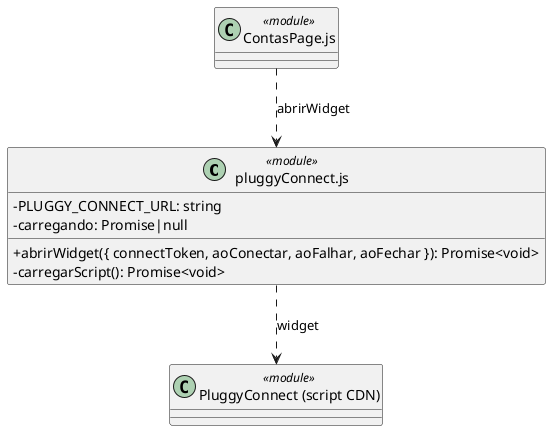
