# Modelo UML: Frontend (app, core e shared)

Modelo UML (notação Astah / UML 2) dos elementos do grupo **fe-core**: ponto de entrada da SPA (`app`), infraestrutura (`core`) e componentes/utilitários reutilizáveis (`shared`) do Frontend.

Convenções:

- Visibilidade: `+` público (exportado), `-` privado (interno ao módulo), `#` protegido, `~` pacote.
- Os arquivos JavaScript são módulos ES; cada módulo é representado como «module». Constantes e variáveis de módulo aparecem como atributos e funções de módulo como operações.
- Relações do tipo dependência indicam `import` (ou uso) entre módulos.
- Cada diagrama aparece em dois blocos: `mermaid` (renderiza no GitHub) e `plantuml` (para recriar no Astah). Nos blocos Mermaid, tipos com chaves ou vírgulas foram simplificados; os tipos completos estão nas tabelas.
- Este grupo não possui elementos «planejado» (contas e transferências pertencem a outros grupos).

## Diagrama do grupo

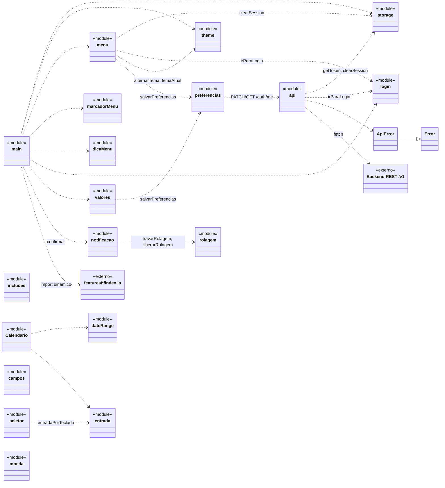

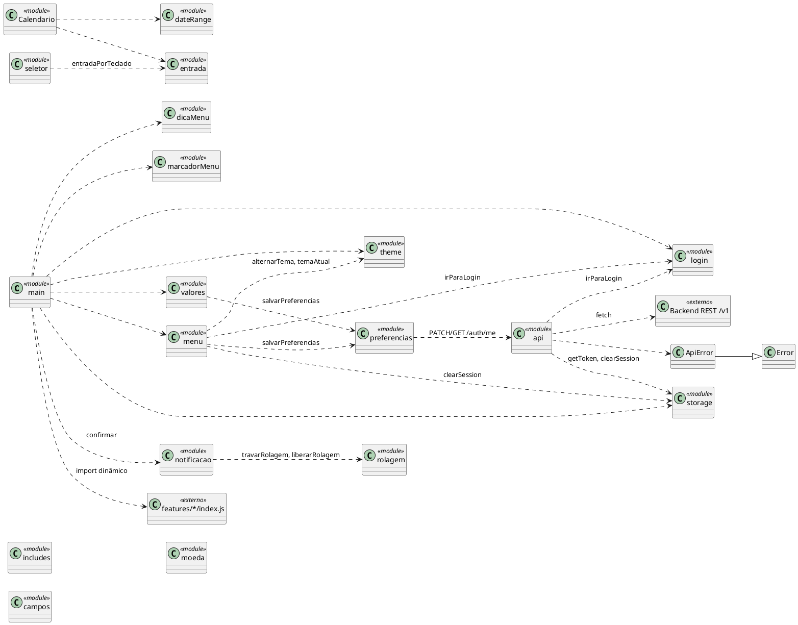

---

## main

**Tipo:** módulo «module»
**Arquivo:** `Frontend/src/app/main.js`

Ponto de entrada da SPA: roteador por hash que carrega HTML, CSS e módulo de cada tela e monta o menu.

### Atributos

| Visibilidade | Nome | Tipo | Descrição |
|---|---|---|---|
| - | TEMPO_MAXIMO_ESCONDIDO_MS | number | Tempo máximo em que o conteúdo pode ficar escondido durante a troca de tela. |
| - | TELAS | Record<string, {titulo, html, css[], modulo()}> | Tabela de rotas: título, HTML, CSS e carregador do módulo de cada tela. |
| - | telaAtual | {modulo}\|null | Tela atualmente montada. |
| - | rotaAtual | string\|null | Rota atualmente exibida. |
| - | sequencia | number | Contador usado para descartar renderizações obsoletas. |

### Operações

| Visibilidade | Assinatura | Retorno | Descrição |
|---|---|---|---|
| - | esconderConteudo(esconder) | void | Esconde ou mostra o conteúdo durante a troca de tela. |
| - | renderMenu(route) | void | Monta o menu lateral para a rota informada. |
| - | currentRoute() | string | Lê a rota atual a partir do hash. |
| - | navigate(route) | void | Navega para a rota informada. |
| - | carregarCss(enderecos) | Promise<HTMLLinkElement[]> | Carrega as folhas de estilo da tela. |
| - | desmontarTela() | void | Desmonta a tela atual. |
| - | montarTela(tela, minha) | Promise<void> | Monta a tela solicitada. |
| - | renderRoute() | Promise<void> | Renderiza a rota atual (HTML, CSS e módulo da tela). |

### Relações

| Tipo | Alvo | Multiplicidade | Rótulo |
|---|---|---|---|
| dependência | storage | 1 | |
| dependência | theme | 1 | |
| dependência | menu | 1 | |
| dependência | marcadorMenu | 1 | |
| dependência | dicaMenu | 1 | |
| dependência | login | 1 | |
| dependência | valores | 1 | |
| dependência | notificacao | 1 | confirmar |
| dependência | features/*/index.js | * | import dinâmico de montar/desmontar das telas |

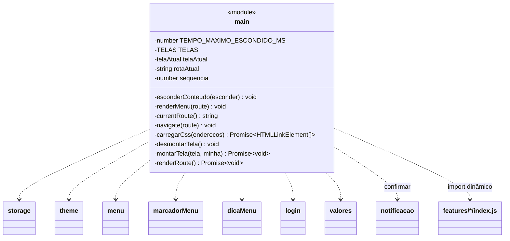

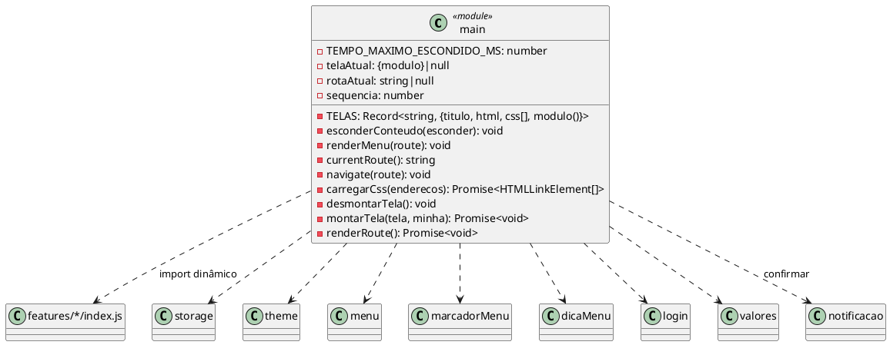

---

## api

**Tipo:** módulo «module»
**Arquivo:** `Frontend/src/core/http/api.js`

Cliente HTTP da API (/v1): normaliza JSON, erros, token Bearer e redirecionamento ao login em 401.

### Atributos

| Visibilidade | Nome | Tipo | Descrição |
|---|---|---|---|
| - | API_BASE_URL | string | Endereço base da API. |
| + | api | apiFetch | Exportação de `apiFetch` sob o nome `api`. |

### Operações

| Visibilidade | Assinatura | Retorno | Descrição |
|---|---|---|---|
| - | lerErro(data, status) | {message, code, details} | Normaliza o corpo de erro da resposta. |
| + | apiFetch(path, options) | Promise<any> | Executa a requisição com token Bearer, normaliza a resposta e lança `ApiError` em falha. |

### Relações

| Tipo | Alvo | Multiplicidade | Rótulo |
|---|---|---|---|
| dependência | storage | 1 | getToken, clearSession |
| dependência | login | 1 | irParaLogin |
| dependência | ApiError | 1 | |
| dependência | Backend REST /v1 | 1 | fetch |

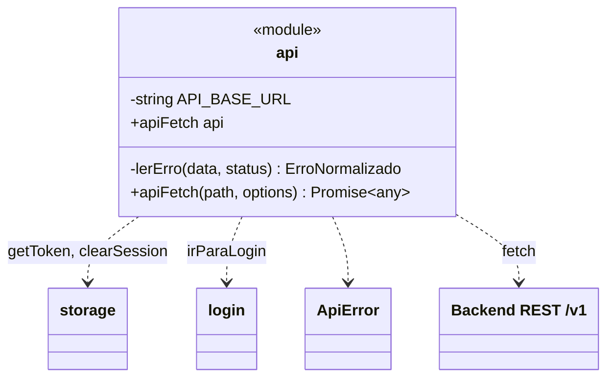

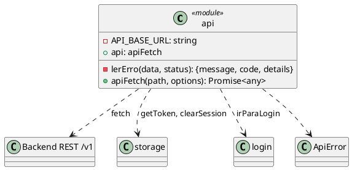

---

## ApiError

**Tipo:** classe
**Arquivo:** `Frontend/src/core/http/api.js`

Erro lançado por apiFetch com status HTTP, dados, código e detalhes de validação.

### Atributos

| Visibilidade | Nome | Tipo | Descrição |
|---|---|---|---|
| + | name | string | Nome do erro. |
| + | status | number | Status HTTP da resposta. |
| + | data | any | Corpo da resposta. |
| + | code | string\|null | Código de erro da API. |
| + | details | Record<string,string[]>\|null | Detalhes de validação por campo. |

### Operações

| Visibilidade | Assinatura | Retorno | Descrição |
|---|---|---|---|
| + | constructor(message, {status, data, code, details}) | ApiError | Cria o erro com mensagem, status, dados, código e detalhes. |

### Relações

| Tipo | Alvo | Multiplicidade | Rótulo |
|---|---|---|---|
| generalização | Error | 1 | |

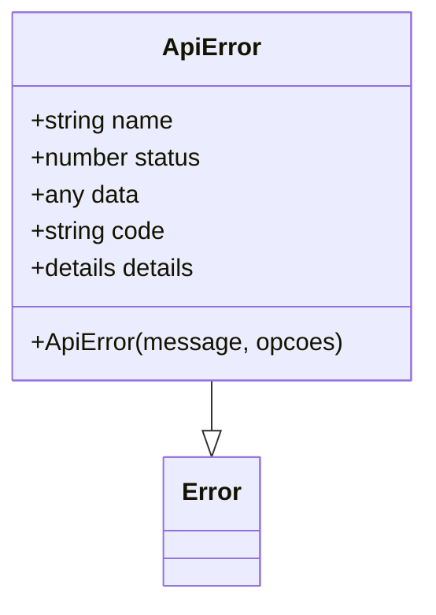

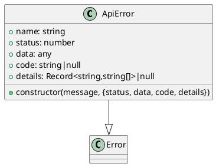

---

## dicaMenu

**Tipo:** módulo «module»
**Arquivo:** `Frontend/src/core/layout/dicaMenu.js`

Dica animada com o nome dos itens do menu lateral recolhido (elemento #dica-menu).

### Atributos

| Visibilidade | Nome | Tipo | Descrição |
|---|---|---|---|
| - | SELETOR_ITENS | string | Seletor CSS dos itens do menu. |
| - | AFASTAMENTO | number | Distância entre o item e a dica. |
| - | CELULAR | string | Media query usada para detectar celular. |

### Operações

| Visibilidade | Assinatura | Retorno | Descrição |
|---|---|---|---|
| - | nomeDoItem(item) | string | Obtém o nome exibido de um item do menu. |
| + | ligarDicaMenu() | void | Liga a dica animada aos itens do menu. |

### Relações

| Tipo | Alvo | Multiplicidade | Rótulo |
|---|---|---|---|
| — | (nenhuma) | | |

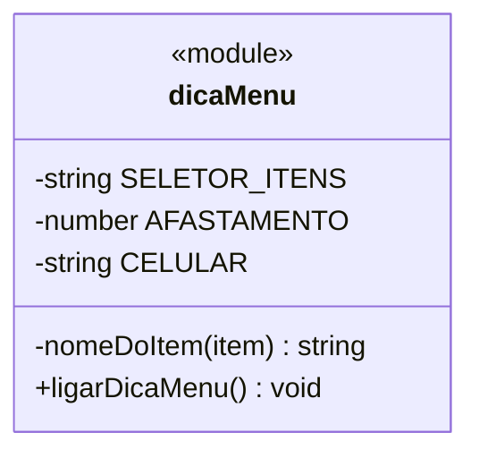

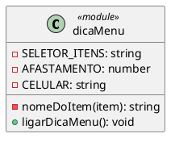

---

## marcadorMenu

**Tipo:** módulo «module»
**Arquivo:** `Frontend/src/core/layout/marcadorMenu.js`

Marcador que desliza até o item do menu da rota atual.

### Atributos

| Visibilidade | Nome | Tipo | Descrição |
|---|---|---|---|
| — | (nenhum) | | |

### Operações

| Visibilidade | Assinatura | Retorno | Descrição |
|---|---|---|---|
| + | ligarMarcadorMenu() | {atualizar()} | Liga o marcador e devolve o controle com `atualizar()`. |

### Relações

| Tipo | Alvo | Multiplicidade | Rótulo |
|---|---|---|---|
| — | (nenhuma) | | |

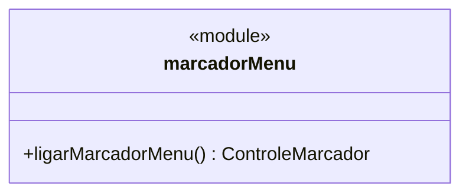

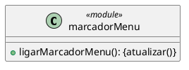

---

## menu

**Tipo:** módulo «module»
**Arquivo:** `Frontend/src/core/layout/menu.js`

Liga os botões do menu lateral: tema com transição circular, recolher menu e sair.

### Atributos

| Visibilidade | Nome | Tipo | Descrição |
|---|---|---|---|
| - | CHAVE_MENU_RECOLHIDO | string | Chave de persistência do estado recolhido. |

### Operações

| Visibilidade | Assinatura | Retorno | Descrição |
|---|---|---|---|
| - | rotuloTema() | string | Texto do botão de tema conforme o tema atual. |
| - | definirRotulo(botao, texto) | void | Define o rótulo de um botão. |
| - | lerMenuRecolhido() | boolean | Lê se o menu está recolhido. |
| - | ligarRecolher(raiz) | void | Liga o botão de recolher o menu. |
| + | ligarMenu(raiz) | void | Liga os botões do menu (tema, recolher, sair). |

### Relações

| Tipo | Alvo | Multiplicidade | Rótulo |
|---|---|---|---|
| dependência | storage | 1 | clearSession |
| dependência | login | 1 | irParaLogin |
| dependência | theme | 1 | alternarTema, temaAtual |
| dependência | preferencias | 1 | salvarPreferencias |

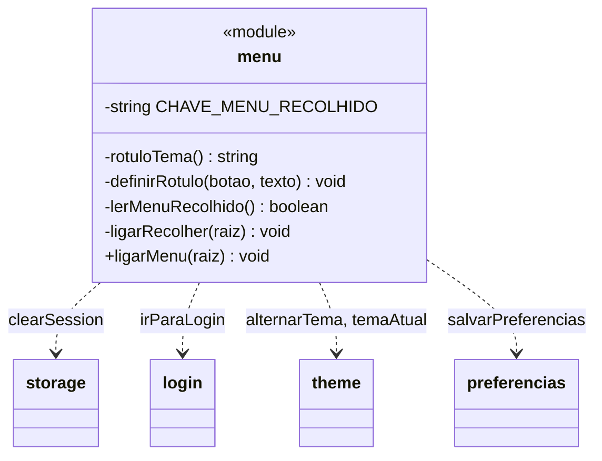

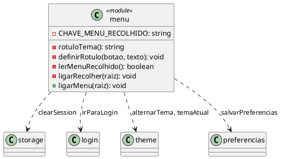

---

## preferencias

**Tipo:** módulo «module»
**Arquivo:** `Frontend/src/core/preferencias.js`

Salva e lê as preferências do usuário (tema, ocultar valores) via /auth/me.

### Atributos

| Visibilidade | Nome | Tipo | Descrição |
|---|---|---|---|
| — | (nenhum) | | |

### Operações

| Visibilidade | Assinatura | Retorno | Descrição |
|---|---|---|---|
| + | salvarPreferencias(preferencias) | Promise<any> | Envia as preferências ao Backend (PATCH /auth/me). |
| + | buscarPreferencias() | Promise<object> | Lê as preferências do usuário (GET /auth/me). |

### Relações

| Tipo | Alvo | Multiplicidade | Rótulo |
|---|---|---|---|
| dependência | api | 1 | PATCH/GET /auth/me |

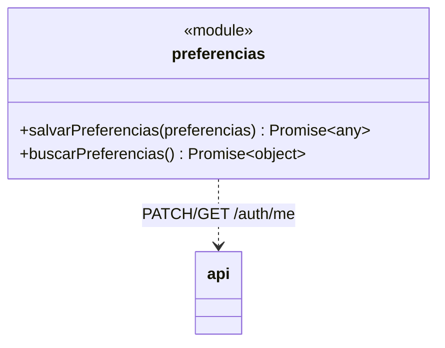

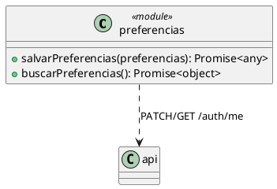

---

## valores

**Tipo:** módulo «module»
**Arquivo:** `Frontend/src/core/privacy/valores.js`

Oculta valores financeiros da tela (resumo de entradas, saídas e saldo) e persiste a escolha.

### Atributos

| Visibilidade | Nome | Tipo | Descrição |
|---|---|---|---|
| - | CHAVE | string | Chave de persistência da escolha. |
| - | ocultos | boolean | Indica se os valores estão ocultos. |
| - | SELETORES_FINANCEIROS | string[] | Seletores dos elementos que exibem valores financeiros. |

### Operações

| Visibilidade | Assinatura | Retorno | Descrição |
|---|---|---|---|
| - | marcarValoresFinanceiros() | void | Marca os elementos financeiros a serem ocultados. |
| + | iniciarOcultacaoValores() | void | Inicia o mecanismo de ocultação de valores. |

### Relações

| Tipo | Alvo | Multiplicidade | Rótulo |
|---|---|---|---|
| dependência | preferencias | 1 | salvarPreferencias |

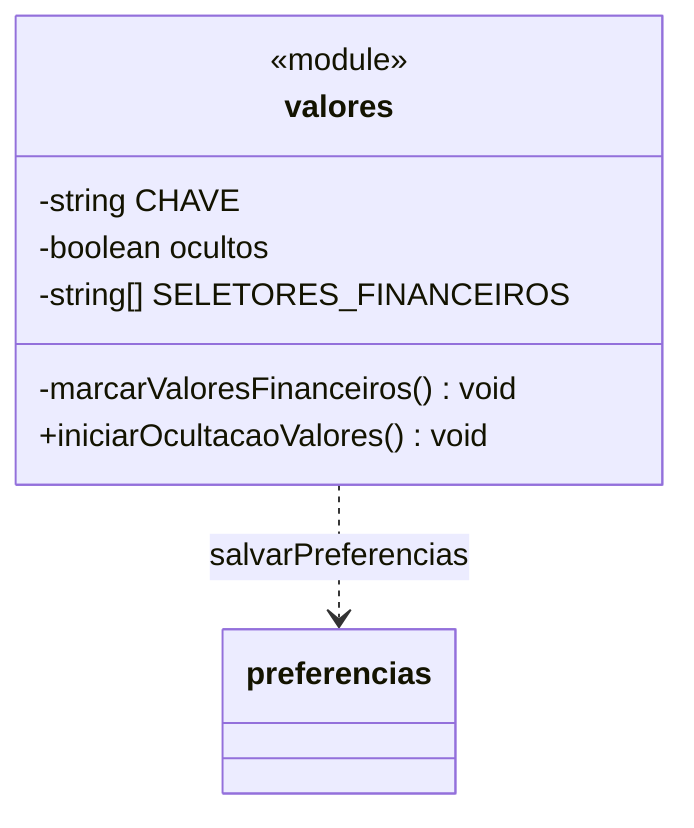

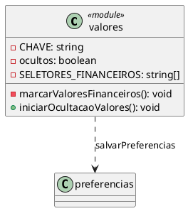

---

## login

**Tipo:** módulo «module»
**Arquivo:** `Frontend/src/core/session/login.js`

Endereço da tela de login e redirecionamento para ela.

### Atributos

| Visibilidade | Nome | Tipo | Descrição |
|---|---|---|---|
| + | URL_LOGIN | string | Endereço da tela de login. |

### Operações

| Visibilidade | Assinatura | Retorno | Descrição |
|---|---|---|---|
| + | irParaLogin({substituir}) | void | Redireciona para a tela de login. |

### Relações

| Tipo | Alvo | Multiplicidade | Rótulo |
|---|---|---|---|
| — | (nenhuma) | | |

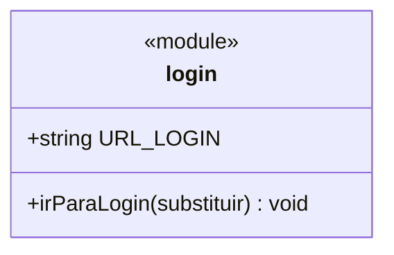

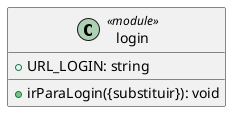

---

## storage

**Tipo:** módulo «module»
**Arquivo:** `Frontend/src/core/session/storage.js`

Guarda, lê e remove o token de sessão no localStorage.

### Atributos

| Visibilidade | Nome | Tipo | Descrição |
|---|---|---|---|
| - | TOKEN_KEY | string | Chave do token no localStorage. |

### Operações

| Visibilidade | Assinatura | Retorno | Descrição |
|---|---|---|---|
| + | getToken() | string\|null | Lê o token de sessão. |
| + | hasToken() | boolean | Informa se há token salvo. |
| + | saveToken(token) | void | Salva o token de sessão. |
| + | clearSession() | void | Remove a sessão (token). |

### Relações

| Tipo | Alvo | Multiplicidade | Rótulo |
|---|---|---|---|
| — | (nenhuma) | | |

```mermaid
classDiagram
    class storage {
        <<module>>
        -string TOKEN_KEY
        +getToken() string
        +hasToken() boolean
        +saveToken(token) void
        +clearSession() void
    }
```

```plantuml
@startuml
class storage <<module>> {
  - TOKEN_KEY: string
  + getToken(): string|null
  + hasToken(): boolean
  + saveToken(token): void
  + clearSession(): void
}
@enduml
```

---

## theme

**Tipo:** módulo «module»
**Arquivo:** `Frontend/src/core/theme/theme.js`

Tema (claro/escuro), estilo (sombras/bordas) e paleta de cores, com transições e persistência.

### Atributos

| Visibilidade | Nome | Tipo | Descrição |
|---|---|---|---|
| + | PALETAS | {valor,nome,descricao,amostra[]}[] | Paletas de cores disponíveis. |
| - | CHAVE | string | Chave de persistência do tema. |
| - | CHAVE_ESTILO | string | Chave de persistência do estilo. |
| - | CHAVE_PALETA | string | Chave de persistência da paleta. |
| - | DURACAO_REVELACAO_MS | number | Duração da revelação circular. |
| - | DURACAO_FADE_MS | number | Duração da transição por fade. |

### Operações

| Visibilidade | Assinatura | Retorno | Descrição |
|---|---|---|---|
| + | temaAtual() | 'claro'\|'escuro' | Tema atual. |
| + | aplicarTema(tema) | void | Aplica o tema. |
| + | estiloAtual() | 'bordas'\|'sombras' | Estilo atual. |
| + | aplicarEstilo(estilo) | void | Aplica o estilo. |
| + | paletaAtual() | string | Paleta atual. |
| + | aplicarPaleta(paleta) | string | Aplica a paleta. |
| + | iniciarTema() | void | Aplica tema, estilo e paleta salvos. |
| + | alternarTema({origem, aoAplicar}) | string | Alterna entre claro e escuro com transição. |
| + | alternarEstilo() | string | Alterna entre bordas e sombras. |
| - | revelarEmCirculo(trocar, origem) | void | Transição circular a partir da origem. |
| - | trocarComFade(trocar) | void | Transição por fade. |

### Relações

| Tipo | Alvo | Multiplicidade | Rótulo |
|---|---|---|---|
| — | (nenhuma) | | |

```mermaid
classDiagram
    class theme {
        <<module>>
        +PALETAS PALETAS
        -string CHAVE
        -string CHAVE_ESTILO
        -string CHAVE_PALETA
        -number DURACAO_REVELACAO_MS
        -number DURACAO_FADE_MS
        +temaAtual() string
        +aplicarTema(tema) void
        +estiloAtual() string
        +aplicarEstilo(estilo) void
        +paletaAtual() string
        +aplicarPaleta(paleta) string
        +iniciarTema() void
        +alternarTema(opcoes) string
        +alternarEstilo() string
        -revelarEmCirculo(trocar, origem) void
        -trocarComFade(trocar) void
    }
```

```plantuml
@startuml
class theme <<module>> {
  + PALETAS: {valor,nome,descricao,amostra[]}[]
  - CHAVE: string
  - CHAVE_ESTILO: string
  - CHAVE_PALETA: string
  - DURACAO_REVELACAO_MS: number
  - DURACAO_FADE_MS: number
  + temaAtual(): 'claro'|'escuro'
  + aplicarTema(tema): void
  + estiloAtual(): 'bordas'|'sombras'
  + aplicarEstilo(estilo): void
  + paletaAtual(): string
  + aplicarPaleta(paleta): string
  + iniciarTema(): void
  + alternarTema({origem, aoAplicar}): string
  + alternarEstilo(): string
  - revelarEmCirculo(trocar, origem): void
  - trocarComFade(trocar): void
}
@enduml
```

---

## includes

**Tipo:** módulo «module»
**Arquivo:** `Frontend/src/core/views/includes.js`

Inclui fragmentos HTML de componentes onde houver data-incluir, até a profundidade máxima.

### Atributos

| Visibilidade | Nome | Tipo | Descrição |
|---|---|---|---|
| - | PROFUNDIDADE_MAXIMA | number | Profundidade máxima de inclusões aninhadas. |

### Operações

| Visibilidade | Assinatura | Retorno | Descrição |
|---|---|---|---|
| + | incluirFragmentos(raiz) | Promise<void> | Substitui cada `data-incluir` pelo HTML do fragmento. |

### Relações

| Tipo | Alvo | Multiplicidade | Rótulo |
|---|---|---|---|
| — | (nenhuma) | | |

```mermaid
classDiagram
    class includes {
        <<module>>
        -number PROFUNDIDADE_MAXIMA
        +incluirFragmentos(raiz) Promise~void~
    }
```

```plantuml
@startuml
class includes <<module>> {
  - PROFUNDIDADE_MAXIMA: number
  + incluirFragmentos(raiz): Promise<void>
}
@enduml
```

---

## Calendario

**Tipo:** módulo «module»
**Arquivo:** `Frontend/src/shared/components/Calendario.js`

Campo de data (única ou período) com calendário, atalhos e máscara; HTML em shared/components/calendario/Calendario.html e CSS shared/styles/calendario.css.

### Atributos

| Visibilidade | Nome | Tipo | Descrição |
|---|---|---|---|
| - | MESES_EM_TEXTO | Intl.DateTimeFormat | Formatador do nome do mês. |
| - | DATA_EM_TEXTO | Intl.DateTimeFormat | Formatador de data por extenso. |
| - | ESPERA_PARA_ABRIR_MS | number | Espera antes de abrir o calendário. |
| - | ESPERA_PARA_FECHAR_MS | number | Espera antes de fechar o calendário. |

### Operações

| Visibilidade | Assinatura | Retorno | Descrição |
|---|---|---|---|
| - | iso(ano, mes, dia) | string | Monta uma data ISO. |
| + | ligarCalendario(area, {signal}) | controle do campo | Liga o campo de data ao calendário e devolve o controle. |

### Relações

| Tipo | Alvo | Multiplicidade | Rótulo |
|---|---|---|---|
| dependência | dateRange | 1 | |
| dependência | entrada | 1 | |

```mermaid
classDiagram
    class Calendario {
        <<module>>
        -DateTimeFormat MESES_EM_TEXTO
        -DateTimeFormat DATA_EM_TEXTO
        -number ESPERA_PARA_ABRIR_MS
        -number ESPERA_PARA_FECHAR_MS
        -iso(ano, mes, dia) string
        +ligarCalendario(area, opcoes) ControleCampo
    }
    Calendario ..> dateRange
    Calendario ..> entrada
```

```plantuml
@startuml
class Calendario <<module>> {
  - MESES_EM_TEXTO: Intl.DateTimeFormat
  - DATA_EM_TEXTO: Intl.DateTimeFormat
  - ESPERA_PARA_ABRIR_MS: number
  - ESPERA_PARA_FECHAR_MS: number
  - iso(ano, mes, dia): string
  + ligarCalendario(area, {signal}): controle do campo
}
Calendario ..> dateRange
Calendario ..> entrada
@enduml
```

---

## campos

**Tipo:** módulo «module»
**Arquivo:** `Frontend/src/shared/components/campos.js`

Liga campos de formulário (erro, valor) e máscaras numérica e de moeda; CSS em shared/styles/campos.css.

### Atributos

| Visibilidade | Nome | Tipo | Descrição |
|---|---|---|---|
| — | (nenhum) | | |

### Operações

| Visibilidade | Assinatura | Retorno | Descrição |
|---|---|---|---|
| + | ligarCampo(raiz, id) | {controle, ler, definir, definirErro, focar} | Liga um campo de formulário e devolve seu controle. |
| + | aceitarSomenteNumeros(controle) | void | Restringe o campo a dígitos. |
| + | aplicarMascaraMoeda(controle) | void | Aplica a máscara de moeda ao campo. |

### Relações

| Tipo | Alvo | Multiplicidade | Rótulo |
|---|---|---|---|
| — | (nenhuma) | | |

```mermaid
classDiagram
    class campos {
        <<module>>
        +ligarCampo(raiz, id) ControleCampo
        +aceitarSomenteNumeros(controle) void
        +aplicarMascaraMoeda(controle) void
    }
```

```plantuml
@startuml
class campos <<module>> {
  + ligarCampo(raiz, id): {controle, ler, definir, definirErro, focar}
  + aceitarSomenteNumeros(controle): void
  + aplicarMascaraMoeda(controle): void
}
@enduml
```

---

## notificacao

**Tipo:** módulo «module»
**Arquivo:** `Frontend/src/shared/components/notificacao.js`

Alertas temporários (notificar) e janela de confirmação (confirmar); CSS em shared/styles/notificacao.css.

### Atributos

| Visibilidade | Nome | Tipo | Descrição |
|---|---|---|---|
| - | DURACAO_MS | number | Duração padrão do alerta. |
| - | DURACAO_ANIMACAO_MS | number | Duração da animação do alerta. |
| - | PAUSA_MAXIMA_MS | number | Tempo máximo de pausa do alerta. |
| - | TIPOS | Record | Tipos de alerta. |
| - | SINONIMOS | Record<string,string> | Sinônimos aceitos para os tipos. |

### Operações

| Visibilidade | Assinatura | Retorno | Descrição |
|---|---|---|---|
| - | regiao() | HTMLElement | Região da página onde os alertas são inseridos. |
| - | ligarPausa(alerta, animacao) | void | Pausa o alerta enquanto o usuário interage. |
| + | notificar(mensagem, tipo, {duracao, pausavel, acao}) | {fechar} | Exibe um alerta temporário. |
| + | confirmar(mensagem, tipo) | Promise<boolean> | Exibe janela de confirmação e resolve com a escolha do usuário. |

### Relações

| Tipo | Alvo | Multiplicidade | Rótulo |
|---|---|---|---|
| dependência | rolagem | 1 | travarRolagem, liberarRolagem |

```mermaid
classDiagram
    class notificacao {
        <<module>>
        -number DURACAO_MS
        -number DURACAO_ANIMACAO_MS
        -number PAUSA_MAXIMA_MS
        -Record TIPOS
        -Record SINONIMOS
        -regiao() HTMLElement
        -ligarPausa(alerta, animacao) void
        +notificar(mensagem, tipo, opcoes) ControleAlerta
        +confirmar(mensagem, tipo) Promise~boolean~
    }
    notificacao ..> rolagem : travarRolagem, liberarRolagem
```

```plantuml
@startuml
class notificacao <<module>> {
  - DURACAO_MS: number
  - DURACAO_ANIMACAO_MS: number
  - PAUSA_MAXIMA_MS: number
  - TIPOS: Record
  - SINONIMOS: Record<string,string>
  - regiao(): HTMLElement
  - ligarPausa(alerta, animacao): void
  + notificar(mensagem, tipo, {duracao, pausavel, acao}): {fechar}
  + confirmar(mensagem, tipo): Promise<boolean>
}
notificacao ..> rolagem : travarRolagem, liberarRolagem
@enduml
```

---

## seletor

**Tipo:** módulo «module»
**Arquivo:** `Frontend/src/shared/components/seletor.js`

Lista customizada para selects de campos .campo--seletor, com abertura por mouse/teclado e posicionamento.

### Atributos

| Visibilidade | Nome | Tipo | Descrição |
|---|---|---|---|
| - | ESPERA_PARA_ABRIR_MS | number | Espera antes de abrir a lista. |
| - | ESPERA_PARA_FECHAR_MS | number | Espera antes de fechar a lista. |
| - | DURACAO_FADE_MS | number | Duração do fade da lista. |
| - | MARGEM_PX | number | Margem entre a lista e a borda da janela. |
| - | ALTURA_MINIMA_PX | number | Altura mínima da lista. |

### Operações

| Visibilidade | Assinatura | Retorno | Descrição |
|---|---|---|---|
| + | ligarSeletores(raiz, signal) | void | Liga todos os seletores `.campo--seletor` dentro da raiz. |
| - | ligarSeletor(campo, modelo, signal) | void | Liga um seletor individual. |

### Relações

| Tipo | Alvo | Multiplicidade | Rótulo |
|---|---|---|---|
| dependência | entrada | 1 | entradaPorTeclado |

```mermaid
classDiagram
    class seletor {
        <<module>>
        -number ESPERA_PARA_ABRIR_MS
        -number ESPERA_PARA_FECHAR_MS
        -number DURACAO_FADE_MS
        -number MARGEM_PX
        -number ALTURA_MINIMA_PX
        +ligarSeletores(raiz, signal) void
        -ligarSeletor(campo, modelo, signal) void
    }
    seletor ..> entrada : entradaPorTeclado
```

```plantuml
@startuml
class seletor <<module>> {
  - ESPERA_PARA_ABRIR_MS: number
  - ESPERA_PARA_FECHAR_MS: number
  - DURACAO_FADE_MS: number
  - MARGEM_PX: number
  - ALTURA_MINIMA_PX: number
  + ligarSeletores(raiz, signal): void
  - ligarSeletor(campo, modelo, signal): void
}
seletor ..> entrada : entradaPorTeclado
@enduml
```

---

## dateRange

**Tipo:** módulo «module»
**Arquivo:** `Frontend/src/shared/utils/dateRange.js`

Utilitários de data: validação, conversão ISO/BR, máscara, leitura de período e períodos predefinidos.

### Atributos

| Visibilidade | Nome | Tipo | Descrição |
|---|---|---|---|
| - | DATA_BR | RegExp | Expressão do formato de data brasileiro. |

### Operações

| Visibilidade | Assinatura | Retorno | Descrição |
|---|---|---|---|
| + | dataValida(texto) | boolean | Valida uma data em texto. |
| + | isoDeData(data) | string | Converte `Date` para ISO. |
| + | isoParaBr(iso) | string | Converte ISO para formato brasileiro. |
| + | mascararData(texto) | string | Aplica a máscara de data. |
| + | lerData(texto) | {iso, valida} | Lê uma data em texto. |
| + | lerPeriodo(textoInicio, textoFim) | {dataInicio, dataFim, erro} | Lê e valida um período. |
| + | mesAtual(hoje) | {inicio, fim} | Período do mês atual. |
| + | periodoPredefinido(chave, hoje) | {inicio, fim}\|null | Período predefinido pela chave. |

### Relações

| Tipo | Alvo | Multiplicidade | Rótulo |
|---|---|---|---|
| — | (nenhuma) | | |

```mermaid
classDiagram
    class dateRange {
        <<module>>
        -RegExp DATA_BR
        +dataValida(texto) boolean
        +isoDeData(data) string
        +isoParaBr(iso) string
        +mascararData(texto) string
        +lerData(texto) DataLida
        +lerPeriodo(textoInicio, textoFim) PeriodoLido
        +mesAtual(hoje) Periodo
        +periodoPredefinido(chave, hoje) Periodo
    }
```

```plantuml
@startuml
class dateRange <<module>> {
  - DATA_BR: RegExp
  + dataValida(texto): boolean
  + isoDeData(data): string
  + isoParaBr(iso): string
  + mascararData(texto): string
  + lerData(texto): {iso, valida}
  + lerPeriodo(textoInicio, textoFim): {dataInicio, dataFim, erro}
  + mesAtual(hoje): {inicio, fim}
  + periodoPredefinido(chave, hoje): {inicio, fim}|null
}
@enduml
```

---

## entrada

**Tipo:** módulo «module»
**Arquivo:** `Frontend/src/shared/utils/entrada.js`

Informa se a última interação do usuário foi por teclado.

### Atributos

| Visibilidade | Nome | Tipo | Descrição |
|---|---|---|---|
| - | porTeclado | boolean | Indica se a última interação foi por teclado. |

### Operações

| Visibilidade | Assinatura | Retorno | Descrição |
|---|---|---|---|
| + | entradaPorTeclado() | boolean | Informa se a última interação foi por teclado. |

### Relações

| Tipo | Alvo | Multiplicidade | Rótulo |
|---|---|---|---|
| — | (nenhuma) | | |

```mermaid
classDiagram
    class entrada {
        <<module>>
        -boolean porTeclado
        +entradaPorTeclado() boolean
    }
```

```plantuml
@startuml
class entrada <<module>> {
  - porTeclado: boolean
  + entradaPorTeclado(): boolean
}
@enduml
```

---

## moeda

**Tipo:** módulo «module»
**Arquivo:** `Frontend/src/shared/utils/moeda.js`

Formatação e leitura de valores monetários, percentuais e datas em pt-BR.

### Atributos

| Visibilidade | Nome | Tipo | Descrição |
|---|---|---|---|
| - | moeda | Intl.NumberFormat | Formatador de moeda (BRL). |
| - | numero | Intl.NumberFormat | Formatador numérico. |
| - | dataCurta | Intl.DateTimeFormat | Formatador de data curta. |

### Operações

| Visibilidade | Assinatura | Retorno | Descrição |
|---|---|---|---|
| + | formatarMoeda(valor) | string | Formata valor monetário. |
| + | formatarPercentual(valor) | string | Formata percentual. |
| + | formatarData(iso) | string | Formata data ISO. |
| + | valorParaCampo(valor) | string | Converte número para o texto de um campo. |
| + | lerValor(texto) | number | Lê valor monetário digitado. |
| + | lerTaxa(texto) | number | Lê taxa percentual digitada. |

### Relações

| Tipo | Alvo | Multiplicidade | Rótulo |
|---|---|---|---|
| — | (nenhuma) | | |

```mermaid
classDiagram
    class moeda {
        <<module>>
        -NumberFormat moeda
        -NumberFormat numero
        -DateTimeFormat dataCurta
        +formatarMoeda(valor) string
        +formatarPercentual(valor) string
        +formatarData(iso) string
        +valorParaCampo(valor) string
        +lerValor(texto) number
        +lerTaxa(texto) number
    }
```

```plantuml
@startuml
class moeda <<module>> {
  - moeda: Intl.NumberFormat
  - numero: Intl.NumberFormat
  - dataCurta: Intl.DateTimeFormat
  + formatarMoeda(valor): string
  + formatarPercentual(valor): string
  + formatarData(iso): string
  + valorParaCampo(valor): string
  + lerValor(texto): number
  + lerTaxa(texto): number
}
@enduml
```

---

## rolagem

**Tipo:** módulo «module»
**Arquivo:** `Frontend/src/shared/utils/rolagem.js`

Trava e libera a rolagem da página enquanto painéis ou janelas estão abertos, compensando a barra.

### Atributos

| Visibilidade | Nome | Tipo | Descrição |
|---|---|---|---|
| - | travas | number | Contador de travas ativas. |
| - | anterior | {overflow, paddingRight}\|null | Estilo anterior do documento, restaurado ao liberar. |

### Operações

| Visibilidade | Assinatura | Retorno | Descrição |
|---|---|---|---|
| + | travarRolagem() | void | Trava a rolagem da página. |
| + | liberarRolagem() | void | Libera a rolagem quando não restam travas. |

### Relações

| Tipo | Alvo | Multiplicidade | Rótulo |
|---|---|---|---|
| — | (nenhuma) | | |

```mermaid
classDiagram
    class rolagem {
        <<module>>
        -number travas
        -EstiloAnterior anterior
        +travarRolagem() void
        +liberarRolagem() void
    }
```

```plantuml
@startuml
class rolagem <<module>> {
  - travas: number
  - anterior: {overflow, paddingRight}|null
  + travarRolagem(): void
  + liberarRolagem(): void
}
@enduml
```
