# Frontend: dashboard (pasta `Frontend/src/features/dashboard`)

Modelo UML (padrão Astah / UML 2) dos módulos do grupo **fe-dashboard**, responsáveis pela página do painel (dashboard): entrada da página, cabeçalho, cards de resumo, estado de carregamento/erro e serviço de busca do resumo.

Convenções: visibilidade `+` público (exportado), `-` privado (não exportado do módulo), `#` protegido, `~` pacote. Estereótipos entre «aspas angulares». O Frontend é JavaScript com módulos ES; cada arquivo é modelado como `«module»` e suas funções como operações. Elementos vizinhos de outros grupos (`theme.js`, `menu.js`, `includes.js`, `api.js` e o endpoint do Backend) aparecem apenas como alvo de dependência; seus modelos completos estão em outros arquivos. Não há elementos «planejado» neste grupo (o plano de contas e transferências, em `docs/especificacao-contas-e-transferencias.md`, não cria módulos novos aqui).

## Diagrama do grupo

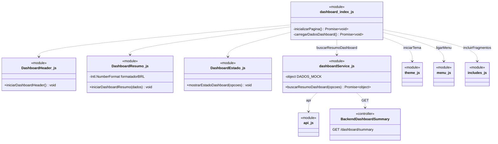

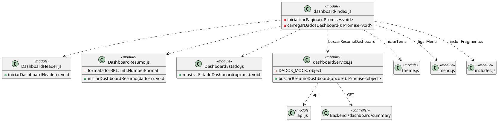

## dashboard/index.js

- **Tipo e estereótipo:** módulo «module» (ponto de entrada da página).
- **Arquivo de origem:** `Frontend/src/features/dashboard/index.js`
- **Descrição:** Entrada da página do dashboard. Inicia tema e menu, inclui os fragmentos HTML, inicia o cabeçalho e carrega o resumo. Em `carregarDadosDashboard` mostra o estado "carregando", busca o resumo com `usarMock: true` (mock ativo), oculta o estado e preenche os cards; em caso de erro mostra o estado de erro com botão de tentar novamente, que reexecuta `carregarDadosDashboard`. A função `inicializarPagina()` é chamada ao carregar o módulo. Nenhuma função é exportada.

### Atributos

| Visibilidade | Nome | Tipo | Descrição |
|---|---|---|---|
| - | (nenhum) | - | O módulo não declara atributos. |

### Operações

| Visibilidade | Assinatura | Retorno | Descrição |
|---|---|---|---|
| - | inicializarPagina() | Promise<void> | Inicia tema e menu, aguarda `incluirFragmentos(document)`, inicia o cabeçalho e carrega os dados. |
| - | carregarDadosDashboard() | Promise<void> | Exibe "carregando", busca o resumo (mock ativo), oculta o estado e inicia o resumo; no erro, exibe o estado de erro com nova tentativa. |

### Relações

| Tipo | Alvo | Multiplicidade | Rótulo |
|---|---|---|---|
| dependência | theme.js | 1 | iniciarTema |
| dependência | menu.js | 1 | ligarMenu |
| dependência | includes.js | 1 | incluirFragmentos |
| dependência | DashboardHeader.js | 1 | iniciarDashboardHeader |
| dependência | DashboardResumo.js | 1 | iniciarDashboardResumo |
| dependência | DashboardEstado.js | 1 | mostrarEstadoDashboard |
| dependência | dashboardService.js | 1 | buscarResumoDashboard |

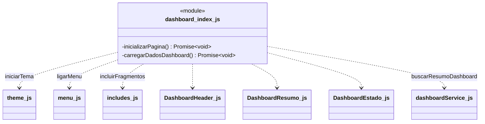

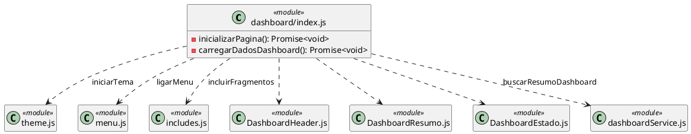

## DashboardEstado.js

- **Tipo e estereótipo:** módulo «module» (componente de interface).
- **Arquivo de origem:** `Frontend/src/features/dashboard/components/DashboardEstado/DashboardEstado.js`
- **Descrição:** Mostra o estado do dashboard: carregando, erro com botão "tentar novamente" ou oculto. Opera sobre os elementos `#dashboard-estado`, `#dashboard-estado-msg`, `#dashboard-estado-btn` e `#dashboard-resumo`; ao mostrar carregando ou erro, esconde o resumo.

### Atributos

| Visibilidade | Nome | Tipo | Descrição |
|---|---|---|---|
| - | (nenhum) | - | O módulo não declara atributos. |

### Operações

| Visibilidade | Assinatura | Retorno | Descrição |
|---|---|---|---|
| + | mostrarEstadoDashboard({ tipo, mensagem, aoTentarNovamente }) | void | Exibe ou oculta a caixa de estado; `tipo` aceita 'carregando', 'erro' ou 'oculto' (padrão); no erro, com callback válido, mostra o botão e liga o clique. |

### Relações

| Tipo | Alvo | Multiplicidade | Rótulo |
|---|---|---|---|
| dependência (de entrada) | dashboard/index.js | 1 | usado por `carregarDadosDashboard` |

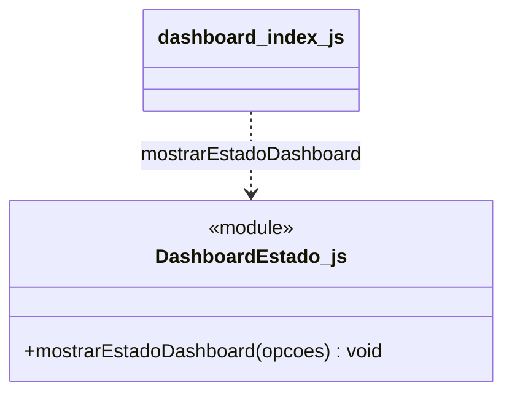

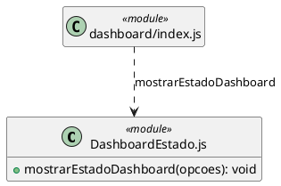

## DashboardHeader.js

- **Tipo e estereótipo:** módulo «module» (componente de interface).
- **Arquivo de origem:** `Frontend/src/features/dashboard/components/DashboardHeader/DashboardHeader.js`
- **Descrição:** Cabeçalho do dashboard. A função é vazia e fica reservada para receber filtros de período ou botões de ação em sprints futuras.

### Atributos

| Visibilidade | Nome | Tipo | Descrição |
|---|---|---|---|
| - | (nenhum) | - | O módulo não declara atributos. |

### Operações

| Visibilidade | Assinatura | Retorno | Descrição |
|---|---|---|---|
| + | iniciarDashboardHeader() | void | Função vazia, reservada para filtros futuros. |

### Relações

| Tipo | Alvo | Multiplicidade | Rótulo |
|---|---|---|---|
| dependência (de entrada) | dashboard/index.js | 1 | usado por `inicializarPagina` |

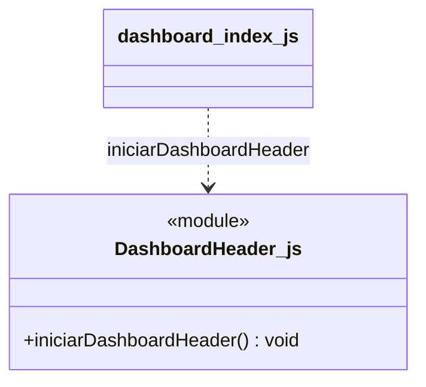

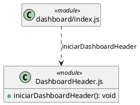

## DashboardResumo.js

- **Tipo e estereótipo:** módulo «module» (componente de interface).
- **Arquivo de origem:** `Frontend/src/features/dashboard/components/DashboardResumo/DashboardResumo.js`
- **Descrição:** Preenche os cards de saldo, despesas e receitas (`#card-saldo`, `#card-despesas`, `#card-receitas` dentro de `#dashboard-resumo`) formatados em BRL. Aceita `despesas` ou, como alternativa, `gastos`. O saldo recebe a classe `resumo-card__valor--positivo` ou `resumo-card__valor--negativo` conforme o sinal. Ao final torna o container visível.

### Atributos

| Visibilidade | Nome | Tipo | Descrição |
|---|---|---|---|
| - | formatadorBRL | Intl.NumberFormat | Formatador de moeda `pt-BR` / `BRL` usado nos três cards. |

### Operações

| Visibilidade | Assinatura | Retorno | Descrição |
|---|---|---|---|
| + | iniciarDashboardResumo(dados?) | void | Lê `saldo`, `despesas` (ou `gastos`) e `receitas` de `dados`, formata em BRL, atualiza os cards e exibe o container. |

### Relações

| Tipo | Alvo | Multiplicidade | Rótulo |
|---|---|---|---|
| dependência | Intl.NumberFormat | 1 | formatadorBRL |
| dependência (de entrada) | dashboard/index.js | 1 | usado por `carregarDadosDashboard` |

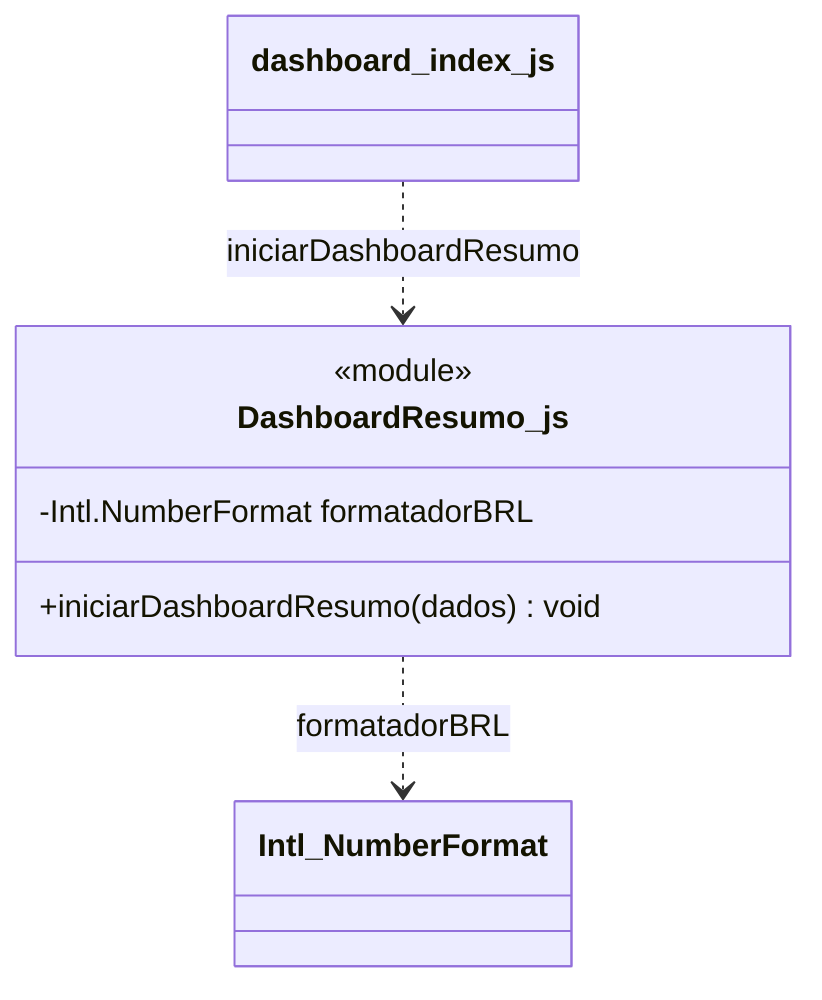

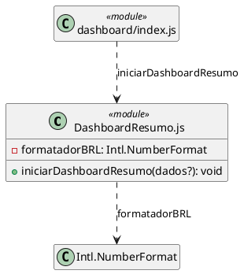

## dashboardService.js

- **Tipo e estereótipo:** módulo «module» (serviço de acesso ao Backend; função de serviço, sem estereótipo «service» formal no código).
- **Arquivo de origem:** `Frontend/src/features/dashboard/services/dashboardService.js`
- **Descrição:** Busca o resumo do dashboard em `/dashboard/summary` pelo cliente `api`, ou devolve dados mockados (`DADOS_MOCK`) após uma espera de 400 ms quando `usarMock` é verdadeiro. O mock contém `receitas`, `despesas`, `saldo`, `economia` e `fluxoDeCaixa`.

### Atributos

| Visibilidade | Nome | Tipo | Descrição |
|---|---|---|---|
| - | DADOS_MOCK | object | Resumo fictício (`receitas`, `despesas`, `saldo`, `economia`, `fluxoDeCaixa`) usado quando `usarMock` é verdadeiro. |

### Operações

| Visibilidade | Assinatura | Retorno | Descrição |
|---|---|---|---|
| + | buscarResumoDashboard({ usarMock? }) | Promise<object> | Com `usarMock` devolve `DADOS_MOCK` após 400 ms; senão chama `api('/dashboard/summary')`. Padrão de `usarMock`: `false`. |

### Relações

| Tipo | Alvo | Multiplicidade | Rótulo |
|---|---|---|---|
| dependência | api.js | 1 | api |
| dependência | Backend /dashboard/summary | 1 | GET |
| dependência (de entrada) | dashboard/index.js | 1 | usado por `carregarDadosDashboard` |

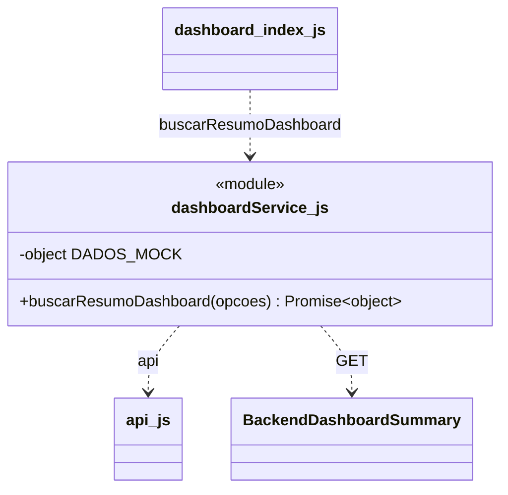

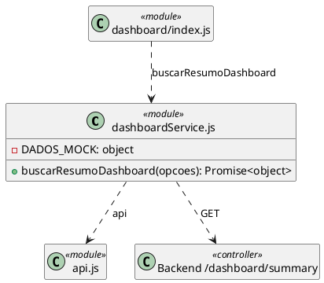
