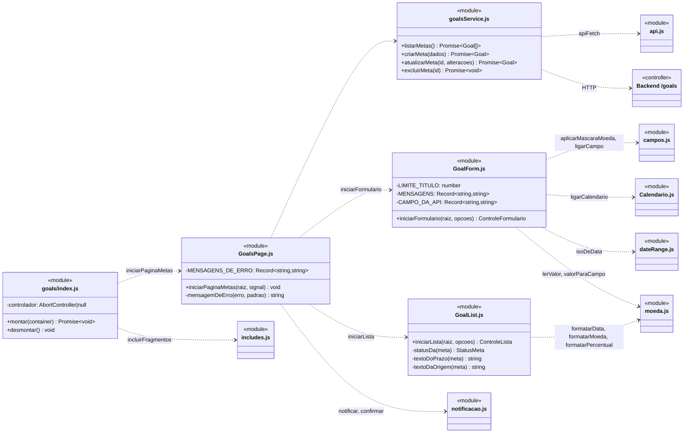
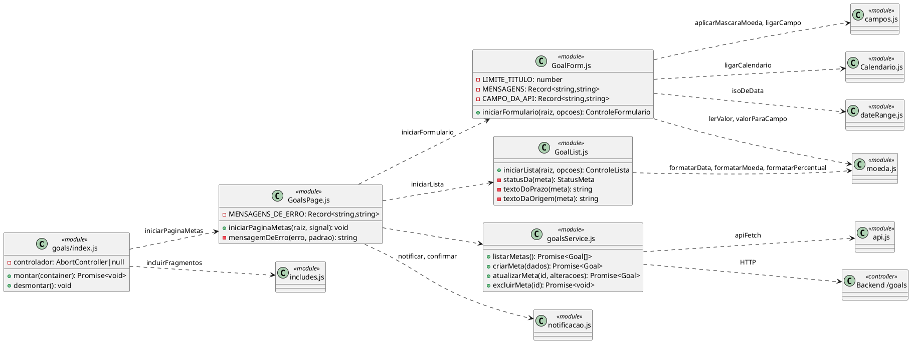
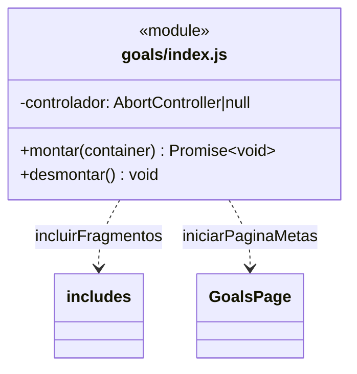
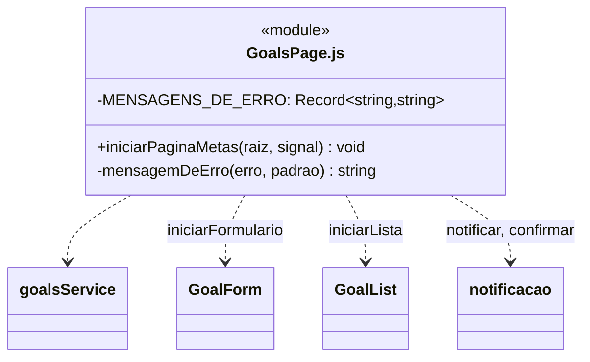
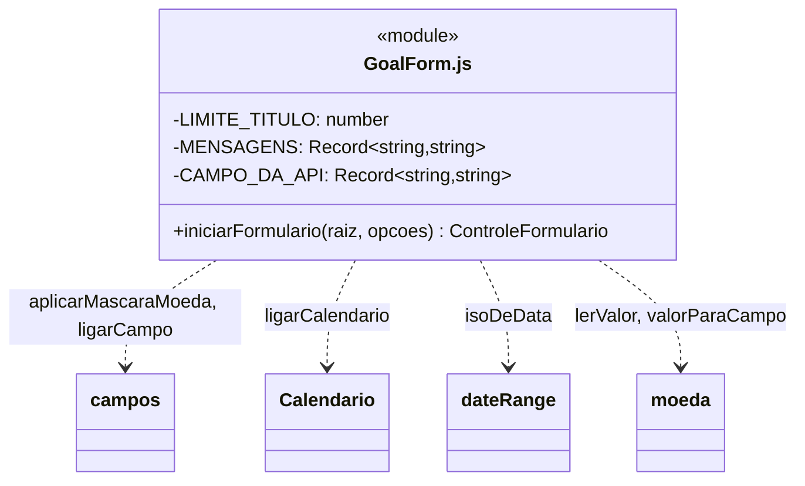
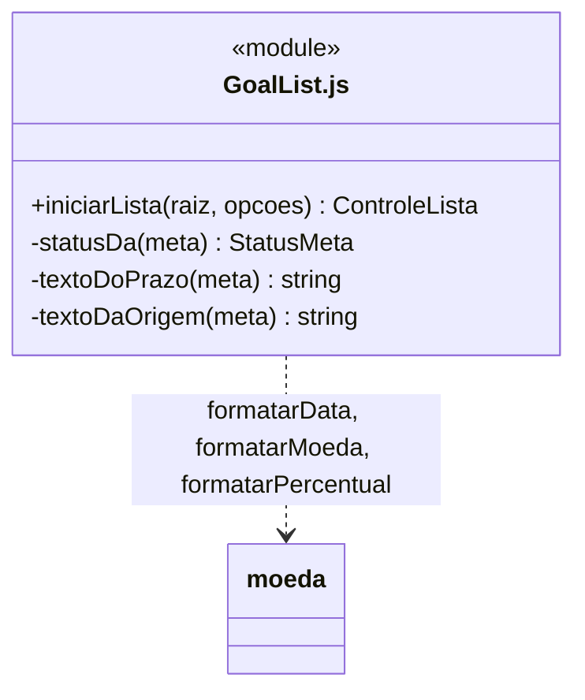
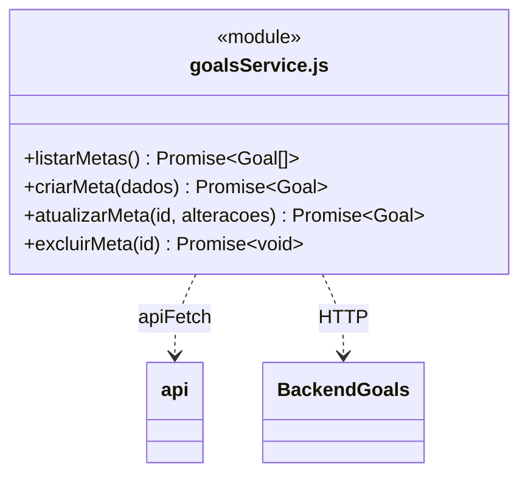

# Modelo UML - Frontend: goals

Modelo UML (notação Astah / UML 2) dos elementos da feature de Metas do Frontend (`Frontend/src/features/goals/`). Todos os elementos são módulos ES («module»): funções exportadas operam como operações públicas (+), funções e constantes não exportadas como privadas (-). Não há classes, interfaces nem enumerações neste grupo. Nenhum elemento deste grupo é «planejado»: todos existem no código.

Convenções: visibilidade + público, - privado; multiplicidade 1, 0..1, *, 1..*; todas as relações entre módulos são dependências (importação ou chamada). Os módulos externos ao grupo (includes.js, campos.js, Calendario.js, dateRange.js, moeda.js, notificacao.js, api.js e o Backend /goals) aparecem apenas como vizinhos.

## Diagrama do grupo

---

## goals/index.js

- Tipo e estereótipo: módulo «module»
- Arquivo de origem: `Frontend/src/features/goals/index.js`
- Descrição: ponto de entrada da tela de Metas. O roteador (app/main.js) busca views/goals.html, escreve o HTML em #app-content e chama `montar()`; `montar` inclui os fragmentos HTML e liga GoalsPage. `desmontar` aborta o controlador e descarta o que a tela ligou.

### Atributos

| Visibilidade | Nome | Tipo | Descrição |
|---|---|---|---|
| - | controlador | AbortController\|null | Um AbortController por montagem; seu abort() desliga ouvintes e respostas pendentes. |

### Operações

| Visibilidade | Assinatura | Retorno | Descrição |
|---|---|---|---|
| + | montar(container) | Promise\<void\> | Junta os componentes HTML (incluirFragmentos), cria o AbortController e chama iniciarPaginaMetas. |
| + | desmontar() | void | Aborta o controlador e o zera ao sair da tela. |

### Relações

| Tipo | Alvo | Multiplicidade | Rótulo |
|---|---|---|---|
| dependência | includes.js | 1 | incluirFragmentos |
| dependência | GoalsPage.js | 1 | iniciarPaginaMetas |

---

## GoalsPage.js

- Tipo e estereótipo: módulo «module»
- Arquivo de origem: `Frontend/src/features/goals/components/GoalsPage/GoalsPage.js`
- Descrição: coordena a página de Metas: carrega, cria, edita e exclui metas ligando formulário e lista. Descarta respostas antigas por meio de uma sequência e traduz códigos de erro da API em mensagens ao usuário. Funções internas ao módulo: carregar, salvar e excluir.

### Atributos

| Visibilidade | Nome | Tipo | Descrição |
|---|---|---|---|
| - | MENSAGENS_DE_ERRO | Record\<string,string\> | Textos para os erros GOAL_NOT_FOUND e JAVA_SERVER_UNAVAILABLE. |

### Operações

| Visibilidade | Assinatura | Retorno | Descrição |
|---|---|---|---|
| + | iniciarPaginaMetas(raiz, { signal }) | void | Liga formulário e lista ao HTML da tela e dispara a primeira carga das metas. |
| - | mensagemDeErro(erro, padrao) | string | Devolve a mensagem mapeada pelo código do erro, a mensagem da API ou o texto padrão. |

### Relações

| Tipo | Alvo | Multiplicidade | Rótulo |
|---|---|---|---|
| dependência | goalsService.js | 1 | listarMetas, criarMeta, atualizarMeta, excluirMeta |
| dependência | GoalForm.js | 1 | iniciarFormulario |
| dependência | GoalList.js | 1 | iniciarLista |
| dependência | notificacao.js | 1 | notificar, confirmar |

---

## GoalForm.js

- Tipo e estereótipo: módulo «module»
- Arquivo de origem: `Frontend/src/features/goals/components/GoalForm/GoalForm.js` (par GoalForm.html)
- Descrição: formulário de meta com validação, máscara de moeda, calendário do prazo, criar e editar. `enviar(dados, id)` cria (id indefinido) ou edita; erros de campo da API (`erro.details`) aparecem junto dos campos. `aoFechar(meta)` roda ao fechar. O botão #goals-nova é opcional. Funções internas: limparErros, lerFormulario, abrir, fechar, iniciarNovo.

### Atributos

| Visibilidade | Nome | Tipo | Descrição |
|---|---|---|---|
| - | LIMITE_TITULO | number | Tamanho máximo do título (100). |
| - | MENSAGENS | Record\<string,string\> | Mensagem curta de cada campo, também usada para traduzir erros da API. |
| - | CAMPO_DA_API | Record\<string,string\> | Mapeia campo do formulário para campo da API (valorObjetivo para objetivo, valorInicial para inicial). |

### Operações

| Visibilidade | Assinatura | Retorno | Descrição |
|---|---|---|---|
| + | iniciarFormulario(raiz, { signal, enviar, aoFechar }) | { abrirNovo, abrirEdicao, fechar, estaAberto } | Liga o formulário e devolve o controle para abrir (novo ou edição), fechar e consultar se está aberto. |

### Relações

| Tipo | Alvo | Multiplicidade | Rótulo |
|---|---|---|---|
| dependência | campos.js | 1 | aplicarMascaraMoeda, ligarCampo |
| dependência | Calendario.js | 1 | ligarCalendario |
| dependência | dateRange.js | 1 | isoDeData |
| dependência | moeda.js | 1 | lerValor, valorParaCampo |

---

## GoalList.js

- Tipo e estereótipo: módulo «module»
- Arquivo de origem: `Frontend/src/features/goals/components/GoalList/GoalList.js` (par GoalList.html)
- Descrição: lista de metas com cartões de progresso, status, prazo, editar e excluir. A tela decide a ação de cada botão (`aoEditar`, `aoExcluir`, `tentarNovamente`); o módulo cuida dos estados (carregando, erro, vazio, lista) e do preenchimento dos cartões copiados do template. Todo texto entra com textContent.

### Atributos

Nenhum atributo de módulo (as constantes são locais a iniciarLista).

### Operações

| Visibilidade | Assinatura | Retorno | Descrição |
|---|---|---|---|
| + | iniciarLista(raiz, { signal, aoEditar, aoExcluir, tentarNovamente }) | { iniciarCarga, mostrarMetas, mostrarErro } | Liga a lista e devolve o controle dos estados e do conteúdo. |
| - | statusDa(meta) | { rotulo, situacao } | Etiqueta do estado da meta: Concluída, Em andamento, Prazo vencido ou No prazo. |
| - | textoDoPrazo(meta) | string | Data do prazo com complemento (vencido, vence hoje ou dias restantes). |
| - | textoDaOrigem(meta) | string | Explica de onde vem o valor: o valor inicial mais as transações vinculadas. |

### Relações

| Tipo | Alvo | Multiplicidade | Rótulo |
|---|---|---|---|
| dependência | moeda.js | 1 | formatarData, formatarMoeda, formatarPercentual |

---

## goalsService.js

- Tipo e estereótipo: módulo «module» (camada de serviço)
- Arquivo de origem: `Frontend/src/features/goals/services/goalsService.js`
- Descrição: chamadas ao Backend em /goals (listar, criar, atualizar, excluir). O progresso de cada meta vem calculado pelo Backend (soma das transações reais) e pelo Servidor Java; o Frontend só pede e mostra.

### Atributos

Nenhum.

### Operações

| Visibilidade | Assinatura | Retorno | Descrição |
|---|---|---|---|
| + | listarMetas() | Promise\<Goal[]\> | GET /goals; metas do usuário, do prazo mais próximo ao mais distante. |
| + | criarMeta(dados) | Promise\<Goal\> | POST /goals com { titulo, valorObjetivo, prazo, valorInicial? }. |
| + | atualizarMeta(id, alteracoes) | Promise\<Goal\> | PATCH /goals/:id; só os campos enviados mudam. |
| + | excluirMeta(id) | Promise\<void\> | DELETE /goals/:id; resposta 204 sem corpo, transações não são tocadas. |

### Relações

| Tipo | Alvo | Multiplicidade | Rótulo |
|---|---|---|---|
| dependência | api.js | 1 | apiFetch |
| dependência | Backend /goals | 1 | HTTP |

