# Modelo UML: Frontend, investments (cartões)

Grupo: `fe-investments`. Origem: `Frontend/src/features/investments/`.

Notação: padrão Astah / UML 2. Visibilidade: `+` público, `-` privado, `#` protegido, `~` pacote. Todos os elementos deste grupo são módulos JavaScript («module»); não há classes nem interfaces. Nenhum elemento «planejado» pertence a este grupo: a tela de Cartão de crédito já existe no código. Nos módulos, "público" significa exportado (`export`) e "privado" significa interno ao arquivo.

Vizinhos externos ao grupo (fora de `investments`): `includes.js` (`incluirFragmentos`), `api.js` (`apiFetch`), `notificacao.js` (`notificar`, `confirmar`), `campos.js` (`aplicarMascaraMoeda`, `ligarCampo`), `moeda.js` (`formatarData`, `formatarMoeda`, `valorParaCampo`, `lerValor`), `transactionsService.js` (`listarTransacoes`), `constants.js (transactions)` (`CATEGORIAS`, `rotuloDe`) e o Backend `/investments/cards`.

## Diagrama do grupo

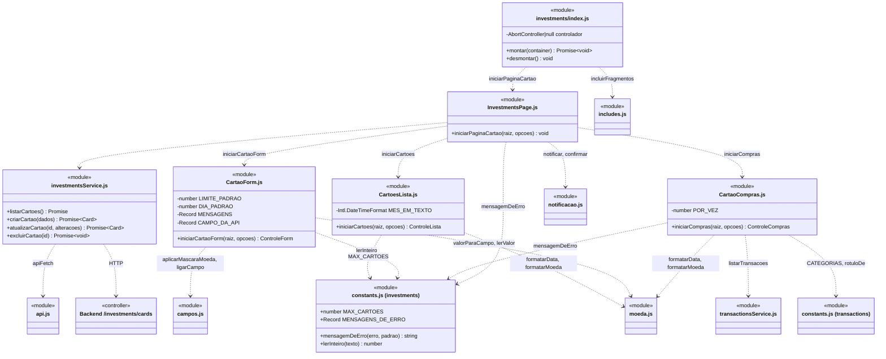

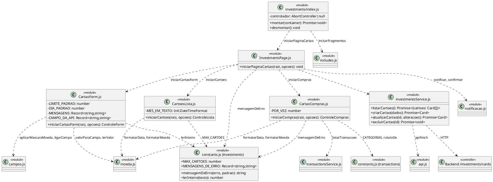

---

## investments/index.js

- **Tipo e estereótipo:** módulo, «module»
- **Arquivo de origem:** `Frontend/src/features/investments/index.js`
- **Descrição:** ponto de entrada da tela de Cartão de crédito. O roteador entrega o HTML de `views/investments.html` já no container; `montar` junta os fragmentos de componentes e liga `InvestmentsPage`. `desmontar` aborta o controlador, o que remove os ouvintes e descarta respostas pendentes.

### Atributos

| Visibilidade | Nome | Tipo | Descrição |
|---|---|---|---|
| - | controlador | AbortController\|null | Um controlador por montagem; o `abort()` desliga tudo o que a tela ligou. |

### Operações

| Visibilidade | Assinatura | Retorno | Descrição |
|---|---|---|---|
| + | montar(container) | Promise\<void\> | Inclui os fragmentos HTML, cria o controlador e chama `iniciarPaginaCartao`. |
| + | desmontar() | void | Aborta o controlador e o zera. |

### Relações

| Tipo | Alvo | Multiplicidade | Rótulo |
|---|---|---|---|
| dependência | includes.js | 1 | incluirFragmentos |
| dependência | InvestmentsPage.js | 1 | iniciarPaginaCartao |

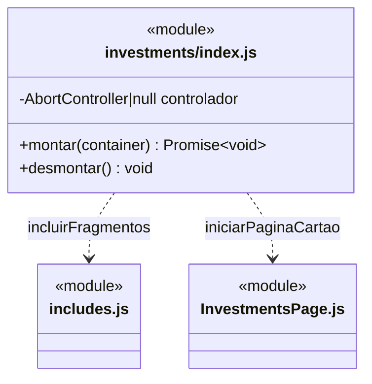

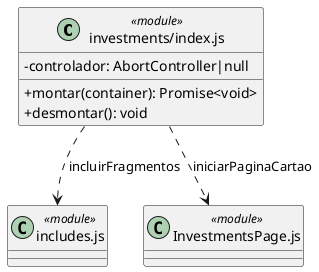

---

## InvestmentsPage.js

- **Tipo e estereótipo:** módulo, «module»
- **Arquivo de origem:** `Frontend/src/features/investments/components/InvestmentsPage/InvestmentsPage.js`
- **Descrição:** coordena a página de Cartões: carrega os cartões, cria, edita, exclui e escolhe o cartão cujas compras são exibidas. Mantém o estado local (`sequencia`, `cartaoId`) e descarta respostas antigas.

### Atributos

Nenhum atributo exportado. Internamente usa o objeto de estado `estado { sequencia, cartaoId }` e a lista `lista` de cartões carregados (variáveis locais da função).

| Visibilidade | Nome | Tipo | Descrição |
|---|---|---|---|
| - | estado | { sequencia: number, cartaoId: string\|null } | Contador para ignorar respostas antigas e id do cartão escolhido (null = o primeiro). |
| - | lista | Card[] | Cartões carregados. |

### Operações

| Visibilidade | Assinatura | Retorno | Descrição |
|---|---|---|---|
| + | iniciarPaginaCartao(raiz, { signal }) | void | Liga a página ao HTML de `views/investments.html`, cria os componentes e dispara o primeiro carregamento. |
| - | mostrarEscolhido() | void | Marca o card escolhido e mostra as compras dele. |
| - | carregar({ silencioso }) | Promise\<void\> | Busca os cartões e controla os estados carregando, erro e conteúdo. |
| - | agir(chamada, sucesso, falha, aoConcluir) | Promise\<void\> | Executa uma chamada, notifica o resultado e recarrega a tela em silêncio. |

### Relações

| Tipo | Alvo | Multiplicidade | Rótulo |
|---|---|---|---|
| dependência | investmentsService.js | 1 | listarCartoes, criarCartao, atualizarCartao, excluirCartao |
| dependência | constants.js (investments) | 1 | mensagemDeErro |
| dependência | CartoesLista.js | 1 | iniciarCartoes |
| dependência | CartaoForm.js | 1 | iniciarCartaoForm |
| dependência | CartaoCompras.js | 1 | iniciarCompras |
| dependência | notificacao.js | 1 | notificar, confirmar |

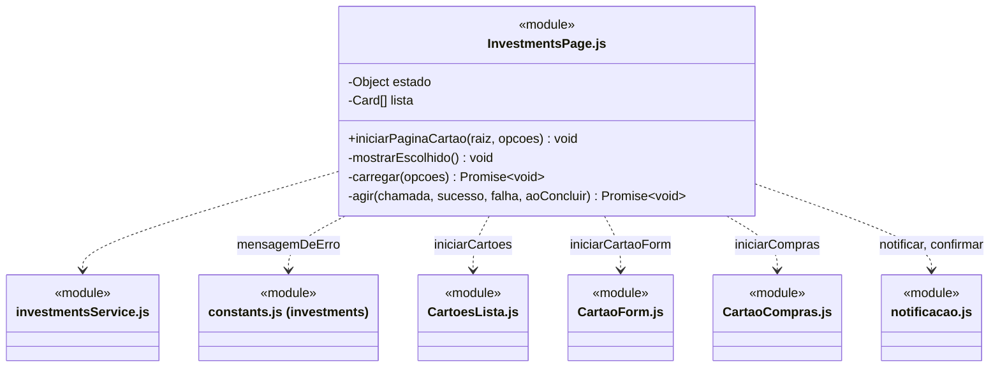

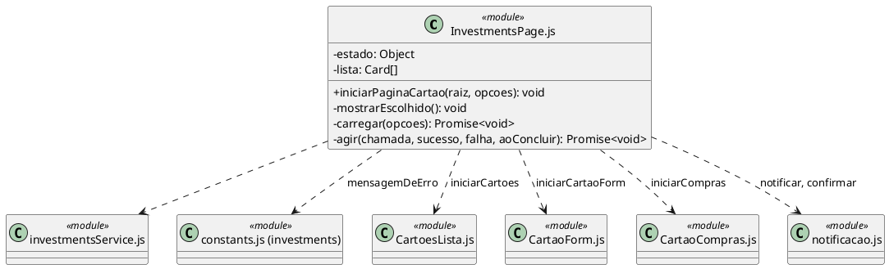

---

## CartaoCompras.js

- **Tipo e estereótipo:** módulo, «module»
- **Arquivo de origem:** `Frontend/src/features/investments/components/CartaoCompras/CartaoCompras.js` (par `CartaoCompras.html` e CSS)
- **Descrição:** tabela das compras no crédito do cartão escolhido, buscadas em transações.

### Atributos

| Visibilidade | Nome | Tipo | Descrição |
|---|---|---|---|
| - | POR_VEZ | number | Quantidade de compras exibidas por vez. |

### Operações

| Visibilidade | Assinatura | Retorno | Descrição |
|---|---|---|---|
| + | iniciarCompras(raiz, { signal }) | { mostrar, esconder } | Liga o componente e devolve o controle para mostrar as compras de um cartão ou escondê-las. |

### Relações

| Tipo | Alvo | Multiplicidade | Rótulo |
|---|---|---|---|
| dependência | transactionsService.js | 1 | listarTransacoes |
| dependência | constants.js (transactions) | 1 | CATEGORIAS, rotuloDe |
| dependência | moeda.js | 1 | formatarData, formatarMoeda |
| dependência | constants.js (investments) | 1 | mensagemDeErro |

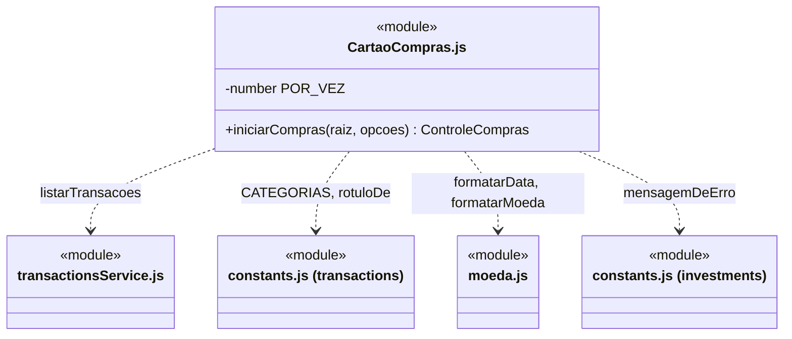

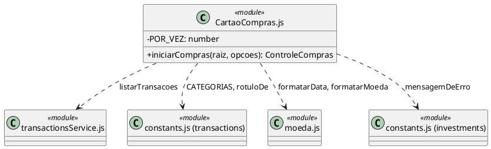

---

## CartaoForm.js

- **Tipo e estereótipo:** módulo, «module»
- **Arquivo de origem:** `Frontend/src/features/investments/components/CartaoForm/CartaoForm.js` (par `CartaoForm.html` e CSS)
- **Descrição:** formulário de cartão para criar ou editar nome, limite e dia de fechamento, com validação.

### Atributos

| Visibilidade | Nome | Tipo | Descrição |
|---|---|---|---|
| - | LIMITE_PADRAO | number | Limite sugerido para um cartão novo. |
| - | DIA_PADRAO | number | Dia de fechamento sugerido para um cartão novo. |
| - | MENSAGENS | Record\<string,string\> | Textos de erro de validação dos campos. |
| - | CAMPO_DA_API | Record\<string,string\> | Correspondência entre campos da API e campos do formulário, para exibir erros de campo. |

### Operações

| Visibilidade | Assinatura | Retorno | Descrição |
|---|---|---|---|
| + | iniciarCartaoForm(raiz, { signal, salvar }) | { abrirNovo, abrirEditar, fechar } | Liga o formulário; `salvar` é a função fornecida pela página para persistir os dados. Devolve o controle para abrir em modo novo, abrir em modo edição e fechar. |

### Relações

| Tipo | Alvo | Multiplicidade | Rótulo |
|---|---|---|---|
| dependência | campos.js | 1 | aplicarMascaraMoeda, ligarCampo |
| dependência | moeda.js | 1 | valorParaCampo, lerValor |
| dependência | constants.js (investments) | 1 | lerInteiro |

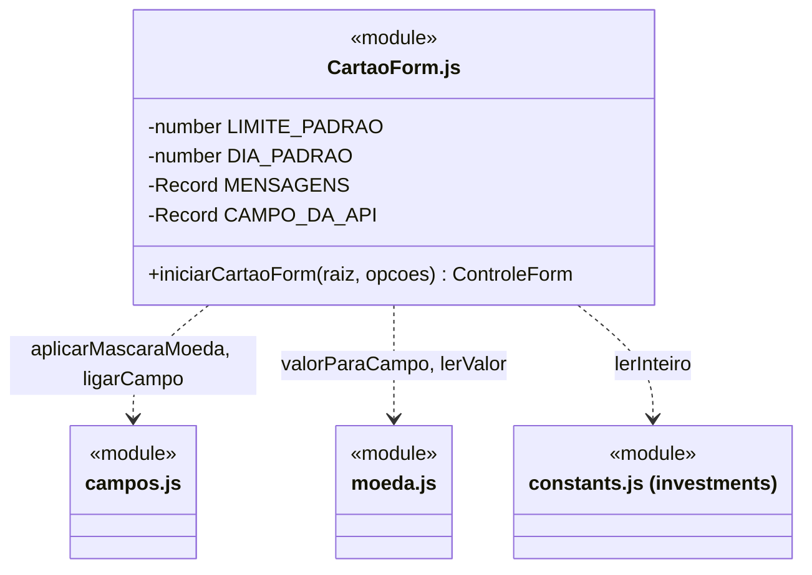

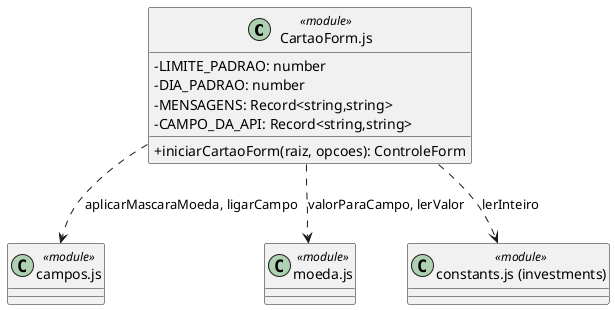

---

## CartoesLista.js

- **Tipo e estereótipo:** módulo, «module»
- **Arquivo de origem:** `Frontend/src/features/investments/components/CartoesLista/CartoesLista.js` (par `CartoesLista.html` e CSS)
- **Descrição:** lista de cards de cartões com fatura, limite, barra de uso e as ações selecionar, editar, excluir e novo.

### Atributos

| Visibilidade | Nome | Tipo | Descrição |
|---|---|---|---|
| - | MES_EM_TEXTO | Intl.DateTimeFormat | Formatador do mês em texto, usado na exibição da fatura. |

### Operações

| Visibilidade | Assinatura | Retorno | Descrição |
|---|---|---|---|
| + | iniciarCartoes(raiz, { signal, selecionar, editar, excluir, novo }) | { mostrar } | Liga a lista e registra os callbacks de ação; `mostrar(lista, escolhidoId)` desenha os cards e marca o escolhido. |

### Relações

| Tipo | Alvo | Multiplicidade | Rótulo |
|---|---|---|---|
| dependência | moeda.js | 1 | formatarData, formatarMoeda |
| dependência | constants.js (investments) | 1 | MAX_CARTOES |

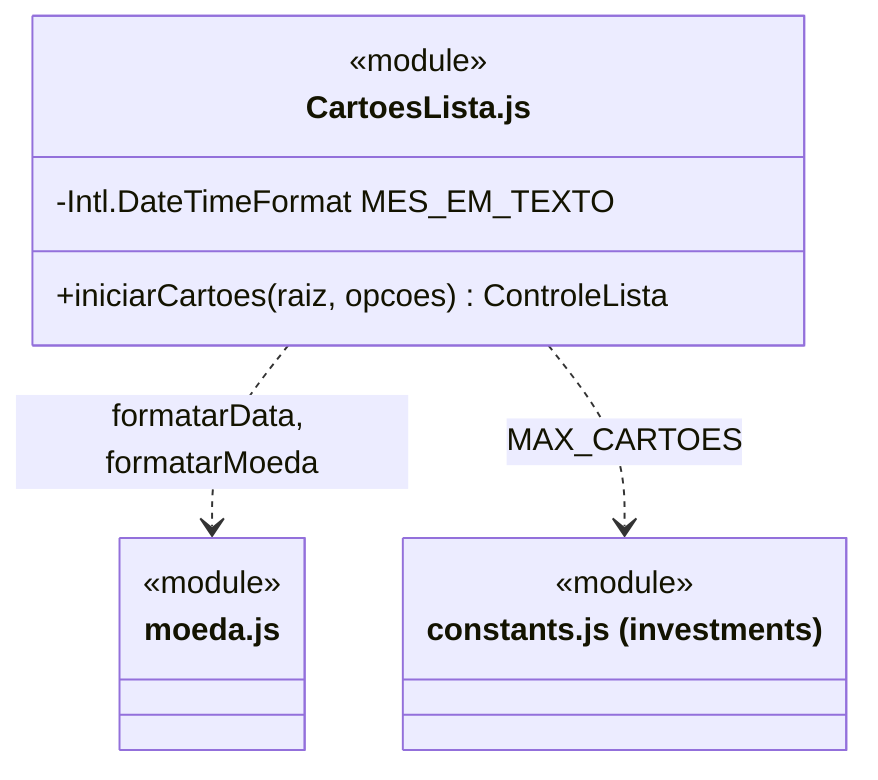

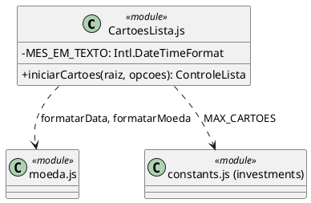

---

## investmentsService.js

- **Tipo e estereótipo:** módulo, «module» (papel de serviço de acesso ao Backend)
- **Arquivo de origem:** `Frontend/src/features/investments/services/investmentsService.js`
- **Descrição:** chamadas ao Backend em `/investments/cards` (listar, criar, atualizar e excluir cartões simulados). Fatura, valor atual e demais cálculos já chegam prontos do Backend.

### Atributos

Nenhum.

### Operações

| Visibilidade | Assinatura | Retorno | Descrição |
|---|---|---|---|
| + | listarCartoes() | Promise\<{cartoes: Card[]}\> | `GET /investments/cards`: cartões do usuário, o mais antigo (o padrão) primeiro, cada um com a sua fatura. |
| + | criarCartao(dados) | Promise\<Card\> | `POST /investments/cards` com `{ nome, limite?, diaFechamento? }`. |
| + | atualizarCartao(id, alteracoes) | Promise\<Card\> | `PATCH /investments/cards/:id`: altera nome, limite e/ou dia de fechamento; devolve o cartão recalculado. |
| + | excluirCartao(id) | Promise\<void\> | `DELETE /investments/cards/:id`: as transações do cartão ficam, sem o vínculo (resposta 204). |

### Relações

| Tipo | Alvo | Multiplicidade | Rótulo |
|---|---|---|---|
| dependência | api.js | 1 | apiFetch |
| dependência | Backend /investments/cards | 1 | HTTP |

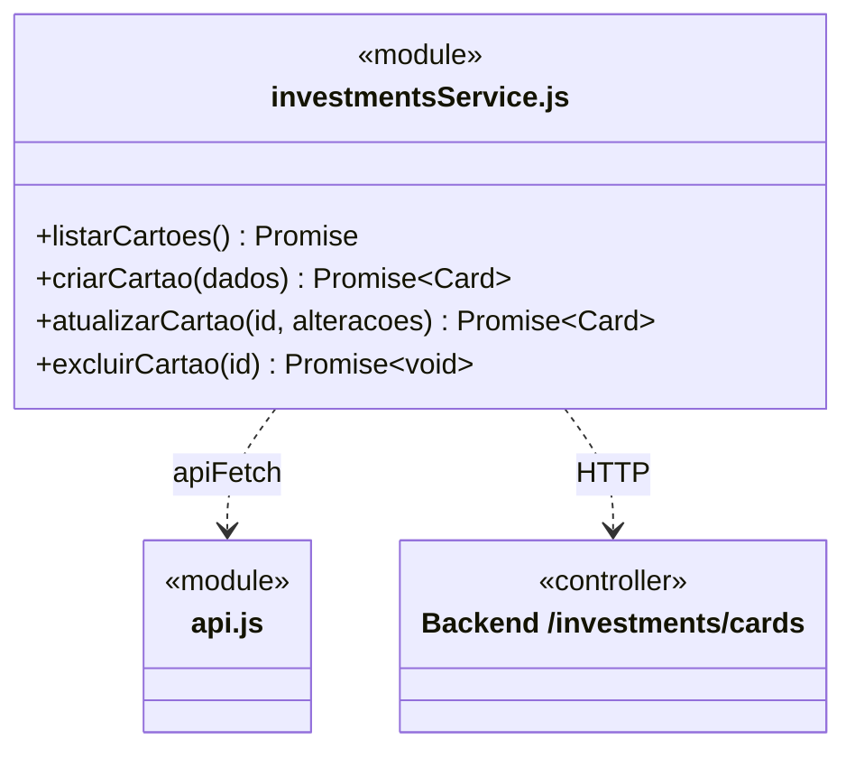

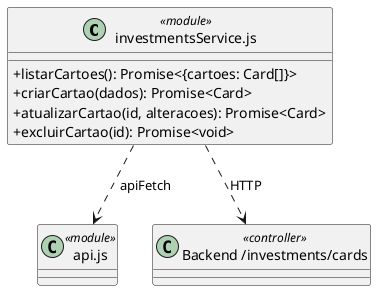

---

## constants.js (investments)

- **Tipo e estereótipo:** módulo, «module»
- **Arquivo de origem:** `Frontend/src/features/investments/utils/constants.js`
- **Descrição:** limite de cartões, mensagens de erro da API (códigos como `CARD_NOT_FOUND`, `CARD_LIMIT_REACHED`, `CARD_NAME_TAKEN`, `CARD_HAS_INSTALLMENTS`, `INSTALLMENT_FROM_TRANSACTION`, `INSTALLMENT_NOT_FOUND`, `JAVA_SERVER_UNAVAILABLE`) e leitura de inteiros.

### Atributos

| Visibilidade | Nome | Tipo | Descrição |
|---|---|---|---|
| + | MAX_CARTOES | number | Máximo de cartões por usuário (5); o Backend recusa o sexto com `CARD_LIMIT_REACHED`. |
| + | MENSAGENS_DE_ERRO | Record\<string,string\> | Texto para o usuário de cada código de erro conhecido da API. |

### Operações

| Visibilidade | Assinatura | Retorno | Descrição |
|---|---|---|---|
| + | mensagemDeErro(erro, padrao) | string | Devolve o texto do código do erro, senão a mensagem da própria API, senão `padrao`. |
| + | lerInteiro(texto) | number | Converte "12" em 12; devolve `NaN` se não for inteiro (zero vale). |

### Relações

| Tipo | Alvo | Multiplicidade | Rótulo |
|---|---|---|---|
| dependência (usado por) | InvestmentsPage.js | * | mensagemDeErro |
| dependência (usado por) | CartaoCompras.js | * | mensagemDeErro |
| dependência (usado por) | CartaoForm.js | * | lerInteiro |
| dependência (usado por) | CartoesLista.js | * | MAX_CARTOES |

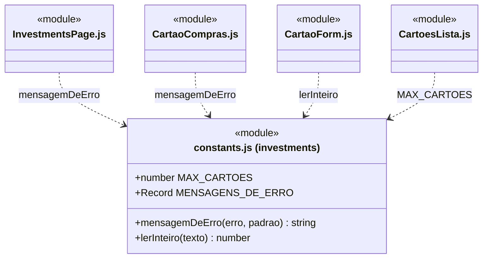

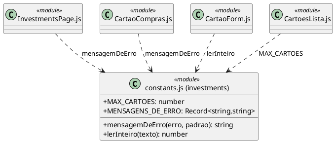
