# Frontend: mentor-ia — Modelo UML das classes e módulos

Grupo `fe-mentor-ia`: módulos da tela do Mentor IA no Frontend (`Frontend/src/features/mentor-ia`). Todos os elementos são módulos JavaScript (ES modules) com estereótipo «módulo»; as "operações" são funções exportadas (`+`) ou internas (`-`) e os "atributos" são constantes ou variáveis do módulo. Notação Astah / UML 2.

Observações de notação:
- Nos diagramas, os módulos usam identificadores sem ponto (ex.: `MentorPage`), com o nome do arquivo no rótulo.
- Os parâmetros por desestruturação (`{ signal }`) aparecem abreviados como `opcoes` nos diagramas e completos nas tabelas.
- Vizinhos fora do grupo (`includes.js`, `api.js`, `notificacao.js`, Backend `/mentor-ia`) aparecem apenas como alvos de dependência.

## Diagrama do grupo

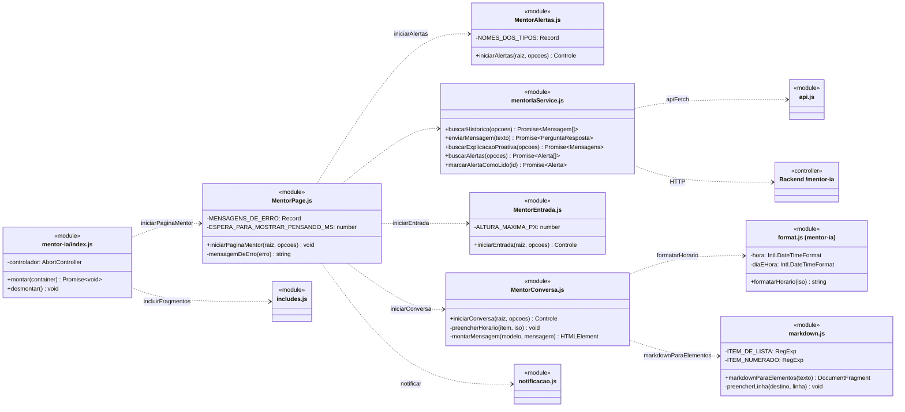

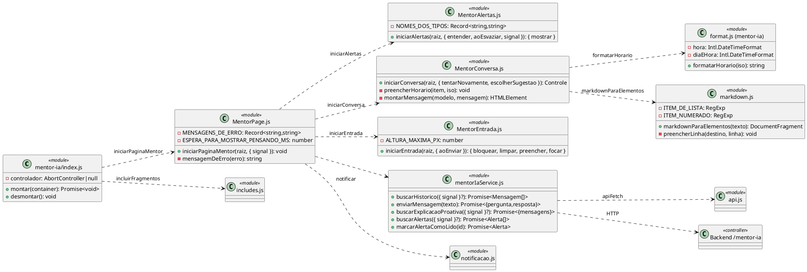

---

## mentor-ia/index.js

**Tipo:** módulo — **Estereótipo:** «module»
**Arquivo de origem:** `Frontend/src/features/mentor-ia/index.js`

**Descrição:** Ponto de entrada da tela do Mentor IA: monta o HTML e liga MentorPage; desmonta abortando o controlador.

### Atributos

| Visibilidade | Nome | Tipo | Descrição |
|---|---|---|---|
| - | controlador | AbortController\|null | Controlador de cancelamento da tela montada; abortado em `desmontar()`. |

### Operações

| Visibilidade | Assinatura | Retorno | Descrição |
|---|---|---|---|
| + | montar(container) | Promise\<void\> | Monta o HTML da tela no container e inicia a página do Mentor. |
| + | desmontar() | void | Desmonta a tela abortando o controlador. |

### Relações

| Tipo | Alvo | Multiplicidade | Rótulo |
|---|---|---|---|
| dependência | includes.js | 1 | incluirFragmentos |
| dependência | MentorPage.js | 1 | iniciarPaginaMentor |

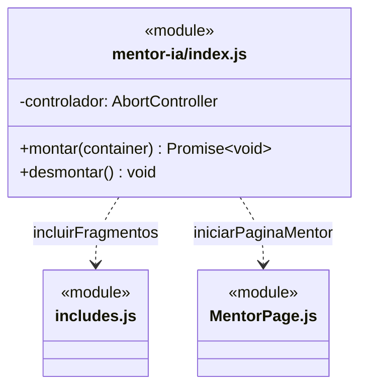

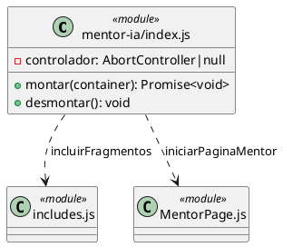

---

## MentorPage.js

**Tipo:** módulo — **Estereótipo:** «module»
**Arquivo de origem:** `Frontend/src/features/mentor-ia/components/MentorPage/MentorPage.js`

**Descrição:** Coordena a página do Mentor: histórico, alertas, insight proativo e envio de perguntas.

### Atributos

| Visibilidade | Nome | Tipo | Descrição |
|---|---|---|---|
| - | MENSAGENS_DE_ERRO | Record\<string,string\> | Mensagens de erro exibidas ao usuário. |
| - | ESPERA_PARA_MOSTRAR_PENSANDO_MS | number | Espera, em milissegundos, antes de mostrar o estado "pensando". |

### Operações

| Visibilidade | Assinatura | Retorno | Descrição |
|---|---|---|---|
| + | iniciarPaginaMentor(raiz, { signal }) | void | Liga os componentes da página (alertas, conversa, entrada) e carrega histórico, alertas e insight proativo. |
| - | mensagemDeErro(erro) | string | Traduz um erro na mensagem apresentada ao usuário. |

### Relações

| Tipo | Alvo | Multiplicidade | Rótulo |
|---|---|---|---|
| dependência | mentorIaService.js | 1 | — |
| dependência | MentorAlertas.js | 1 | iniciarAlertas |
| dependência | MentorConversa.js | 1 | iniciarConversa |
| dependência | MentorEntrada.js | 1 | iniciarEntrada |
| dependência | notificacao.js | 1 | notificar |

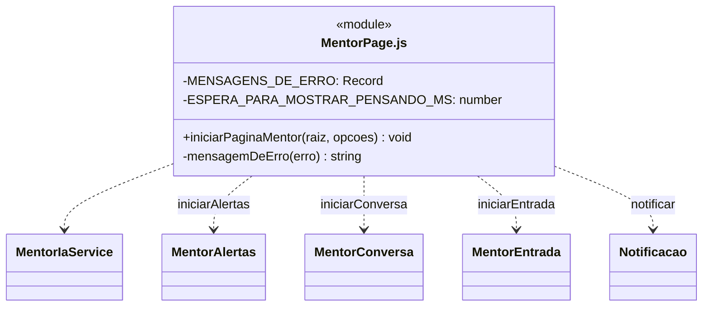

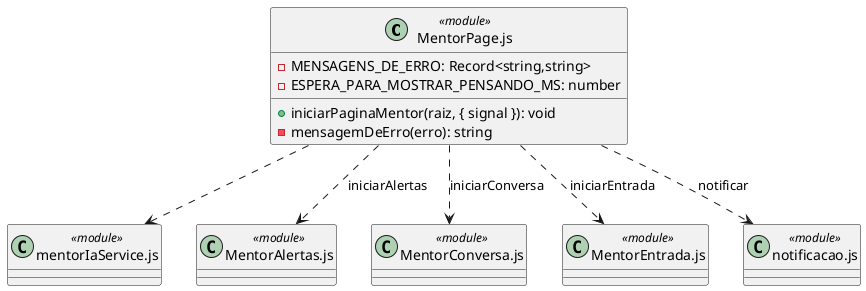

---

## MentorAlertas.js

**Tipo:** módulo — **Estereótipo:** «module»
**Arquivo de origem:** `Frontend/src/features/mentor-ia/components/MentorAlertas/MentorAlertas.js`

**Descrição:** Faixa de alertas não lidos (par MentorAlertas.html/CSS) com botão Entendi.

### Atributos

| Visibilidade | Nome | Tipo | Descrição |
|---|---|---|---|
| - | NOMES_DOS_TIPOS | Record\<string,string\> | Nomes legíveis dos tipos de alerta. |

### Operações

| Visibilidade | Assinatura | Retorno | Descrição |
|---|---|---|---|
| + | iniciarAlertas(raiz, { entender, aoEsvaziar, signal }) | { mostrar } | Liga a faixa de alertas; devolve o controle com `mostrar` para exibir a lista. O botão Entendi aciona `entender`; `aoEsvaziar` é chamado quando não restam alertas. |

### Relações

| Tipo | Alvo | Multiplicidade | Rótulo |
|---|---|---|---|
| dependência (entrada) | MentorPage.js | 1 | iniciarAlertas |

O mapeamento não registra dependências de saída para este módulo.

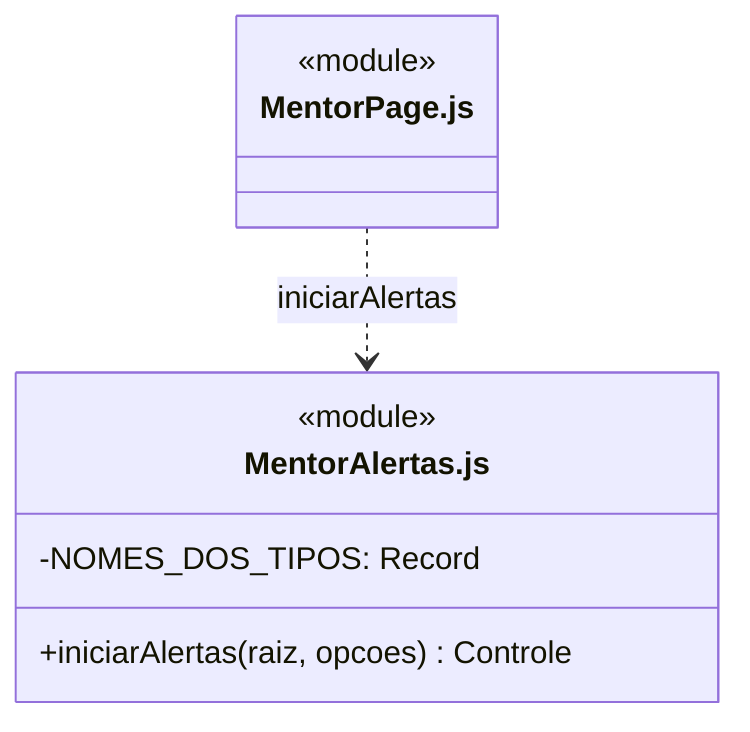

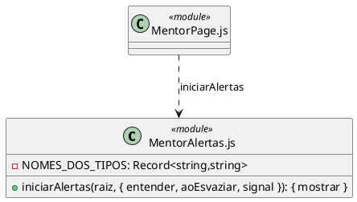

---

## MentorConversa.js

**Tipo:** módulo — **Estereótipo:** «module»
**Arquivo de origem:** `Frontend/src/features/mentor-ia/components/MentorConversa/MentorConversa.js`

**Descrição:** Área da conversa (par MentorConversa.html/CSS): estados, histórico, perguntas pendentes, respostas e insights.

### Atributos

Nenhum atributo de módulo registrado no mapeamento.

### Operações

| Visibilidade | Assinatura | Retorno | Descrição |
|---|---|---|---|
| + | iniciarConversa(raiz, { tentarNovamente, escolherSugestao }) | { mostrarCarregando, mostrarErro, mostrarHistorico, adicionarPergunta, adicionarResposta, adicionarProativas, pensando } | Liga a área da conversa e devolve o controle com as ações de estado, histórico, pergunta, resposta e insights proativos. |
| - | preencherHorario(item, iso) | void | Preenche o horário de uma mensagem. |
| - | montarMensagem(modelo, mensagem) | HTMLElement | Monta o elemento de uma mensagem a partir de um modelo. |

### Relações

| Tipo | Alvo | Multiplicidade | Rótulo |
|---|---|---|---|
| dependência | format.js (mentor-ia) | 1 | formatarHorario |
| dependência | markdown.js | 1 | markdownParaElementos |
| dependência (entrada) | MentorPage.js | 1 | iniciarConversa |

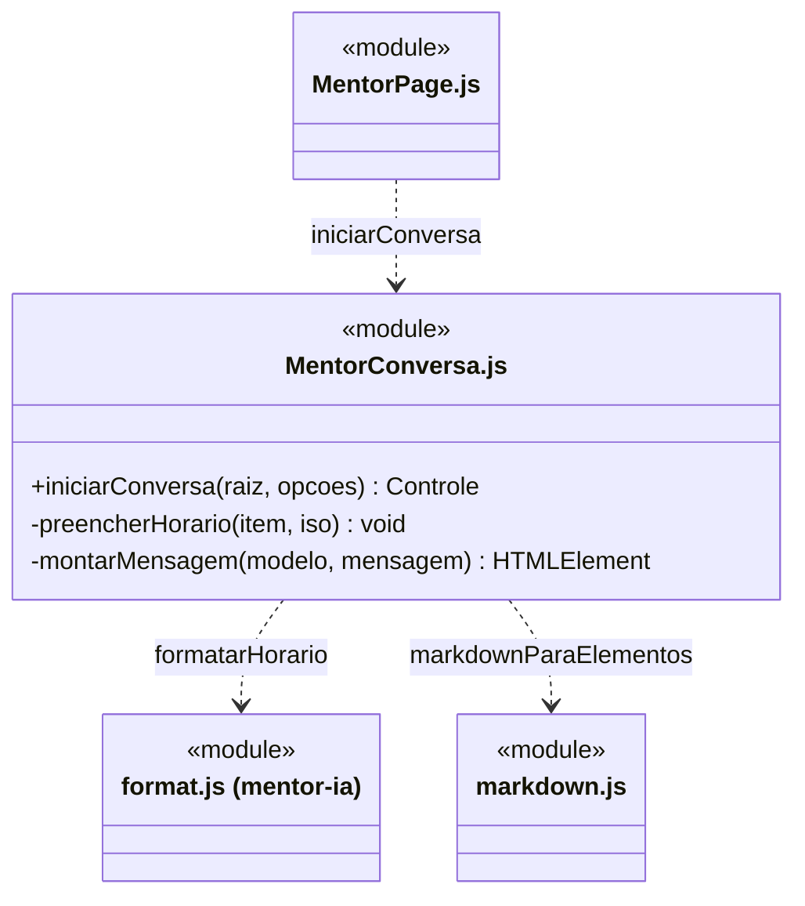

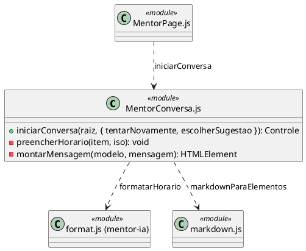

---

## MentorEntrada.js

**Tipo:** módulo — **Estereótipo:** «module»
**Arquivo de origem:** `Frontend/src/features/mentor-ia/components/MentorEntrada/MentorEntrada.js`

**Descrição:** Campo de pergunta (par MentorEntrada.html/CSS): contador, altura automática, Enter envia e bloqueio do botão.

### Atributos

| Visibilidade | Nome | Tipo | Descrição |
|---|---|---|---|
| - | ALTURA_MAXIMA_PX | number | Altura máxima, em pixels, do campo de pergunta com altura automática. |

### Operações

| Visibilidade | Assinatura | Retorno | Descrição |
|---|---|---|---|
| + | iniciarEntrada(raiz, { aoEnviar }) | { bloquear, limpar, preencher, focar } | Liga o campo de pergunta; `aoEnviar` é chamado ao enviar. Devolve o controle com as ações de bloquear, limpar, preencher e focar. |

### Relações

| Tipo | Alvo | Multiplicidade | Rótulo |
|---|---|---|---|
| dependência (entrada) | MentorPage.js | 1 | iniciarEntrada |

O mapeamento não registra dependências de saída para este módulo.

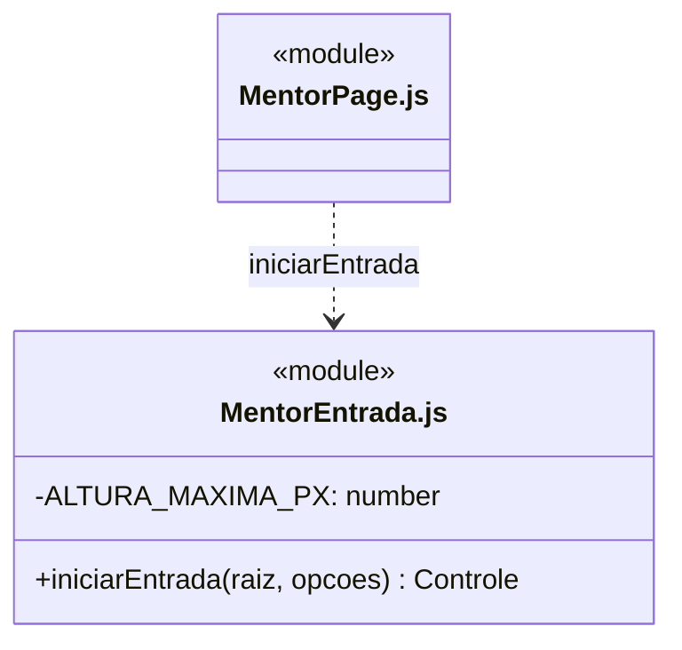

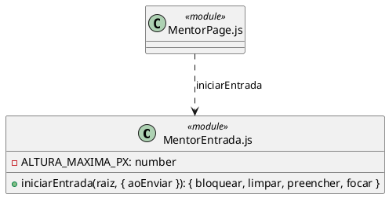

---

## mentorIaService.js

**Tipo:** módulo — **Estereótipo:** «module» (serviço do Frontend)
**Arquivo de origem:** `Frontend/src/features/mentor-ia/services/mentorIaService.js`

**Descrição:** Chamadas ao Backend em /mentor-ia (histórico, enviar mensagem, explicação proativa, alertas, marcar lido).

### Atributos

Nenhum atributo de módulo registrado no mapeamento.

### Operações

| Visibilidade | Assinatura | Retorno | Descrição |
|---|---|---|---|
| + | buscarHistorico({ signal }?) | Promise\<Mensagem[]\> | Busca o histórico de mensagens do Mentor. |
| + | enviarMensagem(texto) | Promise\<{pergunta,resposta}\> | Envia a pergunta e devolve a pergunta e a resposta. |
| + | buscarExplicacaoProativa({ signal }?) | Promise\<{mensagens}\> | Busca a explicação proativa (insight) do Mentor. |
| + | buscarAlertas({ signal }?) | Promise\<Alerta[]\> | Busca os alertas. |
| + | marcarAlertaComoLido(id) | Promise\<Alerta\> | Marca um alerta como lido. |

### Relações

| Tipo | Alvo | Multiplicidade | Rótulo |
|---|---|---|---|
| dependência | api.js | 1 | apiFetch |
| dependência | Backend /mentor-ia | 1 | HTTP |
| dependência (entrada) | MentorPage.js | 1 | — |

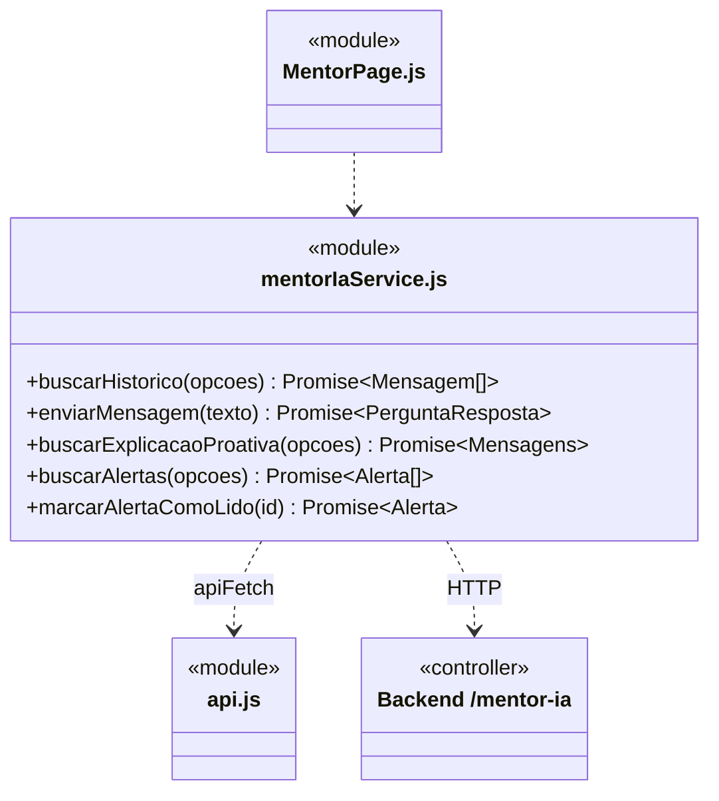

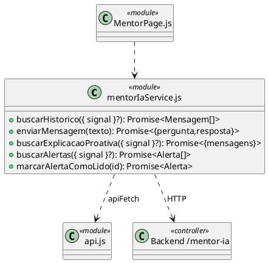

---

## format.js (mentor-ia)

**Tipo:** módulo — **Estereótipo:** «module»
**Arquivo de origem:** `Frontend/src/features/mentor-ia/utils/format.js`

**Descrição:** Formata o horário das mensagens (hora se for de hoje, dia e hora senão).

### Atributos

| Visibilidade | Nome | Tipo | Descrição |
|---|---|---|---|
| - | hora | Intl.DateTimeFormat | Formatador usado para mensagens de hoje (somente hora). |
| - | diaEHora | Intl.DateTimeFormat | Formatador usado para mensagens de outros dias (dia e hora). |

### Operações

| Visibilidade | Assinatura | Retorno | Descrição |
|---|---|---|---|
| + | formatarHorario(iso) | string | Formata uma data ISO: apenas a hora se for de hoje, dia e hora caso contrário. |

### Relações

| Tipo | Alvo | Multiplicidade | Rótulo |
|---|---|---|---|
| dependência (entrada) | MentorConversa.js | 1 | formatarHorario |

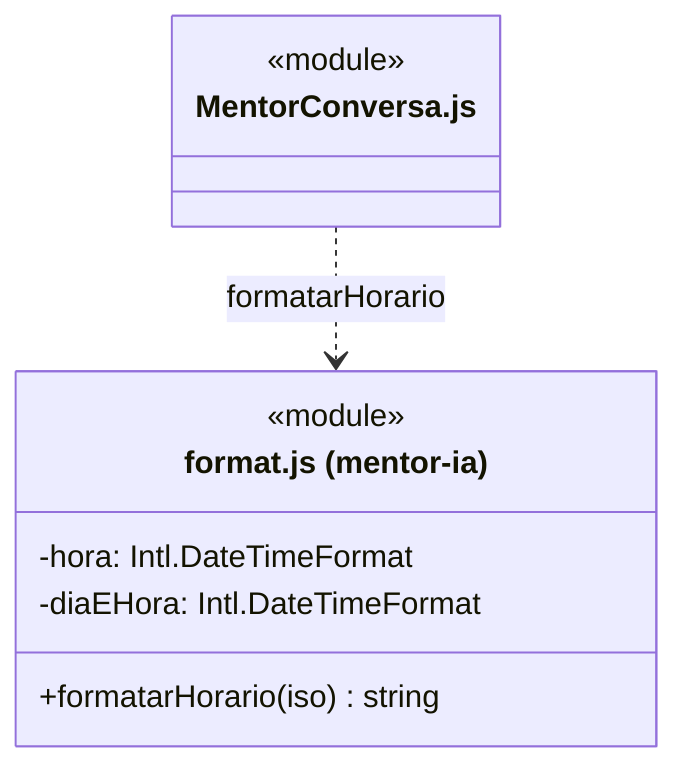

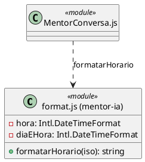

---

## markdown.js

**Tipo:** módulo — **Estereótipo:** «module»
**Arquivo de origem:** `Frontend/src/features/mentor-ia/utils/markdown.js`

**Descrição:** Converte o markdown simples da IA (parágrafos, listas, negrito) em elementos DOM sem innerHTML.

### Atributos

| Visibilidade | Nome | Tipo | Descrição |
|---|---|---|---|
| - | ITEM_DE_LISTA | RegExp | Reconhece item de lista com marcador. |
| - | ITEM_NUMERADO | RegExp | Reconhece item de lista numerada. |

### Operações

| Visibilidade | Assinatura | Retorno | Descrição |
|---|---|---|---|
| + | markdownParaElementos(texto) | DocumentFragment | Converte o texto em markdown simples em elementos DOM, sem usar innerHTML. |
| - | preencherLinha(destino, linha) | void | Preenche o elemento de destino com o conteúdo de uma linha (incluindo negrito). |

### Relações

| Tipo | Alvo | Multiplicidade | Rótulo |
|---|---|---|---|
| dependência (entrada) | MentorConversa.js | 1 | markdownParaElementos |

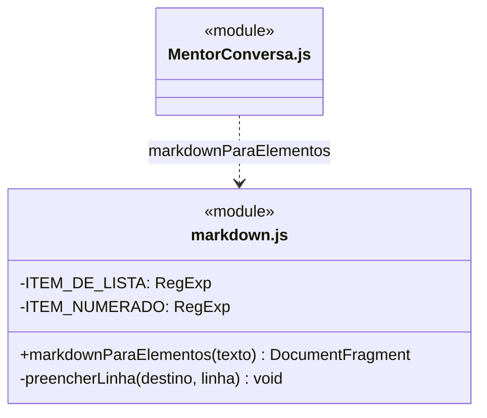

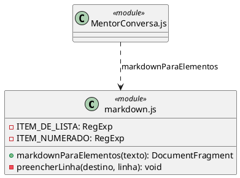
