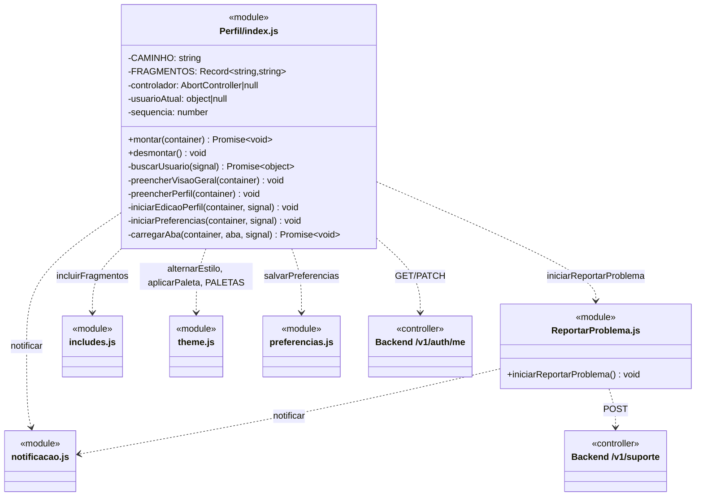
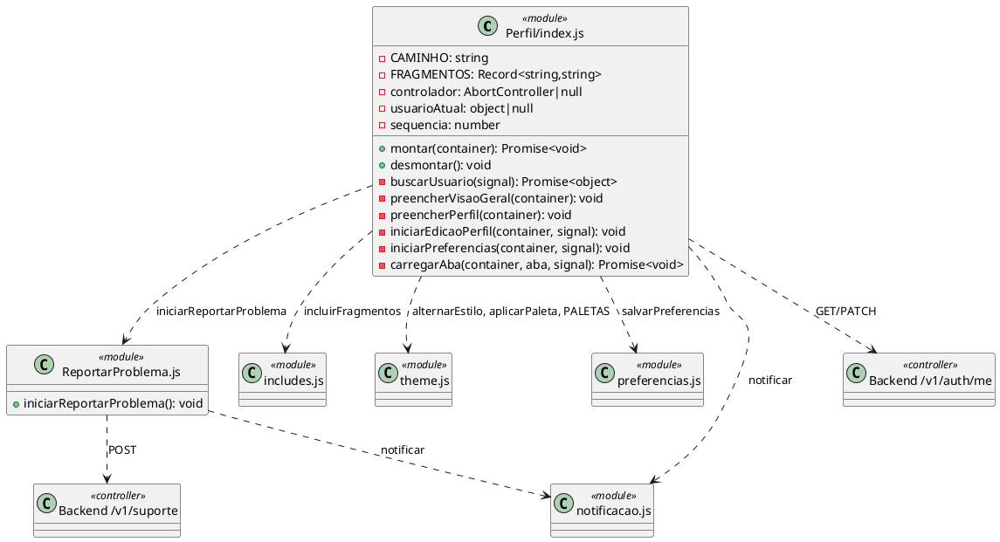
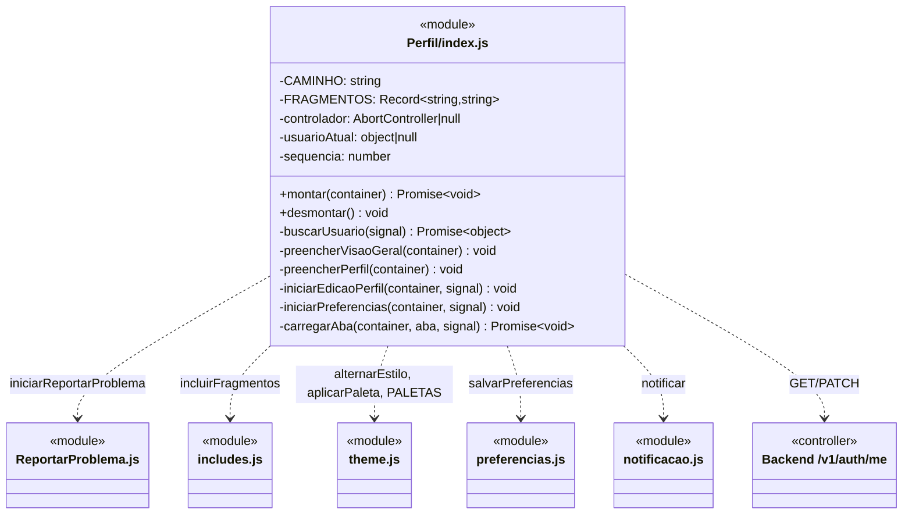
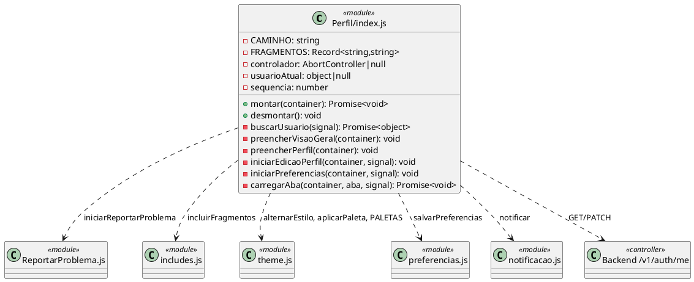
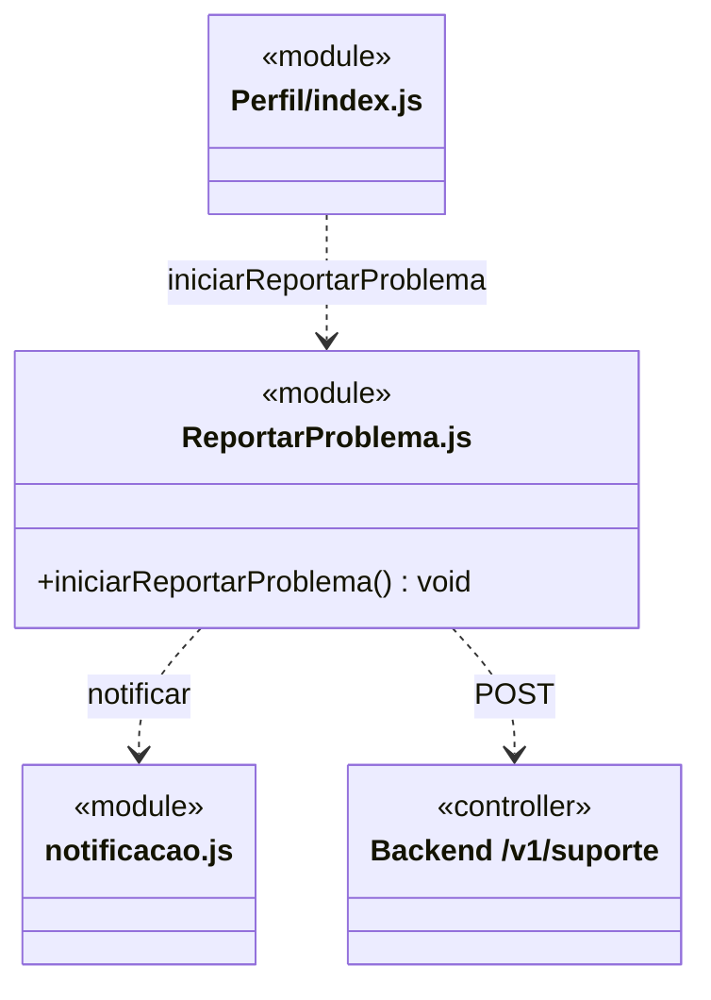
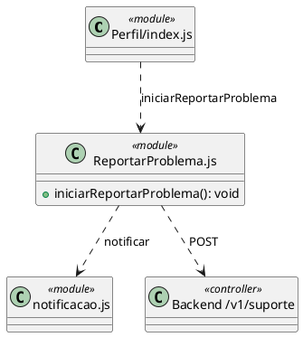

# Frontend: Perfil

Modelo UML (padrão Astah / UML 2) dos módulos do grupo "Frontend: Perfil", responsável pela tela Minha Conta. Como o código é composto por módulos ES (funções e variáveis de módulo, sem classes), cada arquivo é modelado com o estereótipo «module». Atributos privados correspondem a variáveis e constantes não exportadas; operações públicas correspondem às funções exportadas.

Elementos do grupo:

- `Perfil/index.js` («module»)
- `ReportarProblema.js` («module»)

## Diagrama do grupo

## Perfil/index.js

**Tipo e estereótipo:** módulo, «module».

**Arquivo de origem:** `Frontend/src/features/Perfil/index.js`

**Descrição:** ponto de entrada da tela Minha Conta. Carrega as abas como fragmentos HTML (visão geral, perfil, preferências, segurança e reportar problema) e permite editar o nome e as preferências do usuário (estilo com sombras/bordas e paleta de cores). Ao montar, busca o usuário autenticado em `/v1/auth/me` e abre a aba "visão geral". O módulo descarta respostas atrasadas por meio de um contador de sequência e cancela requisições pendentes com `AbortController`.

### Atributos

| Visibilidade | Nome | Tipo | Descrição |
|---|---|---|---|
| - | CAMINHO | string | Caminho base dos fragmentos HTML das abas (`/src/features/perfil/components`). |
| - | FRAGMENTOS | Record<string,string> | Mapa aba para arquivo de fragmento: visao-geral, perfil, preferencias, seguranca, reportar-problema. |
| - | controlador | AbortController\|null | Cancela requisições e listeners ao desmontar a tela. |
| - | usuarioAtual | object\|null | Dados do usuário autenticado carregados de `/v1/auth/me`. |
| - | sequencia | number | Contador que identifica a carga de aba mais recente e ignora respostas obsoletas. |

### Operações

| Visibilidade | Assinatura | Retorno | Descrição |
|---|---|---|---|
| + | montar(container) | Promise<void> | Inclui fragmentos, registra o clique nas abas (`data-aba`/`data-destino`), busca o usuário e carrega a aba inicial "visao-geral". |
| + | desmontar() | void | Aborta o controlador, zera `usuarioAtual` e incrementa `sequencia`. |
| - | buscarUsuario(signal) | Promise<object> | GET `/v1/auth/me` com o token Bearer; lança erro se não autenticado ou resposta não ok. |
| - | preencherVisaoGeral(container) | void | Exibe nome, e-mail, inicial e plano (Free/Pro) do usuário. |
| - | preencherPerfil(container) | void | Preenche os campos nome, e-mail e plano do formulário de perfil. |
| - | iniciarEdicaoPerfil(container, signal) | void | Valida o nome e envia PATCH `/v1/auth/me`; atualiza `usuarioAtual` e notifica o resultado. |
| - | iniciarPreferencias(container, signal) | void | Liga o interruptor de estilo (sombras/bordas) e os botões de paleta; salva o estilo via `salvarPreferencias`. |
| - | carregarAba(container, aba, signal) | Promise<void> | Busca o fragmento da aba, injeta o HTML, marca a aba ativa e inicia a lógica específica da aba. |

### Relações

| Tipo | Alvo | Multiplicidade | Rótulo |
|---|---|---|---|
| dependência | ReportarProblema.js | 1 | iniciarReportarProblema |
| dependência | includes.js | 1 | incluirFragmentos |
| dependência | theme.js | 1 | alternarEstilo, aplicarPaleta, PALETAS |
| dependência | preferencias.js | 1 | salvarPreferencias |
| dependência | notificacao.js | 1 | notificar |
| dependência | Backend /v1/auth/me | 1 | GET/PATCH |

## ReportarProblema.js

**Tipo e estereótipo:** módulo, «module».

**Arquivo de origem:** `Frontend/src/features/Perfil/components/ReportarProblema.js`

**Descrição:** liga o formulário de reportar problema (par `ReportarProblema.html`, formulário `form-reportar-problema`) e envia o relato (assunto, categoria, descrição) ao Backend em `/v1/suporte` via POST com token Bearer. Evita registrar o evento de envio duas vezes (`data-inicializado`), exige usuário autenticado e se auto-inicializa quando o arquivo é carregado diretamente (`DOMContentLoaded` ou imediatamente se o documento já estiver carregado).

### Atributos

Não há atributos de módulo; apenas variáveis locais dentro da função.

| Visibilidade | Nome | Tipo | Descrição |
|---|---|---|---|
| - | - | - | Nenhum atributo de módulo. |

### Operações

| Visibilidade | Assinatura | Retorno | Descrição |
|---|---|---|---|
| + | iniciarReportarProblema() | void | Localiza o formulário, registra o envio uma única vez, valida o token, faz POST `/v1/suporte` e notifica sucesso ou erro. |

### Relações

| Tipo | Alvo | Multiplicidade | Rótulo |
|---|---|---|---|
| dependência | notificacao.js | 1 | notificar |
| dependência | Backend /v1/suporte | 1 | POST |
| dependência (inversa) | Perfil/index.js | 1 | iniciarReportarProblema (chamada por Perfil/index.js) |

