# Modelo UML: Frontend (transactions)

Modelo UML (notação Astah / UML 2) dos elementos do grupo **fe-transactions**: a feature de Transações do Frontend (`Frontend/src/features/transactions`), com o ponto de entrada, a página coordenadora, o serviço HTTP, os utilitários e os componentes da tela.

Convenções:

- Visibilidade: `+` público (exportado), `-` privado (interno ao módulo), `#` protegido, `~` pacote.
- Os arquivos JavaScript são módulos ES; cada módulo é representado como «module». Constantes de módulo aparecem como atributos e funções exportadas como operações.
- Relações do tipo dependência indicam `import` (ou uso) entre módulos; o rótulo lista o que é usado. Multiplicidade não se aplica a dependências entre módulos (`-`).
- Cada diagrama aparece em dois blocos: `mermaid` (renderiza no GitHub) e `plantuml` (para recriar no Astah). Nos blocos de diagrama, tipos com chaves ou vírgulas foram simplificados (`objeto`); os tipos completos estão nas tabelas.
- Elementos de outros grupos (core, shared, features goals/investments) aparecem como «externo».
- Todos os elementos deste grupo existem no código. Nenhuma classe nova do plano de contas e transferências foi criada ainda (ver a seção "Alterações planejadas").

## Diagrama do grupo

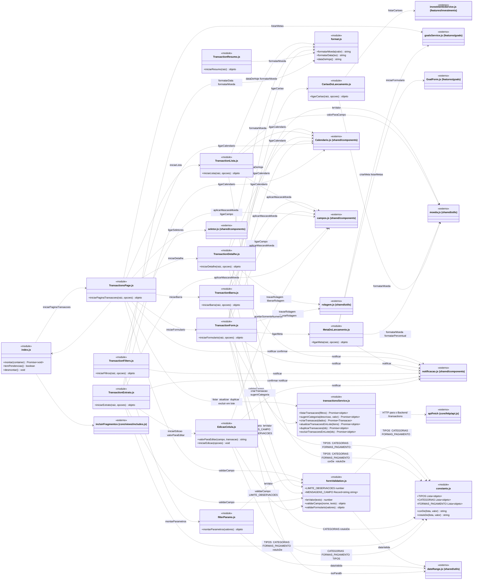

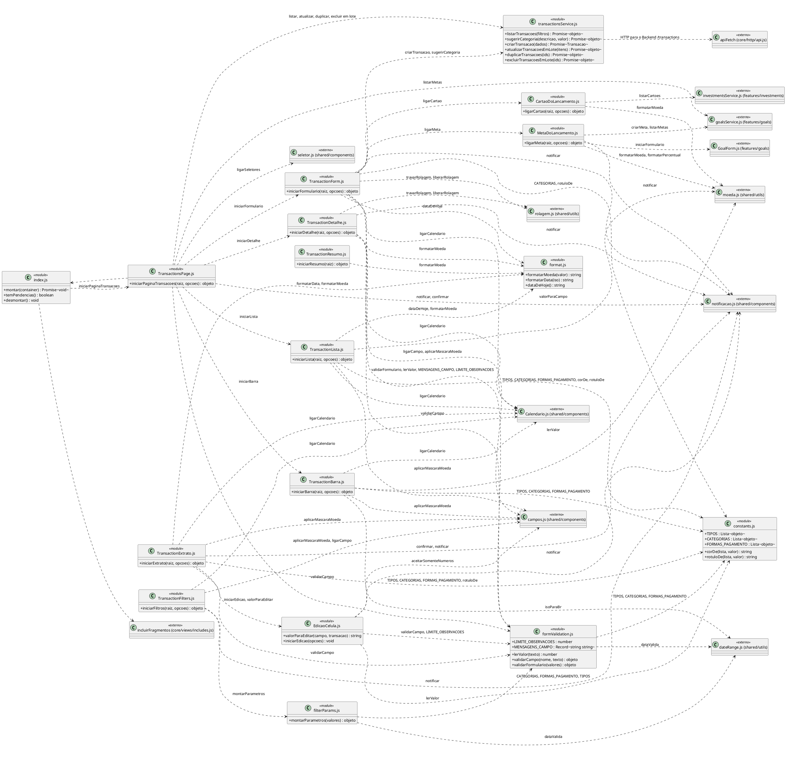


Observação: `TransactionFilters.js`, `TransactionResumo.js` e `TransactionExtrato.js` (com `EdicaoCelula.js`) não são importados pela página atual (`TransactionsPage.js`); a tela atual usa `TransactionBarra.js` e `TransactionLista.js`.

## Alterações planejadas

Segundo `docs/especificacao-contas-e-transferencias.md` (status: planejado, nada implementado no Backend), estes módulos existentes serão alterados. Não há elemento novo no código; estas linhas são «planejado» e **não existem ainda**.

| Módulo | Alteração «planejado» |
|---|---|
| `TransactionForm.js` | Campo **Conta** obrigatório no lançamento; sem nenhuma conta, o botão Lançamento leva a criar uma. |
| `TransactionBarra.js` | Menu Lançamento com Nova despesa, Nova receita e **Nova transferência** (atalho T); botão Selecionar ao lado de Lançamento; totais em cartão de fundo mais escuro. |
| `TransactionLista.js` | Coluna **Origem** passa a mostrar a conta do lançamento. |
| `transactionsService.js` | Novo filtro `contaId`; `POST /transactions` passa a exigir `contaId`; criação de transferência em `POST /transactions/transfers`. |
| `constants.js` | `TIPOS` passa a aceitar `transferencia` além de `receita` e `despesa`. |


## index.js

- **Tipo:** módulo (arquivo JavaScript ES)
- **Estereótipo:** «module»
- **Arquivo de origem:** `Frontend/src/features/transactions/index.js`

**Descrição:** Ponto de entrada da tela de Transações: o roteador chama montar(), temPendencias() e desmontar(); usa views/transactions.html e styles/transactions.css.

### Atributos

Sem atributos.

### Operações

| Visibilidade | Assinatura | Retorno | Descrição |
|---|---|---|---|
| + | `montar(container): Promise<void>` | `Promise<void>` | Carrega os fragmentos HTML da tela e inicia a página de transações. |
| + | `temPendencias(): boolean` | `boolean` | Informa ao roteador se há alterações pendentes (rascunho) na tela. |
| + | `desmontar(): void` | `void` | Encerra a tela e libera seus ouvintes. |

### Relações

| Tipo | Alvo | Multiplicidade | Rótulo |
|---|---|---|---|
| dependência | `incluirFragmentos (core/views/includes.js)` | - | - |
| dependência | `TransactionsPage.js` | - | iniciarPaginaTransacoes |

Usada por: `TransactionsPage.js`.

### Diagrama

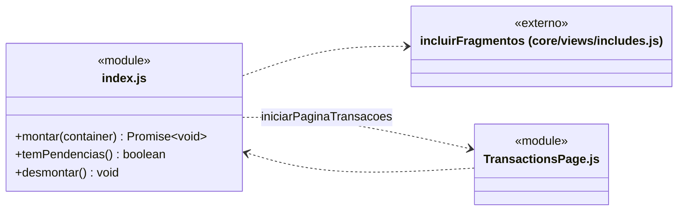

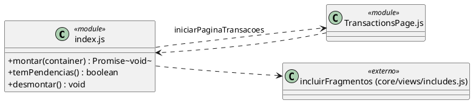

## TransactionsPage.js

- **Tipo:** módulo (arquivo JavaScript ES)
- **Estereótipo:** «module»
- **Arquivo de origem:** `Frontend/src/features/transactions/components/TransactionsPage/TransactionsPage.js`

**Descrição:** Coordena a tela: consulta a API, conecta barra, lista, detalhe e formulário e trata lotes, desfazer e metas (só JS, sem HTML/CSS próprios).

### Atributos

Sem atributos.

### Operações

| Visibilidade | Assinatura | Retorno | Descrição |
|---|---|---|---|
| + | `iniciarPaginaTransacoes(raiz, { signal }): { temPendencias }` | `{ temPendencias(): boolean }` | Inicia a coordenação da tela e devolve o controle usado para consultar pendências. |

### Relações

| Tipo | Alvo | Multiplicidade | Rótulo |
|---|---|---|---|
| dependência | `transactionsService.js` | - | listar, atualizar, duplicar, excluir em lote |
| dependência | `TransactionBarra.js` | - | iniciarBarra |
| dependência | `TransactionLista.js` | - | iniciarLista |
| dependência | `TransactionDetalhe.js` | - | iniciarDetalhe |
| dependência | `TransactionForm.js` | - | iniciarFormulario |
| dependência | `formValidation.js` | - | validarCampo |
| dependência | `goalsService.js (features/goals)` | - | listarMetas |
| dependência | `notificacao.js (shared/components)` | - | notificar, confirmar |
| dependência | `seletor.js (shared/components)` | - | ligarSeletores |
| dependência | `index.js` | - | - |

Usada por: `index.js`.

### Diagrama

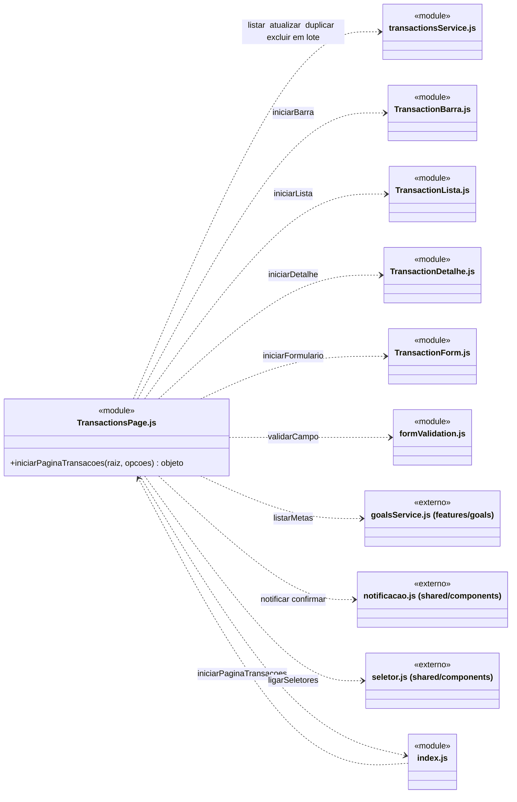

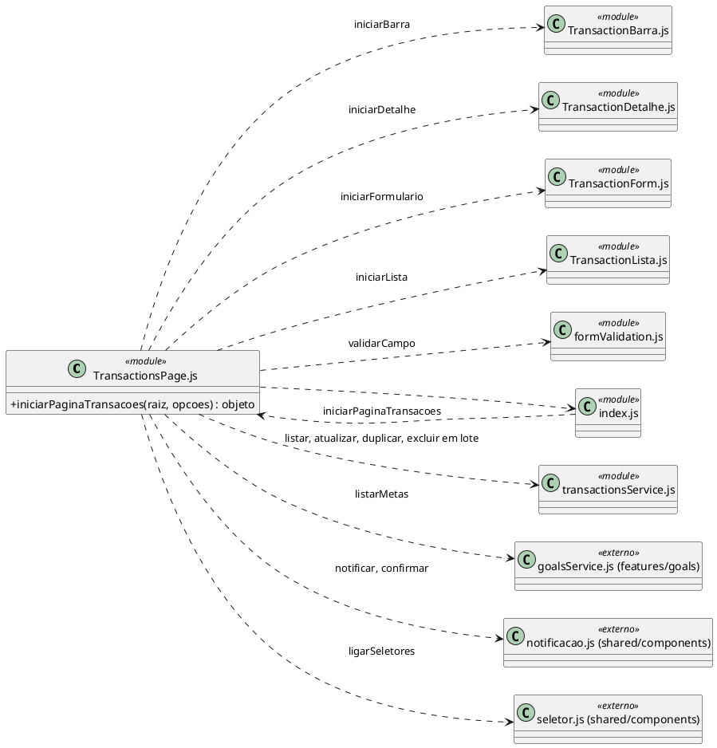

## transactionsService.js

- **Tipo:** módulo (arquivo JavaScript ES)
- **Estereótipo:** «module»
- **Arquivo de origem:** `Frontend/src/features/transactions/services/transactionsService.js`

**Descrição:** Chamadas ao Backend de transações (GET/POST /transactions, sugestão de categoria, duplicação, PATCH /bulk e POST /bulk-delete em blocos de 100).

### Atributos

Sem atributos.

### Operações

| Visibilidade | Assinatura | Retorno | Descrição |
|---|---|---|---|
| + | `listarTransacoes(filtros = {}): Promise<Pagina>` | `Promise<{ itens, pagina, limite, total, totalPaginas, resumo }>` | Consulta GET /transactions com os filtros informados. |
| + | `sugerirCategoria(descricao, valor?): Promise<{ categoria }>` | `Promise<{ categoria }>` | Pede ao Backend a categoria sugerida para a descrição. |
| + | `criarTransacao(dados): Promise<Transacao>` | `Promise<Transacao>` | Cria a transação com POST /transactions. |
| + | `atualizarTransacoesEmLote(itens): Promise<Lote>` | `Promise<{ afetadas, naoEncontradas }>` | Atualiza várias transações (PATCH /bulk), em blocos de 100. |
| + | `duplicarTransacoes(ids): Promise<Lote>` | `Promise<{ afetadas, naoEncontradas, copias }>` | Duplica as transações indicadas. |
| + | `excluirTransacoesEmLote(ids): Promise<Lote>` | `Promise<{ afetadas, naoEncontradas }>` | Exclui várias transações (POST /bulk-delete), em blocos de 100. |

### Relações

| Tipo | Alvo | Multiplicidade | Rótulo |
|---|---|---|---|
| dependência | `apiFetch (core/http/api.js)` | - | HTTP para o Backend /transactions |

Usada por: `TransactionForm.js`, `TransactionsPage.js`.

### Diagrama

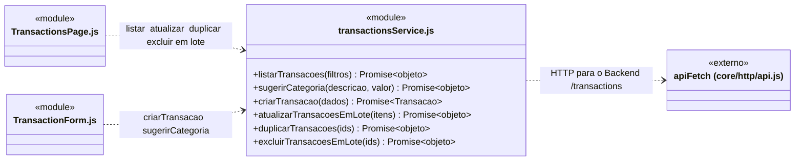

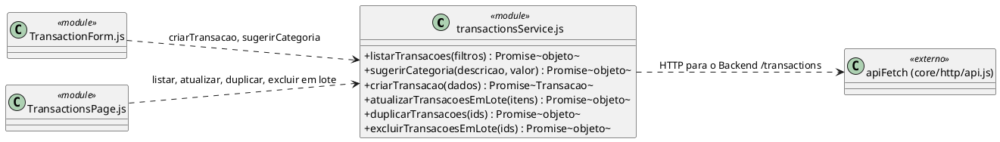

## constants.js

- **Tipo:** módulo (arquivo JavaScript ES)
- **Estereótipo:** «module»
- **Arquivo de origem:** `Frontend/src/features/transactions/utils/constants.js`

**Descrição:** Valores aceitos pela API (tipos, categorias, formas de pagamento) com rótulo e cor, e helpers corDe/rotuloDe.

### Atributos

| Visibilidade | Nome | Tipo | Descrição |
|---|---|---|---|
| + | `TIPOS` | `{valor,rotulo,cor}[]` | Tipos de lançamento aceitos pela API. |
| + | `CATEGORIAS` | `{valor,rotulo,cor}[]` | Categorias aceitas pela API. |
| + | `FORMAS_PAGAMENTO` | `{valor,rotulo,cor}[]` | Formas de pagamento aceitas pela API. |

### Operações

| Visibilidade | Assinatura | Retorno | Descrição |
|---|---|---|---|
| + | `corDe(lista, valor): string` | `string` | Devolve a cor associada ao valor na lista. |
| + | `rotuloDe(lista, valor): string` | `string` | Devolve o rótulo associado ao valor na lista. |

### Relações

Sem relações de saída (não importa outros módulos).

Usada por: `EdicaoCelula.js`, `TransactionBarra.js`, `TransactionExtrato.js`, `TransactionForm.js`, `TransactionLista.js`, `formValidation.js`.

### Diagrama

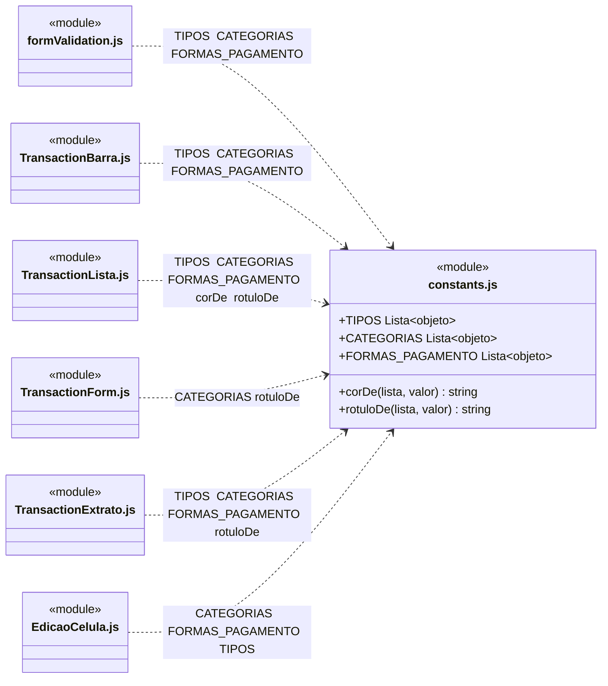

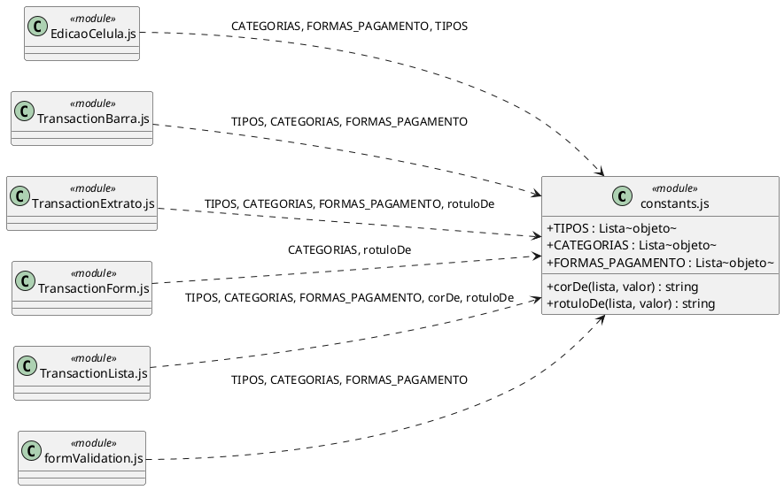

## format.js

- **Tipo:** módulo (arquivo JavaScript ES)
- **Estereótipo:** «module»
- **Arquivo de origem:** `Frontend/src/features/transactions/utils/format.js`

**Descrição:** Formatação de moeda (BRL) e data (UTC) e data de hoje no formato AAAA-MM-DD.

### Atributos

Sem atributos.

### Operações

| Visibilidade | Assinatura | Retorno | Descrição |
|---|---|---|---|
| + | `formatarMoeda(valor): string` | `string` | Formata o valor em reais (BRL). |
| + | `formatarData(iso): string` | `string` | Formata a data ISO (UTC) para exibição. |
| + | `dataDeHoje(): string` | `string` | Devolve a data de hoje no formato AAAA-MM-DD. |

### Relações

Sem relações de saída (não importa outros módulos).

Usada por: `TransactionDetalhe.js`, `TransactionExtrato.js`, `TransactionForm.js`, `TransactionLista.js`, `TransactionResumo.js`.

### Diagrama

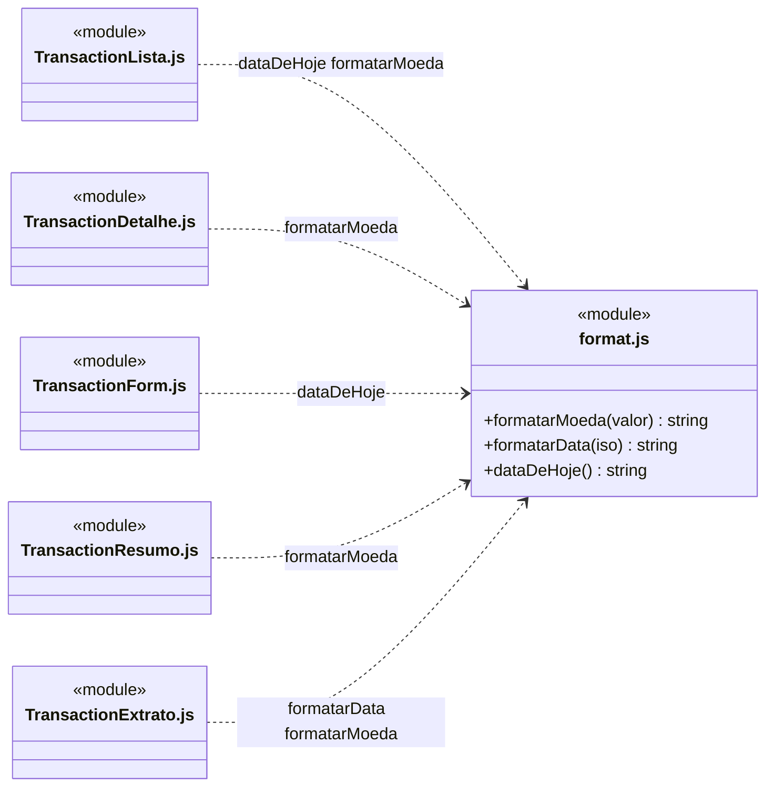

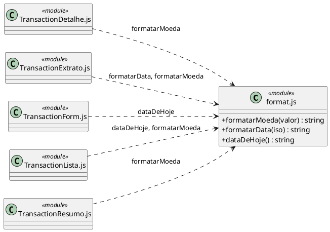

## formValidation.js

- **Tipo:** módulo (arquivo JavaScript ES)
- **Estereótipo:** «module»
- **Arquivo de origem:** `Frontend/src/features/transactions/utils/formValidation.js`

**Descrição:** Regras de validação do formulário e da edição direta, sem tela (leitura de valor, campo único e formulário completo).

### Atributos

| Visibilidade | Nome | Tipo | Descrição |
|---|---|---|---|
| + | `LIMITE_OBSERVACOES` | `number` | Limite de caracteres das observações. |
| + | `MENSAGENS_CAMPO` | `Record<string,string>` | Mensagens de erro por campo. |

### Operações

| Visibilidade | Assinatura | Retorno | Descrição |
|---|---|---|---|
| + | `lerValor(texto): number` | `number` | Converte o texto digitado em número. |
| + | `validarCampo(nome, texto): { erro, valor }` | `{ erro: string\|null, valor }` | Valida um único campo e devolve a mensagem de erro (ou nulo) e o valor lido. |
| + | `validarFormulario(valores): { erros, dados }` | `{ erros, dados: object\|null }` | Valida o formulário completo e devolve os erros ou os dados prontos para a API. |

### Relações

| Tipo | Alvo | Multiplicidade | Rótulo |
|---|---|---|---|
| dependência | `constants.js` | - | TIPOS, CATEGORIAS, FORMAS_PAGAMENTO |
| dependência | `dateRange.js (shared/utils)` | - | dataValida |

Usada por: `EdicaoCelula.js`, `TransactionDetalhe.js`, `TransactionExtrato.js`, `TransactionForm.js`, `TransactionsPage.js`, `filterParams.js`.

### Diagrama

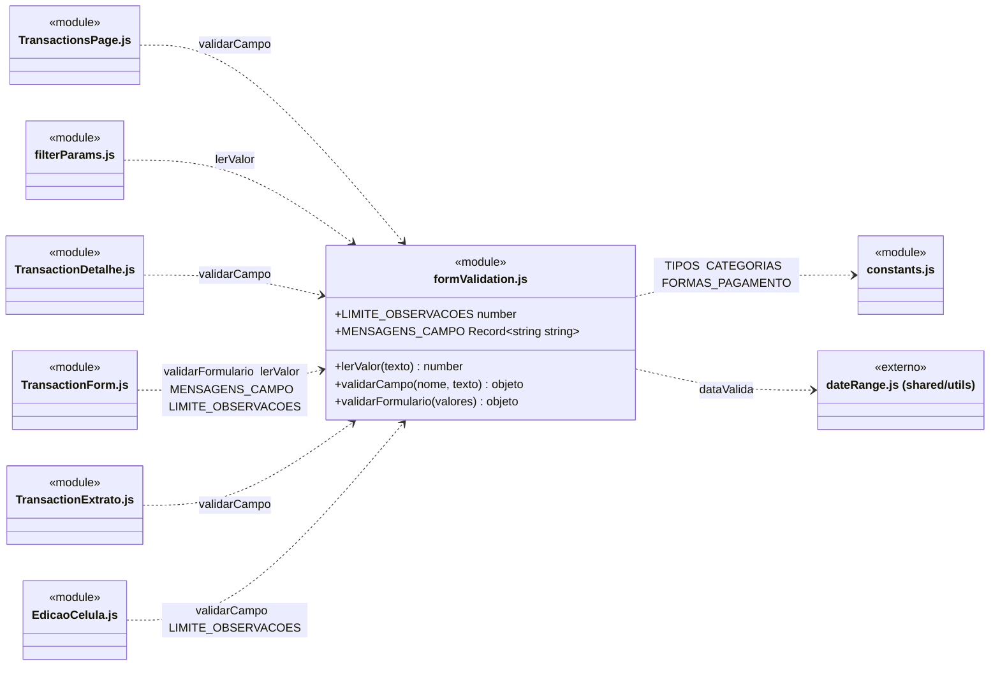

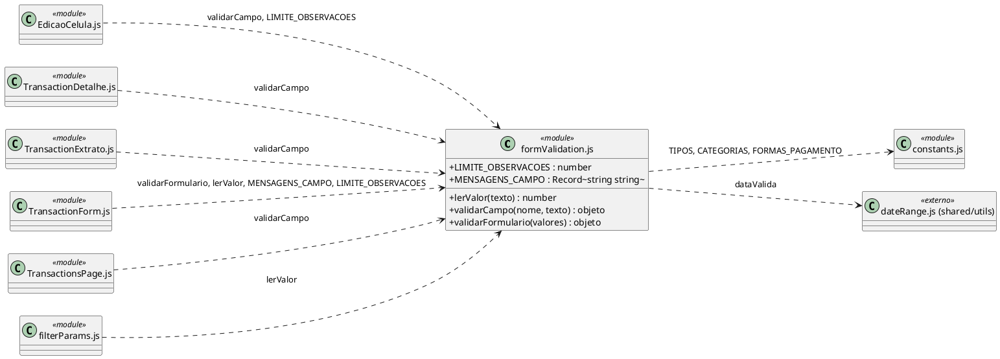

## filterParams.js

- **Tipo:** módulo (arquivo JavaScript ES)
- **Estereótipo:** «module»
- **Arquivo de origem:** `Frontend/src/features/transactions/utils/filterParams.js`

**Descrição:** Converte os campos de filtro nos parâmetros de GET /transactions, validando datas e valores, sem tela.

### Atributos

Sem atributos.

### Operações

| Visibilidade | Assinatura | Retorno | Descrição |
|---|---|---|---|
| + | `montarParametros(valores): { erros, parametros }` | `{ erros, parametros: object\|null }` | Valida os filtros e monta os parâmetros da consulta. |

### Relações

| Tipo | Alvo | Multiplicidade | Rótulo |
|---|---|---|---|
| dependência | `formValidation.js` | - | lerValor |
| dependência | `dateRange.js (shared/utils)` | - | dataValida |

Usada por: `TransactionFilters.js`.

### Diagrama

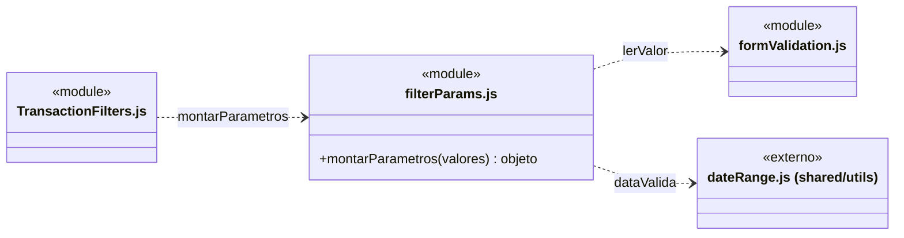

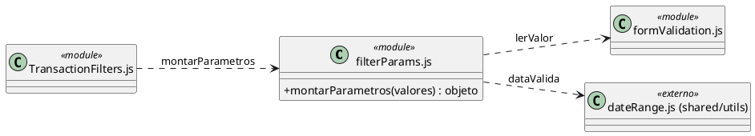

## TransactionBarra.js

- **Tipo:** módulo (arquivo JavaScript ES)
- **Estereótipo:** «module»
- **Arquivo de origem:** `Frontend/src/features/transactions/components/TransactionBarra/TransactionBarra.js`

**Descrição:** Barra do topo (par TransactionBarra.html/.css): mês com setas e calendário de período, Selecionar, menu Lançamento, pílulas de filtro, valor e busca.

### Atributos

Sem atributos.

### Operações

| Visibilidade | Assinatura | Retorno | Descrição |
|---|---|---|---|
| + | `iniciarBarra(raiz, { aoMudar, aoSelecionar, aoNovo, signal }): { definirMetas, sairDaSelecao }` | `{ definirMetas(metas), sairDaSelecao() }` | Liga os controles da barra e devolve os métodos para atualizar metas e sair do modo de seleção. |

### Relações

| Tipo | Alvo | Multiplicidade | Rótulo |
|---|---|---|---|
| dependência | `Calendario.js (shared/components)` | - | ligarCalendario |
| dependência | `campos.js (shared/components)` | - | aplicarMascaraMoeda |
| dependência | `dateRange.js (shared/utils)` | - | isoParaBr |
| dependência | `moeda.js (shared/utils)` | - | lerValor |
| dependência | `constants.js` | - | TIPOS, CATEGORIAS, FORMAS_PAGAMENTO |

Usada por: `TransactionsPage.js`.

### Diagrama

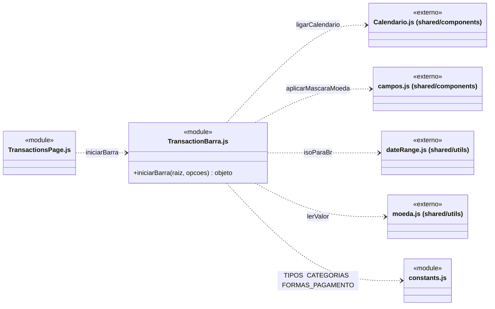

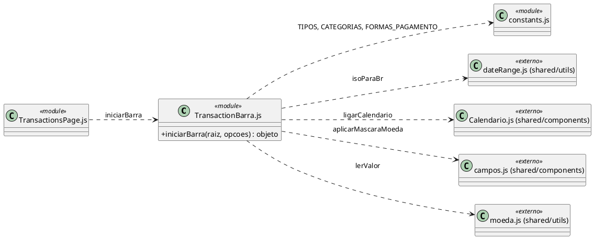

## TransactionLista.js

- **Tipo:** módulo (arquivo JavaScript ES)
- **Estereótipo:** «module»
- **Arquivo de origem:** `Frontend/src/features/transactions/components/TransactionLista/TransactionLista.js`

**Descrição:** Lista de transações agrupada por dia (par TransactionLista.html/.css), com edição ao clicar, seleção, ações em lote e rascunho de alterações pendentes.

### Atributos

Sem atributos.

### Operações

| Visibilidade | Assinatura | Retorno | Descrição |
|---|---|---|---|
| + | `iniciarLista(raiz, { abrirDetalhe, carregarMais, tentarNovamente, editarCampo, alterarVarias, confirmarPendentes, duplicarVarias, excluirVarias, signal }): Lista` | `{ iniciarCarga, mostrarResposta, mostrarErro, rascunhar, limparRascunho, temPendencias, descartarRascunhoDe, definirMetas, definirSelecao }` | Liga a lista e devolve os métodos de carga, exibição, rascunho e seleção. |

### Relações

| Tipo | Alvo | Multiplicidade | Rótulo |
|---|---|---|---|
| dependência | `Calendario.js (shared/components)` | - | ligarCalendario |
| dependência | `campos.js (shared/components)` | - | aplicarMascaraMoeda |
| dependência | `moeda.js (shared/utils)` | - | valorParaCampo |
| dependência | `constants.js` | - | TIPOS, CATEGORIAS, FORMAS_PAGAMENTO, corDe, rotuloDe |
| dependência | `format.js` | - | dataDeHoje, formatarMoeda |

Usada por: `TransactionsPage.js`.

### Diagrama

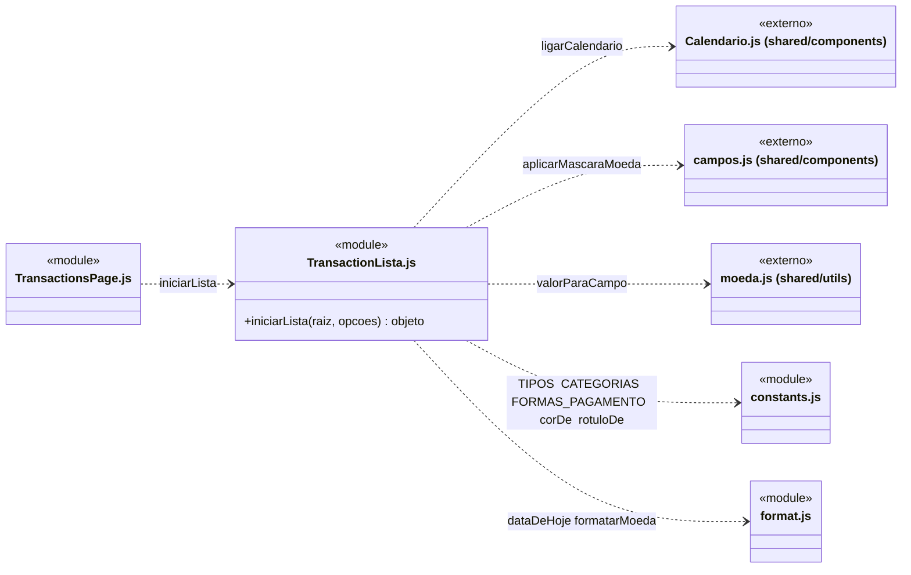

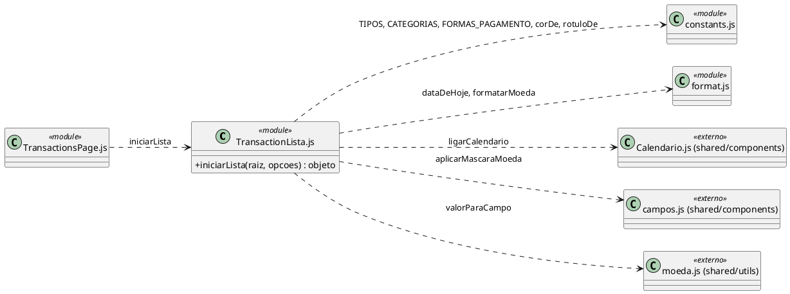

## TransactionDetalhe.js

- **Tipo:** módulo (arquivo JavaScript ES)
- **Estereótipo:** «module»
- **Arquivo de origem:** `Frontend/src/features/transactions/components/TransactionDetalhe/TransactionDetalhe.js`

**Descrição:** Painel lateral de detalhes (par TransactionDetalhe.html/.css): edita data e observação e aciona duplicar e excluir via página.

### Atributos

Sem atributos.

### Operações

| Visibilidade | Assinatura | Retorno | Descrição |
|---|---|---|---|
| + | `iniciarDetalhe(raiz, { salvar, duplicar, excluir, signal }): { abrir, fechar }` | `{ abrir(transacao), fechar() }` | Liga o painel e devolve os métodos para abrir e fechar o detalhe. |

### Relações

| Tipo | Alvo | Multiplicidade | Rótulo |
|---|---|---|---|
| dependência | `Calendario.js (shared/components)` | - | ligarCalendario |
| dependência | `notificacao.js (shared/components)` | - | notificar |
| dependência | `rolagem.js (shared/utils)` | - | travarRolagem, liberarRolagem |
| dependência | `formValidation.js` | - | validarCampo |
| dependência | `format.js` | - | formatarMoeda |

Usada por: `TransactionsPage.js`.

### Diagrama

```mermaid
classDiagram
    direction LR
    class TransactionDetalhe["TransactionDetalhe.js"] {
        <<module>>
        +iniciarDetalhe(raiz, opcoes) objeto
    }
    class TransactionsPage["TransactionsPage.js"] {
        <<module>>
    }
    class formValidation["formValidation.js"] {
        <<module>>
    }
    class format["format.js"] {
        <<module>>
    }
    class Ext3["notificacao.js (shared/components)"] {
        <<externo>>
    }
    class Ext7["Calendario.js (shared/components)"] {
        <<externo>>
    }
    class Ext10["rolagem.js (shared/utils)"] {
        <<externo>>
    }
    TransactionsPage ..> TransactionDetalhe : iniciarDetalhe
    TransactionDetalhe ..> Ext7 : ligarCalendario
    TransactionDetalhe ..> Ext3 : notificar
    TransactionDetalhe ..> Ext10 : travarRolagem  liberarRolagem
    TransactionDetalhe ..> formValidation : validarCampo
    TransactionDetalhe ..> format : formatarMoeda
```

```plantuml
@startuml
left to right direction
skinparam classAttributeIconSize 0
class "TransactionDetalhe.js" as TransactionDetalhe <<module>> {
  +iniciarDetalhe(raiz, opcoes) : objeto
}
class "TransactionsPage.js" as TransactionsPage <<module>>
class "formValidation.js" as formValidation <<module>>
class "format.js" as format <<module>>
class "notificacao.js (shared/components)" as Ext3 <<externo>>
class "Calendario.js (shared/components)" as Ext7 <<externo>>
class "rolagem.js (shared/utils)" as Ext10 <<externo>>
TransactionsPage ..> TransactionDetalhe : iniciarDetalhe
TransactionDetalhe ..> Ext7 : ligarCalendario
TransactionDetalhe ..> Ext3 : notificar
TransactionDetalhe ..> Ext10 : travarRolagem, liberarRolagem
TransactionDetalhe ..> formValidation : validarCampo
TransactionDetalhe ..> format : formatarMoeda
@enduml
```

## TransactionForm.js

- **Tipo:** módulo (arquivo JavaScript ES)
- **Estereótipo:** «module»
- **Arquivo de origem:** `Frontend/src/features/transactions/components/TransactionForm/TransactionForm.js`

**Descrição:** Janela 'Novo lançamento' (par TransactionForm.html/.css): valida, sugere categoria via Servidor, cria a transação e integra meta e cartão.

### Atributos

Sem atributos.

### Operações

| Visibilidade | Assinatura | Retorno | Descrição |
|---|---|---|---|
| + | `iniciarFormulario(raiz, { aoSalvar, signal }): { abrir, fechar }` | `{ abrir(tipo), fechar() }` | Liga a janela de novo lançamento e devolve os métodos para abrir e fechar. |

### Relações

| Tipo | Alvo | Multiplicidade | Rótulo |
|---|---|---|---|
| dependência | `transactionsService.js` | - | criarTransacao, sugerirCategoria |
| dependência | `MetaDoLancamento.js` | - | ligarMeta |
| dependência | `CartaoDoLancamento.js` | - | ligarCartao |
| dependência | `formValidation.js` | - | validarFormulario, lerValor, MENSAGENS_CAMPO, LIMITE_OBSERVACOES |
| dependência | `constants.js` | - | CATEGORIAS, rotuloDe |
| dependência | `format.js` | - | dataDeHoje |
| dependência | `Calendario.js (shared/components)` | - | ligarCalendario |
| dependência | `campos.js (shared/components)` | - | ligarCampo, aplicarMascaraMoeda |
| dependência | `notificacao.js (shared/components)` | - | notificar |
| dependência | `rolagem.js (shared/utils)` | - | travarRolagem, liberarRolagem |

Usada por: `TransactionsPage.js`.

### Diagrama

```mermaid
classDiagram
    direction LR
    class TransactionForm["TransactionForm.js"] {
        <<module>>
        +iniciarFormulario(raiz, opcoes) objeto
    }
    class CartaoDoLancamento["CartaoDoLancamento.js"] {
        <<module>>
    }
    class MetaDoLancamento["MetaDoLancamento.js"] {
        <<module>>
    }
    class TransactionsPage["TransactionsPage.js"] {
        <<module>>
    }
    class constants["constants.js"] {
        <<module>>
    }
    class formValidation["formValidation.js"] {
        <<module>>
    }
    class format["format.js"] {
        <<module>>
    }
    class transactionsService["transactionsService.js"] {
        <<module>>
    }
    class Ext3["notificacao.js (shared/components)"] {
        <<externo>>
    }
    class Ext7["Calendario.js (shared/components)"] {
        <<externo>>
    }
    class Ext8["campos.js (shared/components)"] {
        <<externo>>
    }
    class Ext10["rolagem.js (shared/utils)"] {
        <<externo>>
    }
    TransactionsPage ..> TransactionForm : iniciarFormulario
    TransactionForm ..> transactionsService : criarTransacao  sugerirCategoria
    TransactionForm ..> MetaDoLancamento : ligarMeta
    TransactionForm ..> CartaoDoLancamento : ligarCartao
    TransactionForm ..> formValidation : validarFormulario  lerValor  MENSAGENS_CAMPO  LIMITE_OBSERVACOES
    TransactionForm ..> constants : CATEGORIAS  rotuloDe
    TransactionForm ..> format : dataDeHoje
    TransactionForm ..> Ext7 : ligarCalendario
    TransactionForm ..> Ext8 : ligarCampo  aplicarMascaraMoeda
    TransactionForm ..> Ext3 : notificar
    TransactionForm ..> Ext10 : travarRolagem  liberarRolagem
```

```plantuml
@startuml
left to right direction
skinparam classAttributeIconSize 0
class "TransactionForm.js" as TransactionForm <<module>> {
  +iniciarFormulario(raiz, opcoes) : objeto
}
class "CartaoDoLancamento.js" as CartaoDoLancamento <<module>>
class "MetaDoLancamento.js" as MetaDoLancamento <<module>>
class "TransactionsPage.js" as TransactionsPage <<module>>
class "constants.js" as constants <<module>>
class "formValidation.js" as formValidation <<module>>
class "format.js" as format <<module>>
class "transactionsService.js" as transactionsService <<module>>
class "notificacao.js (shared/components)" as Ext3 <<externo>>
class "Calendario.js (shared/components)" as Ext7 <<externo>>
class "campos.js (shared/components)" as Ext8 <<externo>>
class "rolagem.js (shared/utils)" as Ext10 <<externo>>
TransactionsPage ..> TransactionForm : iniciarFormulario
TransactionForm ..> transactionsService : criarTransacao, sugerirCategoria
TransactionForm ..> MetaDoLancamento : ligarMeta
TransactionForm ..> CartaoDoLancamento : ligarCartao
TransactionForm ..> formValidation : validarFormulario, lerValor, MENSAGENS_CAMPO, LIMITE_OBSERVACOES
TransactionForm ..> constants : CATEGORIAS, rotuloDe
TransactionForm ..> format : dataDeHoje
TransactionForm ..> Ext7 : ligarCalendario
TransactionForm ..> Ext8 : ligarCampo, aplicarMascaraMoeda
TransactionForm ..> Ext3 : notificar
TransactionForm ..> Ext10 : travarRolagem, liberarRolagem
@enduml
```

## MetaDoLancamento.js

- **Tipo:** módulo (arquivo JavaScript ES)
- **Estereótipo:** «module»
- **Arquivo de origem:** `Frontend/src/features/transactions/components/TransactionForm/MetaDoLancamento.js`

**Descrição:** Trecho 'Vincular a uma meta' do formulário (usa o HTML de TransactionForm.html): lista metas e abre a janela Nova meta.

### Atributos

Sem atributos.

### Operações

| Visibilidade | Assinatura | Retorno | Descrição |
|---|---|---|---|
| + | `ligarMeta(raiz, { signal }): CampoMeta` | `{ ler, lerMeta, validar, definirErro, focar, reiniciar, recarregar }` | Liga o trecho de meta do formulário e devolve os métodos do campo. |

### Relações

| Tipo | Alvo | Multiplicidade | Rótulo |
|---|---|---|---|
| dependência | `goalsService.js (features/goals)` | - | criarMeta, listarMetas |
| dependência | `GoalForm.js (features/goals)` | - | iniciarFormulario |
| dependência | `notificacao.js (shared/components)` | - | notificar |
| dependência | `moeda.js (shared/utils)` | - | formatarMoeda, formatarPercentual |

Usada por: `TransactionForm.js`.

### Diagrama

```mermaid
classDiagram
    direction LR
    class MetaDoLancamento["MetaDoLancamento.js"] {
        <<module>>
        +ligarMeta(raiz, opcoes) objeto
    }
    class TransactionForm["TransactionForm.js"] {
        <<module>>
    }
    class Ext2["goalsService.js (features/goals)"] {
        <<externo>>
    }
    class Ext3["notificacao.js (shared/components)"] {
        <<externo>>
    }
    class Ext9["moeda.js (shared/utils)"] {
        <<externo>>
    }
    class Ext11["GoalForm.js (features/goals)"] {
        <<externo>>
    }
    TransactionForm ..> MetaDoLancamento : ligarMeta
    MetaDoLancamento ..> Ext2 : criarMeta  listarMetas
    MetaDoLancamento ..> Ext11 : iniciarFormulario
    MetaDoLancamento ..> Ext3 : notificar
    MetaDoLancamento ..> Ext9 : formatarMoeda  formatarPercentual
```

```plantuml
@startuml
left to right direction
skinparam classAttributeIconSize 0
class "MetaDoLancamento.js" as MetaDoLancamento <<module>> {
  +ligarMeta(raiz, opcoes) : objeto
}
class "TransactionForm.js" as TransactionForm <<module>>
class "goalsService.js (features/goals)" as Ext2 <<externo>>
class "notificacao.js (shared/components)" as Ext3 <<externo>>
class "moeda.js (shared/utils)" as Ext9 <<externo>>
class "GoalForm.js (features/goals)" as Ext11 <<externo>>
TransactionForm ..> MetaDoLancamento : ligarMeta
MetaDoLancamento ..> Ext2 : criarMeta, listarMetas
MetaDoLancamento ..> Ext11 : iniciarFormulario
MetaDoLancamento ..> Ext3 : notificar
MetaDoLancamento ..> Ext9 : formatarMoeda, formatarPercentual
@enduml
```

## CartaoDoLancamento.js

- **Tipo:** módulo (arquivo JavaScript ES)
- **Estereótipo:** «module»
- **Arquivo de origem:** `Frontend/src/features/transactions/components/TransactionForm/CartaoDoLancamento.js`

**Descrição:** Trecho 'Cartão' e 'Parcelas' do formulário no crédito (usa o HTML de TransactionForm.html): carrega cartões e calcula a parcela.

### Atributos

Sem atributos.

### Operações

| Visibilidade | Assinatura | Retorno | Descrição |
|---|---|---|---|
| + | `ligarCartao(raiz, { signal, formaPagamento, tipo, valor }): CampoCartao` | `{ ler, validar, reiniciar, recarregar, definirErro, focar }` | Liga o trecho de cartão e parcelas e devolve os métodos do campo. |

### Relações

| Tipo | Alvo | Multiplicidade | Rótulo |
|---|---|---|---|
| dependência | `investmentsService.js (features/investments)` | - | listarCartoes |
| dependência | `moeda.js (shared/utils)` | - | formatarMoeda |

Usada por: `TransactionForm.js`.

### Diagrama

```mermaid
classDiagram
    direction LR
    class CartaoDoLancamento["CartaoDoLancamento.js"] {
        <<module>>
        +ligarCartao(raiz, opcoes) objeto
    }
    class TransactionForm["TransactionForm.js"] {
        <<module>>
    }
    class Ext9["moeda.js (shared/utils)"] {
        <<externo>>
    }
    class Ext12["investmentsService.js (features/investments)"] {
        <<externo>>
    }
    TransactionForm ..> CartaoDoLancamento : ligarCartao
    CartaoDoLancamento ..> Ext12 : listarCartoes
    CartaoDoLancamento ..> Ext9 : formatarMoeda
```

```plantuml
@startuml
left to right direction
skinparam classAttributeIconSize 0
class "CartaoDoLancamento.js" as CartaoDoLancamento <<module>> {
  +ligarCartao(raiz, opcoes) : objeto
}
class "TransactionForm.js" as TransactionForm <<module>>
class "moeda.js (shared/utils)" as Ext9 <<externo>>
class "investmentsService.js (features/investments)" as Ext12 <<externo>>
TransactionForm ..> CartaoDoLancamento : ligarCartao
CartaoDoLancamento ..> Ext12 : listarCartoes
CartaoDoLancamento ..> Ext9 : formatarMoeda
@enduml
```

## TransactionFilters.js

- **Tipo:** módulo (arquivo JavaScript ES)
- **Estereótipo:** «module»
- **Arquivo de origem:** `Frontend/src/features/transactions/components/TransactionFilters/TransactionFilters.js`

**Descrição:** Cartão de filtros do extrato (par TransactionFilters.html/.css): aplica ao mudar e chama aoMudar com os parâmetros da API; não é importado pela página atual.

### Atributos

Sem atributos.

### Operações

| Visibilidade | Assinatura | Retorno | Descrição |
|---|---|---|---|
| + | `iniciarFiltros(raiz, { aoMudar, signal }): { definirMetas }` | `{ definirMetas(metas) }` | Liga os filtros e devolve o método para atualizar a lista de metas. |

### Relações

| Tipo | Alvo | Multiplicidade | Rótulo |
|---|---|---|---|
| dependência | `filterParams.js` | - | montarParametros |
| dependência | `Calendario.js (shared/components)` | - | ligarCalendario |
| dependência | `campos.js (shared/components)` | - | aplicarMascaraMoeda, ligarCampo |
| dependência | `notificacao.js (shared/components)` | - | notificar |

Usada por: nenhum módulo deste grupo.

### Diagrama

```mermaid
classDiagram
    direction LR
    class TransactionFilters["TransactionFilters.js"] {
        <<module>>
        +iniciarFiltros(raiz, opcoes) objeto
    }
    class filterParams["filterParams.js"] {
        <<module>>
    }
    class Ext3["notificacao.js (shared/components)"] {
        <<externo>>
    }
    class Ext7["Calendario.js (shared/components)"] {
        <<externo>>
    }
    class Ext8["campos.js (shared/components)"] {
        <<externo>>
    }
    TransactionFilters ..> filterParams : montarParametros
    TransactionFilters ..> Ext7 : ligarCalendario
    TransactionFilters ..> Ext8 : aplicarMascaraMoeda  ligarCampo
    TransactionFilters ..> Ext3 : notificar
```

```plantuml
@startuml
left to right direction
skinparam classAttributeIconSize 0
class "TransactionFilters.js" as TransactionFilters <<module>> {
  +iniciarFiltros(raiz, opcoes) : objeto
}
class "filterParams.js" as filterParams <<module>>
class "notificacao.js (shared/components)" as Ext3 <<externo>>
class "Calendario.js (shared/components)" as Ext7 <<externo>>
class "campos.js (shared/components)" as Ext8 <<externo>>
TransactionFilters ..> filterParams : montarParametros
TransactionFilters ..> Ext7 : ligarCalendario
TransactionFilters ..> Ext8 : aplicarMascaraMoeda, ligarCampo
TransactionFilters ..> Ext3 : notificar
@enduml
```

## TransactionResumo.js

- **Tipo:** módulo (arquivo JavaScript ES)
- **Estereótipo:** «module»
- **Arquivo de origem:** `Frontend/src/features/transactions/components/TransactionResumo/TransactionResumo.js`

**Descrição:** Resumo de Entradas, Saídas e Saldo (par TransactionResumo.html/.css); não é importado pela página atual.

### Atributos

Sem atributos.

### Operações

| Visibilidade | Assinatura | Retorno | Descrição |
|---|---|---|---|
| + | `iniciarResumo(raiz): { atualizar }` | `{ atualizar(resumo) }` | Liga o resumo e devolve o método que atualiza os totais. |

### Relações

| Tipo | Alvo | Multiplicidade | Rótulo |
|---|---|---|---|
| dependência | `format.js` | - | formatarMoeda |

Usada por: nenhum módulo deste grupo.

### Diagrama

```mermaid
classDiagram
    direction LR
    class TransactionResumo["TransactionResumo.js"] {
        <<module>>
        +iniciarResumo(raiz) objeto
    }
    class format["format.js"] {
        <<module>>
    }
    TransactionResumo ..> format : formatarMoeda
```

```plantuml
@startuml
left to right direction
skinparam classAttributeIconSize 0
class "TransactionResumo.js" as TransactionResumo <<module>> {
  +iniciarResumo(raiz) : objeto
}
class "format.js" as format <<module>>
TransactionResumo ..> format : formatarMoeda
@enduml
```

## TransactionExtrato.js

- **Tipo:** módulo (arquivo JavaScript ES)
- **Estereótipo:** «module»
- **Arquivo de origem:** `Frontend/src/features/transactions/components/TransactionExtrato/TransactionExtrato.js`

**Descrição:** Extrato em tabela (par TransactionExtrato.html/.css) com paginação, seleção em lote, edição em lote e rascunho; não é importado pela página atual.

### Atributos

Sem atributos.

### Operações

| Visibilidade | Assinatura | Retorno | Descrição |
|---|---|---|---|
| + | `iniciarExtrato(raiz, { irParaPagina, tentarNovamente, mudarLimite, salvarAlteracoes, editarVarias, duplicarVarias, excluirVarias, signal }): Extrato` | `{ definirMetas, temPendencias, iniciarCarga, finalizarCarga, mostrarResposta, mostrarErro }` | Liga o extrato e devolve os métodos de carga, exibição e controle de pendências. |

### Relações

| Tipo | Alvo | Multiplicidade | Rótulo |
|---|---|---|---|
| dependência | `EdicaoCelula.js` | - | iniciarEdicao, valorParaEditar |
| dependência | `formValidation.js` | - | validarCampo |
| dependência | `constants.js` | - | TIPOS, CATEGORIAS, FORMAS_PAGAMENTO, rotuloDe |
| dependência | `format.js` | - | formatarData, formatarMoeda |
| dependência | `Calendario.js (shared/components)` | - | ligarCalendario |
| dependência | `campos.js (shared/components)` | - | aplicarMascaraMoeda |
| dependência | `notificacao.js (shared/components)` | - | confirmar, notificar |

Usada por: nenhum módulo deste grupo.

### Diagrama

```mermaid
classDiagram
    direction LR
    class TransactionExtrato["TransactionExtrato.js"] {
        <<module>>
        +iniciarExtrato(raiz, opcoes) objeto
    }
    class EdicaoCelula["EdicaoCelula.js"] {
        <<module>>
    }
    class constants["constants.js"] {
        <<module>>
    }
    class formValidation["formValidation.js"] {
        <<module>>
    }
    class format["format.js"] {
        <<module>>
    }
    class Ext3["notificacao.js (shared/components)"] {
        <<externo>>
    }
    class Ext7["Calendario.js (shared/components)"] {
        <<externo>>
    }
    class Ext8["campos.js (shared/components)"] {
        <<externo>>
    }
    TransactionExtrato ..> EdicaoCelula : iniciarEdicao  valorParaEditar
    TransactionExtrato ..> formValidation : validarCampo
    TransactionExtrato ..> constants : TIPOS  CATEGORIAS  FORMAS_PAGAMENTO  rotuloDe
    TransactionExtrato ..> format : formatarData  formatarMoeda
    TransactionExtrato ..> Ext7 : ligarCalendario
    TransactionExtrato ..> Ext8 : aplicarMascaraMoeda
    TransactionExtrato ..> Ext3 : confirmar  notificar
```

```plantuml
@startuml
left to right direction
skinparam classAttributeIconSize 0
class "TransactionExtrato.js" as TransactionExtrato <<module>> {
  +iniciarExtrato(raiz, opcoes) : objeto
}
class "EdicaoCelula.js" as EdicaoCelula <<module>>
class "constants.js" as constants <<module>>
class "formValidation.js" as formValidation <<module>>
class "format.js" as format <<module>>
class "notificacao.js (shared/components)" as Ext3 <<externo>>
class "Calendario.js (shared/components)" as Ext7 <<externo>>
class "campos.js (shared/components)" as Ext8 <<externo>>
TransactionExtrato ..> EdicaoCelula : iniciarEdicao, valorParaEditar
TransactionExtrato ..> formValidation : validarCampo
TransactionExtrato ..> constants : TIPOS, CATEGORIAS, FORMAS_PAGAMENTO, rotuloDe
TransactionExtrato ..> format : formatarData, formatarMoeda
TransactionExtrato ..> Ext7 : ligarCalendario
TransactionExtrato ..> Ext8 : aplicarMascaraMoeda
TransactionExtrato ..> Ext3 : confirmar, notificar
@enduml
```

## EdicaoCelula.js

- **Tipo:** módulo (arquivo JavaScript ES)
- **Estereótipo:** «module»
- **Arquivo de origem:** `Frontend/src/features/transactions/components/TransactionExtrato/EdicaoCelula.js`

**Descrição:** Edição direta de um campo do extrato (troca o botão por select, data ou texto; Enter salva, Esc cancela); sem HTML/CSS próprios.

### Atributos

Sem atributos.

### Operações

| Visibilidade | Assinatura | Retorno | Descrição |
|---|---|---|---|
| + | `valorParaEditar(campo, transacao): string` | `string` | Obtém da transação o valor inicial do campo a editar. |
| + | `iniciarEdicao({ botao, campo, atual, aoSalvar, opcoes }): void` | `void` | Troca o botão pelo controle de edição; Enter salva e Esc cancela. |

### Relações

| Tipo | Alvo | Multiplicidade | Rótulo |
|---|---|---|---|
| dependência | `formValidation.js` | - | validarCampo, LIMITE_OBSERVACOES |
| dependência | `constants.js` | - | CATEGORIAS, FORMAS_PAGAMENTO, TIPOS |
| dependência | `campos.js (shared/components)` | - | aceitarSomenteNumeros |
| dependência | `notificacao.js (shared/components)` | - | notificar |

Usada por: `TransactionExtrato.js`.

### Diagrama

```mermaid
classDiagram
    direction LR
    class EdicaoCelula["EdicaoCelula.js"] {
        <<module>>
        +valorParaEditar(campo, transacao) string
        +iniciarEdicao(opcoes) void
    }
    class TransactionExtrato["TransactionExtrato.js"] {
        <<module>>
    }
    class constants["constants.js"] {
        <<module>>
    }
    class formValidation["formValidation.js"] {
        <<module>>
    }
    class Ext3["notificacao.js (shared/components)"] {
        <<externo>>
    }
    class Ext8["campos.js (shared/components)"] {
        <<externo>>
    }
    TransactionExtrato ..> EdicaoCelula : iniciarEdicao  valorParaEditar
    EdicaoCelula ..> formValidation : validarCampo  LIMITE_OBSERVACOES
    EdicaoCelula ..> constants : CATEGORIAS  FORMAS_PAGAMENTO  TIPOS
    EdicaoCelula ..> Ext8 : aceitarSomenteNumeros
    EdicaoCelula ..> Ext3 : notificar
```

```plantuml
@startuml
left to right direction
skinparam classAttributeIconSize 0
class "EdicaoCelula.js" as EdicaoCelula <<module>> {
  +valorParaEditar(campo, transacao) : string
  +iniciarEdicao(opcoes) : void
}
class "TransactionExtrato.js" as TransactionExtrato <<module>>
class "constants.js" as constants <<module>>
class "formValidation.js" as formValidation <<module>>
class "notificacao.js (shared/components)" as Ext3 <<externo>>
class "campos.js (shared/components)" as Ext8 <<externo>>
TransactionExtrato ..> EdicaoCelula : iniciarEdicao, valorParaEditar
EdicaoCelula ..> formValidation : validarCampo, LIMITE_OBSERVACOES
EdicaoCelula ..> constants : CATEGORIAS, FORMAS_PAGAMENTO, TIPOS
EdicaoCelula ..> Ext8 : aceitarSomenteNumeros
EdicaoCelula ..> Ext3 : notificar
@enduml
```
