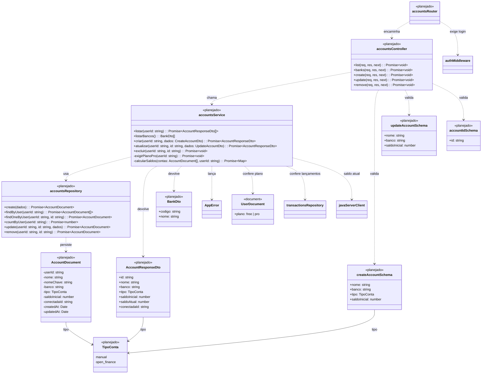
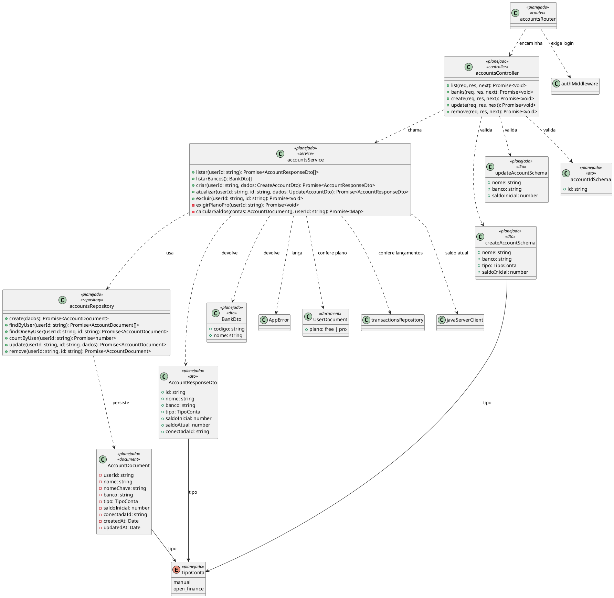
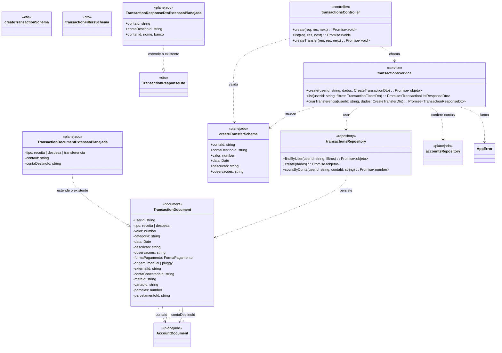
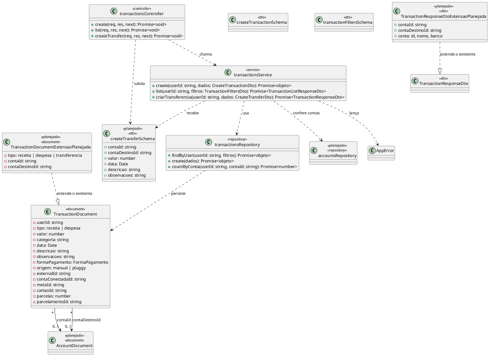
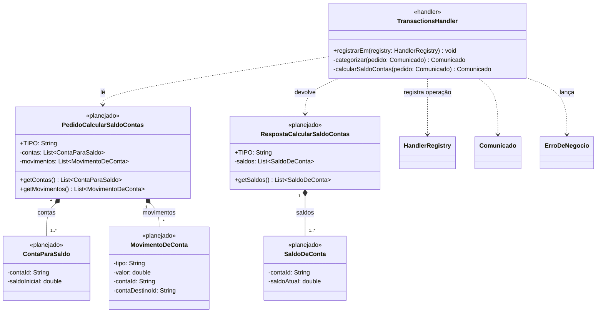
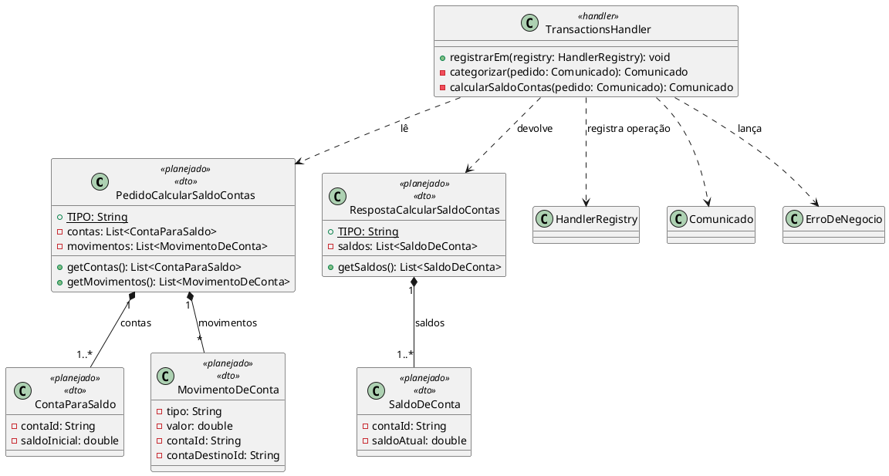
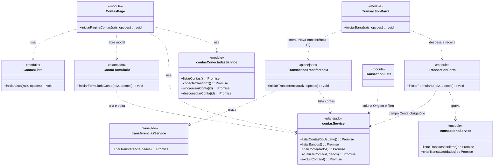
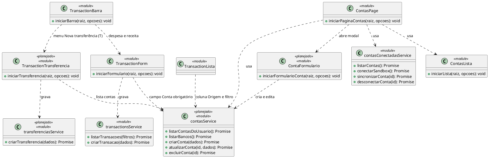

# Modelo UML (planejado): contas e transferências

Notação Astah / UML 2. Visibilidade: `+` público, `-` privado, `#` protegido, `~` pacote. Atributo: `- nome: Tipo`. Operação: `+ nome(param: Tipo): Retorno`.

**Todos os elementos «planejado» deste arquivo AINDA NÃO EXISTEM no código.** Eles vêm da especificação `docs/especificacao-contas-e-transferencias.md` (regras RN1 a RN10, seções 3 a 6, issues #101 a #115). Os elementos sem «planejado» já existem e aparecem só como vizinhos, com o arquivo onde estão. A parte visual da tela de Transações (seção 7 da especificação) já foi feita no Frontend e não é modelada aqui.

Cada diagrama aparece em dois blocos: `mermaid` (renderiza no GitHub) e `plantuml` (mesmo conteúdo, para recriar no Astah).

Onde a especificação não define um detalhe (por exemplo, nomes exatos de métodos), o nome abaixo é uma **proposta** seguindo o padrão dos módulos existentes (`transactionsService`, `connectedAccountsRepository`) e está sinalizado como tal.

## Sumário dos elementos planejados

| Camada | Elemento | Estereótipo | Issue |
|---|---|---|---|
| BD / Backend | `AccountDocument` (coleção `accounts`) | «planejado» «document» | #101 |
| Backend | `accountsRouter` | «planejado» «router» | #102 |
| Backend | `accountsController` | «planejado» «controller» | #102 |
| Backend | `accountsService` | «planejado» «service» | #102, #103 |
| Backend | `accountsRepository` | «planejado» «repository» | #102 |
| Backend | `createAccountSchema`, `updateAccountSchema`, `accountIdSchema`, `AccountResponseDto`, `BankDto` | «planejado» «dto» | #102 |
| Backend | `TipoConta` | «planejado» «enumeration» | #102 |
| Backend | extensão de `TransactionDocument` (`contaId`, `contaDestinoId`, tipo `transferencia`) | «planejado» | #104, #105 |
| Backend | `createTransferSchema`, extensão de `TransactionResponseDto` e dos filtros (`contaId`) | «planejado» «dto» | #104, #105 |
| Backend | `transactionsService.criarTransferencia` (método do TransferService, ver seção 4) | «planejado» «service» | #105 |
| Servidor | `PedidoCalcularSaldoContas`, `RespostaCalcularSaldoContas`, tratamento no `TransactionsHandler` | «planejado» «dto» «handler» | #106 |
| Frontend | formulário de conta, modal de transferência, campo Conta, coluna Origem | «planejado» «module» | #108 a #111 |

---

## 1. Backend: módulo de contas (`Backend/src/modules/accounts/`, planejado)

Módulo novo, nas mesmas camadas dos existentes: Router, Controller, Service, Repository, Model. Os arquivos previstos seguem o padrão `accounts.routes.ts`, `accounts.controller.ts`, `accounts.service.ts`, `accounts.repository.ts`, `accounts.model.ts`, `accounts.dto.ts` (proposta).

### Diagrama

### AccountDocument «planejado» «document»

- **Origem:** coleção `accounts` (seção 3 da especificação; issue #101). Ainda não existe `accounts.model.ts`.
- **Descrição:** conta do usuário. Pode ser manual (saldo calculado) ou Open Finance (saldo vem da Pluggy, somente leitura).
- **Índices previstos:** `userId`; único `(userId, nomeChave)`.

| Visibilidade | Nome | Tipo | Descrição |
|---|---|---|---|
| - | userId | string | Dono da conta; indexado. |
| - | nome | string | De 1 a 40 caracteres (RN1). |
| - | nomeChave | string | Nome em minúsculas, para a unicidade por usuário sem diferenciar maiúsculas. |
| - | banco | string | Código da lista fixa de bancos (por exemplo `nubank`, `itau`, `outro`). |
| - | tipo | TipoConta | `manual` ou `open_finance`. |
| - | saldoInicial | number | Manual: informado pelo usuário. Open Finance: saldo no momento da conexão. |
| - | conectadaId | string (opcional) | Id em `connected_accounts`; só em `open_finance`. |
| - | createdAt, updatedAt | Date | Datas automáticas. |

Operações: nenhuma (documento de dados). O saldo atual **não é gravado**: é sempre calculado (RN9).

| Tipo | Alvo | Multiplicidade | Rótulo |
|---|---|---|---|
| associação | TipoConta | 1 | tipo |
| associação (por `userId`) | usuário (`UserDocument`, módulo `auth`) | * para 1 | pertence a |
| associação (por `conectadaId`) | `ConnectedAccountDocument` (`connected-accounts.model.ts`, existente) | 0..1 | espelha a conexão (só `open_finance`) |
| associação (por `contaId` em `TransactionDocument`) | `TransactionDocument` | 1 para * | recebe lançamentos |

### TipoConta «planejado» «enumeration»

| Literal | Descrição |
|---|---|
| manual | Conta criada pelo usuário; qualquer plano (RN2). |
| open_finance | Conta criada pela conexão com a Pluggy sandbox; só plano Pro (RN3). |

### accountsRouter «planejado» «router»

Rotas previstas sob `/v1` (seção 4 da especificação), todas atrás de `authMiddleware`:

| Método e rota | Operação do controller | Sucesso |
|---|---|---|
| GET /accounts | list | 200 |
| GET /accounts/banks | banks | 200 |
| POST /accounts | create | 201 |
| PATCH /accounts/:id | update | 200 |
| DELETE /accounts/:id | remove | 204 |

Relações: dependência para `accountsController` (encaminha) e para `authMiddleware` (existente, `Backend/src/middlewares/auth.middleware.ts`). `GET /accounts/banks` deve ser registrada antes de `/accounts/:id` (proposta, para a rota fixa não cair no parâmetro).

### accountsController «planejado» «controller»

Segue o padrão de `transactionsController`: valida com Zod, chama o service e passa o erro a `next`.

| Visibilidade | Assinatura | Retorno | Descrição |
|---|---|---|---|
| + | list(req: AuthenticatedRequest, res: Response, next: NextFunction) | Promise\<void\> | Lista as contas do usuário com `saldoAtual`. |
| + | banks(req, res, next) | Promise\<void\> | Devolve a lista fixa de bancos. |
| + | create(req, res, next) | Promise\<void\> | Valida `createAccountSchema` e cria a conta; responde 201. |
| + | update(req, res, next) | Promise\<void\> | Valida `accountIdSchema` e `updateAccountSchema`; responde 200. |
| + | remove(req, res, next) | Promise\<void\> | Valida `accountIdSchema` e exclui; responde 204. |

| Tipo | Alvo | Multiplicidade | Rótulo |
|---|---|---|---|
| dependência | accountsService | 1 | chama |
| dependência | createAccountSchema, updateAccountSchema, accountIdSchema | 1 cada | valida |
| dependência | AuthenticatedRequest (existente) | 1 | recebe |

### accountsService «planejado» «service»

Nomes dos métodos são proposta (em português, como `connectedAccountsService.listar`).

| Visibilidade | Assinatura | Retorno | Descrição |
|---|---|---|---|
| + | listar(userId: string) | Promise\<AccountResponseDto[]\> | Contas do usuário, cada uma com `saldoAtual` calculado. |
| + | listarBancos() | BankDto[] | Lista fixa de bancos (proposta inicial na seção 9 da especificação; lista final em aberto). |
| + | criar(userId: string, dados: CreateAccountDto) | Promise\<AccountResponseDto\> | Cria conta. `tipo: "open_finance"` exige plano Pro (`403 PLAN_REQUIRED`, RN3, issue #103). Nome repetido: `409 ACCOUNT_NAME_IN_USE`. |
| + | atualizar(userId: string, id: string, dados: UpdateAccountDto) | Promise\<AccountResponseDto\> | Altera nome, banco e/ou saldo inicial (conta manual). Inexistente: `404 ACCOUNT_NOT_FOUND`. |
| + | excluir(userId: string, id: string) | Promise\<void\> | Exclui a conta; com lançamentos, `409 ACCOUNT_HAS_TRANSACTIONS` (RN8). |
| - | exigirPlanoPro(userId: string) | Promise\<void\> | Lê o plano do usuário (`plano: "free" \| "pro"`, existente em `auth.model.ts`) e lança `AppError` 403 se for Free. |
| - | calcularSaldos(contas, userId) | Promise\<Map\> | Monta o pedido de saldo e consulta o Servidor Java (seção 3). |

| Tipo | Alvo | Multiplicidade | Rótulo |
|---|---|---|---|
| dependência | accountsRepository | 1 | usa |
| dependência | transactionsRepository (existente) | 1 | busca movimentos e confere lançamentos da conta |
| dependência | javaServerClient (existente, `Backend/src/java-client/java-server.client.ts`) | 1 | pede o saldo atual |
| dependência | AppError (existente) | 1 | lança erros de negócio |
| dependência | AccountResponseDto, BankDto | * | devolve |

### accountsRepository «planejado» «repository»

Toda consulta filtrada por `userId`, como em `transactionsRepository`.

| Visibilidade | Assinatura | Retorno | Descrição |
|---|---|---|---|
| + | create(dados) | Promise\<AccountDocument\> | Insere uma conta. |
| + | findByUser(userId: string) | Promise\<AccountDocument[]\> | Contas do usuário. |
| + | findOneByUser(userId: string, id: string) | Promise\<AccountDocument \| null\> | Uma conta do usuário. |
| + | countByUser(userId: string) | Promise\<number\> | Quantidade de contas (usada para a regra RN4). |
| + | update(userId: string, id: string, dados) | Promise\<AccountDocument \| null\> | Atualiza campos permitidos. |
| + | remove(userId: string, id: string) | Promise\<AccountDocument \| null\> | Remove a conta. |

Relação: dependência para `AccountDocument` (persiste, via Mongoose).

### DTOs de conta «planejado» «dto»

| DTO | Atributos | Observação |
|---|---|---|
| createAccountSchema (Zod) | nome: string (1 a 40), banco: string, tipo: TipoConta, saldoInicial: number | Corpo do `POST /accounts`. |
| updateAccountSchema (Zod) | nome?: string, banco?: string, saldoInicial?: number | Corpo do `PATCH /accounts/:id`; parcial. |
| accountIdSchema (Zod) | id: string | Id em 24 hexadecimais, como `transactionIdSchema` (existente). |
| AccountResponseDto | id, nome, banco, tipo, saldoInicial, saldoAtual: number, conectadaId?: string | Resposta; `id` no lugar de `_id`, sem `userId`. |
| BankDto | codigo: string, nome: string | Item de `GET /accounts/banks`. |

---

## 2. Backend: extensão do módulo de transações (existente)

Arquivos existentes: `Backend/src/modules/transactions/transactions.model.ts`, `transactions.dto.ts`, `transactions.service.ts`, `transactions.repository.ts`, `transactions.controller.ts`, `transactions.routes.ts`. Hoje `TransactionDocument.tipo` é `"receita" | "despesa"` e não há `contaId`.

### Diagrama

Observação de notação: os blocos `...ExtensaoPlanejada` representam, no diagrama, os campos novos que serão **acrescentados** às classes existentes (não são classes novas no código). No Astah, acrescente os atributos marcados «planejado» direto em `TransactionDocument` e `TransactionResponseDto`. A seta tracejada com ponta vazada foi usada só para ligar o acréscimo à classe existente.

### Extensão de TransactionDocument «planejado»

Acréscimos previstos (seção 3 da especificação; issues #104 e #105):

| Visibilidade | Nome | Tipo | Descrição |
|---|---|---|---|
| - | contaId | string | **Novo.** Obrigatório nos lançamentos manuais (RN5, RN4). Na transferência, é a conta de **origem**. Nos importados da Pluggy, é a conta Open Finance de onde vieram. |
| - | contaDestinoId | string (opcional) | **Novo.** Só em `transferencia`. |
| - | tipo | receita \| despesa \| transferencia | **Alterado.** Hoje aceita só `receita` e `despesa`. Transferência é um único registro (RN6). |
| - | origem | manual \| pluggy | **Continua**, uso interno; a tela passa a mostrar a conta. |

Regras de integridade (RN6, RN7): contas diferentes, do mesmo usuário, valor maior que zero e só contas manuais (`422 TRANSFER_NOT_ALLOWED`).

| Tipo | Alvo | Multiplicidade | Rótulo |
|---|---|---|---|
| associação | AccountDocument | * para 1 | contaId (conta do lançamento ou origem da transferência) |
| associação | AccountDocument | * para 0..1 | contaDestinoId (só em transferência) |
| associação (existente) | ConnectedAccountDocument | * para 0..1 | contaConectadaId (já existe) |

### DTOs e rotas de transações «planejado»

| Elemento | Mudança prevista |
|---|---|
| createTransactionSchema (existente) | Passa a exigir `contaId` nos lançamentos manuais; sem conta no usuário, `422 ACCOUNT_REQUIRED` (RN4). |
| createTransferSchema | **Novo.** Corpo do `POST /transactions/transfers`: contaId (origem), contaDestinoId, valor, data, descricao?, observacoes?. |
| transactionFiltersSchema (existente) | Novo filtro `contaId`. |
| TransactionResponseDto (existente) | Novos campos `contaId`, `contaDestinoId?` e `conta: { id, nome, banco }`. |
| TransactionSummaryDto (existente) | Receitas, despesas e saldo **ignoram** transferências (RN6, issue #107). |
| transactionsController (existente) | Nova operação para `POST /transactions/transfers` (nome proposto: `createTransfer`). |
| transactionsRepository (existente) | Operação para contar lançamentos por conta, usada em `ACCOUNT_HAS_TRANSACTIONS` (nome proposto: `countByConta`). |

### TransferService «planejado» «service»

A especificação não cria uma classe separada; a transferência entra no módulo de transações (`POST /transactions/transfers`, issue #105). Por isso o "TransferService" é modelado como o método abaixo de `transactionsService` (existente). Se o grupo preferir uma classe própria, é a mesma operação movida para um `transfersService`.

| Visibilidade | Assinatura (proposta) | Retorno | Descrição |
|---|---|---|---|
| + | criarTransferencia(userId: string, dados: CreateTransferDto) | Promise\<TransactionResponseDto\> | Confere que origem e destino existem, são do usuário, diferentes e `manual`; grava **um** registro de tipo `transferencia` com `contaId` e `contaDestinoId`. Erros: `404 ACCOUNT_NOT_FOUND`, `422 TRANSFER_NOT_ALLOWED`. |

| Tipo | Alvo | Multiplicidade | Rótulo |
|---|---|---|---|
| dependência | transactionsRepository (existente) | 1 | grava o registro |
| dependência | accountsRepository | 1 | confere as duas contas |
| dependência | AppError (existente) | 1 | erros de negócio |

---

## 3. Servidor Java: saldo das contas (`com.financeai.transactions`)

Complementa `docs/uml/classes/srv-transactions.md`, onde esses elementos já aparecem como «planejado». Operação pura, sem banco, como as demais (seção 5 da especificação; issue #106). O Backend envia as contas (com `saldoInicial`) e os movimentos (receitas, despesas e transferências); o Servidor devolve o saldo atual de cada conta (RN2, RN9).

### Diagrama

### PedidoCalcularSaldoContas «planejado» «dto»

| Visibilidade | Nome | Tipo | Descrição |
|---|---|---|---|
| + | TIPO (constante estática) | String | Identificador da mensagem: `"PedidoCalcularSaldoContas"` (mesmo padrão de `PedidoCategorizarTransacao`). |
| - | contas | List\<ContaParaSaldo\> | Contas com o `saldoInicial` (proposta de estrutura). |
| - | movimentos | List\<MovimentoDeConta\> | Receitas, despesas e transferências (proposta de estrutura). |

Operações: `+ getContas(): List<ContaParaSaldo>`, `+ getMovimentos(): List<MovimentoDeConta>`.

### RespostaCalcularSaldoContas «planejado» «dto»

| Visibilidade | Nome | Tipo | Descrição |
|---|---|---|---|
| + | TIPO (constante estática) | String | `"RespostaCalcularSaldoContas"`. |
| - | saldos | List\<SaldoDeConta\> | Saldo atual de cada conta (proposta de estrutura). |

Operação: `+ getSaldos(): List<SaldoDeConta>`.

### Tipos de apoio «planejado» «dto»

A especificação diz apenas "contas (com saldoInicial)", "movimentos" e "saldo atual de cada conta". Os três tipos abaixo são uma **proposta** para dar forma a isso; os nomes podem mudar na implementação da issue #106.

| Tipo | Atributos | Descrição |
|---|---|---|
| ContaParaSaldo | contaId: String, saldoInicial: double | Entrada: uma conta. |
| MovimentoDeConta | tipo: String (receita, despesa ou transferencia), valor: double, contaId: String, contaDestinoId: String (só em transferência) | Entrada: um movimento. Receita soma na conta; despesa subtrai; transferência subtrai da origem e soma no destino. |
| SaldoDeConta | contaId: String, saldoAtual: double | Saída: saldo calculado. |

### TransactionsHandler (existente) e a nova operação «planejado»

Classe existente (`Servidor/src/main/java/com/financeai/transactions/TransactionsHandler.java`, ver `srv-transactions.md`). Acréscimo previsto:

| Visibilidade | Assinatura (proposta) | Retorno | Descrição |
|---|---|---|---|
| - | calcularSaldoContas(pedido: Comunicado) | Comunicado | Lê `PedidoCalcularSaldoContas`, aplica a fórmula da RN2 (saldoInicial + receitas - despesas ± transferências) e responde `RespostaCalcularSaldoContas`. Registrada em `registrarEm(registry)` ao lado de `categorizar`. |

| Tipo | Alvo | Multiplicidade | Rótulo |
|---|---|---|---|
| dependência | PedidoCalcularSaldoContas | 1 | lê |
| dependência | RespostaCalcularSaldoContas | 1 | devolve |
| composição | ContaParaSaldo (em PedidoCalcularSaldoContas) | 1 para 1..* | contas |
| composição | MovimentoDeConta (em PedidoCalcularSaldoContas) | 1 para * | movimentos |
| composição | SaldoDeConta (em RespostaCalcularSaldoContas) | 1 para 1..* | saldos |
| dependência (do lado do Backend) | `javaServerClient` (existente) | 1 | envia o pedido e lê a resposta |

---

## 4. Frontend (planejado)

Os módulos de Frontend previstos (seção 6 da especificação; issues #108 a #111) ficam dentro das features existentes. O Frontend usa JavaScript com páginas HTML e componentes em pastas, sem classes; por isso cada «module» abaixo é um arquivo/função de módulo, e as operações são funções exportadas. Nomes de arquivos e funções são **proposta** no padrão dos existentes (`iniciarFormulario`, `iniciarLista`, `iniciarBarra`).

### Diagrama

Arquivos existentes mostrados: `Frontend/src/features/contas-conectadas/services/contasConectadasService.js`, `components/ContasLista/ContasLista.js`, `components/ContasPage/ContasPage.js`; `Frontend/src/features/transactions/services/transactionsService.js`, `components/TransactionForm/TransactionForm.js`, `components/TransactionBarra/TransactionBarra.js`, `components/TransactionLista/TransactionLista.js`.

### Elementos planejados

| Elemento | Estereótipo | Descrição | Issue | Liga-se a (existente) |
|---|---|---|---|---|
| contasService | «planejado» «module» | Chamadas `GET /accounts`, `GET /accounts/banks`, `POST/PATCH/DELETE /accounts`. Nome e local propostos. | #108 | `contasConectadasService` (mesma feature) |
| ContaFormulario | «planejado» «module» | Modal em Contas Conectadas: nome, banco, saldo inicial e tipo. Opção Open Finance com selo PRO, bloqueada no plano Free (RN3). Editar e excluir contas. | #108 | `ContasPage`, `ContasLista` |
| Campo Conta em TransactionForm | «planejado» | Campo Conta obrigatório; sem conta, o botão Lançamento leva a criar uma (RN4). Acréscimo ao módulo existente. | #109 | `TransactionForm`, `transactionsService.criarTransacao` |
| transferenciasService | «planejado» «module» | Chamada `POST /transactions/transfers`. Pode ser apenas uma função nova em `transactionsService` (proposta). | #110 | `transactionsService` |
| TransactionTransferencia | «planejado» «module» | Modal com conta de origem, conta de destino, valor, data, descrição e observação. Aberto por "Nova transferência" (atalho T), junto de "Nova despesa" e "Nova receita". | #110 | `TransactionBarra` (menu Lançamento) |
| Coluna Origem e filtro por conta | «planejado» | Origem mostra banco e nome da conta; filtro Origem lista as contas; tipo `Transferência` na coluna Tipo. Acréscimo aos módulos existentes. | #111 | `TransactionLista`, `TransactionBarra`, `filterParams` |

### Operações propostas

| Visibilidade | Assinatura | Retorno | Descrição |
|---|---|---|---|
| + | iniciarFormularioConta(raiz, { aoSalvar, signal }) | void | Liga o modal de conta; segue a forma de `iniciarFormulario`. |
| + | iniciarTransferencia(raiz, { aoSalvar, signal }) | void | Liga o modal de transferência. |
| + | listarContasDoUsuario() | Promise | `GET /accounts`. |
| + | listarBancos() | Promise | `GET /accounts/banks`. |
| + | criarConta(dados) / atualizarConta(id, dados) / excluirConta(id) | Promise | CRUD de contas. |
| + | criarTransferencia(dados) | Promise | `POST /transactions/transfers`. |

---

## 5. Relações com os elementos existentes (resumo)

| Origem (planejado) | Tipo | Destino (existente) | Observação |
|---|---|---|---|
| AccountDocument | associação 0..1 | ConnectedAccountDocument | `conectadaId`; RN10: conexões existentes viram contas `open_finance`. |
| TransactionDocument (extensão) | associação * para 1 | AccountDocument | `contaId` obrigatório nos manuais. |
| accountsService | dependência | UserDocument (campo `plano`) | Trava de plano Pro (RN3, #103). |
| accountsService | dependência | transactionsRepository | Impede excluir conta com lançamentos (RN8). |
| accountsService | dependência | javaServerClient | Saldo atual calculado no Servidor. |
| transactionsService.criarTransferencia | dependência | accountsRepository | Confere as contas (RN6, RN7). |
| TransactionsHandler.calcularSaldoContas | dependência | PedidoCalcularSaldoContas, RespostaCalcularSaldoContas | Mensagem nova do Grupo 2. |
| TransactionSummaryDto (existente) | regra | transferência | Totais ignoram transferências (RN6, #107). |
| TransactionBarra | dependência | TransactionTransferencia | Menu Lançamento. |
| ContasPage | dependência | ContaFormulario | Botão Nova conta. |

## 6. Pontos em aberto

Herdados da seção 9 da especificação: lista final de bancos; limite de contas manuais no plano Free (proposta: sem limite); transferências com contas Open Finance no futuro (RN7 as proíbe por ora). Os nomes marcados como "proposta" neste arquivo devem ser confirmados na implementação das issues #101 a #111.
