# Servidor Java: autenticação (pacote `com.financeai.auth`)

Modelo UML (padrão Astah / UML 2) das classes do pacote `com.financeai.auth` do Servidor Java. O pacote gera e valida hashes de senha (PBKDF2WithHmacSHA256) a pedido do Backend, usando o protocolo de `Comunicado`. Os elementos `HandlerRegistry`, `Comunicado` e `ErroDeNegocio` pertencem ao pacote `com.financeai.core` e aparecem apenas como vizinhos.

Elementos do grupo: `PedidoHashSenha`, `PedidoValidarSenha`, `RespostaHashSenha`, `RespostaValidarSenha`, `AuthHandler`. Não há interfaces nem enumerações neste grupo.

## Diagrama do grupo

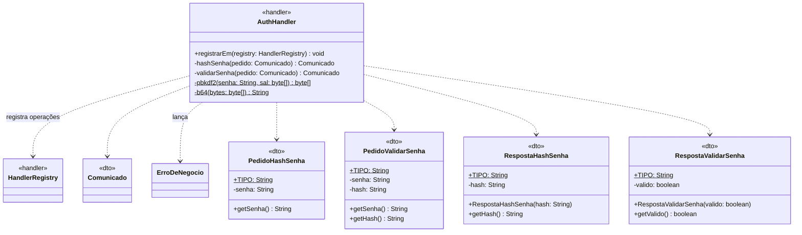

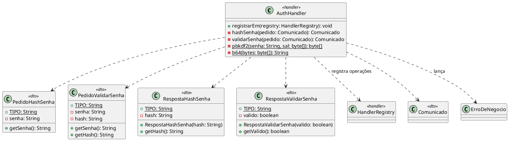

---

## PedidoHashSenha

- **Tipo / estereótipo:** classe «dto»
- **Arquivo:** `Servidor/src/main/java/com/financeai/auth/PedidoHashSenha.java`
- **Descrição:** Pedido para gerar o hash de uma senha.

### Atributos

| Visibilidade | Nome | Tipo | Descrição |
|---|---|---|---|
| + | TIPO | String | Constante estática que identifica o tipo do pedido no `Comunicado`. |
| - | senha | String | Senha em texto puro a ser transformada em hash. |

### Operações

| Visibilidade | Assinatura | Retorno | Descrição |
|---|---|---|---|
| + | getSenha() | String | Retorna a senha informada no pedido. |

### Relações

| Tipo | Alvo | Multiplicidade | Rótulo |
|---|---|---|---|
| dependência (entrante) | AuthHandler | 1 | usada por `hashSenha` e registrada em `registrarEm` |

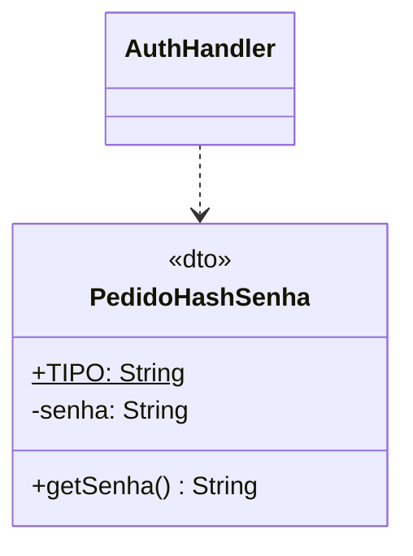

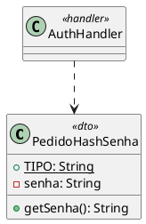

## PedidoValidarSenha

- **Tipo / estereótipo:** classe «dto»
- **Arquivo:** `Servidor/src/main/java/com/financeai/auth/PedidoValidarSenha.java`
- **Descrição:** Pedido para validar uma senha contra um hash existente.

### Atributos

| Visibilidade | Nome | Tipo | Descrição |
|---|---|---|---|
| + | TIPO | String | Constante estática que identifica o tipo do pedido no `Comunicado`. |
| - | senha | String | Senha em texto puro a ser conferida. |
| - | hash | String | Hash existente no formato `sal:hash` em Base64. |

### Operações

| Visibilidade | Assinatura | Retorno | Descrição |
|---|---|---|---|
| + | getSenha() | String | Retorna a senha informada. |
| + | getHash() | String | Retorna o hash informado. |

### Relações

| Tipo | Alvo | Multiplicidade | Rótulo |
|---|---|---|---|
| dependência (entrante) | AuthHandler | 1 | usada por `validarSenha` e registrada em `registrarEm` |

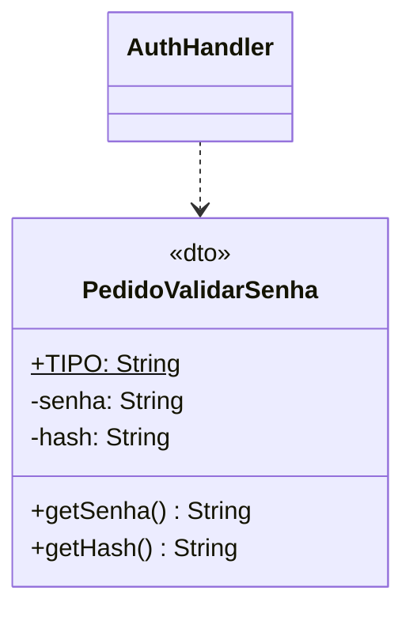

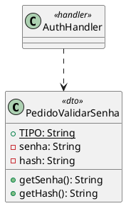

## RespostaHashSenha

- **Tipo / estereótipo:** classe «dto»
- **Arquivo:** `Servidor/src/main/java/com/financeai/auth/RespostaHashSenha.java`
- **Descrição:** Resposta com o hash (sal:hash em Base64) gerado.

### Atributos

| Visibilidade | Nome | Tipo | Descrição |
|---|---|---|---|
| + | TIPO | String | Constante estática que identifica o tipo da resposta no `Comunicado`. |
| - | hash | String | Hash gerado, no formato `sal:hash` em Base64. |

### Operações

| Visibilidade | Assinatura | Retorno | Descrição |
|---|---|---|---|
| + | RespostaHashSenha(hash: String) | (construtor) | Cria a resposta com o hash gerado. |
| + | getHash() | String | Retorna o hash. |

### Relações

| Tipo | Alvo | Multiplicidade | Rótulo |
|---|---|---|---|
| dependência (entrante) | AuthHandler | 1 | instanciada por `hashSenha` |

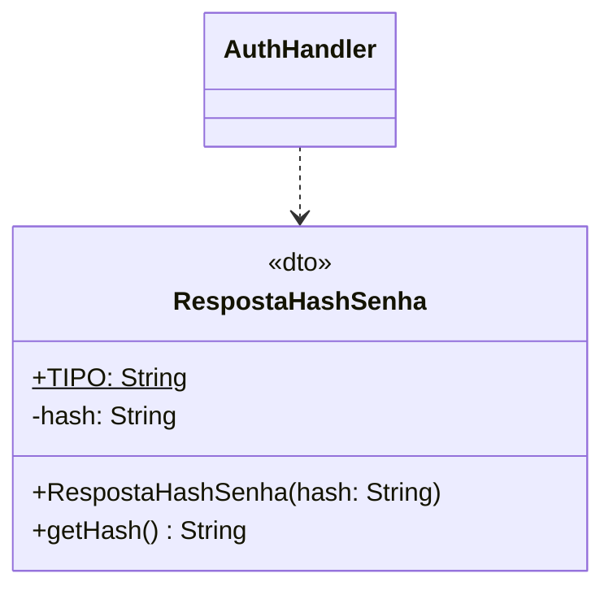

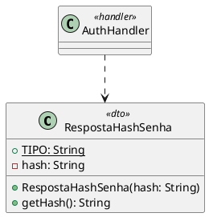

## RespostaValidarSenha

- **Tipo / estereótipo:** classe «dto»
- **Arquivo:** `Servidor/src/main/java/com/financeai/auth/RespostaValidarSenha.java`
- **Descrição:** Resposta indicando se a senha confere com o hash.

### Atributos

| Visibilidade | Nome | Tipo | Descrição |
|---|---|---|---|
| + | TIPO | String | Constante estática que identifica o tipo da resposta no `Comunicado`. |
| - | valido | boolean | Indica se a senha confere com o hash. |

### Operações

| Visibilidade | Assinatura | Retorno | Descrição |
|---|---|---|---|
| + | RespostaValidarSenha(valido: boolean) | (construtor) | Cria a resposta com o resultado da validação. |
| + | getValido() | boolean | Retorna o resultado da validação. |

### Relações

| Tipo | Alvo | Multiplicidade | Rótulo |
|---|---|---|---|
| dependência (entrante) | AuthHandler | 1 | instanciada por `validarSenha` |

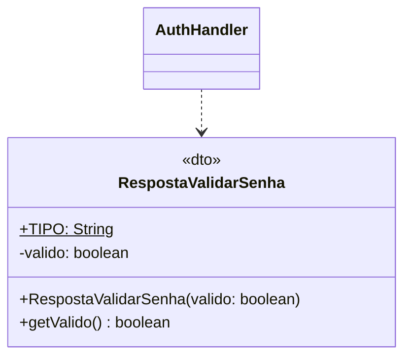

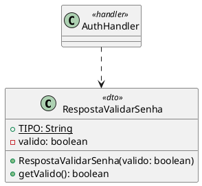

## AuthHandler

- **Tipo / estereótipo:** classe «handler»
- **Arquivo:** `Servidor/src/main/java/com/financeai/auth/AuthHandler.java`
- **Descrição:** Handler que gera e valida hashes de senha com PBKDF2WithHmacSHA256 (sal aleatório de 16 bytes, 120000 iterações, chave de 256 bits). Registra as operações `PedidoHashSenha` e `PedidoValidarSenha` no `HandlerRegistry`. Lança `ErroDeNegocio` com código `VALIDATION` quando os dados do pedido são inválidos.

### Atributos

Não possui atributos.

### Operações

| Visibilidade | Assinatura | Retorno | Descrição |
|---|---|---|---|
| + | registrarEm(registry: HandlerRegistry) | void | Registra no `HandlerRegistry` as operações de hash e de validação de senha. |
| - | hashSenha(pedido: Comunicado) | Comunicado | Gera sal aleatório, calcula o PBKDF2 e devolve `RespostaHashSenha` com `sal:hash` em Base64. Lança `ErroDeNegocio` se a senha for ausente ou vazia. |
| - | validarSenha(pedido: Comunicado) | Comunicado | Decodifica o hash `sal:hash`, recalcula o PBKDF2 e compara em tempo constante; devolve `RespostaValidarSenha`. Lança `ErroDeNegocio` se senha/hash forem ausentes ou o hash for inválido. |
| - | pbkdf2(senha: String, sal: byte[]) {static} | byte[] | Deriva a chave com PBKDF2WithHmacSHA256. |
| - | b64(bytes: byte[]) {static} | String | Codifica bytes em Base64. |

### Relações

| Tipo | Alvo | Multiplicidade | Rótulo |
|---|---|---|---|
| dependência | HandlerRegistry | 1 | registra operações |
| dependência | Comunicado | 1 | |
| dependência | ErroDeNegocio | * | lança |
| dependência | PedidoHashSenha | 1 | |
| dependência | PedidoValidarSenha | 1 | |
| dependência | RespostaHashSenha | 1 | |
| dependência | RespostaValidarSenha | 1 | |

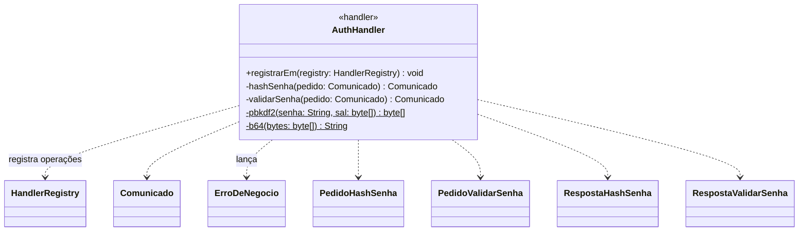

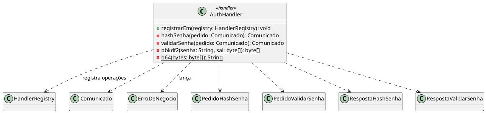
