# Servidor Java: núcleo (core)

Modelo UML (padrão Astah / UML 2) dos elementos do grupo **srv-core**: infraestrutura de conexão, protocolo e despacho de pedidos do Servidor Java. Todos os elementos abaixo existem no código; este grupo não possui elementos «planejado» (contas e transferências, descritas em `docs/especificacao-contas-e-transferencias.md`, serão implementadas em handlers de outros grupos).

Notação: visibilidade `+` público, `-` privado, `#` protegido, `~` pacote. Atributos e operações `static` são indicados na descrição. Cada diagrama aparece em dois blocos (Mermaid para o GitHub e PlantUML para recriar no Astah).

## Elementos do grupo

| Elemento | Tipo | Estereótipo | Arquivo |
|---|---|---|---|
| Handler | interface | «interface» | `Servidor/src/main/java/com/financeai/core/Handler.java` |
| Parceiro | classe | - | `Servidor/src/main/java/com/financeai/core/Parceiro.java` |
| Teclado | classe | - | `Servidor/src/main/java/com/financeai/core/Teclado.java` |
| Aceitadora | classe | - | `Servidor/src/main/java/com/financeai/core/Aceitadora.java` |
| Comunicado | classe | - | `Servidor/src/main/java/com/financeai/core/Comunicado.java` |
| EcoHandler | classe | «handler» | `Servidor/src/main/java/com/financeai/core/EcoHandler.java` |
| ErroDeNegocio | classe | - | `Servidor/src/main/java/com/financeai/core/ErroDeNegocio.java` |
| Supervisora | classe | - | `Servidor/src/main/java/com/financeai/core/Supervisora.java` |
| HandlerRegistry | classe | - | `Servidor/src/main/java/com/financeai/core/HandlerRegistry.java` |
| Main | classe | - | `Servidor/src/main/java/com/financeai/Main.java` |

## Diagrama do grupo

Vizinhos de outros grupos (AuthHandler, MentorHandler, TransactionsHandler, DashboardHandler, GoalsHandler, InvestmentsHandler) aparecem apenas como dependências do HandlerRegistry. Thread e Exception são classes da biblioteca Java.

```mermaid
classDiagram
    direction LR
    class Handler {
        <<interface>>
        +tratar(pedido: Comunicado) Comunicado
    }
    class Parceiro {
        -conexao: Socket
        -receptor: BufferedReader
        -transmissor: PrintWriter
        -proximoComunicado: Comunicado
        -mutEx: Semaphore
        +Parceiro(conexao: Socket, receptor: BufferedReader, transmissor: PrintWriter)
        +receba(x: Comunicado) void
        +espie() Comunicado
        +envie() Comunicado
        -lerProximo() Comunicado
        +adeus() void
    }
    class Teclado {
        -teclado: BufferedReader
        +getUmString() String
        +getUmByte() byte
        +getUmShort() short
        +getUmInt() int
        +getUmLong() long
        +getUmFloat() float
        +getUmDouble() double
        +getUmChar() char
        +getUmBoolean() boolean
    }
    class Aceitadora {
        -pedido: ServerSocket
        -usuarios: ArrayList~Parceiro~
        -registry: HandlerRegistry
        +Aceitadora(porta: String, usuarios: ArrayList~Parceiro~, registry: HandlerRegistry)
        +run() void
    }
    class Comunicado {
        +TIPO_PEDIDO_PARA_SAIR: String
        +TIPO_DESLIGAMENTO: String
        +TIPO_ERRO: String
        -GSON: Gson
        -tipo: String
        -dados: JsonElement
        +Comunicado(tipo: String, dados: JsonElement)
        +de(tipo: String, payload: Object) Comunicado
        +desligamento() Comunicado
        +erro(code: String, mensagem: String) Comunicado
        +erro(mensagem: String) Comunicado
        +lerJson(linha: String) Comunicado
        +paraJson() String
        +dadosComo(classe: Class~T~) T
        +getDados() JsonElement
        +getTipo() String
    }
    class EcoHandler {
        <<handler>>
        +TIPO_PEDIDO: String
        +TIPO_RESPOSTA: String
        +registrarEm(registry: HandlerRegistry) void
        -eco(pedido: Comunicado) Comunicado
    }
    class ErroDeNegocio {
        -serialVersionUID: long
        -code: String
        +ErroDeNegocio(code: String, mensagem: String)
        +getCode() String
    }
    class Supervisora {
        +TIMEOUT_LEITURA_MS: int
        -usuario: Parceiro
        -conexao: Socket
        -usuarios: ArrayList~Parceiro~
        -registry: HandlerRegistry
        +Supervisora(conexao: Socket, usuarios: ArrayList~Parceiro~, registry: HandlerRegistry)
        +run() void
    }
    class HandlerRegistry {
        -handlers: Map~String, Handler~
        +registrar(tipo: String, handler: Handler) void
        +obter(tipo: String) Handler
        +criarPadrao() HandlerRegistry
    }
    class Main {
        +PORTA_PADRAO: String
        +main(args: String[]) void
    }
    class Thread
    class Exception
    class AuthHandler
    class MentorHandler
    class TransactionsHandler
    class DashboardHandler
    class GoalsHandler
    class InvestmentsHandler

    Aceitadora --|> Thread
    Supervisora --|> Thread
    ErroDeNegocio --|> Exception
    Parceiro --> "0..1" Comunicado : proximoComunicado
    Aceitadora o-- "0..*" Parceiro : usuarios
    Aceitadora --> "1" HandlerRegistry : registry
    Supervisora *-- "1" Parceiro : usuario
    Supervisora o-- "0..*" Parceiro : usuarios
    Supervisora --> "1" HandlerRegistry : registry
    HandlerRegistry o-- "0..*" Handler : handlers
    Main o-- "0..*" Parceiro : usuarios
    Handler ..> Comunicado : recebe e devolve
    Parceiro ..> Comunicado : paraJson / lerJson
    Aceitadora ..> Supervisora : cria
    Supervisora ..> Handler : obtem e invoca
    Supervisora ..> Comunicado
    Supervisora ..> ErroDeNegocio : captura
    EcoHandler ..> HandlerRegistry : registra
    EcoHandler ..> Comunicado
    EcoHandler ..> ErroDeNegocio : lanca
    EcoHandler ..> Handler : this::eco como Handler
    HandlerRegistry ..> EcoHandler : instancia e registra
    HandlerRegistry ..> AuthHandler : instancia e registra
    HandlerRegistry ..> MentorHandler : instancia e registra
    HandlerRegistry ..> TransactionsHandler : instancia e registra
    HandlerRegistry ..> DashboardHandler : instancia e registra
    HandlerRegistry ..> GoalsHandler : instancia e registra
    HandlerRegistry ..> InvestmentsHandler : instancia e registra
    Main ..> HandlerRegistry : criarPadrao
    Main ..> Aceitadora : cria e inicia
    Main ..> Teclado : le comando
    Main ..> Comunicado : desligamento
```

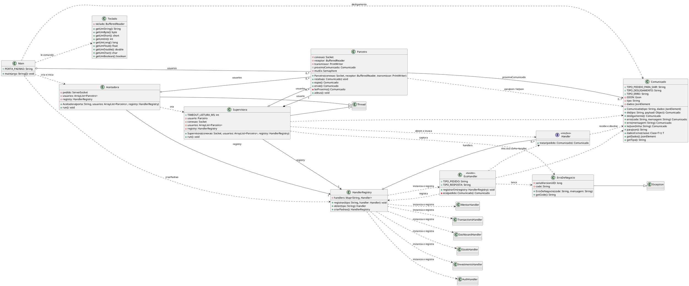

---

## Handler

- **Tipo e estereótipo:** interface, «interface» (interface funcional).
- **Arquivo de origem:** `Servidor/src/main/java/com/financeai/core/Handler.java`
- **Descrição:** Interface funcional de tratamento de um pedido que devolve um Comunicado de resposta.

### Atributos

Não possui atributos.

### Operações

| Visibilidade | Assinatura | Retorno | Descrição |
|---|---|---|---|
| + | tratar(pedido: Comunicado) | Comunicado | Trata o pedido recebido e devolve o Comunicado de resposta. |

### Relações

| Tipo | Alvo | Multiplicidade | Rótulo |
|---|---|---|---|
| dependência | Comunicado | - | recebe e devolve |

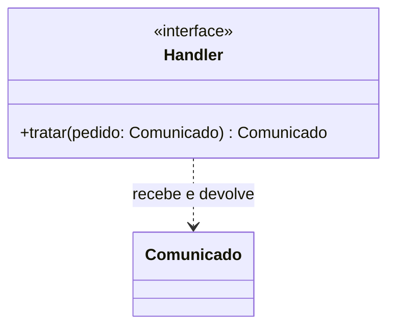

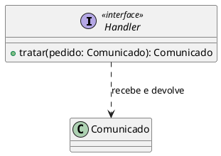

## Parceiro

- **Tipo e estereótipo:** classe.
- **Arquivo de origem:** `Servidor/src/main/java/com/financeai/core/Parceiro.java`
- **Descrição:** Representa uma conexão de cliente, lendo e escrevendo Comunicados em linhas JSON com exclusão mútua.

### Atributos

| Visibilidade | Nome | Tipo | Descrição |
|---|---|---|---|
| - | conexao | Socket | Socket da conexão com o cliente. |
| - | receptor | BufferedReader | Leitor das linhas JSON recebidas. |
| - | transmissor | PrintWriter | Escritor das linhas JSON enviadas. |
| - | proximoComunicado | Comunicado | Próximo Comunicado já lido e ainda não consumido. |
| - | mutEx | Semaphore | Semáforo de exclusão mútua do acesso à conexão. |

### Operações

| Visibilidade | Assinatura | Retorno | Descrição |
|---|---|---|---|
| + | Parceiro(conexao: Socket, receptor: BufferedReader, transmissor: PrintWriter) | - | Construtor que recebe a conexão e seus fluxos de leitura e escrita. |
| + | receba(x: Comunicado) | void | Envia um Comunicado ao cliente (serializado com paraJson). |
| + | espie() | Comunicado | Consulta o próximo Comunicado sem consumi-lo. |
| + | envie() | Comunicado | Devolve e consome o próximo Comunicado recebido. |
| - | lerProximo() | Comunicado | Lê a próxima linha JSON e a converte (lerJson). |
| + | adeus() | void | Encerra a conexão com o cliente. |

### Relações

| Tipo | Alvo | Multiplicidade | Rótulo |
|---|---|---|---|
| associação | Comunicado | 0..1 | proximoComunicado |
| dependência | Comunicado | - | paraJson / lerJson |

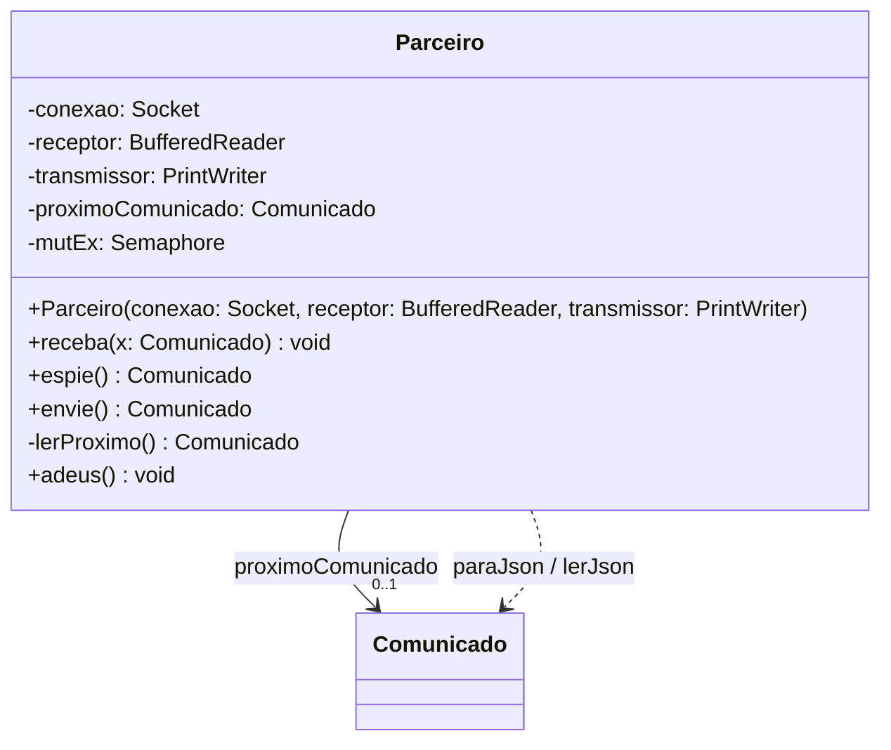

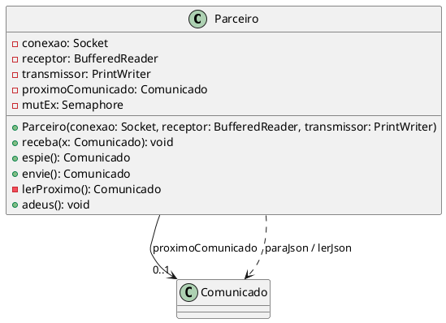

## Teclado

- **Tipo e estereótipo:** classe (utilitária, membros estáticos).
- **Arquivo de origem:** `Servidor/src/main/java/com/financeai/core/Teclado.java`
- **Descrição:** Utilitário estático para ler valores tipados do teclado (System.in).

### Atributos

| Visibilidade | Nome | Tipo | Descrição |
|---|---|---|---|
| - | teclado | BufferedReader | Leitor da entrada padrão. |

### Operações

| Visibilidade | Assinatura | Retorno | Descrição |
|---|---|---|---|
| + | getUmString() | String | Lê uma linha como String. |
| + | getUmByte() | byte | Lê um valor byte. |
| + | getUmShort() | short | Lê um valor short. |
| + | getUmInt() | int | Lê um valor int. |
| + | getUmLong() | long | Lê um valor long. |
| + | getUmFloat() | float | Lê um valor float. |
| + | getUmDouble() | double | Lê um valor double. |
| + | getUmChar() | char | Lê um caractere. |
| + | getUmBoolean() | boolean | Lê um valor booleano. |

### Relações

Não possui relações com outros elementos do grupo (é usada por Main).

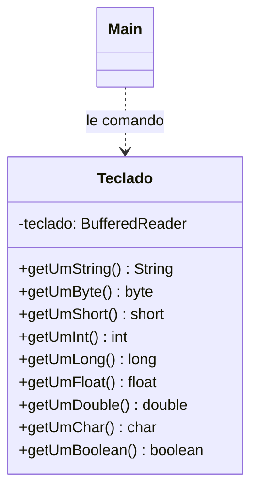

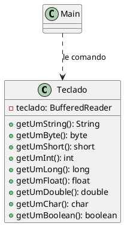

## Aceitadora

- **Tipo e estereótipo:** classe (herda de Thread).
- **Arquivo de origem:** `Servidor/src/main/java/com/financeai/core/Aceitadora.java`
- **Descrição:** Thread que aceita conexões TCP somente de loopback e cria uma Supervisora para cada uma.

### Atributos

| Visibilidade | Nome | Tipo | Descrição |
|---|---|---|---|
| - | pedido | ServerSocket | Socket de escuta de novas conexões. |
| - | usuarios | ArrayList<Parceiro> | Lista compartilhada das conexões ativas. |
| - | registry | HandlerRegistry | Registro de handlers repassado às Supervisoras. |

### Operações

| Visibilidade | Assinatura | Retorno | Descrição |
|---|---|---|---|
| + | Aceitadora(porta: String, usuarios: ArrayList<Parceiro>, registry: HandlerRegistry) | - | Construtor que abre a escuta na porta indicada. |
| + | run() | void | Laço que aceita conexões de loopback e cria uma Supervisora por conexão. |

### Relações

| Tipo | Alvo | Multiplicidade | Rótulo |
|---|---|---|---|
| generalização | Thread | - | - |
| agregação | Parceiro | 0..* | usuarios |
| associação | HandlerRegistry | 1 | registry |
| dependência | Supervisora | - | cria |

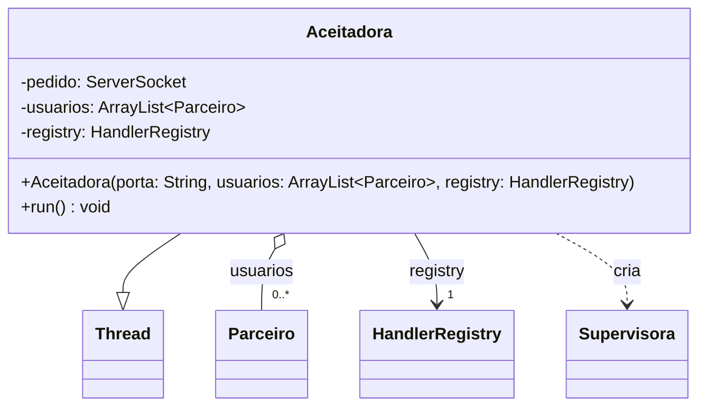

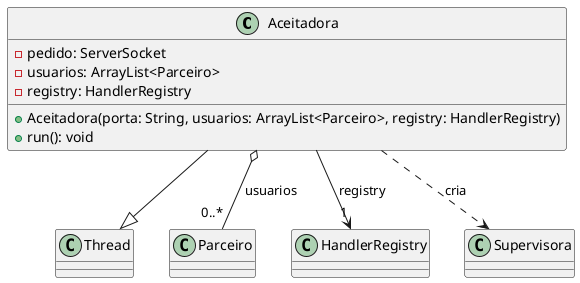

## Comunicado

- **Tipo e estereótipo:** classe (mensagem do protocolo; sem estereótipo específico).
- **Arquivo de origem:** `Servidor/src/main/java/com/financeai/core/Comunicado.java`
- **Descrição:** Mensagem do protocolo JSON com tipo e dados, com fábricas para erro e desligamento.

### Atributos

| Visibilidade | Nome | Tipo | Descrição |
|---|---|---|---|
| + | TIPO_PEDIDO_PARA_SAIR | String | Constante (estática) do tipo de pedido de saída. |
| + | TIPO_DESLIGAMENTO | String | Constante (estática) do tipo de aviso de desligamento. |
| + | TIPO_ERRO | String | Constante (estática) do tipo de resposta de erro. |
| - | GSON | Gson | Instância (estática) usada na serialização JSON. |
| - | tipo | String | Tipo do comunicado, usado para localizar o Handler. |
| - | dados | JsonElement | Conteúdo (payload) do comunicado. |

### Operações

| Visibilidade | Assinatura | Retorno | Descrição |
|---|---|---|---|
| + | Comunicado(tipo: String, dados: JsonElement) | - | Construtor com tipo e dados. |
| + | de(tipo: String, payload: Object) | Comunicado | Fábrica estática que converte o payload em JSON. |
| + | desligamento() | Comunicado | Fábrica estática do comunicado de desligamento. |
| + | erro(code: String, mensagem: String) | Comunicado | Fábrica estática de erro com código e mensagem. |
| + | erro(mensagem: String) | Comunicado | Fábrica estática de erro apenas com mensagem. |
| + | lerJson(linha: String) | Comunicado | Converte uma linha JSON em Comunicado. |
| + | paraJson() | String | Serializa o comunicado em uma linha JSON. |
| + | dadosComo(classe: Class<T>) | T | Converte os dados para a classe informada. |
| + | getDados() | JsonElement | Devolve os dados. |
| + | getTipo() | String | Devolve o tipo. |

### Relações

Não possui relações de saída; é usada por Handler, Parceiro, Supervisora, EcoHandler e Main.

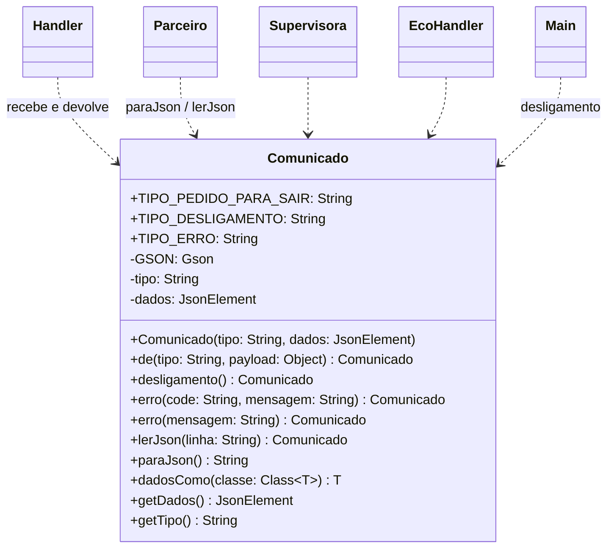

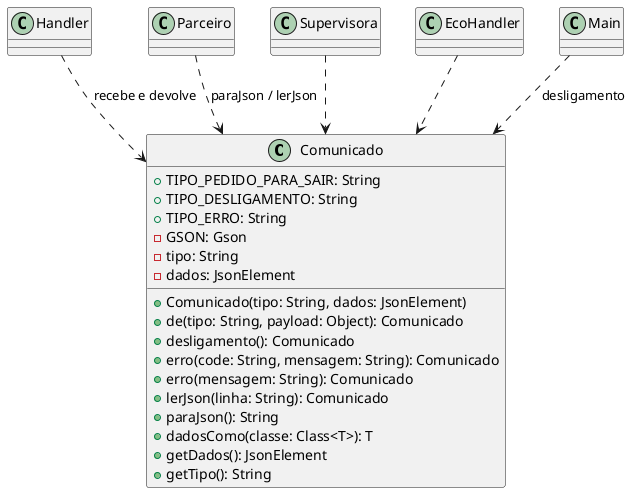

## EcoHandler

- **Tipo e estereótipo:** classe, «handler».
- **Arquivo de origem:** `Servidor/src/main/java/com/financeai/core/EcoHandler.java`
- **Descrição:** Handler de teste que devolve em RespostaEco os dados de PedidoEco e simula falhas de negócio ou internas.

### Atributos

| Visibilidade | Nome | Tipo | Descrição |
|---|---|---|---|
| + | TIPO_PEDIDO | String | Constante (estática) do tipo de pedido tratado. |
| + | TIPO_RESPOSTA | String | Constante (estática) do tipo de resposta devolvida. |

### Operações

| Visibilidade | Assinatura | Retorno | Descrição |
|---|---|---|---|
| + | registrarEm(registry: HandlerRegistry) | void | Registra o handler de eco no HandlerRegistry (método estático). |
| - | eco(pedido: Comunicado) | Comunicado | Devolve os dados do pedido em RespostaEco ou simula falha. |

### Relações

| Tipo | Alvo | Multiplicidade | Rótulo |
|---|---|---|---|
| dependência | HandlerRegistry | - | registra |
| dependência | Comunicado | - | - |
| dependência | ErroDeNegocio | - | lança |
| dependência | Handler | - | this::eco como Handler |

```mermaid
classDiagram
    class EcoHandler {
        <<handler>>
        +TIPO_PEDIDO: String
        +TIPO_RESPOSTA: String
        +registrarEm(registry: HandlerRegistry) void
        -eco(pedido: Comunicado) Comunicado
    }
    class HandlerRegistry
    class Comunicado
    class ErroDeNegocio
    class Handler
    EcoHandler ..> HandlerRegistry : registra
    EcoHandler ..> Comunicado
    EcoHandler ..> ErroDeNegocio : lanca
    EcoHandler ..> Handler : this::eco como Handler
```

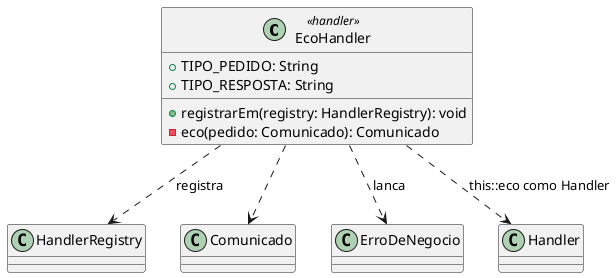

## ErroDeNegocio

- **Tipo e estereótipo:** classe (exceção, herda de Exception).
- **Arquivo de origem:** `Servidor/src/main/java/com/financeai/core/ErroDeNegocio.java`
- **Descrição:** Exceção de regra de negócio com code, convertida em Comunicado de erro pela Supervisora.

### Atributos

| Visibilidade | Nome | Tipo | Descrição |
|---|---|---|---|
| - | serialVersionUID | long | Constante (estática) de versão de serialização. |
| - | code | String | Código do erro de negócio. |

### Operações

| Visibilidade | Assinatura | Retorno | Descrição |
|---|---|---|---|
| + | ErroDeNegocio(code: String, mensagem: String) | - | Construtor com código e mensagem. |
| + | getCode() | String | Devolve o código do erro. |

### Relações

| Tipo | Alvo | Multiplicidade | Rótulo |
|---|---|---|---|
| generalização | Exception | - | - |

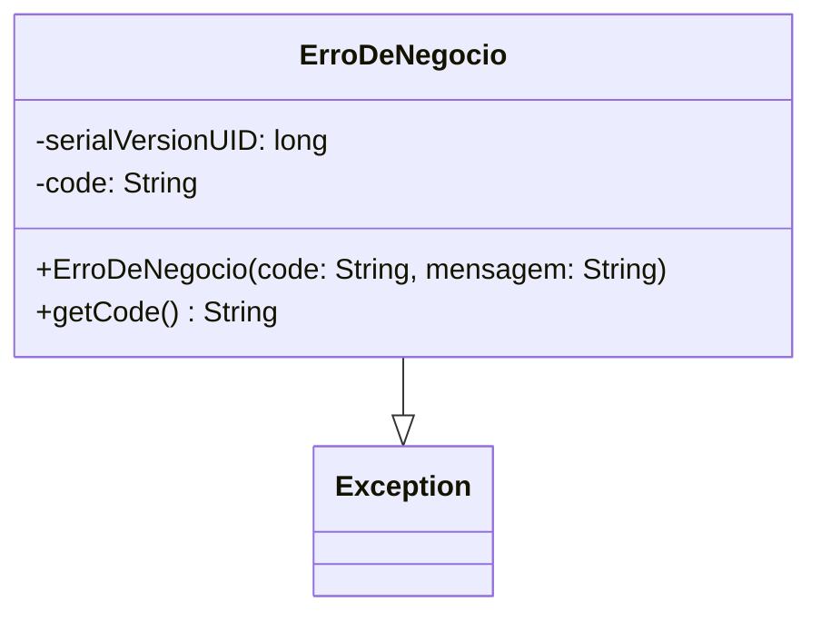

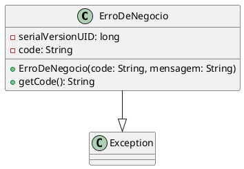

## Supervisora

- **Tipo e estereótipo:** classe (herda de Thread).
- **Arquivo de origem:** `Servidor/src/main/java/com/financeai/core/Supervisora.java`
- **Descrição:** Thread que atende uma conexão, despachando cada pedido ao Handler registrado e respondendo ou convertendo erros.

### Atributos

| Visibilidade | Nome | Tipo | Descrição |
|---|---|---|---|
| + | TIMEOUT_LEITURA_MS | int | Constante (estática) do tempo limite de leitura, em ms. |
| - | usuario | Parceiro | Conexão atendida por esta Supervisora. |
| - | conexao | Socket | Socket da conexão. |
| - | usuarios | ArrayList<Parceiro> | Lista compartilhada das conexões ativas. |
| - | registry | HandlerRegistry | Registro usado para obter o Handler de cada pedido. |

### Operações

| Visibilidade | Assinatura | Retorno | Descrição |
|---|---|---|---|
| + | Supervisora(conexao: Socket, usuarios: ArrayList<Parceiro>, registry: HandlerRegistry) | - | Construtor com a conexão, a lista de usuários e o registro. |
| + | run() | void | Laço de atendimento: lê pedidos, invoca o Handler e responde; converte ErroDeNegocio em Comunicado de erro. |

### Relações

| Tipo | Alvo | Multiplicidade | Rótulo |
|---|---|---|---|
| generalização | Thread | - | - |
| composição | Parceiro | 1 | usuario |
| agregação | Parceiro | 0..* | usuarios |
| associação | HandlerRegistry | 1 | registry |
| dependência | Handler | - | obtém e invoca |
| dependência | Comunicado | - | - |
| dependência | ErroDeNegocio | - | captura |

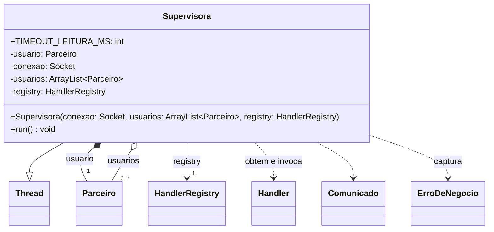

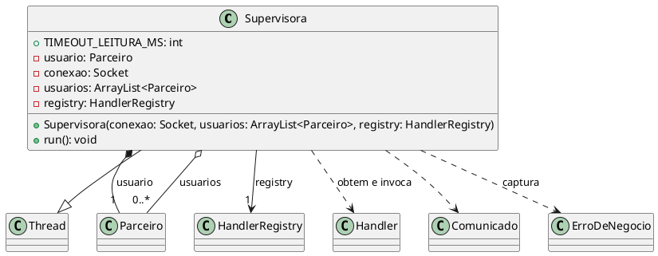

## HandlerRegistry

- **Tipo e estereótipo:** classe (registro de handlers).
- **Arquivo de origem:** `Servidor/src/main/java/com/financeai/core/HandlerRegistry.java`
- **Descrição:** Registro que mapeia o tipo de pedido ao Handler e monta o registro padrão com todos os handlers do servidor.

### Atributos

| Visibilidade | Nome | Tipo | Descrição |
|---|---|---|---|
| - | handlers | Map<String, Handler> | Mapa de tipo de pedido para Handler. |

### Operações

| Visibilidade | Assinatura | Retorno | Descrição |
|---|---|---|---|
| + | registrar(tipo: String, handler: Handler) | void | Associa um Handler a um tipo de pedido. |
| + | obter(tipo: String) | Handler | Devolve o Handler registrado para o tipo. |
| + | criarPadrao() | HandlerRegistry | Monta o registro padrão com todos os handlers do servidor (método estático). |

### Relações

| Tipo | Alvo | Multiplicidade | Rótulo |
|---|---|---|---|
| agregação | Handler | 0..* | handlers |
| dependência | EcoHandler | - | instancia e registra |
| dependência | AuthHandler | - | instancia e registra |
| dependência | MentorHandler | - | instancia e registra |
| dependência | TransactionsHandler | - | instancia e registra |
| dependência | DashboardHandler | - | instancia e registra |
| dependência | GoalsHandler | - | instancia e registra |
| dependência | InvestmentsHandler | - | instancia e registra |

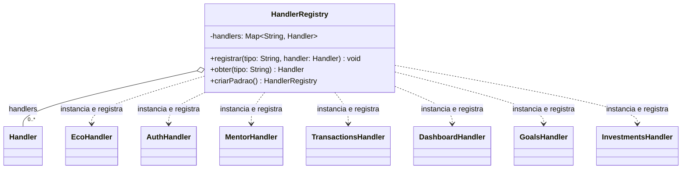

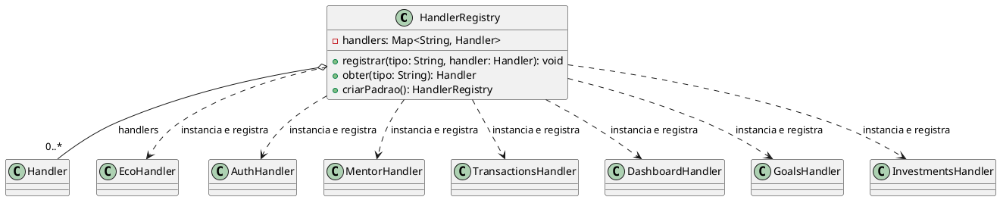

## Main

- **Tipo e estereótipo:** classe (ponto de entrada).
- **Arquivo de origem:** `Servidor/src/main/java/com/financeai/Main.java`
- **Descrição:** Ponto de entrada do Servidor: inicia a Aceitadora e atende o comando de console para desativar, avisando os clientes.

### Atributos

| Visibilidade | Nome | Tipo | Descrição |
|---|---|---|---|
| + | PORTA_PADRAO | String | Constante (estática) com a porta padrão do servidor. |

### Operações

| Visibilidade | Assinatura | Retorno | Descrição |
|---|---|---|---|
| + | main(args: String[]) | void | Cria o registro padrão e a Aceitadora, e atende o comando de console para desativar o servidor (envia o Comunicado de desligamento). Método estático. |

### Relações

| Tipo | Alvo | Multiplicidade | Rótulo |
|---|---|---|---|
| dependência | HandlerRegistry | - | criarPadrao |
| dependência | Aceitadora | - | cria e inicia |
| agregação | Parceiro | 0..* | usuarios |
| dependência | Teclado | - | lê comando |
| dependência | Comunicado | - | desligamento |

```mermaid
classDiagram
    class Main {
        +PORTA_PADRAO: String
        +main(args: String[]) void
    }
    class HandlerRegistry
    class Aceitadora
    class Parceiro
    class Teclado
    class Comunicado
    Main ..> HandlerRegistry : criarPadrao
    Main ..> Aceitadora : cria e inicia
    Main o-- "0..*" Parceiro : usuarios
    Main ..> Teclado : le comando
    Main ..> Comunicado : desligamento
```

```plantuml
@startuml
class Main {
  + PORTA_PADRAO: String
  + main(args: String[]): void
}
class HandlerRegistry
class Aceitadora
class Parceiro
class Teclado
class Comunicado
Main ..> HandlerRegistry : criarPadrao
Main ..> Aceitadora : cria e inicia
Main o-- "0..*" Parceiro : usuarios
Main ..> Teclado : le comando
Main ..> Comunicado : desligamento
@enduml
```
