# Servidor Java: painel (pacote `com.financeai.dashboard`)

Modelo UML (padrão Astah / UML 2) das classes do grupo **srv-dashboard**, responsáveis pelos cálculos puros de indicadores (saldo, economia, fluxo de caixa) e pela comparação de períodos do dashboard.

Convenções: visibilidade `+` público, `-` privado, `#` protegido, `~` pacote. Estereótipos entre «aspas angulares». Elementos vizinhos de outros grupos (`HandlerRegistry`, `Comunicado`, `ErroDeNegocio`) aparecem apenas como alvo de dependência; seus modelos completos estão em outros arquivos.

## Diagrama do grupo

```mermaid
classDiagram
    class DashboardHandler {
        <<handler>>
        -double LIMITE_TENDENCIA
        +registrarEm(registry: HandlerRegistry) void
        -calcularIndicadores(pedido: Comunicado) Comunicado
        -compararPeriodos(pedido: Comunicado) Comunicado
        -variacao(anterior: double, atual: double) double
        -numero(mapa: Map, chave: String) double
    }
    class PedidoCalcularIndicadores {
        <<dto>>
        +String TIPO
        -double receitas
        -double despesas
        +PedidoCalcularIndicadores()
        +PedidoCalcularIndicadores(receitas: double, despesas: double)
        +getReceitas() double
        +getDespesas() double
        +toString() String
    }
    class PedidoCompararPeriodos {
        <<dto>>
        +String TIPO
        -List~Map~String,Object~~ periodos
        +PedidoCompararPeriodos()
        +PedidoCompararPeriodos(periodos: List~Map~String,Object~~)
        +getPeriodos() List~Map~String,Object~~
        +toString() String
    }
    class RespostaCalcularIndicadores {
        <<dto>>
        +String TIPO
        -double saldo
        -double economia
        -double fluxoDeCaixa
        +RespostaCalcularIndicadores(saldo: double, economia: double, fluxoDeCaixa: double)
        +getSaldo() double
        +getEconomia() double
        +getFluxoDeCaixa() double
        +toString() String
    }
    class RespostaCompararPeriodos {
        <<dto>>
        +String TIPO
        -List~Map~String,Object~~ periodos
        -String tendenciaDespesas
        +RespostaCompararPeriodos(periodos: List~Map~String,Object~~, tendenciaDespesas: String)
        +getPeriodos() List~Map~String,Object~~
        +getTendenciaDespesas() String
        +toString() String
    }
    class HandlerRegistry
    class Comunicado
    class ErroDeNegocio
    DashboardHandler ..> HandlerRegistry : registra em
    DashboardHandler ..> Comunicado : recebe/devolve
    DashboardHandler ..> ErroDeNegocio : lança
    DashboardHandler ..> PedidoCalcularIndicadores : usa
    DashboardHandler ..> PedidoCompararPeriodos : usa
    DashboardHandler ..> RespostaCalcularIndicadores : usa
    DashboardHandler ..> RespostaCompararPeriodos : usa
```

```plantuml
@startuml
class DashboardHandler <<handler>> {
  - LIMITE_TENDENCIA: double
  + registrarEm(registry: HandlerRegistry): void
  - calcularIndicadores(pedido: Comunicado): Comunicado
  - compararPeriodos(pedido: Comunicado): Comunicado
  - variacao(anterior: double, atual: double): double
  - numero(mapa: Map, chave: String): double
}
class PedidoCalcularIndicadores <<dto>> {
  + TIPO: String
  - receitas: double
  - despesas: double
  + PedidoCalcularIndicadores()
  + PedidoCalcularIndicadores(receitas: double, despesas: double)
  + getReceitas(): double
  + getDespesas(): double
  + toString(): String
}
class PedidoCompararPeriodos <<dto>> {
  + TIPO: String
  - periodos: List<Map<String,Object>>
  + PedidoCompararPeriodos()
  + PedidoCompararPeriodos(periodos: List<Map<String,Object>>)
  + getPeriodos(): List<Map<String,Object>>
  + toString(): String
}
class RespostaCalcularIndicadores <<dto>> {
  + TIPO: String
  - saldo: double
  - economia: double
  - fluxoDeCaixa: double
  + RespostaCalcularIndicadores(saldo: double, economia: double, fluxoDeCaixa: double)
  + getSaldo(): double
  + getEconomia(): double
  + getFluxoDeCaixa(): double
  + toString(): String
}
class RespostaCompararPeriodos <<dto>> {
  + TIPO: String
  - periodos: List<Map<String,Object>>
  - tendenciaDespesas: String
  + RespostaCompararPeriodos(periodos: List<Map<String,Object>>, tendenciaDespesas: String)
  + getPeriodos(): List<Map<String,Object>>
  + getTendenciaDespesas(): String
  + toString(): String
}
class HandlerRegistry
class Comunicado
class ErroDeNegocio
DashboardHandler ..> HandlerRegistry : registra em
DashboardHandler ..> Comunicado : recebe/devolve
DashboardHandler ..> ErroDeNegocio : lança
DashboardHandler ..> PedidoCalcularIndicadores : usa
DashboardHandler ..> PedidoCompararPeriodos : usa
DashboardHandler ..> RespostaCalcularIndicadores : usa
DashboardHandler ..> RespostaCompararPeriodos : usa
@enduml
```

---

## DashboardHandler

- **Tipo / estereótipo:** classe «handler»
- **Arquivo de origem:** `Servidor/src/main/java/com/financeai/dashboard/DashboardHandler.java`
- **Descrição:** Handler que registra e executa os cálculos puros de indicadores e comparação de períodos do dashboard.

### Atributos

| Visibilidade | Nome | Tipo | Descrição |
|---|---|---|---|
| - | LIMITE_TENDENCIA | double | Limite usado na classificação da tendência das despesas. |

### Operações

| Visibilidade | Assinatura | Retorno | Descrição |
|---|---|---|---|
| + | registrarEm(registry: HandlerRegistry) | void | Registra os tratadores do dashboard no registro de handlers. |
| - | calcularIndicadores(pedido: Comunicado) | Comunicado | Calcula saldo, economia e fluxo de caixa a partir de receitas e despesas. |
| - | compararPeriodos(pedido: Comunicado) | Comunicado | Compara os períodos informados e determina a tendência das despesas. |
| - | variacao(anterior: double, atual: double) | double | Calcula a variação entre dois valores. |
| - | numero(mapa: Map, chave: String) | double | Extrai um valor numérico de um mapa. |

### Relações

| Tipo | Alvo | Multiplicidade | Rótulo |
|---|---|---|---|
| dependência | HandlerRegistry | 1 | registra em |
| dependência | Comunicado | 1 | recebe/devolve |
| dependência | ErroDeNegocio | 0..* | lança |
| dependência | PedidoCalcularIndicadores | 1 | usa |
| dependência | PedidoCompararPeriodos | 1 | usa |
| dependência | RespostaCalcularIndicadores | 1 | usa |
| dependência | RespostaCompararPeriodos | 1 | usa |

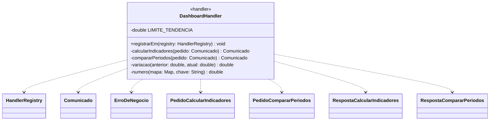

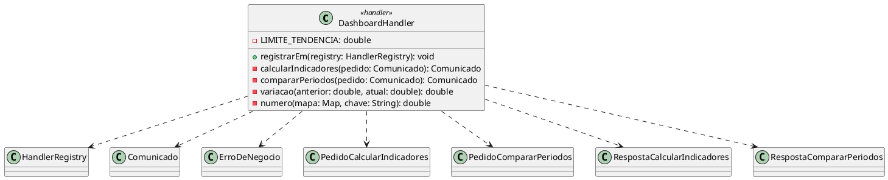

---

## PedidoCalcularIndicadores

- **Tipo / estereótipo:** classe «dto»
- **Arquivo de origem:** `Servidor/src/main/java/com/financeai/dashboard/PedidoCalcularIndicadores.java`
- **Descrição:** Pedido com receitas e despesas para calcular saldo, economia e fluxo de caixa.

### Atributos

| Visibilidade | Nome | Tipo | Descrição |
|---|---|---|---|
| + | TIPO | String | Identificador do tipo de pedido (constante). |
| - | receitas | double | Total de receitas do período. |
| - | despesas | double | Total de despesas do período. |

### Operações

| Visibilidade | Assinatura | Retorno | Descrição |
|---|---|---|---|
| + | PedidoCalcularIndicadores() | | Construtor padrão. |
| + | PedidoCalcularIndicadores(receitas: double, despesas: double) | | Construtor que inicializa receitas e despesas. |
| + | getReceitas() | double | Retorna as receitas. |
| + | getDespesas() | double | Retorna as despesas. |
| + | toString() | String | Representação textual do pedido. |

### Relações

| Tipo | Alvo | Multiplicidade | Rótulo |
|---|---|---|---|
| dependência (entrante) | DashboardHandler | 1 | usa |

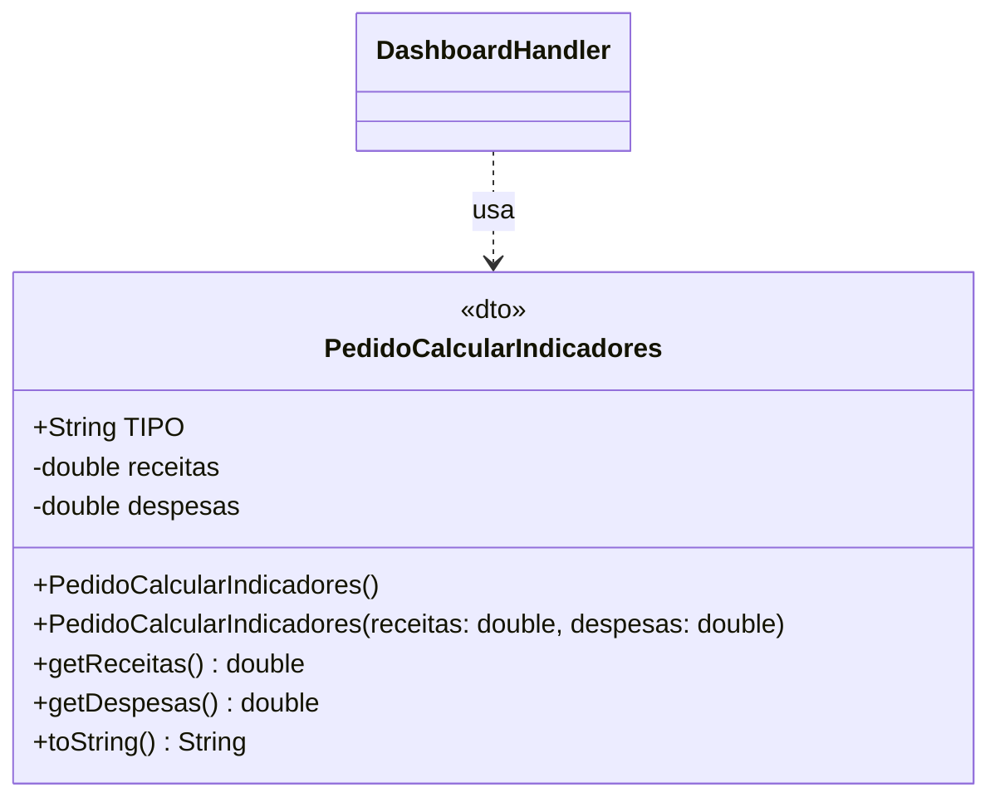

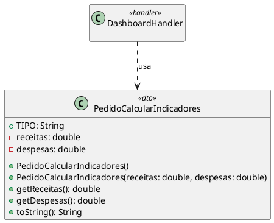

---

## PedidoCompararPeriodos

- **Tipo / estereótipo:** classe «dto»
- **Arquivo de origem:** `Servidor/src/main/java/com/financeai/dashboard/PedidoCompararPeriodos.java`
- **Descrição:** Pedido com a lista de períodos (receitas/despesas) a comparar.

### Atributos

| Visibilidade | Nome | Tipo | Descrição |
|---|---|---|---|
| + | TIPO | String | Identificador do tipo de pedido (constante). |
| - | periodos | List<Map<String,Object>> | Períodos a comparar, com receitas e despesas. |

### Operações

| Visibilidade | Assinatura | Retorno | Descrição |
|---|---|---|---|
| + | PedidoCompararPeriodos() | | Construtor padrão. |
| + | PedidoCompararPeriodos(periodos: List<Map<String,Object>>) | | Construtor que inicializa a lista de períodos. |
| + | getPeriodos() | List<Map<String,Object>> | Retorna os períodos. |
| + | toString() | String | Representação textual do pedido. |

### Relações

| Tipo | Alvo | Multiplicidade | Rótulo |
|---|---|---|---|
| dependência (entrante) | DashboardHandler | 1 | usa |

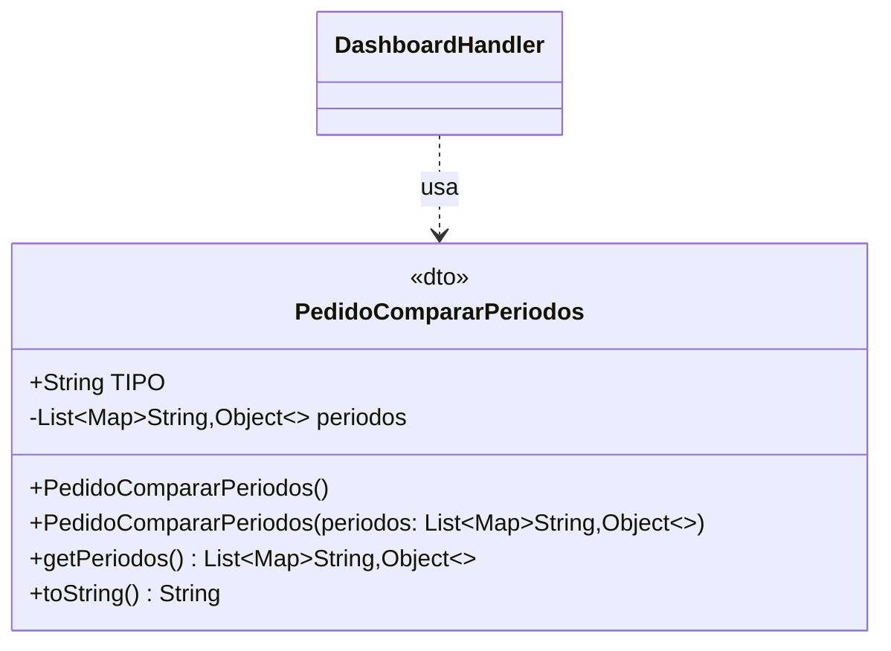

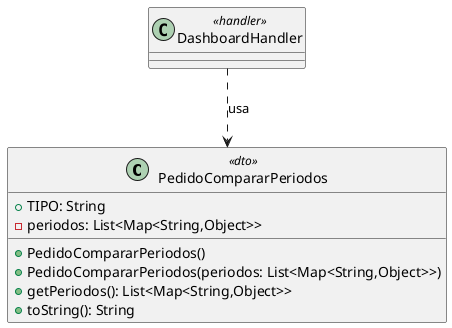

---

## RespostaCalcularIndicadores

- **Tipo / estereótipo:** classe «dto»
- **Arquivo de origem:** `Servidor/src/main/java/com/financeai/dashboard/RespostaCalcularIndicadores.java`
- **Descrição:** Resposta com saldo, economia e fluxo de caixa calculados.

### Atributos

| Visibilidade | Nome | Tipo | Descrição |
|---|---|---|---|
| + | TIPO | String | Identificador do tipo de resposta (constante). |
| - | saldo | double | Saldo calculado. |
| - | economia | double | Economia calculada. |
| - | fluxoDeCaixa | double | Fluxo de caixa calculado. |

### Operações

| Visibilidade | Assinatura | Retorno | Descrição |
|---|---|---|---|
| + | RespostaCalcularIndicadores(saldo: double, economia: double, fluxoDeCaixa: double) | | Construtor que inicializa os indicadores. |
| + | getSaldo() | double | Retorna o saldo. |
| + | getEconomia() | double | Retorna a economia. |
| + | getFluxoDeCaixa() | double | Retorna o fluxo de caixa. |
| + | toString() | String | Representação textual da resposta. |

### Relações

| Tipo | Alvo | Multiplicidade | Rótulo |
|---|---|---|---|
| dependência (entrante) | DashboardHandler | 1 | usa |

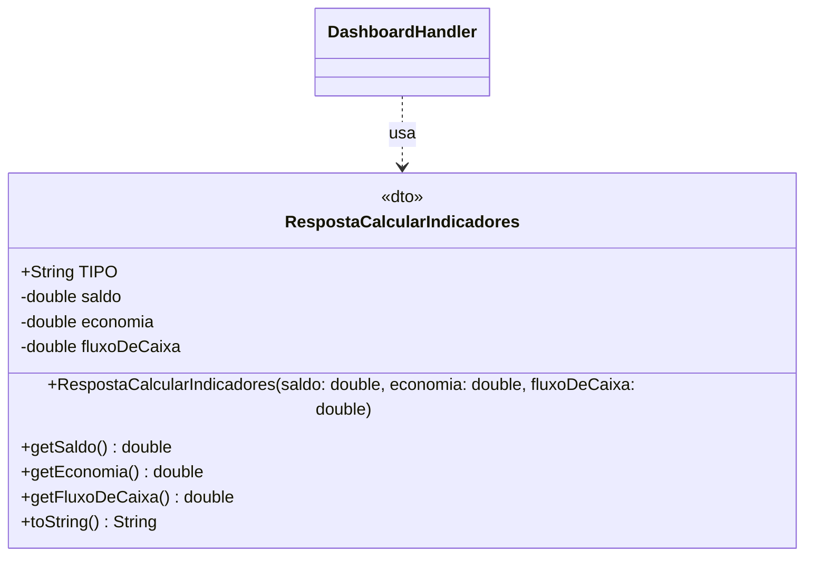

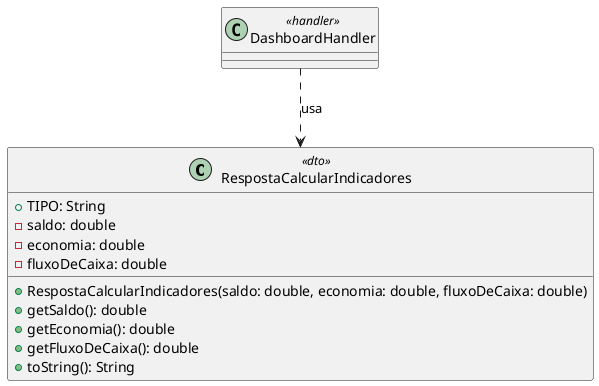

---

## RespostaCompararPeriodos

- **Tipo / estereótipo:** classe «dto»
- **Arquivo de origem:** `Servidor/src/main/java/com/financeai/dashboard/RespostaCompararPeriodos.java`
- **Descrição:** Resposta com os períodos comparados e a tendência das despesas.

### Atributos

| Visibilidade | Nome | Tipo | Descrição |
|---|---|---|---|
| + | TIPO | String | Identificador do tipo de resposta (constante). |
| - | periodos | List<Map<String,Object>> | Períodos comparados. |
| - | tendenciaDespesas | String | Tendência das despesas entre os períodos. |

### Operações

| Visibilidade | Assinatura | Retorno | Descrição |
|---|---|---|---|
| + | RespostaCompararPeriodos(periodos: List<Map<String,Object>>, tendenciaDespesas: String) | | Construtor que inicializa períodos e tendência. |
| + | getPeriodos() | List<Map<String,Object>> | Retorna os períodos comparados. |
| + | getTendenciaDespesas() | String | Retorna a tendência das despesas. |
| + | toString() | String | Representação textual da resposta. |

### Relações

| Tipo | Alvo | Multiplicidade | Rótulo |
|---|---|---|---|
| dependência (entrante) | DashboardHandler | 1 | usa |

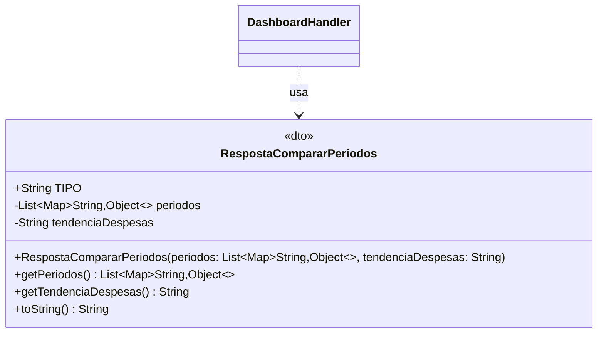

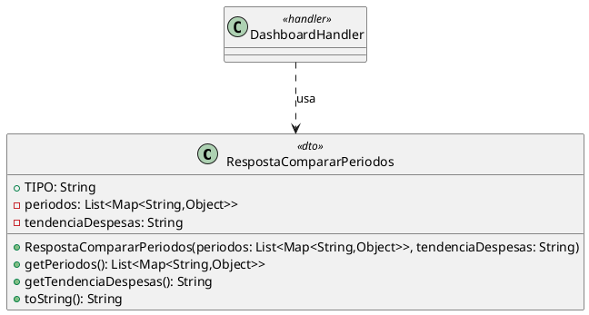
