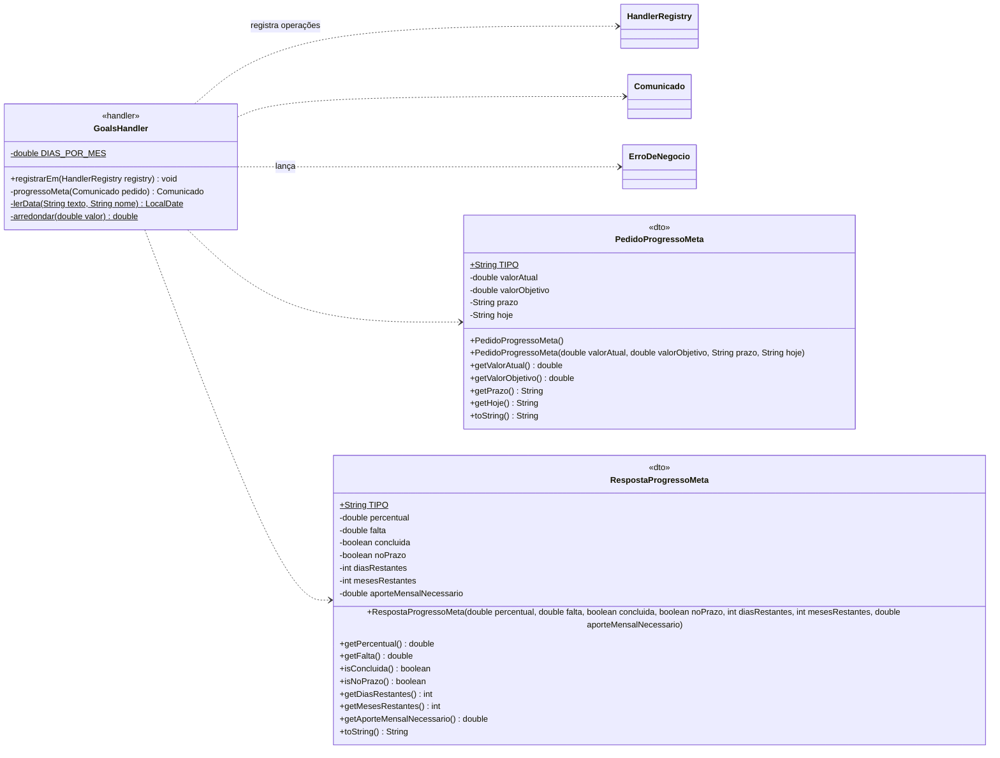
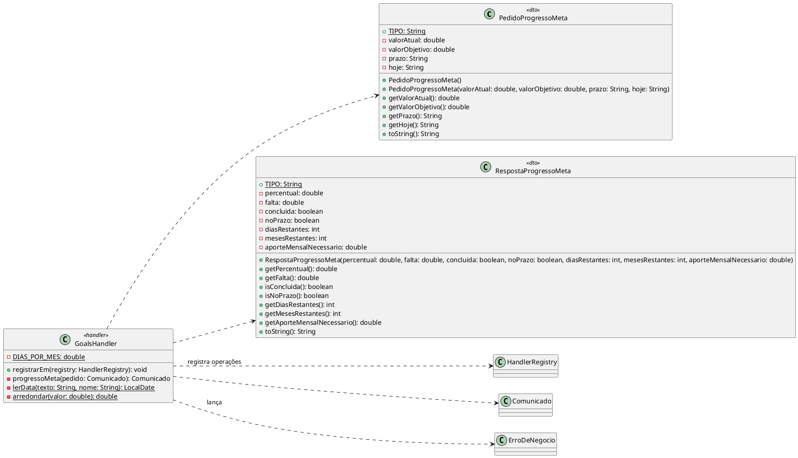
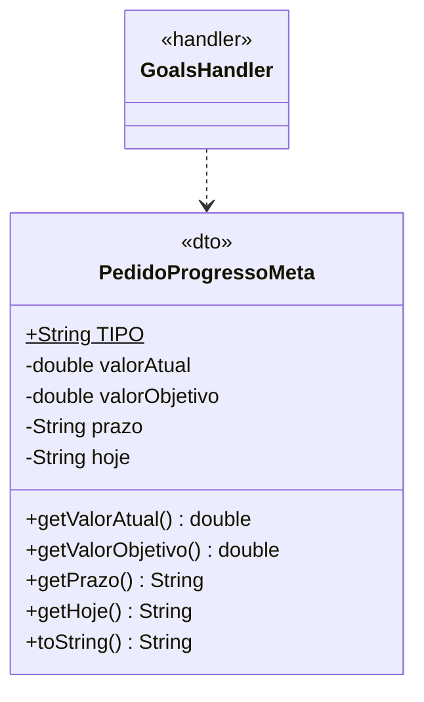
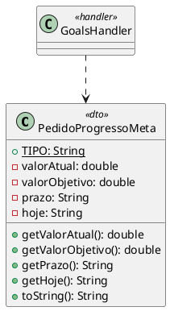
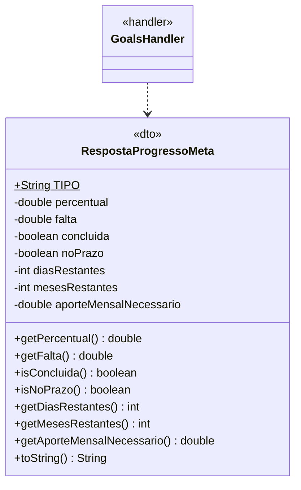
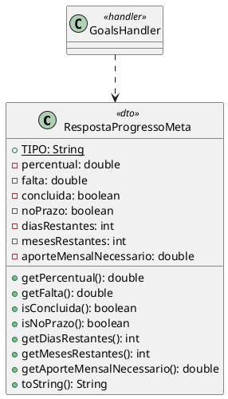
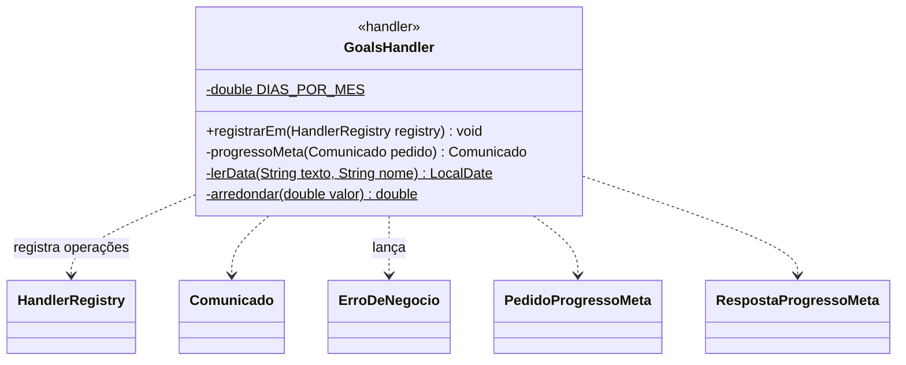
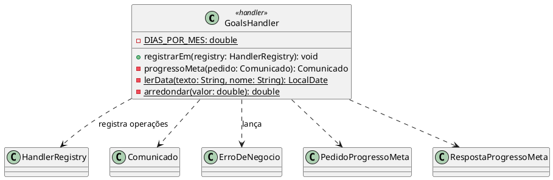

# Servidor Java: metas (pacote `com.financeai.goals`)

Modelo UML (padrão Astah / UML 2) das classes do grupo de metas do Servidor Java. O Servidor executa apenas operações puras: tudo o que precisa vem no pedido e nada é gravado. O CRUD das metas e o MongoDB pertencem ao Backend.

Elementos do grupo: `PedidoProgressoMeta`, `RespostaProgressoMeta` e `GoalsHandler`. Vizinhos (pacote `com.financeai.core`, documentados em outro arquivo): `HandlerRegistry`, `Comunicado` e `ErroDeNegocio`.

## Diagrama do grupo

---

## PedidoProgressoMeta

- **Tipo / estereótipo:** classe «dto»
- **Arquivo de origem:** `Servidor/src/main/java/com/financeai/goals/PedidoProgressoMeta.java`
- **Descrição:** Pedido de cálculo do progresso de uma meta (valor atual, objetivo, prazo). O campo `prazo` é uma data ISO-8601 (instante ou só a data, como `2026-12-31`); o campo `hoje` é opcional (dia de referência, usado só pelos testes; sem ele vale o relógio do Servidor).

### Atributos

| Visibilidade | Nome | Tipo | Descrição |
|---|---|---|---|
| + (estático, constante) | TIPO | String | Identificador da operação (`"PedidoProgressoMeta"`) registrado no `HandlerRegistry`. |
| - | valorAtual | double | Valor acumulado até o momento. |
| - | valorObjetivo | double | Valor que a meta deseja atingir. |
| - | prazo | String | Prazo da meta em ISO-8601. |
| - | hoje | String | Dia de referência opcional. |

### Operações

| Visibilidade | Assinatura | Retorno | Descrição |
|---|---|---|---|
| + | PedidoProgressoMeta() | (construtor) | Construtor vazio. |
| + | PedidoProgressoMeta(valorAtual: double, valorObjetivo: double, prazo: String, hoje: String) | (construtor) | Constrói o pedido com todos os campos. |
| + | getValorAtual() | double | Retorna o valor atual. |
| + | getValorObjetivo() | double | Retorna o valor objetivo. |
| + | getPrazo() | String | Retorna o prazo. |
| + | getHoje() | String | Retorna a data de referência. |
| + | toString() | String | Representação textual do pedido. |

### Relações

| Tipo | Alvo | Multiplicidade | Rótulo |
|---|---|---|---|
| dependência (recebida) | GoalsHandler | 1 | lido por `progressoMeta` |

---

## RespostaProgressoMeta

- **Tipo / estereótipo:** classe «dto»
- **Arquivo de origem:** `Servidor/src/main/java/com/financeai/goals/RespostaProgressoMeta.java`
- **Descrição:** Resposta com percentual, falta, prazo e aporte mensal necessário da meta.

### Atributos

| Visibilidade | Nome | Tipo | Descrição |
|---|---|---|---|
| + (estático, constante) | TIPO | String | Identificador do tipo de resposta. |
| - | percentual | double | Percentual concluído (limitado a 100). |
| - | falta | double | Valor que falta para atingir o objetivo. |
| - | concluida | boolean | Indica se a meta foi atingida. |
| - | noPrazo | boolean | Indica se a meta está dentro do prazo. |
| - | diasRestantes | int | Dias até o prazo. |
| - | mesesRestantes | int | Meses restantes até o prazo. |
| - | aporteMensalNecessario | double | Aporte mensal necessário para cumprir a meta. |

### Operações

| Visibilidade | Assinatura | Retorno | Descrição |
|---|---|---|---|
| + | RespostaProgressoMeta(percentual: double, falta: double, concluida: boolean, noPrazo: boolean, diasRestantes: int, mesesRestantes: int, aporteMensalNecessario: double) | (construtor) | Constrói a resposta com todos os campos. |
| + | getPercentual() | double | Retorna o percentual. |
| + | getFalta() | double | Retorna o valor que falta. |
| + | isConcluida() | boolean | Indica se a meta foi concluída. |
| + | isNoPrazo() | boolean | Indica se está no prazo. |
| + | getDiasRestantes() | int | Retorna os dias restantes. |
| + | getMesesRestantes() | int | Retorna os meses restantes. |
| + | getAporteMensalNecessario() | double | Retorna o aporte mensal necessário. |
| + | toString() | String | Representação textual da resposta. |

### Relações

| Tipo | Alvo | Multiplicidade | Rótulo |
|---|---|---|---|
| dependência (recebida) | GoalsHandler | 1 | criada por `progressoMeta` |

---

## GoalsHandler

- **Tipo / estereótipo:** classe «handler»
- **Arquivo de origem:** `Servidor/src/main/java/com/financeai/goals/GoalsHandler.java`
- **Descrição:** Handler puro (Grupo 5, metas) que calcula o progresso de uma meta a partir dos dados do pedido, sem gravar nada. Valida o valor objetivo (> 0) e as datas, trata valor acumulado negativo como zero, calcula percentual, falta, dias e meses restantes (mês = 30 dias, mínimo 1) e o aporte mensal necessário.

### Atributos

| Visibilidade | Nome | Tipo | Descrição |
|---|---|---|---|
| - (estático, constante) | DIAS_POR_MES | double | Dias considerados por mês (30,0) no cálculo dos meses restantes. |

### Operações

| Visibilidade | Assinatura | Retorno | Descrição |
|---|---|---|---|
| + | registrarEm(registry: HandlerRegistry) | void | Registra a operação `PedidoProgressoMeta.TIPO` apontando para `progressoMeta`. |
| - | progressoMeta(pedido: Comunicado) | Comunicado | Lê o `PedidoProgressoMeta`, valida e devolve um `Comunicado` com `RespostaProgressoMeta`; lança `ErroDeNegocio` (`VALIDATION`) se o objetivo for <= 0 ou a data for inválida. |
| - (estático) | lerData(texto: String, nome: String) | LocalDate | Converte instante ISO completo ou só a data; lança `ErroDeNegocio` se vazio ou inválido. |
| - (estático) | arredondar(valor: double) | double | Arredonda para duas casas decimais. |

### Relações

| Tipo | Alvo | Multiplicidade | Rótulo |
|---|---|---|---|
| dependência | HandlerRegistry | 1 | registra operações |
| dependência | Comunicado | 1 | pedido e resposta |
| dependência | ErroDeNegocio | * | lança |
| dependência | PedidoProgressoMeta | 1 | lê |
| dependência | RespostaProgressoMeta | 1 | produz |

