# Modelo UML: Servidor Java, investimentos e cartões

Pacote `com.financeai.investments` (`Servidor/src/main/java/com/financeai/investments/`). Contém o handler de cálculos puros (rentabilidade simulada por juros compostos e parcelamentos pela Tabela Price) e os DTOs de pedido e resposta de cada operação. Nenhum elemento deste grupo é «planejado»: todos existem no código. Os elementos vizinhos (`HandlerRegistry`, `Comunicado`, `ErroDeNegocio`) pertencem ao pacote `com.financeai.core` e são documentados em outro arquivo.

Observação: no código, os quatro DTOs são classes públicas sem declaração de herança nem de interface (`public class ...`); por isso não há generalização entre eles e `Comunicado` neste modelo.

## Diagrama do grupo

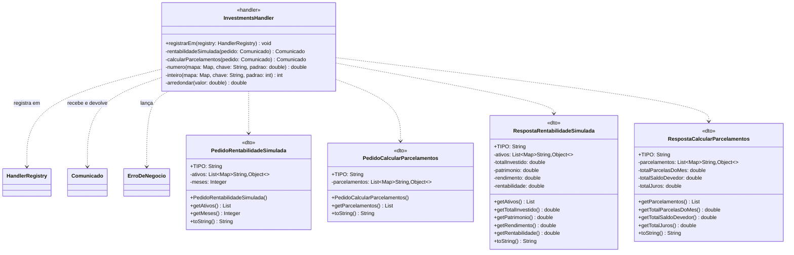

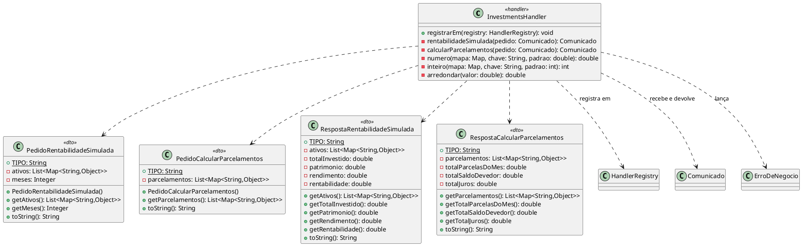

---

## InvestmentsHandler

- **Tipo / estereótipo:** classe, «handler»
- **Arquivo de origem:** `Servidor/src/main/java/com/financeai/investments/InvestmentsHandler.java`
- **Descrição:** handler dos cálculos puros de rentabilidade simulada (juros compostos) e de parcelamentos (Tabela Price). Registra suas operações no `HandlerRegistry` e processa os pedidos recebidos como `Comunicado`.

### Atributos

| Visibilidade | Nome | Tipo | Descrição |
|---|---|---|---|
| (nenhum) | n/a | n/a | A classe não declara atributos no mapeamento. |

### Operações

| Visibilidade | Assinatura | Retorno | Descrição |
|---|---|---|---|
| + | registrarEm(registry: HandlerRegistry) | void | Registra no `HandlerRegistry` os tratadores das operações de investimentos e cartões. |
| - | rentabilidadeSimulada(pedido: Comunicado) | Comunicado | Calcula a rentabilidade simulada (juros compostos) dos ativos do portfolio. |
| - | calcularParcelamentos(pedido: Comunicado) | Comunicado | Calcula os parcelamentos do cartão simulado (Tabela Price). |
| - | numero(mapa: Map, chave: String, padrao: double) | double | Auxiliar: lê um valor numérico do mapa, com valor padrão. |
| - | inteiro(mapa: Map, chave: String, padrao: int) | int | Auxiliar: lê um valor inteiro do mapa, com valor padrão. |
| - | arredondar(valor: double) | double | Auxiliar: arredonda o valor calculado. |

### Relações

| Tipo | Alvo | Multiplicidade | Rótulo |
|---|---|---|---|
| dependência | HandlerRegistry | 1 | registra em |
| dependência | Comunicado | 1 | recebe e devolve |
| dependência | ErroDeNegocio | 0..1 | lança |
| dependência | PedidoRentabilidadeSimulada | 1 | pedido |
| dependência | PedidoCalcularParcelamentos | 1 | pedido |
| dependência | RespostaRentabilidadeSimulada | 1 | resposta |
| dependência | RespostaCalcularParcelamentos | 1 | resposta |

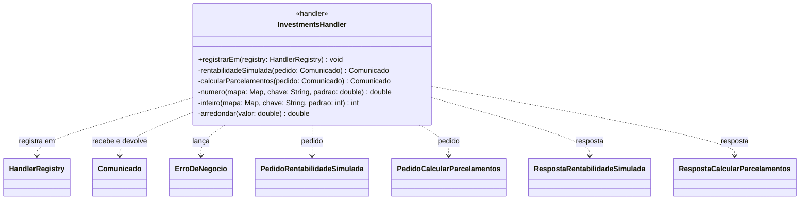

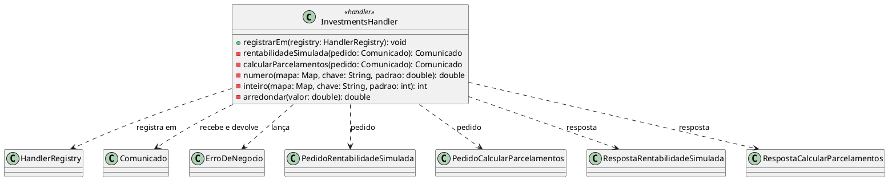

---

## PedidoRentabilidadeSimulada

- **Tipo / estereótipo:** classe, «dto»
- **Arquivo de origem:** `Servidor/src/main/java/com/financeai/investments/PedidoRentabilidadeSimulada.java`
- **Descrição:** pedido de juros compostos sobre os ativos do portfolio simulado.

### Atributos

| Visibilidade | Nome | Tipo | Descrição |
|---|---|---|---|
| + | TIPO | String | Constante (estática) que identifica o tipo do pedido. |
| - | ativos | List<Map<String,Object>> | Ativos do portfolio simulado. |
| - | meses | Integer | Número de meses da simulação. |

### Operações

| Visibilidade | Assinatura | Retorno | Descrição |
|---|---|---|---|
| + | PedidoRentabilidadeSimulada() | n/a | Construtor padrão. |
| + | getAtivos() | List<Map<String,Object>> | Retorna os ativos do pedido. |
| + | getMeses() | Integer | Retorna o número de meses. |
| + | toString() | String | Representação textual do pedido. |

### Relações

| Tipo | Alvo | Multiplicidade | Rótulo |
|---|---|---|---|
| dependência (de entrada) | InvestmentsHandler | 1 | pedido processado por |

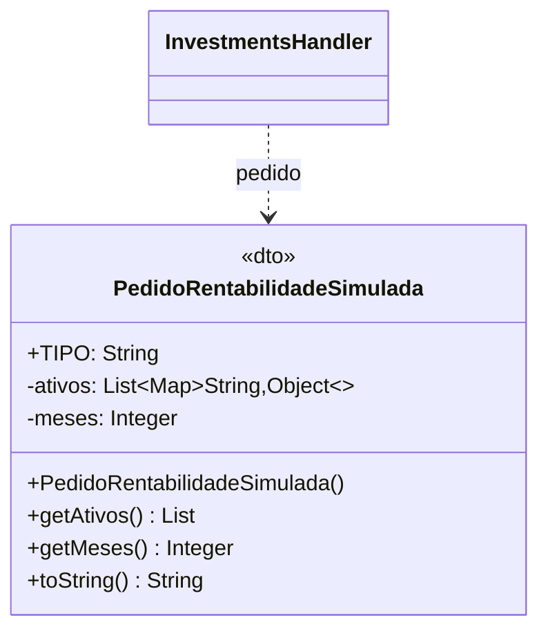

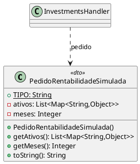

---

## PedidoCalcularParcelamentos

- **Tipo / estereótipo:** classe, «dto»
- **Arquivo de origem:** `Servidor/src/main/java/com/financeai/investments/PedidoCalcularParcelamentos.java`
- **Descrição:** pedido de cálculo de parcelamentos do cartão simulado.

### Atributos

| Visibilidade | Nome | Tipo | Descrição |
|---|---|---|---|
| + | TIPO | String | Constante (estática) que identifica o tipo do pedido. |
| - | parcelamentos | List<Map<String,Object>> | Parcelamentos do cartão simulado a calcular. |

### Operações

| Visibilidade | Assinatura | Retorno | Descrição |
|---|---|---|---|
| + | PedidoCalcularParcelamentos() | n/a | Construtor padrão. |
| + | getParcelamentos() | List<Map<String,Object>> | Retorna os parcelamentos do pedido. |
| + | toString() | String | Representação textual do pedido. |

### Relações

| Tipo | Alvo | Multiplicidade | Rótulo |
|---|---|---|---|
| dependência (de entrada) | InvestmentsHandler | 1 | pedido processado por |

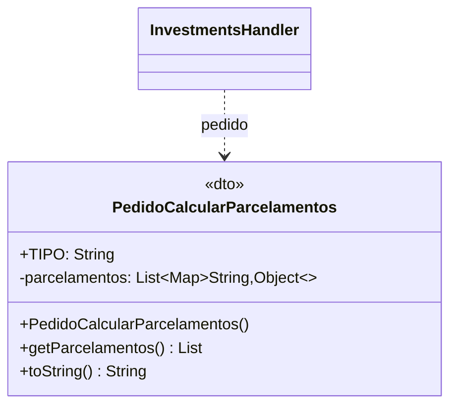

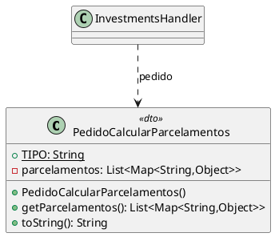

---

## RespostaRentabilidadeSimulada

- **Tipo / estereótipo:** classe, «dto»
- **Arquivo de origem:** `Servidor/src/main/java/com/financeai/investments/RespostaRentabilidadeSimulada.java`
- **Descrição:** resposta com ativos recalculados, total investido, patrimônio, rendimento e rentabilidade.

### Atributos

| Visibilidade | Nome | Tipo | Descrição |
|---|---|---|---|
| + | TIPO | String | Constante (estática) que identifica o tipo da resposta. |
| - | ativos | List<Map<String,Object>> | Ativos recalculados. |
| - | totalInvestido | double | Total investido. |
| - | patrimonio | double | Patrimônio resultante. |
| - | rendimento | double | Rendimento obtido. |
| - | rentabilidade | double | Rentabilidade calculada. |

### Operações

| Visibilidade | Assinatura | Retorno | Descrição |
|---|---|---|---|
| + | RespostaRentabilidadeSimulada(ativos: List<Map<String,Object>>, totalInvestido: double, patrimonio: double, rendimento: double, rentabilidade: double) | n/a | Construtor que recebe todos os campos. |
| + | getAtivos() | List<Map<String,Object>> | Retorna os ativos recalculados. |
| + | getTotalInvestido() | double | Retorna o total investido. |
| + | getPatrimonio() | double | Retorna o patrimônio. |
| + | getRendimento() | double | Retorna o rendimento. |
| + | getRentabilidade() | double | Retorna a rentabilidade. |
| + | toString() | String | Representação textual da resposta. |

### Relações

| Tipo | Alvo | Multiplicidade | Rótulo |
|---|---|---|---|
| dependência (de entrada) | InvestmentsHandler | 1 | resposta produzida por |

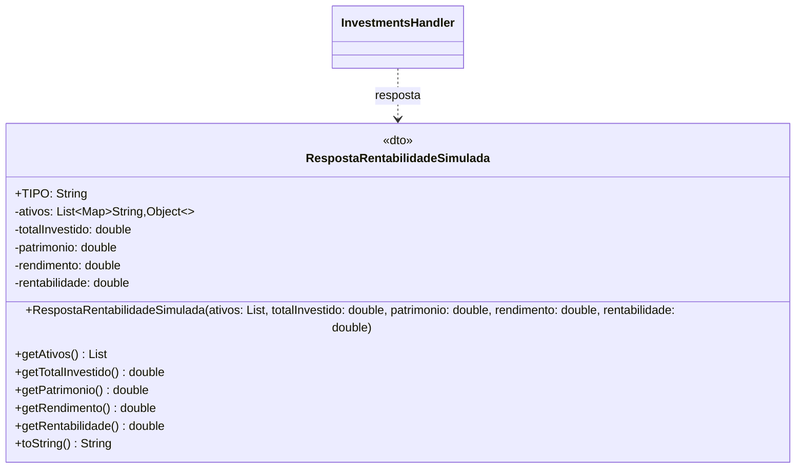

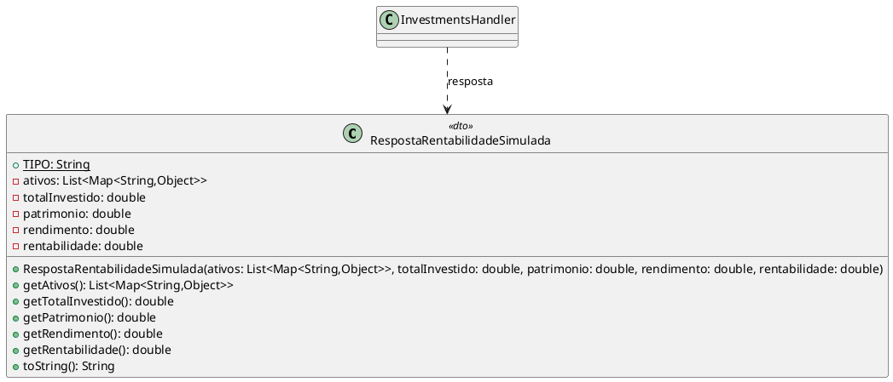

---

## RespostaCalcularParcelamentos

- **Tipo / estereótipo:** classe, «dto»
- **Arquivo de origem:** `Servidor/src/main/java/com/financeai/investments/RespostaCalcularParcelamentos.java`
- **Descrição:** resposta com parcelamentos calculados e totais de parcelas do mês, saldo devedor e juros.

### Atributos

| Visibilidade | Nome | Tipo | Descrição |
|---|---|---|---|
| + | TIPO | String | Constante (estática) que identifica o tipo da resposta. |
| - | parcelamentos | List<Map<String,Object>> | Parcelamentos calculados. |
| - | totalParcelasDoMes | double | Soma das parcelas do mês. |
| - | totalSaldoDevedor | double | Soma do saldo devedor. |
| - | totalJuros | double | Soma dos juros. |

### Operações

| Visibilidade | Assinatura | Retorno | Descrição |
|---|---|---|---|
| + | RespostaCalcularParcelamentos(parcelamentos: List<Map<String,Object>>, totalParcelasDoMes: double, totalSaldoDevedor: double, totalJuros: double) | n/a | Construtor que recebe todos os campos. |
| + | getParcelamentos() | List<Map<String,Object>> | Retorna os parcelamentos calculados. |
| + | getTotalParcelasDoMes() | double | Retorna o total de parcelas do mês. |
| + | getTotalSaldoDevedor() | double | Retorna o total do saldo devedor. |
| + | getTotalJuros() | double | Retorna o total de juros. |
| + | toString() | String | Representação textual da resposta. |

### Relações

| Tipo | Alvo | Multiplicidade | Rótulo |
|---|---|---|---|
| dependência (de entrada) | InvestmentsHandler | 1 | resposta produzida por |

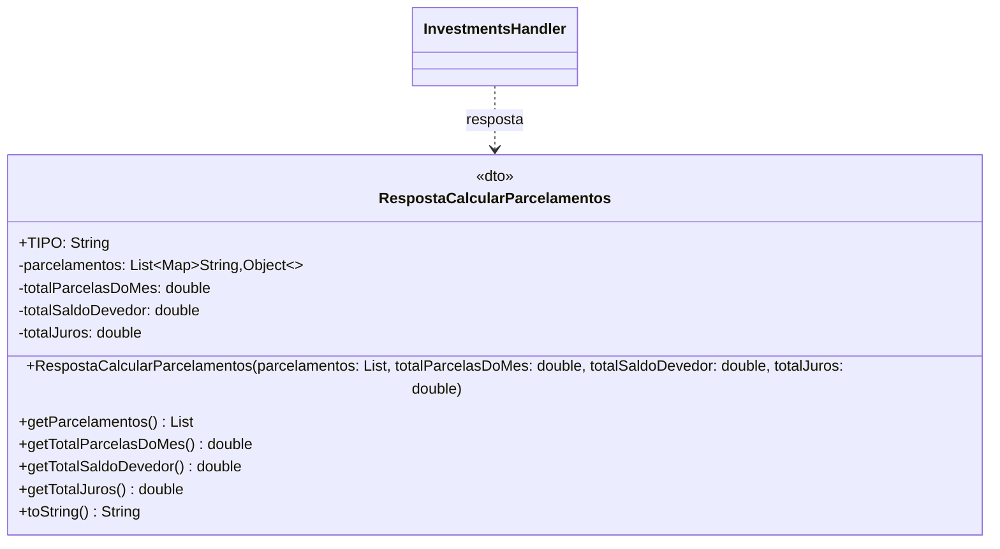

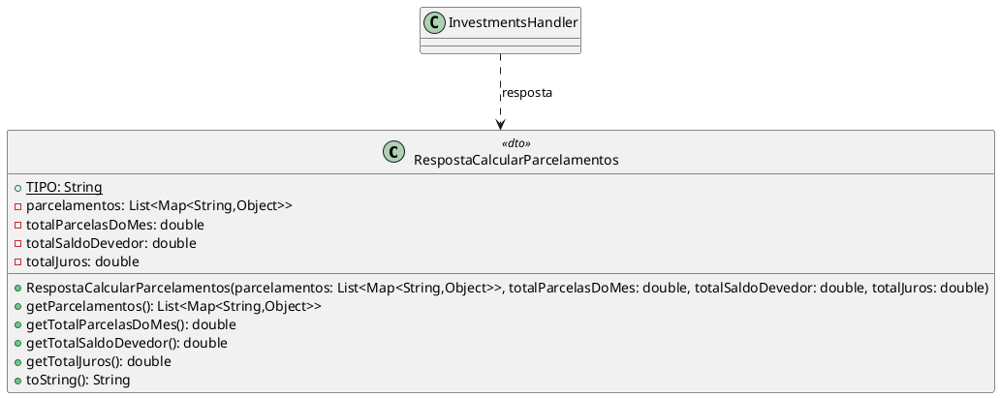
