# Servidor Java: mentor financeiro (pacote `com.financeai.mentoria`)

Modelo UML (padrão Astah / UML 2) das classes do grupo **srv-mentoria**. O pacote implementa, no Servidor Java, duas operações puras usadas pelo Backend no Mentor Financeiro: montar o contexto numérico do mês para a IA e filtrar a resposta da IA (recomendação de ativos e fuga de escopo).

Convenções: visibilidade `+` público, `-` privado, `#` protegido, `~` pacote. Constantes (`static final`) aparecem como atributos. Os blocos `plantuml` descrevem o mesmo diagrama dos blocos `mermaid` e servem para recriá-lo no Astah.

Observação: no Mermaid, a classe aninhada `PedidoMontarContextoIA.Transacao` é escrita como `PedidoMontarContextoIA_Transacao`, pois o ponto não é aceito em identificadores.

Elementos de vizinhança (fora do grupo, mostrados só como referência): `HandlerRegistry`, `Comunicado` e `ErroDeNegocio`.

## Diagrama do grupo

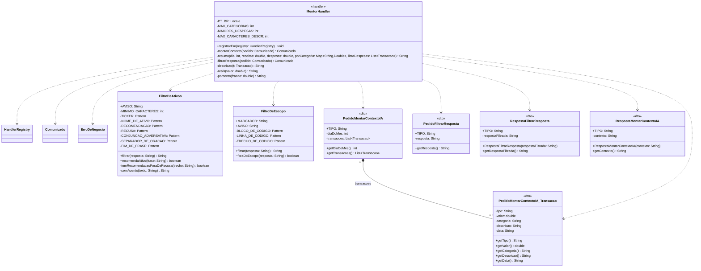

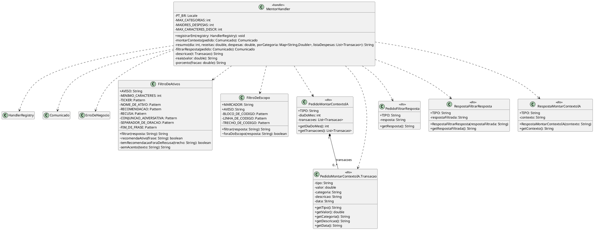

---

## MentorHandler

- **Tipo / estereótipo:** classe «handler»
- **Arquivo de origem:** `Servidor/src/main/java/com/financeai/mentoria/MentorHandler.java`
- **Descrição:** Handler do Mentor Financeiro. Registra no `HandlerRegistry` as operações `PedidoMontarContextoIA` (monta o contexto numérico do mês para a IA) e `PedidoFiltrarResposta` (filtra a resposta da IA).

### Atributos

| Visibilidade | Nome | Tipo | Descrição |
|---|---|---|---|
| - | PT_BR | Locale | Constante de localidade pt-BR usada na formatação de valores. |
| - | MAX_CATEGORIAS | int | Constante: limite de categorias incluídas no resumo. |
| - | MAIORES_DESPESAS | int | Constante: quantidade de maiores despesas listadas no resumo. |
| - | MAX_CARACTERES_DESCR | int | Constante: tamanho máximo da descrição de uma transação no resumo. |

### Operações

| Visibilidade | Assinatura | Retorno | Descrição |
|---|---|---|---|
| + | registrarEm(registry: HandlerRegistry) | void | Registra as duas operações do pacote (`PedidoMontarContextoIA.TIPO` e `PedidoFiltrarResposta.TIPO`) no registro de handlers. |
| - | montarContexto(pedido: Comunicado) | Comunicado | Recebe o pedido com dia do mês e transações e devolve o resumo textual do mês. |
| - | resumo(dia: int, receitas: double, despesas: double, porCategoria: Map<String,Double>, listaDespesas: List<Transacao>) | String | Monta o texto de contexto numérico do mês. |
| - | filtrarResposta(pedido: Comunicado) | Comunicado | Aplica `FiltroDeAtivos` e `FiltroDeEscopo` à resposta da IA e devolve o texto filtrado. |
| - | descricao(t: Transacao) | String | Formata a descrição de uma transação para o resumo. |
| - | reais(valor: double) | String | Formata um valor em reais. |
| - | porcento(fracao: double) | String | Formata uma fração como percentual. |

### Relações

| Tipo | Alvo | Multiplicidade | Rótulo |
|---|---|---|---|
| dependência | HandlerRegistry | - | registra operações |
| dependência | Comunicado | - | - |
| dependência | ErroDeNegocio | - | - |
| dependência | PedidoMontarContextoIA | - | - |
| dependência | PedidoMontarContextoIA.Transacao | - | - |
| dependência | RespostaMontarContextoIA | - | - |
| dependência | PedidoFiltrarResposta | - | - |
| dependência | RespostaFiltrarResposta | - | - |
| dependência | FiltroDeAtivos | - | - |
| dependência | FiltroDeEscopo | - | - |

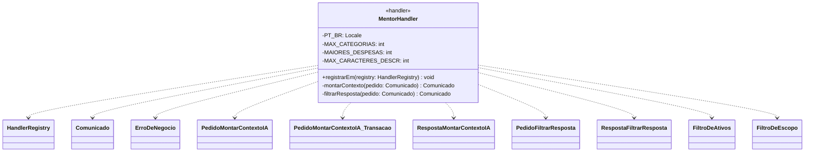

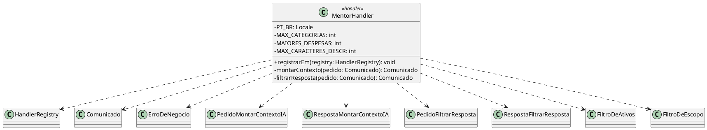

---

## FiltroDeAtivos

- **Tipo / estereótipo:** classe (utilitária, sem estereótipo)
- **Arquivo de origem:** `Servidor/src/main/java/com/financeai/mentoria/FiltroDeAtivos.java`
- **Descrição:** Remove da resposta da IA as frases que recomendam comprar ou vender ativos específicos.

### Atributos

| Visibilidade | Nome | Tipo | Descrição |
|---|---|---|---|
| + | AVISO | String | Constante: texto de aviso exibido quando frases são removidas. |
| - | MINIMO_CARACTERES | int | Constante: tamanho mínimo usado na verificação do texto. |
| - | TICKER | Pattern | Expressão que reconhece códigos de ativos (tickers). |
| - | NOME_DE_ATIVO | Pattern | Expressão que reconhece nomes de ativos. |
| - | RECOMENDACAO | Pattern | Expressão que reconhece verbos de recomendação de compra/venda. |
| - | RECUSA | Pattern | Expressão que reconhece trechos de recusa (a IA se negando a recomendar). |
| - | CONJUNCAO_ADVERSATIVA | Pattern | Expressão que reconhece conjunções adversativas, para separar recusa de recomendação. |
| - | SEPARADOR_DE_ORACAO | Pattern | Expressão que separa a frase em orações. |
| - | FIM_DE_FRASE | Pattern | Expressão que separa o texto em frases. |

### Operações

| Visibilidade | Assinatura | Retorno | Descrição |
|---|---|---|---|
| + | filtrar(resposta: String) | String | Remove as frases que recomendam ativos e devolve a resposta filtrada. |
| ~ | recomendaAtivo(frase: String) | boolean | Indica se a frase recomenda comprar/vender um ativo específico. |
| - | temRecomendacaoForaDeRecusa(trecho: String) | boolean | Indica se há recomendação em trecho que não é uma recusa. |
| - | semAcento(texto: String) | String | Remove acentos do texto para comparação. |

### Relações

| Tipo | Alvo | Multiplicidade | Rótulo |
|---|---|---|---|
| dependência (entrada) | MentorHandler | - | usada por `filtrarResposta` |

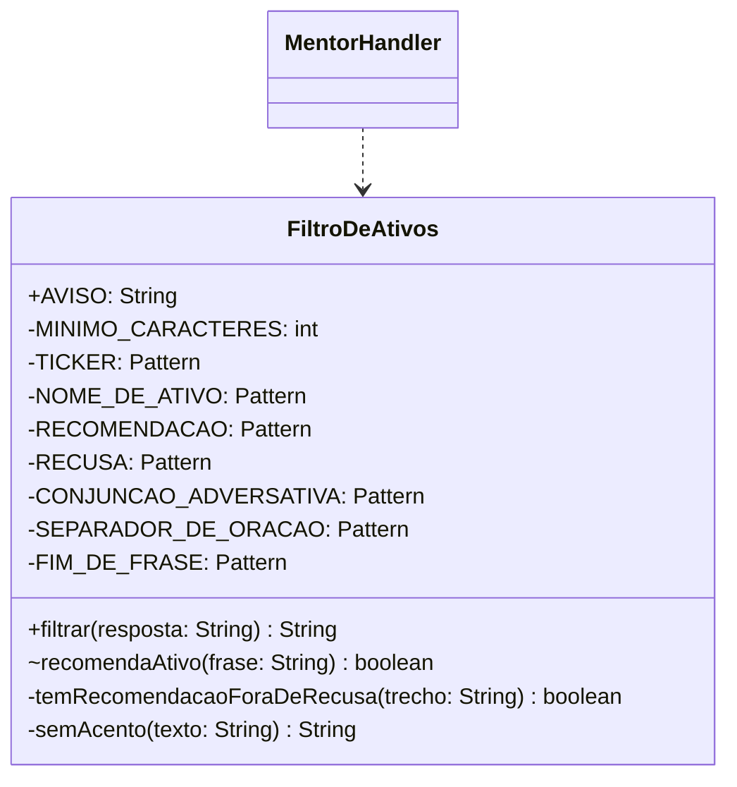

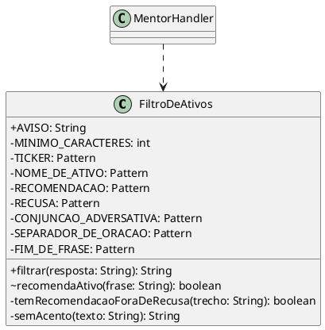

---

## FiltroDeEscopo

- **Tipo / estereótipo:** classe (utilitária, sem estereótipo)
- **Arquivo de origem:** `Servidor/src/main/java/com/financeai/mentoria/FiltroDeEscopo.java`
- **Descrição:** Substitui por recusa padrão a resposta da IA que foge de finanças pessoais ou contém código.

### Atributos

| Visibilidade | Nome | Tipo | Descrição |
|---|---|---|---|
| + | MARCADOR | String | Constante: marcador que a IA usa para sinalizar resposta fora do escopo. |
| + | AVISO | String | Constante: texto de recusa padrão que substitui a resposta. |
| - | BLOCO_DE_CODIGO | Pattern | Expressão que reconhece blocos de código. |
| - | LINHA_DE_CODIGO | Pattern | Expressão que reconhece linhas com aparência de código. |
| - | TRECHO_DE_CODIGO | Pattern | Expressão que reconhece trechos de código no meio do texto. |

### Operações

| Visibilidade | Assinatura | Retorno | Descrição |
|---|---|---|---|
| + | filtrar(resposta: String) | String | Devolve a resposta original ou a recusa padrão, se estiver fora do escopo. |
| ~ | foraDoEscopo(resposta: String) | boolean | Indica se a resposta foge de finanças pessoais ou contém código. |

### Relações

| Tipo | Alvo | Multiplicidade | Rótulo |
|---|---|---|---|
| dependência (entrada) | MentorHandler | - | usada por `filtrarResposta` |

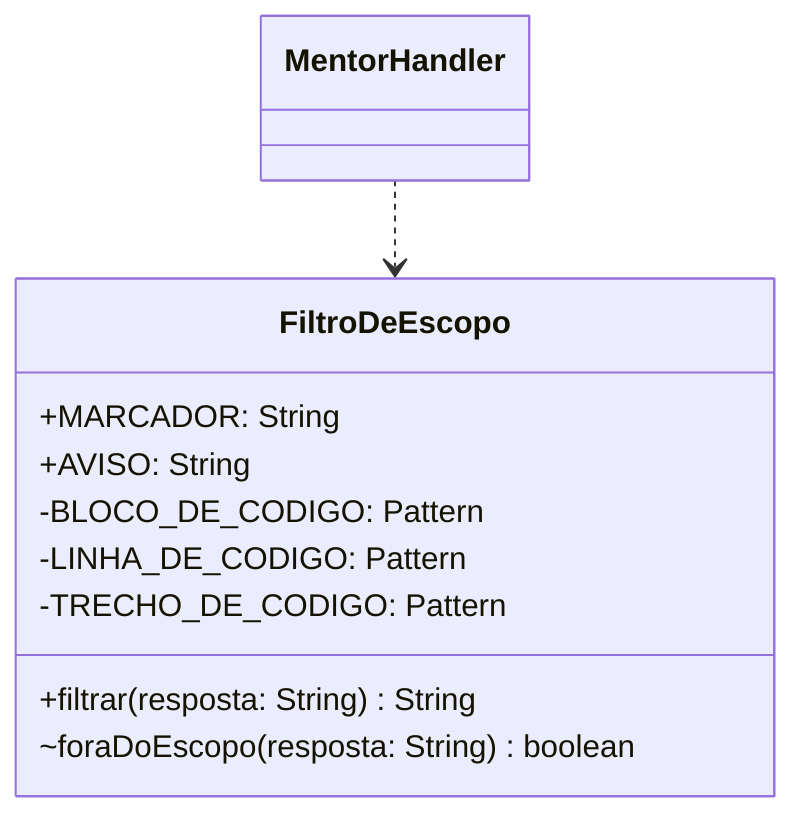

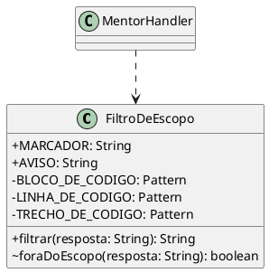

---

## PedidoMontarContextoIA

- **Tipo / estereótipo:** classe «dto»
- **Arquivo de origem:** `Servidor/src/main/java/com/financeai/mentoria/PedidoMontarContextoIA.java`
- **Descrição:** Pedido com o dia do mês e as transações do mês atual para montar o contexto da IA.

### Atributos

| Visibilidade | Nome | Tipo | Descrição |
|---|---|---|---|
| + | TIPO | String | Constante: identificador do tipo de pedido (`"PedidoMontarContextoIA"`), usado no registro do handler. |
| - | diaDoMes | int | Dia do mês atual. |
| - | transacoes | List<Transacao> | Transações do mês atual enviadas pelo Backend. |

### Operações

| Visibilidade | Assinatura | Retorno | Descrição |
|---|---|---|---|
| + | getDiaDoMes() | int | Retorna o dia do mês. |
| + | getTransacoes() | List<Transacao> | Retorna as transações do mês. |

### Relações

| Tipo | Alvo | Multiplicidade | Rótulo |
|---|---|---|---|
| composição | PedidoMontarContextoIA.Transacao | 0..* | transacoes |
| dependência (entrada) | MentorHandler | - | lido em `montarContexto` |

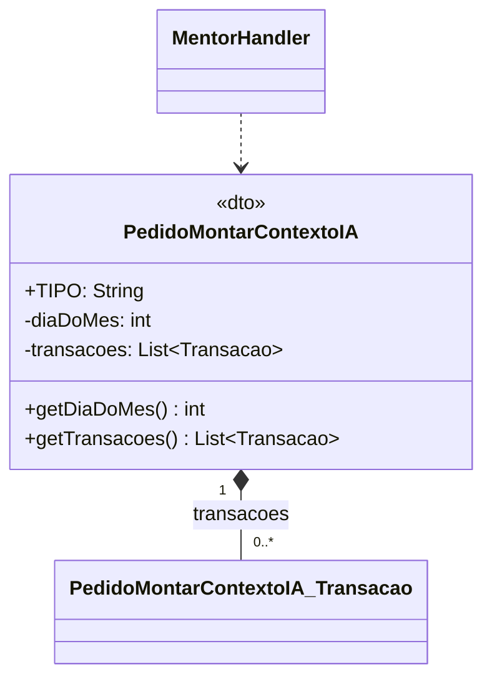

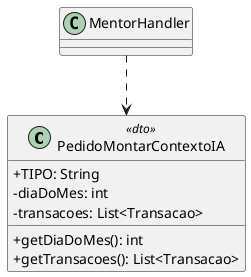

---

## PedidoMontarContextoIA.Transacao

- **Tipo / estereótipo:** classe aninhada estática «dto»
- **Arquivo de origem:** `Servidor/src/main/java/com/financeai/mentoria/PedidoMontarContextoIA.java`
- **Descrição:** Classe aninhada estática que representa uma transação do mês enviada pelo Backend.

### Atributos

| Visibilidade | Nome | Tipo | Descrição |
|---|---|---|---|
| - | tipo | String | Tipo da transação (receita ou despesa). |
| - | valor | double | Valor da transação. |
| - | categoria | String | Categoria da transação. |
| - | descricao | String | Descrição da transação. |
| - | data | String | Data da transação. |

### Operações

| Visibilidade | Assinatura | Retorno | Descrição |
|---|---|---|---|
| + | getTipo() | String | Retorna o tipo. |
| + | getValor() | double | Retorna o valor. |
| + | getCategoria() | String | Retorna a categoria. |
| + | getDescricao() | String | Retorna a descrição. |
| + | getData() | String | Retorna a data. |

### Relações

| Tipo | Alvo | Multiplicidade | Rótulo |
|---|---|---|---|
| composição (parte) | PedidoMontarContextoIA | 1 | transacoes |
| dependência (entrada) | MentorHandler | - | usada em `resumo` e `descricao` |

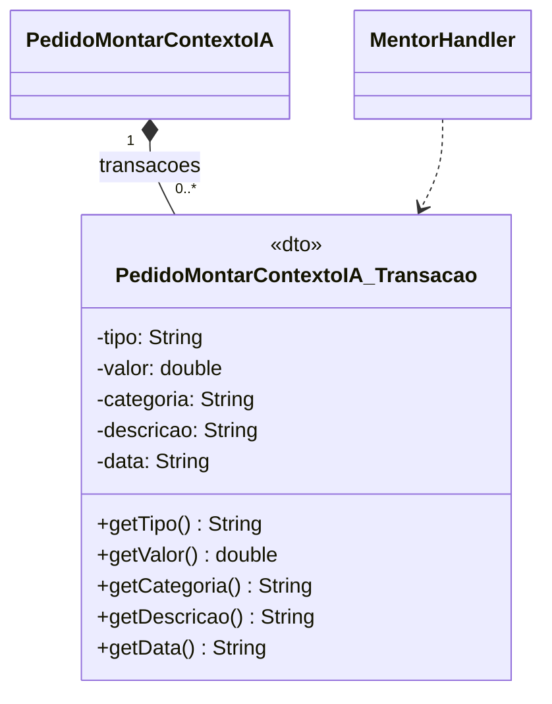

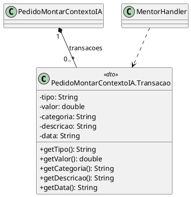

---

## PedidoFiltrarResposta

- **Tipo / estereótipo:** classe «dto»
- **Arquivo de origem:** `Servidor/src/main/java/com/financeai/mentoria/PedidoFiltrarResposta.java`
- **Descrição:** Pedido com a resposta da IA a ser filtrada.

### Atributos

| Visibilidade | Nome | Tipo | Descrição |
|---|---|---|---|
| + | TIPO | String | Constante: identificador do tipo de pedido (`"PedidoFiltrarResposta"`), usado no registro do handler. |
| - | resposta | String | Texto bruto devolvido pela IA. |

### Operações

| Visibilidade | Assinatura | Retorno | Descrição |
|---|---|---|---|
| + | getResposta() | String | Retorna o texto da IA a ser filtrado. |

### Relações

| Tipo | Alvo | Multiplicidade | Rótulo |
|---|---|---|---|
| dependência (entrada) | MentorHandler | - | lido em `filtrarResposta` |

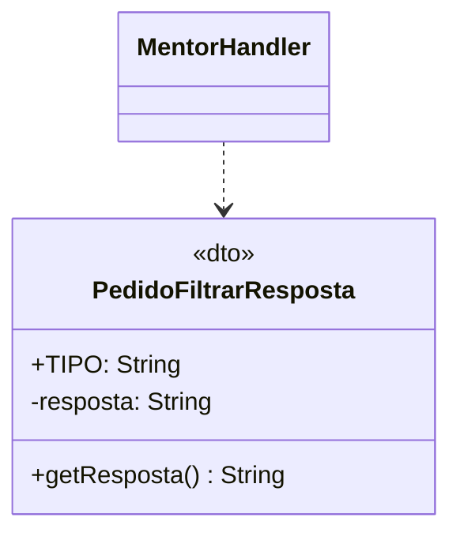

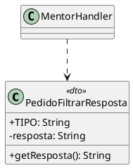

---

## RespostaFiltrarResposta

- **Tipo / estereótipo:** classe «dto»
- **Arquivo de origem:** `Servidor/src/main/java/com/financeai/mentoria/RespostaFiltrarResposta.java`
- **Descrição:** Resposta com o texto da IA já filtrado.

### Atributos

| Visibilidade | Nome | Tipo | Descrição |
|---|---|---|---|
| + | TIPO | String | Constante: identificador do tipo de resposta. |
| - | respostaFiltrada | String | Texto da IA após os filtros de ativos e de escopo. |

### Operações

| Visibilidade | Assinatura | Retorno | Descrição |
|---|---|---|---|
| + | RespostaFiltrarResposta(respostaFiltrada: String) | - | Construtor que recebe o texto já filtrado. |
| + | getRespostaFiltrada() | String | Retorna o texto filtrado. |

### Relações

| Tipo | Alvo | Multiplicidade | Rótulo |
|---|---|---|---|
| dependência (entrada) | MentorHandler | - | criada em `filtrarResposta` |

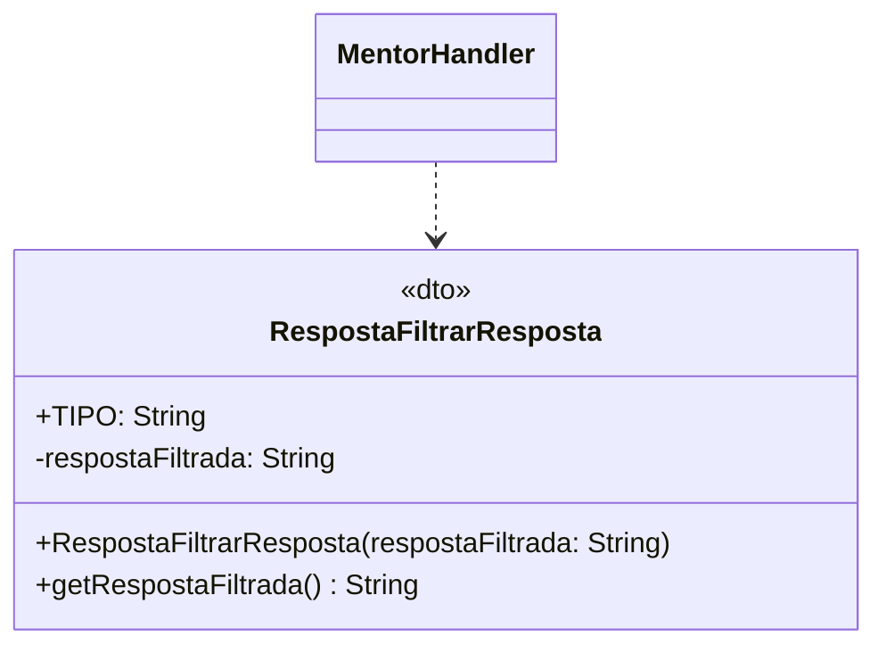

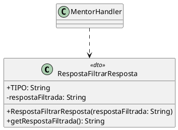

---

## RespostaMontarContextoIA

- **Tipo / estereótipo:** classe «dto»
- **Arquivo de origem:** `Servidor/src/main/java/com/financeai/mentoria/RespostaMontarContextoIA.java`
- **Descrição:** Resposta com o resumo textual do mês para virar contexto do prompt.

### Atributos

| Visibilidade | Nome | Tipo | Descrição |
|---|---|---|---|
| + | TIPO | String | Constante: identificador do tipo de resposta. |
| - | contexto | String | Resumo textual do mês usado como contexto do prompt da IA. |

### Operações

| Visibilidade | Assinatura | Retorno | Descrição |
|---|---|---|---|
| + | RespostaMontarContextoIA(contexto: String) | - | Construtor que recebe o resumo do mês. |
| + | getContexto() | String | Retorna o contexto textual. |

### Relações

| Tipo | Alvo | Multiplicidade | Rótulo |
|---|---|---|---|
| dependência (entrada) | MentorHandler | - | criada em `montarContexto` |

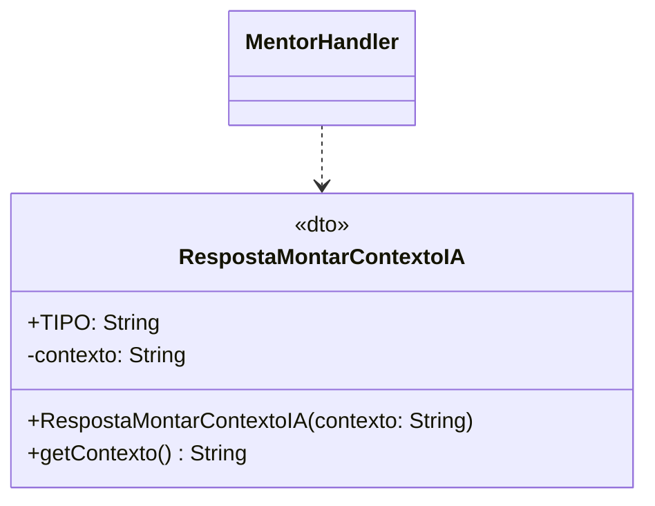

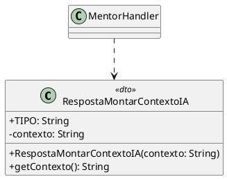
