# Modelo UML — Servidor Java: transações

Pacote `com.financeai.transactions` (`Servidor/src/main/java/com/financeai/transactions/`). Notação Astah / UML 2. Visibilidade: `+` público, `-` privado, `#` protegido, `~` pacote. Elementos marcados com ainda não existem no código.

## Diagrama do grupo

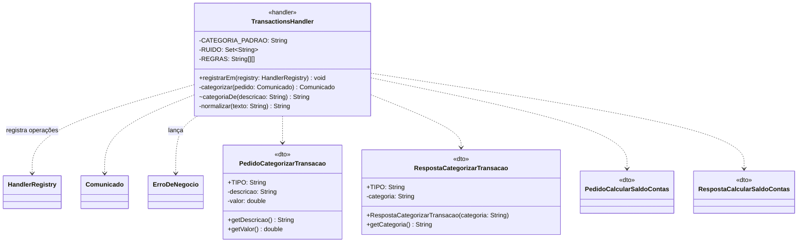

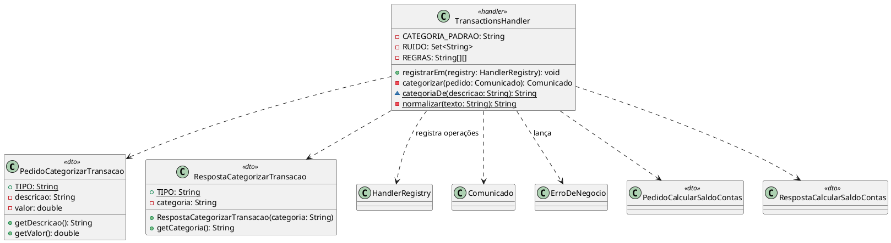

---

## PedidoCategorizarTransacao

- **Tipo / estereótipo:** classe «dto»
- **Arquivo:** `Servidor/src/main/java/com/financeai/transactions/PedidoCategorizarTransacao.java`
- **Descrição:** pedido para sugerir a categoria de uma transação pela descrição. É lido de `Comunicado.dados` via `dadosComo`.

### Atributos

| Visibilidade | Nome | Tipo | Descrição |
|---|---|---|---|
| + | TIPO (constante estática) | String | Identificador da mensagem: `"PedidoCategorizarTransacao"`. |
| - | descricao | String | Descrição da transação usada para sugerir a categoria. |
| - | valor | double | Valor da transação. |

### Operações

| Visibilidade | Assinatura | Retorno | Descrição |
|---|---|---|---|
| + | getDescricao() | String | Devolve a descrição. |
| + | getValor() | double | Devolve o valor. |

### Relações

| Tipo | Alvo | Multiplicidade | Rótulo |
|---|---|---|---|
| dependência (recebida) | TransactionsHandler | 1 | usado por |

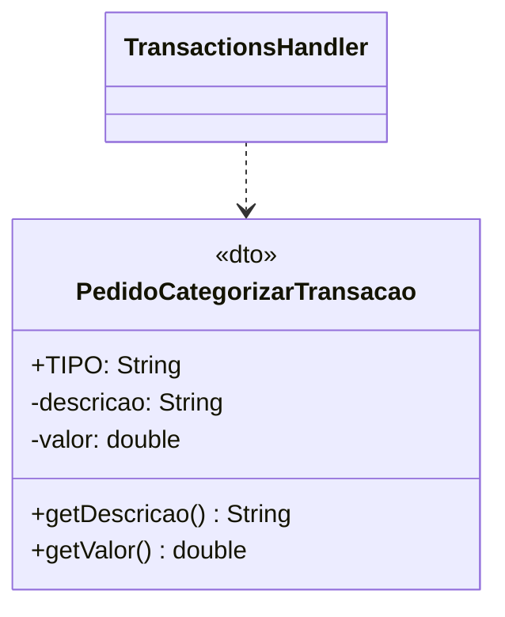

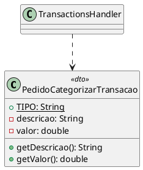

---

## RespostaCategorizarTransacao

- **Tipo / estereótipo:** classe «dto»
- **Arquivo:** `Servidor/src/main/java/com/financeai/transactions/RespostaCategorizarTransacao.java`
- **Descrição:** resposta com a categoria sugerida para a transação.

### Atributos

| Visibilidade | Nome | Tipo | Descrição |
|---|---|---|---|
| + | TIPO (constante estática) | String | Identificador da mensagem: `"RespostaCategorizarTransacao"`. |
| - | categoria | String | Categoria sugerida. |

### Operações

| Visibilidade | Assinatura | Retorno | Descrição |
|---|---|---|---|
| + | RespostaCategorizarTransacao(categoria: String) | — (construtor) | Cria a resposta com a categoria. |
| + | getCategoria() | String | Devolve a categoria. |

### Relações

| Tipo | Alvo | Multiplicidade | Rótulo |
|---|---|---|---|
| dependência (recebida) | TransactionsHandler | 1 | criado por |

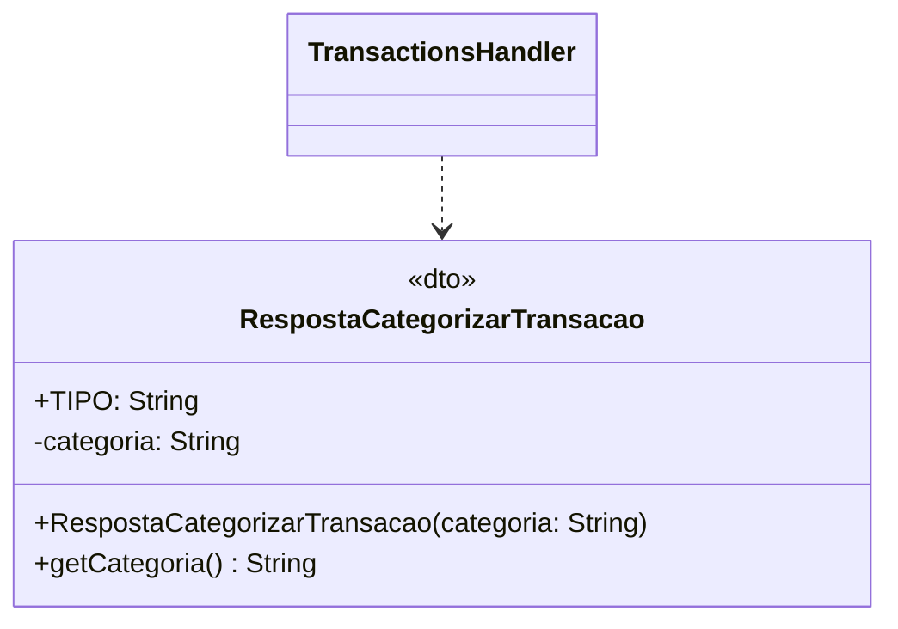

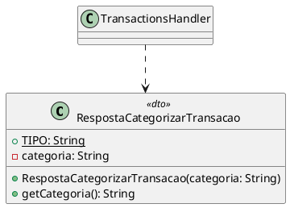

---

## TransactionsHandler

- **Tipo / estereótipo:** classe «handler»
- **Arquivo:** `Servidor/src/main/java/com/financeai/transactions/TransactionsHandler.java`
- **Descrição:** handler puro que sugere a categoria por palavras-chave normalizadas da descrição. Só usa os dados do pedido (o Servidor não acessa o banco). As regras são avaliadas em ordem, e vale o primeiro grupo que casar; sem correspondência, devolve `"Outros"`. A lista `RUIDO` sai da descrição antes da comparação.

### Atributos

| Visibilidade | Nome | Tipo | Descrição |
|---|---|---|---|
| - | CATEGORIA_PADRAO (constante) | String | Categoria usada quando nenhuma regra casa (`"Outros"`). |
| - | RUIDO (constante) | Set<String> | Palavras sem valor para a classificação, removidas na normalização. |
| - | REGRAS (constante) | String[][] | Cada linha é `{ categoria, palavra-chave... }`; a ordem é a prioridade. |

### Operações

| Visibilidade | Assinatura | Retorno | Descrição |
|---|---|---|---|
| + | registrarEm(registry: HandlerRegistry) | void | Registra a operação `PedidoCategorizarTransacao.TIPO` apontando para `categorizar`. |
| - | categorizar(pedido: Comunicado) | Comunicado | Lê o pedido, valida a descrição e devolve `RespostaCategorizarTransacao`; lança `ErroDeNegocio` (`VALIDATION`) para dados inválidos ou descrição vazia. |
| ~ | categoriaDe(descricao: String) {static} | String | Normaliza a descrição e devolve a categoria da primeira regra que casar por palavra inteira, ou `"Outros"`. |
| - | normalizar(texto: String) {static} | String | Minúsculas, sem acentos, só letras e sem as palavras de `RUIDO`. |

### Relações

| Tipo | Alvo | Multiplicidade | Rótulo |
|---|---|---|---|
| dependência | HandlerRegistry | 1 | registra operações |
| dependência | Comunicado | 1 | recebe e devolve |
| dependência | ErroDeNegocio | * | lança |
| dependência | PedidoCategorizarTransacao | 1 | lê |
| dependência | RespostaCategorizarTransacao | 1 | cria |
| dependência | PedidoCalcularSaldoContas | 1 | trata  |
| dependência | RespostaCalcularSaldoContas | 1 | devolve  |

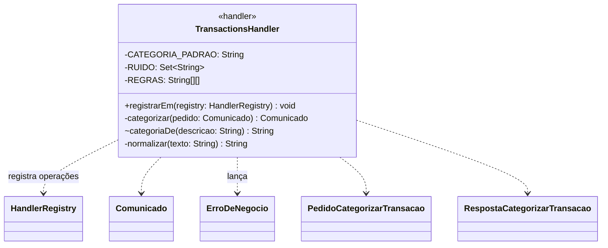

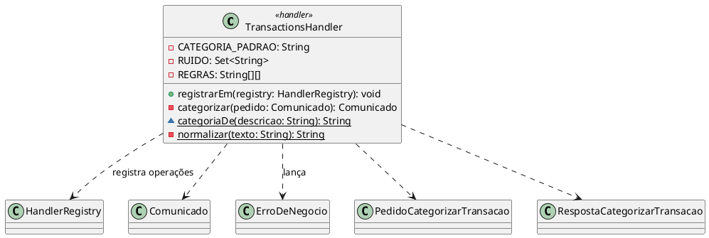

---

## PedidoCalcularSaldoContas

- **Tipo / estereótipo:** classe «dto»
- **Arquivo:** `PedidoCalcularSaldoContas.java` / `RespostaCalcularSaldoContas.java` (pacote `com.financeai.transactions`, issue #106)
- **Descrição:** pedido em que o Backend envia as contas (com `saldoInicial`) e os movimentos (receitas, despesas e transferências) para o Servidor calcular o saldo atual de cada conta.

### Atributos

| Visibilidade | Nome | Tipo | Descrição |
|---|---|---|---|
| - | contas | `List<Conta>` | Cada conta leva `id` e `saldoInicial`. |
| - | movimentos | `List<Movimento>` | Cada movimento leva `tipo` (receita, despesa ou transferência), `valor`, `contaId` e, na transferência, o destino. |

### Operações

| Visibilidade | Assinatura | Retorno | Descrição |
|---|---|---|---|
| + | getContas(), getMovimentos() | `List` | Leitura dos campos (a mensagem só carrega dados). |

### Relações

| Tipo | Alvo | Multiplicidade | Rótulo |
|---|---|---|---|
| dependência (recebida) | TransactionsHandler | 1 | tratado por |

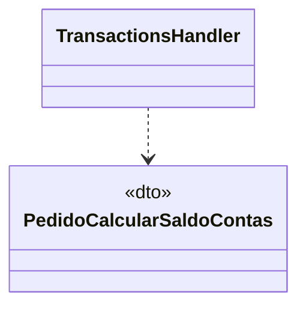

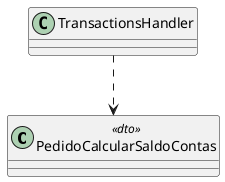

---

## RespostaCalcularSaldoContas

- **Tipo / estereótipo:** classe «dto»
- **Arquivo:** `PedidoCalcularSaldoContas.java` / `RespostaCalcularSaldoContas.java` (pacote `com.financeai.transactions`, issue #106)
- **Descrição:** resposta com o saldo atual de cada conta, calculado de forma pura, sem banco.

### Atributos

| Visibilidade | Nome | Tipo | Descrição |
|---|---|---|---|
| - | saldos | `List<Saldo>` | Cada saldo leva `contaId` e `saldoAtual`. |

### Operações

| Visibilidade | Assinatura | Retorno | Descrição |
|---|---|---|---|
| + | getSaldos() | `List<Saldo>` | Leitura dos saldos calculados. |

### Relações

| Tipo | Alvo | Multiplicidade | Rótulo |
|---|---|---|---|
| dependência (recebida) | TransactionsHandler | 1 | criado por |

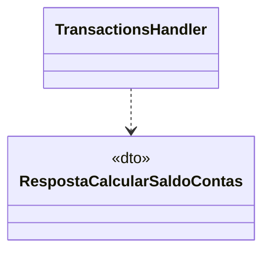

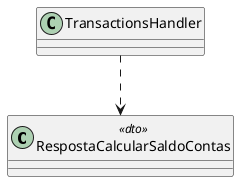
